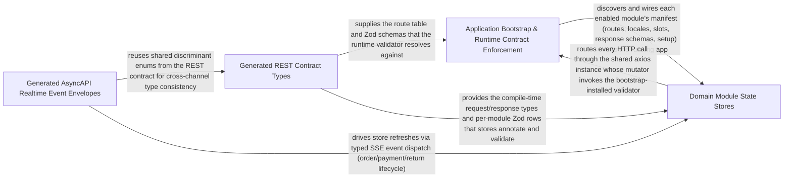

---
tags:
  - 2brain
  - 2brain/arch
  - project/boilerplate-vue-frontend
type: architecture
component: Application_Bootstrap
---

## Details

The app entry point that boots the Vue application and carries the generated contract surface (AsyncAPI realtime envelopes, REST route table) plus the HTTP response-schema validation that enforces those contracts at runtime.

### Generated REST Contract Types
The complete static type surface of the REST API, generated from openapi.yaml. Contains every request body type, every response envelope, and the generated route table (ROUTES) that maps method + URL pattern to schema name. These types are the compile-time contract that stores, views, and the runtime validator all reference. They are read-only, derived artifacts — never hand-edited.

**Related Classes/Methods**:

- `contracts.rest.index.AddCartItemRequest`:4930-4933

**Source Files:**

- `contracts/rest/index.ts`
  - `contracts.rest.index.PaginationMeta` (L163-L170) - Interface
  - `contracts.rest.index.ErrorItem` (L177-L184) - Interface
  - `contracts.rest.index.Problem` (L195-L215) - Interface
  - `contracts.rest.index.PurchaseHold` (L224-L234) - Interface
  - `contracts.rest.index.Account` (L236-L258) - Interface
  - `contracts.rest.index.SessionConfig` (L282-L292) - Interface
  - `contracts.rest.index.AntibotRungs` (L309-L314) - Interface
  - `contracts.rest.index.AntibotConfig` (L321-L327) - Interface
  - `contracts.rest.index.Operator` (L332-L353) - Interface
  - `contracts.rest.index.Config` (L355-L365) - Interface
  - `contracts.rest.index.Abilities` (L399-L441) - Interface
  - `contracts.rest.index.SessionActivity` (L443-L451) - Interface
  - `contracts.rest.index.AccountView` (L453-L477) - Interface
  - `contracts.rest.index.UserActions` (L482-L503) - Interface
  - `contracts.rest.index.User` (L505-L532) - Interface
  - `contracts.rest.index.HealthPing` (L543-L546) - Interface
  - `contracts.rest.index.LanguageActions` (L600-L610) - Interface
  - `contracts.rest.index.Language` (L616-L644) - Interface
  - `contracts.rest.index.LocaleCapabilities` (L649-L654) - Interface
  - `contracts.rest.index.CreateLocaleRequest` (L656-L670) - Interface
  - `contracts.rest.index.LocaleAppDescriptor` (L685-L690) - Interface
  - `contracts.rest.index.LocaleApps` (L692-L695) - Interface
  - `contracts.rest.index.ReplaceLocaleRequest` (L697-L709) - Interface
  - `contracts.rest.index.UpdateLocaleRequest` (L714-L726) - Interface
  - `contracts.rest.index.LocaleDictionary` (L736-L740) - Interface
  - `contracts.rest.index.LocaleMessages` (L750-L756) - Interface
  - `contracts.rest.index.LocaleEntry` (L762-L771) - Interface
  - `contracts.rest.index.LocaleEntriesResponse` (L773-L776) - Interface
  - `contracts.rest.index.ReplaceLocaleEntriesRequest` (L789-L796) - Interface
  - `contracts.rest.index.LocaleImportResult` (L801-L810) - Interface
  - `contracts.rest.index.CreateLocaleEntryRequest` (L812-L820) - Interface
  - `contracts.rest.index.UpdateLocaleEntriesRequest` (L831-L837) - Interface
  - `contracts.rest.index.ReplaceLocaleEntryRequest` (L839-L842) - Interface
  - `contracts.rest.index.Translation` (L869-L883) - Interface
  - `contracts.rest.index.EntityTranslations` (L888-L894) - Interface
  - `contracts.rest.index.ReplaceEntityTranslationsEntry` (L904-L908) - Interface
  - `contracts.rest.index.ReplaceEntityTranslationsRequest` (L913-L915) - Interface
  - `contracts.rest.index.UpdateEntityTranslationsEntry` (L925-L929) - Interface
  - `contracts.rest.index.UpdateEntityTranslationsRequest` (L934-L936) - Interface
  - `contracts.rest.index.ObservabilityDependency` (L951-L953) - Interface
  - `contracts.rest.index.ObservabilityHealthDependencies` (L958-L962) - Interface
  - `contracts.rest.index.ObservabilityHealthTelemetry` (L983-L989) - Interface
  - `contracts.rest.index.ProcessMemory` (L995-L1004) - Interface
  - `contracts.rest.index.ObservabilityHealthSystem` (L1006-L1012) - Interface
  - `contracts.rest.index.ObservabilityHealthJob` (L1018-L1022) - Interface
  - `contracts.rest.index.ObservabilityHealthQueue` (L1027-L1032) - Interface
  - `contracts.rest.index.ObservabilityHealth` (L1046-L1067) - Interface
  - `contracts.rest.index.ObservabilityMetricsLatency` (L1069-L1074) - Interface
  - `contracts.rest.index.ObservabilityMetricsSummary` (L1125-L1132) - Interface
  - `contracts.rest.index.AuditEntryItem` (L1185-L1224) - Interface
  - `contracts.rest.index.AuditLogsResponse` (L1226-L1229) - Interface
  - `contracts.rest.index.AuditEntriesResponse` (L1231-L1234) - Interface
  - `contracts.rest.index.AntibotChallengeParameters` (L1239-L1253) - Interface
  - `contracts.rest.index.AntibotChallenge` (L1258-L1262) - Interface
  - `contracts.rest.index.ProductViewedEvent` (L1271-L1275) - Interface
  - `contracts.rest.index.ProductsSearchedEvent` (L1284-L1295) - Interface
  - `contracts.rest.index.ReplaceAccountRequest` (L1299-L1320) - Interface
  - `contracts.rest.index.ReplaceAccountRequestMultipart` (L1322-L1342) - Interface
  - `contracts.rest.index.AccountDeletion` (L1344-L1349) - Interface
  - `contracts.rest.index.UpdateAccountRequest` (L1351-L1372) - Interface
  - `contracts.rest.index.UpdateAccountRequestMultipart` (L1374-L1394) - Interface
  - `contracts.rest.index.RequestEmailChangeRequest` (L1396-L1398) - Interface
  - `contracts.rest.index.EmailVerificationRequested` (L1400-L1406) - Interface
  - `contracts.rest.index.ChangePasswordRequest` (L1422-L1426) - Interface
  - `contracts.rest.index.AuthTokens` (L1428-L1435) - Interface
  - `contracts.rest.index.PasswordCheckRequest` (L1437-L1444) - Interface
  - `contracts.rest.index.PasswordCheck` (L1446-L1454) - Interface
  - `contracts.rest.index.ReauthMethods` (L1466-L1469) - Interface
  - `contracts.rest.index.ReauthPasswordRequest` (L1478-L1487) - Interface
  - `contracts.rest.index.ReauthEmailRequest` (L1496-L1510) - Interface
  - `contracts.rest.index.Session` (L1514-L1526) - Interface
  - `contracts.rest.index.SessionsResponse` (L1528-L1530) - Interface
  - `contracts.rest.index.Address` (L1532-L1543) - Interface
  - `contracts.rest.index.AddressesResponse` (L1545-L1547) - Interface
  - `contracts.rest.index.CreateAddressRequest` (L1549-L1562) - Interface
  - `contracts.rest.index.ReplaceAddressRequest` (L1564-L1577) - Interface
  - `contracts.rest.index.UpdateAddressRequest` (L1579-L1592) - Interface
  - `contracts.rest.index.VerifyEmailConfirmRequest` (L1594-L1601) - Interface
  - `contracts.rest.index.AccountRestoreRequest` (L1603-L1610) - Interface
  - `contracts.rest.index.LoginRequest` (L1633-L1638) - Interface
  - `contracts.rest.index.TwoFactorMethodSummary` (L1640-L1658) - Interface
  - `contracts.rest.index.MfaChallenge` (L1660-L1671) - Interface
  - `contracts.rest.index.DeletionPending` (L1673-L1682) - Interface
  - `contracts.rest.index.LoginRestoreRequest` (L1689-L1698) - Interface
  - `contracts.rest.index.SignupRequest` (L1700-L1711) - Interface
  - `contracts.rest.index.PasswordResetRequest` (L1713-L1715) - Interface
  - `contracts.rest.index.PasswordResetConfirmRequest` (L1717-L1728) - Interface
  - `contracts.rest.index.RefreshTokenResponse` (L1730-L1735) - Interface
  - `contracts.rest.index.AccountExport` (L1761-L1770) - Interface
  - `contracts.rest.index.ExportSession` (L1772-L1779) - Interface
  - `contracts.rest.index.ExportLinkedProvider` (L1781-L1787) - Interface
  - `contracts.rest.index.ExportTwoFactorMethod` (L1789-L1794) - Interface
  - `contracts.rest.index.ExportSignInMethods` (L1796-L1801) - Interface
  - `contracts.rest.index.ExportTaskNote` (L1824-L1827) - Interface
  - `contracts.rest.index.ExportTask` (L1829-L1841) - Interface
  - `contracts.rest.index.TaskLink` (L1873-L1876) - Interface
  - `contracts.rest.index.ExportSystemTask` (L1886-L1903) - Interface
  - `contracts.rest.index.CartItem` (L1905-L1909) - Interface
  - `contracts.rest.index.WishlistExportItem` (L1911-L1913) - Interface
  - `contracts.rest.index.OrderLineProduct` (L1938-L1964) - Interface
  - `contracts.rest.index.OrderLineCurrent` (L1966-L1969) - Interface
  - `contracts.rest.index.OrderItem` (L1971-L1991) - Interface
  - `contracts.rest.index.OrderTaxSummaryRow` (L1993-L2003) - Interface
  - `contracts.rest.index.OrderAddress` (L2005-L2012) - Interface
  - `contracts.rest.index.ExportOrder` (L2078-L2129) - Interface
  - `contracts.rest.index.OrderTimelineExportEntryBase` (L2142-L2150) - Interface
  - `contracts.rest.index.OrderTimelineDataNone` (L2155-L2157) - Interface
  - `contracts.rest.index.OrderTimelineDataStatusOverridden` (L2187-L2192) - Interface
  - `contracts.rest.index.OrderTimelineDataPaid` (L2225-L2228) - Interface
  - `contracts.rest.index.OrderTimelineDataDelivered` (L2245-L2248) - Interface
  - `contracts.rest.index.OrderTimelineDataCanceled` (L2294-L2301) - Interface
  - `contracts.rest.index.OrderTimelineDataPaymentDeclined` (L2318-L2320) - Interface
  - `contracts.rest.index.OrderTimelineDataRefund` (L2337-L2343) - Interface
  - `contracts.rest.index.OrderTimelineDataRefundFailure` (L2362-L2370) - Interface
  - `contracts.rest.index.OrderTimelineDataDispute` (L2388-L2399) - Interface
  - `contracts.rest.index.OrderTimelineDataShipmentShipped` (L2417-L2427) - Interface
  - `contracts.rest.index.OrderTimelineDataShipmentDelivered` (L2444-L2452) - Interface
  - `contracts.rest.index.OrderTimelineDataShipmentLost` (L2469-L2479) - Interface
  - `contracts.rest.index.OrderTimelineDataFulfillmentHeld` (L2496-L2500) - Interface
  - `contracts.rest.index.OrderTimelineDataFulfillmentOrderRef` (L2517-L2519) - Interface
  - `contracts.rest.index.OrderTimelineDataReturnRequested` (L2537-L2541) - Interface
  - `contracts.rest.index.OrderTimelineDataReturnApproved` (L2558-L2562) - Interface
  - `contracts.rest.index.OrderTimelineDataReturnRef` (L2579-L2581) - Interface
  - `contracts.rest.index.OrderTimelineDataReturnReceived` (L2600-L2604) - Interface
  - `contracts.rest.index.OrderTimelineDataReturnClosed` (L2621-L2627) - Interface
  - `contracts.rest.index.OrderTimelineDataInvoiceIssued` (L2644-L2648) - Interface
  - `contracts.rest.index.OrderTimelineDataCreditNoteIssued` (L2665-L2670) - Interface
  - `contracts.rest.index.OrderTimelineDataReleaseDateMoved` (L2687-L2693) - Interface
  - `contracts.rest.index.OrderTimelineDataDelayNoticeSent` (L2710-L2716) - Interface
  - `contracts.rest.index.Refund` (L2800-L2823) - Interface
  - `contracts.rest.index.ExportPayment` (L2836-L2849) - Interface
  - `contracts.rest.index.ExportInvoiceDocument` (L2851-L2857) - Interface
  - `contracts.rest.index.ShipmentLine` (L2873-L2878) - Interface
  - `contracts.rest.index.ExportShipment` (L2893-L2919) - Interface
  - `contracts.rest.index.FulfillmentOrderLine` (L2948-L2969) - Interface
  - `contracts.rest.index.ExportFulfillmentOrder` (L3012-L3036) - Interface
  - `contracts.rest.index.ExportReturn` (L3083-L3093) - Interface
  - `contracts.rest.index.ExportApiKey` (L3107-L3119) - Interface
  - `contracts.rest.index.ExportExample` (L3129-L3141) - Interface
  - `contracts.rest.index.WebhookDisabledParams` (L3156-L3158) - Interface
  - `contracts.rest.index.NotificationStaffWebhookDisabled` (L3182-L3191) - Interface
  - `contracts.rest.index.TaskOpenedParams` (L3196-L3204) - Interface
  - `contracts.rest.index.NotificationStaffTaskOpened` (L3216-L3225) - Interface
  - `contracts.rest.index.NotificationStaffTaskOverdue` (L3237-L3246) - Interface
  - `contracts.rest.index.NotificationStaffTaskDueSoon` (L3258-L3267) - Interface
  - `contracts.rest.index.TaskAssignedParams` (L3272-L3276) - Interface
  - `contracts.rest.index.NotificationStaffTaskAssigned` (L3288-L3297) - Interface
  - `contracts.rest.index.OutboxDeadParams` (L3302-L3307) - Interface
  - `contracts.rest.index.NotificationStaffOutboxDead` (L3319-L3328) - Interface
  - `contracts.rest.index.FulfillmentHeldParams` (L3348-L3354) - Interface
  - `contracts.rest.index.NotificationFulfillmentHeld` (L3359-L3368) - Interface
  - `contracts.rest.index.ShipmentLostParams` (L3388-L3398) - Interface
  - `contracts.rest.index.NotificationShipmentLost` (L3403-L3412) - Interface
  - `contracts.rest.index.ProductTitles` (L3421-L3423) - Interface
  - `contracts.rest.index.CartLineRemovedParams` (L3425-L3428) - Interface
  - `contracts.rest.index.NotificationStockAlert` (L3433-L3442) - Interface
  - `contracts.rest.index.FulfillmentDelayedParams` (L3454-L3463) - Interface
  - `contracts.rest.index.NotificationFulfillmentDelayed` (L3468-L3477) - Interface
  - `contracts.rest.index.NotificationCartLineRemoved` (L3489-L3498) - Interface
  - `contracts.rest.index.NotificationWishlistItemRemoved` (L3510-L3519) - Interface
  - `contracts.rest.index.CartMergeRefusedParams` (L3535-L3538) - Interface
  - `contracts.rest.index.NotificationCartMergeRefused` (L3543-L3552) - Interface
  - `contracts.rest.index.PurchaseHoldPlacedParams` (L3564-L3568) - Interface
  - `contracts.rest.index.NotificationStaffPurchaseHoldPlaced` (L3573-L3582) - Interface
  - `contracts.rest.index.ReturnRequestedParams` (L3594-L3597) - Interface
  - `contracts.rest.index.NotificationStaffReturnRequested` (L3602-L3611) - Interface
  - `contracts.rest.index.WorkCountParams` (L3623-L3628) - Interface
  - `contracts.rest.index.NotificationStaffTransfersDue` (L3633-L3642) - Interface
  - `contracts.rest.index.NotificationStaffPreordersLate` (L3654-L3663) - Interface
  - `contracts.rest.index.NotificationStaffDeliveryHoldsOpen` (L3675-L3684) - Interface
  - `contracts.rest.index.NotificationStaffReturnsAwaitingGoods` (L3696-L3705) - Interface
  - `contracts.rest.index.NotificationStaffReturnsUndecided` (L3717-L3726) - Interface
  - `contracts.rest.index.NotificationStaffLowStock` (L3738-L3747) - Interface
  - `contracts.rest.index.NotificationStaffUnshipped` (L3759-L3768) - Interface
  - `contracts.rest.index.NotificationStaffAwaitingTracking` (L3780-L3789) - Interface
  - `contracts.rest.index.NotificationStaffUndelivered` (L3801-L3810) - Interface
  - `contracts.rest.index.NotificationStaffStaleRefunds` (L3822-L3831) - Interface
  - `contracts.rest.index.StaffNoticeExport` (L3863-L3867) - Interface
  - `contracts.rest.index.StockAlert` (L3869-L3872) - Interface
  - `contracts.rest.index.AccountExportResponse` (L3892-L3918) - Interface
  - `contracts.rest.index.LoginTwoFactorRequest` (L3920-L3935) - Interface
  - `contracts.rest.index.TwoFactorSendRequest` (L3942-L3954) - Interface
  - `contracts.rest.index.TwoFactorDelivery` (L3956-L3968) - Interface
  - `contracts.rest.index.TwoFactorStatus` (L3970-L3982) - Interface
  - `contracts.rest.index.TwoFactorSetupRequest` (L3984-L3991) - Interface
  - `contracts.rest.index.TwoFactorSetup` (L3993-L4011) - Interface
  - `contracts.rest.index.TwoFactorConfirmRequest` (L4013-L4020) - Interface
  - `contracts.rest.index.TwoFactorConfirmed` (L4022-L4034) - Interface
  - `contracts.rest.index.TwoFactorCodeRequest` (L4036-L4043) - Interface
  - `contracts.rest.index.TwoFactorBackupCodesRegenerated` (L4045-L4053) - Interface
  - `contracts.rest.index.OAuthLink` (L4055-L4060) - Interface
  - `contracts.rest.index.OAuthLinks` (L4062-L4064) - Interface
  - `contracts.rest.index.OAuthLinkStart` (L4066-L4072) - Interface
  - `contracts.rest.index.UsersResponse` (L4091-L4094) - Interface
  - `contracts.rest.index.CreateUserRequest` (L4096-L4110) - Interface
  - `contracts.rest.index.CreateUserRequestMultipart` (L4112-L4128) - Interface
  - `contracts.rest.index.ReplaceUserByIdRequest` (L4130-L4150) - Interface
  - `contracts.rest.index.ReplaceUserByIdRequestMultipart` (L4152-L4171) - Interface
  - `contracts.rest.index.UpdateUserByIdRequest` (L4173-L4193) - Interface
  - `contracts.rest.index.UpdateUserByIdRequestMultipart` (L4195-L4214) - Interface
  - `contracts.rest.index.SearchUsersRequest` (L4216-L4233) - Interface
  - `contracts.rest.index.TaskNote` (L4267-L4272) - Interface
  - `contracts.rest.index.TaskRef` (L4277-L4282) - Interface
  - `contracts.rest.index.TaskActions` (L4287-L4302) - Interface
  - `contracts.rest.index.Task` (L4304-L4341) - Interface
  - `contracts.rest.index.TasksResponse` (L4343-L4346) - Interface
  - `contracts.rest.index.CreateContactTaskRequest` (L4348-L4377) - Interface
  - `contracts.rest.index.SearchTasksRequest` (L4379-L4391) - Interface
  - `contracts.rest.index.TaskSummary` (L4396-L4405) - Interface
  - `contracts.rest.index.AssignTaskRequest` (L4407-L4409) - Interface
  - `contracts.rest.index.CreateTaskNoteRequest` (L4411-L4417) - Interface
  - `contracts.rest.index.ProductActions` (L4454-L4463) - Interface
  - `contracts.rest.index.ProductTranslationFields` (L4465-L4468) - Interface
  - `contracts.rest.index.Product` (L4475-L4530) - Interface
  - `contracts.rest.index.ProductsResponse` (L4532-L4535) - Interface
  - `contracts.rest.index.ProductTranslationFieldsWrite` (L4537-L4548) - Interface
  - `contracts.rest.index.ProductTranslationsCreate` (L4553-L4555) - Interface
  - `contracts.rest.index.CreateProductRequest` (L4557-L4586) - Interface
  - `contracts.rest.index.CreateProductRequestMultipart` (L4588-L4623) - Interface
  - `contracts.rest.index.FacetCount` (L4625-L4629) - Interface
  - `contracts.rest.index.CatalogFacetsResponse` (L4631-L4634) - Interface
  - `contracts.rest.index.ProductTranslationsWrite` (L4639-L4641) - Interface
  - `contracts.rest.index.ReplaceProductRequest` (L4643-L4674) - Interface
  - `contracts.rest.index.ReplaceProductRequestMultipart` (L4676-L4711) - Interface
  - `contracts.rest.index.ProductTranslationFieldsPatch` (L4713-L4727) - Interface
  - `contracts.rest.index.ProductTranslationsPatch` (L4732-L4734) - Interface
  - `contracts.rest.index.UpdateProductRequest` (L4736-L4767) - Interface
  - `contracts.rest.index.UpdateProductRequestMultipart` (L4769-L4804) - Interface
  - `contracts.rest.index.SearchProductsRequest` (L4806-L4827) - Interface
  - `contracts.rest.index.CartResponseItem` (L4859-L4866) - Interface
  - `contracts.rest.index.CartSummaryResponse` (L4868-L4887) - Interface
  - `contracts.rest.index.CartShippingOption` (L4892-L4901) - Interface
  - `contracts.rest.index.CartShipping` (L4906-L4913) - Interface
  - `contracts.rest.index.CartResponse` (L4915-L4921) - Interface
  - `contracts.rest.index.AddCartItemRequest` (L4930-L4933) - Interface
  - `contracts.rest.index.UpdateCartItemByProductIdRequest` (L4935-L4937) - Interface
  - `contracts.rest.index.SetCartShippingMethodRequest` (L4939-L4947) - Interface
  - `contracts.rest.index.ExpectedTotal` (L4952-L4957) - Interface
  - `contracts.rest.index.CheckoutRequest` (L4959-L4973) - Interface
  - `contracts.rest.index.OrderActions` (L4990-L5015) - Interface
  - `contracts.rest.index.Order` (L5017-L5071) - Interface
  - `contracts.rest.index.ReorderRequest` (L5073-L5076) - Interface
  - `contracts.rest.index.MergeLineResult` (L5096-L5110) - Interface
  - `contracts.rest.index.ReorderResponse` (L5112-L5116) - Interface
  - `contracts.rest.index.WishlistItem` (L5118-L5121) - Interface
  - `contracts.rest.index.WishlistResponse` (L5123-L5125) - Interface
  - `contracts.rest.index.CreateWishlistItemRequest` (L5127-L5129) - Interface
  - `contracts.rest.index.OrdersResponse` (L5152-L5155) - Interface
  - `contracts.rest.index.OrderLineInput` (L5157-L5164) - Interface
  - `contracts.rest.index.CreateOrderRequest` (L5169-L5177) - Interface
  - `contracts.rest.index.SearchOrdersRequest` (L5179-L5206) - Interface
  - `contracts.rest.index.ReplaceOrderByIdRequest` (L5208-L5210) - Interface
  - `contracts.rest.index.UpdateOrderByIdRequest` (L5212-L5214) - Interface
  - `contracts.rest.index.CancelOrderRequest` (L5219-L5222) - Interface
  - `contracts.rest.index.StatusOverrideRequest` (L5224-L5233) - Interface
  - `contracts.rest.index.CreditNoteSummary` (L5235-L5245) - Interface
  - `contracts.rest.index.CreditNotesResponse` (L5247-L5249) - Interface
  - `contracts.rest.index.PaymentBankTransferAction` (L5274-L5285) - Interface
  - `contracts.rest.index.Dispute` (L5338-L5355) - Interface
  - `contracts.rest.index.PaymentActions` (L5360-L5371) - Interface
  - `contracts.rest.index.Payment` (L5399-L5444) - Interface
  - `contracts.rest.index.OrderPaymentsResponse` (L5446-L5448) - Interface
  - `contracts.rest.index.RecordOfflinePaymentRequest` (L5462-L5473) - Interface
  - `contracts.rest.index.FulfillmentOrderActions` (L5478-L5487) - Interface
  - `contracts.rest.index.FulfillmentOrder` (L5492-L5525) - Interface
  - `contracts.rest.index.OrderFulfillmentOrdersResponse` (L5527-L5529) - Interface
  - `contracts.rest.index.ShipmentActions` (L5534-L5541) - Interface
  - `contracts.rest.index.Shipment` (L5546-L5583) - Interface
  - `contracts.rest.index.OrderShipmentsResponse` (L5585-L5587) - Interface
  - `contracts.rest.index.PaymentMethodOption` (L5589-L5596) - Interface
  - `contracts.rest.index.PaymentMethodsResponse` (L5598-L5600) - Interface
  - `contracts.rest.index.RefundPaymentRequest` (L5602-L5607) - Interface
  - `contracts.rest.index.ConfirmPaymentRequest` (L5609-L5617) - Interface
  - `contracts.rest.index.DisputeReport` (L5622-L5646) - Interface
  - `contracts.rest.index.PaymentWebhookEvent` (L5651-L5668) - Interface
  - `contracts.rest.index.ShippingMethod` (L5670-L5693) - Interface
  - `contracts.rest.index.ShippingMethodsResponse` (L5695-L5697) - Interface
  - `contracts.rest.index.PreorderBuyer` (L5715-L5718) - Interface
  - `contracts.rest.index.PreorderFulfillmentOrder` (L5723-L5752) - Interface
  - `contracts.rest.index.PreorderFulfillmentOrdersResponse` (L5754-L5757) - Interface
  - `contracts.rest.index.PreorderProductSummary` (L5762-L5780) - Interface
  - `contracts.rest.index.PreorderProductSummariesResponse` (L5782-L5785) - Interface
  - `contracts.rest.index.ShipFulfillmentOrderRequest` (L5793-L5805) - Interface
  - `contracts.rest.index.HoldFulfillmentOrderRequest` (L5819-L5834) - Interface
  - `contracts.rest.index.UpdateShipmentRequest` (L5836-L5843) - Interface
  - `contracts.rest.index.ReturnLine` (L5873-L5886) - Interface
  - `contracts.rest.index.ReturnActions` (L5947-L5960) - Interface
  - `contracts.rest.index.Return` (L5962-L6025) - Interface
  - `contracts.rest.index.ReturnsResponse` (L6027-L6030) - Interface
  - `contracts.rest.index.CreateReturnRequest` (L6051-L6072) - Interface
  - `contracts.rest.index.ReturnOptionLine` (L6074-L6081) - Interface
  - `contracts.rest.index.CancelOptionLine` (L6086-L6091) - Interface
  - `contracts.rest.index.CancelableFulfillmentOrder` (L6096-L6107) - Interface
  - `contracts.rest.index.ReturnOptions` (L6109-L6120) - Interface
  - `contracts.rest.index.DeclineReturnRequest` (L6122-L6130) - Interface
  - `contracts.rest.index.ReceiveReturnRequest` (L6138-L6145) - Interface
  - `contracts.rest.index.InventoryLevel` (L6147-L6167) - Interface
  - `contracts.rest.index.InventoryLevelsResponse` (L6169-L6172) - Interface
  - `contracts.rest.index.PreorderLevel` (L6174-L6208) - Interface
  - `contracts.rest.index.PreorderLevelsResponse` (L6210-L6213) - Interface
  - `contracts.rest.index.StockMovement` (L6244-L6257) - Interface
  - `contracts.rest.index.StockMovementsResponse` (L6259-L6262) - Interface
  - `contracts.rest.index.ReceiptRequest` (L6264-L6276) - Interface
  - `contracts.rest.index.AdjustmentRequest` (L6278-L6287) - Interface
  - `contracts.rest.index.ReservationSweepResponse` (L6289-L6295) - Interface
  - `contracts.rest.index.WebhookRetiringSecret` (L6343-L6348) - Interface
  - `contracts.rest.index.WebhookSubscriptionActions` (L6350-L6363) - Interface
  - `contracts.rest.index.WebhookSubscription` (L6365-L6390) - Interface
  - `contracts.rest.index.WebhookSubscriptionsResponse` (L6392-L6395) - Interface
  - `contracts.rest.index.CreateWebhookSubscriptionRequest` (L6397-L6414) - Interface
  - `contracts.rest.index.WebhookSubscriptionCreated` (L6416-L6437) - Interface
  - `contracts.rest.index.ReplaceWebhookSubscriptionRequest` (L6439-L6457) - Interface
  - `contracts.rest.index.UpdateWebhookSubscriptionRequest` (L6459-L6477) - Interface
  - `contracts.rest.index.WebhookDeliveryActions` (L6517-L6520) - Interface
  - `contracts.rest.index.WebhookDelivery` (L6522-L6542) - Interface
  - `contracts.rest.index.WebhookDeliveriesResponse` (L6544-L6547) - Interface
  - `contracts.rest.index.WebhookEventCatalogEntry` (L6549-L6552) - Interface
  - `contracts.rest.index.WebhookEventCatalogResponse` (L6554-L6556) - Interface
  - `contracts.rest.index.ApiKeyActions` (L6578-L6581) - Interface
  - `contracts.rest.index.ApiKey` (L6583-L6600) - Interface
  - `contracts.rest.index.ApiKeysResponse` (L6602-L6607) - Interface
  - `contracts.rest.index.CreateApiKeyRequest` (L6609-L6624) - Interface
  - `contracts.rest.index.ApiKeyCreated` (L6626-L6639) - Interface
  - `contracts.rest.index.AssignUserRoleRequest` (L6641-L6647) - Interface
  - `contracts.rest.index.PlacePurchaseHoldRequest` (L6649-L6658) - Interface
  - `contracts.rest.index.MergeCartRequest` (L6660-L6667) - Interface
  - `contracts.rest.index.MergeCartResponse` (L6669-L6673) - Interface
  - `contracts.rest.index.OrderTimelineEntryBase` (L6686-L6693) - Interface
  - `contracts.rest.index.OrderTimelineResponse` (L7023-L7026) - Interface
  - `contracts.rest.index.CreateOrderNoteRequest` (L7028-L7035) - Interface
  - `contracts.rest.index.PaymentsResponse` (L7069-L7072) - Interface
  - `contracts.rest.index.CreatePaymentRequest` (L7074-L7076) - Interface
  - `contracts.rest.index.SearchPaymentsRequest` (L7078-L7102) - Interface
  - `contracts.rest.index.RefundListItem` (L7104-L7119) - Interface
  - `contracts.rest.index.RefundsResponse` (L7121-L7124) - Interface
  - `contracts.rest.index.PaymentAttentionItem` (L7150-L7176) - Interface
  - `contracts.rest.index.PaymentAttentionResponse` (L7178-L7180) - Interface
  - `contracts.rest.index.CancelRefundRequest` (L7182-L7189) - Interface
  - `contracts.rest.index.ReleaseDateImpact` (L7194-L7200) - Interface
  - `contracts.rest.index.MarkShipmentLostRequest` (L7202-L7216) - Interface
  - `contracts.rest.index.CloseReturnRequest` (L7218-L7225) - Interface
  - `contracts.rest.index.CancelReturnRequest` (L7227-L7234) - Interface
  - `contracts.rest.index.RecordProofOfSendingRequest` (L7236-L7251) - Interface
  - `contracts.rest.index.StatsPeriod` (L7264-L7270) - Interface
  - `contracts.rest.index.StatsLimits` (L7272-L7283) - Interface
  - `contracts.rest.index.SalesFigures` (L7285-L7321) - Interface
  - `contracts.rest.index.SalesBucket` (L7323-L7327) - Interface
  - `contracts.rest.index.SalesCurrency` (L7329-L7336) - Interface
  - `contracts.rest.index.SalesStats` (L7338-L7342) - Interface
  - `contracts.rest.index.ProductSalesRow` (L7344-L7355) - Interface
  - `contracts.rest.index.ProductStats` (L7357-L7361) - Interface
  - `contracts.rest.index.ProductSeriesBucket` (L7363-L7369) - Interface
  - `contracts.rest.index.ProductSeries` (L7371-L7378) - Interface
  - `contracts.rest.index.CategorySalesRow` (L7380-L7386) - Interface
  - `contracts.rest.index.CategoryStats` (L7388-L7392) - Interface
  - `contracts.rest.index.PaymentMixRow` (L7403-L7410) - Interface
  - `contracts.rest.index.PaymentMix` (L7412-L7416) - Interface
  - `contracts.rest.index.OperationsStats` (L7452-L7459) - Interface
  - `contracts.rest.index.CustomerStats` (L7461-L7481) - Interface
  - `contracts.rest.index.PipelineStats` (L7491-L7498) - Interface
  - `contracts.rest.index.UpdateInventoryLevelRequest` (L7500-L7507) - Interface
  - `contracts.rest.index.ExampleActions` (L7529-L7540) - Interface
  - `contracts.rest.index.Example` (L7542-L7558) - Interface
  - `contracts.rest.index.ExamplesResponse` (L7560-L7563) - Interface
  - `contracts.rest.index.CreateExampleRequest` (L7565-L7576) - Interface
  - `contracts.rest.index.SearchExamplesRequest` (L7578-L7584) - Interface
  - `contracts.rest.index.ReplaceExampleRequest` (L7586-L7597) - Interface
  - `contracts.rest.index.UpdateExampleRequest` (L7599-L7610) - Interface
  - `contracts.rest.index.ReplaceExampleCoverRequestMultipart` (L7612-L7614) - Interface
  - `contracts.rest.index.NotificationsResponse` (L7616-L7619) - Interface
  - `contracts.rest.index.ShopAddress` (L7624-L7631) - Interface
  - `contracts.rest.index.Shop` (L7633-L7653) - Interface
  - `contracts.rest.index.ShopWorkSummary` (L7658-L7684) - Interface
  - `contracts.rest.index.StockAlertsResponse` (L7691-L7693) - Interface
  - `contracts.rest.index.CreateStockAlertRequest` (L7695-L7697) - Interface
  - `contracts.rest.index.createProductWithMultipart` (L10849-L10913) - Class
  - `contracts.rest.index.createProductWithMultipart.createProductRequestMultipart.categories.forEach() callback` (L10896-L10897) - Function
  - `contracts.rest.index.createProductWithMultipart.createProductRequestMultipart.tags.forEach() callback` (L10901-L10901) - Function
  - `contracts.rest.index.replaceProductByIdWithMultipart` (L10974-L11022) - Class
  - `contracts.rest.index.replaceProductByIdWithMultipart.replaceProductRequestMultipart.categories.forEach() callback` (L11008-L11009) - Function
  - `contracts.rest.index.replaceProductByIdWithMultipart.replaceProductRequestMultipart.tags.forEach() callback` (L11011-L11011) - Function
  - `contracts.rest.index.updateProductByIdWithMultipart` (L11116-L11185) - Class
  - `contracts.rest.index.updateProductByIdWithMultipart.updateProductRequestMultipart.categories.forEach() callback` (L11168-L11169) - Function
  - `contracts.rest.index.updateProductByIdWithMultipart.updateProductRequestMultipart.tags.forEach() callback` (L11173-L11173) - Function
- `contracts/rest/routes.ts`
  - `contracts.rest.routes.GeneratedRoute` (L14-L21) - Interface
- `src/app/components/app-nav-item.ts`
  - `src.app.components.app-nav-item.AppNavItem` (L15-L49) - Interface
- `src/i18n/language-label.ts`
  - `src.i18n.language-label.Translator` (L12-L15) - Interface
- `src/infrastructure/http/index.ts`
  - `src.infrastructure.http.index.send` (L45-L58) - Class
  - `src.infrastructure.http.index.send.then() callback` (L46-L58) - Function
  - `src.infrastructure.http.index.orvalMutator` (L79-L95) - Class
  - `src.infrastructure.http.index.orvalMutator.then() callback` (L93-L93) - Function
- `src/modules/webhooks/types.ts`
  - `src.modules.webhooks.types.WebhookDeliveryFilters` (L12-L19) - Interface
- `src/ui/composables/use-axios-upload-progress.ts`
  - `src.ui.composables.use-axios-upload-progress.AxiosUploadProgress` (L15-L33) - Interface

### Application Bootstrap & Runtime Contract Enforcement
The composition root and the runtime enforcement mechanism. bootstrapApplication sequences Pinia activation, remote-locale merge, Vue app creation/mount, lazy Zod-schema loading, shop-currency fetch, and observability init. The module registry defines the AppModule manifest and provides aggregation functions that turn the enabled-module list into a wired application. The response-schema-map builds the method+URL→Zod-schema table from the generated route table and module contributions. The validator parses every HTTP response through the resolved schema, with profile-aware report-only vs. throw semantics.

**Related Classes/Methods**:

- `src.main.bootstrapApplication`:72-179
- `src.kernel.registry.collectModuleResponseSchemas`:500-505
- `src.infrastructure.http.response-schema-map.loadResponseSchemas`:214-225
- `src.kernel.registry.AppModule`:255-324

**Source Files:**

- `src/app/guards/locale-choice.ts`
  - `src.app.guards.locale-choice.supportedSpellingOf` (L86-L89) - Class
  - `src.app.guards.locale-choice.supportedSpellingOf.supportedLanguages.find() callback` (L88-L88) - Function
- `src/infrastructure/analytics-consent.ts`
  - `src.infrastructure.analytics-consent.defineStore('analytics-consent') callback.trackBrowsing` (L157-L163) - Class
- `src/infrastructure/email-verification.ts`
  - `src.infrastructure.email-verification.requestEmailVerification` (L28-L29) - Class
  - `src.infrastructure.email-verification.requestEmailVerification.then() callback` (L29-L29) - Function
- `src/infrastructure/http/idempotency.ts`
  - `src.infrastructure.http.idempotency.then() callback` (L110-L113) - Function
- `src/infrastructure/http/response-schema-map.ts`
  - `src.infrastructure.http.response-schema-map.ResponseSchemaRoute` (L44-L63) - Interface
  - `src.infrastructure.http.response-schema-map.routesForModules` (L134-L143) - Class
  - `src.infrastructure.http.response-schema-map.routesForModules.ROUTES.filter() callback` (L139-L142) - Function
  - `src.infrastructure.http.response-schema-map.routesForModules.map() callback` (L143-L143) - Function
  - `src.infrastructure.http.response-schema-map.buildCoreRouteSchemas` (L156-L162) - Class
  - `src.infrastructure.http.response-schema-map.buildCoreRouteSchemas.ROUTES.filter() callback` (L158-L161) - Function
  - `src.infrastructure.http.response-schema-map.buildCoreRouteSchemas.map() callback` (L162-L162) - Function
  - `src.infrastructure.http.response-schema-map.loadResponseSchemas` (L214-L225) - Class
  - `src.infrastructure.http.response-schema-map.loadResponseSchemas.moduleResponseSchemaLoaders.map() callback` (L219-L219) - Function
  - `src.infrastructure.http.response-schema-map.then() callback` (L219-L220) - Function
  - `src.infrastructure.http.response-schema-map.loadResponseSchemas.then() callback` (L222-L225) - Function
  - `src.infrastructure.http.response-schema-map.findRoute` (L233-L242) - Class
  - `src.infrastructure.http.response-schema-map.findRoute.routeSchemas.find() callback` (L240-L240) - Function
- `src/infrastructure/http/validate.ts`
  - `src.infrastructure.http.validate.validateResponseAgainstContract.issues` (L133-L135) - Class
  - `src.infrastructure.http.validate.validateResponseAgainstContract.issues.result.error.issues.map() callback` (L134-L134) - Function
  - `src.infrastructure.http.validate.validateRequestAgainstContract.issues` (L191-L193) - Class
  - `src.infrastructure.http.validate.validateRequestAgainstContract.issues.result.error.issues.map() callback` (L192-L192) - Function
- `src/infrastructure/locale-overrides.ts`
  - `src.infrastructure.locale-overrides.RemoteLocales` (L71-L83) - Interface
  - `src.infrastructure.locale-overrides.mergeRemoteLocales.then() callback.target` (L221-L223) - Class
  - `src.infrastructure.locale-overrides.mergeRemoteLocales.then() callback.target.filter() callback` (L222-L222) - Function
- `src/infrastructure/reauth.ts`
  - `src.infrastructure.reauth.reauthMethods` (L36-L37) - Class
  - `src.infrastructure.reauth.reauthMethods.then() callback` (L37-L37) - Function
  - `src.infrastructure.reauth.sendReauthCode` (L45-L47) - Class
  - `src.infrastructure.reauth.sendReauthCode.then() callback` (L47-L47) - Function
- `src/kernel/registry.ts`
  - `src.kernel.registry.AppNavigationEntry` (L54-L136) - Interface
  - `src.kernel.registry.AppModule` (L255-L324) - Interface
  - `src.kernel.registry.routeIdentitiesOf` (L357-L367) - Class
  - `src.kernel.registry.routeIdentitiesOf.routes.flatMap() callback` (L361-L367) - Function
  - `src.kernel.registry.collectModuleRoutes.routes` (L409-L409) - Class
  - `src.kernel.registry.collectModuleRoutes.routes.appModules.flatMap() callback` (L409-L409) - Function
  - `src.kernel.registry.collectModuleNavigation` (L426-L427) - Class
  - `src.kernel.registry.collectModuleNavigation.appModules.flatMap() callback` (L427-L427) - Function
  - `src.kernel.registry.sortNavigation` (L462-L467) - Class
  - `src.kernel.registry.sortNavigation.entries.toSorted() callback` (L465-L466) - Function
  - `src.kernel.registry.collectModuleResponseSchemas` (L500-L505) - Class
  - `src.kernel.registry.collectModuleResponseSchemas.appModules.map() callback` (L504-L504) - Function
  - `src.kernel.registry.collectModuleResponseSchemas.filter() callback` (L505-L505) - Function
  - `src.kernel.registry.collectModuleLoadingKeys` (L536-L537) - Class
  - `src.kernel.registry.collectModuleLoadingKeys.appModules.flatMap() callback` (L537-L537) - Function
- `src/main.ts`
  - `src.main.bootstrapApplication` (L72-L179) - Class
  - `src.main.then() callback` (L74-L103) - Function
  - `src.main.then() callback.then() callback` (L102-L102) - Function
  - `src.main.bootstrapApplication.then() callback` (L104-L179) - Function
  - `src.main.bootstrapApplication.then() callback.catch() callback` (L139-L144) - Function
  - `src.main.bootstrapApplication.then() callback.then() callback` (L174-L178) - Function
  - `src.main.catch() callback` (L181-L183) - Function

### Generated AsyncAPI Realtime Event Envelopes
The typed event-envelope surface for the SSE/realtime channel, generated from asyncapi.yaml. Defines the wire format for every server-pushed event: order lifecycle, payment events, return events, and observability metrics. Each envelope carries a discriminant type string, a timestamp, and a typed data payload. These are the compile-time types the realtime store and event handlers consume.

**Related Classes/Methods**:

- `contracts.asyncapi.generated.OrderCreatedEnvelope`:30-34
- `contracts.asyncapi.generated.PaymentSucceededEnvelope`:102-106
- `contracts.asyncapi.generated.ReturnRequestedEnvelope`:184-188
- `contracts.asyncapi.generated.ObservabilityMetricsPayload`:10-16

**Source Files:**

- `contracts/asyncapi.generated.ts`
  - `contracts.asyncapi.generated.ObservabilityMetricsPayload` (L10-L16) - Interface
  - `contracts.asyncapi.generated.MemoryUsage` (L17-L22) - Interface
  - `contracts.asyncapi.generated.HttpMetrics` (L23-L26) - Interface
  - `contracts.asyncapi.generated.RealtimeMetrics` (L27-L29) - Interface
  - `contracts.asyncapi.generated.OrderCreatedEnvelope` (L30-L34) - Interface
  - `contracts.asyncapi.generated.OrderIdPayload` (L36-L38) - Interface
  - `contracts.asyncapi.generated.OrderPaidEnvelope` (L39-L43) - Interface
  - `contracts.asyncapi.generated.PaymentSucceededEnvelope` (L102-L106) - Interface
  - `contracts.asyncapi.generated.PaymentEventPayload` (L108-L111) - Interface
  - `contracts.asyncapi.generated.PaymentFailedEnvelope` (L112-L116) - Interface
  - `contracts.asyncapi.generated.PaymentRefundedEnvelope` (L118-L122) - Interface
  - `contracts.asyncapi.generated.PaymentRefundedPayload` (L124-L130) - Interface
  - `contracts.asyncapi.generated.ReturnRequestedEnvelope` (L184-L188) - Interface
  - `contracts.asyncapi.generated.ReturnRequestedPayload` (L190-L196) - Interface
  - `contracts.asyncapi.generated.ReturnReceivedEnvelope` (L197-L201) - Interface
  - `contracts.asyncapi.generated.ReturnReceivedPayload` (L203-L206) - Interface
  - `contracts.asyncapi.generated.ReturnClosedEnvelope` (L207-L211) - Interface
  - `contracts.asyncapi.generated.ReturnClosedPayload` (L213-L219) - Interface
  - `contracts.asyncapi.generated.SseEventPayloadMap` (L745-L752) - Interface

### Domain Module State Stores [[Expand]](./Domain_Module_State_Stores.md)
The Pinia store layer and shared reactive state of the pluggable domain modules (account, delivery, inventory, orders, shop, locales, example), plus the reusable Idempotency-Key HTTP helper that guards their write calls — the state layer that sits between views and the generated HTTP client.

**Related Classes/Methods**: _None_

**Source Files:**

- `src/infrastructure/http/idempotency.ts`
  - `src.infrastructure.http.idempotency.IdempotencyKeysBySubject` (L65-L73) - Interface
  - `src.infrastructure.http.idempotency.useIdempotencyKeys` (L82-L92) - Class
  - `src.infrastructure.http.idempotency.useIdempotencyKeys.forSubject` (L86-L90) - Method
  - `src.infrastructure.http.idempotency.sendKeyed` (L104-L118) - Class
  - `src.infrastructure.http.idempotency.sendKeyed.then() callback` (L114-L117) - Function
- `src/modules/account/stores/addresses.ts`
  - `src.modules.account.stores.addresses.useAccountAddressesStore` (L31-L138) - Class
  - `src.modules.account.stores.addresses.useAccountAddressesStore.defineStore('account-addresses') callback` (L31-L138) - Function
  - `src.modules.account.stores.addresses.useAccountAddressesStore.defineStore('account-addresses') callback.fetchAddresses.fetchAny() callback` (L66-L66) - Function
  - `src.modules.account.stores.addresses.useAccountAddressesStore.defineStore('account-addresses') callback.fetchAddresses.fetchAny() callback.then() callback` (L66-L66) - Function
  - `src.modules.account.stores.addresses.useAccountAddressesStore.defineStore('account-addresses') callback.reloadBook` (L74-L74) - Class
  - `src.modules.account.stores.addresses.useAccountAddressesStore.defineStore('account-addresses') callback.reloadBook.then() callback` (L74-L74) - Function
  - `src.modules.account.stores.addresses.useAccountAddressesStore.defineStore('account-addresses') callback.addAddress.fetchAny() callback` (L92-L95) - Function
  - `src.modules.account.stores.addresses.useAccountAddressesStore.defineStore('account-addresses') callback.addAddress.fetchAny() callback.sendKeyed() callback` (L93-L94) - Function
  - `src.modules.account.stores.addresses.useAccountAddressesStore.defineStore('account-addresses') callback.addAddress.fetchAny() callback.then() callback` (L95-L95) - Function
  - `src.modules.account.stores.addresses.useAccountAddressesStore.defineStore('account-addresses') callback.updateAddress.fetchAny() callback` (L107-L107) - Function
  - `src.modules.account.stores.addresses.useAccountAddressesStore.defineStore('account-addresses') callback.updateAddress.fetchAny() callback.then() callback` (L107-L107) - Function
  - `src.modules.account.stores.addresses.useAccountAddressesStore.defineStore('account-addresses') callback.setDefaultAddress.fetchAny() callback` (L117-L117) - Function
  - `src.modules.account.stores.addresses.useAccountAddressesStore.defineStore('account-addresses') callback.setDefaultAddress.fetchAny() callback.then() callback` (L117-L117) - Function
  - `src.modules.account.stores.addresses.useAccountAddressesStore.defineStore('account-addresses') callback.removeAddress.fetchAny() callback` (L127-L127) - Function
  - `src.modules.account.stores.addresses.useAccountAddressesStore.defineStore('account-addresses') callback.removeAddress.fetchAny() callback.then() callback` (L127-L127) - Function
- `src/modules/account/stores/oauth-links.ts`
  - `src.modules.account.stores.oauth-links.startProviderLink` (L31-L42) - Class
  - `src.modules.account.stores.oauth-links.startProviderLink.then() callback` (L38-L42) - Function
  - `src.modules.account.stores.oauth-links.useAccountOAuthLinksStore` (L47-L92) - Class
  - `src.modules.account.stores.oauth-links.useAccountOAuthLinksStore.defineStore('account-oauth-links') callback` (L47-L92) - Function
  - `src.modules.account.stores.oauth-links.useAccountOAuthLinksStore.defineStore('account-oauth-links') callback.fetchLinks.fetchAny() callback` (L78-L78) - Function
  - `src.modules.account.stores.oauth-links.useAccountOAuthLinksStore.defineStore('account-oauth-links') callback.unlinkProvider.fetchAny() callback` (L89-L89) - Function
- `src/modules/account/stores/sessions.ts`
  - `src.modules.account.stores.sessions.useAccountSessionsStore.defineStore('account-sessions') callback` (L19-L70) - Function
  - `src.modules.account.stores.sessions.defineStore('account-sessions') callback.fetchSessions` (L41-L47) - Class
  - `src.modules.account.stores.sessions.useAccountSessionsStore.defineStore('account-sessions') callback.fetchSessions.fetchAny() callback` (L42-L46) - Function
  - `src.modules.account.stores.sessions.useAccountSessionsStore.defineStore('account-sessions') callback.fetchSessions.fetchAny() callback.then() callback` (L43-L46) - Function
  - `src.modules.account.stores.sessions.defineStore('account-sessions') callback.revokeSession` (L59-L62) - Class
  - `src.modules.account.stores.sessions.useAccountSessionsStore.defineStore('account-sessions') callback.revokeSession.fetchAny() callback` (L60-L61) - Function
  - `src.modules.account.stores.sessions.useAccountSessionsStore.defineStore('account-sessions') callback.revokeSession.fetchAny() callback.then() callback` (L61-L61) - Function
- `src/modules/delivery/composables/use-preorder-summaries.ts`
  - `src.modules.delivery.composables.use-preorder-summaries.usePreorderSummaries.summaries.computed() callback` (L20-L20) - Function
- `src/modules/delivery/store.ts`
  - `src.modules.delivery.store.useDeliveryStore.defineStore('delivery') callback.fetchPreorderBoard.fetchAny() callback` (L128-L133) - Function
  - `src.modules.delivery.store.useDeliveryStore.defineStore('delivery') callback.fetchPreorderBoard.fetchAny() callback.then() callback` (L129-L133) - Function
  - `src.modules.delivery.store.useDeliveryStore.defineStore('delivery') callback.fetchPreorderSummaries.fetchAny() callback` (L142-L157) - Function
  - `src.modules.delivery.store.useDeliveryStore.defineStore('delivery') callback.fetchPreorderSummaries.fetchAny() callback.collect` (L143-L152) - Class
  - `src.modules.delivery.store.useDeliveryStore.defineStore('delivery') callback.fetchPreorderSummaries.fetchAny() callback.collect.then() callback` (L148-L151) - Function
  - `src.modules.delivery.store.useDeliveryStore.defineStore('delivery') callback.fetchPreorderSummaries.fetchAny() callback.then() callback` (L153-L156) - Function
  - `src.modules.delivery.store.useDeliveryStore.defineStore('delivery') callback.readFulfillment` (L181-L187) - Class
  - `src.modules.delivery.store.useDeliveryStore.defineStore('delivery') callback.readFulfillment.then() callback` (L183-L186) - Function
  - `src.modules.delivery.store.useDeliveryStore.defineStore('delivery') callback.fetchFulfillmentForOrder.fetchAny() callback` (L196-L196) - Function
  - `src.modules.delivery.store.useDeliveryStore.defineStore('delivery') callback.process.fetchAny() callback` (L207-L207) - Function
  - `src.modules.delivery.store.useDeliveryStore.defineStore('delivery') callback.process.fetchAny() callback.then() callback` (L207-L207) - Function
  - `src.modules.delivery.store.useDeliveryStore.defineStore('delivery') callback.failKeyedWrite` (L219-L237) - Class
  - `src.modules.delivery.store.useDeliveryStore.defineStore('delivery') callback.failKeyedWrite.orderId` (L225-L227) - Class
  - `src.modules.delivery.store.useDeliveryStore.defineStore('delivery') callback.failKeyedWrite.orderId.fulfillmentOrders.value.find() callback` (L226-L226) - Function
  - `src.modules.delivery.store.defineStore('delivery') callback.ship.fetchAny() callback.then() callback` (L252-L255) - Function
  - `src.modules.delivery.store.useDeliveryStore.defineStore('delivery') callback.ship.fetchAny() callback.then() callback.then() callback` (L254-L254) - Function
  - `src.modules.delivery.store.defineStore('delivery') callback.fulfill.fetchAny() callback.then() callback` (L271-L274) - Function
  - `src.modules.delivery.store.useDeliveryStore.defineStore('delivery') callback.fulfill.fetchAny() callback.then() callback.then() callback` (L273-L273) - Function
  - `src.modules.delivery.store.useDeliveryStore.defineStore('delivery') callback.hold.fetchAny() callback` (L288-L291) - Function
  - `src.modules.delivery.store.useDeliveryStore.defineStore('delivery') callback.hold.fetchAny() callback.then() callback` (L289-L290) - Function
  - `src.modules.delivery.store.useDeliveryStore.defineStore('delivery') callback.hold.fetchAny() callback.then() callback.then() callback` (L290-L290) - Function
  - `src.modules.delivery.store.useDeliveryStore.defineStore('delivery') callback.release.fetchAny() callback` (L302-L305) - Function
  - `src.modules.delivery.store.useDeliveryStore.defineStore('delivery') callback.release.fetchAny() callback.then() callback` (L303-L304) - Function
  - `src.modules.delivery.store.useDeliveryStore.defineStore('delivery') callback.release.fetchAny() callback.then() callback.then() callback` (L304-L304) - Function
  - `src.modules.delivery.store.useDeliveryStore.defineStore('delivery') callback.deliver.fetchAny() callback.then() callback.then() callback` (L318-L318) - Function
  - `src.modules.delivery.store.useDeliveryStore.defineStore('delivery') callback.markLost.fetchAny() callback` (L331-L334) - Function
  - `src.modules.delivery.store.useDeliveryStore.defineStore('delivery') callback.markLost.fetchAny() callback.then() callback` (L332-L333) - Function
  - `src.modules.delivery.store.useDeliveryStore.defineStore('delivery') callback.markLost.fetchAny() callback.then() callback.then() callback` (L333-L333) - Function
  - `src.modules.delivery.store.useDeliveryStore.defineStore('delivery') callback.editTracking.fetchAny() callback` (L345-L348) - Function
  - `src.modules.delivery.store.useDeliveryStore.defineStore('delivery') callback.editTracking.fetchAny() callback.then() callback` (L346-L347) - Function
  - `src.modules.delivery.store.useDeliveryStore.defineStore('delivery') callback.editTracking.fetchAny() callback.then() callback.then() callback` (L347-L347) - Function
- `src/modules/example/store.ts`
  - `src.modules.example.store.useExampleStore` (L57-L213) - Class
  - `src.modules.example.store.useExampleStore.defineStore('example') callback` (L57-L213) - Function
  - `src.modules.example.store.defineStore('example') callback.createExample` (L133-L142) - Class
  - `src.modules.example.store.useExampleStore.defineStore('example') callback.createExample.then() callback` (L135-L138) - Function
  - `src.modules.example.store.useExampleStore.defineStore('example') callback.createExample.catch() callback` (L139-L142) - Function
  - `src.modules.example.store.useExampleStore.defineStore('example') callback.transitionExample.fetchAny() callback` (L153-L157) - Function
  - `src.modules.example.store.useExampleStore.defineStore('example') callback.transitionExample.fetchAny() callback.then() callback` (L154-L157) - Function
  - `src.modules.example.store.useExampleStore.defineStore('example') callback.setCover.fetchAny() callback` (L171-L175) - Function
  - `src.modules.example.store.useExampleStore.defineStore('example') callback.setCover.fetchAny() callback.then() callback` (L172-L175) - Function
  - `src.modules.example.store.useExampleStore.defineStore('example') callback.fetchPublished.fetchAny() callback` (L186-L186) - Function
- `src/modules/inventory/store.ts`
  - `src.modules.inventory.store.defineStore('inventory') callback.fetchPreorderLevels` (L160-L171) - Class
  - `src.modules.inventory.store.useInventoryStore.defineStore('inventory') callback.fetchPreorderLevels.fetchAny() callback` (L161-L171) - Function
  - `src.modules.inventory.store.useInventoryStore.defineStore('inventory') callback.fetchPreorderLevels.fetchAny() callback.collect` (L162-L166) - Class
  - `src.modules.inventory.store.useInventoryStore.defineStore('inventory') callback.fetchPreorderLevels.fetchAny() callback.collect.then() callback` (L163-L166) - Function
  - `src.modules.inventory.store.useInventoryStore.defineStore('inventory') callback.fetchPreorderLevels.fetchAny() callback.then() callback` (L167-L170) - Function
  - `src.modules.inventory.store.defineStore('inventory') callback.setLimit` (L181-L186) - Class
  - `src.modules.inventory.store.useInventoryStore.defineStore('inventory') callback.setLimit.fetchAny() callback` (L182-L185) - Function
  - `src.modules.inventory.store.useInventoryStore.defineStore('inventory') callback.setLimit.fetchAny() callback.then() callback` (L183-L184) - Function
  - `src.modules.inventory.store.useInventoryStore.defineStore('inventory') callback.setLimit.fetchAny() callback.then() callback.then() callback` (L184-L184) - Function
- `src/modules/locales/dictionaries.ts`
  - `src.modules.locales.dictionaries.DictionaryRow` (L23-L26) - Interface
  - `src.modules.locales.dictionaries.findDuplicateKey` (L61-L62) - Class
  - `src.modules.locales.dictionaries.findDuplicateKey.keys.find() callback` (L62-L62) - Function
- `src/modules/locales/store.ts`
  - `src.modules.locales.store.defineStore('locales') callback.backendApp` (L199-L201) - Class
  - `src.modules.locales.store.useLocalesStore.defineStore('locales') callback.backendApp.computed() callback` (L200-L200) - Function
  - `src.modules.locales.store.useLocalesStore.defineStore('locales') callback.backendApp.computed() callback.apps.value.find() callback` (L200-L200) - Function
  - `src.modules.locales.store.defineStore('locales') callback.appLabel` (L210-L210) - Class
  - `src.modules.locales.store.useLocalesStore.defineStore('locales') callback.appLabel.apps.value.find() callback` (L210-L210) - Function
  - `src.modules.locales.store.defineStore('locales') callback.fetchApps` (L217-L223) - Class
  - `src.modules.locales.store.useLocalesStore.defineStore('locales') callback.fetchApps.fetchAny() callback` (L218-L222) - Function
  - `src.modules.locales.store.useLocalesStore.defineStore('locales') callback.fetchApps.fetchAny() callback.then() callback` (L219-L222) - Function
  - `src.modules.locales.store.useLocalesStore.defineStore('locales') callback.upsertLanguage` (L241-L247) - Class
  - `src.modules.locales.store.useLocalesStore.defineStore('locales') callback.upsertLanguage.capabilities.value.filter() callback` (L243-L243) - Function
  - `src.modules.locales.store.useLocalesStore.defineStore('locales') callback.upsertLanguage.toSorted() callback` (L245-L245) - Function
  - `src.modules.locales.store.defineStore('locales') callback.fetchLanguage` (L270-L271) - Class
  - `src.modules.locales.store.useLocalesStore.defineStore('locales') callback.fetchLanguage.fetchAny() callback` (L271-L271) - Function
  - `src.modules.locales.store.useLocalesStore.defineStore('locales') callback.fetchLanguage.fetchAny() callback.then() callback` (L271-L271) - Function
  - `src.modules.locales.store.useLocalesStore.defineStore('locales') callback.createLanguage.fetchAny() callback.then() callback` (L280-L280) - Function
  - `src.modules.locales.store.defineStore('locales') callback.activateLanguage` (L301-L302) - Class
  - `src.modules.locales.store.useLocalesStore.defineStore('locales') callback.activateLanguage.fetchAny() callback` (L302-L302) - Function
  - `src.modules.locales.store.useLocalesStore.defineStore('locales') callback.activateLanguage.fetchAny() callback.then() callback` (L302-L302) - Function
  - `src.modules.locales.store.defineStore('locales') callback.deactivateLanguage` (L310-L311) - Class
  - `src.modules.locales.store.useLocalesStore.defineStore('locales') callback.deactivateLanguage.fetchAny() callback` (L311-L311) - Function
  - `src.modules.locales.store.useLocalesStore.defineStore('locales') callback.deactivateLanguage.fetchAny() callback.then() callback` (L311-L311) - Function
  - `src.modules.locales.store.useLocalesStore.defineStore('locales') callback.removeLanguage.fetchAny() callback.then() callback.capabilities.value.filter() callback` (L324-L324) - Function
  - `src.modules.locales.store.useLocalesStore.defineStore('locales') callback.importEntries.entries` (L399-L399) - Class
  - `src.modules.locales.store.useLocalesStore.defineStore('locales') callback.importEntries.entries.rows.map() callback` (L399-L399) - Function
  - `src.modules.locales.store.defineStore('locales') callback.savingEntityTranslations` (L480-L480) - Class
  - `src.modules.locales.store.useLocalesStore.defineStore('locales') callback.savingEntityTranslations.computed() callback` (L480-L480) - Function
- `src/modules/notifications/store.ts`
  - `src.modules.notifications.store.useNotificationsInboxStore.defineStore('notifications-inbox') callback.dismissAll.ids` (L439-L443) - Class
  - `src.modules.notifications.store.useNotificationsInboxStore.defineStore('notifications-inbox') callback.dismissAll.ids.inbox.value.filter() callback` (L441-L441) - Function
  - `src.modules.notifications.store.useNotificationsInboxStore.defineStore('notifications-inbox') callback.dismissAll.ids.map() callback` (L443-L443) - Function
- `src/modules/orders/store.ts`
  - `src.modules.orders.store.addNote` (L132-L135) - Class
  - `src.modules.orders.store.addNote.sendKeyed() callback` (L133-L134) - Function
  - `src.modules.orders.store.useOrdersStore.defineStore('orders') callback.correctShippingAddress.updateTarget() callback` (L331-L331) - Function
- `src/modules/payments/store.ts`
  - `src.modules.payments.store.usePaymentsStore.defineStore('payments') callback.rereadAfterFault` (L132-L146) - Class
  - `src.modules.payments.store.usePaymentsStore.defineStore('payments') callback.rereadAfterFault.then() callback` (L144-L146) - Function
  - `src.modules.payments.store.usePaymentsStore.defineStore('payments') callback.readPayment.fetchAny() callback` (L156-L156) - Function
  - `src.modules.payments.store.usePaymentsStore.defineStore('payments') callback.finishAtProvider.fetchAny() callback.catch() callback` (L225-L231) - Function
  - `src.modules.payments.store.defineStore('payments') callback.refundPayment` (L252-L274) - Class
  - `src.modules.payments.store.usePaymentsStore.defineStore('payments') callback.refundPayment.fetchAny() callback` (L254-L272) - Function
  - `src.modules.payments.store.usePaymentsStore.defineStore('payments') callback.refundPayment.fetchAny() callback.then() callback` (L256-L262) - Function
  - `src.modules.payments.store.usePaymentsStore.defineStore('payments') callback.refundPayment.fetchAny() callback.then() callback.then() callback` (L258-L261) - Function
  - `src.modules.payments.store.usePaymentsStore.defineStore('payments') callback.refundPayment.fetchAny() callback.catch() callback` (L263-L272) - Function
  - `src.modules.payments.store.usePaymentsStore.defineStore('payments') callback.settleRefundByHand.fetchAny() callback` (L297-L312) - Function
  - `src.modules.payments.store.usePaymentsStore.defineStore('payments') callback.settleRefundByHand.fetchAny() callback.then() callback` (L301-L304) - Function
  - `src.modules.payments.store.usePaymentsStore.defineStore('payments') callback.settleRefundByHand.fetchAny() callback.catch() callback` (L305-L311) - Function
  - `src.modules.payments.store.usePaymentsStore.defineStore('payments') callback.cancelRefund.fetchAny() callback` (L333-L347) - Function
  - `src.modules.payments.store.usePaymentsStore.defineStore('payments') callback.cancelRefund.fetchAny() callback.then() callback` (L336-L339) - Function
  - `src.modules.payments.store.usePaymentsStore.defineStore('payments') callback.cancelRefund.fetchAny() callback.catch() callback` (L340-L346) - Function
  - `src.modules.payments.store.usePaymentsStore.defineStore('payments') callback.findOrderIdByReference.fetchAny() callback` (L391-L394) - Function
  - `src.modules.payments.store.usePaymentsStore.defineStore('payments') callback.findOrderIdByReference.fetchAny() callback.then() callback` (L393-L393) - Function
  - `src.modules.payments.store.usePaymentsStore.defineStore('payments') callback.fetchPaymentsPage.fetchAny() callback` (L442-L447) - Function
  - `src.modules.payments.store.usePaymentsStore.defineStore('payments') callback.fetchPaymentsPage.fetchAny() callback.then() callback` (L443-L447) - Function
  - `src.modules.payments.store.usePaymentsStore.defineStore('payments') callback.fetchAwaitingPage.fetchAny() callback` (L461-L472) - Function
  - `src.modules.payments.store.usePaymentsStore.defineStore('payments') callback.fetchAwaitingPage.fetchAny() callback.then() callback` (L468-L472) - Function
  - `src.modules.payments.store.usePaymentsStore.defineStore('payments') callback.fetchRefundsPage.fetchAny() callback` (L482-L487) - Function
  - `src.modules.payments.store.usePaymentsStore.defineStore('payments') callback.fetchRefundsPage.fetchAny() callback.then() callback` (L483-L487) - Function
  - `src.modules.payments.store.usePaymentsStore.defineStore('payments') callback.fetchAttention.fetchAny() callback` (L497-L501) - Function
  - `src.modules.payments.store.usePaymentsStore.defineStore('payments') callback.fetchAttention.fetchAny() callback.then() callback` (L498-L501) - Function
- `src/modules/products/composables/use-product-lines.ts`
  - `src.modules.products.composables.use-product-lines.useProductLines.availabilityLabel` (L98-L111) - Method
  - `src.modules.products.composables.use-product-lines.useProductLines.isRemoved` (L112-L112) - Method
- `src/modules/products/store.ts`
  - `src.modules.products.store.useProductsStore.defineStore('products') callback.useResetOnViewerChange() callback` (L356-L362) - Function
  - `src.modules.products.store.useProductsStore.defineStore('products') callback.useResetOnViewerChange() callback.predicate` (L360-L360) - Method
  - `src.modules.products.store.useProductsStore.defineStore('products') callback.fetchProductForEdit.fetchAny() callback` (L407-L407) - Function
  - `src.modules.products.store.useProductsStore.defineStore('products') callback.loadingProductForEdit.computed() callback` (L415-L415) - Function
  - `src.modules.products.store.useProductsStore.defineStore('products') callback.loadingTranslationLocales.computed() callback` (L459-L459) - Function
  - `src.modules.products.store.useProductsStore.defineStore('products') callback.fetchTranslationLocales.fetchAny() callback` (L477-L477) - Function
  - `src.modules.products.store.useProductsStore.defineStore('products') callback.fetchTranslationLocales.then() callback` (L478-L482) - Function
  - `src.modules.products.store.useProductsStore.defineStore('products') callback.fetchTranslationLocales.catch() callback` (L483-L487) - Function
- `src/modules/returns/store.ts`
  - `src.modules.returns.store.useReturnsStore.defineStore('returns') callback.fetchReturnOptions.fetchAny() callback` (L153-L153) - Function
  - `src.modules.returns.store.useReturnsStore.defineStore('returns') callback.recordProof.updateTarget() callback` (L214-L214) - Function
  - `src.modules.returns.store.useReturnsStore.defineStore('returns') callback.close.updateTarget() callback` (L226-L226) - Function
  - `src.modules.returns.store.useReturnsStore.defineStore('returns') callback.cancel.updateTarget() callback` (L237-L237) - Function
- `src/modules/shop/shop.ts`
  - `src.modules.shop.shop.shopCurrency` (L34-L34) - Class
  - `src.modules.shop.shop.shopCurrency.computed() callback` (L34-L34) - Function
  - `src.modules.shop.shop.shopMinorUnits` (L40-L40) - Class
  - `src.modules.shop.shop.shopMinorUnits.computed() callback` (L40-L40) - Function
  - `src.modules.shop.shop.shipToCountries` (L46-L46) - Class
  - `src.modules.shop.shop.shipToCountries.computed() callback` (L46-L46) - Function
  - `src.modules.shop.shop.backorderPromiseDays` (L52-L52) - Class
  - `src.modules.shop.shop.backorderPromiseDays.computed() callback` (L52-L52) - Function
  - `src.modules.shop.shop.shopTimeZone` (L59-L59) - Class
  - `src.modules.shop.shop.shopTimeZone.computed() callback` (L59-L59) - Function
  - `src.modules.shop.shop.loadShop` (L68-L80) - Class
  - `src.modules.shop.shop.loadShop.then() callback` (L70-L73) - Function
  - `src.modules.shop.shop.loadShop.catch() callback` (L74-L78) - Function
- `src/modules/stats/store.ts`
  - `src.modules.stats.store.useStatsStore` (L48-L180) - Class
  - `src.modules.stats.store.useStatsStore.defineStore('stats') callback` (L48-L180) - Function
  - `src.modules.stats.store.useStatsStore.defineStore('stats') callback.loadDashboard.fetchAny() callback` (L123-L147) - Function
  - `src.modules.stats.store.useStatsStore.defineStore('stats') callback.loadDashboard.fetchAny() callback.then() callback` (L147-L147) - Function
  - `src.modules.stats.store.useStatsStore.defineStore('stats') callback.loadProductSales.fetchAny() callback` (L159-L163) - Function
  - `src.modules.stats.store.useStatsStore.defineStore('stats') callback.loadProductSales.fetchAny() callback.then() callback` (L160-L163) - Function
- `src/modules/tasks/store.ts`
  - `src.modules.tasks.store.useTasksStore` (L51-L215) - Class
  - `src.modules.tasks.store.useTasksStore.defineStore('tasks') callback` (L51-L215) - Function
  - `src.modules.tasks.store.useTasksStore.defineStore('tasks') callback.loadSummary.then() callback` (L134-L137) - Function
  - `src.modules.tasks.store.defineStore('tasks') callback.addNote` (L148-L151) - Class
  - `src.modules.tasks.store.useTasksStore.defineStore('tasks') callback.addNote.sendKeyed() callback` (L149-L150) - Function
  - `src.modules.tasks.store.useTasksStore.defineStore('tasks') callback.submitContact.fetchAny() callback` (L176-L185) - Function
  - `src.modules.tasks.store.useTasksStore.defineStore('tasks') callback.submitContact.fetchAny() callback.then() callback` (L178-L181) - Function
  - `src.modules.tasks.store.useTasksStore.defineStore('tasks') callback.submitContact.fetchAny() callback.catch() callback` (L182-L185) - Function
- `src/modules/users/store.ts`
  - `src.modules.users.store.defineStore('users') callback.activateUser` (L225-L231) - Class
  - `src.modules.users.store.useUsersStore.defineStore('users') callback.activateUser.fetchAny() callback` (L226-L230) - Function
  - `src.modules.users.store.useUsersStore.defineStore('users') callback.activateUser.fetchAny() callback.then() callback` (L227-L230) - Function
  - `src.modules.users.store.defineStore('users') callback.deactivateUser` (L240-L246) - Class
  - `src.modules.users.store.useUsersStore.defineStore('users') callback.deactivateUser.fetchAny() callback` (L241-L245) - Function
  - `src.modules.users.store.useUsersStore.defineStore('users') callback.deactivateUser.fetchAny() callback.then() callback` (L242-L245) - Function
  - `src.modules.users.store.defineStore('users') callback.assignRole` (L257-L263) - Class
  - `src.modules.users.store.useUsersStore.defineStore('users') callback.assignRole.fetchAny() callback` (L258-L262) - Function
  - `src.modules.users.store.useUsersStore.defineStore('users') callback.assignRole.fetchAny() callback.then() callback` (L259-L262) - Function
  - `src.modules.users.store.defineStore('users') callback.revokeRole` (L272-L278) - Class
  - `src.modules.users.store.useUsersStore.defineStore('users') callback.revokeRole.fetchAny() callback` (L273-L277) - Function
  - `src.modules.users.store.useUsersStore.defineStore('users') callback.revokeRole.fetchAny() callback.then() callback` (L274-L277) - Function
  - `src.modules.users.store.useUsersStore.defineStore('users') callback.applyAccessChange.then() callback` (L298-L301) - Function
  - `src.modules.users.store.useUsersStore.defineStore('users') callback.setPurchaseHold.fetchAny() callback` (L312-L316) - Function
  - `src.modules.users.store.useUsersStore.defineStore('users') callback.setPurchaseHold.fetchAny() callback.then() callback` (L313-L316) - Function
  - `src.modules.users.store.useUsersStore.defineStore('users') callback.liftPurchaseHold.fetchAny() callback` (L329-L333) - Function
  - `src.modules.users.store.useUsersStore.defineStore('users') callback.liftPurchaseHold.fetchAny() callback.then() callback` (L330-L333) - Function
- `src/modules/webhooks/store.ts`
  - `src.modules.webhooks.store.useWebhooksStore.defineStore('webhooks') callback.writingSubscription.computed() callback` (L170-L170) - Function
  - `src.modules.webhooks.store.useWebhooksStore.defineStore('webhooks') callback.createSecret.fetchAnySubscriptions() callback` (L185-L190) - Function
  - `src.modules.webhooks.store.useWebhooksStore.defineStore('webhooks') callback.createSecret.fetchAnySubscriptions() callback.then() callback` (L186-L190) - Function
  - `src.modules.webhooks.store.useWebhooksStore.defineStore('webhooks') callback.enableSubscription.fetchAnySubscriptions() callback` (L223-L227) - Function
  - `src.modules.webhooks.store.useWebhooksStore.defineStore('webhooks') callback.enableSubscription.fetchAnySubscriptions() callback.then() callback` (L224-L227) - Function
  - `src.modules.webhooks.store.useWebhooksStore.defineStore('webhooks') callback.disableSubscription.fetchAnySubscriptions() callback` (L238-L242) - Function
  - `src.modules.webhooks.store.useWebhooksStore.defineStore('webhooks') callback.disableSubscription.fetchAnySubscriptions() callback.then() callback` (L239-L242) - Function
  - `src.modules.webhooks.store.useWebhooksStore.defineStore('webhooks') callback.eventCatalog.computed() callback` (L310-L310) - Function
  - `src.modules.webhooks.store.useWebhooksStore.defineStore('webhooks') callback.fetchEventCatalog.then() callback` (L315-L315) - Function
