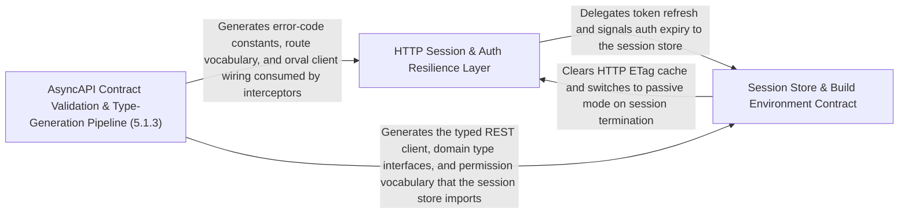

---
tags:
  - 2brain
  - 2brain/arch
  - project/boilerplate-vue-frontend
type: architecture
component: AsyncAPI_Contract_Validation_Type_Generation_Pipeline
---

## Details

This is the entry-point and spec-level correctness sub-component. It owns the full lifecycle of the AsyncAPI contract: parsing the spec, running structural validation (isInvalid), generating TypeScript model types (generate-asyncapi-types), and comparing spec identity across shared files (SpecComparison, normalise). It also hosts the demo backend runner (run-backend.boot), which boots a mock server to exercise the validated contract at runtime. The readAliases helper bridges into the reference-checking layer by extracting alias tables that downstream claim resolution consumes. This group is architecturally central because every other sub-component in the subsystem depends on the spec being validated and types being generated before documentation facts can be checked.

### HTTP Session & Auth Resilience Layer
The transport-level auth machinery that every Axios request traverses. It owns the API error envelope shape (ApiErrorItem), the single-flight deduplication primitive that prevents thundering-herd token refreshes, the step-up reauth prompt store (a reactive 'is a step-up pending?' flag consumed by the UI), and the two Axios response-reject interceptors (onResponseRejectWithRefresh, onResponseRejectWithStepUp) that transparently retry or escalate. requestFreshSession is the terminal escalation path when both refresh and step-up fail. This layer is the runtime contract between the generated HTTP client and the browser's auth state.

**Related Classes/Methods**:

- `src.infrastructure.http.single-flight.singleFlight`:15-23
- `src.infrastructure.http.refresh.onResponseRejectWithRefresh`:128-170
- `src.infrastructure.http.step-up.onResponseRejectWithStepUp`:68-95
- `src.infrastructure.http.reauth-prompt.useReauthPromptStore`:41-90

**Source Files:**

- `src/infrastructure/analytics-consent.ts`
  - `src.infrastructure.analytics-consent.useAnalyticsConsentStore.defineStore('analytics-consent') callback` (L84-L213) - Function
  - `src.infrastructure.analytics-consent.defineStore('analytics-consent') callback.effective` (L100-L103) - Class
  - `src.infrastructure.analytics-consent.useAnalyticsConsentStore.defineStore('analytics-consent') callback.effective.computed() callback` (L100-L103) - Function
  - `src.infrastructure.analytics-consent.defineStore('analytics-consent') callback.promptOpen` (L123-L123) - Class
  - `src.infrastructure.analytics-consent.useAnalyticsConsentStore.defineStore('analytics-consent') callback.promptOpen.computed() callback` (L123-L123) - Function
  - `src.infrastructure.analytics-consent.useAnalyticsConsentStore.defineStore('analytics-consent') callback.trackBrowsing.catch() callback` (L160-L162) - Function
- `src/infrastructure/browser-storage.ts`
  - `src.infrastructure.browser-storage.BROWSER_STORAGE_ITEMS` (L87-L89) - Class
  - `src.infrastructure.browser-storage.BROWSER_STORAGE_ITEMS.BROWSER_STORAGE_DATA.map() callback` (L88-L88) - Function
- `src/infrastructure/config.ts`
  - `src.infrastructure.config.loadConfig` (L34-L46) - Class
  - `src.infrastructure.config.loadConfig.then() callback` (L36-L39) - Function
  - `src.infrastructure.config.loadConfig.catch() callback` (L40-L44) - Function
- `src/infrastructure/http/antibot.ts`
  - `src.infrastructure.http.antibot.fetchAntibotConfig` (L57-L61) - Class
  - `src.infrastructure.http.antibot.fetchAntibotConfig.then() callback` (L58-L61) - Function
- `src/infrastructure/http/envelope.ts`
  - `src.infrastructure.http.envelope.ApiErrorItem` (L19-L24) - Interface
- `src/infrastructure/http/interceptors.ts`
  - `src.infrastructure.http.interceptors.onResponseReject` (L222-L227) - Class
  - `src.infrastructure.http.interceptors.onResponseReject.then() callback` (L225-L226) - Function
- `src/infrastructure/http/problem.ts`
  - `src.infrastructure.http.problem.readProblemBody` (L46-L58) - Class
  - `src.infrastructure.http.problem.readProblemBody.then() callback` (L56-L56) - Function
- `src/infrastructure/http/reauth-prompt.ts`
  - `src.infrastructure.http.reauth-prompt.PendingStepUp` (L17-L32) - Interface
  - `src.infrastructure.http.reauth-prompt.useReauthPromptStore` (L41-L90) - Class
  - `src.infrastructure.http.reauth-prompt.useReauthPromptStore.defineStore('reauth-prompt') callback` (L41-L90) - Function
  - `src.infrastructure.http.reauth-prompt.defineStore('reauth-prompt') callback.isOpen` (L50-L50) - Class
  - `src.infrastructure.http.reauth-prompt.useReauthPromptStore.defineStore('reauth-prompt') callback.isOpen.computed() callback` (L50-L50) - Function
  - `src.infrastructure.http.reauth-prompt.defineStore('reauth-prompt') callback.requiredMethods` (L55-L55) - Class
  - `src.infrastructure.http.reauth-prompt.useReauthPromptStore.defineStore('reauth-prompt') callback.requiredMethods.computed() callback` (L55-L55) - Function
  - `src.infrastructure.http.reauth-prompt.defineStore('reauth-prompt') callback.requestStepUp` (L64-L67) - Class
  - `src.infrastructure.http.reauth-prompt.useReauthPromptStore.defineStore('reauth-prompt') callback.requestStepUp.<function>` (L65-L67) - Function
- `src/infrastructure/http/refresh.ts`
  - `src.infrastructure.http.refresh.NO_REFRESH_ROUTES` (L39-L39) - Class
  - `src.infrastructure.http.refresh.NO_REFRESH_ROUTES.ROUTES.filter() callback` (L39-L39) - Function
  - `src.infrastructure.http.refresh.shouldSkipRefresh` (L48-L54) - Class
  - `src.infrastructure.http.refresh.shouldSkipRefresh.NO_REFRESH_ROUTES.some() callback` (L52-L52) - Function
  - `src.infrastructure.http.refresh.onResponseRejectWithRefresh` (L128-L170) - Class
  - `src.infrastructure.http.refresh.onResponseRejectWithRefresh.then() callback` (L150-L161) - Function
- `src/infrastructure/http/single-flight.ts`
  - `src.infrastructure.http.single-flight.singleFlight` (L15-L23) - Class
  - `src.infrastructure.http.single-flight.singleFlight.<function>` (L17-L22) - Function
  - `src.infrastructure.http.single-flight.singleFlight.<function>.finally() callback` (L18-L20) - Function
  - `src.infrastructure.http.single-flight.exclusiveRunner` (L32-L40) - Class
  - `src.infrastructure.http.single-flight.exclusiveRunner.<function>` (L36-L39) - Function
  - `src.infrastructure.http.single-flight.exclusiveRunner.<function>.finally() callback` (L37-L39) - Function
- `src/infrastructure/http/step-up.ts`
  - `src.infrastructure.http.step-up.requestFreshSession.singleFlight() callback` (L43-L44) - Function
  - `src.infrastructure.http.step-up.requestFreshSession` (L43-L45) - Class
  - `src.infrastructure.http.step-up.methodsOf` (L53-L58) - Class
  - `src.infrastructure.http.step-up.methodsOf.methods.filter() callback` (L56-L56) - Function
  - `src.infrastructure.http.step-up.onResponseRejectWithStepUp` (L68-L95) - Class
  - `src.infrastructure.http.step-up.onResponseRejectWithStepUp.then() callback` (L73-L95) - Function
  - `src.infrastructure.http.step-up.onResponseRejectWithStepUp.then() callback.then() callback` (L85-L89) - Function
  - `src.infrastructure.http.step-up.onResponseRejectWithStepUp.then() callback.catch() callback` (L91-L91) - Function
- `src/infrastructure/locale-overrides.ts`
  - `src.infrastructure.locale-overrides.readRemoteLocales` (L120-L149) - Class
  - `src.infrastructure.locale-overrides.readRemoteLocales.then() callback` (L122-L148) - Function
  - `src.infrastructure.locale-overrides.readRemoteLocales.catch() callback` (L149-L149) - Function
  - `src.infrastructure.locale-overrides.mergeRemoteLocales.then() callback.added.target.filter() callback` (L224-L224) - Function
- `src/infrastructure/observability/config.ts`
  - `src.infrastructure.observability.config.propagationTargets` (L119-L121) - Function
- `src/infrastructure/observability/store.ts`
  - `src.infrastructure.observability.store.SpanAttribute` (L61-L64) - Interface
  - `src.infrastructure.observability.store.OtlpPayload` (L69-L71) - Interface
  - `src.infrastructure.observability.store.spanAttributes` (L80-L84) - Class
  - `src.infrastructure.observability.store.flatMap() callback` (L82-L82) - Function
  - `src.infrastructure.observability.store.spanAttributes.flatMap() callback` (L84-L84) - Function
  - `src.infrastructure.observability.store.EventPayload` (L128-L131) - Interface
  - `src.infrastructure.observability.store.defineStore('observability') callback.setFaroConsent` (L358-L379) - Class
  - `src.infrastructure.observability.store.useObservabilityStore.defineStore('observability') callback.setFaroConsent.then() callback` (L368-L374) - Function
  - `src.infrastructure.observability.store.useObservabilityStore.defineStore('observability') callback.setFaroConsent.catch() callback` (L376-L378) - Function
- `src/infrastructure/reauth.ts`
  - `src.infrastructure.reauth.useReauthStore` (L52-L79) - Class
  - `src.infrastructure.reauth.useReauthStore.defineStore('reauth') callback` (L52-L79) - Function
  - `src.infrastructure.reauth.useReauthStore.defineStore('reauth') callback.reauth.then() callback` (L70-L72) - Function
  - `src.infrastructure.reauth.useReauthStore.defineStore('reauth') callback.reauth.finally() callback` (L73-L75) - Function
- `src/infrastructure/runtime-config.ts`
  - `src.infrastructure.runtime-config.readApiUrl` (L59-L61) - Function
- `src/infrastructure/session.ts`
  - `src.infrastructure.session.SessionViewer` (L110-L152) - Interface
  - `src.infrastructure.session.useSessionStore` (L182-L792) - Class
  - `src.infrastructure.session.useSessionStore.defineStore('session') callback` (L182-L792) - Function
  - `src.infrastructure.session.defineStore('session') callback.hasSession` (L223-L223) - Class
  - `src.infrastructure.session.useSessionStore.defineStore('session') callback.isAuth.computed() callback` (L230-L230) - Function
  - `src.infrastructure.session.defineStore('session') callback.loadSessionMode` (L410-L418) - Class
  - `src.infrastructure.session.defineStore('session') callback.reloadAbilities` (L444-L456) - Class
  - `src.infrastructure.session.useSessionStore.defineStore('session') callback.refreshToken.then() callback` (L533-L546) - Function
  - `src.infrastructure.session.useSessionStore.defineStore('session') callback.refreshToken.catch() callback` (L547-L551) - Function
  - `src.infrastructure.session.useSessionStore.defineStore('session') callback.refreshToken.finally() callback` (L552-L554) - Function
  - `src.infrastructure.session.useSessionStore.defineStore('session') callback.loadViewer.then() callback` (L584-L601) - Function
  - `src.infrastructure.session.defineStore('session') callback.touchSession` (L657-L661) - Class
  - `src.infrastructure.session.defineStore('session') callback.rereadSession.then() callback` (L672-L672) - Function
  - `src.infrastructure.session.useSessionStore.defineStore('session') callback.onScopeDispose() callback` (L695-L695) - Function
  - `src.infrastructure.session.useSessionStore.defineStore('session') callback.logout.then() callback` (L746-L746) - Function
  - `src.infrastructure.session.useSessionStore.defineStore('session') callback.logoutAll.then() callback` (L756-L756) - Function
- `src/infrastructure/tour-seen.ts`
  - `src.infrastructure.tour-seen.markTourSeen.keys.filter() callback` (L82-L82) - Function
- `src/infrastructure/utils/request-ticket.ts`
  - `src.infrastructure.utils.request-ticket.RequestClaim` (L16-L27) - Interface

### Session Store & Build Environment Contract
The declarative auth-state surface and the build-time environment type contract. The Pinia session store (defined via defineStore('session')) is the single source of truth for viewer identity, auth status, token lifecycle (refreshToken, reauth, sendReauthCode, requestEmailVerification), locale persistence, and logout semantics (logout, logoutAll). It is the consumer of the resilience layer above and the provider of auth context to every domain module store. vite-env.d.ts extends ImportMetaEnv and ViteTypeOptions so that build-time configuration (API base URL, feature flags, observability endpoints) is typed at the boundary between the Vite build and the application runtime. Together these two files define the 'what the app knows about the user and the environment' contract.

**Related Classes/Methods**:

- `src.vite-env.d.ImportMetaEnv`:24-50
- `src.vite-env.d.ViteTypeOptions`:14-16

**Source Files:**

- `src/app/components/use-language-switch.ts`
  - `src.app.components.use-language-switch.switchLanguage` (L48-L62) - Class
- `src/app/guards/authentications.ts`
  - `src.app.guards.authentications.restoreSessionIfNeeded` (L142-L149) - Class
  - `src.app.guards.authentications.restoreSessionIfNeeded.then() callback` (L147-L147) - Function
  - `src.app.guards.authentications.restoreSessionIfNeeded.catch() callback` (L148-L148) - Function
- `src/infrastructure/locale-preference.ts`
  - `src.infrastructure.locale-preference.persistLocalePreference` (L27-L34) - Class
  - `src.infrastructure.locale-preference.persistLocalePreference.then() callback` (L32-L32) - Function
  - `src.infrastructure.locale-preference.persistLocalePreference.catch() callback` (L33-L33) - Function
- `src/infrastructure/session.ts`
  - `src.infrastructure.session.useSessionStore.defineStore('session') callback.hasSession.computed() callback` (L223-L223) - Function
  - `src.infrastructure.session.defineStore('session') callback.isAuth` (L230-L230) - Class
  - `src.infrastructure.session.useSessionStore.defineStore('session') callback.loadSessionMode.then() callback` (L411-L418) - Function
  - `src.infrastructure.session.useSessionStore.defineStore('session') callback.reloadAbilities.then() callback` (L447-L450) - Function
  - `src.infrastructure.session.useSessionStore.defineStore('session') callback.reloadAbilities.catch() callback` (L451-L451) - Function
  - `src.infrastructure.session.useSessionStore.defineStore('session') callback.reloadAbilities.finally() callback` (L452-L454) - Function
  - `src.infrastructure.session.defineStore('session') callback.refreshToken` (L523-L557) - Class
  - `src.infrastructure.session.defineStore('session') callback.restoreFromCookies` (L569-L576) - Class
  - `src.infrastructure.session.useSessionStore.defineStore('session') callback.restoreFromCookies.then() callback` (L572-L576) - Function
  - `src.infrastructure.session.useSessionStore.defineStore('session') callback.restoreFromCookies.then() callback.then() callback` (L574-L574) - Function
  - `src.infrastructure.session.defineStore('session') callback.loadViewer` (L583-L601) - Class
  - `src.infrastructure.session.useSessionStore.defineStore('session') callback.touchSession.catch() callback` (L661-L661) - Function
  - `src.infrastructure.session.useSessionStore.defineStore('session') callback.rereadSession` (L670-L674) - Class
  - `src.infrastructure.session.useSessionStore.defineStore('session') callback.rereadSession.then() callback` (L673-L673) - Function
  - `src.infrastructure.session.useSessionStore.defineStore('session') callback.rereadSession.catch() callback` (L674-L674) - Function
  - `src.infrastructure.session.defineStore('session') callback.logout` (L745-L746) - Class
  - `src.infrastructure.session.defineStore('session') callback.logoutAll` (L755-L756) - Class
- `src/modules/account/stores/auth.ts`
  - `src.modules.account.stores.auth.useAccountAuthStore` (L61-L317) - Class
  - `src.modules.account.stores.auth.useAccountAuthStore.defineStore('account-auth') callback` (L61-L317) - Function
  - `src.modules.account.stores.auth.useAccountAuthStore.defineStore('account-auth') callback.toLoginOutcome` (L84-L111) - Class
  - `src.modules.account.stores.auth.useAccountAuthStore.defineStore('account-auth') callback.toLoginOutcome.then() callback` (L110-L110) - Function
  - `src.modules.account.stores.auth.useAccountAuthStore.defineStore('account-auth') callback.login.fetchAny() callback` (L140-L148) - Function
  - `src.modules.account.stores.auth.useAccountAuthStore.defineStore('account-auth') callback.login.fetchAny() callback.then() callback` (L148-L148) - Function
  - `src.modules.account.stores.auth.useAccountAuthStore.defineStore('account-auth') callback.login.then() callback` (L149-L152) - Function
  - `src.modules.account.stores.auth.useAccountAuthStore.defineStore('account-auth') callback.signup.fetchAny() callback` (L197-L216) - Function
  - `src.modules.account.stores.auth.useAccountAuthStore.defineStore('account-auth') callback.signup.fetchAny() callback.then() callback` (L209-L212) - Function
  - `src.modules.account.stores.auth.useAccountAuthStore.defineStore('account-auth') callback.signup.fetchAny() callback.catch() callback` (L213-L216) - Function
  - `src.modules.account.stores.auth.defineStore('account-auth') callback.setAvatarAfterSignup` (L231-L237) - Class
  - `src.modules.account.stores.auth.defineStore('account-auth') callback.setAvatarAfterSignup.then() callback` (L235-L235) - Function
  - `src.modules.account.stores.auth.useAccountAuthStore.defineStore('account-auth') callback.setAvatarAfterSignup.then() callback` (L236-L236) - Function
  - `src.modules.account.stores.auth.useAccountAuthStore.defineStore('account-auth') callback.requestPasswordReset.fetchAny() callback` (L249-L249) - Function
  - `src.modules.account.stores.auth.useAccountAuthStore.defineStore('account-auth') callback.confirmPasswordReset.fetchAny() callback` (L268-L276) - Function
  - `src.modules.account.stores.auth.useAccountAuthStore.defineStore('account-auth') callback.confirmPasswordReset.fetchAny() callback.then() callback` (L274-L276) - Function
  - `src.modules.account.stores.auth.useAccountAuthStore.defineStore('account-auth') callback.logout.then() callback` (L289-L293) - Function
  - `src.modules.account.stores.auth.useAccountAuthStore.defineStore('account-auth') callback.logoutEverywhere.then() callback` (L302-L305) - Function
- `src/modules/account/stores/profile.ts`
  - `src.modules.account.stores.profile.useAccountProfileStore` (L69-L599) - Class
  - `src.modules.account.stores.profile.useAccountProfileStore.defineStore('account-profile') callback` (L69-L599) - Function
  - `src.modules.account.stores.profile.useAccountProfileStore.defineStore('account-profile') callback.fetchProfile.fetchTarget() callback` (L150-L169) - Function
  - `src.modules.account.stores.profile.useAccountProfileStore.defineStore('account-profile') callback.fetchProfile.fetchTarget() callback.then() callback` (L151-L169) - Function
  - `src.modules.account.stores.profile.useAccountProfileStore.defineStore('account-profile') callback.fetchProfile.then() callback` (L172-L179) - Function
  - `src.modules.account.stores.profile.useAccountProfileStore.defineStore('account-profile') callback.fetchProfile.then() callback.then() callback` (L178-L178) - Function
  - `src.modules.account.stores.profile.defineStore('account-profile') callback.updateProfile` (L247-L300) - Class
  - `src.modules.account.stores.profile.useAccountProfileStore.defineStore('account-profile') callback.updateProfile.updateTarget() callback` (L268-L282) - Function
  - `src.modules.account.stores.profile.defineStore('account-profile') callback.updateProfile.updateTarget() callback.uploadThenClear() callback` (L273-L274) - Function
  - `src.modules.account.stores.profile.useAccountProfileStore.defineStore('account-profile') callback.updateProfile.updateTarget() callback.uploadThenClear() callback` (L275-L275) - Function
  - `src.modules.account.stores.profile.useAccountProfileStore.defineStore('account-profile') callback.updateProfile.updateTarget() callback.then() callback` (L278-L282) - Function
  - `src.modules.account.stores.profile.useAccountProfileStore.defineStore('account-profile') callback.updateProfile.then() callback` (L292-L298) - Function
  - `src.modules.account.stores.profile.useAccountProfileStore.defineStore('account-profile') callback.updateProfile.then() callback.then() callback` (L298-L298) - Function
  - `src.modules.account.stores.profile.useAccountProfileStore.defineStore('account-profile') callback.requestEmailChange.fetchAny() callback` (L341-L344) - Function
  - `src.modules.account.stores.profile.useAccountProfileStore.defineStore('account-profile') callback.requestEmailChange.fetchAny() callback.then() callback` (L342-L343) - Function
  - `src.modules.account.stores.profile.useAccountProfileStore.defineStore('account-profile') callback.requestEmailChange.fetchAny() callback.then() callback.then() callback` (L343-L343) - Function
  - `src.modules.account.stores.profile.useAccountProfileStore.defineStore('account-profile') callback.cancelPendingEmailChange.fetchAny() callback` (L358-L359) - Function
  - `src.modules.account.stores.profile.useAccountProfileStore.defineStore('account-profile') callback.cancelPendingEmailChange.fetchAny() callback.then() callback.then() callback` (L359-L359) - Function
  - `src.modules.account.stores.profile.useAccountProfileStore.defineStore('account-profile') callback.resendPendingEmail.fetchAny() callback` (L376-L376) - Function
  - `src.modules.account.stores.profile.useAccountProfileStore.defineStore('account-profile') callback.resendPendingEmail.then() callback` (L377-L377) - Function
  - `src.modules.account.stores.profile.useAccountProfileStore.defineStore('account-profile') callback.changePassword.fetchAny() callback` (L396-L399) - Function
  - `src.modules.account.stores.profile.useAccountProfileStore.defineStore('account-profile') callback.changePassword.fetchAny() callback.then() callback` (L397-L399) - Function
  - `src.modules.account.stores.profile.useAccountProfileStore.defineStore('account-profile') callback.confirmEmailVerification.fetchAny() callback` (L411-L414) - Function
  - `src.modules.account.stores.profile.useAccountProfileStore.defineStore('account-profile') callback.confirmEmailVerification.fetchAny() callback.then() callback` (L412-L413) - Function
  - `src.modules.account.stores.profile.useAccountProfileStore.defineStore('account-profile') callback.confirmEmailVerification.fetchAny() callback.then() callback.then() callback` (L413-L413) - Function
  - `src.modules.account.stores.profile.useAccountProfileStore.defineStore('account-profile') callback.confirmEmailChange.fetchAny() callback` (L427-L430) - Function
  - `src.modules.account.stores.profile.useAccountProfileStore.defineStore('account-profile') callback.confirmEmailChange.fetchAny() callback.then() callback` (L428-L429) - Function
  - `src.modules.account.stores.profile.useAccountProfileStore.defineStore('account-profile') callback.confirmEmailChange.fetchAny() callback.then() callback.then() callback` (L429-L429) - Function
  - `src.modules.account.stores.profile.useAccountProfileStore.defineStore('account-profile') callback.undoEmailChange.fetchAny() callback` (L443-L443) - Function
  - `src.modules.account.stores.profile.useAccountProfileStore.defineStore('account-profile') callback.watch() callback` (L449-L451) - Function
  - `src.modules.account.stores.profile.useAccountProfileStore.defineStore('account-profile') callback.$onAction() callback` (L456-L463) - Function
  - `src.modules.account.stores.profile.useAccountProfileStore.defineStore('account-profile') callback.$onAction() callback.after() callback` (L458-L462) - Function
  - `src.modules.account.stores.profile.useAccountProfileStore.defineStore('account-profile') callback.$onAction() callback.after() callback.catch() callback` (L459-L461) - Function
  - `src.modules.account.stores.profile.useAccountProfileStore.defineStore('account-profile') callback.requestAccountDelete.fetchAny() callback` (L493-L493) - Function
  - `src.modules.account.stores.profile.useAccountProfileStore.defineStore('account-profile') callback.requestAccountDelete.fetchAny() callback.then() callback` (L493-L493) - Function
  - `src.modules.account.stores.profile.useAccountProfileStore.defineStore('account-profile') callback.requestAccountDelete.then() callback` (L493-L498) - Function
  - `src.modules.account.stores.profile.useAccountProfileStore.defineStore('account-profile') callback.requestAccountExport.fetchAny() callback` (L513-L513) - Function
  - `src.modules.account.stores.profile.useAccountProfileStore.defineStore('account-profile') callback.requestAccountExport.fetchAny() callback.then() callback` (L513-L513) - Function
  - `src.modules.account.stores.profile.useAccountProfileStore.defineStore('account-profile') callback.fetchAccountExport.fetchAny() callback` (L523-L527) - Function
  - `src.modules.account.stores.profile.useAccountProfileStore.defineStore('account-profile') callback.fetchAccountExport.fetchAny() callback.catch() callback` (L524-L527) - Function
  - `src.modules.account.stores.profile.useAccountProfileStore.defineStore('account-profile') callback.downloadAccountExport.fetchAny() callback` (L542-L542) - Function
  - `src.modules.account.stores.profile.useAccountProfileStore.defineStore('account-profile') callback.downloadAccountExport.then() callback` (L543-L543) - Function
  - `src.modules.account.stores.profile.useAccountProfileStore.defineStore('account-profile') callback.restoreAccount.fetchAny() callback` (L553-L553) - Function
  - `src.modules.account.stores.profile.useAccountProfileStore.defineStore('account-profile') callback.uploadingAvatar.computed() callback` (L558-L558) - Function
  - `src.modules.account.stores.profile.useAccountProfileStore.defineStore('account-profile') callback.removingAvatar.computed() callback` (L563-L563) - Function
  - `src.modules.account.stores.profile.useAccountProfileStore.defineStore('account-profile') callback.savingProfile.computed() callback` (L568-L568) - Function
  - `src.modules.account.stores.profile.useAccountProfileStore.defineStore('account-profile') callback.changingPendingEmail.computed() callback` (L573-L573) - Function
- `src/modules/cart/checkout-attempt-storage.ts`
  - `src.modules.cart.checkout-attempt-storage.CheckoutAttempt` (L23-L36) - Interface
- `src/modules/cart/composables/use-cart-stock-poll.ts`
  - `src.modules.cart.composables.use-cart-stock-poll.useCartStockPoll` (L37-L128) - Class
  - `src.modules.cart.composables.use-cart-stock-poll.watch() callback` (L66-L68) - Function
  - `src.modules.cart.composables.use-cart-stock-poll.useCartStockPoll.tick` (L93-L97) - Class
  - `src.modules.cart.composables.use-cart-stock-poll.useCartStockPoll.tick.catch() callback` (L94-L96) - Function
  - `src.modules.cart.composables.use-cart-stock-poll.useCartStockPoll.watch() callback` (L113-L120) - Function
  - `src.modules.cart.composables.use-cart-stock-poll.useCartStockPoll.onScopeDispose() callback` (L124-L127) - Function
- `src/modules/cart/composables/use-checkout-refusals.ts`
  - `src.modules.cart.composables.use-checkout-refusals.CheckoutRefusalHooks` (L38-L43) - Interface
  - `src.modules.cart.composables.use-checkout-refusals.useCheckoutRefusals.refetchCart` (L132-L136) - Class
  - `src.modules.cart.composables.use-checkout-refusals.refetchCart.then() callback` (L134-L134) - Function
  - `src.modules.cart.composables.use-checkout-refusals.useCheckoutRefusals.refetchCart.then() callback` (L135-L135) - Function
- `src/modules/cart/composables/use-guest-cart.ts`
  - `src.modules.cart.composables.use-guest-cart.guestQuantity` (L34-L34) - Class
- `src/modules/cart/domain/checkout-errors.ts`
  - `src.modules.cart.domain.checkout-errors.listDetail` (L173-L182) - Class
  - `src.modules.cart.domain.checkout-errors.listDetail.filter() callback` (L181-L181) - Function
  - `src.modules.cart.domain.checkout-errors.listDetail.map() callback` (L181-L181) - Function
  - `src.modules.cart.domain.checkout-errors.VERDICT_BY_CODE` (L198-L243) - Class
  - `src.modules.cart.domain.checkout-errors.<function>` (L202-L202) - Function
  - `src.modules.cart.domain.checkout-errors.VERDICT_BY_CODE.<function>` (L242-L242) - Function
- `src/modules/cart/domain/guest-cart.ts`
  - `src.modules.cart.domain.guest-cart.addGuestLine.existing` (L83-L83) - Class
  - `src.modules.cart.domain.guest-cart.addGuestLine.existing.lines.find() callback` (L83-L83) - Function
  - `src.modules.cart.domain.guest-cart.subtractGuestLines.lines.flatMap() callback.taken` (L139-L139) - Class
  - `src.modules.cart.domain.guest-cart.subtractGuestLines.lines.flatMap() callback.taken.sent.find() callback` (L139-L139) - Function
  - `src.modules.cart.domain.guest-cart.MergeAttempt` (L200-L209) - Interface
- `src/modules/cart/store.ts`
  - `src.modules.cart.store.defineStore('cart') callback.pollCart` (L334-L349) - Class
  - `src.modules.cart.store.defineStore('cart') callback.settleFailedCheckout.then() callback` (L438-L438) - Function
  - `src.modules.cart.store.defineStore('cart') callback.seedAfterSignIn` (L634-L666) - Class
  - `src.modules.cart.store.defineStore('cart') callback.seedAfterSignIn.settled.read.then() callback` (L652-L652) - Function
- `src/modules/users/composables/use-role-options.ts`
  - `src.modules.users.composables.use-role-options.useRoleOptions` (L27-L49) - Class
  - `src.modules.users.composables.use-role-options.useRoleOptions.roleOptions.map() callback` (L44-L44) - Function
  - `src.modules.users.composables.use-role-options.useRoleOptions.grantableRoles` (L48-L48) - Method
- `src/vite-env.d.ts`
  - `src.vite-env.d.ViteTypeOptions` (L14-L16) - Interface
  - `src.vite-env.d.ImportMetaEnv` (L24-L50) - Interface

### AsyncAPI Contract Validation & Type-Generation Pipeline (5.1.3)
The spec-level correctness and runtime-exercise pipeline. It owns the full AsyncAPI lifecycle: (a) structural validation — isInvalid runs the @asyncapi/parser default ruleset and gates CI on error-severity diagnostics; (b) TypeScript type generation — generate-asyncapi-types uses @asyncapi/modelina to emit payload interfaces, channel constants, SSE event maps, and inlined JSON-Schema validators into contracts/asyncapi.generated.ts, with a --check mode that fails on drift; (c) cross-repo spec identity — SpecComparison / normalise / SharedFile compare the shared contract files between this checkout and the paired backend to catch silent forks; (d) demo backend boot — boot spawns the paired backend's demo profile on a pinned port with a scratch directory, wiring the webhook sink and antibot env, so the validated contract is exercised end-to-end; (e) reference & fact checking — readAliases extracts the tsconfig path-alias table for downstream claim resolution, and document-facts / check-references verify that every npm run script, dependency, and @api import named in the docs actually exists. This group is architecturally central: every other sub-component depends on the spec being validated and types being generated before documentation facts can be checked.

**Related Classes/Methods**:

- `scripts.contracts.validate-asyncapi.isInvalid`:38-43
- `scripts.demo.run-backend.boot`:51-96
- `scripts.pairing.spec-identity.SpecComparison`:130-140
- `scripts.docs.check-references.readAliases`:213-222
- `scripts.docs.document-facts.exportedNames`:156-163

**Source Files:**

- `scripts/contracts/generate-asyncapi-types.ts`
  - `scripts.contracts.generate-asyncapi-types.renderLiteralArray.lines` (L251-L251) - Class
  - `scripts.contracts.generate-asyncapi-types.renderLiteralArray.lines.values.map() callback` (L251-L251) - Function
  - `scripts.contracts.generate-asyncapi-types.renderPayloadMap.rows` (L266-L270) - Class
  - `scripts.contracts.generate-asyncapi-types.renderPayloadMap.rows.entries.map() callback` (L268-L268) - Function
- `scripts/contracts/validate-asyncapi.ts`
  - `scripts.contracts.validate-asyncapi.isInvalid` (L38-L43) - Class
  - `scripts.contracts.validate-asyncapi.isInvalid.diagnostics.some() callback` (L40-L42) - Function
  - `scripts.contracts.validate-asyncapi.files.map() callback` (L50-L62) - Function
  - `scripts.contracts.validate-asyncapi.files.map() callback.then() callback` (L51-L62) - Function
  - `scripts.contracts.validate-asyncapi.then() callback` (L65-L69) - Function
  - `scripts.contracts.validate-asyncapi.catch() callback` (L70-L73) - Function
- `scripts/demo/run-backend.ts`
  - `scripts.demo.run-backend.boot` (L51-L96) - Class
  - `scripts.demo.run-backend.boot.process.on() callback` (L87-L89) - Function
  - `scripts.demo.run-backend.boot.child.on('close') callback` (L91-L95) - Function
  - `scripts.demo.run-backend.setInterval() callback` (L114-L114) - Function
- `scripts/docs/check-references.ts`
  - `scripts.docs.check-references.readAliases` (L213-L222) - Class
  - `scripts.docs.check-references.readAliases.map() callback` (L218-L221) - Function
  - `scripts.docs.check-references.run.pages` (L517-L523) - Class
  - `scripts.docs.check-references.run.pages.filter() callback` (L523-L523) - Function
- `scripts/docs/document-facts.ts`
  - `scripts.docs.document-facts.fencedContractImports.fences` (L109-L109) - Class
  - `scripts.docs.document-facts.fencedContractImports.fences.map() callback` (L109-L109) - Function
  - `scripts.docs.document-facts.fencedContractImports.fences.flatMap() callback` (L110-L125) - Function
  - `scripts.docs.document-facts.fencedContractImports.fences.flatMap() callback.flatMap() callback` (L113-L124) - Function
  - `scripts.docs.document-facts.fencedContractImports.fences.flatMap() callback.flatMap() callback.map() callback` (L124-L124) - Function
  - `scripts.docs.document-facts.exportedNames` (L156-L163) - Class
  - `scripts.docs.document-facts.exportedNames.map() callback` (L162-L162) - Function
- `scripts/mutation/baseline.ts`
  - `scripts.mutation.baseline.scoresFromReport.scored` (L101-L101) - Class
  - `scripts.mutation.baseline.scoresFromReport.scored.mutants.filter() callback` (L101-L101) - Function
  - `scripts.mutation.baseline.formatUnrecorded.lines` (L225-L225) - Class
  - `scripts.mutation.baseline.formatUnrecorded.lines.unrecorded.map() callback` (L225-L225) - Function
- `scripts/pairing/spec-identity.ts`
  - `scripts.pairing.spec-identity.SharedFile` (L29-L34) - Interface
  - `scripts.pairing.spec-identity.SpecComparison` (L130-L140) - Interface
  - `scripts.pairing.spec-identity.normalise` (L161-L173) - Class
  - `scripts.pairing.spec-identity.normalise.value.map() callback` (L162-L162) - Function
- `src/kernel/use-badge-refresh.ts`
  - `src.kernel.use-badge-refresh.BadgeRefreshOptions` (L25-L41) - Interface
  - `src.kernel.use-badge-refresh.useBadgeRefresh` (L54-L111) - Class
  - `src.kernel.use-badge-refresh.useBadgeRefresh.refresh` (L64-L75) - Class
  - `src.kernel.use-badge-refresh.useBadgeRefresh.refresh.then() callback` (L67-L69) - Function
  - `src.kernel.use-badge-refresh.useBadgeRefresh.refresh.catch() callback` (L70-L74) - Function
  - `src.kernel.use-badge-refresh.useBadgeRefresh.watch() callback` (L96-L98) - Function
  - `src.kernel.use-badge-refresh.useBadgeRefresh.onScopeDispose() callback` (L108-L110) - Function
- `src/modules/shop-tasks/composables/use-shop-work-feed.ts`
  - `src.modules.shop-tasks.composables.use-shop-work-feed.useShopWorkFeed` (L15-L34) - Class
  - `src.modules.shop-tasks.composables.use-shop-work-feed.useShopWorkFeed.readerId.computed() callback` (L20-L26) - Function
  - `src.modules.shop-tasks.composables.use-shop-work-feed.useShopWorkFeed.read` (L31-L31) - Method
- `src/modules/shop-tasks/store.ts`
  - `src.modules.shop-tasks.store.useShopTasksStore` (L19-L46) - Class
  - `src.modules.shop-tasks.store.useShopTasksStore.defineStore('shop-tasks') callback` (L19-L46) - Function
  - `src.modules.shop-tasks.store.useShopTasksStore.defineStore('shop-tasks') callback.loadSummary.fetchAny() callback` (L36-L36) - Function
  - `src.modules.shop-tasks.store.useShopTasksStore.defineStore('shop-tasks') callback.loadSummary.then() callback` (L41-L43) - Function
- `src/modules/users/badge-store.ts`
  - `src.modules.users.badge-store.useUsersBadgeStore` (L19-L50) - Class
  - `src.modules.users.badge-store.useUsersBadgeStore.defineStore('users-badge') callback` (L19-L50) - Function
  - `src.modules.users.badge-store.defineStore('users-badge') callback.loadReviewTotal` (L40-L47) - Class
  - `src.modules.users.badge-store.useUsersBadgeStore.defineStore('users-badge') callback.loadReviewTotal.fetchAny() callback` (L43-L43) - Function
  - `src.modules.users.badge-store.useUsersBadgeStore.defineStore('users-badge') callback.loadReviewTotal.then() callback` (L45-L47) - Function
- `src/modules/users/composables/use-review-badge.ts`
  - `src.modules.users.composables.use-review-badge.useReviewBadge` (L19-L33) - Class
  - `src.modules.users.composables.use-review-badge.useReviewBadge.readerId.computed() callback` (L25-L25) - Function
  - `src.modules.users.composables.use-review-badge.useReviewBadge.read` (L26-L26) - Method
  - `src.modules.users.composables.use-review-badge.useReviewBadge.clear` (L27-L29) - Method
- `src/modules/users/composables/use-role-options.ts`
  - `src.modules.users.composables.use-role-options.RoleOption` (L16-L19) - Interface
  - `src.modules.users.composables.use-role-options.roleOptions` (L39-L46) - Class
- `src/modules/users/composables/use-user-summary.ts`
  - `src.modules.users.composables.use-user-summary.heroTitle` (L31-L31) - Class
  - `src.modules.users.composables.use-user-summary.heroDescription` (L34-L34) - Class
  - `src.modules.users.composables.use-user-summary.userRole` (L40-L40) - Class
  - `src.modules.users.composables.use-user-summary.userStatus` (L43-L45) - Class
- `src/modules/users/store.ts`
  - `src.modules.users.store.defineStore('users') callback.applyAccessChange` (L289-L301) - Class
  - `src.modules.users.store.defineStore('users') callback.setPurchaseHold` (L311-L317) - Class
  - `src.modules.users.store.defineStore('users') callback.liftPurchaseHold` (L328-L334) - Class
- `src/modules/webhooks/badge-store.ts`
  - `src.modules.webhooks.badge-store.useWebhooksBadgeStore` (L19-L49) - Class
  - `src.modules.webhooks.badge-store.useWebhooksBadgeStore.defineStore('webhooks-badge') callback` (L19-L49) - Function
  - `src.modules.webhooks.badge-store.useWebhooksBadgeStore.defineStore('webhooks-badge') callback.loadAutoDisabledTotal.fetchAny() callback` (L42-L42) - Function
  - `src.modules.webhooks.badge-store.useWebhooksBadgeStore.defineStore('webhooks-badge') callback.loadAutoDisabledTotal.then() callback` (L44-L46) - Function
- `src/modules/webhooks/composables/use-auto-disabled-badge.ts`
  - `src.modules.webhooks.composables.use-auto-disabled-badge.useAutoDisabledBadge` (L19-L35) - Class
  - `src.modules.webhooks.composables.use-auto-disabled-badge.useAutoDisabledBadge.readerId.computed() callback` (L25-L26) - Function
  - `src.modules.webhooks.composables.use-auto-disabled-badge.useAutoDisabledBadge.read` (L28-L28) - Method
  - `src.modules.webhooks.composables.use-auto-disabled-badge.useAutoDisabledBadge.clear` (L29-L31) - Method
