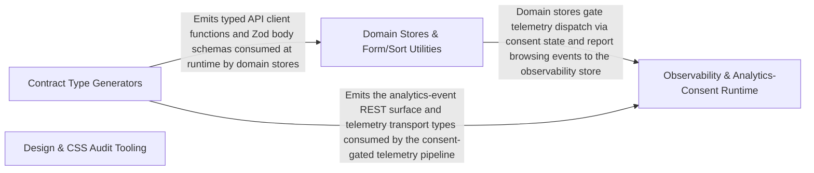

---
tags:
  - 2brain
  - 2brain/arch
  - project/boilerplate-vue-frontend
type: architecture
component: Contract_Type_Generation
---

## Details

Generators that derive the typed contract surface — AsyncAPI message/channel types, error codes, operation modules, and permission actions — with the observability config/store as a secondary concern.

### Observability & Analytics-Consent Runtime [[Expand]](./Observability_Analytics_Consent_Runtime.md)
The secondary runtime concern that consumes the generated contract surface for telemetry and consent. It owns the Faro/Umami configuration readers (FaroConfig, UmamiConfig, readFaroConfig, readUmamiConfig, readUmamiRequireConsent, origin→regex helpers), the observability Pinia store (ApiRejectEnvelope, UmamiTracker), and the analytics-consent store (useAnalyticsConsentStore with its promptOpen callback). It also carries the account auth/profile stores and the orders/products/users stores plus the use-order-actions-refetch / reorder / use-any-filter-choice composables that wire domain actions to the generated API types.

**Related Classes/Methods**:

- `src.infrastructure.observability.config.readFaroConfig`:129-161
- `src.infrastructure.observability.config.readUmamiConfig`:69-82
- `src.infrastructure.analytics-consent.useAnalyticsConsentStore`:84-213

**Source Files:**

- `src/infrastructure/analytics-consent.ts`
  - `src.infrastructure.analytics-consent.useAnalyticsConsentStore` (L84-L213) - Class
- `src/infrastructure/observability/config.ts`
  - `src.infrastructure.observability.config.FaroConfig` (L14-L36) - Interface
  - `src.infrastructure.observability.config.UmamiConfig` (L41-L50) - Interface
  - `src.infrastructure.observability.config.originToRegExp` (L58-L61) - Function
  - `src.infrastructure.observability.config.readUmamiConfig` (L69-L82) - Function
  - `src.infrastructure.observability.config.readUmamiRequireConsent` (L91-L95) - Function
  - `src.infrastructure.observability.config.umamiOriginPattern` (L107-L111) - Function
  - `src.infrastructure.observability.config.readFaroConfig` (L129-L161) - Function
- `src/infrastructure/observability/store.ts`
  - `src.infrastructure.observability.store.ApiRejectEnvelope` (L161-L168) - Interface
  - `src.infrastructure.observability.store.describeApiRejectError` (L191-L194) - Class
  - `src.infrastructure.observability.store.describeApiRejectError.filter() callback` (L193-L193) - Function
  - `src.infrastructure.observability.store.useObservabilityStore` (L217-L502) - Class
  - `src.infrastructure.observability.store.useObservabilityStore.defineStore('observability') callback` (L217-L502) - Function
  - `src.infrastructure.observability.store.defineStore('observability') callback.initFaro` (L268-L348) - Class
  - `src.infrastructure.observability.store.useObservabilityStore.defineStore('observability') callback.initFaro.then() callback` (L280-L332) - Function
  - `src.infrastructure.observability.store.useObservabilityStore.defineStore('observability') callback.initFaro.catch() callback` (L333-L345) - Function
  - `src.infrastructure.observability.store.normalizeContext` (L510-L512) - Function
  - `src.infrastructure.observability.store.normalizeContext.mapValues() callback` (L511-L511) - Function
- `src/modules/orders/domain/reorder.ts`
  - `src.modules.orders.domain.reorder.ReorderedOrderLine` (L13-L16) - Interface
- `src/ui/composables/use-any-filter-choice.ts`
  - `src.ui.composables.use-any-filter-choice.useAnyFilterChoice` (L23-L30) - Class
  - `src.ui.composables.use-any-filter-choice.useAnyFilterChoice.get` (L28-L28) - Method
  - `src.ui.composables.use-any-filter-choice.useAnyFilterChoice.set` (L29-L29) - Method
- `src/ui/composables/use-deleted-filter-options.ts`
  - `src.ui.composables.use-deleted-filter-options.DeletedFilterOption` (L14-L19) - Interface
  - `src.ui.composables.use-deleted-filter-options.useDeletedFilterOptions` (L26-L33) - Class
  - `src.ui.composables.use-deleted-filter-options.useDeletedFilterOptions.computed() callback` (L28-L32) - Function
- `src/ui/composables/use-list-url-state.ts`
  - `src.ui.composables.use-list-url-state.ListUrlStateOptions` (L25-L39) - Interface
  - `src.ui.composables.use-list-url-state.ListUrlState` (L44-L50) - Interface
  - `src.ui.composables.use-list-url-state.useListUrlState.hydrate.present` (L119-L119) - Class
  - `src.ui.composables.use-list-url-state.useListUrlState.sync.foreign` (L153-L155) - Class
  - `src.ui.composables.use-list-url-state.useListUrlState.sync.foreign.filter() callback` (L154-L154) - Function
- `src/ui/composables/use-return-focus.ts`
  - `src.ui.composables.use-return-focus.useReturnFocus` (L17-L62) - Class
  - `src.ui.composables.use-return-focus.useReturnFocus.watch() callback` (L42-L52) - Function
  - `src.ui.composables.use-return-focus.useReturnFocus.watch() callback.nextTick() callback` (L51-L51) - Function
- `src/ui/composables/use-row-actions.ts`
  - `src.ui.composables.use-row-actions.run` (L90-L97) - Class
  - `src.ui.composables.use-row-actions.run.then() callback` (L93-L93) - Function
- `src/ui/composables/use-server-sort.ts`
  - `src.ui.composables.use-server-sort.ServerSortOptions` (L15-L20) - Interface
  - `src.ui.composables.use-server-sort.ServerSort` (L25-L30) - Interface
  - `src.ui.composables.use-server-sort.useServerSort.choice.get` (L63-L63) - Method
  - `src.ui.composables.use-server-sort.useServerSort.choice.set` (L64-L64) - Method
- `src/ui/composables/use-touch-friendly-size.ts`
  - `src.ui.composables.use-touch-friendly-size.useTouchFriendlySize` (L38-L41) - Class
  - `src.ui.composables.use-touch-friendly-size.useTouchFriendlySize.computed() callback` (L40-L40) - Function

### Domain Stores & Form/Sort Utilities [[Expand]](./Domain_Stores_Form_Sort_Utilities.md)
The domain-state and request-shaping layer that turns user input into contract-conformant request bodies and reads generated response types. It owns the form utilities (filter, omitNulls, shapeObject, toRequestBody, uploadThenClear) and the sort helpers (SingleSort, sortFieldsOf), the orders/products/users Pinia stores (listCreditNotes, idBatches, useUsersStore), and the products translation composables (translation-tab-errors, translations-body, use-active-locales, use-product-lines, use-translated-entity-form) that drive the localized entity editing surface.

**Related Classes/Methods**:

- `src.infrastructure.utils.forms.toRequestBody`:169-179
- `src.infrastructure.utils.forms.shapeObject`:108-121
- `src.infrastructure.utils.sort.sortFieldsOf`:100-102
- `src.modules.products.store.useProductsStore`:153-546
- `src.modules.users.store.useUsersStore`:73-368

**Source Files:**

- `src/infrastructure/utils/forms.ts`
  - `src.infrastructure.utils.forms.shapeObject` (L108-L121) - Class
  - `src.infrastructure.utils.forms.filter() callback` (L115-L115) - Function
  - `src.infrastructure.utils.forms.shapeObject.map() callback` (L117-L118) - Function
  - `src.infrastructure.utils.forms.shapeObject.filter() callback` (L120-L120) - Function
  - `src.infrastructure.utils.forms.toRequestBody` (L169-L179) - Class
  - `src.infrastructure.utils.forms.toRequestBody.then() callback` (L175-L178) - Function
  - `src.infrastructure.utils.forms.uploadThenClear` (L204-L221) - Class
  - `src.infrastructure.utils.forms.uploadThenClear.clears` (L212-L214) - Class
  - `src.infrastructure.utils.forms.uploadThenClear.clears.entries.filter() callback` (L213-L213) - Function
  - `src.infrastructure.utils.forms.uploadThenClear.rest` (L215-L217) - Class
  - `src.infrastructure.utils.forms.uploadThenClear.rest.entries.filter() callback` (L216-L216) - Function
  - `src.infrastructure.utils.forms.uploadThenClear.then() callback` (L218-L219) - Function
  - `src.infrastructure.utils.forms.omitNulls` (L232-L238) - Class
  - `src.infrastructure.utils.forms.omitNulls.keys.filter() callback` (L237-L237) - Function
  - `src.infrastructure.utils.forms.omitNulls.map() callback` (L237-L237) - Function
- `src/infrastructure/utils/money.ts`
  - `src.infrastructure.utils.money.normalizeAmount.mark` (L176-L176) - Class
  - `src.infrastructure.utils.money.normalizeAmount.mark.parts.find() callback` (L176-L176) - Function
- `src/infrastructure/utils/sort.ts`
  - `src.infrastructure.utils.sort.SingleSort` (L17-L22) - Interface
  - `src.infrastructure.utils.sort.sortTokensOf.tokens` (L86-L89) - Class
  - `src.infrastructure.utils.sort.sortTokensOf.tokens.map() callback` (L88-L88) - Function
  - `src.infrastructure.utils.sort.sortTokensOf.tokens.filter() callback` (L89-L89) - Function
  - `src.infrastructure.utils.sort.sortTokensOf.valid` (L90-L90) - Class
  - `src.infrastructure.utils.sort.sortTokensOf.valid.tokens.filter() callback` (L90-L90) - Function
  - `src.infrastructure.utils.sort.sortFieldsOf` (L100-L102) - Class
  - `src.infrastructure.utils.sort.sortFieldsOf.map() callback` (L101-L101) - Function
- `src/modules/orders/store.ts`
  - `src.modules.orders.store.listCreditNotes` (L158-L159) - Class
  - `src.modules.orders.store.listCreditNotes.then() callback` (L159-L159) - Function
  - `src.modules.orders.store.useOrdersStore` (L171-L399) - Class
  - `src.modules.orders.store.useOrdersStore.defineStore('orders') callback` (L171-L399) - Function
  - `src.modules.orders.store.defineStore('orders') callback.hardDeleteOrder` (L268-L269) - Class
  - `src.modules.orders.store.useOrdersStore.defineStore('orders') callback.hardDeleteOrder.deleteTarget() callback` (L269-L269) - Function
  - `src.modules.orders.store.defineStore('orders') callback.restoreOrder` (L278-L279) - Class
  - `src.modules.orders.store.useOrdersStore.defineStore('orders') callback.restoreOrder.updateTarget() callback` (L279-L279) - Function
  - `src.modules.orders.store.defineStore('orders') callback.cancelOrder` (L296-L304) - Class
  - `src.modules.orders.store.useOrdersStore.defineStore('orders') callback.cancelOrder.updateTarget() callback` (L298-L301) - Function
  - `src.modules.orders.store.useOrdersStore.defineStore('orders') callback.cancelOrder.updateTarget() callback.then() callback` (L300-L300) - Function
  - `src.modules.orders.store.defineStore('orders') callback.overrideStatus` (L318-L319) - Class
  - `src.modules.orders.store.useOrdersStore.defineStore('orders') callback.overrideStatus.updateTarget() callback` (L319-L319) - Function
  - `src.modules.orders.store.defineStore('orders') callback.fetchInvoice` (L352-L352) - Class
  - `src.modules.orders.store.useOrdersStore.defineStore('orders') callback.fetchInvoice.fetchAny() callback` (L352-L352) - Function
  - `src.modules.orders.store.defineStore('orders') callback.fetchCreditNote` (L362-L363) - Class
  - `src.modules.orders.store.useOrdersStore.defineStore('orders') callback.fetchCreditNote.fetchAny() callback` (L363-L363) - Function
- `src/modules/products/composables/use-product-lines.ts`
  - `src.modules.products.composables.use-product-lines.ProductLines` (L17-L65) - Interface
  - `src.modules.products.composables.use-product-lines.useProductLines` (L85-L114) - Class
  - `src.modules.products.composables.use-product-lines.useProductLines.loadProducts` (L93-L94) - Method
  - `src.modules.products.composables.use-product-lines.useProductLines.titleOf` (L96-L97) - Method
- `src/modules/products/composables/use-translated-entity-form.ts`
  - `src.modules.products.composables.use-translated-entity-form.TranslatedForm` (L26-L31) - Interface
  - `src.modules.products.composables.use-translated-entity-form.TranslatedEntityFormOptions` (L36-L72) - Interface
  - `src.modules.products.composables.use-translated-entity-form.useTranslatedEntityForm` (L86-L232) - Class
  - `src.modules.products.composables.use-translated-entity-form.useTranslatedEntityForm.validation` (L103-L107) - Class
  - `src.modules.products.composables.use-translated-entity-form.useTranslatedEntityForm.validation.onInvalid` (L106-L106) - Method
  - `src.modules.products.composables.use-translated-entity-form.openTags` (L117-L117) - Class
  - `src.modules.products.composables.use-translated-entity-form.useTranslatedEntityForm.openTags.useTranslationTabOrder() callback` (L117-L117) - Function
  - `src.modules.products.composables.use-translated-entity-form.watch() callback` (L127-L129) - Function
  - `src.modules.products.composables.use-translated-entity-form.useTranslatedEntityForm.watch() callback` (L196-L205) - Function
  - `src.modules.products.composables.use-translated-entity-form.handleSubmitFailure` (L215-L221) - Class
  - `src.modules.products.composables.use-translated-entity-form.useTranslatedEntityForm.handleSubmitFailure.onUnmapped` (L220-L220) - Method
- `src/modules/products/store.ts`
  - `src.modules.products.store.idBatches` (L142-L145) - Class
  - `src.modules.products.store.idBatches.Array.from() callback` (L143-L144) - Function
  - `src.modules.products.store.useProductsStore` (L153-L546) - Class
  - `src.modules.products.store.useProductsStore.defineStore('products') callback` (L153-L546) - Function
  - `src.modules.products.store.defineStore('products') callback.hardDeleteProduct` (L377-L378) - Class
  - `src.modules.products.store.useProductsStore.defineStore('products') callback.hardDeleteProduct.deleteTarget() callback` (L378-L378) - Function
  - `src.modules.products.store.defineStore('products') callback.restoreProduct` (L387-L393) - Class
  - `src.modules.products.store.useProductsStore.defineStore('products') callback.restoreProduct.fetchAny() callback` (L388-L392) - Function
  - `src.modules.products.store.useProductsStore.defineStore('products') callback.restoreProduct.fetchAny() callback.then() callback` (L389-L392) - Function
  - `src.modules.products.store.defineStore('products') callback.fetchProductsByIds` (L430-L442) - Class
  - `src.modules.products.store.useProductsStore.defineStore('products') callback.fetchProductsByIds.fetchMultiple() callback` (L432-L439) - Function
  - `src.modules.products.store.useProductsStore.defineStore('products') callback.fetchProductsByIds.fetchMultiple() callback.map() callback` (L434-L437) - Function
  - `src.modules.products.store.useProductsStore.defineStore('products') callback.fetchProductsByIds.fetchMultiple() callback.map() callback.then() callback` (L436-L436) - Function
  - `src.modules.products.store.useProductsStore.defineStore('products') callback.fetchProductsByIds.fetchMultiple() callback.then() callback` (L439-L439) - Function
  - `src.modules.products.store.defineStore('products') callback.fetchFacets` (L504-L510) - Class
  - `src.modules.products.store.useProductsStore.defineStore('products') callback.fetchFacets.fetchAny() callback` (L505-L509) - Function
  - `src.modules.products.store.useProductsStore.defineStore('products') callback.fetchFacets.fetchAny() callback.then() callback` (L506-L509) - Function
- `src/modules/users/composables/use-user-access-dialog.ts`
  - `src.modules.users.composables.use-user-access-dialog.UserAccessDialogTarget` (L17-L29) - Interface
  - `src.modules.users.composables.use-user-access-dialog.UserAccessDialogRequestOptions` (L36-L40) - Interface
  - `src.modules.users.composables.use-user-access-dialog.UserAccessDialogResult` (L47-L51) - Interface
  - `src.modules.users.composables.use-user-access-dialog.useUserAccessDialog` (L59-L119) - Class
  - `src.modules.users.composables.use-user-access-dialog.useUserAccessDialog.confirm` (L116-L116) - Method
  - `src.modules.users.composables.use-user-access-dialog.useUserAccessDialog.cancel` (L117-L117) - Method
- `src/modules/users/store.ts`
  - `src.modules.users.store.useUsersStore` (L73-L368) - Class
  - `src.modules.users.store.useUsersStore.defineStore('users') callback` (L73-L368) - Function
  - `src.modules.users.store.defineStore('users') callback.hardDeleteUser` (L200-L201) - Class
  - `src.modules.users.store.useUsersStore.defineStore('users') callback.hardDeleteUser.deleteTarget() callback` (L201-L201) - Function
  - `src.modules.users.store.defineStore('users') callback.restoreUser` (L210-L216) - Class
  - `src.modules.users.store.useUsersStore.defineStore('users') callback.restoreUser.fetchAny() callback` (L211-L215) - Function
  - `src.modules.users.store.useUsersStore.defineStore('users') callback.restoreUser.fetchAny() callback.then() callback` (L212-L215) - Function
- `src/ui/composables/use-list-search.ts`
  - `src.ui.composables.use-list-search.ListSearchOptions` (L11-L25) - Interface
  - `src.ui.composables.use-list-search.ListSearchHandlers` (L30-L35) - Interface
  - `src.ui.composables.use-list-search.useListSearch` (L43-L58) - Class
  - `src.ui.composables.use-list-search.useListSearch.handleSearch` (L46-L50) - Method
  - `src.ui.composables.use-list-search.useListSearch.handleReset` (L51-L57) - Method
- `src/ui/composables/use-server-sort.ts`
  - `src.ui.composables.use-server-sort.useServerSort.sortBy.get` (L58-L58) - Method
  - `src.ui.composables.use-server-sort.useServerSort.sortBy.set` (L59-L59) - Method
- `src/ui/composables/use-translation-tab-order.ts`
  - `src.ui.composables.use-translation-tab-order.useTranslationTabOrder` (L23-L34) - Class
  - `src.ui.composables.use-translation-tab-order.useTranslationTabOrder.computed() callback` (L27-L34) - Function
  - `src.ui.composables.use-translation-tab-order.computed() callback.tags.filter() callback` (L30-L30) - Function
  - `src.ui.composables.use-translation-tab-order.useTranslationTabOrder.computed() callback.tags` (L30-L30) - Class
  - `src.ui.composables.use-translation-tab-order.useTranslationTabOrder.computed() callback.tags.filter() callback` (L32-L32) - Function

### Contract Type Generators
The heart of the subsystem — a set of pure, byte-identical generator scripts that parse the shared contract documents and render the typed contract surface. generate-asyncapi-types.ts uses a JSON-Schema TypeScriptGenerator to emit model interfaces, message-type aliases, channel-namespace constants, SSE event-name/payload maps, and inlined payload schemas. generate-error-codes.ts renders the ERROR_CODES const object and ErrorCode union from x-error-codes. generate-operation-modules.ts builds the OPERATION_MODULES function-name→module map from x-module stamps. permission-actions-render.ts provides the pure read/render half of the permission-action generator. All share the --out/--check CLI contract.

**Related Classes/Methods**:

- `scripts.contracts.generate-asyncapi-types.collectChannelMessageEntries`:174-191
- `scripts.contracts.generate-asyncapi-types.messageTypeBlocks`:432-440
- `scripts.contracts.generate-asyncapi-types.inlineReferences`:201-213

**Source Files:**

- `scripts/contracts/generate-asyncapi-types.ts`
  - `scripts.contracts.generate-asyncapi-types.AsyncApiChannel` (L44-L54) - Interface
  - `scripts.contracts.generate-asyncapi-types.AsyncApiMessage` (L57-L59) - Interface
  - `scripts.contracts.generate-asyncapi-types.JsonSchema` (L62-L73) - Interface
  - `scripts.contracts.generate-asyncapi-types.AsyncApiDocument` (L76-L82) - Interface
  - `scripts.contracts.generate-asyncapi-types.toPascalCase` (L117-L124) - Class
  - `scripts.contracts.generate-asyncapi-types.toPascalCase.map() callback` (L123-L123) - Function
  - `scripts.contracts.generate-asyncapi-types.collectChannelMessageEntries` (L174-L191) - Class
  - `scripts.contracts.generate-asyncapi-types.collectChannelMessageEntries.filter() callback` (L180-L180) - Function
  - `scripts.contracts.generate-asyncapi-types.collectChannelMessageEntries.map() callback` (L181-L190) - Function
  - `scripts.contracts.generate-asyncapi-types.collectChannelMessageEntries.toSorted() callback` (L191-L191) - Function
  - `scripts.contracts.generate-asyncapi-types.inlineReferences` (L201-L213) - Class
  - `scripts.contracts.generate-asyncapi-types.inlineReferences.schema.map() callback` (L202-L202) - Function
  - `scripts.contracts.generate-asyncapi-types.inlineReferences.map() callback` (L211-L211) - Function
  - `scripts.contracts.generate-asyncapi-types.renderPayloadSchemas.rows` (L230-L237) - Class
  - `scripts.contracts.generate-asyncapi-types.renderPayloadSchemas.rows.entries.map() callback` (L231-L236) - Function
  - `scripts.contracts.generate-asyncapi-types.renderChannelNamespace.entries` (L301-L303) - Class
  - `scripts.contracts.generate-asyncapi-types.renderChannelNamespace.entries.channelNames.map() callback` (L302-L302) - Function
  - `scripts.contracts.generate-asyncapi-types.modelNameConstraints` (L338-L340) - Class
  - `scripts.contracts.generate-asyncapi-types.modelNameConstraints.NAMING_FORMATTER` (L339-L339) - Method
  - `scripts.contracts.generate-asyncapi-types.sseMessageNames` (L415-L424) - Class
  - `scripts.contracts.generate-asyncapi-types.sseMessageNames.filter() callback` (L416-L416) - Function
  - `scripts.contracts.generate-asyncapi-types.sseMessageNames.map() callback` (L417-L423) - Function
  - `scripts.contracts.generate-asyncapi-types.sseMessageNames.toSorted() callback` (L424-L424) - Function
  - `scripts.contracts.generate-asyncapi-types.channelNamespaceBlocks` (L427-L429) - Class
  - `scripts.contracts.generate-asyncapi-types.channelNamespaceBlocks.map() callback` (L428-L428) - Function
  - `scripts.contracts.generate-asyncapi-types.messageTypeBlocks` (L432-L440) - Class
  - `scripts.contracts.generate-asyncapi-types.messageTypeBlocks.map() callback` (L433-L439) - Function
  - `scripts.contracts.generate-asyncapi-types.buildOutput.sections` (L450-L482) - Class
  - `scripts.contracts.generate-asyncapi-types.buildOutput.sections.sseEntries.map() callback` (L470-L470) - Function
  - `scripts.contracts.generate-asyncapi-types.then() callback` (L492-L520) - Function
  - `scripts.contracts.generate-asyncapi-types.then() callback.restModels` (L493-L493) - Class
  - `scripts.contracts.generate-asyncapi-types.then() callback.restModels.models.flatMap() callback` (L493-L493) - Function
  - `scripts.contracts.generate-asyncapi-types.then() callback.modelBlocks.models.filter() callback` (L495-L495) - Function
  - `scripts.contracts.generate-asyncapi-types.then() callback.modelBlocks.map() callback` (L497-L498) - Function
  - `scripts.contracts.generate-asyncapi-types.catch() callback` (L521-L524) - Function
- `scripts/contracts/generate-error-codes.ts`
  - `scripts.contracts.generate-error-codes.ErrorCodeEntry` (L29-L32) - Interface
  - `scripts.contracts.generate-error-codes.OpenApiDocument` (L35-L37) - Interface
  - `scripts.contracts.generate-error-codes.rows` (L95-L95) - Class
  - `scripts.contracts.generate-error-codes.rows.codes.map() callback` (L95-L95) - Function
- `scripts/contracts/generate-operation-modules.ts`
  - `scripts.contracts.generate-operation-modules.OpenApiOperation` (L29-L33) - Interface
  - `scripts.contracts.generate-operation-modules.OpenApiDocument` (L36-L38) - Interface
  - `scripts.contracts.generate-operation-modules.entries.sort() callback` (L111-L111) - Function
  - `scripts.contracts.generate-operation-modules.rows` (L114-L116) - Class
  - `scripts.contracts.generate-operation-modules.rows.entries.map() callback` (L115-L115) - Function
- `scripts/contracts/generate-route-table.ts`
  - `scripts.contracts.generate-route-table.segmentToPatternSource` (L98-L105) - Class
  - `scripts.contracts.generate-route-table.segmentToPatternSource.map() callback` (L101-L103) - Function
- `scripts/contracts/generate-upload-types.ts`
  - `scripts.contracts.generate-upload-types.MediaType` (L24-L26) - Interface
  - `scripts.contracts.generate-upload-types.OpenApiDocument` (L29-L34) - Interface
  - `scripts.contracts.generate-upload-types.map() callback` (L86-L86) - Function
  - `scripts.contracts.generate-upload-types.types` (L94-L94) - Class
  - `scripts.contracts.generate-upload-types.types.map() callback` (L94-L94) - Function
- `scripts/contracts/permission-vocabulary-render.ts`
  - `scripts.contracts.permission-vocabulary-render.PermissionVocabulary` (L13-L28) - Interface
  - `scripts.contracts.permission-vocabulary-render.stringList` (L41-L48) - Class
  - `scripts.contracts.permission-vocabulary-render.stringList.value.every() callback` (L45-L45) - Function
  - `scripts.contracts.permission-vocabulary-render.fieldOfEach` (L75-L85) - Class
  - `scripts.contracts.permission-vocabulary-render.fieldOfEach.entries.map() callback` (L79-L84) - Function
  - `scripts.contracts.permission-vocabulary-render.assertUnique.repeat` (L95-L95) - Class
  - `scripts.contracts.permission-vocabulary-render.assertUnique.repeat.list.find() callback` (L95-L95) - Function
  - `scripts.contracts.permission-vocabulary-render.readPermissionVocabulary.ruleIds.ruleActions.map() callback` (L135-L135) - Function
  - `scripts.contracts.permission-vocabulary-render.readPermissionVocabulary.pairs.subjects.map() callback` (L140-L140) - Function
  - `scripts.contracts.permission-vocabulary-render.renderList.rows` (L160-L160) - Class
  - `scripts.contracts.permission-vocabulary-render.renderList.rows.items.map() callback` (L160-L160) - Function
  - `scripts.contracts.permission-vocabulary-render.renderPermissionVocabulary.pairRows` (L176-L181) - Class
  - `scripts.contracts.permission-vocabulary-render.renderPermissionVocabulary.pairRows.map() callback` (L177-L180) - Function
  - `scripts.contracts.permission-vocabulary-render.renderPermissionVocabulary.pairRows.map() callback.list` (L178-L178) - Class
  - `scripts.contracts.permission-vocabulary-render.renderPermissionVocabulary.pairRows.map() callback.list.actions.map() callback` (L178-L178) - Function
- `scripts/css-sources.ts`
  - `scripts.css-sources.CssSource` (L23-L34) - Interface
  - `scripts.css-sources.documentCssSources` (L87-L96) - Class
  - `scripts.css-sources.documentCssSources.map() callback` (L89-L95) - Function
- `scripts/demo/demo-remove-registry.ts`
  - `scripts.demo.demo-remove-registry.removeModuleFolders` (L19-L24) - Class
  - `scripts.demo.demo-remove-registry.removeModuleFolders.names.map() callback` (L20-L24) - Function
  - `scripts.demo.demo-remove-registry.filterLines` (L32-L35) - Class
  - `scripts.demo.demo-remove-registry.filterLines.lines.filter() callback` (L34-L34) - Function
  - `scripts.demo.demo-remove-registry.stripModuleRegistry` (L46-L62) - Class
  - `scripts.demo.demo-remove-registry.stripModuleRegistry.variables` (L51-L56) - Class
  - `scripts.demo.demo-remove-registry.stripModuleRegistry.variables.map() callback` (L54-L54) - Function
  - `scripts.demo.demo-remove-registry.stripModuleRegistry.variables.filter() callback` (L55-L55) - Function
  - `scripts.demo.demo-remove-registry.stripModuleRegistry.filterLines() callback` (L60-L60) - Function
- `scripts/design-policy.ts`
  - `scripts.design-policy.themeColorNames.base` (L38-L41) - Class
  - `scripts.design-policy.themeColorNames.base.filter() callback` (L39-L39) - Function
  - `scripts.design-policy.themeColorNames.steps.flatMap() callback` (L42-L43) - Function
  - `scripts.design-policy.themeColorNames.steps` (L42-L44) - Class
  - `scripts.design-policy.themeColorNames.steps.flatMap() callback.Array.from() callback` (L43-L43) - Function
  - `scripts.design-policy.themeColorNames.declaredOn` (L47-L47) - Class
  - `scripts.design-policy.themeColorNames.declaredOn.filter() callback` (L47-L47) - Function
  - `scripts.design-policy.AmbiguousUtility` (L55-L62) - Interface
  - `scripts.design-policy.RestrictedClass` (L68-L73) - Interface
- `scripts/lighthouse/analytics-sink.ts`
  - `scripts.lighthouse.analytics-sink.startAnalyticsSink` (L39-L63) - Class
  - `scripts.lighthouse.analytics-sink.startAnalyticsSink.<function>` (L40-L63) - Function
  - `scripts.lighthouse.analytics-sink.startAnalyticsSink.<function>.server` (L41-L57) - Class
  - `scripts.lighthouse.analytics-sink.startAnalyticsSink.<function>.server.createServer() callback` (L41-L57) - Function
  - `scripts.lighthouse.analytics-sink.startAnalyticsSink.<function>.server.createServer() callback.request.on('end') callback` (L54-L56) - Function
  - `scripts.lighthouse.analytics-sink.startAnalyticsSink.<function>.server.listen('127.0.0.1') callback` (L60-L62) - Function
- `scripts/lighthouse/audit-environment.ts`
  - `scripts.lighthouse.audit-environment.generatorScripts` (L41-L45) - Class
  - `scripts.lighthouse.audit-environment.generatorScripts.filter() callback` (L43-L43) - Function
  - `scripts.lighthouse.audit-environment.generatorScripts.map() callback` (L45-L45) - Function
- `scripts/lighthouse/baseline.ts`
  - `scripts.lighthouse.baseline.CaseMetrics` (L19-L32) - Interface
  - `scripts.lighthouse.baseline.BaselineEnvironment` (L35-L42) - Interface
  - `scripts.lighthouse.baseline.LighthouseBaseline` (L45-L52) - Interface
  - `scripts.lighthouse.baseline.RatchetResult` (L58-L67) - Interface
  - `scripts.lighthouse.baseline.dropped` (L111-L111) - Class
  - `scripts.lighthouse.baseline.ratchet.dropped.filter() callback` (L111-L111) - Function
- `scripts/lighthouse/chrome.ts`
  - `scripts.lighthouse.chrome.AuditBrowser` (L36-L43) - Interface
  - `scripts.lighthouse.chrome.launchAuditBrowser` (L48-L65) - Class
  - `scripts.lighthouse.chrome.launchAuditBrowser.then() callback` (L51-L64) - Function
  - `scripts.lighthouse.chrome.launchAuditBrowser.then() callback.then() callback` (L60-L64) - Function
  - `scripts.lighthouse.chrome.launchAuditBrowser.then() callback.then() callback.close` (L63-L63) - Method
  - `scripts.lighthouse.chrome.launchAuditBrowser.then() callback.then() callback.close.then() callback` (L63-L63) - Function
- `scripts/lighthouse/collect.ts`
  - `scripts.lighthouse.collect.MeasuredRun` (L23-L30) - Interface
  - `scripts.lighthouse.collect.answerChallenge` (L39-L46) - Class
  - `scripts.lighthouse.collect.then() callback` (L44-L44) - Function
  - `scripts.lighthouse.collect.answerChallenge.then() callback` (L46-L46) - Function
  - `scripts.lighthouse.collect.signIn` (L55-L83) - Class
  - `scripts.lighthouse.collect.signIn.then() callback.page.$eval('form') callback` (L66-L68) - Function
  - `scripts.lighthouse.collect.signIn.then() callback.page.waitForFunction() callback` (L76-L76) - Function
  - `scripts.lighthouse.collect.signIn.then() callback` (L77-L77) - Function
  - `scripts.lighthouse.collect.signIn.catch() callback` (L78-L83) - Function
  - `scripts.lighthouse.collect.toReport.audits.map() callback` (L95-L103) - Function
  - `scripts.lighthouse.collect.toReport.categories.map() callback` (L106-L109) - Function
  - `scripts.lighthouse.collect.measureOnce` (L117-L125) - Class
  - `scripts.lighthouse.collect.measureOnce.then() callback` (L121-L125) - Function
  - `scripts.lighthouse.collect.measureCase` (L144-L167) - Class
  - `scripts.lighthouse.collect.measureCase.then() callback` (L158-L165) - Function
  - `scripts.lighthouse.collect.measureCase.then() callback.sequentially() callback` (L159-L164) - Function
  - `scripts.lighthouse.collect.collectCase` (L177-L188) - Class
  - `scripts.lighthouse.collect.collectCase.then() callback` (L183-L187) - Function
  - `scripts.lighthouse.collect.collectCase.then() callback.then() callback` (L186-L186) - Function
  - `scripts.lighthouse.collect.collectCase.then() callback.finally() callback` (L187-L187) - Function
- `scripts/lighthouse/evaluate.ts`
  - `scripts.lighthouse.evaluate.AuditResult` (L13-L22) - Interface
  - `scripts.lighthouse.evaluate.Report` (L25-L41) - Interface
  - `scripts.lighthouse.evaluate.CaseRuns` (L44-L49) - Interface
  - `scripts.lighthouse.evaluate.Evaluation` (L55-L62) - Interface
  - `scripts.lighthouse.evaluate.median.sorted` (L102-L102) - Class
  - `scripts.lighthouse.evaluate.median.sorted.values.toSorted() callback` (L102-L102) - Function
  - `scripts.lighthouse.evaluate.mediansOf.lcp.runs.map() callback` (L128-L128) - Function
  - `scripts.lighthouse.evaluate.mediansOf.fcp.runs.map() callback` (L129-L129) - Function
  - `scripts.lighthouse.evaluate.mediansOf.tbt.runs.map() callback` (L130-L130) - Function
  - `scripts.lighthouse.evaluate.mediansOf.si.runs.map() callback` (L131-L131) - Function
  - `scripts.lighthouse.evaluate.mediansOf.cls.runs.map() callback` (L132-L132) - Function
  - `scripts.lighthouse.evaluate.mediansOf.performance.runs.map() callback` (L133-L133) - Function
  - `scripts.lighthouse.evaluate.weighted` (L137-L140) - Class
  - `scripts.lighthouse.evaluate.weighted.filter() callback` (L139-L139) - Function
  - `scripts.lighthouse.evaluate.weighted.map() callback` (L140-L140) - Function
  - `scripts.lighthouse.evaluate.failsMostly` (L152-L153) - Class
  - `scripts.lighthouse.evaluate.failsMostly.runs.filter() callback` (L153-L153) - Function
  - `scripts.lighthouse.evaluate.foreignRequests` (L165-L173) - Class
  - `scripts.lighthouse.evaluate.foreignRequests.map() callback` (L167-L167) - Function
  - `scripts.lighthouse.evaluate.foreignRequests.filter() callback` (L168-L173) - Function
  - `scripts.lighthouse.evaluate.auditFailures` (L204-L220) - Class
  - `scripts.lighthouse.evaluate.auditFailures.runs.some() callback` (L217-L217) - Function
  - `scripts.lighthouse.evaluate.timingWarnings.warnings` (L238-L243) - Class
  - `scripts.lighthouse.evaluate.timingWarnings.warnings.filter() callback` (L239-L239) - Function
  - `scripts.lighthouse.evaluate.timingWarnings.warnings.map() callback` (L241-L242) - Function
  - `scripts.lighthouse.evaluate.benchmarkWarning.now` (L257-L259) - Class
  - `scripts.lighthouse.evaluate.benchmarkWarning.now.runs.flatMap() callback` (L258-L258) - Function
  - `scripts.lighthouse.evaluate.benchmarkWarning.now.runs.flatMap() callback.entry.runs.map() callback` (L258-L258) - Function
  - `scripts.lighthouse.evaluate.insightWarnings` (L269-L272) - Class
  - `scripts.lighthouse.evaluate.insightWarnings.REPORT_ONLY_AUDITS.filter() callback` (L270-L270) - Function
  - `scripts.lighthouse.evaluate.insightWarnings.map() callback` (L271-L271) - Function
  - `scripts.lighthouse.evaluate.closestToMedian.lcps` (L318-L318) - Class
  - `scripts.lighthouse.evaluate.closestToMedian.lcps.runs.map() callback` (L318-L318) - Function
- `scripts/lighthouse/pull-baseline.ts`
  - `scripts.lighthouse.pull-baseline.then() callback` (L24-L26) - Function
  - `scripts.lighthouse.pull-baseline.catch() callback` (L27-L32) - Function
- `scripts/lighthouse/route.ts`
  - `scripts.lighthouse.route.resolveRoute` (L17-L26) - Class
  - `scripts.lighthouse.route.resolveRoute.route.replaceAll() callback` (L18-L26) - Function
- `scripts/lighthouse/run.ts`
  - `scripts.lighthouse.run.discoverCases` (L45-L55) - Class
  - `scripts.lighthouse.run.map() callback` (L48-L48) - Function
  - `scripts.lighthouse.run.discoverCases.filter() callback` (L49-L49) - Function
  - `scripts.lighthouse.run.discoverCases.map() callback` (L50-L53) - Function
  - `scripts.lighthouse.run.discoverCases.map() callback.then() callback` (L51-L53) - Function
  - `scripts.lighthouse.run.discoverCases.then() callback` (L55-L55) - Function
  - `scripts.lighthouse.run.readScenario` (L67-L74) - Class
  - `scripts.lighthouse.run.readScenario.then() callback` (L69-L69) - Function
  - `scripts.lighthouse.run.readScenario.catch() callback` (L70-L74) - Function
  - `scripts.lighthouse.run.writeReports` (L77-L89) - Class
  - `scripts.lighthouse.run.writeReports.measured.map() callback` (L87-L87) - Function
  - `scripts.lighthouse.run.collectAll.runs.measured.map() callback` (L102-L102) - Function
  - `scripts.lighthouse.run.then() callback` (L109-L150) - Function
  - `scripts.lighthouse.run.then() callback.then() callback` (L111-L148) - Function
  - `scripts.lighthouse.run.then() callback.then() callback.then() callback` (L113-L147) - Function
  - `scripts.lighthouse.run.then() callback.then() callback.finally() callback` (L148-L148) - Function
  - `scripts.lighthouse.run.then() callback.finally() callback` (L150-L150) - Function
  - `scripts.lighthouse.run.catch() callback` (L152-L155) - Function
- `scripts/lighthouse/summary.ts`
  - `scripts.lighthouse.summary.row.cells.TIMING.map() callback` (L18-L21) - Function
  - `scripts.lighthouse.summary.row.cells` (L18-L22) - Class
  - `scripts.lighthouse.summary.renderSummary` (L32-L51) - Class
  - `scripts.lighthouse.summary.renderSummary.map() callback` (L43-L43) - Function
  - `scripts.lighthouse.summary.renderSummary.evaluation.failures.map() callback` (L46-L46) - Function
  - `scripts.lighthouse.summary.renderSummary.evaluation.warnings.map() callback` (L49-L49) - Function
- `scripts/module-manifest.ts`
  - `scripts.module-manifest.ModuleManifest` (L43-L48) - Interface
  - `scripts.module-manifest.stringList` (L63-L64) - Class
  - `scripts.module-manifest.stringList.value.filter() callback` (L64-L64) - Function
  - `scripts.module-manifest.loadModuleManifest.folders` (L75-L78) - Class
  - `scripts.module-manifest.loadModuleManifest.folders.filter() callback` (L76-L76) - Function
  - `scripts.module-manifest.loadModuleManifest.folders.map() callback` (L77-L77) - Function
  - `scripts.module-manifest.demoModuleNames` (L127-L130) - Class
  - `scripts.module-manifest.demoModuleNames.filter() callback` (L129-L129) - Function
  - `scripts.module-manifest.demoModuleNames.map() callback` (L130-L130) - Function
- `scripts/mutation/overlay.ts`
  - `scripts.mutation.overlay.ReportMutant` (L13-L18) - Interface
  - `scripts.mutation.overlay.ReportTest` (L21-L26) - Interface
  - `scripts.mutation.overlay.StrykerReport` (L29-L33) - Interface
  - `scripts.mutation.overlay.mergeTests.idMaps.reports.map() callback` (L45-L61) - Function
  - `scripts.mutation.overlay.overlayReport.remap` (L76-L76) - Class
  - `scripts.mutation.overlay.overlayReport.remap.ids.map() callback` (L76-L76) - Function
  - `scripts.mutation.overlay.overlayReport.kept` (L77-L77) - Class
  - `scripts.mutation.overlay.overlayReport.kept.filter() callback` (L77-L77) - Function
  - `scripts.mutation.overlay.files` (L80-L96) - Class
  - `scripts.mutation.overlay.overlayReport.files.kept.map() callback` (L82-L82) - Function
  - `scripts.mutation.overlay.files.map() callback` (L83-L83) - Function
  - `scripts.mutation.overlay.overlayReport.files.map() callback` (L84-L95) - Function
  - `scripts.mutation.overlay.overlayReport.files.map() callback.mutants.entry.mutants.map() callback` (L88-L93) - Function
  - `scripts.mutation.overlay.renderHtml.at` (L111-L111) - Class
  - `scripts.mutation.overlay.renderHtml.at.lines.findIndex() callback` (L111-L111) - Function
- `scripts/mutation/pull-report.ts`
  - `scripts.mutation.pull-report.files.map() callback` (L38-L41) - Function
  - `scripts.mutation.pull-report.then() callback` (L45-L50) - Function
  - `scripts.mutation.pull-report.catch() callback` (L51-L54) - Function
- `scripts/mutation/run-tests.ts`
  - `scripts.mutation.run-tests.strykerArguments` (L132-L138) - Class
  - `scripts.mutation.run-tests.strykerArguments.passthrough.some() callback` (L134-L134) - Function
  - `scripts.mutation.run-tests.partial` (L167-L169) - Class
  - `scripts.mutation.run-tests.partial.passthrough.some() callback` (L168-L168) - Function
  - `scripts.mutation.run-tests.main` (L194-L241) - Class
  - `scripts.mutation.run-tests.main.stryker.stdout.on('data') callback` (L214-L234) - Function
  - `scripts.mutation.run-tests.main.stryker.on('exit') callback` (L236-L240) - Function
- `scripts/tailwind-build.ts`
  - `scripts.tailwind-build.tailwindBuilder.compiler` (L26-L37) - Class
  - `scripts.tailwind-build.tailwindBuilder.compiler.loadStylesheet` (L29-L36) - Method

### Design & CSS Audit Tooling [[Expand]](./Design_CSS_Audit_Tooling.md)
The cross-cutting design/CSS governance tooling — the design-policy knobs, the css-sources collector, the CSS-invasive and code-shape audit scripts, and the ESLint design rules and shared-rule generators that enforce the theme-token and class policy in CI.

**Related Classes/Methods**: _None_

**Source Files:**

- `scripts/audit/code-shape/scripts/generate-shallow-candidates.ts`
  - `scripts.audit.code-shape.scripts.generate-shallow-candidates.scriptOf.lines` (L40-L40) - Class
  - `scripts.audit.code-shape.scripts.generate-shallow-candidates.scriptOf.lines.map() callback` (L40-L40) - Function
  - `scripts.audit.code-shape.scripts.generate-shallow-candidates.virtualFiles` (L53-L58) - Class
  - `scripts.audit.code-shape.scripts.generate-shallow-candidates.virtualFiles.map() callback` (L54-L57) - Function
  - `scripts.audit.code-shape.scripts.generate-shallow-candidates.readConfig.raw.ts.readConfigFile() callback` (L62-L63) - Function
  - `scripts.audit.code-shape.scripts.generate-shallow-candidates.readConfig.raw` (L62-L64) - Class
  - `scripts.audit.code-shape.scripts.generate-shallow-candidates.fileExists` (L81-L81) - Function
  - `scripts.audit.code-shape.scripts.generate-shallow-candidates.getSourceFile` (L82-L87) - Function
  - `scripts.audit.code-shape.scripts.generate-shallow-candidates.resolveModuleNameLiterals` (L93-L112) - Function
  - `scripts.audit.code-shape.scripts.generate-shallow-candidates.resolveModuleNameLiterals.literals.map() callback` (L94-L112) - Function
- `scripts/audit/code-shape/scripts/shallow-candidates.ts`
  - `scripts.audit.code-shape.scripts.shallow-candidates.FunctionFacts` (L46-L64) - Interface
  - `scripts.audit.code-shape.scripts.shallow-candidates.FileFacts` (L69-L78) - Interface
  - `scripts.audit.code-shape.scripts.shallow-candidates.ShallowReport` (L83-L92) - Interface
  - `scripts.audit.code-shape.scripts.shallow-candidates.Usage` (L97-L102) - Interface
  - `scripts.audit.code-shape.scripts.shallow-candidates.NamedFunction` (L107-L112) - Interface
  - `scripts.audit.code-shape.scripts.shallow-candidates.callArgumentsOf` (L150-L156) - Class
  - `scripts.audit.code-shape.scripts.shallow-candidates.callArgumentsOf.call.arguments.some() callback` (L153-L153) - Function
  - `scripts.audit.code-shape.scripts.shallow-candidates.projectFiles` (L164-L171) - Class
  - `scripts.audit.code-shape.scripts.shallow-candidates.projectFiles.filter() callback` (L168-L170) - Function
  - `scripts.audit.code-shape.scripts.shallow-candidates.collectUsage.record` (L186-L207) - Class
  - `scripts.audit.code-shape.scripts.shallow-candidates.collectUsage.record.symbol.declarations.some() callback` (L193-L193) - Function
  - `scripts.audit.code-shape.scripts.shallow-candidates.forwardTarget.own.declared.parameters.map() callback` (L284-L287) - Function
  - `scripts.audit.code-shape.scripts.shallow-candidates.forwardTarget.own` (L284-L288) - Class
  - `scripts.audit.code-shape.scripts.shallow-candidates.forwardTarget.passed` (L289-L294) - Class
  - `scripts.audit.code-shape.scripts.shallow-candidates.forwardTarget.passed.call.arguments.map() callback` (L289-L294) - Function
  - `scripts.audit.code-shape.scripts.shallow-candidates.optionalNeverPassed` (L306-L317) - Class
  - `scripts.audit.code-shape.scripts.shallow-candidates.optionalNeverPassed.declared.parameters.filter() callback` (L311-L314) - Function
  - `scripts.audit.code-shape.scripts.shallow-candidates.optionalNeverPassed.map() callback` (L316-L316) - Function
  - `scripts.audit.code-shape.scripts.shallow-candidates.publishedFiles.queue` (L377-L377) - Class
  - `scripts.audit.code-shape.scripts.shallow-candidates.publishedFiles.queue.filter() callback` (L377-L377) - Function
  - `scripts.audit.code-shape.scripts.shallow-candidates.findShallowCandidates.inScope` (L459-L461) - Class
  - `scripts.audit.code-shape.scripts.shallow-candidates.findShallowCandidates.inScope.scope.some() callback` (L461-L461) - Function
  - `scripts.audit.code-shape.scripts.shallow-candidates.findShallowCandidates.smallAndRare.functions.filter() callback` (L494-L494) - Function
  - `scripts.audit.code-shape.scripts.shallow-candidates.findShallowCandidates.passThroughs.functions.filter() callback` (L496-L496) - Function
  - `scripts.audit.code-shape.scripts.shallow-candidates.findShallowCandidates.optionalNeverPassed.functions.filter() callback` (L498-L498) - Function
  - `scripts.audit.code-shape.scripts.shallow-candidates.findShallowCandidates.lazyFiles.files.filter() callback` (L502-L505) - Function
  - `scripts.audit.code-shape.scripts.shallow-candidates.findShallowCandidates.lazyFiles.toSorted() callback` (L508-L508) - Function
- `scripts/audit/css-invasive/report.ts`
  - `scripts.audit.css-invasive.report.countsByCheck.counts.map() callback` (L17-L17) - Function
  - `scripts.audit.css-invasive.report.countsByCheck.counts` (L17-L20) - Class
  - `scripts.audit.css-invasive.report.print` (L38-L51) - Class
  - `scripts.audit.css-invasive.report.print.findings.map() callback` (L46-L46) - Function
  - `scripts.audit.css-invasive.report.then() callback` (L54-L56) - Function
  - `scripts.audit.css-invasive.report.catch() callback` (L57-L62) - Function
- `scripts/audit/css-invasive/scan.ts`
  - `scripts.audit.css-invasive.scan.CheckInfo` (L41-L46) - Interface
  - `scripts.audit.css-invasive.scan.CssFinding` (L114-L127) - Interface
  - `scripts.audit.css-invasive.scan.RawHit` (L132-L135) - Interface
  - `scripts.audit.css-invasive.scan.Allowance` (L140-L153) - Interface
  - `scripts.audit.css-invasive.scan.Scan` (L156-L161) - Interface
  - `scripts.audit.css-invasive.scan.compoundsOf.compounds.compounds.filter() callback` (L231-L231) - Function
  - `scripts.audit.css-invasive.scan.isBareElement` (L235-L237) - Class
  - `scripts.audit.css-invasive.scan.compound.some() callback` (L236-L236) - Function
  - `scripts.audit.css-invasive.scan.isBareElement.compound.some() callback` (L237-L237) - Function
  - `scripts.audit.css-invasive.scan.deepReachesElement` (L243-L248) - Class
  - `scripts.audit.css-invasive.scan.deepReachesElement.deeps.some() callback` (L244-L247) - Function
  - `scripts.audit.css-invasive.scan.deepReachesElement.deeps.some() callback.deep.nodes.some() callback` (L245-L246) - Function
  - `scripts.audit.css-invasive.scan.deepReachesElement.deeps.some() callback.deep.nodes.some() callback.compounds.some() callback` (L246-L246) - Function
  - `scripts.audit.css-invasive.scan.classesOf` (L251-L257) - Class
  - `scripts.audit.css-invasive.scan.classesOf.selector.walkClasses() callback` (L253-L255) - Function
  - `scripts.audit.css-invasive.scan.usesDeep` (L260-L267) - Class
  - `scripts.audit.css-invasive.scan.usesDeep.selector.walk() callback` (L262-L265) - Function
  - `scripts.audit.css-invasive.scan.RuleContext` (L272-L277) - Interface
  - `scripts.audit.css-invasive.scan.declsOf` (L287-L288) - Class
  - `scripts.audit.css-invasive.scan.declsOf.rule.nodes.filter() callback` (L288-L288) - Function
  - `scripts.audit.css-invasive.scan.RULE_CHECKS` (L313-L365) - Class
  - `scripts.audit.css-invasive.scan.<function>.selectors.filter() callback` (L319-L321) - Function
  - `scripts.audit.css-invasive.scan.<function>.selectors.filter() callback.some() callback` (L320-L320) - Function
  - `scripts.audit.css-invasive.scan.RULE_CHECKS.<function>.selectors.filter() callback` (L341-L341) - Function
  - `scripts.audit.css-invasive.scan.RULE_CHECKS.<function>.selectors.filter() callback.some() callback` (L341-L341) - Function
  - `scripts.audit.css-invasive.scan.RULE_CHECKS.<function>` (L360-L363) - Function
  - `scripts.audit.css-invasive.scan.RULE_CHECKS.<function>.filter() callback` (L362-L362) - Function
  - `scripts.audit.css-invasive.scan.RULE_CHECKS.<function>.filter() callback.KNOBS.disallowedUnits.some() callback` (L362-L362) - Function
  - `scripts.audit.css-invasive.scan.RULE_CHECKS.<function>.map() callback` (L363-L363) - Function
  - `scripts.audit.css-invasive.scan.ruleHits` (L386-L402) - Class
  - `scripts.audit.css-invasive.scan.ruleHits.RULE_CHECKS.flatMap() callback` (L388-L401) - Function
  - `scripts.audit.css-invasive.scan.ruleHits.RULE_CHECKS.flatMap() callback.pieces` (L389-L389) - Class
  - `scripts.audit.css-invasive.scan.ruleHits.RULE_CHECKS.flatMap() callback.pieces.map() callback` (L389-L389) - Function
  - `scripts.audit.css-invasive.scan.cssAllowances` (L418-L433) - Class
  - `scripts.audit.css-invasive.scan.cssAllowances.root.walkComments() callback` (L420-L431) - Function
  - `scripts.audit.css-invasive.scan.classesIn` (L436-L446) - Class
  - `scripts.audit.css-invasive.scan.classesIn.container.walkRules() callback` (L438-L444) - Function
  - `scripts.audit.css-invasive.scan.classesIn.container.walkRules() callback.nodes.flatMap() callback` (L442-L442) - Function
  - `scripts.audit.css-invasive.scan.tailwindUtilities` (L455-L463) - Class
  - `scripts.audit.css-invasive.scan.tailwindUtilities.candidates` (L456-L456) - Class
  - `scripts.audit.css-invasive.scan.tailwindUtilities.candidates.parsed.flatMap() callback` (L456-L456) - Function
  - `scripts.audit.css-invasive.scan.tailwindUtilities.walkAtRules('layer') callback` (L459-L461) - Function
  - `scripts.audit.css-invasive.scan.scanCss.parsed` (L474-L474) - Class
  - `scripts.audit.css-invasive.scan.scanCss.parsed.sources.map() callback` (L474-L474) - Function
  - `scripts.audit.css-invasive.scan.scanCss.hits.parsed.flatMap() callback` (L476-L482) - Function
  - `scripts.audit.css-invasive.scan.scanCss.hits.parsed.flatMap() callback.root.walkRules() callback` (L478-L480) - Function
  - `scripts.audit.css-invasive.scan.scanCss.allowances.parsed.flatMap() callback` (L485-L485) - Function
  - `scripts.audit.css-invasive.scan.TemplateNode` (L497-L512) - Interface
  - `scripts.audit.css-invasive.scan.TemplateProp` (L517-L530) - Interface
  - `scripts.audit.css-invasive.scan.childrenOf` (L537-L538) - Class
  - `scripts.audit.css-invasive.scan.childrenOf.filter() callback` (L538-L538) - Function
  - `scripts.audit.css-invasive.scan.vuetifyComponent` (L554-L558) - Class
  - `scripts.audit.css-invasive.scan.vuetifyComponent.tag.replaceAll() callback` (L557-L557) - Function
  - `scripts.audit.css-invasive.scan.TemplateContext` (L574-L577) - Interface
  - `scripts.audit.css-invasive.scan.staticAttribute` (L580-L581) - Class
  - `scripts.audit.css-invasive.scan.staticAttribute.node.props.find() callback` (L581-L581) - Function
  - `scripts.audit.css-invasive.scan.titleAttribute` (L584-L589) - Class
  - `scripts.audit.css-invasive.scan.titleAttribute.node.props.find() callback` (L586-L588) - Function
  - `scripts.audit.css-invasive.scan.ClassSource` (L601-L606) - Interface
  - `scripts.audit.css-invasive.scan.tokensOf` (L635-L636) - Class
  - `scripts.audit.css-invasive.scan.tokensOf.strings.flatMap() callback` (L636-L636) - Function
  - `scripts.audit.css-invasive.scan.dynamicClassTokens` (L666-L686) - Class
  - `scripts.audit.css-invasive.scan.dynamicClassTokens.expression` (L670-L673) - Class
  - `scripts.audit.css-invasive.scan.dynamicClassTokens.expression.node.props.find() callback` (L671-L672) - Function
  - `scripts.audit.css-invasive.scan.dynamicClassTokens.first` (L681-L681) - Class
  - `scripts.audit.css-invasive.scan.dynamicClassTokens.first.source.names.flatMap() callback` (L681-L681) - Function
  - `scripts.audit.css-invasive.scan.dynamicClassTokens.second.first.flatMap() callback` (L682-L683) - Function
  - `scripts.audit.css-invasive.scan.dynamicClassTokens.second` (L682-L684) - Class
  - `scripts.audit.css-invasive.scan.dynamicClassTokens.second.first.flatMap() callback.binding.names.flatMap() callback` (L683-L683) - Function
  - `scripts.audit.css-invasive.scan.dynamicClassTokens.flatMap() callback` (L685-L685) - Function
  - `scripts.audit.css-invasive.scan.ElementOffence` (L701-L710) - Interface
  - `scripts.audit.css-invasive.scan.ELEMENT_CHECKS` (L719-L767) - Class
  - `scripts.audit.css-invasive.scan.<function>` (L722-L728) - Function
  - `scripts.audit.css-invasive.scan.<function>.filter() callback` (L724-L724) - Function
  - `scripts.audit.css-invasive.scan.<function>.map() callback` (L725-L728) - Function
  - `scripts.audit.css-invasive.scan.ELEMENT_CHECKS.<function>.filter() callback` (L746-L746) - Function
  - `scripts.audit.css-invasive.scan.ELEMENT_CHECKS.<function>.map() callback` (L747-L750) - Function
  - `scripts.audit.css-invasive.scan.ELEMENT_CHECKS.<function>` (L754-L765) - Function
  - `scripts.audit.css-invasive.scan.elementsOf` (L770-L776) - Class
  - `scripts.audit.css-invasive.scan.elementsOf.nodes.flatMap() callback` (L771-L776) - Function
  - `scripts.audit.css-invasive.scan.templateAllowances` (L789-L802) - Class
  - `scripts.audit.css-invasive.scan.templateAllowances.nodes.flatMap() callback` (L790-L802) - Function
  - `scripts.audit.css-invasive.scan.templateAllowances.nodes.flatMap() callback.next` (L791-L791) - Class
  - `scripts.audit.css-invasive.scan.templateAllowances.nodes.flatMap() callback.next.find() callback` (L791-L791) - Function
  - `scripts.audit.css-invasive.scan.rootOverrideHits` (L814-L848) - Class
  - `scripts.audit.css-invasive.scan.rootOverrideHits.onVuetify` (L819-L823) - Class
  - `scripts.audit.css-invasive.scan.rootOverrideHits.onVuetify.elements.filter() callback` (L821-L821) - Function
  - `scripts.audit.css-invasive.scan.rootOverrideHits.onVuetify.flatMap() callback` (L822-L822) - Function
  - `scripts.audit.css-invasive.scan.rootOverrideHits.descriptor.styles.flatMap() callback` (L825-L847) - Function
  - `scripts.audit.css-invasive.scan.rootOverrideHits.descriptor.styles.flatMap() callback.walkRules() callback` (L827-L845) - Function
  - `scripts.audit.css-invasive.scan.rootOverrideHits.descriptor.styles.flatMap() callback.walkRules() callback.named` (L828-L831) - Class
  - `scripts.audit.css-invasive.scan.rootOverrideHits.descriptor.styles.flatMap() callback.walkRules() callback.named.nodes.flatMap() callback` (L830-L830) - Function
  - `scripts.audit.css-invasive.scan.rootOverrideHits.descriptor.styles.flatMap() callback.walkRules() callback.named.filter() callback` (L831-L831) - Function
  - `scripts.audit.css-invasive.scan.rootOverrideHits.descriptor.styles.flatMap() callback.walkRules() callback.real` (L832-L832) - Class
  - `scripts.audit.css-invasive.scan.rootOverrideHits.descriptor.styles.flatMap() callback.walkRules() callback.real.filter() callback` (L832-L832) - Function
  - `scripts.audit.css-invasive.scan.rootOverrideHits.descriptor.styles.flatMap() callback.walkRules() callback.snippet.real.map() callback` (L841-L841) - Function
  - `scripts.audit.css-invasive.scan.scanTemplate.elements` (L867-L870) - Class
  - `scripts.audit.css-invasive.scan.scanTemplate.elements.map() callback` (L867-L870) - Function
  - `scripts.audit.css-invasive.scan.scanTemplate.hits.elements.flatMap() callback` (L872-L883) - Function
  - `scripts.audit.css-invasive.scan.scanTemplate.hits.elements.flatMap() callback.ELEMENT_CHECKS.flatMap() callback` (L873-L882) - Function
  - `scripts.audit.css-invasive.scan.scanTemplate.hits.elements.flatMap() callback.ELEMENT_CHECKS.flatMap() callback.map() callback` (L874-L881) - Function
  - `scripts.audit.css-invasive.scan.vuetifyClasses` (L910-L919) - Class
  - `scripts.audit.css-invasive.scan.vuetifyClasses.flatMap() callback` (L913-L915) - Function
  - `scripts.audit.css-invasive.scan.vuetifyClasses.map() callback` (L916-L916) - Function
  - `scripts.audit.css-invasive.scan.scriptsOf` (L961-L967) - Class
  - `scripts.audit.css-invasive.scan.scriptsOf.flatMap() callback` (L964-L965) - Function
  - `scripts.audit.css-invasive.scan.scanScript.hits.flatMap() callback` (L980-L1000) - Function
  - `scripts.audit.css-invasive.scan.scanScript.hits.flatMap() callback.filter() callback` (L982-L982) - Function
  - `scripts.audit.css-invasive.scan.scanScript.hits.flatMap() callback.flatMap() callback` (L983-L1000) - Function
  - `scripts.audit.css-invasive.scan.scanScript.hits.flatMap() callback.flatMap() callback.unknown` (L991-L993) - Class
  - `scripts.audit.css-invasive.scan.scanScript.hits.flatMap() callback.flatMap() callback.unknown.map() callback` (L992-L992) - Function
  - `scripts.audit.css-invasive.scan.scanScript.hits.flatMap() callback.flatMap() callback.unknown.filter() callback` (L993-L993) - Function
  - `scripts.audit.css-invasive.scan.scanScript.allowances.lines.flatMap() callback` (L1002-L1009) - Function
  - `scripts.audit.css-invasive.scan.shippedScripts` (L1014-L1017) - Class
  - `scripts.audit.css-invasive.scan.shippedScripts.filter() callback` (L1016-L1016) - Function
  - `scripts.audit.css-invasive.scan.vuetifyParts` (L1022-L1027) - Class
  - `scripts.audit.css-invasive.scan.vuetifyParts.map() callback` (L1025-L1025) - Function
  - `scripts.audit.css-invasive.scan.vuetifyParts.filter() callback` (L1026-L1026) - Function
  - `scripts.audit.css-invasive.scan.applyAllowances` (L1042-L1072) - Class
  - `scripts.audit.css-invasive.scan.applyAllowances.kept` (L1043-L1043) - Class
  - `scripts.audit.css-invasive.scan.applyAllowances.kept.hits.filter() callback` (L1043-L1043) - Function
  - `scripts.audit.css-invasive.scan.applyAllowances.kept.hits.filter() callback.allowances.some() callback` (L1043-L1043) - Function
  - `scripts.audit.css-invasive.scan.applyAllowances.own` (L1044-L1070) - Class
  - `scripts.audit.css-invasive.scan.applyAllowances.own.allowances.flatMap() callback` (L1044-L1070) - Function
  - `scripts.audit.css-invasive.scan.applyAllowances.own.allowances.flatMap() callback.covered` (L1045-L1045) - Class
  - `scripts.audit.css-invasive.scan.applyAllowances.own.allowances.flatMap() callback.covered.hits.filter() callback` (L1045-L1045) - Function
  - `scripts.audit.css-invasive.scan.applyAllowances.own.allowances.flatMap() callback.broad` (L1046-L1048) - Class
  - `scripts.audit.css-invasive.scan.applyAllowances.own.allowances.flatMap() callback.broad.covered.some() callback` (L1047-L1047) - Function
  - `scripts.audit.css-invasive.scan.applyAllowances.kept.map() callback` (L1071-L1071) - Function
  - `scripts.audit.css-invasive.scan.scanApp` (L1079-L1091) - Class
  - `scripts.audit.css-invasive.scan.scanApp.templates` (L1082-L1082) - Class
  - `scripts.audit.css-invasive.scan.scanApp.templates.map() callback` (L1082-L1082) - Function
  - `scripts.audit.css-invasive.scan.scanApp.scripts` (L1083-L1083) - Class
  - `scripts.audit.css-invasive.scan.scanApp.scripts.map() callback` (L1083-L1083) - Function
  - `scripts.audit.css-invasive.scan.scanApp.hits.all.flatMap() callback` (L1086-L1086) - Function
  - `scripts.audit.css-invasive.scan.scanApp.allowances.all.flatMap() callback` (L1087-L1087) - Function
  - `scripts.audit.css-invasive.scan.scanApp.toSorted() callback` (L1089-L1089) - Function
- `scripts/audit/design-manual/scripts/bands.ts`
  - `scripts.audit.design-manual.scripts.bands.FixedBox` (L43-L52) - Interface
- `scripts/audit/design-manual/scripts/capture-matrix.ts`
  - `scripts.audit.design-manual.scripts.capture-matrix.CaptureCaseShape` (L14-L25) - Interface
  - `scripts.audit.design-manual.scripts.capture-matrix.PlannedShot` (L30-L39) - Interface
  - `scripts.audit.design-manual.scripts.capture-matrix.expandCase` (L113-L152) - Class
  - `scripts.audit.design-manual.scripts.capture-matrix.expandCase.sizes` (L134-L136) - Class
  - `scripts.audit.design-manual.scripts.capture-matrix.expandCase.sizes.PREPARED_SIZES.filter() callback` (L136-L136) - Function
  - `scripts.audit.design-manual.scripts.capture-matrix.expandCase.sizes.flatMap() callback` (L137-L140) - Function
  - `scripts.audit.design-manual.scripts.capture-matrix.expandCase.extra` (L145-L145) - Class
  - `scripts.audit.design-manual.scripts.capture-matrix.expandCase.extra.locales.filter() callback` (L145-L145) - Function
  - `scripts.audit.design-manual.scripts.capture-matrix.expandCase.PLAIN_SHOTS.filter() callback` (L147-L147) - Function
  - `scripts.audit.design-manual.scripts.capture-matrix.expandCase.map() callback` (L147-L148) - Function
  - `scripts.audit.design-manual.scripts.capture-matrix.expandCase.extra.map() callback` (L150-L150) - Function
  - `scripts.audit.design-manual.scripts.capture-matrix.expandCaptureCases` (L162-L175) - Class
  - `scripts.audit.design-manual.scripts.capture-matrix.expandCaptureCases.expanded` (L167-L167) - Class
  - `scripts.audit.design-manual.scripts.capture-matrix.expandCaptureCases.expanded.shapes.map() callback` (L167-L167) - Function
  - `scripts.audit.design-manual.scripts.capture-matrix.expandCaptureCases.expanded.flatMap() callback` (L170-L170) - Function
  - `scripts.audit.design-manual.scripts.capture-matrix.ActionRowShape` (L186-L193) - Interface
  - `scripts.audit.design-manual.scripts.capture-matrix.PlannedActionShot` (L198-L201) - Interface
  - `scripts.audit.design-manual.scripts.capture-matrix.expandActionRow` (L234-L245) - Class
  - `scripts.audit.design-manual.scripts.capture-matrix.expandActionRow.flatMap() callback` (L236-L243) - Function
  - `scripts.audit.design-manual.scripts.capture-matrix.expandActionRow.flatMap() callback.PREPARED_SIZES.map() callback` (L237-L243) - Function
  - `scripts.audit.design-manual.scripts.capture-matrix.expandActionRows.expanded` (L258-L258) - Class
  - `scripts.audit.design-manual.scripts.capture-matrix.expandActionRows.expanded.rows.map() callback` (L258-L258) - Function
- `scripts/audit/design-manual/scripts/capture-scope.ts`
  - `scripts.audit.design-manual.scripts.capture-scope.ScopeInput` (L24-L33) - Interface
  - `scripts.audit.design-manual.scripts.capture-scope.ScopeResult` (L38-L43) - Interface
  - `scripts.audit.design-manual.scripts.capture-scope.scopeToSpecs` (L69-L102) - Class
  - `scripts.audit.design-manual.scripts.capture-scope.scopeToSpecs.collect.specs.names.flatMap() callback` (L73-L73) - Function
  - `scripts.audit.design-manual.scripts.capture-scope.scopeToSpecs.changedFiles.some() callback.SHARED_PREFIXES.some() callback` (L80-L80) - Function
  - `scripts.audit.design-manual.scripts.capture-scope.scopeToSpecs.touched` (L82-L89) - Class
  - `scripts.audit.design-manual.scripts.capture-scope.scopeToSpecs.touched.changedFiles.filter() callback` (L85-L85) - Function
  - `scripts.audit.design-manual.scripts.capture-scope.scopeToSpecs.touched.map() callback` (L86-L86) - Function
  - `scripts.audit.design-manual.scripts.capture-scope.scopeToSpecs.touched.filter() callback` (L87-L87) - Function
- `scripts/audit/design-manual/scripts/capture-task.ts`
  - `scripts.audit.design-manual.scripts.capture-task.StitchSegmentRequest` (L18-L23) - Interface
  - `scripts.audit.design-manual.scripts.capture-task.StitchRequest` (L28-L39) - Interface
  - `scripts.audit.design-manual.scripts.capture-task.stitchDesignCapture` (L57-L84) - Class
  - `scripts.audit.design-manual.scripts.capture-task.stitchDesignCapture.segments` (L58-L61) - Class
  - `scripts.audit.design-manual.scripts.capture-task.stitchDesignCapture.segments.request.segments.map() callback` (L58-L61) - Function
  - `scripts.audit.design-manual.scripts.capture-task.stitchDesignCapture.map() callback` (L73-L83) - Function
  - `scripts.audit.design-manual.scripts.capture-task.RecordShotRequest` (L89-L94) - Interface
  - `scripts.audit.design-manual.scripts.capture-task.recordDesignShot.kept` (L109-L114) - Class
  - `scripts.audit.design-manual.scripts.capture-task.kept.filter() callback` (L112-L112) - Function
  - `scripts.audit.design-manual.scripts.capture-task.recordDesignShot.kept.filter() callback` (L113-L113) - Function
- `scripts/audit/design-manual/scripts/capture.ts`
  - `scripts.audit.design-manual.scripts.capture.sweptModules` (L41-L44) - Class
  - `scripts.audit.design-manual.scripts.capture.sweptModules.filter() callback` (L42-L43) - Function
  - `scripts.audit.design-manual.scripts.capture.changedFiles` (L47-L52) - Class
  - `scripts.audit.design-manual.scripts.capture.changedFiles.filter() callback` (L51-L51) - Function
  - `scripts.audit.design-manual.scripts.capture.changedFiles.map() callback` (L52-L52) - Function
  - `scripts.audit.design-manual.scripts.capture.runCapture` (L60-L78) - Class
  - `scripts.audit.design-manual.scripts.capture.runCapture.<function>` (L61-L78) - Function
  - `scripts.audit.design-manual.scripts.capture.runCapture.<function>.child.on('close') callback` (L74-L77) - Function
  - `scripts.audit.design-manual.scripts.capture.readParts` (L81-L92) - Class
  - `scripts.audit.design-manual.scripts.capture.readParts.filter() callback` (L85-L85) - Function
  - `scripts.audit.design-manual.scripts.capture.readParts.map() callback` (L86-L90) - Function
  - `scripts.audit.design-manual.scripts.capture.readParts.map() callback.filter() callback` (L89-L89) - Function
  - `scripts.audit.design-manual.scripts.capture.readParts.map() callback.map() callback` (L90-L90) - Function
  - `scripts.audit.design-manual.scripts.capture.viewportsOf` (L99-L105) - Class
  - `scripts.audit.design-manual.scripts.capture.viewportsOf.shots.map() callback` (L101-L101) - Function
  - `scripts.audit.design-manual.scripts.capture.viewportsOf.map() callback` (L101-L104) - Function
  - `scripts.audit.design-manual.scripts.capture.then() callback` (L132-L150) - Function
  - `scripts.audit.design-manual.scripts.capture.then() callback.parts` (L133-L137) - Class
  - `scripts.audit.design-manual.scripts.capture.then() callback.parts.map() callback` (L133-L137) - Function
  - `scripts.audit.design-manual.scripts.capture.then() callback.tiles` (L143-L146) - Class
  - `scripts.audit.design-manual.scripts.capture.then() callback.tiles.manifest.shots.reduce() callback` (L144-L144) - Function
  - `scripts.audit.design-manual.scripts.capture.catch() callback` (L151-L156) - Function
- `scripts/audit/design-manual/scripts/check-report.ts`
  - `scripts.audit.design-manual.scripts.check-report.CitationSources` (L14-L21) - Interface
  - `scripts.audit.design-manual.scripts.check-report.CitationFailure` (L26-L33) - Interface
  - `scripts.audit.design-manual.scripts.check-report.CheckResult` (L38-L43) - Interface
  - `scripts.audit.design-manual.scripts.check-report.cellsOf` (L58-L64) - Class
  - `scripts.audit.design-manual.scripts.check-report.cellsOf.map() callback` (L64-L64) - Function
  - `scripts.audit.design-manual.scripts.check-report.columnsOf.find.index` (L75-L75) - Class
  - `scripts.audit.design-manual.scripts.check-report.columnsOf.find.index.header.findIndex() callback` (L75-L75) - Function
  - `scripts.audit.design-manual.scripts.check-report.columnsOf.id.find() callback` (L79-L79) - Function
  - `scripts.audit.design-manual.scripts.check-report.columnsOf.item.find() callback` (L80-L80) - Function
  - `scripts.audit.design-manual.scripts.check-report.columnsOf.tile.find() callback` (L81-L81) - Function
  - `scripts.audit.design-manual.scripts.check-report.columnsOf.source.find() callback` (L82-L82) - Function
  - `scripts.audit.design-manual.scripts.check-report.columnsOf.severity.find() callback` (L83-L83) - Function
  - `scripts.audit.design-manual.scripts.check-report.columnsOf.fix.find() callback` (L84-L84) - Function
  - `scripts.audit.design-manual.scripts.check-report.checkReport` (L148-L187) - Class
  - `scripts.audit.design-manual.scripts.check-report.checkReport.cells.every() callback` (L171-L171) - Function
- `scripts/audit/design-manual/scripts/manifest.ts`
  - `scripts.audit.design-manual.scripts.manifest.InputFact` (L24-L35) - Interface
  - `scripts.audit.design-manual.scripts.manifest.PageGeometry` (L40-L53) - Interface
  - `scripts.audit.design-manual.scripts.manifest.DesignTile` (L58-L69) - Interface
  - `scripts.audit.design-manual.scripts.manifest.DesignShot` (L74-L109) - Interface
  - `scripts.audit.design-manual.scripts.manifest.DesignCaptureManifest` (L114-L131) - Interface
  - `scripts.audit.design-manual.scripts.manifest.mergeManifests.shots.parts.flatMap() callback` (L147-L147) - Function
  - `scripts.audit.design-manual.scripts.manifest.mergeManifests.viewports.parts.flatMap() callback` (L155-L155) - Function
  - `scripts.audit.design-manual.scripts.manifest.mergeManifests.chromeSources.parts.flatMap() callback` (L156-L156) - Function
- `scripts/audit/design-manual/scripts/plan-batches.ts`
  - `scripts.audit.design-manual.scripts.plan-batches.BatchBudget` (L25-L30) - Interface
  - `scripts.audit.design-manual.scripts.plan-batches.Batch` (L38-L49) - Interface
  - `scripts.audit.design-manual.scripts.plan-batches.BatchPlan` (L54-L59) - Interface
  - `scripts.audit.design-manual.scripts.plan-batches.CaseGroup` (L65-L70) - Interface
  - `scripts.audit.design-manual.scripts.plan-batches.groupByCase` (L75-L93) - Class
  - `scripts.audit.design-manual.scripts.plan-batches.groupByCase.shot.tiles.reduce() callback` (L88-L88) - Function
  - `scripts.audit.design-manual.scripts.plan-batches.planBatches` (L99-L141) - Class
  - `scripts.audit.design-manual.scripts.plan-batches.planBatches.group.shots.map() callback` (L126-L126) - Function
  - `scripts.audit.design-manual.scripts.plan-batches.planBatches.planned.flatMap() callback` (L132-L138) - Function
  - `scripts.audit.design-manual.scripts.plan-batches.planBatches.planned` (L132-L139) - Class
  - `scripts.audit.design-manual.scripts.plan-batches.planBatches.planned.flatMap() callback.batches.map() callback` (L135-L138) - Function
- `scripts/audit/design-manual/scripts/plan.ts`
  - `scripts.audit.design-manual.scripts.plan.shots` (L28-L30) - Class
  - `scripts.audit.design-manual.scripts.plan.shots.manifest.shots.filter() callback` (L29-L29) - Function
- `scripts/audit/design-manual/scripts/stitch.ts`
  - `scripts.audit.design-manual.scripts.stitch.Segment` (L35-L40) - Interface
  - `scripts.audit.design-manual.scripts.stitch.StitchInput` (L45-L54) - Interface
  - `scripts.audit.design-manual.scripts.stitch.Tile` (L59-L64) - Interface
- `scripts/audit/unused-locale-keys/scan.ts`
  - `scripts.audit.unused-locale-keys.scan.Dictionary` (L16-L18) - Interface
  - `scripts.audit.unused-locale-keys.scan.leafPathsOf` (L28-L34) - Class
  - `scripts.audit.unused-locale-keys.scan.leafPathsOf.flatMap() callback` (L29-L34) - Function
  - `scripts.audit.unused-locale-keys.scan.dynamicPrefixesOf` (L43-L47) - Class
  - `scripts.audit.unused-locale-keys.scan.dynamicPrefixesOf.map() callback` (L47-L47) - Function
  - `scripts.audit.unused-locale-keys.scan.unusedPaths` (L57-L64) - Class
  - `scripts.audit.unused-locale-keys.scan.unusedPaths.filter() callback` (L63-L63) - Function
  - `scripts.audit.unused-locale-keys.scan.unusedPaths.filter() callback.prefixes.some() callback` (L63-L63) - Function
  - `scripts.audit.unused-locale-keys.scan.scanLocaleKeys.sourceText` (L81-L83) - Class
  - `scripts.audit.unused-locale-keys.scan.scanLocaleKeys.sourceText.map() callback` (L82-L82) - Function
  - `scripts.audit.unused-locale-keys.scan.scanLocaleKeys.dictionaries` (L86-L86) - Class
  - `scripts.audit.unused-locale-keys.scan.scanLocaleKeys.dictionaries.files.map() callback` (L86-L86) - Function
  - `scripts.audit.unused-locale-keys.scan.scanLocaleKeys.haystack.dictionaries.map() callback` (L87-L87) - Function
  - `scripts.audit.unused-locale-keys.scan.scanLocaleKeys.haystack` (L87-L89) - Class
  - `scripts.audit.unused-locale-keys.scan.scanLocaleKeys.unused.dictionaries.flatMap() callback` (L91-L92) - Function
  - `scripts.audit.unused-locale-keys.scan.scanLocaleKeys.unused.dictionaries.flatMap() callback.map() callback` (L92-L92) - Function
- `scripts/contracts/generate-shared-rules.ts`
  - `scripts.contracts.generate-shared-rules.formatted` (L60-L65) - Class
  - `scripts.contracts.generate-shared-rules.formatted.then() callback` (L63-L64) - Function
  - `scripts.contracts.generate-shared-rules.writeRule` (L74-L87) - Class
  - `scripts.contracts.generate-shared-rules.writeRule.then() callback` (L83-L86) - Function
  - `scripts.contracts.generate-shared-rules.map() callback` (L89-L89) - Function
- `scripts/contracts/shared-rules/browser-storage.ts`
  - `scripts.contracts.shared-rules.browser-storage.InventoryRow` (L13-L26) - Interface
  - `scripts.contracts.shared-rules.browser-storage.BrowserStorageDocument` (L29-L34) - Interface
  - `scripts.contracts.shared-rules.browser-storage.repeated` (L42-L43) - Class
  - `scripts.contracts.shared-rules.browser-storage.repeated.ids.filter() callback` (L43-L43) - Function
  - `scripts.contracts.shared-rules.browser-storage.buildBrowserStorage.backendRows` (L57-L62) - Class
  - `scripts.contracts.shared-rules.browser-storage.buildBrowserStorage.backendRows.map() callback` (L58-L61) - Function
  - `scripts.contracts.shared-rules.browser-storage.buildBrowserStorage.ownRows` (L63-L65) - Class
  - `scripts.contracts.shared-rules.browser-storage.buildBrowserStorage.ownRows.map() callback` (L64-L64) - Function
  - `scripts.contracts.shared-rules.browser-storage.buildBrowserStorage.clash` (L67-L67) - Class
  - `scripts.contracts.shared-rules.browser-storage.buildBrowserStorage.clash.filter() callback` (L67-L67) - Function
  - `scripts.contracts.shared-rules.browser-storage.buildBrowserStorage.missing` (L74-L74) - Class
  - `scripts.contracts.shared-rules.browser-storage.buildBrowserStorage.missing.filter() callback` (L74-L74) - Function
  - `scripts.contracts.shared-rules.browser-storage.buildBrowserStorage.unknown` (L77-L77) - Class
  - `scripts.contracts.shared-rules.browser-storage.buildBrowserStorage.unknown.own.order.filter() callback` (L77-L77) - Function
  - `scripts.contracts.shared-rules.browser-storage.buildBrowserStorage.names.map() callback` (L81-L81) - Function
  - `scripts.contracts.shared-rules.browser-storage.buildBrowserStorage.items.own.order.map() callback` (L85-L85) - Function
  - `scripts.contracts.shared-rules.browser-storage.buildBrowserStorage.names.items.map() callback` (L88-L88) - Function
- `scripts/contracts/shared-rules/generate-spec.ts`
  - `scripts.contracts.shared-rules.generate-spec.GeneratedExport` (L19-L28) - Interface
  - `scripts.contracts.shared-rules.generate-spec.GenerateSpec` (L31-L36) - Interface
  - `scripts.contracts.shared-rules.generate-spec.KeyedEntry` (L39-L44) - Interface
- `scripts/contracts/shared-rules/render.ts`
  - `scripts.contracts.shared-rules.render.docblock` (L26-L34) - Class
  - `scripts.contracts.shared-rules.render.docblock.lines.map() callback` (L31-L31) - Function
  - `scripts.contracts.shared-rules.render.renderKeyed.keys` (L59-L59) - Class
  - `scripts.contracts.shared-rules.render.renderKeyed.keys.entries.map() callback` (L59-L59) - Function
  - `scripts.contracts.shared-rules.render.renderKeyed.rows` (L61-L64) - Class
  - `scripts.contracts.shared-rules.render.renderKeyed.rows.entries.map() callback` (L62-L63) - Function
  - `scripts.contracts.shared-rules.render.withNumericSeparators` (L75-L78) - Class
  - `scripts.contracts.shared-rules.render.withNumericSeparators.json.replaceAll() callback` (L76-L77) - Function
  - `scripts.contracts.shared-rules.render.renderGenerated` (L104-L108) - Class
  - `scripts.contracts.shared-rules.render.renderGenerated.spec.exports.map() callback` (L107-L107) - Function
- `scripts/contracts/shared-rules/rules.ts`
  - `scripts.contracts.shared-rules.rules.staticPagesSchema.pages.refine() callback` (L73-L73) - Function
  - `scripts.contracts.shared-rules.rules.toursSchema.tours.refine() callback` (L91-L91) - Function
  - `scripts.contracts.shared-rules.rules.SharedRule` (L98-L112) - Interface
  - `scripts.contracts.shared-rules.rules.SHARED_RULES.'browser-storage'.derive` (L120-L124) - Method
- `scripts/css-sources.ts`
  - `scripts.css-sources.vueFiles` (L42-L47) - Class
  - `scripts.css-sources.vueFiles.flatMap() callback` (L43-L47) - Function
  - `scripts.css-sources.sfcStyles` (L63-L70) - Class
  - `scripts.css-sources.sfcStyles.descriptor.styles.map() callback` (L64-L70) - Function
  - `scripts.css-sources.cssSources` (L77-L80) - Class
  - `scripts.css-sources.cssSources.flatMap() callback` (L79-L79) - Function
- `scripts/design-policy.ts`
  - `scripts.design-policy.themeColorNames` (L37-L49) - Class
  - `scripts.design-policy.themeColorNames.map() callback` (L48-L48) - Function
- `scripts/eslint/design-config.ts`
  - `scripts.eslint.design-config.designLintConfig` (L53-L121) - Class
  - `scripts.eslint.design-config.designLintConfig.restrictedClasses` (L63-L72) - Class
  - `scripts.eslint.design-config.designLintConfig.restrictedClasses.DESIGN_POLICY.ambiguousUtilities.filter() callback` (L66-L66) - Function
  - `scripts.eslint.design-config.designLintConfig.restrictedClasses.map() callback` (L67-L71) - Function
  - `scripts.eslint.design-config.designLintConfig.map() callback` (L111-L119) - Function
- `scripts/eslint/mobile-strategy.ts`
  - `scripts.eslint.mobile-strategy.TemplateAttribute` (L27-L34) - Interface
  - `scripts.eslint.mobile-strategy.TemplateElement` (L37-L41) - Interface
  - `scripts.eslint.mobile-strategy.hasAttribute` (L44-L49) - Class
  - `scripts.eslint.mobile-strategy.hasAttribute.element.startTag.attributes.some() callback` (L45-L49) - Function
  - `scripts.eslint.mobile-strategy.directiveNamed` (L52-L58) - Class
  - `scripts.eslint.mobile-strategy.directiveNamed.element.startTag.attributes.find() callback` (L54-L57) - Function
  - `scripts.eslint.mobile-strategy.mobileStrategy` (L61-L112) - Class
  - `scripts.eslint.mobile-strategy.mobileStrategy.ESLintUtils.RuleCreator() callback` (L62-L62) - Function
  - `scripts.eslint.mobile-strategy.mobileStrategy.create` (L79-L111) - Method
- `scripts/eslint/no-hover-only.ts`
  - `scripts.eslint.no-hover-only.TemplateAttribute` (L27-L35) - Interface
  - `scripts.eslint.no-hover-only.TemplateElement` (L38-L42) - Interface
  - `scripts.eslint.no-hover-only.listensFor` (L71-L74) - Class
  - `scripts.eslint.no-hover-only.listensFor.element.startTag.attributes.some() callback` (L73-L73) - Function
  - `scripts.eslint.no-hover-only.setsAttribute` (L77-L85) - Class
  - `scripts.eslint.no-hover-only.setsAttribute.element.startTag.attributes.find() callback` (L78-L85) - Function
  - `scripts.eslint.no-hover-only.staticClasses` (L88-L91) - Class
  - `scripts.eslint.no-hover-only.staticClasses.element.startTag.attributes.find() callback` (L90-L90) - Function
  - `scripts.eslint.no-hover-only.noHoverOnly.ESLintUtils.RuleCreator() callback` (L94-L94) - Function
  - `scripts.eslint.no-hover-only.noHoverOnly` (L94-L173) - Class
  - `scripts.eslint.no-hover-only.noHoverOnly.create` (L115-L172) - Method
- `scripts/eslint/stylesheet-classes.ts`
  - `scripts.eslint.stylesheet-classes.StylesheetClasses` (L15-L20) - Interface
  - `scripts.eslint.stylesheet-classes.classesOfCss` (L31-L40) - Class
  - `scripts.eslint.stylesheet-classes.classesOfCss.walkRules() callback` (L34-L38) - Function
  - `scripts.eslint.stylesheet-classes.ignorePatterns` (L103-L104) - Class
  - `scripts.eslint.stylesheet-classes.ignorePatterns.map() callback` (L104-L104) - Function
- `scripts/eslint/template-directive-description.ts`
  - `scripts.eslint.template-directive-description.TemplateComment` (L27-L30) - Interface
  - `scripts.eslint.template-directive-description.templateDirectiveDescription` (L49-L74) - Class
  - `scripts.eslint.template-directive-description.templateDirectiveDescription.ESLintUtils.RuleCreator() callback` (L50-L50) - Function
  - `scripts.eslint.template-directive-description.templateDirectiveDescription.create` (L63-L73) - Method
- `scripts/eslint/theme-token.ts`
  - `scripts.eslint.theme-token.TemplateNode` (L31-L35) - Interface
  - `scripts.eslint.theme-token.TemplateAttribute` (L38-L47) - Interface
  - `scripts.eslint.theme-token.themeToken.ESLintUtils.RuleCreator() callback` (L74-L74) - Function
  - `scripts.eslint.theme-token.themeToken` (L74-L164) - Class
  - `scripts.eslint.theme-token.themeToken.create` (L93-L163) - Method
  - `scripts.eslint.theme-token.themeToken.create.scriptVisitor` (L112-L121) - Class
  - `scripts.eslint.theme-token.themeToken.create.scriptVisitor.Literal` (L113-L115) - Method
  - `scripts.eslint.theme-token.themeToken.create.scriptVisitor.TemplateElement` (L116-L120) - Method
  - `scripts.eslint.theme-token.themeToken.create.templateVisitor` (L143-L150) - Class
  - `scripts.eslint.theme-token.themeToken.create.templateVisitor.VAttribute` (L145-L149) - Method
- `src/infrastructure/utils/single-flight.ts`
  - `src.infrastructure.utils.single-flight.singleFlight` (L15-L33) - Class
  - `src.infrastructure.utils.single-flight.singleFlight.<function>` (L19-L32) - Function
