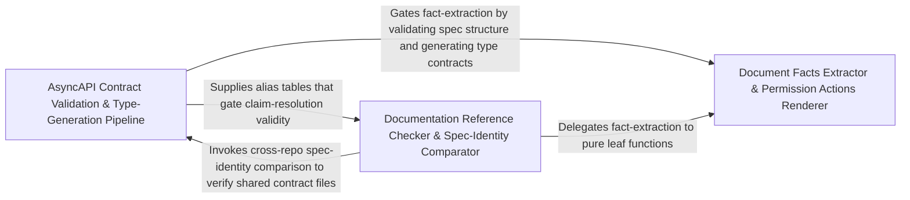

---
tags:
  - 2brain
  - 2brain/arch
  - project/boilerplate-vue-frontend
type: architecture
component: Contract_Validation
---

## Details

Verification tooling that validates the AsyncAPI contract and checks documentation references/facts, with the demo backend runner as a secondary concern.

### AsyncAPI Contract Validation & Type-Generation Pipeline [[Expand]](./AsyncAPI_Contract_Validation_Type_Generation_Pipeline.md)
This is the entry-point and spec-level correctness sub-component. It owns the full lifecycle of the AsyncAPI contract: parsing the spec, running structural validation (isInvalid), generating TypeScript model types (generate-asyncapi-types), and comparing spec identity across shared files (SpecComparison, normalise). It also hosts the demo backend runner (run-backend.boot), which boots a mock server to exercise the validated contract at runtime. The readAliases helper bridges into the reference-checking layer by extracting alias tables that downstream claim resolution consumes. This group is architecturally central because every other sub-component in the subsystem depends on the spec being validated and types being generated before documentation facts can be checked.

**Related Classes/Methods**:

- `scripts.contracts.validate-asyncapi.isInvalid`:38-43
- `scripts.demo.run-backend.boot`:51-96
- `scripts.docs.check-references.readAliases`:213-222

**Source Files:**

- `scripts/contracts/generate-asyncapi-types.ts`
  - `scripts.contracts.generate-asyncapi-types.renderLiteralArray.lines` (L251-L251) - Class
  - `scripts.contracts.generate-asyncapi-types.renderLiteralArray.lines.values.map() callback` (L251-L251) - Function
  - `scripts.contracts.generate-asyncapi-types.renderPayloadMap.rows` (L266-L270) - Class
  - `scripts.contracts.generate-asyncapi-types.renderPayloadMap.rows.entries.map() callback` (L268-L268) - Function
- `scripts/contracts/validate-asyncapi.ts`
  - `scripts.contracts.validate-asyncapi.isInvalid` (L38-L43) - Class
  - `scripts.contracts.validate-asyncapi.isInvalid.diagnostics.some() callback` (L40-L42) - Function
  - `scripts.contracts.validate-asyncapi.files.map() callback` (L50-L62) - Function
  - `scripts.contracts.validate-asyncapi.files.map() callback.then() callback` (L51-L62) - Function
  - `scripts.contracts.validate-asyncapi.then() callback` (L65-L69) - Function
  - `scripts.contracts.validate-asyncapi.catch() callback` (L70-L73) - Function
- `scripts/demo/run-backend.ts`
  - `scripts.demo.run-backend.boot` (L51-L96) - Class
  - `scripts.demo.run-backend.boot.process.on() callback` (L87-L89) - Function
  - `scripts.demo.run-backend.boot.child.on('close') callback` (L91-L95) - Function
  - `scripts.demo.run-backend.setInterval() callback` (L114-L114) - Function
- `scripts/docs/check-references.ts`
  - `scripts.docs.check-references.readAliases` (L213-L222) - Class
  - `scripts.docs.check-references.readAliases.map() callback` (L218-L221) - Function
  - `scripts.docs.check-references.run.pages` (L517-L523) - Class
  - `scripts.docs.check-references.run.pages.filter() callback` (L523-L523) - Function
- `scripts/docs/document-facts.ts`
  - `scripts.docs.document-facts.fencedContractImports.fences` (L109-L109) - Class
  - `scripts.docs.document-facts.fencedContractImports.fences.map() callback` (L109-L109) - Function
  - `scripts.docs.document-facts.fencedContractImports.fences.flatMap() callback` (L110-L125) - Function
  - `scripts.docs.document-facts.fencedContractImports.fences.flatMap() callback.flatMap() callback` (L113-L124) - Function
  - `scripts.docs.document-facts.fencedContractImports.fences.flatMap() callback.flatMap() callback.map() callback` (L124-L124) - Function
  - `scripts.docs.document-facts.exportedNames` (L156-L163) - Class
  - `scripts.docs.document-facts.exportedNames.map() callback` (L162-L162) - Function
- `scripts/mutation/baseline.ts`
  - `scripts.mutation.baseline.scoresFromReport.scored` (L101-L101) - Class
  - `scripts.mutation.baseline.scoresFromReport.scored.mutants.filter() callback` (L101-L101) - Function
  - `scripts.mutation.baseline.formatUnrecorded.lines` (L225-L225) - Class
  - `scripts.mutation.baseline.formatUnrecorded.lines.unrecorded.map() callback` (L225-L225) - Function
- `scripts/pairing/spec-identity.ts`
  - `scripts.pairing.spec-identity.SharedFile` (L29-L34) - Interface
  - `scripts.pairing.spec-identity.SpecComparison` (L130-L140) - Interface
  - `scripts.pairing.spec-identity.normalise` (L161-L173) - Class
  - `scripts.pairing.spec-identity.normalise.value.map() callback` (L162-L162) - Function
- `src/app/components/use-language-switch.ts`
  - `src.app.components.use-language-switch.switchLanguage` (L48-L62) - Class
- `src/app/guards/authentications.ts`
  - `src.app.guards.authentications.restoreSessionIfNeeded` (L142-L149) - Class
  - `src.app.guards.authentications.restoreSessionIfNeeded.then() callback` (L147-L147) - Function
  - `src.app.guards.authentications.restoreSessionIfNeeded.catch() callback` (L148-L148) - Function
- `src/infrastructure/analytics-consent.ts`
  - `src.infrastructure.analytics-consent.useAnalyticsConsentStore.defineStore('analytics-consent') callback` (L84-L213) - Function
  - `src.infrastructure.analytics-consent.defineStore('analytics-consent') callback.effective` (L100-L103) - Class
  - `src.infrastructure.analytics-consent.useAnalyticsConsentStore.defineStore('analytics-consent') callback.effective.computed() callback` (L100-L103) - Function
  - `src.infrastructure.analytics-consent.defineStore('analytics-consent') callback.promptOpen` (L123-L123) - Class
  - `src.infrastructure.analytics-consent.useAnalyticsConsentStore.defineStore('analytics-consent') callback.promptOpen.computed() callback` (L123-L123) - Function
  - `src.infrastructure.analytics-consent.useAnalyticsConsentStore.defineStore('analytics-consent') callback.trackBrowsing.catch() callback` (L160-L162) - Function
- `src/infrastructure/browser-storage.ts`
  - `src.infrastructure.browser-storage.BROWSER_STORAGE_ITEMS` (L87-L89) - Class
  - `src.infrastructure.browser-storage.BROWSER_STORAGE_ITEMS.BROWSER_STORAGE_DATA.map() callback` (L88-L88) - Function
- `src/infrastructure/config.ts`
  - `src.infrastructure.config.loadConfig` (L34-L46) - Class
  - `src.infrastructure.config.loadConfig.then() callback` (L36-L39) - Function
  - `src.infrastructure.config.loadConfig.catch() callback` (L40-L44) - Function
- `src/infrastructure/http/antibot.ts`
  - `src.infrastructure.http.antibot.fetchAntibotConfig` (L57-L61) - Class
  - `src.infrastructure.http.antibot.fetchAntibotConfig.then() callback` (L58-L61) - Function
- `src/infrastructure/http/envelope.ts`
  - `src.infrastructure.http.envelope.ApiErrorItem` (L19-L24) - Interface
- `src/infrastructure/http/interceptors.ts`
  - `src.infrastructure.http.interceptors.onResponseReject` (L222-L227) - Class
  - `src.infrastructure.http.interceptors.onResponseReject.then() callback` (L225-L226) - Function
- `src/infrastructure/http/problem.ts`
  - `src.infrastructure.http.problem.readProblemBody` (L46-L58) - Class
  - `src.infrastructure.http.problem.readProblemBody.then() callback` (L56-L56) - Function
- `src/infrastructure/http/reauth-prompt.ts`
  - `src.infrastructure.http.reauth-prompt.PendingStepUp` (L17-L32) - Interface
  - `src.infrastructure.http.reauth-prompt.useReauthPromptStore` (L41-L90) - Class
  - `src.infrastructure.http.reauth-prompt.useReauthPromptStore.defineStore('reauth-prompt') callback` (L41-L90) - Function
  - `src.infrastructure.http.reauth-prompt.defineStore('reauth-prompt') callback.isOpen` (L50-L50) - Class
  - `src.infrastructure.http.reauth-prompt.useReauthPromptStore.defineStore('reauth-prompt') callback.isOpen.computed() callback` (L50-L50) - Function
  - `src.infrastructure.http.reauth-prompt.defineStore('reauth-prompt') callback.requiredMethods` (L55-L55) - Class
  - `src.infrastructure.http.reauth-prompt.useReauthPromptStore.defineStore('reauth-prompt') callback.requiredMethods.computed() callback` (L55-L55) - Function
  - `src.infrastructure.http.reauth-prompt.defineStore('reauth-prompt') callback.requestStepUp` (L64-L67) - Class
  - `src.infrastructure.http.reauth-prompt.useReauthPromptStore.defineStore('reauth-prompt') callback.requestStepUp.<function>` (L65-L67) - Function
- `src/infrastructure/http/refresh.ts`
  - `src.infrastructure.http.refresh.NO_REFRESH_ROUTES` (L39-L39) - Class
  - `src.infrastructure.http.refresh.NO_REFRESH_ROUTES.ROUTES.filter() callback` (L39-L39) - Function
  - `src.infrastructure.http.refresh.shouldSkipRefresh` (L48-L54) - Class
  - `src.infrastructure.http.refresh.shouldSkipRefresh.NO_REFRESH_ROUTES.some() callback` (L52-L52) - Function
  - `src.infrastructure.http.refresh.onResponseRejectWithRefresh` (L128-L170) - Class
  - `src.infrastructure.http.refresh.onResponseRejectWithRefresh.then() callback` (L150-L161) - Function
- `src/infrastructure/http/single-flight.ts`
  - `src.infrastructure.http.single-flight.singleFlight` (L15-L23) - Class
  - `src.infrastructure.http.single-flight.singleFlight.<function>` (L17-L22) - Function
  - `src.infrastructure.http.single-flight.singleFlight.<function>.finally() callback` (L18-L20) - Function
  - `src.infrastructure.http.single-flight.exclusiveRunner` (L32-L40) - Class
  - `src.infrastructure.http.single-flight.exclusiveRunner.<function>` (L36-L39) - Function
  - `src.infrastructure.http.single-flight.exclusiveRunner.<function>.finally() callback` (L37-L39) - Function
- `src/infrastructure/http/step-up.ts`
  - `src.infrastructure.http.step-up.requestFreshSession.singleFlight() callback` (L43-L44) - Function
  - `src.infrastructure.http.step-up.requestFreshSession` (L43-L45) - Class
  - `src.infrastructure.http.step-up.methodsOf` (L53-L58) - Class
  - `src.infrastructure.http.step-up.methodsOf.methods.filter() callback` (L56-L56) - Function
  - `src.infrastructure.http.step-up.onResponseRejectWithStepUp` (L68-L95) - Class
  - `src.infrastructure.http.step-up.onResponseRejectWithStepUp.then() callback` (L73-L95) - Function
  - `src.infrastructure.http.step-up.onResponseRejectWithStepUp.then() callback.then() callback` (L85-L89) - Function
  - `src.infrastructure.http.step-up.onResponseRejectWithStepUp.then() callback.catch() callback` (L91-L91) - Function
- `src/infrastructure/locale-overrides.ts`
  - `src.infrastructure.locale-overrides.readRemoteLocales` (L120-L149) - Class
  - `src.infrastructure.locale-overrides.readRemoteLocales.then() callback` (L122-L148) - Function
  - `src.infrastructure.locale-overrides.readRemoteLocales.catch() callback` (L149-L149) - Function
  - `src.infrastructure.locale-overrides.mergeRemoteLocales.then() callback.added.target.filter() callback` (L224-L224) - Function
- `src/infrastructure/locale-preference.ts`
  - `src.infrastructure.locale-preference.persistLocalePreference` (L27-L34) - Class
  - `src.infrastructure.locale-preference.persistLocalePreference.then() callback` (L32-L32) - Function
  - `src.infrastructure.locale-preference.persistLocalePreference.catch() callback` (L33-L33) - Function
- `src/infrastructure/observability/config.ts`
  - `src.infrastructure.observability.config.propagationTargets` (L119-L121) - Function
- `src/infrastructure/observability/store.ts`
  - `src.infrastructure.observability.store.SpanAttribute` (L61-L64) - Interface
  - `src.infrastructure.observability.store.OtlpPayload` (L69-L71) - Interface
  - `src.infrastructure.observability.store.spanAttributes` (L80-L84) - Class
  - `src.infrastructure.observability.store.flatMap() callback` (L82-L82) - Function
  - `src.infrastructure.observability.store.spanAttributes.flatMap() callback` (L84-L84) - Function
  - `src.infrastructure.observability.store.EventPayload` (L128-L131) - Interface
  - `src.infrastructure.observability.store.defineStore('observability') callback.setFaroConsent` (L358-L379) - Class
  - `src.infrastructure.observability.store.useObservabilityStore.defineStore('observability') callback.setFaroConsent.then() callback` (L368-L374) - Function
  - `src.infrastructure.observability.store.useObservabilityStore.defineStore('observability') callback.setFaroConsent.catch() callback` (L376-L378) - Function
- `src/infrastructure/reauth.ts`
  - `src.infrastructure.reauth.useReauthStore` (L52-L79) - Class
  - `src.infrastructure.reauth.useReauthStore.defineStore('reauth') callback` (L52-L79) - Function
  - `src.infrastructure.reauth.useReauthStore.defineStore('reauth') callback.reauth.then() callback` (L70-L72) - Function
  - `src.infrastructure.reauth.useReauthStore.defineStore('reauth') callback.reauth.finally() callback` (L73-L75) - Function
- `src/infrastructure/runtime-config.ts`
  - `src.infrastructure.runtime-config.readApiUrl` (L59-L61) - Function
- `src/infrastructure/session.ts`
  - `src.infrastructure.session.SessionViewer` (L110-L152) - Interface
  - `src.infrastructure.session.useSessionStore` (L182-L792) - Class
  - `src.infrastructure.session.useSessionStore.defineStore('session') callback` (L182-L792) - Function
  - `src.infrastructure.session.defineStore('session') callback.hasSession` (L223-L223) - Class
  - `src.infrastructure.session.useSessionStore.defineStore('session') callback.hasSession.computed() callback` (L223-L223) - Function
  - `src.infrastructure.session.defineStore('session') callback.isAuth` (L230-L230) - Class
  - `src.infrastructure.session.useSessionStore.defineStore('session') callback.isAuth.computed() callback` (L230-L230) - Function
  - `src.infrastructure.session.defineStore('session') callback.loadSessionMode` (L410-L418) - Class
  - `src.infrastructure.session.useSessionStore.defineStore('session') callback.loadSessionMode.then() callback` (L411-L418) - Function
  - `src.infrastructure.session.defineStore('session') callback.reloadAbilities` (L444-L456) - Class
  - `src.infrastructure.session.useSessionStore.defineStore('session') callback.reloadAbilities.then() callback` (L447-L450) - Function
  - `src.infrastructure.session.useSessionStore.defineStore('session') callback.reloadAbilities.catch() callback` (L451-L451) - Function
  - `src.infrastructure.session.useSessionStore.defineStore('session') callback.reloadAbilities.finally() callback` (L452-L454) - Function
  - `src.infrastructure.session.defineStore('session') callback.refreshToken` (L523-L557) - Class
  - `src.infrastructure.session.useSessionStore.defineStore('session') callback.refreshToken.then() callback` (L533-L546) - Function
  - `src.infrastructure.session.useSessionStore.defineStore('session') callback.refreshToken.catch() callback` (L547-L551) - Function
  - `src.infrastructure.session.useSessionStore.defineStore('session') callback.refreshToken.finally() callback` (L552-L554) - Function
  - `src.infrastructure.session.defineStore('session') callback.restoreFromCookies` (L569-L576) - Class
  - `src.infrastructure.session.useSessionStore.defineStore('session') callback.restoreFromCookies.then() callback` (L572-L576) - Function
  - `src.infrastructure.session.useSessionStore.defineStore('session') callback.restoreFromCookies.then() callback.then() callback` (L574-L574) - Function
  - `src.infrastructure.session.defineStore('session') callback.loadViewer` (L583-L601) - Class
  - `src.infrastructure.session.useSessionStore.defineStore('session') callback.loadViewer.then() callback` (L584-L601) - Function
  - `src.infrastructure.session.defineStore('session') callback.touchSession` (L657-L661) - Class
  - `src.infrastructure.session.useSessionStore.defineStore('session') callback.touchSession.catch() callback` (L661-L661) - Function
  - `src.infrastructure.session.useSessionStore.defineStore('session') callback.rereadSession` (L670-L674) - Class
  - `src.infrastructure.session.defineStore('session') callback.rereadSession.then() callback` (L672-L672) - Function
  - `src.infrastructure.session.useSessionStore.defineStore('session') callback.rereadSession.then() callback` (L673-L673) - Function
  - `src.infrastructure.session.useSessionStore.defineStore('session') callback.rereadSession.catch() callback` (L674-L674) - Function
  - `src.infrastructure.session.useSessionStore.defineStore('session') callback.onScopeDispose() callback` (L695-L695) - Function
  - `src.infrastructure.session.defineStore('session') callback.logout` (L745-L746) - Class
  - `src.infrastructure.session.useSessionStore.defineStore('session') callback.logout.then() callback` (L746-L746) - Function
  - `src.infrastructure.session.defineStore('session') callback.logoutAll` (L755-L756) - Class
  - `src.infrastructure.session.useSessionStore.defineStore('session') callback.logoutAll.then() callback` (L756-L756) - Function
- `src/infrastructure/tour-seen.ts`
  - `src.infrastructure.tour-seen.markTourSeen.keys.filter() callback` (L82-L82) - Function
- `src/infrastructure/utils/request-ticket.ts`
  - `src.infrastructure.utils.request-ticket.RequestClaim` (L16-L27) - Interface
- `src/kernel/use-badge-refresh.ts`
  - `src.kernel.use-badge-refresh.BadgeRefreshOptions` (L25-L41) - Interface
  - `src.kernel.use-badge-refresh.useBadgeRefresh` (L54-L111) - Class
  - `src.kernel.use-badge-refresh.useBadgeRefresh.refresh` (L64-L75) - Class
  - `src.kernel.use-badge-refresh.useBadgeRefresh.refresh.then() callback` (L67-L69) - Function
  - `src.kernel.use-badge-refresh.useBadgeRefresh.refresh.catch() callback` (L70-L74) - Function
  - `src.kernel.use-badge-refresh.useBadgeRefresh.watch() callback` (L96-L98) - Function
  - `src.kernel.use-badge-refresh.useBadgeRefresh.onScopeDispose() callback` (L108-L110) - Function
- `src/modules/account/stores/auth.ts`
  - `src.modules.account.stores.auth.useAccountAuthStore` (L61-L317) - Class
  - `src.modules.account.stores.auth.useAccountAuthStore.defineStore('account-auth') callback` (L61-L317) - Function
  - `src.modules.account.stores.auth.useAccountAuthStore.defineStore('account-auth') callback.toLoginOutcome` (L84-L111) - Class
  - `src.modules.account.stores.auth.useAccountAuthStore.defineStore('account-auth') callback.toLoginOutcome.then() callback` (L110-L110) - Function
  - `src.modules.account.stores.auth.useAccountAuthStore.defineStore('account-auth') callback.login.fetchAny() callback` (L140-L148) - Function
  - `src.modules.account.stores.auth.useAccountAuthStore.defineStore('account-auth') callback.login.fetchAny() callback.then() callback` (L148-L148) - Function
  - `src.modules.account.stores.auth.useAccountAuthStore.defineStore('account-auth') callback.login.then() callback` (L149-L152) - Function
  - `src.modules.account.stores.auth.useAccountAuthStore.defineStore('account-auth') callback.signup.fetchAny() callback` (L197-L216) - Function
  - `src.modules.account.stores.auth.useAccountAuthStore.defineStore('account-auth') callback.signup.fetchAny() callback.then() callback` (L209-L212) - Function
  - `src.modules.account.stores.auth.useAccountAuthStore.defineStore('account-auth') callback.signup.fetchAny() callback.catch() callback` (L213-L216) - Function
  - `src.modules.account.stores.auth.defineStore('account-auth') callback.setAvatarAfterSignup` (L231-L237) - Class
  - `src.modules.account.stores.auth.defineStore('account-auth') callback.setAvatarAfterSignup.then() callback` (L235-L235) - Function
  - `src.modules.account.stores.auth.useAccountAuthStore.defineStore('account-auth') callback.setAvatarAfterSignup.then() callback` (L236-L236) - Function
  - `src.modules.account.stores.auth.useAccountAuthStore.defineStore('account-auth') callback.requestPasswordReset.fetchAny() callback` (L249-L249) - Function
  - `src.modules.account.stores.auth.useAccountAuthStore.defineStore('account-auth') callback.confirmPasswordReset.fetchAny() callback` (L268-L276) - Function
  - `src.modules.account.stores.auth.useAccountAuthStore.defineStore('account-auth') callback.confirmPasswordReset.fetchAny() callback.then() callback` (L274-L276) - Function
  - `src.modules.account.stores.auth.useAccountAuthStore.defineStore('account-auth') callback.logout.then() callback` (L289-L293) - Function
  - `src.modules.account.stores.auth.useAccountAuthStore.defineStore('account-auth') callback.logoutEverywhere.then() callback` (L302-L305) - Function
- `src/modules/account/stores/profile.ts`
  - `src.modules.account.stores.profile.useAccountProfileStore` (L69-L599) - Class
  - `src.modules.account.stores.profile.useAccountProfileStore.defineStore('account-profile') callback` (L69-L599) - Function
  - `src.modules.account.stores.profile.useAccountProfileStore.defineStore('account-profile') callback.fetchProfile.fetchTarget() callback` (L150-L169) - Function
  - `src.modules.account.stores.profile.useAccountProfileStore.defineStore('account-profile') callback.fetchProfile.fetchTarget() callback.then() callback` (L151-L169) - Function
  - `src.modules.account.stores.profile.useAccountProfileStore.defineStore('account-profile') callback.fetchProfile.then() callback` (L172-L179) - Function
  - `src.modules.account.stores.profile.useAccountProfileStore.defineStore('account-profile') callback.fetchProfile.then() callback.then() callback` (L178-L178) - Function
  - `src.modules.account.stores.profile.defineStore('account-profile') callback.updateProfile` (L247-L300) - Class
  - `src.modules.account.stores.profile.useAccountProfileStore.defineStore('account-profile') callback.updateProfile.updateTarget() callback` (L268-L282) - Function
  - `src.modules.account.stores.profile.defineStore('account-profile') callback.updateProfile.updateTarget() callback.uploadThenClear() callback` (L273-L274) - Function
  - `src.modules.account.stores.profile.useAccountProfileStore.defineStore('account-profile') callback.updateProfile.updateTarget() callback.uploadThenClear() callback` (L275-L275) - Function
  - `src.modules.account.stores.profile.useAccountProfileStore.defineStore('account-profile') callback.updateProfile.updateTarget() callback.then() callback` (L278-L282) - Function
  - `src.modules.account.stores.profile.useAccountProfileStore.defineStore('account-profile') callback.updateProfile.then() callback` (L292-L298) - Function
  - `src.modules.account.stores.profile.useAccountProfileStore.defineStore('account-profile') callback.updateProfile.then() callback.then() callback` (L298-L298) - Function
  - `src.modules.account.stores.profile.useAccountProfileStore.defineStore('account-profile') callback.requestEmailChange.fetchAny() callback` (L341-L344) - Function
  - `src.modules.account.stores.profile.useAccountProfileStore.defineStore('account-profile') callback.requestEmailChange.fetchAny() callback.then() callback` (L342-L343) - Function
  - `src.modules.account.stores.profile.useAccountProfileStore.defineStore('account-profile') callback.requestEmailChange.fetchAny() callback.then() callback.then() callback` (L343-L343) - Function
  - `src.modules.account.stores.profile.useAccountProfileStore.defineStore('account-profile') callback.cancelPendingEmailChange.fetchAny() callback` (L358-L359) - Function
  - `src.modules.account.stores.profile.useAccountProfileStore.defineStore('account-profile') callback.cancelPendingEmailChange.fetchAny() callback.then() callback.then() callback` (L359-L359) - Function
  - `src.modules.account.stores.profile.useAccountProfileStore.defineStore('account-profile') callback.resendPendingEmail.fetchAny() callback` (L376-L376) - Function
  - `src.modules.account.stores.profile.useAccountProfileStore.defineStore('account-profile') callback.resendPendingEmail.then() callback` (L377-L377) - Function
  - `src.modules.account.stores.profile.useAccountProfileStore.defineStore('account-profile') callback.changePassword.fetchAny() callback` (L396-L399) - Function
  - `src.modules.account.stores.profile.useAccountProfileStore.defineStore('account-profile') callback.changePassword.fetchAny() callback.then() callback` (L397-L399) - Function
  - `src.modules.account.stores.profile.useAccountProfileStore.defineStore('account-profile') callback.confirmEmailVerification.fetchAny() callback` (L411-L414) - Function
  - `src.modules.account.stores.profile.useAccountProfileStore.defineStore('account-profile') callback.confirmEmailVerification.fetchAny() callback.then() callback` (L412-L413) - Function
  - `src.modules.account.stores.profile.useAccountProfileStore.defineStore('account-profile') callback.confirmEmailVerification.fetchAny() callback.then() callback.then() callback` (L413-L413) - Function
  - `src.modules.account.stores.profile.useAccountProfileStore.defineStore('account-profile') callback.confirmEmailChange.fetchAny() callback` (L427-L430) - Function
  - `src.modules.account.stores.profile.useAccountProfileStore.defineStore('account-profile') callback.confirmEmailChange.fetchAny() callback.then() callback` (L428-L429) - Function
  - `src.modules.account.stores.profile.useAccountProfileStore.defineStore('account-profile') callback.confirmEmailChange.fetchAny() callback.then() callback.then() callback` (L429-L429) - Function
  - `src.modules.account.stores.profile.useAccountProfileStore.defineStore('account-profile') callback.undoEmailChange.fetchAny() callback` (L443-L443) - Function
  - `src.modules.account.stores.profile.useAccountProfileStore.defineStore('account-profile') callback.watch() callback` (L449-L451) - Function
  - `src.modules.account.stores.profile.useAccountProfileStore.defineStore('account-profile') callback.$onAction() callback` (L456-L463) - Function
  - `src.modules.account.stores.profile.useAccountProfileStore.defineStore('account-profile') callback.$onAction() callback.after() callback` (L458-L462) - Function
  - `src.modules.account.stores.profile.useAccountProfileStore.defineStore('account-profile') callback.$onAction() callback.after() callback.catch() callback` (L459-L461) - Function
  - `src.modules.account.stores.profile.useAccountProfileStore.defineStore('account-profile') callback.requestAccountDelete.fetchAny() callback` (L493-L493) - Function
  - `src.modules.account.stores.profile.useAccountProfileStore.defineStore('account-profile') callback.requestAccountDelete.fetchAny() callback.then() callback` (L493-L493) - Function
  - `src.modules.account.stores.profile.useAccountProfileStore.defineStore('account-profile') callback.requestAccountDelete.then() callback` (L493-L498) - Function
  - `src.modules.account.stores.profile.useAccountProfileStore.defineStore('account-profile') callback.requestAccountExport.fetchAny() callback` (L513-L513) - Function
  - `src.modules.account.stores.profile.useAccountProfileStore.defineStore('account-profile') callback.requestAccountExport.fetchAny() callback.then() callback` (L513-L513) - Function
  - `src.modules.account.stores.profile.useAccountProfileStore.defineStore('account-profile') callback.fetchAccountExport.fetchAny() callback` (L523-L527) - Function
  - `src.modules.account.stores.profile.useAccountProfileStore.defineStore('account-profile') callback.fetchAccountExport.fetchAny() callback.catch() callback` (L524-L527) - Function
  - `src.modules.account.stores.profile.useAccountProfileStore.defineStore('account-profile') callback.downloadAccountExport.fetchAny() callback` (L542-L542) - Function
  - `src.modules.account.stores.profile.useAccountProfileStore.defineStore('account-profile') callback.downloadAccountExport.then() callback` (L543-L543) - Function
  - `src.modules.account.stores.profile.useAccountProfileStore.defineStore('account-profile') callback.restoreAccount.fetchAny() callback` (L553-L553) - Function
  - `src.modules.account.stores.profile.useAccountProfileStore.defineStore('account-profile') callback.uploadingAvatar.computed() callback` (L558-L558) - Function
  - `src.modules.account.stores.profile.useAccountProfileStore.defineStore('account-profile') callback.removingAvatar.computed() callback` (L563-L563) - Function
  - `src.modules.account.stores.profile.useAccountProfileStore.defineStore('account-profile') callback.savingProfile.computed() callback` (L568-L568) - Function
  - `src.modules.account.stores.profile.useAccountProfileStore.defineStore('account-profile') callback.changingPendingEmail.computed() callback` (L573-L573) - Function
- `src/modules/cart/checkout-attempt-storage.ts`
  - `src.modules.cart.checkout-attempt-storage.CheckoutAttempt` (L23-L36) - Interface
- `src/modules/cart/composables/use-cart-stock-poll.ts`
  - `src.modules.cart.composables.use-cart-stock-poll.useCartStockPoll` (L37-L128) - Class
  - `src.modules.cart.composables.use-cart-stock-poll.watch() callback` (L66-L68) - Function
  - `src.modules.cart.composables.use-cart-stock-poll.useCartStockPoll.tick` (L93-L97) - Class
  - `src.modules.cart.composables.use-cart-stock-poll.useCartStockPoll.tick.catch() callback` (L94-L96) - Function
  - `src.modules.cart.composables.use-cart-stock-poll.useCartStockPoll.watch() callback` (L113-L120) - Function
  - `src.modules.cart.composables.use-cart-stock-poll.useCartStockPoll.onScopeDispose() callback` (L124-L127) - Function
- `src/modules/cart/composables/use-checkout-refusals.ts`
  - `src.modules.cart.composables.use-checkout-refusals.CheckoutRefusalHooks` (L38-L43) - Interface
  - `src.modules.cart.composables.use-checkout-refusals.useCheckoutRefusals.refetchCart` (L132-L136) - Class
  - `src.modules.cart.composables.use-checkout-refusals.refetchCart.then() callback` (L134-L134) - Function
  - `src.modules.cart.composables.use-checkout-refusals.useCheckoutRefusals.refetchCart.then() callback` (L135-L135) - Function
- `src/modules/cart/composables/use-guest-cart.ts`
  - `src.modules.cart.composables.use-guest-cart.guestQuantity` (L34-L34) - Class
- `src/modules/cart/domain/checkout-errors.ts`
  - `src.modules.cart.domain.checkout-errors.listDetail` (L173-L182) - Class
  - `src.modules.cart.domain.checkout-errors.listDetail.filter() callback` (L181-L181) - Function
  - `src.modules.cart.domain.checkout-errors.listDetail.map() callback` (L181-L181) - Function
  - `src.modules.cart.domain.checkout-errors.VERDICT_BY_CODE` (L198-L243) - Class
  - `src.modules.cart.domain.checkout-errors.<function>` (L202-L202) - Function
  - `src.modules.cart.domain.checkout-errors.VERDICT_BY_CODE.<function>` (L242-L242) - Function
- `src/modules/cart/domain/guest-cart.ts`
  - `src.modules.cart.domain.guest-cart.addGuestLine.existing` (L83-L83) - Class
  - `src.modules.cart.domain.guest-cart.addGuestLine.existing.lines.find() callback` (L83-L83) - Function
  - `src.modules.cart.domain.guest-cart.subtractGuestLines.lines.flatMap() callback.taken` (L139-L139) - Class
  - `src.modules.cart.domain.guest-cart.subtractGuestLines.lines.flatMap() callback.taken.sent.find() callback` (L139-L139) - Function
  - `src.modules.cart.domain.guest-cart.MergeAttempt` (L200-L209) - Interface
- `src/modules/cart/store.ts`
  - `src.modules.cart.store.defineStore('cart') callback.pollCart` (L334-L349) - Class
  - `src.modules.cart.store.defineStore('cart') callback.settleFailedCheckout.then() callback` (L438-L438) - Function
  - `src.modules.cart.store.defineStore('cart') callback.seedAfterSignIn` (L634-L666) - Class
  - `src.modules.cart.store.defineStore('cart') callback.seedAfterSignIn.settled.read.then() callback` (L652-L652) - Function
- `src/modules/shop-tasks/composables/use-shop-work-feed.ts`
  - `src.modules.shop-tasks.composables.use-shop-work-feed.useShopWorkFeed` (L15-L34) - Class
  - `src.modules.shop-tasks.composables.use-shop-work-feed.useShopWorkFeed.readerId.computed() callback` (L20-L26) - Function
  - `src.modules.shop-tasks.composables.use-shop-work-feed.useShopWorkFeed.read` (L31-L31) - Method
- `src/modules/shop-tasks/store.ts`
  - `src.modules.shop-tasks.store.useShopTasksStore` (L19-L46) - Class
  - `src.modules.shop-tasks.store.useShopTasksStore.defineStore('shop-tasks') callback` (L19-L46) - Function
  - `src.modules.shop-tasks.store.useShopTasksStore.defineStore('shop-tasks') callback.loadSummary.fetchAny() callback` (L36-L36) - Function
  - `src.modules.shop-tasks.store.useShopTasksStore.defineStore('shop-tasks') callback.loadSummary.then() callback` (L41-L43) - Function
- `src/modules/users/badge-store.ts`
  - `src.modules.users.badge-store.useUsersBadgeStore` (L19-L50) - Class
  - `src.modules.users.badge-store.useUsersBadgeStore.defineStore('users-badge') callback` (L19-L50) - Function
  - `src.modules.users.badge-store.defineStore('users-badge') callback.loadReviewTotal` (L40-L47) - Class
  - `src.modules.users.badge-store.useUsersBadgeStore.defineStore('users-badge') callback.loadReviewTotal.fetchAny() callback` (L43-L43) - Function
  - `src.modules.users.badge-store.useUsersBadgeStore.defineStore('users-badge') callback.loadReviewTotal.then() callback` (L45-L47) - Function
- `src/modules/users/composables/use-review-badge.ts`
  - `src.modules.users.composables.use-review-badge.useReviewBadge` (L19-L33) - Class
  - `src.modules.users.composables.use-review-badge.useReviewBadge.readerId.computed() callback` (L25-L25) - Function
  - `src.modules.users.composables.use-review-badge.useReviewBadge.read` (L26-L26) - Method
  - `src.modules.users.composables.use-review-badge.useReviewBadge.clear` (L27-L29) - Method
- `src/modules/users/composables/use-role-options.ts`
  - `src.modules.users.composables.use-role-options.RoleOption` (L16-L19) - Interface
  - `src.modules.users.composables.use-role-options.useRoleOptions` (L27-L49) - Class
  - `src.modules.users.composables.use-role-options.roleOptions` (L39-L46) - Class
  - `src.modules.users.composables.use-role-options.useRoleOptions.roleOptions.map() callback` (L44-L44) - Function
  - `src.modules.users.composables.use-role-options.useRoleOptions.grantableRoles` (L48-L48) - Method
- `src/modules/users/composables/use-user-summary.ts`
  - `src.modules.users.composables.use-user-summary.heroTitle` (L31-L31) - Class
  - `src.modules.users.composables.use-user-summary.heroDescription` (L34-L34) - Class
  - `src.modules.users.composables.use-user-summary.userRole` (L40-L40) - Class
  - `src.modules.users.composables.use-user-summary.userStatus` (L43-L45) - Class
- `src/modules/users/store.ts`
  - `src.modules.users.store.defineStore('users') callback.applyAccessChange` (L289-L301) - Class
  - `src.modules.users.store.defineStore('users') callback.setPurchaseHold` (L311-L317) - Class
  - `src.modules.users.store.defineStore('users') callback.liftPurchaseHold` (L328-L334) - Class
- `src/modules/webhooks/badge-store.ts`
  - `src.modules.webhooks.badge-store.useWebhooksBadgeStore` (L19-L49) - Class
  - `src.modules.webhooks.badge-store.useWebhooksBadgeStore.defineStore('webhooks-badge') callback` (L19-L49) - Function
  - `src.modules.webhooks.badge-store.useWebhooksBadgeStore.defineStore('webhooks-badge') callback.loadAutoDisabledTotal.fetchAny() callback` (L42-L42) - Function
  - `src.modules.webhooks.badge-store.useWebhooksBadgeStore.defineStore('webhooks-badge') callback.loadAutoDisabledTotal.then() callback` (L44-L46) - Function
- `src/modules/webhooks/composables/use-auto-disabled-badge.ts`
  - `src.modules.webhooks.composables.use-auto-disabled-badge.useAutoDisabledBadge` (L19-L35) - Class
  - `src.modules.webhooks.composables.use-auto-disabled-badge.useAutoDisabledBadge.readerId.computed() callback` (L25-L26) - Function
  - `src.modules.webhooks.composables.use-auto-disabled-badge.useAutoDisabledBadge.read` (L28-L28) - Method
  - `src.modules.webhooks.composables.use-auto-disabled-badge.useAutoDisabledBadge.clear` (L29-L31) - Method
- `src/vite-env.d.ts`
  - `src.vite-env.d.ViteTypeOptions` (L14-L16) - Interface
  - `src.vite-env.d.ImportMetaEnv` (L24-L50) - Interface

### Documentation Reference Checker & Spec-Identity Comparator
This sub-component is the claim-resolution and cross-file consistency engine. It models the core data structures of the reference-checking pipeline — Claim (a documented assertion), Finding (the resolution outcome), and Scan (the traversal context) — and implements the resolves function that maps each claim to a concrete source location or flags it as broken. The allowed predicate and ALLOWED list gate which references are considered valid. The compareSharedFiles and sharedFileProblems functions in spec-identity.ts enforce that shared spec files remain structurally consistent with each other. The mutation baseline helpers (formatRegressions, formatUnrecorded) track whether validation results have regressed against a recorded baseline, enabling CI gate enforcement. This group is the decision core of the subsystem: it transforms raw documentation text into pass/fail verdicts with actionable findings.

**Related Classes/Methods**:

- `scripts.docs.check-references.resolves`:355-356
- `scripts.pairing.spec-identity.compareSharedFiles`:209-239

**Source Files:**

- `scripts/contracts/generate-asyncapi-types.ts`
  - `scripts.contracts.generate-asyncapi-types.then() callback.modelBlocks` (L494-L499) - Class
- `scripts/docs/check-references.ts`
  - `scripts.docs.check-references.Finding` (L141-L144) - Interface
  - `scripts.docs.check-references.allowed` (L199-L205) - Class
  - `scripts.docs.check-references.allowed.ALLOWED.some() callback` (L201-L204) - Function
  - `scripts.docs.check-references.trackedTargets.roots.files.map() callback` (L259-L259) - Function
  - `scripts.docs.check-references.resolves` (L355-L356) - Class
  - `scripts.docs.check-references.resolves.SPELLINGS.some() callback` (L356-L356) - Function
  - `scripts.docs.check-references.Scan` (L359-L362) - Interface
  - `scripts.docs.check-references.Claim` (L365-L368) - Interface
  - `scripts.docs.check-references.run.roots` (L509-L509) - Class
  - `scripts.docs.check-references.run.roots.ALLOWED.map() callback` (L509-L509) - Function
- `scripts/mutation/baseline.ts`
  - `scripts.mutation.baseline.formatUnrecorded.unrecorded` (L222-L222) - Class
  - `scripts.mutation.baseline.formatUnrecorded.unrecorded.comparisons.filter() callback` (L222-L222) - Function
  - `scripts.mutation.baseline.formatRegressions.lines` (L241-L244) - Class
  - `scripts.mutation.baseline.formatRegressions.lines.regressed.map() callback` (L242-L243) - Function
- `scripts/pairing/spec-identity.ts`
  - `scripts.pairing.spec-identity.compareSharedFiles` (L209-L239) - Class
  - `scripts.pairing.spec-identity.compareSharedFiles.SHARED_FILES.map() callback` (L214-L239) - Function
  - `scripts.pairing.spec-identity.sharedFileProblems` (L242-L243) - Class
  - `scripts.pairing.spec-identity.sharedFileProblems.comparisons.filter() callback` (L243-L243) - Function
- `src/kernel/registry.ts`
  - `src.kernel.registry.AppTourStep` (L145-L178) - Interface
  - `src.kernel.registry.NoticeContext` (L183-L200) - Interface
  - `src.kernel.registry.collectModuleTours` (L434-L435) - Class
  - `src.kernel.registry.collectModuleTours.appModules.flatMap() callback` (L435-L435) - Function
- `src/kernel/work-counts.ts`
  - `src.kernel.work-counts.useWorkCount` (L25-L26) - Class
  - `src.kernel.work-counts.useWorkCount.computed() callback` (L26-L26) - Function
- `src/main.ts`
  - `src.main.then() callback.watch() callback` (L163-L163) - Function
- `src/modules/account/composables/use-countdown.ts`
  - `src.modules.account.composables.use-countdown.useCountdown` (L21-L74) - Class
  - `src.modules.account.composables.use-countdown.useCountdown.watch() callback` (L47-L54) - Function
  - `src.modules.account.composables.use-countdown.useCountdown.watch() callback.setInterval() callback` (L51-L53) - Function
  - `src.modules.account.composables.use-countdown.secondsLeft` (L63-L71) - Class
  - `src.modules.account.composables.use-countdown.useCountdown.secondsLeft.computed() callback` (L63-L71) - Function
  - `src.modules.account.composables.use-countdown.useExpiryCountdown` (L83-L84) - Class
  - `src.modules.account.composables.use-countdown.useExpiryCountdown.computed() callback` (L84-L84) - Function
  - `src.modules.account.composables.use-countdown.useCountdownAnnouncement` (L118-L146) - Class
  - `src.modules.account.composables.use-countdown.useCountdownAnnouncement.watch() callback` (L135-L141) - Function
  - `src.modules.account.composables.use-countdown.useCountdownAnnouncement.watch() callback.threshold` (L136-L136) - Class
  - `src.modules.account.composables.use-countdown.useCountdownAnnouncement.watch() callback.threshold.ANNOUNCEMENT_THRESHOLDS.find() callback` (L136-L136) - Function
- `src/modules/account/composables/use-password-breach-check.ts`
  - `src.modules.account.composables.use-password-breach-check.usePasswordBreachCheck` (L21-L81) - Class
  - `src.modules.account.composables.use-password-breach-check.usePasswordBreachCheck.send` (L43-L58) - Class
  - `src.modules.account.composables.use-password-breach-check.usePasswordBreachCheck.send.debounce() callback` (L43-L58) - Function
  - `src.modules.account.composables.use-password-breach-check.usePasswordBreachCheck.send.debounce() callback.then() callback` (L47-L50) - Function
  - `src.modules.account.composables.use-password-breach-check.usePasswordBreachCheck.send.debounce() callback.catch() callback` (L51-L54) - Function
  - `src.modules.account.composables.use-password-breach-check.usePasswordBreachCheck.send.debounce() callback.finally() callback` (L55-L57) - Function
  - `src.modules.account.composables.use-password-breach-check.usePasswordBreachCheck.onScopeDispose() callback` (L78-L78) - Function
- `src/modules/account/composables/use-password-strength.ts`
  - `src.modules.account.composables.use-password-strength.loadZxcvbn` (L22-L50) - Class
  - `src.modules.account.composables.use-password-strength.loadZxcvbn.then() callback` (L29-L41) - Function
  - `src.modules.account.composables.use-password-strength.loadZxcvbn.catch() callback` (L45-L48) - Function
  - `src.modules.account.composables.use-password-strength.usePasswordStrength` (L61-L85) - Class
  - `src.modules.account.composables.use-password-strength.usePasswordStrength.watch() callback` (L66-L80) - Function
  - `src.modules.account.composables.use-password-strength.usePasswordStrength.watch() callback.then() callback` (L75-L78) - Function
  - `src.modules.account.composables.use-password-strength.usePasswordStrength.watch() callback.catch() callback` (L79-L79) - Function
- `src/modules/account/stores/addresses.ts`
  - `src.modules.account.stores.addresses.defineStore('account-addresses') callback.addAddress` (L91-L96) - Class
  - `src.modules.account.stores.addresses.defineStore('account-addresses') callback.updateAddress` (L106-L107) - Class
  - `src.modules.account.stores.addresses.defineStore('account-addresses') callback.removeAddress` (L126-L127) - Class
- `src/modules/account/stores/deletion-restore.ts`
  - `src.modules.account.stores.deletion-restore.PendingRestore` (L23-L32) - Interface
  - `src.modules.account.stores.deletion-restore.defineStore('account-deletion-restore') callback.restoreAndSignIn` (L94-L110) - Class
- `src/modules/account/stores/oauth-links.ts`
  - `src.modules.account.stores.oauth-links.defineStore('account-oauth-links') callback.unlinkProvider` (L88-L89) - Class
- `src/modules/account/stores/oauth-providers.ts`
  - `src.modules.account.stores.oauth-providers.oauthStartUrl.parameters` (L71-L75) - Class
  - `src.modules.account.stores.oauth-providers.oauthStartUrl.parameters.filter() callback` (L72-L73) - Function
  - `src.modules.account.stores.oauth-providers.useAccountOAuthProvidersStore` (L84-L134) - Class
  - `src.modules.account.stores.oauth-providers.useAccountOAuthProvidersStore.defineStore('account-oauth-providers') callback` (L84-L134) - Function
  - `src.modules.account.stores.oauth-providers.useAccountOAuthProvidersStore.defineStore('account-oauth-providers') callback.fetchProviders.fetchAny() callback` (L118-L125) - Function
  - `src.modules.account.stores.oauth-providers.useAccountOAuthProvidersStore.defineStore('account-oauth-providers') callback.fetchProviders.fetchAny() callback.then() callback` (L119-L125) - Function
  - `src.modules.account.stores.oauth-providers.useAccountOAuthProvidersStore.defineStore('account-oauth-providers') callback.fetchProviders.catch() callback` (L126-L126) - Function
- `src/modules/account/stores/profile.ts`
  - `src.modules.account.stores.profile.defineStore('account-profile') callback.cancelPendingEmailChange` (L356-L363) - Class
  - `src.modules.account.stores.profile.defineStore('account-profile') callback.resendPendingEmail` (L375-L378) - Class
  - `src.modules.account.stores.profile.defineStore('account-profile') callback.confirmEmailVerification` (L410-L415) - Class
  - `src.modules.account.stores.profile.defineStore('account-profile') callback.requestAccountExport` (L512-L513) - Class
  - `src.modules.account.stores.profile.defineStore('account-profile') callback.fetchAccountExport` (L522-L528) - Class
  - `src.modules.account.stores.profile.defineStore('account-profile') callback.uploadingAvatar` (L558-L558) - Class
  - `src.modules.account.stores.profile.defineStore('account-profile') callback.removingAvatar` (L563-L563) - Class
  - `src.modules.account.stores.profile.defineStore('account-profile') callback.savingProfile` (L568-L568) - Class
  - `src.modules.account.stores.profile.defineStore('account-profile') callback.changingPendingEmail` (L573-L573) - Class
- `src/modules/account/stores/two-factor.ts`
  - `src.modules.account.stores.two-factor.LoginChallenge` (L44-L50) - Interface
  - `src.modules.account.stores.two-factor.useAccountTwoFactorStore` (L60-L446) - Class
  - `src.modules.account.stores.two-factor.useAccountTwoFactorStore.defineStore('account-two-factor') callback` (L60-L446) - Function
  - `src.modules.account.stores.two-factor.defineStore('account-two-factor') callback.fetchStatus` (L137-L143) - Class
  - `src.modules.account.stores.two-factor.useAccountTwoFactorStore.defineStore('account-two-factor') callback.fetchStatus.fetchAny() callback` (L138-L142) - Function
  - `src.modules.account.stores.two-factor.useAccountTwoFactorStore.defineStore('account-two-factor') callback.fetchStatus.fetchAny() callback.then() callback` (L139-L142) - Function
  - `src.modules.account.stores.two-factor.defineStore('account-two-factor') callback.setupMethod` (L160-L176) - Class
  - `src.modules.account.stores.two-factor.useAccountTwoFactorStore.defineStore('account-two-factor') callback.setupMethod.fetchAny() callback` (L163-L173) - Function
  - `src.modules.account.stores.two-factor.useAccountTwoFactorStore.defineStore('account-two-factor') callback.setupMethod.fetchAny() callback.then() callback` (L164-L173) - Function
  - `src.modules.account.stores.two-factor.useAccountTwoFactorStore.defineStore('account-two-factor') callback.sendMethodCode.fetchAny() callback` (L189-L193) - Function
  - `src.modules.account.stores.two-factor.useAccountTwoFactorStore.defineStore('account-two-factor') callback.sendMethodCode.fetchAny() callback.then() callback` (L190-L193) - Function
  - `src.modules.account.stores.two-factor.defineStore('account-two-factor') callback.confirmMethod` (L208-L217) - Class
  - `src.modules.account.stores.two-factor.useAccountTwoFactorStore.defineStore('account-two-factor') callback.confirmMethod.fetchAny() callback` (L210-L215) - Function
  - `src.modules.account.stores.two-factor.useAccountTwoFactorStore.defineStore('account-two-factor') callback.confirmMethod.fetchAny() callback.then() callback` (L211-L215) - Function
  - `src.modules.account.stores.two-factor.useAccountTwoFactorStore.defineStore('account-two-factor') callback.confirmMethod.fetchAny() callback.then() callback.then() callback` (L214-L214) - Function
  - `src.modules.account.stores.two-factor.defineStore('account-two-factor') callback.removeMethod` (L227-L231) - Class
  - `src.modules.account.stores.two-factor.useAccountTwoFactorStore.defineStore('account-two-factor') callback.removeMethod.fetchAny() callback` (L228-L228) - Function
  - `src.modules.account.stores.two-factor.useAccountTwoFactorStore.defineStore('account-two-factor') callback.removeMethod.fetchAny() callback.then() callback` (L228-L228) - Function
  - `src.modules.account.stores.two-factor.useAccountTwoFactorStore.defineStore('account-two-factor') callback.disableAll.fetchAny() callback` (L240-L240) - Function
  - `src.modules.account.stores.two-factor.useAccountTwoFactorStore.defineStore('account-two-factor') callback.disableAll.fetchAny() callback.then() callback` (L240-L240) - Function
  - `src.modules.account.stores.two-factor.useAccountTwoFactorStore.defineStore('account-two-factor') callback.regenerateBackupCodes.fetchAny() callback` (L257-L261) - Function
  - `src.modules.account.stores.two-factor.useAccountTwoFactorStore.defineStore('account-two-factor') callback.regenerateBackupCodes.fetchAny() callback.then() callback` (L258-L261) - Function
  - `src.modules.account.stores.two-factor.useAccountTwoFactorStore.defineStore('account-two-factor') callback.regenerateBackupCodes.fetchAny() callback.then() callback.then() callback` (L260-L260) - Function
  - `src.modules.account.stores.two-factor.useAccountTwoFactorStore.defineStore('account-two-factor') callback.sendingCode.computed() callback` (L270-L270) - Function
  - `src.modules.account.stores.two-factor.defineStore('account-two-factor') callback.confirmingCode` (L275-L275) - Class
  - `src.modules.account.stores.two-factor.useAccountTwoFactorStore.defineStore('account-two-factor') callback.confirmingCode.computed() callback` (L275-L275) - Function
  - `src.modules.account.stores.two-factor.defineStore('account-two-factor') callback.mutatingWithCode` (L281-L283) - Class
  - `src.modules.account.stores.two-factor.useAccountTwoFactorStore.defineStore('account-two-factor') callback.mutatingWithCode.computed() callback` (L282-L282) - Function
  - `src.modules.account.stores.two-factor.defineStore('account-two-factor') callback.sendLoginCode` (L361-L372) - Class
  - `src.modules.account.stores.two-factor.useAccountTwoFactorStore.defineStore('account-two-factor') callback.sendLoginCode.fetchAny() callback` (L365-L369) - Function
  - `src.modules.account.stores.two-factor.useAccountTwoFactorStore.defineStore('account-two-factor') callback.sendLoginCode.fetchAny() callback.then() callback` (L366-L369) - Function
  - `src.modules.account.stores.two-factor.useAccountTwoFactorStore.defineStore('account-two-factor') callback.submitLoginCode.fetchAny() callback` (L387-L416) - Function
  - `src.modules.account.stores.two-factor.useAccountTwoFactorStore.defineStore('account-two-factor') callback.submitLoginCode.fetchAny() callback.then() callback` (L394-L416) - Function
  - `src.modules.account.stores.two-factor.useAccountTwoFactorStore.defineStore('account-two-factor') callback.submitLoginCode.fetchAny() callback.then() callback.then() callback` (L412-L415) - Function
- `src/modules/example/store.ts`
  - `src.modules.example.store.defineStore('example') callback.fetchPublished` (L186-L186) - Class
- `src/modules/locales/domain/translation-drafts.ts`
  - `src.modules.locales.domain.translation-drafts.toUpdateEntityTranslationsBody` (L23-L41) - Class
  - `src.modules.locales.domain.translation-drafts.toUpdateEntityTranslationsBody.map() callback` (L27-L40) - Function
  - `src.modules.locales.domain.translation-drafts.toUpdateEntityTranslationsBody.map() callback.fields.map() callback` (L33-L36) - Function
- `src/modules/orders/domain/reorder.ts`
  - `src.modules.orders.domain.reorder.reorderOutcome.nameOf` (L41-L43) - Class
  - `src.modules.orders.domain.reorder.reorderOutcome.nameOf.orderLines.map() callback` (L42-L42) - Function
- `src/modules/orders/domain/timeline.ts`
  - `src.modules.orders.domain.timeline.TimelineLine` (L49-L54) - Interface
- `src/modules/products/composables/use-release-date-confirm.ts`
  - `src.modules.products.composables.use-release-date-confirm.confirmReleaseDateMove` (L59-L88) - Class
- `src/modules/products/store.ts`
  - `src.modules.products.store.defineStore('products') callback.fetchTranslationLocales` (L476-L487) - Class
- `src/modules/returns/store.ts`
  - `src.modules.returns.store.defineStore('returns') callback.fetchReturnOptions` (L152-L153) - Class
- `src/modules/shop-tasks/composables/use-shop-work-feed.ts`
  - `src.modules.shop-tasks.composables.use-shop-work-feed.readerId` (L20-L27) - Class
- `src/modules/stats/domain/chart.ts`
  - `src.modules.stats.domain.chart.chartTable.header.chart.series.map() callback` (L45-L45) - Function
  - `src.modules.stats.domain.chart.chartTable.rows.chart.labels.map() callback.chart.series.map() callback` (L48-L48) - Function
- `src/modules/stats/domain/csv.ts`
  - `src.modules.stats.domain.csv.toCsv` (L46-L47) - Class
  - `src.modules.stats.domain.csv.toCsv.map() callback.row.map() callback` (L47-L47) - Function
- `src/modules/stats/domain/mermaid.ts`
  - `src.modules.stats.domain.mermaid.pieChartSource` (L70-L78) - Class
  - `src.modules.stats.domain.mermaid.pieChartSource.chart.labels.flatMap() callback` (L74-L75) - Function
- `src/modules/stats/domain/period.ts`
  - `src.modules.stats.domain.period.StatsPeriodChoice` (L14-L21) - Interface
- `src/modules/stats/store.ts`
  - `src.modules.stats.store.defineStore('stats') callback.loadProductSales` (L158-L164) - Class
- `src/modules/tasks/schemas.ts`
  - `src.modules.tasks.schemas.email.error` (L32-L32) - Method
- `src/modules/webhooks/domain/subscription-status.ts`
  - `src.modules.webhooks.domain.subscription-status.SubscriptionStatusFilter` (L32-L35) - Interface

### Document Facts Extractor & Permission Actions Renderer
This sub-component is the page-level fact extraction and structured output layer. DocumentPage models a single documentation page and its extracted facts; PackageFacts captures the ground-truth state of the package (exported names, npm scripts, dependency listings) against which facts are verified. The extraction pipeline produces FactFinding records for categories such as missingScripts, staleListings, unknownContractImports, fencedContractImports, codeSpans, and unnamedOn. The factFindings.byPath index aggregates findings per file path for reporting. The renderPermissionActions function converts the contract's permission-action definitions into a structured table, ensuring the documented permission matrix matches the spec. This group is the output and reporting sub-component: it turns raw extraction data into human- and machine-readable findings that feed CI reports and developer feedback.

**Related Classes/Methods**:

- `scripts.docs.check-references.factFindings.byPath`

**Source Files:**

- `scripts/docs/check-references.ts`
  - `scripts.docs.check-references.throughAliases.alias.aliases.find() callback` (L336-L337) - Function
  - `scripts.docs.check-references.throughAliases.alias` (L336-L338) - Class
  - `scripts.docs.check-references.factFindings.byPath` (L486-L486) - Class
  - `scripts.docs.check-references.factFindings.byPath.pages.map() callback` (L486-L486) - Function
  - `scripts.docs.check-references.run.documentPages` (L540-L543) - Class
  - `scripts.docs.check-references.run.documentPages.pages.map() callback` (L540-L543) - Function
- `scripts/docs/document-facts.ts`
  - `scripts.docs.document-facts.DocumentPage` (L18-L23) - Interface
  - `scripts.docs.document-facts.PackageFacts` (L28-L35) - Interface
  - `scripts.docs.document-facts.FactFinding` (L40-L45) - Interface
  - `scripts.docs.document-facts.npmScriptsCited` (L54-L56) - Class
  - `scripts.docs.document-facts.npmScriptsCited.map() callback` (L55-L55) - Function
  - `scripts.docs.document-facts.missingScripts` (L65-L70) - Class
  - `scripts.docs.document-facts.missingScripts.pages.flatMap() callback` (L66-L69) - Function
  - `scripts.docs.document-facts.missingScripts.pages.flatMap() callback.filter() callback` (L68-L68) - Function
  - `scripts.docs.document-facts.missingScripts.pages.flatMap() callback.map() callback` (L69-L69) - Function
  - `scripts.docs.document-facts.staleListings` (L97-L100) - Class
  - `scripts.docs.document-facts.staleListings.filter() callback` (L99-L99) - Function
  - `scripts.docs.document-facts.staleListings.map() callback` (L100-L100) - Function
  - `scripts.docs.document-facts.fencedContractImports` (L108-L127) - Class
  - `scripts.docs.document-facts.fences.flatMap() callback.flatMap() callback.map() callback` (L117-L121) - Function
  - `scripts.docs.document-facts.unknownContractImports` (L136-L147) - Class
  - `scripts.docs.document-facts.unknownContractImports.pages.flatMap() callback` (L140-L146) - Function
  - `scripts.docs.document-facts.unknownContractImports.pages.flatMap() callback.filter() callback` (L142-L142) - Function
  - `scripts.docs.document-facts.unknownContractImports.pages.flatMap() callback.map() callback` (L143-L146) - Function
- `scripts/mutation/baseline.ts`
  - `scripts.mutation.baseline.scoresFromReport.killed` (L109-L109) - Class
  - `scripts.mutation.baseline.scoresFromReport.killed.scored.filter() callback` (L109-L109) - Function
  - `scripts.mutation.baseline.formatRegressions.regressed` (L238-L238) - Class
  - `scripts.mutation.baseline.formatRegressions.regressed.comparisons.filter() callback` (L238-L238) - Function
- `scripts/pairing/spec-identity.ts`
  - `scripts.pairing.spec-identity.formatSharedFileProblems.lines` (L260-L276) - Class
  - `scripts.pairing.spec-identity.formatSharedFileProblems.lines.problems.map() callback` (L260-L276) - Function
- `src/app/components/use-focus-tooltip.ts`
  - `src.app.components.use-focus-tooltip.FocusTooltip` (L16-L33) - Interface
  - `src.app.components.use-focus-tooltip.useFocusTooltip` (L52-L71) - Class
  - `src.app.components.use-focus-tooltip.useFocusTooltip.openTooltipOnRealFocus` (L61-L63) - Method
  - `src.app.components.use-focus-tooltip.useFocusTooltip.closeTooltip` (L64-L69) - Method
  - `src.app.components.use-focus-tooltip.useFocusTooltip.closeTooltip.setTimeout() callback` (L66-L68) - Function
- `src/app/tours/catalogue.ts`
  - `src.app.tours.catalogue.TourDefinition` (L21-L32) - Interface
- `src/app/tours/use-tour.ts`
  - `src.app.tours.use-tour.startTour` (L119-L161) - Class
  - `src.app.tours.use-tour.startTour.then() callback` (L128-L133) - Function
  - `src.app.tours.use-tour.useTour.startTour.then() callback.then() callback` (L132-L132) - Function
  - `src.app.tours.use-tour.useTour.startTour.then() callback` (L135-L156) - Function
  - `src.app.tours.use-tour.useTour.startTour.catch() callback` (L157-L160) - Function
- `src/kernel/use-badge-refresh.ts`
  - `src.kernel.use-badge-refresh.useBadgeRefresh.staffNoticeCount` (L77-L79) - Class
  - `src.kernel.use-badge-refresh.useBadgeRefresh.staffNoticeCount.computed() callback` (L78-L78) - Function
  - `src.kernel.use-badge-refresh.useBadgeRefresh.staffNoticeCount.computed() callback.notices.value.filter() callback` (L78-L78) - Function
- `src/main.ts`
  - `src.main.bootstrapApplication.then() callback.watch() callback` (L165-L165) - Function
- `src/modules/account/stores/addresses.ts`
  - `src.modules.account.stores.addresses.defineStore('account-addresses') callback.fetchAddresses` (L65-L66) - Class
  - `src.modules.account.stores.addresses.defineStore('account-addresses') callback.setDefaultAddress` (L116-L117) - Class
- `src/modules/account/stores/auth.ts`
  - `src.modules.account.stores.auth.defineStore('account-auth') callback.login` (L134-L152) - Class
  - `src.modules.account.stores.auth.defineStore('account-auth') callback.signup` (L179-L217) - Class
  - `src.modules.account.stores.auth.defineStore('account-auth') callback.requestPasswordReset` (L248-L249) - Class
  - `src.modules.account.stores.auth.defineStore('account-auth') callback.confirmPasswordReset` (L262-L277) - Class
  - `src.modules.account.stores.auth.defineStore('account-auth') callback.logout` (L287-L294) - Class
  - `src.modules.account.stores.auth.defineStore('account-auth') callback.logoutEverywhere` (L301-L306) - Class
- `src/modules/account/stores/deletion-restore.ts`
  - `src.modules.account.stores.deletion-restore.useAccountDeletionRestoreStore` (L37-L113) - Class
  - `src.modules.account.stores.deletion-restore.useAccountDeletionRestoreStore.defineStore('account-deletion-restore') callback` (L37-L113) - Function
  - `src.modules.account.stores.deletion-restore.useAccountDeletionRestoreStore.defineStore('account-deletion-restore') callback.restoreAndSignIn.fetchAny() callback` (L97-L108) - Function
  - `src.modules.account.stores.deletion-restore.useAccountDeletionRestoreStore.defineStore('account-deletion-restore') callback.restoreAndSignIn.fetchAny() callback.then() callback` (L101-L108) - Function
  - `src.modules.account.stores.deletion-restore.useAccountDeletionRestoreStore.defineStore('account-deletion-restore') callback.restoreAndSignIn.fetchAny() callback.then() callback.then() callback` (L105-L107) - Function
- `src/modules/account/stores/oauth-links.ts`
  - `src.modules.account.stores.oauth-links.defineStore('account-oauth-links') callback.fetchLinks` (L78-L78) - Class
- `src/modules/account/stores/oauth-providers.ts`
  - `src.modules.account.stores.oauth-providers.defineStore('account-oauth-providers') callback.fetchProviders` (L116-L127) - Class
- `src/modules/account/stores/profile.ts`
  - `src.modules.account.stores.profile.defineStore('account-profile') callback.fetchProfile` (L148-L180) - Class
  - `src.modules.account.stores.profile.defineStore('account-profile') callback.requestEmailChange` (L339-L347) - Class
  - `src.modules.account.stores.profile.defineStore('account-profile') callback.changePassword` (L395-L400) - Class
  - `src.modules.account.stores.profile.defineStore('account-profile') callback.confirmEmailChange` (L426-L431) - Class
  - `src.modules.account.stores.profile.defineStore('account-profile') callback.undoEmailChange` (L442-L443) - Class
  - `src.modules.account.stores.profile.defineStore('account-profile') callback.watch() callback` (L448-L448) - Function
  - `src.modules.account.stores.profile.defineStore('account-profile') callback.requestAccountDelete` (L492-L498) - Class
  - `src.modules.account.stores.profile.defineStore('account-profile') callback.downloadAccountExport` (L541-L544) - Class
  - `src.modules.account.stores.profile.defineStore('account-profile') callback.restoreAccount` (L553-L553) - Class
- `src/modules/account/stores/sessions.ts`
  - `src.modules.account.stores.sessions.useAccountSessionsStore` (L19-L70) - Class
- `src/modules/account/stores/two-factor.ts`
  - `src.modules.account.stores.two-factor.useAccountTwoFactorStore.defineStore('account-two-factor') callback.applyResendCooldown` (L124-L129) - Class
  - `src.modules.account.stores.two-factor.useAccountTwoFactorStore.defineStore('account-two-factor') callback.applyResendCooldown.promise.catch() callback` (L125-L129) - Function
  - `src.modules.account.stores.two-factor.defineStore('account-two-factor') callback.sendMethodCode` (L186-L196) - Class
  - `src.modules.account.stores.two-factor.defineStore('account-two-factor') callback.disableAll` (L239-L243) - Class
  - `src.modules.account.stores.two-factor.defineStore('account-two-factor') callback.regenerateBackupCodes` (L255-L263) - Class
  - `src.modules.account.stores.two-factor.defineStore('account-two-factor') callback.sendingCode` (L270-L270) - Class
  - `src.modules.account.stores.two-factor.defineStore('account-two-factor') callback.submitLoginCode` (L384-L418) - Class
- `src/modules/example/domain/publication.ts`
  - `src.modules.example.domain.publication.Publication` (L21-L26) - Interface
- `src/modules/example/module.ts`
  - `src.modules.example.module.'@/infrastructure/utils/logger.ts'.LogScopes` (L21-L23) - Interface
- `src/modules/example/store.ts`
  - `src.modules.example.store.ExampleFilters` (L45-L49) - Interface
  - `src.modules.example.store.defineStore('example') callback.transitionExample` (L152-L158) - Class
- `src/modules/inventory/domain/preorder-rows.ts`
  - `src.modules.inventory.domain.preorder-rows.PreorderRow` (L13-L24) - Interface
  - `src.modules.inventory.domain.preorder-rows.preorderRows` (L33-L60) - Class
  - `src.modules.inventory.domain.preorder-rows.preorderRows.toSorted() callback` (L55-L58) - Function
- `src/modules/orders/domain/reorder.ts`
  - `src.modules.orders.domain.reorder.ReorderOutcome` (L21-L26) - Interface
  - `src.modules.orders.domain.reorder.reorderOutcome.named` (L44-L47) - Class
  - `src.modules.orders.domain.reorder.reorderOutcome.named.results.filter() callback` (L46-L46) - Function
  - `src.modules.orders.domain.reorder.reorderOutcome.named.map() callback` (L47-L47) - Function
- `src/modules/orders/domain/timeline.ts`
  - `src.modules.orders.domain.timeline.DETAILS` (L222-L268) - Class
  - `src.modules.orders.domain.timeline.DETAILS.paid` (L223-L225) - Method
  - `src.modules.orders.domain.timeline.DETAILS.delivered` (L226-L228) - Method
  - `src.modules.orders.domain.timeline.DETAILS.canceled` (L229-L232) - Method
  - `src.modules.orders.domain.timeline.DETAILS.refund_failed` (L237-L245) - Method
  - `src.modules.orders.domain.timeline.DETAILS.shipment_shipped` (L248-L251) - Method
  - `src.modules.orders.domain.timeline.DETAILS.shipment_delivered` (L252-L254) - Method
  - `src.modules.orders.domain.timeline.DETAILS.shipment_lost` (L255-L258) - Method
  - `src.modules.orders.domain.timeline.DETAILS.fulfillment_held` (L259-L261) - Method
- `src/modules/orders/store.ts`
  - `src.modules.orders.store.defineStore('orders') callback.correctShippingAddress` (L330-L331) - Class
- `src/modules/payments/schemas.ts`
  - `src.modules.payments.schemas.error` (L23-L23) - Method
- `src/modules/payments/store.ts`
  - `src.modules.payments.store.defineStore('payments') callback.rereadAfterFault.then() callback` (L140-L140) - Function
  - `src.modules.payments.store.defineStore('payments') callback.settleRefundByHand` (L296-L313) - Class
  - `src.modules.payments.store.defineStore('payments') callback.settleRefundByHand.fetchAny() callback.then() callback` (L300-L300) - Function
  - `src.modules.payments.store.defineStore('payments') callback.findOrderIdByReference` (L390-L395) - Class
  - `src.modules.payments.store.defineStore('payments') callback.fetchPaymentsPage` (L441-L448) - Class
- `src/modules/products/store.ts`
  - `src.modules.products.store.defineStore('products') callback.loadingTranslationLocales` (L459-L459) - Class
- `src/modules/products/translation-tab-errors.ts`
  - `src.modules.products.translation-tab-errors.TranslationIssue` (L16-L19) - Interface
- `src/modules/returns/store.ts`
  - `src.modules.returns.store.defineStore('returns') callback.cancel` (L236-L237) - Class
- `src/modules/shop-tasks/describe.ts`
  - `src.modules.shop-tasks.describe.productName.anyTitle` (L53-L53) - Class
  - `src.modules.shop-tasks.describe.productName.anyTitle.find() callback` (L53-L53) - Function
  - `src.modules.shop-tasks.describe.lines` (L87-L92) - Class
- `src/modules/shop-tasks/notices.ts`
  - `src.modules.shop-tasks.notices.summaryNotices` (L67-L67) - Class
  - `src.modules.shop-tasks.notices.summaryNotices.SUMMARY_CODES.map() callback` (L67-L67) - Function
- `src/modules/stats/domain/chart.ts`
  - `src.modules.stats.domain.chart.ChartSeries` (L11-L18) - Interface
  - `src.modules.stats.domain.chart.ChartModel` (L23-L32) - Interface
  - `src.modules.stats.domain.chart.chartTable.rows.chart.labels.map() callback` (L46-L49) - Function
- `src/modules/stats/domain/mermaid.ts`
  - `src.modules.stats.domain.mermaid.xyChartSource` (L51-L61) - Class
  - `src.modules.stats.domain.mermaid.xyChartSource.chart.labels.map() callback` (L55-L55) - Function
  - `src.modules.stats.domain.mermaid.xyChartSource.chart.series.map() callback` (L58-L59) - Function
  - `src.modules.stats.domain.mermaid.xyChartSource.chart.series.map() callback.values.map() callback` (L59-L59) - Function
- `src/modules/stats/domain/period.ts`
  - `src.modules.stats.domain.period.periodFromQuery.candidate.interval.find() callback` (L127-L127) - Function
- `src/modules/stats/store.ts`
  - `src.modules.stats.store.defineStore('stats') callback.loadDashboard` (L121-L149) - Class
  - `src.modules.stats.store.defineStore('stats') callback.loadDashboard.fetchAny() callback.then() callback` (L125-L127) - Function
- `src/modules/tasks/store.ts`
  - `src.modules.tasks.store.defineStore('tasks') callback.loadSummary` (L133-L137) - Class
  - `src.modules.tasks.store.defineStore('tasks') callback.submitContact` (L175-L186) - Class
- `src/modules/webhooks/badge-store.ts`
  - `src.modules.webhooks.badge-store.defineStore('webhooks-badge') callback.loadAutoDisabledTotal` (L39-L46) - Class
- `src/modules/webhooks/store.ts`
  - `src.modules.webhooks.store.defineStore('webhooks') callback.writingSubscription` (L170-L170) - Class
  - `src.modules.webhooks.store.defineStore('webhooks') callback.createSecret` (L183-L192) - Class
  - `src.modules.webhooks.store.defineStore('webhooks') callback.enableSubscription` (L221-L229) - Class
  - `src.modules.webhooks.store.defineStore('webhooks') callback.disableSubscription` (L236-L244) - Class
  - `src.modules.webhooks.store.defineStore('webhooks') callback.eventCatalog` (L310-L310) - Class
