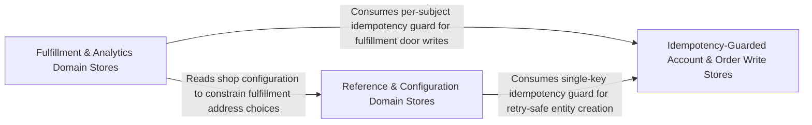

---
tags:
  - 2brain
  - 2brain/arch
  - project/boilerplate-vue-frontend
type: architecture
component: Domain_Module_State_Stores
---

## Details

The Pinia store layer and shared reactive state of the pluggable domain modules (account, delivery, inventory, orders, shop, locales, example), plus the reusable Idempotency-Key HTTP helper that guards their write calls — the state layer that sits between views and the generated HTTP client.

### Idempotency-Guarded Account & Order Write Stores
The write-heavy half of the state layer. It contains the reusable Idempotency-Key HTTP helper (src/infrastructure/http/idempotency.ts) — the single place where the 'mint a UUID, attach it as a header, settle on answer' pairing lives — together with the domain stores whose write paths must be safe to retry: the account sub-stores (address book, connected OAuth providers, device sessions), the orders store (notes, cancel, status override), the tasks store (contact submit, inbox status doors), and the payments store's refund path. These stores share one architectural pattern: a useStructureRestApi/useStructureCrudApi slice for loading + fetchAny, a plain ref for whole-list state, and sendKeyed(keeper, call) wrapping every non-idempotent write so a retry after a lost connection replays the server's first answer instead of double-writing.

**Related Classes/Methods**:

- `src.infrastructure.http.idempotency.sendKeyed`:104-118
- `src.infrastructure.http.idempotency.useIdempotencyKeys`:82-92
- `src.modules.account.stores.addresses.useAccountAddressesStore`:31-138
- `src.modules.account.stores.oauth-links.useAccountOAuthLinksStore`:47-92
- `src.modules.tasks.store.useTasksStore`:51-215

**Source Files:**

- `src/infrastructure/http/idempotency.ts`
  - `src.infrastructure.http.idempotency.IdempotencyKeysBySubject` (L65-L73) - Interface
  - `src.infrastructure.http.idempotency.useIdempotencyKeys` (L82-L92) - Class
  - `src.infrastructure.http.idempotency.useIdempotencyKeys.forSubject` (L86-L90) - Method
  - `src.infrastructure.http.idempotency.sendKeyed` (L104-L118) - Class
  - `src.infrastructure.http.idempotency.sendKeyed.then() callback` (L114-L117) - Function
- `src/modules/account/stores/addresses.ts`
  - `src.modules.account.stores.addresses.useAccountAddressesStore` (L31-L138) - Class
  - `src.modules.account.stores.addresses.useAccountAddressesStore.defineStore('account-addresses') callback` (L31-L138) - Function
  - `src.modules.account.stores.addresses.useAccountAddressesStore.defineStore('account-addresses') callback.fetchAddresses.fetchAny() callback` (L66-L66) - Function
  - `src.modules.account.stores.addresses.useAccountAddressesStore.defineStore('account-addresses') callback.fetchAddresses.fetchAny() callback.then() callback` (L66-L66) - Function
  - `src.modules.account.stores.addresses.useAccountAddressesStore.defineStore('account-addresses') callback.reloadBook` (L74-L74) - Class
  - `src.modules.account.stores.addresses.useAccountAddressesStore.defineStore('account-addresses') callback.reloadBook.then() callback` (L74-L74) - Function
  - `src.modules.account.stores.addresses.useAccountAddressesStore.defineStore('account-addresses') callback.addAddress.fetchAny() callback` (L92-L95) - Function
  - `src.modules.account.stores.addresses.useAccountAddressesStore.defineStore('account-addresses') callback.addAddress.fetchAny() callback.sendKeyed() callback` (L93-L94) - Function
  - `src.modules.account.stores.addresses.useAccountAddressesStore.defineStore('account-addresses') callback.addAddress.fetchAny() callback.then() callback` (L95-L95) - Function
  - `src.modules.account.stores.addresses.useAccountAddressesStore.defineStore('account-addresses') callback.updateAddress.fetchAny() callback` (L107-L107) - Function
  - `src.modules.account.stores.addresses.useAccountAddressesStore.defineStore('account-addresses') callback.updateAddress.fetchAny() callback.then() callback` (L107-L107) - Function
  - `src.modules.account.stores.addresses.useAccountAddressesStore.defineStore('account-addresses') callback.setDefaultAddress.fetchAny() callback` (L117-L117) - Function
  - `src.modules.account.stores.addresses.useAccountAddressesStore.defineStore('account-addresses') callback.setDefaultAddress.fetchAny() callback.then() callback` (L117-L117) - Function
  - `src.modules.account.stores.addresses.useAccountAddressesStore.defineStore('account-addresses') callback.removeAddress.fetchAny() callback` (L127-L127) - Function
  - `src.modules.account.stores.addresses.useAccountAddressesStore.defineStore('account-addresses') callback.removeAddress.fetchAny() callback.then() callback` (L127-L127) - Function
- `src/modules/account/stores/oauth-links.ts`
  - `src.modules.account.stores.oauth-links.startProviderLink` (L31-L42) - Class
  - `src.modules.account.stores.oauth-links.startProviderLink.then() callback` (L38-L42) - Function
  - `src.modules.account.stores.oauth-links.useAccountOAuthLinksStore` (L47-L92) - Class
  - `src.modules.account.stores.oauth-links.useAccountOAuthLinksStore.defineStore('account-oauth-links') callback` (L47-L92) - Function
  - `src.modules.account.stores.oauth-links.useAccountOAuthLinksStore.defineStore('account-oauth-links') callback.fetchLinks.fetchAny() callback` (L78-L78) - Function
  - `src.modules.account.stores.oauth-links.useAccountOAuthLinksStore.defineStore('account-oauth-links') callback.unlinkProvider.fetchAny() callback` (L89-L89) - Function
- `src/modules/account/stores/sessions.ts`
  - `src.modules.account.stores.sessions.useAccountSessionsStore.defineStore('account-sessions') callback` (L19-L70) - Function
  - `src.modules.account.stores.sessions.defineStore('account-sessions') callback.fetchSessions` (L41-L47) - Class
  - `src.modules.account.stores.sessions.useAccountSessionsStore.defineStore('account-sessions') callback.fetchSessions.fetchAny() callback` (L42-L46) - Function
  - `src.modules.account.stores.sessions.useAccountSessionsStore.defineStore('account-sessions') callback.fetchSessions.fetchAny() callback.then() callback` (L43-L46) - Function
  - `src.modules.account.stores.sessions.defineStore('account-sessions') callback.revokeSession` (L59-L62) - Class
  - `src.modules.account.stores.sessions.useAccountSessionsStore.defineStore('account-sessions') callback.revokeSession.fetchAny() callback` (L60-L61) - Function
  - `src.modules.account.stores.sessions.useAccountSessionsStore.defineStore('account-sessions') callback.revokeSession.fetchAny() callback.then() callback` (L61-L61) - Function
- `src/modules/delivery/composables/use-preorder-summaries.ts`
  - `src.modules.delivery.composables.use-preorder-summaries.usePreorderSummaries.summaries.computed() callback` (L20-L20) - Function
- `src/modules/notifications/store.ts`
  - `src.modules.notifications.store.useNotificationsInboxStore.defineStore('notifications-inbox') callback.dismissAll.ids` (L439-L443) - Class
  - `src.modules.notifications.store.useNotificationsInboxStore.defineStore('notifications-inbox') callback.dismissAll.ids.inbox.value.filter() callback` (L441-L441) - Function
  - `src.modules.notifications.store.useNotificationsInboxStore.defineStore('notifications-inbox') callback.dismissAll.ids.map() callback` (L443-L443) - Function
- `src/modules/orders/store.ts`
  - `src.modules.orders.store.addNote` (L132-L135) - Class
  - `src.modules.orders.store.addNote.sendKeyed() callback` (L133-L134) - Function
  - `src.modules.orders.store.useOrdersStore.defineStore('orders') callback.correctShippingAddress.updateTarget() callback` (L331-L331) - Function
- `src/modules/payments/store.ts`
  - `src.modules.payments.store.usePaymentsStore.defineStore('payments') callback.rereadAfterFault` (L132-L146) - Class
  - `src.modules.payments.store.usePaymentsStore.defineStore('payments') callback.rereadAfterFault.then() callback` (L144-L146) - Function
  - `src.modules.payments.store.usePaymentsStore.defineStore('payments') callback.readPayment.fetchAny() callback` (L156-L156) - Function
  - `src.modules.payments.store.usePaymentsStore.defineStore('payments') callback.finishAtProvider.fetchAny() callback.catch() callback` (L225-L231) - Function
  - `src.modules.payments.store.defineStore('payments') callback.refundPayment` (L252-L274) - Class
  - `src.modules.payments.store.usePaymentsStore.defineStore('payments') callback.refundPayment.fetchAny() callback` (L254-L272) - Function
  - `src.modules.payments.store.usePaymentsStore.defineStore('payments') callback.refundPayment.fetchAny() callback.then() callback` (L256-L262) - Function
  - `src.modules.payments.store.usePaymentsStore.defineStore('payments') callback.refundPayment.fetchAny() callback.then() callback.then() callback` (L258-L261) - Function
  - `src.modules.payments.store.usePaymentsStore.defineStore('payments') callback.refundPayment.fetchAny() callback.catch() callback` (L263-L272) - Function
  - `src.modules.payments.store.usePaymentsStore.defineStore('payments') callback.settleRefundByHand.fetchAny() callback` (L297-L312) - Function
  - `src.modules.payments.store.usePaymentsStore.defineStore('payments') callback.settleRefundByHand.fetchAny() callback.then() callback` (L301-L304) - Function
  - `src.modules.payments.store.usePaymentsStore.defineStore('payments') callback.settleRefundByHand.fetchAny() callback.catch() callback` (L305-L311) - Function
  - `src.modules.payments.store.usePaymentsStore.defineStore('payments') callback.cancelRefund.fetchAny() callback` (L333-L347) - Function
  - `src.modules.payments.store.usePaymentsStore.defineStore('payments') callback.cancelRefund.fetchAny() callback.then() callback` (L336-L339) - Function
  - `src.modules.payments.store.usePaymentsStore.defineStore('payments') callback.cancelRefund.fetchAny() callback.catch() callback` (L340-L346) - Function
  - `src.modules.payments.store.usePaymentsStore.defineStore('payments') callback.findOrderIdByReference.fetchAny() callback` (L391-L394) - Function
  - `src.modules.payments.store.usePaymentsStore.defineStore('payments') callback.findOrderIdByReference.fetchAny() callback.then() callback` (L393-L393) - Function
  - `src.modules.payments.store.usePaymentsStore.defineStore('payments') callback.fetchPaymentsPage.fetchAny() callback` (L442-L447) - Function
  - `src.modules.payments.store.usePaymentsStore.defineStore('payments') callback.fetchPaymentsPage.fetchAny() callback.then() callback` (L443-L447) - Function
  - `src.modules.payments.store.usePaymentsStore.defineStore('payments') callback.fetchAwaitingPage.fetchAny() callback` (L461-L472) - Function
  - `src.modules.payments.store.usePaymentsStore.defineStore('payments') callback.fetchAwaitingPage.fetchAny() callback.then() callback` (L468-L472) - Function
  - `src.modules.payments.store.usePaymentsStore.defineStore('payments') callback.fetchRefundsPage.fetchAny() callback` (L482-L487) - Function
  - `src.modules.payments.store.usePaymentsStore.defineStore('payments') callback.fetchRefundsPage.fetchAny() callback.then() callback` (L483-L487) - Function
  - `src.modules.payments.store.usePaymentsStore.defineStore('payments') callback.fetchAttention.fetchAny() callback` (L497-L501) - Function
  - `src.modules.payments.store.usePaymentsStore.defineStore('payments') callback.fetchAttention.fetchAny() callback.then() callback` (L498-L501) - Function
- `src/modules/tasks/store.ts`
  - `src.modules.tasks.store.useTasksStore` (L51-L215) - Class
  - `src.modules.tasks.store.useTasksStore.defineStore('tasks') callback` (L51-L215) - Function
  - `src.modules.tasks.store.useTasksStore.defineStore('tasks') callback.loadSummary.then() callback` (L134-L137) - Function
  - `src.modules.tasks.store.defineStore('tasks') callback.addNote` (L148-L151) - Class
  - `src.modules.tasks.store.useTasksStore.defineStore('tasks') callback.addNote.sendKeyed() callback` (L149-L150) - Function
  - `src.modules.tasks.store.useTasksStore.defineStore('tasks') callback.submitContact.fetchAny() callback` (L176-L185) - Function
  - `src.modules.tasks.store.useTasksStore.defineStore('tasks') callback.submitContact.fetchAny() callback.then() callback` (L178-L181) - Function
  - `src.modules.tasks.store.useTasksStore.defineStore('tasks') callback.submitContact.fetchAny() callback.catch() callback` (L182-L185) - Function

### Fulfillment & Analytics Domain Stores
The operational, read-dominant stores that drive the staff-facing dashboards and the order-fulfillment workflow. The delivery store owns shipping methods, the per-order fulfillment orders and shipments, the preorder board, and the ship/fulfill/hold/release status doors (each guarded by its own per-subject idempotency keeper). The stats store is a pure read-only fan-out: seven dashboard blocks, each the last answer to its own GET, fired together by loadDashboard and never cached across periods. The locales store is the translation-admin surface split into a languages half (manifest + explicit write wrappers) and a per-language entries half (toolkit-driven paginated CRUD). The products store contributes the viewer-scoped reset hook (useResetOnViewerChange) that the other stores in this group depend on for cache invalidation.

**Related Classes/Methods**:

- `src.modules.stats.store.useStatsStore`:48-180

**Source Files:**

- `src/modules/delivery/store.ts`
  - `src.modules.delivery.store.useDeliveryStore.defineStore('delivery') callback.fetchPreorderBoard.fetchAny() callback` (L128-L133) - Function
  - `src.modules.delivery.store.useDeliveryStore.defineStore('delivery') callback.fetchPreorderBoard.fetchAny() callback.then() callback` (L129-L133) - Function
  - `src.modules.delivery.store.useDeliveryStore.defineStore('delivery') callback.fetchPreorderSummaries.fetchAny() callback` (L142-L157) - Function
  - `src.modules.delivery.store.useDeliveryStore.defineStore('delivery') callback.fetchPreorderSummaries.fetchAny() callback.collect` (L143-L152) - Class
  - `src.modules.delivery.store.useDeliveryStore.defineStore('delivery') callback.fetchPreorderSummaries.fetchAny() callback.collect.then() callback` (L148-L151) - Function
  - `src.modules.delivery.store.useDeliveryStore.defineStore('delivery') callback.fetchPreorderSummaries.fetchAny() callback.then() callback` (L153-L156) - Function
  - `src.modules.delivery.store.useDeliveryStore.defineStore('delivery') callback.readFulfillment` (L181-L187) - Class
  - `src.modules.delivery.store.useDeliveryStore.defineStore('delivery') callback.readFulfillment.then() callback` (L183-L186) - Function
  - `src.modules.delivery.store.useDeliveryStore.defineStore('delivery') callback.fetchFulfillmentForOrder.fetchAny() callback` (L196-L196) - Function
  - `src.modules.delivery.store.useDeliveryStore.defineStore('delivery') callback.process.fetchAny() callback` (L207-L207) - Function
  - `src.modules.delivery.store.useDeliveryStore.defineStore('delivery') callback.process.fetchAny() callback.then() callback` (L207-L207) - Function
  - `src.modules.delivery.store.useDeliveryStore.defineStore('delivery') callback.failKeyedWrite` (L219-L237) - Class
  - `src.modules.delivery.store.useDeliveryStore.defineStore('delivery') callback.failKeyedWrite.orderId` (L225-L227) - Class
  - `src.modules.delivery.store.useDeliveryStore.defineStore('delivery') callback.failKeyedWrite.orderId.fulfillmentOrders.value.find() callback` (L226-L226) - Function
  - `src.modules.delivery.store.defineStore('delivery') callback.ship.fetchAny() callback.then() callback` (L252-L255) - Function
  - `src.modules.delivery.store.useDeliveryStore.defineStore('delivery') callback.ship.fetchAny() callback.then() callback.then() callback` (L254-L254) - Function
  - `src.modules.delivery.store.defineStore('delivery') callback.fulfill.fetchAny() callback.then() callback` (L271-L274) - Function
  - `src.modules.delivery.store.useDeliveryStore.defineStore('delivery') callback.fulfill.fetchAny() callback.then() callback.then() callback` (L273-L273) - Function
  - `src.modules.delivery.store.useDeliveryStore.defineStore('delivery') callback.hold.fetchAny() callback` (L288-L291) - Function
  - `src.modules.delivery.store.useDeliveryStore.defineStore('delivery') callback.hold.fetchAny() callback.then() callback` (L289-L290) - Function
  - `src.modules.delivery.store.useDeliveryStore.defineStore('delivery') callback.hold.fetchAny() callback.then() callback.then() callback` (L290-L290) - Function
  - `src.modules.delivery.store.useDeliveryStore.defineStore('delivery') callback.release.fetchAny() callback` (L302-L305) - Function
  - `src.modules.delivery.store.useDeliveryStore.defineStore('delivery') callback.release.fetchAny() callback.then() callback` (L303-L304) - Function
  - `src.modules.delivery.store.useDeliveryStore.defineStore('delivery') callback.release.fetchAny() callback.then() callback.then() callback` (L304-L304) - Function
  - `src.modules.delivery.store.useDeliveryStore.defineStore('delivery') callback.deliver.fetchAny() callback.then() callback.then() callback` (L318-L318) - Function
  - `src.modules.delivery.store.useDeliveryStore.defineStore('delivery') callback.markLost.fetchAny() callback` (L331-L334) - Function
  - `src.modules.delivery.store.useDeliveryStore.defineStore('delivery') callback.markLost.fetchAny() callback.then() callback` (L332-L333) - Function
  - `src.modules.delivery.store.useDeliveryStore.defineStore('delivery') callback.markLost.fetchAny() callback.then() callback.then() callback` (L333-L333) - Function
  - `src.modules.delivery.store.useDeliveryStore.defineStore('delivery') callback.editTracking.fetchAny() callback` (L345-L348) - Function
  - `src.modules.delivery.store.useDeliveryStore.defineStore('delivery') callback.editTracking.fetchAny() callback.then() callback` (L346-L347) - Function
  - `src.modules.delivery.store.useDeliveryStore.defineStore('delivery') callback.editTracking.fetchAny() callback.then() callback.then() callback` (L347-L347) - Function
- `src/modules/inventory/store.ts`
  - `src.modules.inventory.store.useInventoryStore.defineStore('inventory') callback.fetchPreorderLevels.fetchAny() callback` (L161-L171) - Function
  - `src.modules.inventory.store.useInventoryStore.defineStore('inventory') callback.fetchPreorderLevels.fetchAny() callback.collect` (L162-L166) - Class
  - `src.modules.inventory.store.useInventoryStore.defineStore('inventory') callback.fetchPreorderLevels.fetchAny() callback.collect.then() callback` (L163-L166) - Function
  - `src.modules.inventory.store.useInventoryStore.defineStore('inventory') callback.fetchPreorderLevels.fetchAny() callback.then() callback` (L167-L170) - Function
  - `src.modules.inventory.store.useInventoryStore.defineStore('inventory') callback.setLimit.fetchAny() callback` (L182-L185) - Function
  - `src.modules.inventory.store.useInventoryStore.defineStore('inventory') callback.setLimit.fetchAny() callback.then() callback` (L183-L184) - Function
  - `src.modules.inventory.store.useInventoryStore.defineStore('inventory') callback.setLimit.fetchAny() callback.then() callback.then() callback` (L184-L184) - Function
- `src/modules/locales/store.ts`
  - `src.modules.locales.store.useLocalesStore.defineStore('locales') callback.backendApp.computed() callback` (L200-L200) - Function
  - `src.modules.locales.store.useLocalesStore.defineStore('locales') callback.fetchApps.fetchAny() callback` (L218-L222) - Function
  - `src.modules.locales.store.useLocalesStore.defineStore('locales') callback.upsertLanguage` (L241-L247) - Class
  - `src.modules.locales.store.useLocalesStore.defineStore('locales') callback.upsertLanguage.capabilities.value.filter() callback` (L243-L243) - Function
  - `src.modules.locales.store.useLocalesStore.defineStore('locales') callback.upsertLanguage.toSorted() callback` (L245-L245) - Function
  - `src.modules.locales.store.useLocalesStore.defineStore('locales') callback.fetchLanguage.fetchAny() callback` (L271-L271) - Function
  - `src.modules.locales.store.useLocalesStore.defineStore('locales') callback.activateLanguage.fetchAny() callback` (L302-L302) - Function
  - `src.modules.locales.store.useLocalesStore.defineStore('locales') callback.deactivateLanguage.fetchAny() callback` (L311-L311) - Function
  - `src.modules.locales.store.useLocalesStore.defineStore('locales') callback.importEntries.entries` (L399-L399) - Class
  - `src.modules.locales.store.useLocalesStore.defineStore('locales') callback.importEntries.entries.rows.map() callback` (L399-L399) - Function
  - `src.modules.locales.store.useLocalesStore.defineStore('locales') callback.savingEntityTranslations.computed() callback` (L480-L480) - Function
- `src/modules/products/store.ts`
  - `src.modules.products.store.useProductsStore.defineStore('products') callback.useResetOnViewerChange() callback` (L356-L362) - Function
  - `src.modules.products.store.useProductsStore.defineStore('products') callback.useResetOnViewerChange() callback.predicate` (L360-L360) - Method
  - `src.modules.products.store.useProductsStore.defineStore('products') callback.fetchProductForEdit.fetchAny() callback` (L407-L407) - Function
  - `src.modules.products.store.useProductsStore.defineStore('products') callback.loadingProductForEdit.computed() callback` (L415-L415) - Function
  - `src.modules.products.store.useProductsStore.defineStore('products') callback.loadingTranslationLocales.computed() callback` (L459-L459) - Function
  - `src.modules.products.store.useProductsStore.defineStore('products') callback.fetchTranslationLocales.fetchAny() callback` (L477-L477) - Function
  - `src.modules.products.store.useProductsStore.defineStore('products') callback.fetchTranslationLocales.then() callback` (L478-L482) - Function
  - `src.modules.products.store.useProductsStore.defineStore('products') callback.fetchTranslationLocales.catch() callback` (L483-L487) - Function
- `src/modules/stats/store.ts`
  - `src.modules.stats.store.useStatsStore` (L48-L180) - Class
  - `src.modules.stats.store.useStatsStore.defineStore('stats') callback` (L48-L180) - Function
  - `src.modules.stats.store.useStatsStore.defineStore('stats') callback.loadDashboard.fetchAny() callback` (L123-L147) - Function
  - `src.modules.stats.store.useStatsStore.defineStore('stats') callback.loadDashboard.fetchAny() callback.then() callback` (L147-L147) - Function
  - `src.modules.stats.store.useStatsStore.defineStore('stats') callback.loadProductSales.fetchAny() callback` (L159-L163) - Function
  - `src.modules.stats.store.useStatsStore.defineStore('stats') callback.loadProductSales.fetchAny() callback.then() callback` (L160-L163) - Function
- `src/modules/webhooks/store.ts`
  - `src.modules.webhooks.store.useWebhooksStore.defineStore('webhooks') callback.writingSubscription.computed() callback` (L170-L170) - Function
  - `src.modules.webhooks.store.useWebhooksStore.defineStore('webhooks') callback.createSecret.fetchAnySubscriptions() callback` (L185-L190) - Function
  - `src.modules.webhooks.store.useWebhooksStore.defineStore('webhooks') callback.createSecret.fetchAnySubscriptions() callback.then() callback` (L186-L190) - Function
  - `src.modules.webhooks.store.useWebhooksStore.defineStore('webhooks') callback.enableSubscription.fetchAnySubscriptions() callback` (L223-L227) - Function
  - `src.modules.webhooks.store.useWebhooksStore.defineStore('webhooks') callback.enableSubscription.fetchAnySubscriptions() callback.then() callback` (L224-L227) - Function
  - `src.modules.webhooks.store.useWebhooksStore.defineStore('webhooks') callback.disableSubscription.fetchAnySubscriptions() callback` (L238-L242) - Function
  - `src.modules.webhooks.store.useWebhooksStore.defineStore('webhooks') callback.disableSubscription.fetchAnySubscriptions() callback.then() callback` (L239-L242) - Function
  - `src.modules.webhooks.store.useWebhooksStore.defineStore('webhooks') callback.eventCatalog.computed() callback` (L310-L310) - Function
  - `src.modules.webhooks.store.useWebhooksStore.defineStore('webhooks') callback.fetchEventCatalog.then() callback` (L315-L315) - Function

### Reference & Configuration Domain Stores
The reference-data and configuration half of the state layer: the shop record (currency, ship-to countries, time zone, backorder promise) held in module-level refs and loaded once via loadShop; the example module's store, which is the canonical template every other module's store is documented against (one defineStore, useStructureCrudApi for the generic CRUD, hand-written actions for the lifecycle doors, and a retry-safe createExample); the inventory store's fetchPreorderLevels read; the locales dictionaries.ts pure conversion layer (flattenDictionary, expandEntries, findDuplicateKey) that bridges the API's flat dotted-key rows and the nested shape vue-i18n consumes; and the use-product-lines composable that derives per-product line state. This group is the 'read-once, hold, expose as computed' pattern — the state that other stores and views read as configuration rather than as a domain record.

**Related Classes/Methods**:

- `src.modules.shop.shop.loadShop`:68-80
- `src.modules.example.store.useExampleStore`:57-213
- `src.modules.locales.dictionaries.findDuplicateKey`:61-62

**Source Files:**

- `src/modules/example/store.ts`
  - `src.modules.example.store.useExampleStore` (L57-L213) - Class
  - `src.modules.example.store.useExampleStore.defineStore('example') callback` (L57-L213) - Function
  - `src.modules.example.store.defineStore('example') callback.createExample` (L133-L142) - Class
  - `src.modules.example.store.useExampleStore.defineStore('example') callback.createExample.then() callback` (L135-L138) - Function
  - `src.modules.example.store.useExampleStore.defineStore('example') callback.createExample.catch() callback` (L139-L142) - Function
  - `src.modules.example.store.useExampleStore.defineStore('example') callback.transitionExample.fetchAny() callback` (L153-L157) - Function
  - `src.modules.example.store.useExampleStore.defineStore('example') callback.transitionExample.fetchAny() callback.then() callback` (L154-L157) - Function
  - `src.modules.example.store.useExampleStore.defineStore('example') callback.setCover.fetchAny() callback` (L171-L175) - Function
  - `src.modules.example.store.useExampleStore.defineStore('example') callback.setCover.fetchAny() callback.then() callback` (L172-L175) - Function
  - `src.modules.example.store.useExampleStore.defineStore('example') callback.fetchPublished.fetchAny() callback` (L186-L186) - Function
- `src/modules/inventory/store.ts`
  - `src.modules.inventory.store.defineStore('inventory') callback.fetchPreorderLevels` (L160-L171) - Class
  - `src.modules.inventory.store.defineStore('inventory') callback.setLimit` (L181-L186) - Class
- `src/modules/locales/dictionaries.ts`
  - `src.modules.locales.dictionaries.DictionaryRow` (L23-L26) - Interface
  - `src.modules.locales.dictionaries.findDuplicateKey` (L61-L62) - Class
  - `src.modules.locales.dictionaries.findDuplicateKey.keys.find() callback` (L62-L62) - Function
- `src/modules/locales/store.ts`
  - `src.modules.locales.store.defineStore('locales') callback.backendApp` (L199-L201) - Class
  - `src.modules.locales.store.useLocalesStore.defineStore('locales') callback.backendApp.computed() callback.apps.value.find() callback` (L200-L200) - Function
  - `src.modules.locales.store.defineStore('locales') callback.appLabel` (L210-L210) - Class
  - `src.modules.locales.store.useLocalesStore.defineStore('locales') callback.appLabel.apps.value.find() callback` (L210-L210) - Function
  - `src.modules.locales.store.defineStore('locales') callback.fetchApps` (L217-L223) - Class
  - `src.modules.locales.store.useLocalesStore.defineStore('locales') callback.fetchApps.fetchAny() callback.then() callback` (L219-L222) - Function
  - `src.modules.locales.store.defineStore('locales') callback.fetchLanguage` (L270-L271) - Class
  - `src.modules.locales.store.useLocalesStore.defineStore('locales') callback.fetchLanguage.fetchAny() callback.then() callback` (L271-L271) - Function
  - `src.modules.locales.store.useLocalesStore.defineStore('locales') callback.createLanguage.fetchAny() callback.then() callback` (L280-L280) - Function
  - `src.modules.locales.store.defineStore('locales') callback.activateLanguage` (L301-L302) - Class
  - `src.modules.locales.store.useLocalesStore.defineStore('locales') callback.activateLanguage.fetchAny() callback.then() callback` (L302-L302) - Function
  - `src.modules.locales.store.defineStore('locales') callback.deactivateLanguage` (L310-L311) - Class
  - `src.modules.locales.store.useLocalesStore.defineStore('locales') callback.deactivateLanguage.fetchAny() callback.then() callback` (L311-L311) - Function
  - `src.modules.locales.store.useLocalesStore.defineStore('locales') callback.removeLanguage.fetchAny() callback.then() callback.capabilities.value.filter() callback` (L324-L324) - Function
  - `src.modules.locales.store.defineStore('locales') callback.savingEntityTranslations` (L480-L480) - Class
- `src/modules/products/composables/use-product-lines.ts`
  - `src.modules.products.composables.use-product-lines.useProductLines.availabilityLabel` (L98-L111) - Method
  - `src.modules.products.composables.use-product-lines.useProductLines.isRemoved` (L112-L112) - Method
- `src/modules/returns/store.ts`
  - `src.modules.returns.store.useReturnsStore.defineStore('returns') callback.fetchReturnOptions.fetchAny() callback` (L153-L153) - Function
  - `src.modules.returns.store.useReturnsStore.defineStore('returns') callback.recordProof.updateTarget() callback` (L214-L214) - Function
  - `src.modules.returns.store.useReturnsStore.defineStore('returns') callback.close.updateTarget() callback` (L226-L226) - Function
  - `src.modules.returns.store.useReturnsStore.defineStore('returns') callback.cancel.updateTarget() callback` (L237-L237) - Function
- `src/modules/shop/shop.ts`
  - `src.modules.shop.shop.shopCurrency` (L34-L34) - Class
  - `src.modules.shop.shop.shopCurrency.computed() callback` (L34-L34) - Function
  - `src.modules.shop.shop.shopMinorUnits` (L40-L40) - Class
  - `src.modules.shop.shop.shopMinorUnits.computed() callback` (L40-L40) - Function
  - `src.modules.shop.shop.shipToCountries` (L46-L46) - Class
  - `src.modules.shop.shop.shipToCountries.computed() callback` (L46-L46) - Function
  - `src.modules.shop.shop.backorderPromiseDays` (L52-L52) - Class
  - `src.modules.shop.shop.backorderPromiseDays.computed() callback` (L52-L52) - Function
  - `src.modules.shop.shop.shopTimeZone` (L59-L59) - Class
  - `src.modules.shop.shop.shopTimeZone.computed() callback` (L59-L59) - Function
  - `src.modules.shop.shop.loadShop` (L68-L80) - Class
  - `src.modules.shop.shop.loadShop.then() callback` (L70-L73) - Function
  - `src.modules.shop.shop.loadShop.catch() callback` (L74-L78) - Function
- `src/modules/users/store.ts`
  - `src.modules.users.store.defineStore('users') callback.activateUser` (L225-L231) - Class
  - `src.modules.users.store.useUsersStore.defineStore('users') callback.activateUser.fetchAny() callback` (L226-L230) - Function
  - `src.modules.users.store.useUsersStore.defineStore('users') callback.activateUser.fetchAny() callback.then() callback` (L227-L230) - Function
  - `src.modules.users.store.defineStore('users') callback.deactivateUser` (L240-L246) - Class
  - `src.modules.users.store.useUsersStore.defineStore('users') callback.deactivateUser.fetchAny() callback` (L241-L245) - Function
  - `src.modules.users.store.useUsersStore.defineStore('users') callback.deactivateUser.fetchAny() callback.then() callback` (L242-L245) - Function
  - `src.modules.users.store.defineStore('users') callback.assignRole` (L257-L263) - Class
  - `src.modules.users.store.useUsersStore.defineStore('users') callback.assignRole.fetchAny() callback` (L258-L262) - Function
  - `src.modules.users.store.useUsersStore.defineStore('users') callback.assignRole.fetchAny() callback.then() callback` (L259-L262) - Function
  - `src.modules.users.store.defineStore('users') callback.revokeRole` (L272-L278) - Class
  - `src.modules.users.store.useUsersStore.defineStore('users') callback.revokeRole.fetchAny() callback` (L273-L277) - Function
  - `src.modules.users.store.useUsersStore.defineStore('users') callback.revokeRole.fetchAny() callback.then() callback` (L274-L277) - Function
  - `src.modules.users.store.useUsersStore.defineStore('users') callback.applyAccessChange.then() callback` (L298-L301) - Function
  - `src.modules.users.store.useUsersStore.defineStore('users') callback.setPurchaseHold.fetchAny() callback` (L312-L316) - Function
  - `src.modules.users.store.useUsersStore.defineStore('users') callback.setPurchaseHold.fetchAny() callback.then() callback` (L313-L316) - Function
  - `src.modules.users.store.useUsersStore.defineStore('users') callback.liftPurchaseHold.fetchAny() callback` (L329-L333) - Function
  - `src.modules.users.store.useUsersStore.defineStore('users') callback.liftPurchaseHold.fetchAny() callback.then() callback` (L330-L333) - Function
