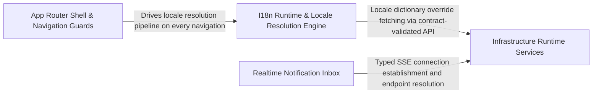

---
tags:
  - 2brain
  - 2brain/arch
  - project/boilerplate-vue-frontend
type: architecture
component: I18n_Runtime_Router_Guard
---

## Details

The core i18n runtime and its app-shell integration. Owns the vue-i18n instance lifecycle: loading bundled locale JSON files, merging module-contributed dictionaries, registering messages via setLocaleMessage, switching the active locale, ensuring the fallback locale is loaded, and keeping <html lang>/<html dir> in sync. The router guard (locale-choice) is the primary entry point that triggers locale loading on navigation; the authentication guard (authentications) restores the session before route access is enforced. The router announcer publishes the resolved page title to a visually-hidden role="status" live region and manages one-shot focus transfer to <v-main>.

### I18n Runtime & Locale Resolution Engine
The core i18n engine and its navigation-triggered locale resolution pipeline. Owns the vue-i18n instance lifecycle: discovering bundled locale JSON files at build time, extending the supported-language list from the API manifest at boot, loading per-locale dictionaries (bundled + module-contributed + API overrides), deep-merging them with correct precedence (caller messages > module dictionaries), registering via setLocaleMessage, switching the active locale, ensuring the fallback locale is loaded, and keeping <html lang>/<html dir> in sync. The localeChoice router guard is the primary entry point that triggers this pipeline on every navigation: it reads the :locale route param, checks whether the locale is already loaded, fetches and merges the dictionary if not, and activates it (with a race-guard for concurrent navigations). The routerLinkI18n helper rewrites any router location to carry the current locale. The locale-overrides fetch layer retrieves the runtime-editable half of dictionaries from the API, always resolving (never rejecting) so the offline-bundled files remain the rendering floor.

**Related Classes/Methods**:

- `src.i18n.index.changeLanguage`:391-393
- `src.i18n.index._updateLocale`:286-306
- `src.app.guards.locale-choice.localeChoice`:136-171
- `src.i18n.index._ensureFallbackLoaded`:331-348
- `src.i18n.router-link.routerLinkI18n`:41-57

**Source Files:**

- `src/app/guards/locale-choice.ts`
  - `src.app.guards.locale-choice.fetchLanguageApi` (L38-L58) - Class
  - `src.app.guards.locale-choice.then() callback` (L51-L51) - Function
  - `src.app.guards.locale-choice.fetchLanguageApi.catch() callback` (L54-L54) - Function
  - `src.app.guards.locale-choice.fetchLanguageApi.then() callback` (L56-L56) - Function
  - `src.app.guards.locale-choice.localeChoice` (L136-L171) - Class
  - `src.app.guards.locale-choice.localeChoice.then() callback.then() callback` (L162-L162) - Function
  - `src.app.guards.locale-choice.localeChoice.then() callback` (L164-L164) - Function
- `src/app/router/index.ts`
  - `src.app.router.index.localeLessRedirects.map() callback.redirect` (L133-L133) - Method
  - `src.app.router.index.routes.redirect` (L166-L171) - Method
  - `src.app.router.index.router.routes.redirect` (L223-L230) - Method
- `src/i18n/index.ts`
  - `src.i18n.index.I18nRuntimeConfig` (L26-L29) - Interface
  - `src.i18n.index.runtimeLocaleValue` (L38-L42) - Function
  - `src.i18n.index.TranslationDictionaries` (L48-L55) - Interface
  - `src.i18n.index.bundledLocales.map() callback` (L73-L74) - Function
  - `src.i18n.index.bundledLocales` (L73-L75) - Class
  - `src.i18n.index.i18n.modifiers.customSnakeCase` (L157-L157) - Method
  - `src.i18n.index._loadLocale` (L186-L206) - Function
  - `src.i18n.index._loadLocale.then() callback` (L196-L200) - Function
  - `src.i18n.index._loadLocale.then() callback.then() callback` (L198-L199) - Function
  - `src.i18n.index._loadLocale.catch() callback` (L202-L202) - Function
  - `src.i18n.index.mergeDictionaries` (L218-L224) - Class
  - `src.i18n.index.mergeDictionaries.mergeWith() callback` (L222-L223) - Function
  - `src.i18n.index.loadBundledDictionary` (L240-L253) - Function
  - `src.i18n.index.loadBundledDictionary.catch() callback` (L246-L246) - Function
  - `src.i18n.index.loadBundledDictionary.map() callback` (L247-L247) - Function
  - `src.i18n.index.loadBundledDictionary.then() callback` (L248-L252) - Function
  - `src.i18n.index.loadLocale` (L261-L263) - Function
  - `src.i18n.index._updateLocale` (L286-L306) - Function
  - `src.i18n.index._updateLocale.map() callback` (L292-L292) - Function
  - `src.i18n.index._updateLocale.then() callback` (L293-L304) - Function
  - `src.i18n.index.updateLocale` (L315-L317) - Function
  - `src.i18n.index._ensureFallbackLoaded` (L331-L348) - Function
  - `src.i18n.index._ensureFallbackLoaded.then() callback` (L342-L343) - Function
  - `src.i18n.index._ensureFallbackLoaded.catch() callback` (L346-L346) - Function
  - `src.i18n.index.applyHtmlLocaleAttributes` (L359-L363) - Function
  - `src.i18n.index._changeLanguage` (L373-L383) - Function
  - `src.i18n.index.then() callback` (L379-L379) - Function
  - `src.i18n.index._changeLanguage.then() callback` (L382-L382) - Function
  - `src.i18n.index.changeLanguage` (L391-L393) - Function
  - `src.i18n.index.getDefaultLocale` (L403-L416) - Function
- `src/i18n/router-link.ts`
  - `src.i18n.router-link.prefixLocalePath` (L24-L28) - Function
  - `src.i18n.router-link.routerLinkI18n` (L41-L57) - Function
- `src/infrastructure/locale-overrides.ts`
  - `src.infrastructure.locale-overrides.fetchRemoteLocales` (L176-L177) - Class
  - `src.infrastructure.locale-overrides.fetchRemoteLocales.then() callback` (L177-L177) - Function
  - `src.infrastructure.locale-overrides.fetchLocaleOverrides` (L188-L191) - Class
  - `src.infrastructure.locale-overrides.fetchLocaleOverrides.then() callback` (L190-L190) - Function
  - `src.infrastructure.locale-overrides.fetchLocaleOverrides.catch() callback` (L191-L191) - Function
  - `src.infrastructure.locale-overrides.mergeRemoteLocales` (L214-L230) - Class
  - `src.infrastructure.locale-overrides.mergeRemoteLocales.then() callback` (L215-L230) - Function
  - `src.infrastructure.locale-overrides.mergeRemoteLocales.then() callback.added` (L224-L224) - Class
  - `src.infrastructure.locale-overrides.withLocaleOverrides` (L239-L243) - Class
  - `src.infrastructure.locale-overrides.withLocaleOverrides.then() callback` (L243-L243) - Function
  - `src.infrastructure.locale-overrides.refreshRunningLocale` (L262-L266) - Class
  - `src.infrastructure.locale-overrides.refreshRunningLocale.then() callback` (L265-L265) - Function
  - `src.infrastructure.locale-overrides.refreshRunningLocale.catch() callback` (L266-L266) - Function
- `src/modules/account/schemas.ts`
  - `src.modules.account.schemas.addressText` (L28-L29) - Class
  - `src.modules.account.schemas.addressText.error` (L29-L29) - Method
  - `src.modules.account.schemas.requiredAddressText` (L38-L39) - Class
  - `src.modules.account.schemas.requiredAddressText.error` (L39-L39) - Method
  - `src.modules.account.schemas.addressSchema.country.error` (L61-L61) - Method
  - `src.modules.account.schemas.resetPasswordConfirmSchema` (L84-L88) - Class
  - `src.modules.account.schemas.resetPasswordConfirmSchema.error` (L87-L87) - Method
- `src/modules/cart/composables/use-checkout-draft.ts`
  - `src.modules.cart.composables.use-checkout-draft.CheckoutDraft` (L13-L20) - Interface
- `src/modules/delivery/domain/ship-lines.ts`
  - `src.modules.delivery.domain.ship-lines.ShipLinesVerdict` (L22-L27) - Interface
  - `src.modules.delivery.domain.ship-lines.readShipLines.picked` (L57-L57) - Class
  - `src.modules.delivery.domain.ship-lines.readShipLines.picked.rows.filter() callback` (L57-L57) - Function
  - `src.modules.delivery.domain.ship-lines.readShipLines.valid.rows.every() callback` (L59-L59) - Function
  - `src.modules.delivery.domain.ship-lines.shipmentCount.parcelIds` (L79-L79) - Class
  - `src.modules.delivery.domain.ship-lines.shipmentCount.parcelIds.physical.map() callback` (L79-L79) - Function
- `src/modules/delivery/store.ts`
  - `src.modules.delivery.store.defineStore('delivery') callback.fetchPreorderBoard` (L127-L134) - Class
  - `src.modules.delivery.store.defineStore('delivery') callback.process` (L206-L207) - Class
  - `src.modules.delivery.store.useDeliveryStore.defineStore('delivery') callback.failKeyedWrite.reread` (L230-L233) - Class
  - `src.modules.delivery.store.useDeliveryStore.defineStore('delivery') callback.failKeyedWrite.reread.catch() callback` (L233-L233) - Function
  - `src.modules.delivery.store.useDeliveryStore.defineStore('delivery') callback.failKeyedWrite.reread.then() callback` (L234-L236) - Function
  - `src.modules.delivery.store.defineStore('delivery') callback.hold` (L287-L292) - Class
  - `src.modules.delivery.store.defineStore('delivery') callback.editTracking` (L344-L349) - Class
- `src/modules/example/composables/use-example-transition.ts`
  - `src.modules.example.composables.use-example-transition.useExampleTransition.changeStatus.catch() callback` (L47-L50) - Function
- `src/modules/example/schemas.ts`
  - `src.modules.example.schemas.exampleTitleSchema` (L15-L18) - Class
  - `src.modules.example.schemas.exampleTitleSchema.error` (L18-L18) - Method
- `src/modules/example/store.ts`
  - `src.modules.example.store.defineStore('example') callback.setCover` (L170-L176) - Class
- `src/modules/locales/composables/use-dictionary-aggregation.ts`
  - `src.modules.locales.composables.use-dictionary-aggregation.useDictionaryAggregation` (L27-L223) - Function
  - `src.modules.locales.composables.use-dictionary-aggregation.hasBaseline` (L47-L49) - Class
  - `src.modules.locales.composables.use-dictionary-aggregation.languages` (L57-L59) - Class
  - `src.modules.locales.composables.use-dictionary-aggregation.allKeys` (L142-L149) - Class
  - `src.modules.locales.composables.use-dictionary-aggregation.missingByTag` (L154-L161) - Class
  - `src.modules.locales.composables.use-dictionary-aggregation.loadLanguage` (L166-L175) - Class
  - `src.modules.locales.composables.use-dictionary-aggregation.loadBoard` (L180-L183) - Class
- `src/modules/locales/composables/use-dictionary-cell-editor.ts`
  - `src.modules.locales.composables.use-dictionary-cell-editor.useDictionaryCellEditor.handleCellClear.finally() callback` (L237-L239) - Function
- `src/modules/locales/schemas.ts`
  - `src.modules.locales.schemas.tag.error` (L46-L46) - Method
  - `src.modules.locales.schemas.localesLanguageSchema.tag.error` (L48-L48) - Method
  - `src.modules.locales.schemas.name.error` (L51-L51) - Method
  - `src.modules.locales.schemas.localesLanguageSchema.name.error` (L52-L52) - Method
  - `src.modules.locales.schemas.localesLanguageSchema.nativeName.error` (L57-L57) - Method
  - `src.modules.locales.schemas.localesEntrySchema.key.error` (L85-L85) - Method
  - `src.modules.locales.schemas.localesEntrySchema.value.error` (L86-L86) - Method
- `src/modules/orders/composables/use-order-documents.ts`
  - `src.modules.orders.composables.use-order-documents.invoiceAvailable` (L34-L34) - Class
- `src/modules/orders/composables/use-order-hero.ts`
  - `src.modules.orders.composables.use-order-hero.heroTitle` (L32-L32) - Class
  - `src.modules.orders.composables.use-order-hero.heroDescription` (L38-L40) - Class
  - `src.modules.orders.composables.use-order-hero.orderStatus` (L45-L48) - Class
- `src/modules/payments/composables/use-order-refund.ts`
  - `src.modules.payments.composables.use-order-refund.useOrderRefund.settleable.computed() callback` (L70-L73) - Function
  - `src.modules.payments.composables.use-order-refund.useOrderRefund.settle` (L130-L133) - Method
- `src/modules/payments/composables/use-paged-table.ts`
  - `src.modules.payments.composables.use-paged-table.usePagedTable` (L37-L75) - Class
  - `src.modules.payments.composables.use-paged-table.usePagedTable.pageTotal.computed() callback` (L54-L54) - Function
  - `src.modules.payments.composables.use-paged-table.usePagedTable.load.catch() callback` (L62-L63) - Function
  - `src.modules.payments.composables.use-paged-table.usePagedTable.watch() callback` (L67-L67) - Function
  - `src.modules.payments.composables.use-paged-table.usePagedTable.onMounted() callback` (L69-L72) - Function
- `src/modules/payments/composables/use-row-select.ts`
  - `src.modules.payments.composables.use-row-select.useRowSelect` (L16-L33) - Class
  - `src.modules.payments.composables.use-row-select.useRowSelect.watch() callback` (L25-L30) - Function
- `src/modules/payments/store.ts`
  - `src.modules.payments.store.defineStore('payments') callback.fetchRefundsPage` (L481-L488) - Class
  - `src.modules.payments.store.defineStore('payments') callback.fetchAttention` (L496-L502) - Class
- `src/modules/products/composables/use-release-date-confirm.ts`
  - `src.modules.products.composables.use-release-date-confirm.useReleaseDateConfirm.confirmReleaseDateMove.then() callback` (L73-L82) - Function
- `src/modules/products/store.ts`
  - `src.modules.products.store.defineStore('products') callback.fetchProductForEdit` (L406-L410) - Class
- `src/modules/products/translation-tab-errors.ts`
  - `src.modules.products.translation-tab-errors.translationTabErrorCountsFromServerError.issues` (L103-L113) - Class
  - `src.modules.products.translation-tab-errors.translationTabErrorCountsFromServerError.issues.items.flatMap() callback` (L103-L113) - Function
- `src/modules/products/translations-body.ts`
  - `src.modules.products.translations-body.toPatchTranslations` (L53-L66) - Class
  - `src.modules.products.translations-body.toPatchTranslations.map() callback` (L57-L65) - Function
- `src/modules/returns/schemas.ts`
  - `src.modules.returns.schemas.declineReasonSchema.refine() callback` (L30-L30) - Function
  - `src.modules.returns.schemas.declineReasonSchema` (L30-L32) - Class
  - `src.modules.returns.schemas.declineReasonSchema.error` (L31-L31) - Method
  - `src.modules.returns.schemas.closeNoteSchema` (L52-L58) - Class
  - `src.modules.returns.schemas.closeNoteSchema.error` (L56-L57) - Method
  - `src.modules.returns.schemas.returnNoteSchema` (L77-L83) - Class
  - `src.modules.returns.schemas.returnNoteSchema.error` (L81-L82) - Method
- `src/modules/returns/store.ts`
  - `src.modules.returns.store.defineStore('returns') callback.recordProof` (L213-L214) - Class
- `src/modules/shop-tasks/describe.ts`
  - `src.modules.shop-tasks.describe.describeMergeRefused.lines.notice.params.lines.map() callback` (L87-L91) - Function
- `src/modules/shop-tasks/notices.ts`
  - `src.modules.shop-tasks.notices.shopNotices.'shop-tasks.cart-line-removed'.target` (L76-L76) - Method
  - `src.modules.shop-tasks.notices.shopNotices.'shop-tasks.stock-alert'.target` (L85-L88) - Method
  - `src.modules.shop-tasks.notices.shopNotices.'shop-tasks.staff.purchase-hold-placed'.target` (L103-L106) - Method
- `src/modules/shop-tasks/store.ts`
  - `src.modules.shop-tasks.store.defineStore('shop-tasks') callback.loadSummary` (L35-L43) - Class
- `src/modules/tasks/composables/use-task-badge.ts`
  - `src.modules.tasks.composables.use-task-badge.useTaskBadge.readerId.computed() callback` (L53-L54) - Function
  - `src.modules.tasks.composables.use-task-badge.useTaskBadge.readerId` (L53-L55) - Class
  - `src.modules.tasks.composables.use-task-badge.watch() callback` (L59-L62) - Function
- `src/modules/tasks/schemas.ts`
  - `src.modules.tasks.schemas.contactSchema.email.error` (L34-L34) - Method
  - `src.modules.tasks.schemas.contactSchema.subject.error` (L37-L37) - Method
- `src/modules/users/composables/use-user-summary.ts`
  - `src.modules.users.composables.use-user-summary.useUserSummary.userRole.computed() callback` (L40-L40) - Function
- `src/modules/users/schemas.ts`
  - `src.modules.users.schemas.error` (L20-L20) - Method
- `src/modules/webhooks/store.ts`
  - `src.modules.webhooks.store.defineStore('webhooks') callback.fetchEventCatalog` (L315-L315) - Class

### App Router Shell & Navigation Guards
The router definition and its guard/announcer pipeline. Owns the Vue Router instance, the route table (shell child routes, locale-less redirects), the authentication guard (authentications) that restores the session token before route access is enforced, and the route announcer that publishes the resolved page title to a visually-hidden role="status" live region and manages one-shot focus transfer to <v-main> after a real page change. Also includes the stale-deploy recovery mechanism (detecting a version mismatch between the loaded bundle and the server's current build, then triggering a full reload) and the static-page utilities (FAQ, About, Privacy, Terms content) and error-message classification that the router's error views consume.

**Related Classes/Methods**:

- `src.app.router.index.router`:140-233
- `src.app.guards.authentications.tryRestoreAuth`:160-176
- `src.app.router.announcer.announceRouteChange`:31-36
- `src.app.router.stale-deploy.registerStaleDeployRecovery`:52-57

**Source Files:**

- `src/app/guards/authentications.ts`
  - `src.app.guards.authentications.'vue-router'.RouteMeta` (L65-L91) - Interface
  - `src.app.guards.authentications.tryRestoreAuth` (L160-L176) - Class
  - `src.app.guards.authentications.tryRestoreAuth.then() callback` (L173-L173) - Function
  - `src.app.guards.authentications.tryRestoreAuth.catch() callback` (L174-L174) - Function
- `src/app/router/announcer.ts`
  - `src.app.router.announcer.announceRouteChange` (L31-L36) - Class
  - `src.app.router.announcer.announceRouteChange.nextTick() callback` (L33-L35) - Function
- `src/app/router/index.ts`
  - `src.app.router.index.shellChildRoutes` (L49-L101) - Class
  - `src.app.router.index.shellChildRoutes.component` (L98-L98) - Method
  - `src.app.router.index.localeLessRedirects` (L125-L134) - Class
  - `src.app.router.index.map() callback` (L128-L128) - Function
  - `src.app.router.index.localeLessRedirects.filter() callback` (L129-L129) - Function
  - `src.app.router.index.localeLessRedirects.map() callback` (L131-L134) - Function
  - `src.app.router.index.router` (L140-L233) - Class
  - `src.app.router.index.router.scrollBehavior` (L156-L162) - Method
  - `src.app.router.index.router.routes.children.component` (L200-L200) - Method
  - `src.app.router.index.router.routes.children.children.redirect` (L207-L214) - Method
  - `src.app.router.index.router.onError() callback` (L259-L313) - Function
  - `src.app.router.index.router.onError() callback.recoverFromStaleDeploy() callback` (L272-L272) - Function
  - `src.app.router.index.router.beforeEach() callback` (L328-L333) - Function
  - `src.app.router.index.router.beforeEach() callback.then() callback` (L332-L332) - Function
  - `src.app.router.index.router.afterEach() callback` (L364-L395) - Function
- `src/app/router/stale-deploy.ts`
  - `src.app.router.stale-deploy.PreloadErrorSource` (L34-L39) - Interface
  - `src.app.router.stale-deploy.registerStaleDeployRecovery` (L52-L57) - Class
  - `src.app.router.stale-deploy.registerStaleDeployRecovery.target.addEventListener('vite:preloadError') callback` (L53-L56) - Function
- `src/app/utils/error-messages.ts`
  - `src.app.utils.error-messages.isKnownErrorMessage` (L28-L29) - Class
  - `src.app.utils.error-messages.isKnownErrorMessage.KNOWN_ERROR_MESSAGE_PREFIXES.some() callback` (L29-L29) - Function
- `src/app/utils/static-pages.ts`
  - `src.app.utils.static-pages.staticPageParagraphs` (L38-L45) - Class
  - `src.app.utils.static-pages.staticPageParagraphs.messages.map() callback` (L44-L44) - Function

### Infrastructure Runtime Services
The cross-cutting runtime primitives that the i18n and router layers depend on. Provides the runtime configuration resolver (runtimeValue) that reads deployment-specific values (locale defaults, tenant IDs) from the server-injected config with build-time env fallbacks. Owns the SSE client factory (contract-validated server-sent-events connection for realtime updates), the HTTP keepalive mechanism (periodic pings to prevent proxy timeouts on long-lived sessions), and the image upload utility (Zod-validated multipart upload with contract conformance checks). These services are the plumbing that makes the i18n runtime's runtimeLocaleValue calls, the router's stale-deploy detection, and the app's realtime/long-polling features functional.

**Related Classes/Methods**:

- `src.infrastructure.runtime-config.runtimeValue`:47-51
- `src.infrastructure.http.keepalive.sendKeepalive`:22-44
- `src.infrastructure.utils.uploads.imageUploadSchema`:75-81

**Source Files:**

- `src/infrastructure/create-sse-client.ts`
  - `src.infrastructure.create-sse-client.passesContract.issues` (L100-L102) - Class
  - `src.infrastructure.create-sse-client.passesContract.issues.result.error.issues.map() callback` (L101-L101) - Function
- `src/infrastructure/http/keepalive.ts`
  - `src.infrastructure.http.keepalive.sendKeepalive` (L22-L44) - Class
  - `src.infrastructure.http.keepalive.sendKeepalive.catch() callback` (L43-L43) - Function
- `src/infrastructure/reauth.ts`
  - `src.infrastructure.reauth.defineStore('reauth') callback.reauth` (L67-L76) - Class
- `src/infrastructure/runtime-config.ts`
  - `src.infrastructure.runtime-config.RuntimeConfig` (L14-L36) - Interface
  - `src.infrastructure.runtime-config.runtimeValue` (L47-L51) - Function
- `src/infrastructure/tour-seen.ts`
  - `src.infrastructure.tour-seen.readKeys` (L55-L62) - Class
  - `src.infrastructure.tour-seen.readKeys.filter() callback` (L61-L61) - Function
  - `src.infrastructure.tour-seen.keys` (L82-L82) - Class
- `src/infrastructure/utils/logger.ts`
  - `src.infrastructure.utils.logger.LogScopes` (L47-L51) - Interface
  - `src.infrastructure.utils.logger.resolveScopes` (L78-L89) - Class
  - `src.infrastructure.utils.logger.resolveScopes.map() callback` (L86-L86) - Function
- `src/infrastructure/utils/uploads.ts`
  - `src.infrastructure.utils.uploads.imageUploadSchema` (L75-L81) - Class
  - `src.infrastructure.utils.uploads.error` (L76-L76) - Method
  - `src.infrastructure.utils.uploads.imageUploadSchema.error` (L79-L79) - Method

### Realtime Notification Inbox
The AsyncAPI-generated realtime event payload types (notification/fulfillment/stock envelopes) and the kernel's inbox-notices registry that reads the notifications module's stamped rows without importing it — the realtime event contract and the bell's notice vocabulary.

**Related Classes/Methods**: _None_

**Source Files:**

- `contracts/asyncapi.generated.ts`
  - `contracts.asyncapi.generated.OrderCanceledPayload` (L51-L54) - Interface
  - `contracts.asyncapi.generated.AnonymousSchema27` (L74-L77) - Interface
  - `contracts.asyncapi.generated.ShipmentDeliveredEnvelope` (L78-L82) - Interface
  - `contracts.asyncapi.generated.ShipmentLostPayload` (L90-L96) - Interface
  - `contracts.asyncapi.generated.PaymentRefundFailedEnvelope` (L131-L135) - Interface
  - `contracts.asyncapi.generated.PaymentRefundReversedPayload` (L152-L159) - Interface
  - `contracts.asyncapi.generated.PaymentDisputeOpenedEnvelope` (L160-L164) - Interface
  - `contracts.asyncapi.generated.ExamplePublishedEnvelope` (L220-L224) - Interface
  - `contracts.asyncapi.generated.UserIdPayload` (L236-L238) - Interface
  - `contracts.asyncapi.generated.NotificationCreatedPayload` (L250-L252) - Interface
  - `contracts.asyncapi.generated.WebhookDisabledParamsPayload` (L264-L266) - Interface
  - `contracts.asyncapi.generated.NotificationStaffTaskOpenedPayload` (L268-L276) - Interface
  - `contracts.asyncapi.generated.TaskAssignedParamsPayload` (L321-L324) - Interface
  - `contracts.asyncapi.generated.NotificationStaffOutboxDeadPayload` (L326-L334) - Interface
  - `contracts.asyncapi.generated.FulfillmentHeldParamsPayload` (L369-L374) - Interface
  - `contracts.asyncapi.generated.NotificationStockAlertPayload` (L398-L406) - Interface
  - `contracts.asyncapi.generated.CartLineRemovedParamsPayload` (L409-L412) - Interface
  - `contracts.asyncapi.generated.NotificationStaffReturnRequestedPayload` (L477-L485) - Interface
  - `contracts.asyncapi.generated.NotificationStaffAwaitingTrackingPayload` (L581-L589) - Interface
  - `contracts.asyncapi.generated.NotificationStaffUndeliveredPayload` (L593-L601) - Interface
  - `contracts.asyncapi.generated.NotificationStaffStaleRefundsPayload` (L605-L613) - Interface
  - `contracts.asyncapi.generated.NotificationsDeletedPayload` (L617-L620) - Interface
- `src/kernel/inbox-notices.ts`
  - `src.kernel.inbox-notices.InboxNotice` (L20-L29) - Interface
- `src/ui/composables/use-leave-guard.ts`
  - `src.ui.composables.use-leave-guard.UseLeaveGuardReturn` (L16-L22) - Interface
  - `src.ui.composables.use-leave-guard.useLeaveGuard` (L32-L94) - Class
  - `src.ui.composables.use-leave-guard.useLeaveGuard.onBeforeRouteLeave() callback` (L54-L63) - Function
  - `src.ui.composables.use-leave-guard.useLeaveGuard.watch() callback` (L81-L84) - Function
  - `src.ui.composables.use-leave-guard.useLeaveGuard.onScopeDispose() callback` (L87-L87) - Function
  - `src.ui.composables.use-leave-guard.useLeaveGuard.markSaved` (L90-L92) - Method
