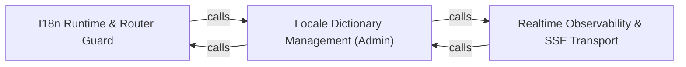

---
tags:
  - 2brain
  - 2brain/arch
  - project/boilerplate-vue-frontend
type: architecture
component: Internationalization
---

## Details

Locale management and i18n runtime (dictionary loading, language switching, HTML locale attributes), with the app-shell router guards (authentication, locale choice) and the router announcer as its secondary concern.

### I18n Runtime & Router Guard [[Expand]](./I18n_Runtime_Router_Guard.md)
The core i18n runtime and its app-shell integration. Owns the vue-i18n instance lifecycle: loading bundled locale JSON files, merging module-contributed dictionaries, registering messages via setLocaleMessage, switching the active locale, ensuring the fallback locale is loaded, and keeping <html lang>/<html dir> in sync. The router guard (locale-choice) is the primary entry point that triggers locale loading on navigation; the authentication guard (authentications) restores the session before route access is enforced. The router announcer publishes the resolved page title to a visually-hidden role="status" live region and manages one-shot focus transfer to <v-main>.

**Related Classes/Methods**:

- `src.i18n.index.changeLanguage`:391-393
- `src.i18n.index._updateLocale`:286-306
- `src.i18n.index.loadBundledDictionary`:240-253
- `src.app.guards.locale-choice.localeChoice`:136-171
- `src.app.router.announcer.announceRouteChange`:31-36

**Source Files:**

- `contracts/asyncapi.generated.ts`
  - `contracts.asyncapi.generated.OrderCanceledPayload` (L51-L54) - Interface
  - `contracts.asyncapi.generated.AnonymousSchema27` (L74-L77) - Interface
  - `contracts.asyncapi.generated.ShipmentDeliveredEnvelope` (L78-L82) - Interface
  - `contracts.asyncapi.generated.ShipmentLostPayload` (L90-L96) - Interface
  - `contracts.asyncapi.generated.PaymentRefundFailedEnvelope` (L131-L135) - Interface
  - `contracts.asyncapi.generated.PaymentRefundReversedPayload` (L152-L159) - Interface
  - `contracts.asyncapi.generated.PaymentDisputeOpenedEnvelope` (L160-L164) - Interface
  - `contracts.asyncapi.generated.ExamplePublishedEnvelope` (L220-L224) - Interface
  - `contracts.asyncapi.generated.UserIdPayload` (L236-L238) - Interface
  - `contracts.asyncapi.generated.NotificationCreatedPayload` (L250-L252) - Interface
  - `contracts.asyncapi.generated.WebhookDisabledParamsPayload` (L264-L266) - Interface
  - `contracts.asyncapi.generated.NotificationStaffTaskOpenedPayload` (L268-L276) - Interface
  - `contracts.asyncapi.generated.TaskAssignedParamsPayload` (L321-L324) - Interface
  - `contracts.asyncapi.generated.NotificationStaffOutboxDeadPayload` (L326-L334) - Interface
  - `contracts.asyncapi.generated.FulfillmentHeldParamsPayload` (L369-L374) - Interface
  - `contracts.asyncapi.generated.NotificationStockAlertPayload` (L398-L406) - Interface
  - `contracts.asyncapi.generated.CartLineRemovedParamsPayload` (L409-L412) - Interface
  - `contracts.asyncapi.generated.NotificationStaffReturnRequestedPayload` (L477-L485) - Interface
  - `contracts.asyncapi.generated.NotificationStaffAwaitingTrackingPayload` (L581-L589) - Interface
  - `contracts.asyncapi.generated.NotificationStaffUndeliveredPayload` (L593-L601) - Interface
  - `contracts.asyncapi.generated.NotificationStaffStaleRefundsPayload` (L605-L613) - Interface
  - `contracts.asyncapi.generated.NotificationsDeletedPayload` (L617-L620) - Interface
- `src/app/guards/authentications.ts`
  - `src.app.guards.authentications.'vue-router'.RouteMeta` (L65-L91) - Interface
  - `src.app.guards.authentications.tryRestoreAuth` (L160-L176) - Class
  - `src.app.guards.authentications.tryRestoreAuth.then() callback` (L173-L173) - Function
  - `src.app.guards.authentications.tryRestoreAuth.catch() callback` (L174-L174) - Function
- `src/app/guards/locale-choice.ts`
  - `src.app.guards.locale-choice.fetchLanguageApi` (L38-L58) - Class
  - `src.app.guards.locale-choice.then() callback` (L51-L51) - Function
  - `src.app.guards.locale-choice.fetchLanguageApi.catch() callback` (L54-L54) - Function
  - `src.app.guards.locale-choice.fetchLanguageApi.then() callback` (L56-L56) - Function
  - `src.app.guards.locale-choice.localeChoice` (L136-L171) - Class
  - `src.app.guards.locale-choice.localeChoice.then() callback.then() callback` (L162-L162) - Function
  - `src.app.guards.locale-choice.localeChoice.then() callback` (L164-L164) - Function
- `src/app/router/announcer.ts`
  - `src.app.router.announcer.announceRouteChange` (L31-L36) - Class
  - `src.app.router.announcer.announceRouteChange.nextTick() callback` (L33-L35) - Function
- `src/app/router/index.ts`
  - `src.app.router.index.shellChildRoutes` (L49-L101) - Class
  - `src.app.router.index.shellChildRoutes.component` (L98-L98) - Method
  - `src.app.router.index.localeLessRedirects` (L125-L134) - Class
  - `src.app.router.index.map() callback` (L128-L128) - Function
  - `src.app.router.index.localeLessRedirects.filter() callback` (L129-L129) - Function
  - `src.app.router.index.localeLessRedirects.map() callback` (L131-L134) - Function
  - `src.app.router.index.localeLessRedirects.map() callback.redirect` (L133-L133) - Method
  - `src.app.router.index.router` (L140-L233) - Class
  - `src.app.router.index.router.scrollBehavior` (L156-L162) - Method
  - `src.app.router.index.routes.redirect` (L166-L171) - Method
  - `src.app.router.index.router.routes.children.component` (L200-L200) - Method
  - `src.app.router.index.router.routes.children.children.redirect` (L207-L214) - Method
  - `src.app.router.index.router.routes.redirect` (L223-L230) - Method
  - `src.app.router.index.router.onError() callback` (L259-L313) - Function
  - `src.app.router.index.router.onError() callback.recoverFromStaleDeploy() callback` (L272-L272) - Function
  - `src.app.router.index.router.beforeEach() callback` (L328-L333) - Function
  - `src.app.router.index.router.beforeEach() callback.then() callback` (L332-L332) - Function
  - `src.app.router.index.router.afterEach() callback` (L364-L395) - Function
- `src/app/router/stale-deploy.ts`
  - `src.app.router.stale-deploy.PreloadErrorSource` (L34-L39) - Interface
  - `src.app.router.stale-deploy.registerStaleDeployRecovery` (L52-L57) - Class
  - `src.app.router.stale-deploy.registerStaleDeployRecovery.target.addEventListener('vite:preloadError') callback` (L53-L56) - Function
- `src/app/utils/error-messages.ts`
  - `src.app.utils.error-messages.isKnownErrorMessage` (L28-L29) - Class
  - `src.app.utils.error-messages.isKnownErrorMessage.KNOWN_ERROR_MESSAGE_PREFIXES.some() callback` (L29-L29) - Function
- `src/app/utils/static-pages.ts`
  - `src.app.utils.static-pages.staticPageParagraphs` (L38-L45) - Class
  - `src.app.utils.static-pages.staticPageParagraphs.messages.map() callback` (L44-L44) - Function
- `src/i18n/index.ts`
  - `src.i18n.index.I18nRuntimeConfig` (L26-L29) - Interface
  - `src.i18n.index.runtimeLocaleValue` (L38-L42) - Function
  - `src.i18n.index.TranslationDictionaries` (L48-L55) - Interface
  - `src.i18n.index.bundledLocales.map() callback` (L73-L74) - Function
  - `src.i18n.index.bundledLocales` (L73-L75) - Class
  - `src.i18n.index.i18n.modifiers.customSnakeCase` (L157-L157) - Method
  - `src.i18n.index._loadLocale` (L186-L206) - Function
  - `src.i18n.index._loadLocale.then() callback` (L196-L200) - Function
  - `src.i18n.index._loadLocale.then() callback.then() callback` (L198-L199) - Function
  - `src.i18n.index._loadLocale.catch() callback` (L202-L202) - Function
  - `src.i18n.index.mergeDictionaries` (L218-L224) - Class
  - `src.i18n.index.mergeDictionaries.mergeWith() callback` (L222-L223) - Function
  - `src.i18n.index.loadBundledDictionary` (L240-L253) - Function
  - `src.i18n.index.loadBundledDictionary.catch() callback` (L246-L246) - Function
  - `src.i18n.index.loadBundledDictionary.map() callback` (L247-L247) - Function
  - `src.i18n.index.loadBundledDictionary.then() callback` (L248-L252) - Function
  - `src.i18n.index.loadLocale` (L261-L263) - Function
  - `src.i18n.index._updateLocale` (L286-L306) - Function
  - `src.i18n.index._updateLocale.map() callback` (L292-L292) - Function
  - `src.i18n.index._updateLocale.then() callback` (L293-L304) - Function
  - `src.i18n.index.updateLocale` (L315-L317) - Function
  - `src.i18n.index._ensureFallbackLoaded` (L331-L348) - Function
  - `src.i18n.index._ensureFallbackLoaded.then() callback` (L342-L343) - Function
  - `src.i18n.index._ensureFallbackLoaded.catch() callback` (L346-L346) - Function
  - `src.i18n.index.applyHtmlLocaleAttributes` (L359-L363) - Function
  - `src.i18n.index._changeLanguage` (L373-L383) - Function
  - `src.i18n.index.then() callback` (L379-L379) - Function
  - `src.i18n.index._changeLanguage.then() callback` (L382-L382) - Function
  - `src.i18n.index.changeLanguage` (L391-L393) - Function
  - `src.i18n.index.getDefaultLocale` (L403-L416) - Function
- `src/i18n/router-link.ts`
  - `src.i18n.router-link.prefixLocalePath` (L24-L28) - Function
  - `src.i18n.router-link.routerLinkI18n` (L41-L57) - Function
- `src/infrastructure/create-sse-client.ts`
  - `src.infrastructure.create-sse-client.passesContract.issues` (L100-L102) - Class
  - `src.infrastructure.create-sse-client.passesContract.issues.result.error.issues.map() callback` (L101-L101) - Function
- `src/infrastructure/http/keepalive.ts`
  - `src.infrastructure.http.keepalive.sendKeepalive` (L22-L44) - Class
  - `src.infrastructure.http.keepalive.sendKeepalive.catch() callback` (L43-L43) - Function
- `src/infrastructure/locale-overrides.ts`
  - `src.infrastructure.locale-overrides.fetchRemoteLocales` (L176-L177) - Class
  - `src.infrastructure.locale-overrides.fetchRemoteLocales.then() callback` (L177-L177) - Function
  - `src.infrastructure.locale-overrides.fetchLocaleOverrides` (L188-L191) - Class
  - `src.infrastructure.locale-overrides.fetchLocaleOverrides.then() callback` (L190-L190) - Function
  - `src.infrastructure.locale-overrides.fetchLocaleOverrides.catch() callback` (L191-L191) - Function
  - `src.infrastructure.locale-overrides.mergeRemoteLocales` (L214-L230) - Class
  - `src.infrastructure.locale-overrides.mergeRemoteLocales.then() callback` (L215-L230) - Function
  - `src.infrastructure.locale-overrides.mergeRemoteLocales.then() callback.added` (L224-L224) - Class
  - `src.infrastructure.locale-overrides.withLocaleOverrides` (L239-L243) - Class
  - `src.infrastructure.locale-overrides.withLocaleOverrides.then() callback` (L243-L243) - Function
  - `src.infrastructure.locale-overrides.refreshRunningLocale` (L262-L266) - Class
  - `src.infrastructure.locale-overrides.refreshRunningLocale.then() callback` (L265-L265) - Function
  - `src.infrastructure.locale-overrides.refreshRunningLocale.catch() callback` (L266-L266) - Function
- `src/infrastructure/reauth.ts`
  - `src.infrastructure.reauth.defineStore('reauth') callback.reauth` (L67-L76) - Class
- `src/infrastructure/runtime-config.ts`
  - `src.infrastructure.runtime-config.RuntimeConfig` (L14-L36) - Interface
  - `src.infrastructure.runtime-config.runtimeValue` (L47-L51) - Function
- `src/infrastructure/tour-seen.ts`
  - `src.infrastructure.tour-seen.readKeys` (L55-L62) - Class
  - `src.infrastructure.tour-seen.readKeys.filter() callback` (L61-L61) - Function
  - `src.infrastructure.tour-seen.keys` (L82-L82) - Class
- `src/infrastructure/utils/logger.ts`
  - `src.infrastructure.utils.logger.LogScopes` (L47-L51) - Interface
  - `src.infrastructure.utils.logger.resolveScopes` (L78-L89) - Class
  - `src.infrastructure.utils.logger.resolveScopes.map() callback` (L86-L86) - Function
- `src/infrastructure/utils/uploads.ts`
  - `src.infrastructure.utils.uploads.imageUploadSchema` (L75-L81) - Class
  - `src.infrastructure.utils.uploads.error` (L76-L76) - Method
  - `src.infrastructure.utils.uploads.imageUploadSchema.error` (L79-L79) - Method
- `src/kernel/inbox-notices.ts`
  - `src.kernel.inbox-notices.InboxNotice` (L20-L29) - Interface
- `src/modules/account/schemas.ts`
  - `src.modules.account.schemas.addressText` (L28-L29) - Class
  - `src.modules.account.schemas.addressText.error` (L29-L29) - Method
  - `src.modules.account.schemas.requiredAddressText` (L38-L39) - Class
  - `src.modules.account.schemas.requiredAddressText.error` (L39-L39) - Method
  - `src.modules.account.schemas.addressSchema.country.error` (L61-L61) - Method
  - `src.modules.account.schemas.resetPasswordConfirmSchema` (L84-L88) - Class
  - `src.modules.account.schemas.resetPasswordConfirmSchema.error` (L87-L87) - Method
- `src/modules/cart/composables/use-checkout-draft.ts`
  - `src.modules.cart.composables.use-checkout-draft.CheckoutDraft` (L13-L20) - Interface
- `src/modules/delivery/domain/ship-lines.ts`
  - `src.modules.delivery.domain.ship-lines.ShipLinesVerdict` (L22-L27) - Interface
  - `src.modules.delivery.domain.ship-lines.readShipLines.picked` (L57-L57) - Class
  - `src.modules.delivery.domain.ship-lines.readShipLines.picked.rows.filter() callback` (L57-L57) - Function
  - `src.modules.delivery.domain.ship-lines.readShipLines.valid.rows.every() callback` (L59-L59) - Function
  - `src.modules.delivery.domain.ship-lines.shipmentCount.parcelIds` (L79-L79) - Class
  - `src.modules.delivery.domain.ship-lines.shipmentCount.parcelIds.physical.map() callback` (L79-L79) - Function
- `src/modules/delivery/store.ts`
  - `src.modules.delivery.store.defineStore('delivery') callback.fetchPreorderBoard` (L127-L134) - Class
  - `src.modules.delivery.store.defineStore('delivery') callback.process` (L206-L207) - Class
  - `src.modules.delivery.store.useDeliveryStore.defineStore('delivery') callback.failKeyedWrite.reread` (L230-L233) - Class
  - `src.modules.delivery.store.useDeliveryStore.defineStore('delivery') callback.failKeyedWrite.reread.catch() callback` (L233-L233) - Function
  - `src.modules.delivery.store.useDeliveryStore.defineStore('delivery') callback.failKeyedWrite.reread.then() callback` (L234-L236) - Function
  - `src.modules.delivery.store.defineStore('delivery') callback.hold` (L287-L292) - Class
  - `src.modules.delivery.store.defineStore('delivery') callback.editTracking` (L344-L349) - Class
- `src/modules/example/composables/use-example-transition.ts`
  - `src.modules.example.composables.use-example-transition.useExampleTransition.changeStatus.catch() callback` (L47-L50) - Function
- `src/modules/example/schemas.ts`
  - `src.modules.example.schemas.exampleTitleSchema` (L15-L18) - Class
  - `src.modules.example.schemas.exampleTitleSchema.error` (L18-L18) - Method
- `src/modules/example/store.ts`
  - `src.modules.example.store.defineStore('example') callback.setCover` (L170-L176) - Class
- `src/modules/locales/composables/use-dictionary-aggregation.ts`
  - `src.modules.locales.composables.use-dictionary-aggregation.useDictionaryAggregation` (L27-L223) - Function
  - `src.modules.locales.composables.use-dictionary-aggregation.hasBaseline` (L47-L49) - Class
  - `src.modules.locales.composables.use-dictionary-aggregation.languages` (L57-L59) - Class
  - `src.modules.locales.composables.use-dictionary-aggregation.allKeys` (L142-L149) - Class
  - `src.modules.locales.composables.use-dictionary-aggregation.missingByTag` (L154-L161) - Class
  - `src.modules.locales.composables.use-dictionary-aggregation.loadLanguage` (L166-L175) - Class
  - `src.modules.locales.composables.use-dictionary-aggregation.loadBoard` (L180-L183) - Class
- `src/modules/locales/composables/use-dictionary-cell-editor.ts`
  - `src.modules.locales.composables.use-dictionary-cell-editor.useDictionaryCellEditor.handleCellClear.finally() callback` (L237-L239) - Function
- `src/modules/locales/schemas.ts`
  - `src.modules.locales.schemas.tag.error` (L46-L46) - Method
  - `src.modules.locales.schemas.localesLanguageSchema.tag.error` (L48-L48) - Method
  - `src.modules.locales.schemas.name.error` (L51-L51) - Method
  - `src.modules.locales.schemas.localesLanguageSchema.name.error` (L52-L52) - Method
  - `src.modules.locales.schemas.localesLanguageSchema.nativeName.error` (L57-L57) - Method
  - `src.modules.locales.schemas.localesEntrySchema.key.error` (L85-L85) - Method
  - `src.modules.locales.schemas.localesEntrySchema.value.error` (L86-L86) - Method
- `src/modules/orders/composables/use-order-documents.ts`
  - `src.modules.orders.composables.use-order-documents.invoiceAvailable` (L34-L34) - Class
- `src/modules/orders/composables/use-order-hero.ts`
  - `src.modules.orders.composables.use-order-hero.heroTitle` (L32-L32) - Class
  - `src.modules.orders.composables.use-order-hero.heroDescription` (L38-L40) - Class
  - `src.modules.orders.composables.use-order-hero.orderStatus` (L45-L48) - Class
- `src/modules/payments/composables/use-order-refund.ts`
  - `src.modules.payments.composables.use-order-refund.useOrderRefund.settleable.computed() callback` (L70-L73) - Function
  - `src.modules.payments.composables.use-order-refund.useOrderRefund.settle` (L130-L133) - Method
- `src/modules/payments/composables/use-paged-table.ts`
  - `src.modules.payments.composables.use-paged-table.usePagedTable` (L37-L75) - Class
  - `src.modules.payments.composables.use-paged-table.usePagedTable.pageTotal.computed() callback` (L54-L54) - Function
  - `src.modules.payments.composables.use-paged-table.usePagedTable.load.catch() callback` (L62-L63) - Function
  - `src.modules.payments.composables.use-paged-table.usePagedTable.watch() callback` (L67-L67) - Function
  - `src.modules.payments.composables.use-paged-table.usePagedTable.onMounted() callback` (L69-L72) - Function
- `src/modules/payments/composables/use-row-select.ts`
  - `src.modules.payments.composables.use-row-select.useRowSelect` (L16-L33) - Class
  - `src.modules.payments.composables.use-row-select.useRowSelect.watch() callback` (L25-L30) - Function
- `src/modules/payments/store.ts`
  - `src.modules.payments.store.defineStore('payments') callback.fetchRefundsPage` (L481-L488) - Class
  - `src.modules.payments.store.defineStore('payments') callback.fetchAttention` (L496-L502) - Class
- `src/modules/products/composables/use-release-date-confirm.ts`
  - `src.modules.products.composables.use-release-date-confirm.useReleaseDateConfirm.confirmReleaseDateMove.then() callback` (L73-L82) - Function
- `src/modules/products/store.ts`
  - `src.modules.products.store.defineStore('products') callback.fetchProductForEdit` (L406-L410) - Class
- `src/modules/products/translation-tab-errors.ts`
  - `src.modules.products.translation-tab-errors.translationTabErrorCountsFromServerError.issues` (L103-L113) - Class
  - `src.modules.products.translation-tab-errors.translationTabErrorCountsFromServerError.issues.items.flatMap() callback` (L103-L113) - Function
- `src/modules/products/translations-body.ts`
  - `src.modules.products.translations-body.toPatchTranslations` (L53-L66) - Class
  - `src.modules.products.translations-body.toPatchTranslations.map() callback` (L57-L65) - Function
- `src/modules/returns/schemas.ts`
  - `src.modules.returns.schemas.declineReasonSchema.refine() callback` (L30-L30) - Function
  - `src.modules.returns.schemas.declineReasonSchema` (L30-L32) - Class
  - `src.modules.returns.schemas.declineReasonSchema.error` (L31-L31) - Method
  - `src.modules.returns.schemas.closeNoteSchema` (L52-L58) - Class
  - `src.modules.returns.schemas.closeNoteSchema.error` (L56-L57) - Method
  - `src.modules.returns.schemas.returnNoteSchema` (L77-L83) - Class
  - `src.modules.returns.schemas.returnNoteSchema.error` (L81-L82) - Method
- `src/modules/returns/store.ts`
  - `src.modules.returns.store.defineStore('returns') callback.recordProof` (L213-L214) - Class
- `src/modules/shop-tasks/describe.ts`
  - `src.modules.shop-tasks.describe.describeMergeRefused.lines.notice.params.lines.map() callback` (L87-L91) - Function
- `src/modules/shop-tasks/notices.ts`
  - `src.modules.shop-tasks.notices.shopNotices.'shop-tasks.cart-line-removed'.target` (L76-L76) - Method
  - `src.modules.shop-tasks.notices.shopNotices.'shop-tasks.stock-alert'.target` (L85-L88) - Method
  - `src.modules.shop-tasks.notices.shopNotices.'shop-tasks.staff.purchase-hold-placed'.target` (L103-L106) - Method
- `src/modules/shop-tasks/store.ts`
  - `src.modules.shop-tasks.store.defineStore('shop-tasks') callback.loadSummary` (L35-L43) - Class
- `src/modules/tasks/composables/use-task-badge.ts`
  - `src.modules.tasks.composables.use-task-badge.useTaskBadge.readerId.computed() callback` (L53-L54) - Function
  - `src.modules.tasks.composables.use-task-badge.useTaskBadge.readerId` (L53-L55) - Class
  - `src.modules.tasks.composables.use-task-badge.watch() callback` (L59-L62) - Function
- `src/modules/tasks/schemas.ts`
  - `src.modules.tasks.schemas.contactSchema.email.error` (L34-L34) - Method
  - `src.modules.tasks.schemas.contactSchema.subject.error` (L37-L37) - Method
- `src/modules/users/composables/use-user-summary.ts`
  - `src.modules.users.composables.use-user-summary.useUserSummary.userRole.computed() callback` (L40-L40) - Function
- `src/modules/users/schemas.ts`
  - `src.modules.users.schemas.error` (L20-L20) - Method
- `src/modules/webhooks/store.ts`
  - `src.modules.webhooks.store.defineStore('webhooks') callback.fetchEventCatalog` (L315-L315) - Class
- `src/ui/composables/use-leave-guard.ts`
  - `src.ui.composables.use-leave-guard.UseLeaveGuardReturn` (L16-L22) - Interface
  - `src.ui.composables.use-leave-guard.useLeaveGuard` (L32-L94) - Class
  - `src.ui.composables.use-leave-guard.useLeaveGuard.onBeforeRouteLeave() callback` (L54-L63) - Function
  - `src.ui.composables.use-leave-guard.useLeaveGuard.watch() callback` (L81-L84) - Function
  - `src.ui.composables.use-leave-guard.useLeaveGuard.onScopeDispose() callback` (L87-L87) - Function
  - `src.ui.composables.use-leave-guard.useLeaveGuard.markSaved` (L90-L92) - Method

### Locale Dictionary Management (Admin)
The translation-admin surface: a Pinia store that manages locale capabilities (the merged manifest of bundled + dynamic tiers) and one language's flat dotted-key entries (paginated CRUD via the generated API client). The pure dictionary-conversion utilities (flattenDictionary, expandEntries, foldNumericNodes) bridge the API's flat-row shape and the nested shape vue-i18n consumes, enabling round-trip import/export of bundled locale files. The store fetches both the API's deployed dictionary and the frontend's bundled dictionary for side-by-side comparison in the translation board. Schemas from the users, webhooks, and observability modules are co-located here because they define the Zod validation contracts that the locales admin's entry editor and the broader admin forms depend on.

**Related Classes/Methods**:

- `src.modules.locales.store.useLocalesStore`:128-517
- `src.modules.locales.dictionaries.flattenDictionary`:39-50
- `src.modules.locales.store.fetchApiDictionary`:75-84
- `src.modules.locales.store.fetchBundledDictionary`:93-96

**Source Files:**

- `contracts/asyncapi.generated.ts`
  - `contracts.asyncapi.generated.OrderRedactedEnvelope` (L56-L60) - Interface
  - `contracts.asyncapi.generated.ShipmentPayload` (L68-L73) - Interface
  - `contracts.asyncapi.generated.ShipmentLostEnvelope` (L84-L88) - Interface
  - `contracts.asyncapi.generated.PaymentRefundFailedPayload` (L137-L145) - Interface
  - `contracts.asyncapi.generated.PaymentDisputePayload` (L166-L177) - Interface
  - `contracts.asyncapi.generated.ExamplePublishedPayload` (L226-L229) - Interface
  - `contracts.asyncapi.generated.UserUpdatedEnvelope` (L239-L243) - Interface
  - `contracts.asyncapi.generated.TaskOpenedParamsPayload` (L279-L284) - Interface
  - `contracts.asyncapi.generated.NotificationStaffTaskOverduePayload` (L286-L294) - Interface
  - `contracts.asyncapi.generated.NotificationStaffTaskAssignedPayload` (L310-L318) - Interface
  - `contracts.asyncapi.generated.PurchaseHoldPlacedParamsPayload` (L353-L356) - Interface
  - `contracts.asyncapi.generated.NotificationShipmentLostPayload` (L377-L385) - Interface
  - `contracts.asyncapi.generated.NotificationFulfillmentDelayedPayload` (L414-L422) - Interface
  - `contracts.asyncapi.generated.NotificationCartLineRemovedPayload` (L433-L441) - Interface
  - `contracts.asyncapi.generated.NotificationWishlistItemRemovedPayload` (L445-L453) - Interface
  - `contracts.asyncapi.generated.CartMergeRefusedLinePayload` (L471-L475) - Interface
  - `contracts.asyncapi.generated.WorkCountParamsPayload` (L504-L507) - Interface
  - `contracts.asyncapi.generated.NotificationStaffPreordersLatePayload` (L509-L517) - Interface
  - `contracts.asyncapi.generated.NotificationStaffDeliveryHoldsOpenPayload` (L521-L529) - Interface
  - `contracts.asyncapi.generated.NotificationStaffReturnsAwaitingGoodsPayload` (L533-L541) - Interface
  - `contracts.asyncapi.generated.NotificationStaffUnshippedPayload` (L569-L577) - Interface
- `src/app/tours/use-tour.ts`
  - `src.app.tours.use-tour.useTour.startTour.isActive` (L123-L123) - Method
- `src/infrastructure/create-sse-client.ts`
  - `src.infrastructure.create-sse-client.createSseClient.open` (L150-L179) - Class
  - `src.infrastructure.create-sse-client.createSseClient.open.source.addEventListener('open') callback` (L157-L160) - Function
  - `src.infrastructure.create-sse-client.createSseClient.open.source.addEventListener('error') callback` (L161-L165) - Function
  - `src.infrastructure.create-sse-client.createSseClient.open.source.addEventListener() callback` (L169-L177) - Function
- `src/infrastructure/runtime-config.ts`
  - `src.infrastructure.runtime-config.readToursEnabled` (L70-L74) - Function
- `src/infrastructure/utils/errors.ts`
  - `src.infrastructure.utils.errors.firstApiMessage` (L28-L37) - Class
  - `src.infrastructure.utils.errors.firstApiMessage.find() callback` (L35-L35) - Function
  - `src.infrastructure.utils.errors.hasErrorCode` (L142-L146) - Class
  - `src.infrastructure.utils.errors.hasErrorCode.some() callback` (L145-L145) - Function
- `src/infrastructure/utils/formatters.ts`
  - `src.infrastructure.utils.formatters.AddressLineParts` (L251-L262) - Interface
- `src/infrastructure/utils/money.ts`
  - `src.infrastructure.utils.money.sumDecimals` (L97-L103) - Class
  - `src.infrastructure.utils.money.sumDecimals.scale` (L98-L98) - Class
  - `src.infrastructure.utils.money.sumDecimals.scale.amounts.map() callback` (L98-L98) - Function
  - `src.infrastructure.utils.money.sumDecimals.amounts.reduce() callback` (L100-L100) - Function
- `src/infrastructure/utils/request-ticket.ts`
  - `src.infrastructure.utils.request-ticket.RequestTickets` (L32-L41) - Interface
  - `src.infrastructure.utils.request-ticket.createRequestTickets` (L48-L85) - Class
  - `src.infrastructure.utils.request-ticket.createRequestTickets.take` (L65-L78) - Method
  - `src.infrastructure.utils.request-ticket.createRequestTickets.take.Object.assign() callback` (L71-L75) - Function
  - `src.infrastructure.utils.request-ticket.createRequestTickets.take.isSameEra` (L76-L76) - Method
  - `src.infrastructure.utils.request-ticket.createRequestTickets.reset` (L79-L83) - Method
- `src/infrastructure/utils/use-link-token.ts`
  - `src.infrastructure.utils.use-link-token.useLinkTokenCleanup` (L44-L49) - Class
  - `src.infrastructure.utils.use-link-token.useLinkTokenCleanup.onMounted() callback` (L45-L48) - Function
- `src/kernel/order-link.ts`
  - `src.kernel.order-link.useOrderLink` (L18-L28) - Class
  - `src.kernel.order-link.useOrderLink.<function>` (L24-L27) - Function
  - `src.kernel.order-link.useOrderNumberLink` (L37-L49) - Class
  - `src.kernel.order-link.useOrderNumberLink.<function>` (L43-L48) - Function
- `src/modules/account/schemas.ts`
  - `src.modules.account.schemas.loginPasswordSchema` (L68-L71) - Class
  - `src.modules.account.schemas.loginPasswordSchema.error` (L71-L71) - Method
- `src/modules/api-keys/store.ts`
  - `src.modules.api-keys.store.defineStore('api-keys') callback.mintCredential` (L81-L97) - Class
  - `src.modules.api-keys.store.defineStore('api-keys') callback.revokeCredential` (L111-L122) - Class
- `src/modules/cart/composables/use-cart-focus-refresh.ts`
  - `src.modules.cart.composables.use-cart-focus-refresh.useCartFocusRefresh` (L17-L45) - Class
  - `src.modules.cart.composables.use-cart-focus-refresh.useCartFocusRefresh.refresh` (L23-L27) - Class
  - `src.modules.cart.composables.use-cart-focus-refresh.useCartFocusRefresh.refresh.catch() callback` (L24-L26) - Function
  - `src.modules.cart.composables.use-cart-focus-refresh.useCartFocusRefresh.onScopeDispose() callback` (L41-L44) - Function
- `src/modules/cart/composables/use-cart-stock-poll.ts`
  - `src.modules.cart.composables.use-cart-stock-poll.useCartStockPoll.stillOwner` (L55-L57) - Class
  - `src.modules.cart.composables.use-cart-stock-poll.useCartStockPoll.stillOwner.computed() callback` (L56-L56) - Function
- `src/modules/cart/composables/use-guest-cart.ts`
  - `src.modules.cart.composables.use-guest-cart.useGuestCart` (L25-L131) - Class
  - `src.modules.cart.composables.use-guest-cart.useGuestCart.guestQuantity.computed() callback` (L34-L34) - Function
  - `src.modules.cart.composables.use-guest-cart.hasGuestLines` (L39-L39) - Class
  - `src.modules.cart.composables.use-guest-cart.useGuestCart.hasGuestLines.computed() callback` (L39-L39) - Function
  - `src.modules.cart.composables.use-guest-cart.useGuestCart.watch() callback` (L44-L46) - Function
  - `src.modules.cart.composables.use-guest-cart.useGuestCart.onScopeDispose() callback` (L61-L61) - Function
- `src/modules/cart/composables/use-line-quantity.ts`
  - `src.modules.cart.composables.use-line-quantity.useLineQuantity.senderFor.send.debounce() callback.request` (L92-L111) - Class
  - `src.modules.cart.composables.use-line-quantity.useLineQuantity.senderFor.send.debounce() callback.request.then() callback` (L95-L95) - Function
  - `src.modules.cart.composables.use-line-quantity.useLineQuantity.senderFor.send.debounce() callback.request.catch() callback` (L96-L99) - Function
  - `src.modules.cart.composables.use-line-quantity.useLineQuantity.senderFor.send.debounce() callback.request.finally() callback` (L100-L111) - Function
- `src/modules/cart/domain/checkout-attempt.ts`
  - `src.modules.cart.domain.checkout-attempt.checkoutFingerprint.lines.map() callback` (L27-L27) - Function
- `src/modules/cart/domain/guest-cart.ts`
  - `src.modules.cart.domain.guest-cart.GuestCartLine` (L13-L22) - Interface
  - `src.modules.cart.domain.guest-cart.addGuestLine` (L77-L89) - Class
  - `src.modules.cart.domain.guest-cart.addGuestLine.lines.map() callback` (L87-L87) - Function
  - `src.modules.cart.domain.guest-cart.setGuestLineQuantity` (L101-L111) - Class
  - `src.modules.cart.domain.guest-cart.setGuestLineQuantity.lines.map() callback` (L108-L109) - Function
  - `src.modules.cart.domain.guest-cart.removeGuestLines` (L120-L123) - Class
  - `src.modules.cart.domain.guest-cart.removeGuestLines.lines.filter() callback` (L123-L123) - Function
  - `src.modules.cart.domain.guest-cart.subtractGuestLines` (L134-L142) - Class
  - `src.modules.cart.domain.guest-cart.subtractGuestLines.lines.flatMap() callback` (L138-L142) - Function
  - `src.modules.cart.domain.guest-cart.guestCartQuantity` (L150-L151) - Class
  - `src.modules.cart.domain.guest-cart.guestCartQuantity.lines.reduce() callback` (L151-L151) - Function
- `src/modules/cart/domain/merge-report.ts`
  - `src.modules.cart.domain.merge-report.MergeReportLine` (L14-L36) - Interface
  - `src.modules.cart.domain.merge-report.changedMergeLines` (L62-L71) - Class
  - `src.modules.cart.domain.merge-report.changedMergeLines.lines.filter() callback` (L64-L64) - Function
  - `src.modules.cart.domain.merge-report.changedMergeLines.map() callback` (L65-L71) - Function
- `src/modules/cart/idempotent-calls.ts`
  - `src.modules.cart.idempotent-calls.sendCheckout` (L62-L75) - Class
  - `src.modules.cart.idempotent-calls.sendCheckout.catch() callback` (L69-L74) - Function
  - `src.modules.cart.idempotent-calls.sendCheckout.catch() callback.then() callback` (L73-L73) - Function
- `src/modules/cart/store.ts`
  - `src.modules.cart.store.useCartStore.defineStore('cart') callback.fetchTracked` (L116-L125) - Class
  - `src.modules.cart.store.useCartStore.defineStore('cart') callback.fetchTracked.finally() callback` (L121-L124) - Function
  - `src.modules.cart.store.useCartStore.defineStore('cart') callback.replaceCartFrom` (L281-L294) - Class
  - `src.modules.cart.store.useCartStore.defineStore('cart') callback.replaceCartFrom.fetchTracked() callback` (L286-L294) - Function
  - `src.modules.cart.store.useCartStore.defineStore('cart') callback.replaceCartFrom.fetchTracked() callback.then() callback` (L288-L293) - Function
  - `src.modules.cart.store.useCartStore.defineStore('cart') callback.replaceCart` (L303-L307) - Class
  - `src.modules.cart.store.useCartStore.defineStore('cart') callback.replaceCart.replaceCartFrom() callback` (L307-L307) - Function
  - `src.modules.cart.store.useCartStore.defineStore('cart') callback.fetchCart.then() callback` (L315-L315) - Function
  - `src.modules.cart.store.useCartStore.defineStore('cart') callback.fetchCart.then() callback.replaceCart() callback` (L315-L315) - Function
  - `src.modules.cart.store.useCartStore.defineStore('cart') callback.pollCart.then() callback` (L341-L345) - Function
  - `src.modules.cart.store.useCartStore.defineStore('cart') callback.pollCart.finally() callback` (L346-L348) - Function
  - `src.modules.cart.store.useCartStore.defineStore('cart') callback.addCartItemAction.replaceCart() callback` (L373-L376) - Function
  - `src.modules.cart.store.useCartStore.defineStore('cart') callback.addCartItemAction.replaceCart() callback.sendKeyed() callback` (L374-L375) - Function
  - `src.modules.cart.store.useCartStore.defineStore('cart') callback.updateCartItem.replaceCart() callback` (L387-L387) - Function
  - `src.modules.cart.store.useCartStore.defineStore('cart') callback.setShippingMethod.replaceCart() callback` (L399-L399) - Function
  - `src.modules.cart.store.useCartStore.defineStore('cart') callback.removeCartItemAction.replaceCart() callback` (L408-L408) - Function
  - `src.modules.cart.store.useCartStore.defineStore('cart') callback.clearCartAction.replaceCart() callback` (L416-L416) - Function
  - `src.modules.cart.store.useCartStore.defineStore('cart') callback.settleFailedCheckout` (L430-L451) - Class
  - `src.modules.cart.store.useCartStore.defineStore('cart') callback.settleFailedCheckout.then() callback` (L447-L447) - Function
  - `src.modules.cart.store.useCartStore.defineStore('cart') callback.checkout.fetchTracked() callback` (L473-L511) - Function
  - `src.modules.cart.store.useCartStore.defineStore('cart') callback.checkout.fetchTracked() callback.then() callback` (L486-L502) - Function
  - `src.modules.cart.store.useCartStore.defineStore('cart') callback.checkout.fetchTracked() callback.catch() callback` (L503-L509) - Function
  - `src.modules.cart.store.useCartStore.defineStore('cart') callback.checkout.fetchTracked() callback.catch() callback.then() callback` (L504-L509) - Function
  - `src.modules.cart.store.defineStore('cart') callback.reorder.replaceCartFrom() callback` (L522-L525) - Function
  - `src.modules.cart.store.useCartStore.defineStore('cart') callback.reorder.replaceCartFrom() callback.sendKeyed() callback` (L523-L524) - Function
  - `src.modules.cart.store.useCartStore.defineStore('cart') callback.reorder.replaceCartFrom() callback` (L526-L526) - Function
  - `src.modules.cart.store.useCartStore.defineStore('cart') callback.sendMerge` (L538-L558) - Class
  - `src.modules.cart.store.useCartStore.defineStore('cart') callback.sendMerge.fetchTracked() callback` (L539-L558) - Function
  - `src.modules.cart.store.useCartStore.defineStore('cart') callback.sendMerge.fetchTracked() callback.then() callback` (L542-L549) - Function
  - `src.modules.cart.store.useCartStore.defineStore('cart') callback.sendMerge.fetchTracked() callback.catch() callback` (L550-L557) - Function
  - `src.modules.cart.store.defineStore('cart') callback.mergeGuestCart` (L593-L621) - Class
  - `src.modules.cart.store.defineStore('cart') callback.mergeGuestCart.then() callback` (L600-L603) - Function
  - `src.modules.cart.store.useCartStore.defineStore('cart') callback.mergeGuestCart.then() callback` (L605-L620) - Function
  - `src.modules.cart.store.useCartStore.defineStore('cart') callback.mergeGuestCart.then() callback.second.then() callback` (L612-L619) - Function
  - `src.modules.cart.store.useCartStore.defineStore('cart') callback.seedAfterSignIn.read` (L637-L649) - Class
  - `src.modules.cart.store.useCartStore.defineStore('cart') callback.seedAfterSignIn.read.catch() callback` (L638-L648) - Function
  - `src.modules.cart.store.useCartStore.defineStore('cart') callback.seedAfterSignIn.settled` (L651-L654) - Class
  - `src.modules.cart.store.useCartStore.defineStore('cart') callback.seedAfterSignIn.settled.read.then() callback` (L653-L653) - Function
  - `src.modules.cart.store.useCartStore.defineStore('cart') callback.seedAfterSignIn.settled.then() callback` (L658-L661) - Function
  - `src.modules.cart.store.useCartStore.defineStore('cart') callback.seedAfterSignIn.catch() callback` (L662-L664) - Function
- `src/modules/example/composables/use-example-transition.ts`
  - `src.modules.example.composables.use-example-transition.useExampleTransition.changeStatus.then() callback` (L44-L46) - Function
- `src/modules/locales/dictionaries.ts`
  - `src.modules.locales.dictionaries.flattenDictionary` (L39-L50) - Class
  - `src.modules.locales.dictionaries.flattenDictionary.flatMap() callback` (L44-L50) - Function
  - `src.modules.locales.dictionaries.foldNumericNodes` (L118-L134) - Class
  - `src.modules.locales.dictionaries.foldNumericNodes.folded` (L122-L127) - Class
  - `src.modules.locales.dictionaries.foldNumericNodes.folded.map() callback` (L123-L126) - Function
  - `src.modules.locales.dictionaries.foldNumericNodes.keys.every() callback` (L129-L129) - Function
  - `src.modules.locales.dictionaries.foldNumericNodes.keys.toSorted() callback` (L131-L131) - Function
  - `src.modules.locales.dictionaries.foldNumericNodes.map() callback` (L132-L132) - Function
- `src/modules/locales/store.ts`
  - `src.modules.locales.store.LocaleEntriesFilters` (L55-L59) - Interface
  - `src.modules.locales.store.fetchApiDictionary` (L75-L84) - Class
  - `src.modules.locales.store.fetchApiDictionary.then() callback` (L77-L82) - Function
  - `src.modules.locales.store.fetchApiDictionary.then() callback.map() callback` (L80-L80) - Function
  - `src.modules.locales.store.fetchApiDictionary.catch() callback` (L84-L84) - Function
  - `src.modules.locales.store.fetchBundledDictionary` (L93-L96) - Class
  - `src.modules.locales.store.fetchBundledDictionary.then() callback` (L94-L95) - Function
  - `src.modules.locales.store.fetchBundledDictionary.then() callback.map() callback` (L95-L95) - Function
  - `src.modules.locales.store.useLocalesStore` (L128-L517) - Class
  - `src.modules.locales.store.useLocalesStore.defineStore('locales') callback` (L128-L517) - Function
  - `src.modules.locales.store.useLocalesStore.defineStore('locales') callback.fetchLanguages.fetchAny() callback` (L255-L261) - Function
  - `src.modules.locales.store.useLocalesStore.defineStore('locales') callback.fetchLanguages.fetchAny() callback.then() callback` (L256-L261) - Function
  - `src.modules.locales.store.useLocalesStore.defineStore('locales') callback.createLanguage.fetchAny() callback` (L280-L280) - Function
  - `src.modules.locales.store.useLocalesStore.defineStore('locales') callback.editLanguage.fetchAny() callback` (L293-L293) - Function
  - `src.modules.locales.store.useLocalesStore.defineStore('locales') callback.editLanguage.fetchAny() callback.then() callback` (L293-L293) - Function
  - `src.modules.locales.store.useLocalesStore.defineStore('locales') callback.removeLanguage.fetchAny() callback` (L322-L325) - Function
  - `src.modules.locales.store.useLocalesStore.defineStore('locales') callback.removeLanguage.fetchAny() callback.then() callback` (L323-L325) - Function
  - `src.modules.locales.store.useLocalesStore.defineStore('locales') callback.addEntry.fetchAny() callback` (L340-L347) - Function
  - `src.modules.locales.store.useLocalesStore.defineStore('locales') callback.addEntry.fetchAny() callback.then() callback` (L341-L347) - Function
  - `src.modules.locales.store.useLocalesStore.defineStore('locales') callback.editEntry.fetchAny() callback` (L360-L364) - Function
  - `src.modules.locales.store.useLocalesStore.defineStore('locales') callback.editEntry.fetchAny() callback.then() callback` (L361-L364) - Function
  - `src.modules.locales.store.useLocalesStore.defineStore('locales') callback.removeEntry.deleteTarget() callback` (L376-L376) - Function
  - `src.modules.locales.store.useLocalesStore.defineStore('locales') callback.importEntries.fetchAny() callback` (L400-L409) - Function
  - `src.modules.locales.store.useLocalesStore.defineStore('locales') callback.importEntries.fetchAny() callback.then() callback` (L404-L409) - Function
  - `src.modules.locales.store.useLocalesStore.defineStore('locales') callback.fetchAllEntries.fetchAny() callback` (L426-L435) - Function
  - `src.modules.locales.store.useLocalesStore.defineStore('locales') callback.fetchAllEntries.fetchAny() callback.collect` (L428-L433) - Class
  - `src.modules.locales.store.useLocalesStore.defineStore('locales') callback.fetchAllEntries.fetchAny() callback.collect.then() callback` (L429-L433) - Function
  - `src.modules.locales.store.useLocalesStore.defineStore('locales') callback.fetchEntityTranslations.fetchAny() callback` (L453-L453) - Function
  - `src.modules.locales.store.useLocalesStore.defineStore('locales') callback.saveEntityTranslations.fetchAny() callback` (L471-L471) - Function
- `src/modules/notifications/composables/use-inbox-lifecycle.ts`
  - `src.modules.notifications.composables.use-inbox-lifecycle.useInboxLifecycle` (L47-L131) - Class
  - `src.modules.notifications.composables.use-inbox-lifecycle.useInboxLifecycle.mayRead` (L62-L62) - Class
  - `src.modules.notifications.composables.use-inbox-lifecycle.useInboxLifecycle.mayRead.computed() callback` (L62-L62) - Function
  - `src.modules.notifications.composables.use-inbox-lifecycle.useInboxLifecycle.start` (L99-L109) - Class
  - `src.modules.notifications.composables.use-inbox-lifecycle.useInboxLifecycle.start.onEvent` (L103-L107) - Method
  - `src.modules.notifications.composables.use-inbox-lifecycle.watch() callback` (L116-L116) - Function
  - `src.modules.notifications.composables.use-inbox-lifecycle.useInboxLifecycle.watch() callback` (L126-L126) - Function
- `src/modules/notifications/composables/use-notification-link.ts`
  - `src.modules.notifications.composables.use-notification-link.useNotificationLink` (L21-L59) - Class
  - `src.modules.notifications.composables.use-notification-link.useNotificationLink.located` (L39-L50) - Class
  - `src.modules.notifications.composables.use-notification-link.useNotificationLink.located.matched.some() callback` (L44-L44) - Function
  - `src.modules.notifications.composables.use-notification-link.useNotificationLink.<function>` (L52-L58) - Function
- `src/modules/notifications/notices.ts`
  - `src.modules.notifications.notices.foundationNotices.'notifications.staff.webhook-disabled'.describe` (L124-L124) - Method
  - `src.modules.notifications.notices.foundationNotices.'notifications.staff.webhook-disabled'.target` (L125-L128) - Method
  - `src.modules.notifications.notices.foundationNotices.'notifications.staff.outbox-dead'.describe` (L131-L132) - Method
  - `src.modules.notifications.notices.foundationNotices.'notifications.staff.outbox-dead'.target` (L133-L134) - Method
- `src/modules/notifications/store.ts`
  - `src.modules.notifications.store.ReadGuard` (L59-L76) - Interface
  - `src.modules.notifications.store.InboxMeta` (L87-L97) - Interface
  - `src.modules.notifications.store.deleteOnServer` (L172-L175) - Class
  - `src.modules.notifications.store.deleteOnServer.then() callback` (L174-L174) - Function
  - `src.modules.notifications.store.deleteOnServer.catch() callback` (L175-L175) - Function
  - `src.modules.notifications.store.useNotificationsInboxStore` (L183-L472) - Class
  - `src.modules.notifications.store.useNotificationsInboxStore.defineStore('notifications-inbox') callback` (L183-L472) - Function
  - `src.modules.notifications.store.useNotificationsInboxStore.defineStore('notifications-inbox') callback.inbox.computed() callback` (L207-L211) - Function
  - `src.modules.notifications.store.useNotificationsInboxStore.defineStore('notifications-inbox') callback.inbox` (L207-L212) - Class
  - `src.modules.notifications.store.useNotificationsInboxStore.defineStore('notifications-inbox') callback.inbox.computed() callback.persistentMessages.value.flatMap() callback` (L208-L211) - Function
  - `src.modules.notifications.store.useNotificationsInboxStore.defineStore('notifications-inbox') callback.items.computed() callback` (L217-L226) - Function
  - `src.modules.notifications.store.defineStore('notifications-inbox') callback.items` (L217-L227) - Class
  - `src.modules.notifications.store.useNotificationsInboxStore.defineStore('notifications-inbox') callback.items.computed() callback.inbox.value.map() callback` (L218-L226) - Function
  - `src.modules.notifications.store.defineStore('notifications-inbox') callback.unreadCount` (L232-L232) - Class
  - `src.modules.notifications.store.useNotificationsInboxStore.defineStore('notifications-inbox') callback.unreadCount.computed() callback` (L232-L232) - Function
  - `src.modules.notifications.store.useNotificationsInboxStore.defineStore('notifications-inbox') callback.unreadCount.computed() callback.items.value.filter() callback` (L232-L232) - Function
  - `src.modules.notifications.store.defineStore('notifications-inbox') callback.hasWork` (L237-L237) - Class
  - `src.modules.notifications.store.useNotificationsInboxStore.defineStore('notifications-inbox') callback.hasWork.computed() callback` (L237-L237) - Function
  - `src.modules.notifications.store.useNotificationsInboxStore.defineStore('notifications-inbox') callback.hasWork.computed() callback.items.value.some() callback` (L237-L237) - Function
  - `src.modules.notifications.store.useNotificationsInboxStore.defineStore('notifications-inbox') callback.project` (L249-L265) - Class
  - `src.modules.notifications.store.useNotificationsInboxStore.defineStore('notifications-inbox') callback.project.onDismiss` (L261-L261) - Method
  - `src.modules.notifications.store.useNotificationsInboxStore.defineStore('notifications-inbox') callback.report` (L272-L273) - Class
  - `src.modules.notifications.store.useNotificationsInboxStore.defineStore('notifications-inbox') callback.report.notifyErrorMessages() callback` (L273-L273) - Function
  - `src.modules.notifications.store.useNotificationsInboxStore.defineStore('notifications-inbox') callback.applyRead.live` (L284-L284) - Class
  - `src.modules.notifications.store.useNotificationsInboxStore.defineStore('notifications-inbox') callback.applyRead.live.rows.map() callback` (L284-L284) - Function
  - `src.modules.notifications.store.defineStore('notifications-inbox') callback.sync` (L310-L322) - Class
  - `src.modules.notifications.store.useNotificationsInboxStore.defineStore('notifications-inbox') callback.sync.then() callback` (L315-L317) - Function
  - `src.modules.notifications.store.useNotificationsInboxStore.defineStore('notifications-inbox') callback.sync.finally() callback` (L319-L321) - Function
  - `src.modules.notifications.store.defineStore('notifications-inbox') callback.receiveCreated` (L338-L341) - Class
  - `src.modules.notifications.store.useNotificationsInboxStore.defineStore('notifications-inbox') callback.receiveCreated.noteForReads() callback` (L339-L339) - Function
  - `src.modules.notifications.store.useNotificationsInboxStore.defineStore('notifications-inbox') callback.drop` (L358-L365) - Class
  - `src.modules.notifications.store.useNotificationsInboxStore.defineStore('notifications-inbox') callback.drop.doomed` (L359-L359) - Class
  - `src.modules.notifications.store.useNotificationsInboxStore.defineStore('notifications-inbox') callback.drop.doomed.inbox.value.map() callback` (L359-L359) - Function
  - `src.modules.notifications.store.useNotificationsInboxStore.defineStore('notifications-inbox') callback.drop.noteForReads() callback` (L360-L363) - Function
  - `src.modules.notifications.store.useNotificationsInboxStore.defineStore('notifications-inbox') callback.stampRead` (L382-L389) - Class
  - `src.modules.notifications.store.useNotificationsInboxStore.defineStore('notifications-inbox') callback.stampRead.noteForReads() callback` (L383-L385) - Function
  - `src.modules.notifications.store.defineStore('notifications-inbox') callback.markAllRead` (L407-L416) - Class
  - `src.modules.notifications.store.useNotificationsInboxStore.defineStore('notifications-inbox') callback.markAllRead.unread` (L408-L410) - Class
  - `src.modules.notifications.store.useNotificationsInboxStore.defineStore('notifications-inbox') callback.markAllRead.unread.items.value.filter() callback` (L409-L409) - Function
  - `src.modules.notifications.store.useNotificationsInboxStore.defineStore('notifications-inbox') callback.markAllRead.unread.map() callback` (L409-L409) - Function
  - `src.modules.notifications.store.useNotificationsInboxStore.defineStore('notifications-inbox') callback.markAllRead.then() callback` (L414-L414) - Function
  - `src.modules.notifications.store.defineStore('notifications-inbox') callback.dismiss` (L425-L428) - Class
  - `src.modules.notifications.store.useNotificationsInboxStore.defineStore('notifications-inbox') callback.dismiss.noteForReads() callback` (L426-L426) - Function
  - `src.modules.notifications.store.defineStore('notifications-inbox') callback.dismissAll` (L438-L449) - Class
  - `src.modules.notifications.store.useNotificationsInboxStore.defineStore('notifications-inbox') callback.dismissAll.then() callback` (L445-L447) - Function
- `src/modules/notifications/types.ts`
  - `src.modules.notifications.types.InboxItem` (L13-L44) - Interface
- `src/modules/observability/composables/use-admin-observability.ts`
  - `src.modules.observability.composables.use-admin-observability.UseAdminObservabilityReturn` (L21-L58) - Interface
  - `src.modules.observability.composables.use-admin-observability.fetchHealth` (L107-L107) - Class
  - `src.modules.observability.composables.use-admin-observability.fetchMetrics` (L112-L112) - Class
  - `src.modules.observability.composables.use-admin-observability.fetchAll` (L119-L119) - Class
- `src/modules/observability/store.ts`
  - `src.modules.observability.store.useObservabilityRealtimeStore` (L16-L117) - Class
  - `src.modules.observability.store.useObservabilityRealtimeStore.defineStore('observability-realtime') callback` (L16-L117) - Function
- `src/modules/orders/domain/timeline.ts`
  - `src.modules.orders.domain.timeline.TimelineTools` (L33-L44) - Interface
- `src/modules/products/composables/use-release-date-confirm.ts`
  - `src.modules.products.composables.use-release-date-confirm.ReleaseDateImpact` (L20-L25) - Interface
- `src/modules/products/translation-tab-errors.ts`
  - `src.modules.products.translation-tab-errors.translationTabErrorCountsFromServerError.container` (L92-L99) - Class
  - `src.modules.products.translation-tab-errors.translationTabErrorCountsFromServerError.container.find() callback` (L97-L98) - Function
- `src/modules/products/translations-body.ts`
  - `src.modules.products.translations-body.toCreateTranslations` (L25-L44) - Class
  - `src.modules.products.translations-body.toCreateTranslations.flatMap() callback` (L29-L42) - Function
- `src/modules/shop-tasks/describe.ts`
  - `src.modules.shop-tasks.describe.productName.wanted` (L52-L52) - Class
  - `src.modules.shop-tasks.describe.productName.wanted.preferred.map() callback` (L52-L52) - Function
- `src/modules/shop-tasks/notices.ts`
  - `src.modules.shop-tasks.notices.shopNotices.'shop-tasks.wishlist-item-removed'.target` (L80-L80) - Method
  - `src.modules.shop-tasks.notices.shopNotices.'shop-tasks.cart-merge-refused'.target` (L93-L93) - Method
  - `src.modules.shop-tasks.notices.shopNotices.'shop-tasks.staff.return-requested'.describe` (L109-L109) - Method
- `src/modules/users/composables/use-user-summary.ts`
  - `src.modules.users.composables.use-user-summary.useUserSummary.heroDescription.computed() callback` (L34-L34) - Function
  - `src.modules.users.composables.use-user-summary.useUserSummary.userStatus.computed() callback` (L43-L44) - Function
- `src/modules/users/schemas.ts`
  - `src.modules.users.schemas.usersEmailSchema` (L19-L21) - Class
  - `src.modules.users.schemas.usersEmailSchema.error` (L21-L21) - Method
  - `src.modules.users.schemas.usersUsernameSchema` (L26-L29) - Class
  - `src.modules.users.schemas.usersUsernameSchema.error` (L29-L29) - Method
  - `src.modules.users.schemas.usersPasswordSchema` (L36-L39) - Class
  - `src.modules.users.schemas.usersPasswordSchema.error` (L39-L39) - Method
- `src/modules/webhooks/schemas.ts`
  - `src.modules.webhooks.schemas.webhookUrlSchema` (L25-L32) - Class
  - `src.modules.webhooks.schemas.webhookUrlSchema.error` (L31-L31) - Method
  - `src.modules.webhooks.schemas.webhookEventTypesSchema` (L38-L40) - Class
  - `src.modules.webhooks.schemas.webhookEventTypesSchema.error` (L40-L40) - Method
- `src/modules/webhooks/store.ts`
  - `src.modules.webhooks.store.defineStore('webhooks') callback.createSubscription` (L152-L159) - Class
  - `src.modules.webhooks.store.defineStore('webhooks') callback.removeSecret` (L204-L212) - Class
  - `src.modules.webhooks.store.defineStore('webhooks') callback.replayDelivery` (L289-L290) - Class
- `src/modules/wishlist/store.ts`
  - `src.modules.wishlist.store.useWishlistStore.defineStore('wishlist') callback.replaceItems` (L53-L60) - Class
  - `src.modules.wishlist.store.useWishlistStore.defineStore('wishlist') callback.replaceItems.fetchAny() callback` (L54-L60) - Function
  - `src.modules.wishlist.store.useWishlistStore.defineStore('wishlist') callback.replaceItems.fetchAny() callback.then() callback` (L56-L59) - Function
  - `src.modules.wishlist.store.useWishlistStore.defineStore('wishlist') callback.fetchWishlist.replaceItems() callback` (L87-L87) - Function
  - `src.modules.wishlist.store.useWishlistStore.defineStore('wishlist') callback.addToWishlist.replaceItems() callback` (L115-L115) - Function
  - `src.modules.wishlist.store.useWishlistStore.defineStore('wishlist') callback.removeFromWishlist.replaceItems() callback` (L124-L124) - Function
  - `src.modules.wishlist.store.useWishlistStore.defineStore('wishlist') callback.moveToCart.replaceItems() callback` (L135-L135) - Function
  - `src.modules.wishlist.store.useWishlistStore.defineStore('wishlist') callback.moveToCart.then() callback` (L135-L138) - Function
  - `src.modules.wishlist.store.useWishlistStore.defineStore('wishlist') callback.moveToCart.then() callback.then() callback` (L138-L138) - Function

### Realtime Observability & SSE Transport [[Expand]](./Realtime_Observability_SSE_Transport.md)
The SSE (Server-Sent Events) client infrastructure and the admin-facing observability module that consumes it. The SSE client (createSseClient) is a reusable, callback-based transport that opens an EventSource, handles reconnection, and dispatches typed events to registered callbacks. The observability module's store (useRealtimeObservabilityStore) and composable (useRealtimeObservability) subscribe to the SSE stream to render live KPI cards, audit-trail entries, and realtime metrics on the admin dashboard. The API-keys module (schemas + store) and the demo store are co-located because they share the same admin-facing, non-visitor audience and the same SSE-driven refresh pattern.

**Related Classes/Methods**:

- `src.infrastructure.create-sse-client.createSseClient`:122-203
- `src.infrastructure.create-sse-client.SseClientCallbacks`:27-41
- `src.modules.observability.types.RealtimeMetricsEntry`:58-75
- `src.modules.api-keys.store.useApiKeysStore`:25-141

**Source Files:**

- `contracts/asyncapi.generated.ts`
  - `contracts.asyncapi.generated.OrderCanceledEnvelope` (L45-L49) - Interface
  - `contracts.asyncapi.generated.ShipmentShippedEnvelope` (L62-L66) - Interface
  - `contracts.asyncapi.generated.AnonymousSchema34` (L97-L100) - Interface
  - `contracts.asyncapi.generated.PaymentRefundReversedEnvelope` (L146-L150) - Interface
  - `contracts.asyncapi.generated.PaymentDisputeUpdatedEnvelope` (L178-L182) - Interface
  - `contracts.asyncapi.generated.UserErasedEnvelope` (L230-L234) - Interface
  - `contracts.asyncapi.generated.UserUpdatedPayload` (L245-L248) - Interface
  - `contracts.asyncapi.generated.NotificationStaffWebhookDisabledPayload` (L253-L261) - Interface
  - `contracts.asyncapi.generated.NotificationStaffTaskDueSoonPayload` (L298-L306) - Interface
  - `contracts.asyncapi.generated.OutboxDeadParamsPayload` (L337-L340) - Interface
  - `contracts.asyncapi.generated.NotificationStaffPurchaseHoldPlacedPayload` (L342-L350) - Interface
  - `contracts.asyncapi.generated.NotificationFulfillmentHeldPayload` (L358-L366) - Interface
  - `contracts.asyncapi.generated.ShipmentLostParamsPayload` (L388-L395) - Interface
  - `contracts.asyncapi.generated.FulfillmentDelayedParamsPayload` (L425-L431) - Interface
  - `contracts.asyncapi.generated.NotificationCartMergeRefusedPayload` (L457-L465) - Interface
  - `contracts.asyncapi.generated.CartMergeRefusedParamsPayload` (L468-L470) - Interface
  - `contracts.asyncapi.generated.ReturnRequestedParamsPayload` (L488-L491) - Interface
  - `contracts.asyncapi.generated.NotificationStaffTransfersDuePayload` (L493-L501) - Interface
  - `contracts.asyncapi.generated.NotificationStaffReturnsUndecidedPayload` (L545-L553) - Interface
  - `contracts.asyncapi.generated.NotificationStaffLowStockPayload` (L557-L565) - Interface
  - `contracts.asyncapi.generated.NotificationsReadPayload` (L621-L623) - Interface
- `src/app/tours/catalogue.ts`
  - `src.app.tours.catalogue.stepsOfTour` (L116-L122) - Class
  - `src.app.tours.catalogue.stepsOfTour.steps.filter() callback` (L118-L118) - Function
  - `src.app.tours.catalogue.stepsOfTour.toSorted() callback` (L120-L121) - Function
  - `src.app.tours.catalogue.visibleSteps` (L132-L135) - Class
  - `src.app.tours.catalogue.visibleSteps.steps.filter() callback` (L135-L135) - Function
- `src/app/tours/use-tour.ts`
  - `src.app.tours.use-tour.useTour.driveSteps` (L88-L92) - Class
  - `src.app.tours.use-tour.useTour.driveSteps.map() callback` (L89-L92) - Function
  - `src.app.tours.use-tour.useTour.whenAnchored` (L101-L110) - Class
  - `src.app.tours.use-tour.useTour.whenAnchored.<function>` (L102-L110) - Function
- `src/infrastructure/browser-storage.ts`
  - `src.infrastructure.browser-storage.BrowserStorageItem` (L40-L67) - Interface
  - `src.infrastructure.browser-storage.browserStorageFor` (L100-L104) - Class
  - `src.infrastructure.browser-storage.browserStorageFor.BROWSER_STORAGE_ITEMS.filter() callback` (L104-L104) - Function
- `src/infrastructure/create-sse-client.ts`
  - `src.infrastructure.create-sse-client.SseClientCallbacks` (L27-L41) - Interface
  - `src.infrastructure.create-sse-client.SseClient` (L46-L48) - Interface
  - `src.infrastructure.create-sse-client.createSseClient` (L122-L203) - Class
  - `src.infrastructure.create-sse-client.createSseClient.close` (L197-L201) - Method
- `src/kernel/inbox-notices.ts`
  - `src.kernel.inbox-notices.useInboxNotices` (L36-L45) - Class
  - `src.kernel.inbox-notices.useInboxNotices.computed() callback` (L39-L43) - Function
  - `src.kernel.inbox-notices.useInboxNotices.computed() callback.persistentMessages.value.flatMap() callback` (L40-L42) - Function
- `src/kernel/registry.ts`
  - `src.kernel.registry.AppNotice` (L229-L243) - Interface
  - `src.kernel.registry.AppNotice.describe` (L236-L236) - Method
  - `src.kernel.registry.AppNotice.target` (L242-L242) - Method
- `src/kernel/use-badge-refresh.ts`
  - `src.kernel.use-badge-refresh.watch() callback` (L83-L86) - Function
- `src/modules/account/schemas.ts`
  - `src.modules.account.schemas.signupPasswordConfirmSchema` (L76-L78) - Class
  - `src.modules.account.schemas.signupPasswordConfirmSchema.error` (L77-L77) - Method
- `src/modules/api-keys/schemas.ts`
  - `src.modules.api-keys.schemas.apiKeyNameSchema` (L15-L18) - Class
  - `src.modules.api-keys.schemas.apiKeyNameSchema.error` (L18-L18) - Method
  - `src.modules.api-keys.schemas.apiKeyPermissionsSchema` (L24-L26) - Class
  - `src.modules.api-keys.schemas.apiKeyPermissionsSchema.error` (L26-L26) - Method
  - `src.modules.api-keys.schemas.apiKeyExpiresAtSchema` (L35-L40) - Class
  - `src.modules.api-keys.schemas.error` (L36-L36) - Method
  - `src.modules.api-keys.schemas.apiKeyExpiresAtSchema.refine() callback` (L38-L38) - Function
  - `src.modules.api-keys.schemas.apiKeyExpiresAtSchema.error` (L39-L39) - Method
- `src/modules/api-keys/store.ts`
  - `src.modules.api-keys.store.useApiKeysStore` (L25-L141) - Class
  - `src.modules.api-keys.store.useApiKeysStore.defineStore('api-keys') callback` (L25-L141) - Function
  - `src.modules.api-keys.store.useApiKeysStore.defineStore('api-keys') callback.mintCredential.fetchAny() callback` (L82-L96) - Function
  - `src.modules.api-keys.store.useApiKeysStore.defineStore('api-keys') callback.mintCredential.fetchAny() callback.then() callback` (L83-L96) - Function
  - `src.modules.api-keys.store.useApiKeysStore.defineStore('api-keys') callback.revokeCredential.fetchAny() callback` (L112-L112) - Function
  - `src.modules.api-keys.store.useApiKeysStore.defineStore('api-keys') callback.revokeCredential.then() callback` (L112-L122) - Function
- `src/modules/cart/composables/use-line-quantity.ts`
  - `src.modules.cart.composables.use-line-quantity.useLineQuantity.senderFor.send` (L89-L113) - Class
  - `src.modules.cart.composables.use-line-quantity.useLineQuantity.senderFor.send.debounce() callback` (L89-L113) - Function
  - `src.modules.cart.composables.use-line-quantity.settle` (L198-L204) - Class
  - `src.modules.cart.composables.use-line-quantity.useLineQuantity.settle.then() callback` (L200-L203) - Function
  - `src.modules.cart.composables.use-line-quantity.useLineQuantity.settle.then() callback.results.some() callback` (L201-L201) - Function
- `src/modules/delivery/domain/ship-lines.ts`
  - `src.modules.delivery.domain.ship-lines.ShipLineInput` (L12-L17) - Interface
  - `src.modules.delivery.domain.ship-lines.shippableLines` (L35-L36) - Class
  - `src.modules.delivery.domain.ship-lines.shippableLines.lines.filter() callback` (L36-L36) - Function
  - `src.modules.delivery.domain.ship-lines.readShipLines.rows` (L49-L56) - Class
  - `src.modules.delivery.domain.ship-lines.readShipLines.rows.map() callback` (L49-L56) - Function
  - `src.modules.delivery.domain.ship-lines.readShipLines.lines.picked.map() callback` (L60-L60) - Function
  - `src.modules.delivery.domain.ship-lines.shipmentCount` (L74-L84) - Class
  - `src.modules.delivery.domain.ship-lines.shipmentCount.physical` (L78-L78) - Class
  - `src.modules.delivery.domain.ship-lines.shipmentCount.physical.fulfillmentOrders.filter() callback` (L78-L78) - Function
  - `src.modules.delivery.domain.ship-lines.shipmentCount.shipments.filter() callback` (L81-L81) - Function
  - `src.modules.delivery.domain.ship-lines.shipmentCount.physical.filter() callback` (L82-L82) - Function
- `src/modules/delivery/store.ts`
  - `src.modules.delivery.store.defineStore('delivery') callback.fetchPreorderSummaries` (L141-L157) - Class
  - `src.modules.delivery.store.defineStore('delivery') callback.fetchFulfillmentForOrder` (L196-L196) - Class
  - `src.modules.delivery.store.defineStore('delivery') callback.release` (L301-L306) - Class
  - `src.modules.delivery.store.defineStore('delivery') callback.markLost` (L330-L335) - Class
- `src/modules/example/composables/use-example-transition.ts`
  - `src.modules.example.composables.use-example-transition.changeStatus` (L38-L51) - Class
- `src/modules/example/provided.ts`
  - `src.modules.example.provided.ProvidedExample` (L19-L24) - Interface
- `src/modules/example/schemas.ts`
  - `src.modules.example.schemas.exampleBodySchema` (L24-L27) - Class
  - `src.modules.example.schemas.error` (L26-L26) - Method
  - `src.modules.example.schemas.exampleBodySchema.error` (L27-L27) - Method
- `src/modules/locales/composables/use-dictionary-aggregation.ts`
  - `src.modules.locales.composables.use-dictionary-aggregation.appKind` (L40-L42) - Class
  - `src.modules.locales.composables.use-dictionary-aggregation.useDictionaryAggregation.appKind.computed() callback` (L41-L41) - Function
  - `src.modules.locales.composables.use-dictionary-aggregation.useDictionaryAggregation.appKind.computed() callback.apps.value.find() callback` (L41-L41) - Function
  - `src.modules.locales.composables.use-dictionary-aggregation.useDictionaryAggregation.appOptions.computed() callback` (L64-L65) - Function
  - `src.modules.locales.composables.use-dictionary-aggregation.appOptions` (L64-L66) - Class
  - `src.modules.locales.composables.use-dictionary-aggregation.useDictionaryAggregation.appOptions.computed() callback.apps.value.map() callback` (L65-L65) - Function
- `src/modules/locales/schemas.ts`
  - `src.modules.locales.schemas.nativeName.error` (L55-L55) - Method
  - `src.modules.locales.schemas.localesEntrySchema.app.error` (L84-L84) - Method
- `src/modules/locales/store.ts`
  - `src.modules.locales.store.defineStore('locales') callback.fetchLanguages` (L254-L262) - Class
  - `src.modules.locales.store.defineStore('locales') callback.createLanguage` (L279-L280) - Class
  - `src.modules.locales.store.defineStore('locales') callback.editLanguage` (L292-L293) - Class
  - `src.modules.locales.store.defineStore('locales') callback.removeLanguage` (L321-L326) - Class
  - `src.modules.locales.store.defineStore('locales') callback.addEntry` (L339-L348) - Class
  - `src.modules.locales.store.defineStore('locales') callback.editEntry` (L359-L365) - Class
  - `src.modules.locales.store.defineStore('locales') callback.removeEntry` (L375-L376) - Class
  - `src.modules.locales.store.defineStore('locales') callback.importEntries` (L391-L411) - Class
  - `src.modules.locales.store.defineStore('locales') callback.fetchAllEntries` (L425-L435) - Class
  - `src.modules.locales.store.defineStore('locales') callback.fetchEntityTranslations` (L449-L453) - Class
  - `src.modules.locales.store.defineStore('locales') callback.saveEntityTranslations` (L465-L475) - Class
- `src/modules/observability/composables/use-admin-observability.ts`
  - `src.modules.observability.composables.use-admin-observability.useAdminObservability.fetchHealth.then() callback` (L107-L107) - Function
  - `src.modules.observability.composables.use-admin-observability.useAdminObservability.fetchMetrics.then() callback` (L112-L112) - Function
  - `src.modules.observability.composables.use-admin-observability.useAdminObservability.fetchAll.then() callback` (L119-L119) - Function
- `src/modules/observability/composables/use-audit-trail.ts`
  - `src.modules.observability.composables.use-audit-trail.UseAuditTrailReturn` (L27-L40) - Interface
  - `src.modules.observability.composables.use-audit-trail.entries` (L87-L87) - Class
  - `src.modules.observability.composables.use-audit-trail.useAuditTrail.entries.computed() callback` (L87-L87) - Function
  - `src.modules.observability.composables.use-audit-trail.total` (L92-L92) - Class
  - `src.modules.observability.composables.use-audit-trail.useAuditTrail.total.computed() callback` (L92-L92) - Function
  - `src.modules.observability.composables.use-audit-trail.pages` (L97-L97) - Class
  - `src.modules.observability.composables.use-audit-trail.useAuditTrail.pages.computed() callback` (L97-L97) - Function
  - `src.modules.observability.composables.use-audit-trail.fetchPage` (L106-L106) - Class
  - `src.modules.observability.composables.use-audit-trail.useAuditTrail.fetchPage.then() callback` (L106-L106) - Function
- `src/modules/observability/types.ts`
  - `src.modules.observability.types.AdminKpiCard` (L21-L30) - Interface
  - `src.modules.observability.types.AdminAuditFilters` (L35-L52) - Interface
  - `src.modules.observability.types.RealtimeMetricsEntry` (L58-L75) - Interface
- `src/modules/observability/use-realtime-observability.ts`
  - `src.modules.observability.use-realtime-observability.connect` (L71-L114) - Class
  - `src.modules.observability.use-realtime-observability.useRealtimeObservability.connect.onOpen` (L77-L77) - Method
  - `src.modules.observability.use-realtime-observability.useRealtimeObservability.connect.onError` (L78-L81) - Method
  - `src.modules.observability.use-realtime-observability.useRealtimeObservability.connect.onEvent` (L82-L112) - Method
- `src/modules/orders/composables/use-order-documents.ts`
  - `src.modules.orders.composables.use-order-documents.useOrderDocuments` (L20-L186) - Class
  - `src.modules.orders.composables.use-order-documents.useOrderDocuments.invoiceAvailable.computed() callback` (L34-L34) - Function
  - `src.modules.orders.composables.use-order-documents.useOrderDocuments.withInvoice` (L60-L73) - Class
  - `src.modules.orders.composables.use-order-documents.useOrderDocuments.withInvoice.then() callback` (L66-L68) - Function
  - `src.modules.orders.composables.use-order-documents.useOrderDocuments.withInvoice.catch() callback` (L69-L69) - Function
  - `src.modules.orders.composables.use-order-documents.useOrderDocuments.withInvoice.finally() callback` (L70-L72) - Function
  - `src.modules.orders.composables.use-order-documents.viewInvoice` (L89-L95) - Class
  - `src.modules.orders.composables.use-order-documents.useOrderDocuments.viewInvoice.withInvoice() callback` (L90-L95) - Function
  - `src.modules.orders.composables.use-order-documents.useOrderDocuments.viewInvoice.withInvoice() callback.tab.addEventListener('load') callback` (L93-L93) - Function
  - `src.modules.orders.composables.use-order-documents.useOrderDocuments.loadCreditNotes` (L125-L138) - Class
  - `src.modules.orders.composables.use-order-documents.useOrderDocuments.loadCreditNotes.then() callback` (L132-L134) - Function
  - `src.modules.orders.composables.use-order-documents.useOrderDocuments.loadCreditNotes.catch() callback` (L135-L137) - Function
  - `src.modules.orders.composables.use-order-documents.useOrderDocuments.watch() callback` (L143-L148) - Function
  - `src.modules.orders.composables.use-order-documents.downloadCreditNote` (L160-L173) - Class
  - `src.modules.orders.composables.use-order-documents.useOrderDocuments.downloadCreditNote.then() callback` (L166-L168) - Function
  - `src.modules.orders.composables.use-order-documents.useOrderDocuments.downloadCreditNote.catch() callback` (L169-L169) - Function
  - `src.modules.orders.composables.use-order-documents.useOrderDocuments.downloadCreditNote.finally() callback` (L170-L172) - Function
- `src/modules/orders/composables/use-order-hero.ts`
  - `src.modules.orders.composables.use-order-hero.useOrderHero.heroTitle.computed() callback` (L32-L32) - Function
  - `src.modules.orders.composables.use-order-hero.useOrderHero.heroDescription.computed() callback` (L38-L39) - Function
  - `src.modules.orders.composables.use-order-hero.useOrderHero.orderStatus.computed() callback` (L45-L48) - Function
- `src/modules/orders/domain/timeline.ts`
  - `src.modules.orders.domain.timeline.describeTimelineEntry.parts` (L296-L298) - Class
  - `src.modules.orders.domain.timeline.describeTimelineEntry.parts.filter() callback` (L297-L297) - Function
- `src/modules/orders/schemas.ts`
  - `src.modules.orders.schemas.ordersSchema.email.error` (L28-L28) - Method
  - `src.modules.orders.schemas.addressText` (L41-L45) - Class
  - `src.modules.orders.schemas.addressText.error` (L45-L45) - Method
  - `src.modules.orders.schemas.requiredAddressText` (L53-L54) - Class
  - `src.modules.orders.schemas.requiredAddressText.error` (L54-L54) - Method
  - `src.modules.orders.schemas.shippingAddressCorrectionSchema.country.error` (L69-L69) - Method
- `src/modules/payments/composables/use-order-refund.ts`
  - `src.modules.payments.composables.use-order-refund.useOrderRefund.settleable.computed() callback.filter() callback` (L72-L72) - Function
  - `src.modules.payments.composables.use-order-refund.useOrderRefund.cancelNotice` (L115-L122) - Method
  - `src.modules.payments.composables.use-order-refund.useOrderRefund.settle.then() callback` (L132-L132) - Function
- `src/modules/payments/composables/use-paged-table.ts`
  - `src.modules.payments.composables.use-paged-table.PagedTable` (L21-L28) - Interface
- `src/modules/payments/composables/use-row-select.ts`
  - `src.modules.payments.composables.use-row-select.useRowSelect.watch() callback.picked` (L27-L27) - Class
  - `src.modules.payments.composables.use-row-select.useRowSelect.watch() callback.picked.rows.value.find() callback` (L27-L27) - Function
- `src/modules/payments/refund-notice.ts`
  - `src.modules.payments.refund-notice.RefundNotice` (L18-L23) - Interface
- `src/modules/payments/schemas.ts`
  - `src.modules.payments.schemas.cancelRefundNoteSchema` (L20-L27) - Class
  - `src.modules.payments.schemas.cancelRefundNoteSchema.error` (L25-L26) - Method
- `src/modules/payments/store.ts`
  - `src.modules.payments.store.defineStore('payments') callback.readPayment` (L156-L156) - Class
  - `src.modules.payments.store.defineStore('payments') callback.cancelRefund` (L328-L348) - Class
  - `src.modules.payments.store.defineStore('payments') callback.cancelRefund.fetchAny() callback.then() callback` (L335-L335) - Function
  - `src.modules.payments.store.defineStore('payments') callback.fetchAwaitingPage` (L460-L473) - Class
- `src/modules/products/composables/use-release-date-confirm.ts`
  - `src.modules.products.composables.use-release-date-confirm.useReleaseDateConfirm.confirmReleaseDateMove.catch() callback` (L86-L86) - Function
- `src/modules/products/schemas.ts`
  - `src.modules.products.schemas.productsTitleSchema` (L30-L35) - Class
  - `src.modules.products.schemas.productsTitleSchema.error` (L34-L34) - Method
  - `src.modules.products.schemas.productsPriceSchema` (L41-L49) - Class
  - `src.modules.products.schemas.productsPriceSchema.transform() callback` (L44-L44) - Function
  - `src.modules.products.schemas.productsPriceSchema.error` (L47-L47) - Method
  - `src.modules.products.schemas.productTranslationFieldsSchema.description.error` (L63-L63) - Method
- `src/modules/products/store.ts`
  - `src.modules.products.store.defineStore('products') callback.loadingProductForEdit` (L415-L415) - Class
- `src/modules/returns/schemas.ts`
  - `src.modules.returns.schemas.declineMessageSchema` (L38-L46) - Class
  - `src.modules.returns.schemas.declineMessageSchema.error` (L42-L45) - Method
  - `src.modules.returns.schemas.cancelNoteSchema` (L64-L72) - Class
  - `src.modules.returns.schemas.cancelNoteSchema.error` (L68-L71) - Method
- `src/modules/returns/store.ts`
  - `src.modules.returns.store.defineStore('returns') callback.close` (L225-L226) - Class
- `src/modules/shop-tasks/describe.ts`
  - `src.modules.shop-tasks.describe.describeLost` (L171-L188) - Class
  - `src.modules.shop-tasks.describe.describeLost.filter() callback` (L186-L186) - Function
- `src/modules/shop-tasks/notices.ts`
  - `src.modules.shop-tasks.notices.summaryNotice` (L58-L62) - Class
  - `src.modules.shop-tasks.notices.summaryNotice.describe` (L59-L60) - Method
  - `src.modules.shop-tasks.notices.summaryNotice.target` (L61-L61) - Method
  - `src.modules.shop-tasks.notices.shopNotices.'shop-tasks.staff.purchase-hold-placed'.describe` (L99-L102) - Method
  - `src.modules.shop-tasks.notices.shopNotices.'shop-tasks.staff.return-requested'.target` (L110-L113) - Method
- `src/modules/stock-alerts/store.ts`
  - `src.modules.stock-alerts.store.useStockAlertsStore` (L19-L117) - Class
  - `src.modules.stock-alerts.store.useStockAlertsStore.defineStore('stock-alerts') callback` (L19-L117) - Function
  - `src.modules.stock-alerts.store.useStockAlertsStore.defineStore('stock-alerts') callback.askedProductIds` (L36-L36) - Class
  - `src.modules.stock-alerts.store.useStockAlertsStore.defineStore('stock-alerts') callback.askedProductIds.computed() callback` (L36-L36) - Function
  - `src.modules.stock-alerts.store.useStockAlertsStore.defineStore('stock-alerts') callback.askedProductIds.computed() callback.items.value.map() callback` (L36-L36) - Function
  - `src.modules.stock-alerts.store.useStockAlertsStore.defineStore('stock-alerts') callback.replaceItems` (L59-L65) - Class
  - `src.modules.stock-alerts.store.useStockAlertsStore.defineStore('stock-alerts') callback.replaceItems.fetchAny() callback` (L60-L64) - Function
  - `src.modules.stock-alerts.store.useStockAlertsStore.defineStore('stock-alerts') callback.replaceItems.fetchAny() callback.then() callback` (L61-L64) - Function
  - `src.modules.stock-alerts.store.defineStore('stock-alerts') callback.fetchStockAlerts` (L72-L72) - Class
  - `src.modules.stock-alerts.store.useStockAlertsStore.defineStore('stock-alerts') callback.fetchStockAlerts.replaceItems() callback` (L72-L72) - Function
  - `src.modules.stock-alerts.store.defineStore('stock-alerts') callback.ensureStockAlerts` (L82-L89) - Class
  - `src.modules.stock-alerts.store.useStockAlertsStore.defineStore('stock-alerts') callback.ensureStockAlerts.catch() callback` (L83-L87) - Function
  - `src.modules.stock-alerts.store.defineStore('stock-alerts') callback.ask` (L98-L98) - Class
  - `src.modules.stock-alerts.store.useStockAlertsStore.defineStore('stock-alerts') callback.ask.replaceItems() callback` (L98-L98) - Function
  - `src.modules.stock-alerts.store.defineStore('stock-alerts') callback.cancel` (L106-L106) - Class
  - `src.modules.stock-alerts.store.useStockAlertsStore.defineStore('stock-alerts') callback.cancel.replaceItems() callback` (L106-L106) - Function
  - `src.modules.stock-alerts.store.useStockAlertsStore.defineStore('stock-alerts') callback.useResetOnViewerChange() callback` (L111-L114) - Function
- `src/modules/tasks/composables/use-task-badge.ts`
  - `src.modules.tasks.composables.use-task-badge.useTaskNoticeCount` (L28-L34) - Class
  - `src.modules.tasks.composables.use-task-badge.useTaskNoticeCount.computed() callback` (L32-L32) - Function
  - `src.modules.tasks.composables.use-task-badge.useTaskNoticeCount.computed() callback.notices.value.filter() callback` (L32-L32) - Function
  - `src.modules.tasks.composables.use-task-badge.useTaskBadge` (L41-L74) - Class
  - `src.modules.tasks.composables.use-task-badge.useTaskBadge.watch() callback` (L67-L69) - Function
  - `src.modules.tasks.composables.use-task-badge.useTaskBadge.computed() callback` (L71-L72) - Function
- `src/modules/tasks/schemas.ts`
  - `src.modules.tasks.schemas.cappedText` (L23-L24) - Class
  - `src.modules.tasks.schemas.cappedText.error` (L24-L24) - Method
  - `src.modules.tasks.schemas.contactSchema.message.error` (L40-L40) - Method
- `src/modules/users/composables/use-user-summary.ts`
  - `src.modules.users.composables.use-user-summary.useUserSummary.heroTitle.computed() callback` (L31-L31) - Function
- `src/modules/webhooks/schemas.ts`
  - `src.modules.webhooks.schemas.webhookCreateSchema.description.error` (L51-L51) - Method
- `src/modules/webhooks/store.ts`
  - `src.modules.webhooks.store.SubscriptionFilters` (L48-L53) - Interface
  - `src.modules.webhooks.store.DeliveryFilters` (L56-L59) - Interface
  - `src.modules.webhooks.store.useWebhooksStore` (L75-L362) - Class
  - `src.modules.webhooks.store.useWebhooksStore.defineStore('webhooks') callback` (L75-L362) - Function
  - `src.modules.webhooks.store.useWebhooksStore.defineStore('webhooks') callback.createSubscription.fetchAnySubscriptions() callback` (L153-L158) - Function
  - `src.modules.webhooks.store.useWebhooksStore.defineStore('webhooks') callback.createSubscription.fetchAnySubscriptions() callback.then() callback` (L154-L158) - Function
  - `src.modules.webhooks.store.useWebhooksStore.defineStore('webhooks') callback.removeSecret.fetchAnySubscriptions() callback` (L206-L210) - Function
  - `src.modules.webhooks.store.useWebhooksStore.defineStore('webhooks') callback.removeSecret.fetchAnySubscriptions() callback.then() callback` (L207-L210) - Function
  - `src.modules.webhooks.store.useWebhooksStore.defineStore('webhooks') callback.replayDelivery.updateTargetDelivery() callback` (L290-L290) - Function
- `src/ui/composables/use-row-actions.ts`
  - `src.ui.composables.use-row-actions.useRowActions.runConfirmed.singleFlight() callback` (L106-L109) - Function
