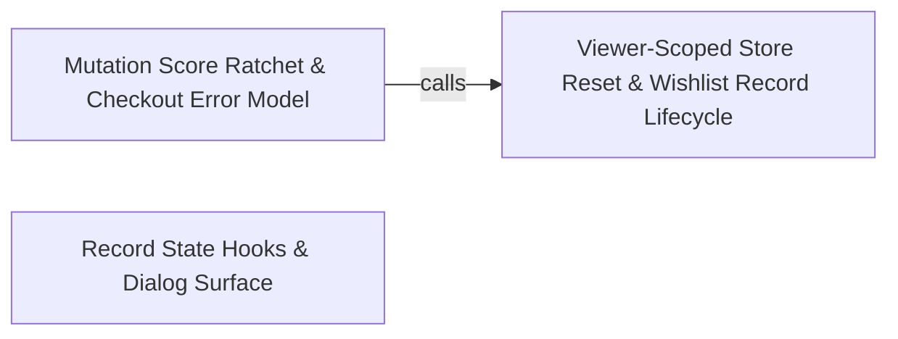

---
tags:
  - 2brain
  - 2brain/arch
  - project/boilerplate-vue-frontend
type: architecture
component: Mutation_Ratchet_Checkout_Record_Utilities
---

## Details

The per-file mutation-score ratchet (compare a Stryker report against mutation-baseline.json, refuse partial runs, lock in improvements) plus the checkout view's data-lifecycle utilities — blocking-error, missing-record, stale-record, reset-on-viewer-change, and clear-query-on-mount hooks — and the checkout error model and dialog store that surface those states. This is the test-quality gate and the checkout record-handling band.

### Mutation Score Ratchet & Checkout Error Model
The test-quality gate and the checkout domain's error-classification core. The mutation ratchet (check-baseline.ts) reads the Stryker JSON report, compares per-file scores against mutation-baseline.json, refuses to record a partial run, and locks in improvements by keeping the higher of baseline vs. current on --update. The checkout error model (checkout-errors.ts) is a pure classifier that reads error.errors[0] from the wire envelope, narrows the payload with runtime type guards, and returns a discriminated-union CheckoutErrorVerdict. The cart store (store.ts) is the consumer — its checkout() action throws the envelope, and the view calls classifyCheckoutError to decide which dialog or inline alert to render.

**Related Classes/Methods**:

- `src.modules.cart.domain.checkout-errors.CheckoutShortfallLine`:27-32
- `src.modules.cart.store.useCartStore`:62-700

**Source Files:**

- `scripts/mutation/check-baseline.ts`
  - `scripts.mutation.check-baseline.map() callback` (L72-L72) - Function
  - `scripts.mutation.check-baseline.counts.held.comparisons.filter() callback` (L84-L84) - Function
  - `scripts.mutation.check-baseline.counts.improved.comparisons.filter() callback` (L85-L85) - Function
  - `scripts.mutation.check-baseline.counts.added.comparisons.filter() callback` (L86-L86) - Function
  - `scripts.mutation.check-baseline.counts.removed.comparisons.filter() callback` (L87-L87) - Function
  - `scripts.mutation.check-baseline.comparisons.filter() callback` (L108-L108) - Function
- `src/app/components/use-language-switch.ts`
  - `src.app.components.use-language-switch.useLanguageSwitch.choiceLabel.t` (L70-L70) - Method
- `src/modules/cart/domain/checkout-errors.ts`
  - `src.modules.cart.domain.checkout-errors.CheckoutShortfallLine` (L27-L32) - Interface
  - `src.modules.cart.domain.checkout-errors.UnavailableCartLine` (L39-L42) - Interface
- `src/modules/cart/store.ts`
  - `src.modules.cart.store.useCartStore` (L62-L700) - Class
  - `src.modules.cart.store.useCartStore.defineStore('cart') callback` (L62-L700) - Function
  - `src.modules.cart.store.defineStore('cart') callback.cartItems` (L135-L135) - Class
  - `src.modules.cart.store.useCartStore.defineStore('cart') callback.cartItems.computed() callback` (L135-L135) - Function
  - `src.modules.cart.store.defineStore('cart') callback.cartSummary` (L140-L140) - Class
  - `src.modules.cart.store.useCartStore.defineStore('cart') callback.cartSummary.computed() callback` (L140-L140) - Function
  - `src.modules.cart.store.defineStore('cart') callback.cartShipping` (L146-L146) - Class
  - `src.modules.cart.store.useCartStore.defineStore('cart') callback.cartShipping.computed() callback` (L146-L146) - Function
  - `src.modules.cart.store.useCartStore.defineStore('cart') callback.liveSummary` (L158-L158) - Class
  - `src.modules.cart.store.useCartStore.defineStore('cart') callback.liveSummary.computed() callback` (L158-L158) - Function
  - `src.modules.cart.store.defineStore('cart') callback.badgeQuantity` (L196-L200) - Class
  - `src.modules.cart.store.useCartStore.defineStore('cart') callback.badgeQuantity.computed() callback` (L197-L199) - Function
  - `src.modules.cart.store.useCartStore.defineStore('cart') callback.badgeMoney.computed() callback` (L207-L210) - Function
  - `src.modules.cart.store.defineStore('cart') callback.badgeMoney` (L207-L211) - Class
  - `src.modules.cart.store.useCartStore.defineStore('cart') callback.useResetOnViewerChange() callback` (L227-L240) - Function
  - `src.modules.cart.store.defineStore('cart') callback.fetchSummary` (L248-L262) - Class
  - `src.modules.cart.store.useCartStore.defineStore('cart') callback.fetchSummary.then() callback` (L251-L254) - Function
  - `src.modules.cart.store.useCartStore.defineStore('cart') callback.fetchSummary.catch() callback` (L255-L261) - Function
  - `src.modules.cart.store.defineStore('cart') callback.fetchCart` (L314-L315) - Class
  - `src.modules.cart.store.useCartStore.defineStore('cart') callback.addCartItemAction` (L372-L377) - Class
  - `src.modules.cart.store.defineStore('cart') callback.updateCartItem` (L386-L387) - Class
  - `src.modules.cart.store.defineStore('cart') callback.setShippingMethod` (L398-L399) - Class
  - `src.modules.cart.store.useCartStore.defineStore('cart') callback.removeCartItemAction` (L407-L408) - Class
  - `src.modules.cart.store.useCartStore.defineStore('cart') callback.clearCartAction` (L416-L416) - Class
  - `src.modules.cart.store.defineStore('cart') callback.checkout` (L472-L511) - Class
  - `src.modules.cart.store.defineStore('cart') callback.reorder` (L520-L528) - Class

### Record State Hooks & Dialog Surface
The composable hook band that manages the full record-page state machine and the dialog store that surfaces user-facing confirmations. useBlockingError provides the inline error slot for a workflow that cannot proceed. useStaleRecord layers on top to handle 412 Precondition Failed with a warning and reload-latest option. useClearQueryOnMount is a one-shot security hook that strips one-time email tokens from the URL after mount. useMissingRecord handles 404/403 by redirecting to the shell's Error page. The dialog store (src/ui/dialog.ts) is the reactive queue that views push DialogRequest entries into and DialogHost renders.

**Related Classes/Methods**:

- `src.infrastructure.utils.use-blocking-error.useBlockingError`:58-85
- `src.infrastructure.utils.use-stale-record.useStaleRecord`:48-74
- `src.ui.dialog.useDialogStore`:76-109

**Source Files:**

- `src/infrastructure/utils/use-blocking-error.ts`
  - `src.infrastructure.utils.use-blocking-error.UseBlockingErrorReturn` (L18-L49) - Interface
  - `src.infrastructure.utils.use-blocking-error.useBlockingError` (L58-L85) - Class
  - `src.infrastructure.utils.use-blocking-error.useBlockingError.report` (L72-L76) - Method
  - `src.infrastructure.utils.use-blocking-error.useBlockingError.warn` (L77-L80) - Method
  - `src.infrastructure.utils.use-blocking-error.useBlockingError.clear` (L81-L83) - Method
- `src/infrastructure/utils/use-missing-record.ts`
  - `src.infrastructure.utils.use-missing-record.useMissingRecord.<function>.status` (L35-L35) - Class
  - `src.infrastructure.utils.use-missing-record.useMissingRecord.<function>.status.find() callback` (L35-L35) - Function
- `src/infrastructure/utils/use-stale-record.ts`
  - `src.infrastructure.utils.use-stale-record.UseStaleRecordReturn` (L17-L39) - Interface
  - `src.infrastructure.utils.use-stale-record.useStaleRecord` (L48-L74) - Class
  - `src.infrastructure.utils.use-stale-record.useStaleRecord.handle` (L59-L64) - Method
  - `src.infrastructure.utils.use-stale-record.useStaleRecord.reloadLatest` (L65-L69) - Method
  - `src.infrastructure.utils.use-stale-record.useStaleRecord.clear` (L70-L72) - Method
- `src/modules/locales/composables/use-dictionary-cell-editor.ts`
  - `src.modules.locales.composables.use-dictionary-cell-editor.useDictionaryCellEditor` (L52-L309) - Function
  - `src.modules.locales.composables.use-dictionary-cell-editor.useDictionaryCellEditor.markSaved` (L120-L125) - Class
  - `src.modules.locales.composables.use-dictionary-cell-editor.useDictionaryCellEditor.markSaved.setTimeout() callback` (L122-L124) - Function
  - `src.modules.locales.composables.use-dictionary-cell-editor.useDictionaryCellEditor.settleWrite` (L138-L152) - Class
  - `src.modules.locales.composables.use-dictionary-cell-editor.useDictionaryCellEditor.settleWrite.request.then() callback` (L140-L143) - Function
  - `src.modules.locales.composables.use-dictionary-cell-editor.useDictionaryCellEditor.settleWrite.catch() callback` (L144-L152) - Function
  - `src.modules.locales.composables.use-dictionary-cell-editor.handleCellBlur` (L168-L185) - Class
  - `src.modules.locales.composables.use-dictionary-cell-editor.useDictionaryCellEditor.handleCellBlur.request.then() callback` (L183-L183) - Function
  - `src.modules.locales.composables.use-dictionary-cell-editor.handleCellClear` (L200-L240) - Class
  - `src.modules.locales.composables.use-dictionary-cell-editor.useDictionaryCellEditor.handleCellClear.then() callback` (L218-L236) - Function
  - `src.modules.locales.composables.use-dictionary-cell-editor.useDictionaryCellEditor.handleCellClear.then() callback.then() callback` (L227-L233) - Function
- `src/ui/composables/use-media-query.ts`
  - `src.ui.composables.use-media-query.useMediaQuery` (L19-L46) - Class
  - `src.ui.composables.use-media-query.useMediaQuery.onScopeDispose() callback` (L41-L43) - Function
- `src/ui/composables/use-row-actions.ts`
  - `src.ui.composables.use-row-actions.useRowActions.run.catch() callback` (L96-L96) - Function
  - `src.ui.composables.use-row-actions.useRowActions.runConfirmed.singleFlight() callback.then() callback` (L109-L109) - Function
- `src/ui/composables/use-theme-color-meta.ts`
  - `src.ui.composables.use-theme-color-meta.useThemeColorMeta` (L18-L36) - Class
  - `src.ui.composables.use-theme-color-meta.watch() callback` (L26-L26) - Function
  - `src.ui.composables.use-theme-color-meta.useThemeColorMeta.watch() callback` (L27-L33) - Function
- `src/ui/composables/use-touch-friendly-size.ts`
  - `src.ui.composables.use-touch-friendly-size.useIsTouch` (L24-L30) - Class
  - `src.ui.composables.use-touch-friendly-size.useIsTouch.computed() callback` (L29-L29) - Function
  - `src.ui.composables.use-touch-friendly-size.useTouchTarget` (L49-L52) - Class
  - `src.ui.composables.use-touch-friendly-size.useTouchTarget.computed() callback` (L51-L51) - Function
  - `src.ui.composables.use-touch-friendly-size.useTouchChipSize` (L60-L63) - Class
  - `src.ui.composables.use-touch-friendly-size.useTouchChipSize.computed() callback` (L62-L62) - Function
- `src/ui/dialog.ts`
  - `src.ui.dialog.DialogRequest` (L16-L44) - Interface
  - `src.ui.dialog.DialogEntry` (L49-L58) - Interface
  - `src.ui.dialog.useDialogStore` (L76-L109) - Class
  - `src.ui.dialog.useDialogStore.defineStore('dialog') callback` (L76-L109) - Function
  - `src.ui.dialog.defineStore('dialog') callback.confirm` (L93-L96) - Class
  - `src.ui.dialog.useDialogStore.defineStore('dialog') callback.confirm.<function>` (L94-L96) - Function
- `src/ui/directives/focusable-scroll.ts`
  - `src.ui.directives.focusable-scroll.vFocusableScroll` (L20-L34) - Class
  - `src.ui.directives.focusable-scroll.vFocusableScroll.mounted` (L21-L28) - Method
  - `src.ui.directives.focusable-scroll.vFocusableScroll.updated` (L29-L33) - Method
- `src/ui/types.ts`
  - `src.ui.types.DetailFieldRow` (L54-L71) - Interface

### Viewer-Scoped Store Reset & Wishlist Record Lifecycle
The per-person data-lifecycle guard and its primary consumer, the wishlist store. useResetOnViewerChange watches session.viewer?.id and calls the store's reset() whenever the signed-in person changes or leaves, preventing one visitor's cart or wishlist from showing through to the next visitor. useMissingRecord provides the onError handler that a record page's watch or forced refetch hands to it: a 404 or 403 redirects to the shell's Error page while any other failure is toasted. The wishlist store is the concrete embodiment — its fetchWishlist, addToWishlist, removeFromWishlist, moveToCart, and ensureWishlist actions are all wrapped with these hooks, demonstrating the full hook composition pattern.

**Related Classes/Methods**:

- `src.infrastructure.utils.use-reset-on-viewer-change.useResetOnViewerChange`:22-32
- `src.infrastructure.utils.use-missing-record.useMissingRecord`:30-51
- `src.modules.wishlist.store.useWishlistStore`:26-162

**Source Files:**

- `src/infrastructure/utils/use-missing-record.ts`
  - `src.infrastructure.utils.use-missing-record.useMissingRecord` (L30-L51) - Class
  - `src.infrastructure.utils.use-missing-record.useMissingRecord.<function>` (L34-L50) - Function
- `src/infrastructure/utils/use-reset-on-viewer-change.ts`
  - `src.infrastructure.utils.use-reset-on-viewer-change.useResetOnViewerChange` (L22-L32) - Class
  - `src.infrastructure.utils.use-reset-on-viewer-change.watch() callback` (L27-L27) - Function
  - `src.infrastructure.utils.use-reset-on-viewer-change.useResetOnViewerChange.watch() callback` (L28-L30) - Function
- `src/modules/wishlist/store.ts`
  - `src.modules.wishlist.store.useWishlistStore` (L26-L162) - Class
  - `src.modules.wishlist.store.useWishlistStore.defineStore('wishlist') callback` (L26-L162) - Function
  - `src.modules.wishlist.store.useWishlistStore.defineStore('wishlist') callback.savedProductIds` (L72-L72) - Class
  - `src.modules.wishlist.store.useWishlistStore.defineStore('wishlist') callback.savedProductIds.computed() callback` (L72-L72) - Function
  - `src.modules.wishlist.store.useWishlistStore.defineStore('wishlist') callback.savedProductIds.computed() callback.items.value.map() callback` (L72-L72) - Function
  - `src.modules.wishlist.store.defineStore('wishlist') callback.fetchWishlist` (L87-L87) - Class
  - `src.modules.wishlist.store.defineStore('wishlist') callback.ensureWishlist` (L98-L105) - Class
  - `src.modules.wishlist.store.useWishlistStore.defineStore('wishlist') callback.ensureWishlist.catch() callback` (L99-L103) - Function
  - `src.modules.wishlist.store.defineStore('wishlist') callback.addToWishlist` (L114-L115) - Class
  - `src.modules.wishlist.store.defineStore('wishlist') callback.removeFromWishlist` (L123-L124) - Class
  - `src.modules.wishlist.store.defineStore('wishlist') callback.moveToCart` (L134-L139) - Class
  - `src.modules.wishlist.store.useWishlistStore.defineStore('wishlist') callback.useResetOnViewerChange() callback` (L145-L149) - Function
