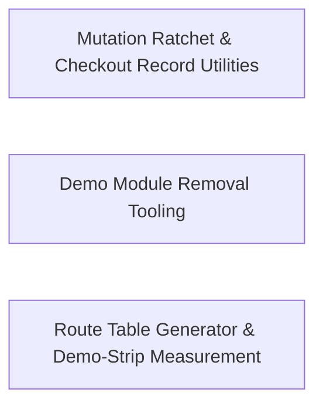

---
tags:
  - 2brain
  - 2brain/arch
  - project/boilerplate-vue-frontend
type: architecture
component: Route_Table_Generation
---

## Details

Build tooling that generates the REST route table from the OpenAPI document, alongside the demo-strip tooling that removes demo modules and measures the resulting footprint.

### Mutation Ratchet & Checkout Record Utilities [[Expand]](./Mutation_Ratchet_Checkout_Record_Utilities.md)
The per-file mutation-score ratchet (compare a Stryker report against mutation-baseline.json, refuse partial runs, lock in improvements) plus the checkout view's data-lifecycle utilities — blocking-error, missing-record, stale-record, reset-on-viewer-change, and clear-query-on-mount hooks — and the checkout error model and dialog store that surface those states. This is the test-quality gate and the checkout record-handling band.

**Related Classes/Methods**:

- `src.infrastructure.utils.use-blocking-error.useBlockingError`:58-85
- `src.infrastructure.utils.use-stale-record.useStaleRecord`:48-74

**Source Files:**

- `scripts/mutation/check-baseline.ts`
  - `scripts.mutation.check-baseline.map() callback` (L72-L72) - Function
  - `scripts.mutation.check-baseline.counts.held.comparisons.filter() callback` (L84-L84) - Function
  - `scripts.mutation.check-baseline.counts.improved.comparisons.filter() callback` (L85-L85) - Function
  - `scripts.mutation.check-baseline.counts.added.comparisons.filter() callback` (L86-L86) - Function
  - `scripts.mutation.check-baseline.counts.removed.comparisons.filter() callback` (L87-L87) - Function
  - `scripts.mutation.check-baseline.comparisons.filter() callback` (L108-L108) - Function
- `src/app/components/use-language-switch.ts`
  - `src.app.components.use-language-switch.useLanguageSwitch.choiceLabel.t` (L70-L70) - Method
- `src/infrastructure/utils/use-blocking-error.ts`
  - `src.infrastructure.utils.use-blocking-error.UseBlockingErrorReturn` (L18-L49) - Interface
  - `src.infrastructure.utils.use-blocking-error.useBlockingError` (L58-L85) - Class
  - `src.infrastructure.utils.use-blocking-error.useBlockingError.report` (L72-L76) - Method
  - `src.infrastructure.utils.use-blocking-error.useBlockingError.warn` (L77-L80) - Method
  - `src.infrastructure.utils.use-blocking-error.useBlockingError.clear` (L81-L83) - Method
- `src/infrastructure/utils/use-missing-record.ts`
  - `src.infrastructure.utils.use-missing-record.useMissingRecord` (L30-L51) - Class
  - `src.infrastructure.utils.use-missing-record.useMissingRecord.<function>` (L34-L50) - Function
  - `src.infrastructure.utils.use-missing-record.useMissingRecord.<function>.status` (L35-L35) - Class
  - `src.infrastructure.utils.use-missing-record.useMissingRecord.<function>.status.find() callback` (L35-L35) - Function
- `src/infrastructure/utils/use-reset-on-viewer-change.ts`
  - `src.infrastructure.utils.use-reset-on-viewer-change.useResetOnViewerChange` (L22-L32) - Class
  - `src.infrastructure.utils.use-reset-on-viewer-change.watch() callback` (L27-L27) - Function
  - `src.infrastructure.utils.use-reset-on-viewer-change.useResetOnViewerChange.watch() callback` (L28-L30) - Function
- `src/infrastructure/utils/use-stale-record.ts`
  - `src.infrastructure.utils.use-stale-record.UseStaleRecordReturn` (L17-L39) - Interface
  - `src.infrastructure.utils.use-stale-record.useStaleRecord` (L48-L74) - Class
  - `src.infrastructure.utils.use-stale-record.useStaleRecord.handle` (L59-L64) - Method
  - `src.infrastructure.utils.use-stale-record.useStaleRecord.reloadLatest` (L65-L69) - Method
  - `src.infrastructure.utils.use-stale-record.useStaleRecord.clear` (L70-L72) - Method
- `src/modules/cart/domain/checkout-errors.ts`
  - `src.modules.cart.domain.checkout-errors.CheckoutShortfallLine` (L27-L32) - Interface
  - `src.modules.cart.domain.checkout-errors.UnavailableCartLine` (L39-L42) - Interface
- `src/modules/cart/store.ts`
  - `src.modules.cart.store.useCartStore` (L62-L700) - Class
  - `src.modules.cart.store.useCartStore.defineStore('cart') callback` (L62-L700) - Function
  - `src.modules.cart.store.defineStore('cart') callback.cartItems` (L135-L135) - Class
  - `src.modules.cart.store.useCartStore.defineStore('cart') callback.cartItems.computed() callback` (L135-L135) - Function
  - `src.modules.cart.store.defineStore('cart') callback.cartSummary` (L140-L140) - Class
  - `src.modules.cart.store.useCartStore.defineStore('cart') callback.cartSummary.computed() callback` (L140-L140) - Function
  - `src.modules.cart.store.defineStore('cart') callback.cartShipping` (L146-L146) - Class
  - `src.modules.cart.store.useCartStore.defineStore('cart') callback.cartShipping.computed() callback` (L146-L146) - Function
  - `src.modules.cart.store.useCartStore.defineStore('cart') callback.liveSummary` (L158-L158) - Class
  - `src.modules.cart.store.useCartStore.defineStore('cart') callback.liveSummary.computed() callback` (L158-L158) - Function
  - `src.modules.cart.store.defineStore('cart') callback.badgeQuantity` (L196-L200) - Class
  - `src.modules.cart.store.useCartStore.defineStore('cart') callback.badgeQuantity.computed() callback` (L197-L199) - Function
  - `src.modules.cart.store.useCartStore.defineStore('cart') callback.badgeMoney.computed() callback` (L207-L210) - Function
  - `src.modules.cart.store.defineStore('cart') callback.badgeMoney` (L207-L211) - Class
  - `src.modules.cart.store.useCartStore.defineStore('cart') callback.useResetOnViewerChange() callback` (L227-L240) - Function
  - `src.modules.cart.store.defineStore('cart') callback.fetchSummary` (L248-L262) - Class
  - `src.modules.cart.store.useCartStore.defineStore('cart') callback.fetchSummary.then() callback` (L251-L254) - Function
  - `src.modules.cart.store.useCartStore.defineStore('cart') callback.fetchSummary.catch() callback` (L255-L261) - Function
  - `src.modules.cart.store.defineStore('cart') callback.fetchCart` (L314-L315) - Class
  - `src.modules.cart.store.useCartStore.defineStore('cart') callback.addCartItemAction` (L372-L377) - Class
  - `src.modules.cart.store.defineStore('cart') callback.updateCartItem` (L386-L387) - Class
  - `src.modules.cart.store.defineStore('cart') callback.setShippingMethod` (L398-L399) - Class
  - `src.modules.cart.store.useCartStore.defineStore('cart') callback.removeCartItemAction` (L407-L408) - Class
  - `src.modules.cart.store.useCartStore.defineStore('cart') callback.clearCartAction` (L416-L416) - Class
  - `src.modules.cart.store.defineStore('cart') callback.checkout` (L472-L511) - Class
  - `src.modules.cart.store.defineStore('cart') callback.reorder` (L520-L528) - Class
- `src/modules/locales/composables/use-dictionary-cell-editor.ts`
  - `src.modules.locales.composables.use-dictionary-cell-editor.useDictionaryCellEditor` (L52-L309) - Function
  - `src.modules.locales.composables.use-dictionary-cell-editor.useDictionaryCellEditor.markSaved` (L120-L125) - Class
  - `src.modules.locales.composables.use-dictionary-cell-editor.useDictionaryCellEditor.markSaved.setTimeout() callback` (L122-L124) - Function
  - `src.modules.locales.composables.use-dictionary-cell-editor.useDictionaryCellEditor.settleWrite` (L138-L152) - Class
  - `src.modules.locales.composables.use-dictionary-cell-editor.useDictionaryCellEditor.settleWrite.request.then() callback` (L140-L143) - Function
  - `src.modules.locales.composables.use-dictionary-cell-editor.useDictionaryCellEditor.settleWrite.catch() callback` (L144-L152) - Function
  - `src.modules.locales.composables.use-dictionary-cell-editor.handleCellBlur` (L168-L185) - Class
  - `src.modules.locales.composables.use-dictionary-cell-editor.useDictionaryCellEditor.handleCellBlur.request.then() callback` (L183-L183) - Function
  - `src.modules.locales.composables.use-dictionary-cell-editor.handleCellClear` (L200-L240) - Class
  - `src.modules.locales.composables.use-dictionary-cell-editor.useDictionaryCellEditor.handleCellClear.then() callback` (L218-L236) - Function
  - `src.modules.locales.composables.use-dictionary-cell-editor.useDictionaryCellEditor.handleCellClear.then() callback.then() callback` (L227-L233) - Function
- `src/modules/wishlist/store.ts`
  - `src.modules.wishlist.store.useWishlistStore` (L26-L162) - Class
  - `src.modules.wishlist.store.useWishlistStore.defineStore('wishlist') callback` (L26-L162) - Function
  - `src.modules.wishlist.store.useWishlistStore.defineStore('wishlist') callback.savedProductIds` (L72-L72) - Class
  - `src.modules.wishlist.store.useWishlistStore.defineStore('wishlist') callback.savedProductIds.computed() callback` (L72-L72) - Function
  - `src.modules.wishlist.store.useWishlistStore.defineStore('wishlist') callback.savedProductIds.computed() callback.items.value.map() callback` (L72-L72) - Function
  - `src.modules.wishlist.store.defineStore('wishlist') callback.fetchWishlist` (L87-L87) - Class
  - `src.modules.wishlist.store.defineStore('wishlist') callback.ensureWishlist` (L98-L105) - Class
  - `src.modules.wishlist.store.useWishlistStore.defineStore('wishlist') callback.ensureWishlist.catch() callback` (L99-L103) - Function
  - `src.modules.wishlist.store.defineStore('wishlist') callback.addToWishlist` (L114-L115) - Class
  - `src.modules.wishlist.store.defineStore('wishlist') callback.removeFromWishlist` (L123-L124) - Class
  - `src.modules.wishlist.store.defineStore('wishlist') callback.moveToCart` (L134-L139) - Class
  - `src.modules.wishlist.store.useWishlistStore.defineStore('wishlist') callback.useResetOnViewerChange() callback` (L145-L149) - Function
- `src/ui/composables/use-media-query.ts`
  - `src.ui.composables.use-media-query.useMediaQuery` (L19-L46) - Class
  - `src.ui.composables.use-media-query.useMediaQuery.onScopeDispose() callback` (L41-L43) - Function
- `src/ui/composables/use-row-actions.ts`
  - `src.ui.composables.use-row-actions.useRowActions.run.catch() callback` (L96-L96) - Function
  - `src.ui.composables.use-row-actions.useRowActions.runConfirmed.singleFlight() callback.then() callback` (L109-L109) - Function
- `src/ui/composables/use-theme-color-meta.ts`
  - `src.ui.composables.use-theme-color-meta.useThemeColorMeta` (L18-L36) - Class
  - `src.ui.composables.use-theme-color-meta.watch() callback` (L26-L26) - Function
  - `src.ui.composables.use-theme-color-meta.useThemeColorMeta.watch() callback` (L27-L33) - Function
- `src/ui/composables/use-touch-friendly-size.ts`
  - `src.ui.composables.use-touch-friendly-size.useIsTouch` (L24-L30) - Class
  - `src.ui.composables.use-touch-friendly-size.useIsTouch.computed() callback` (L29-L29) - Function
  - `src.ui.composables.use-touch-friendly-size.useTouchTarget` (L49-L52) - Class
  - `src.ui.composables.use-touch-friendly-size.useTouchTarget.computed() callback` (L51-L51) - Function
  - `src.ui.composables.use-touch-friendly-size.useTouchChipSize` (L60-L63) - Class
  - `src.ui.composables.use-touch-friendly-size.useTouchChipSize.computed() callback` (L62-L62) - Function
- `src/ui/dialog.ts`
  - `src.ui.dialog.DialogRequest` (L16-L44) - Interface
  - `src.ui.dialog.DialogEntry` (L49-L58) - Interface
  - `src.ui.dialog.useDialogStore` (L76-L109) - Class
  - `src.ui.dialog.useDialogStore.defineStore('dialog') callback` (L76-L109) - Function
  - `src.ui.dialog.defineStore('dialog') callback.confirm` (L93-L96) - Class
  - `src.ui.dialog.useDialogStore.defineStore('dialog') callback.confirm.<function>` (L94-L96) - Function
- `src/ui/directives/focusable-scroll.ts`
  - `src.ui.directives.focusable-scroll.vFocusableScroll` (L20-L34) - Class
  - `src.ui.directives.focusable-scroll.vFocusableScroll.mounted` (L21-L28) - Method
  - `src.ui.directives.focusable-scroll.vFocusableScroll.updated` (L29-L33) - Method
- `src/ui/types.ts`
  - `src.ui.types.DetailFieldRow` (L54-L71) - Interface

### Demo Module Removal Tooling
The live-checkout demo removal flow: reads the demo module manifest, deletes each demo module's folder, strips the module registry, and removes cross-module specs that require or import a removed module (via requires-module headers and import detection). Also carries the idempotency key keeper and product-picker/deactivate-then-delete helpers that the removal path touches. This is the destructive demo:remove side, distinct from the report-only measure.

**Related Classes/Methods**:

- `scripts.demo.demo-remove-tests.removeResidueSpecs`:77-91
- `scripts.demo.demo-remove-tests.headerProblems`:113-126
- `scripts.demo.demo-remove-tests.requiredModules`:36-44
- `src.infrastructure.http.idempotency.IdempotencyKeyKeeper`:19-36

**Source Files:**

- `scripts/demo/demo-remove-tests.ts`
  - `scripts.demo.demo-remove-tests.RemovalNote` (L17-L22) - Interface
  - `scripts.demo.demo-remove-tests.requiredModules` (L36-L44) - Class
  - `scripts.demo.demo-remove-tests.requiredModules.map() callback` (L42-L42) - Function
  - `scripts.demo.demo-remove-tests.requiredModules.filter() callback` (L43-L43) - Function
  - `scripts.demo.demo-remove-tests.walkTypeScript` (L47-L54) - Class
  - `scripts.demo.demo-remove-tests.walkTypeScript.flatMap() callback` (L49-L53) - Function
  - `scripts.demo.demo-remove-tests.removeResidueSpecs` (L77-L91) - Class
  - `scripts.demo.demo-remove-tests.removeResidueSpecs.deleted.filter() callback.needs` (L80-L80) - Class
  - `scripts.demo.demo-remove-tests.removeResidueSpecs.deleted.filter() callback.needs.find() callback` (L80-L80) - Function
  - `scripts.demo.demo-remove-tests.headerProblems` (L113-L126) - Class
  - `scripts.demo.demo-remove-tests.headerProblems.flatMap() callback` (L114-L126) - Function
  - `scripts.demo.demo-remove-tests.headerProblems.flatMap() callback.required.filter() callback` (L124-L124) - Function
  - `scripts.demo.demo-remove-tests.headerProblems.flatMap() callback.map() callback` (L125-L125) - Function
- `src/app/components/use-language-switch.ts`
  - `src.app.components.use-language-switch.useLanguageSwitch.choiceLabel.te` (L70-L70) - Method
- `src/infrastructure/http/idempotency.ts`
  - `src.infrastructure.http.idempotency.IdempotencyKeyKeeper` (L19-L36) - Interface
  - `src.infrastructure.http.idempotency.useIdempotencyKey` (L45-L62) - Class
  - `src.infrastructure.http.idempotency.useIdempotencyKey.withKey` (L53-L57) - Method
  - `src.infrastructure.http.idempotency.useIdempotencyKey.settle` (L58-L60) - Method
- `src/modules/delivery/store.ts`
  - `src.modules.delivery.store.defineStore('delivery') callback.fetchMethods` (L165-L172) - Class
  - `src.modules.delivery.store.defineStore('delivery') callback.ship` (L248-L259) - Class
  - `src.modules.delivery.store.defineStore('delivery') callback.fulfill` (L267-L278) - Class
  - `src.modules.delivery.store.defineStore('delivery') callback.deliver` (L315-L320) - Class
- `src/modules/inventory/composables/use-product-picker.ts`
  - `src.modules.inventory.composables.use-product-picker.ProductPickerOption` (L14-L17) - Interface
  - `src.modules.inventory.composables.use-product-picker.useProductPicker` (L37-L98) - Class
  - `src.modules.inventory.composables.use-product-picker.useProductPicker.runSearch` (L50-L58) - Class
  - `src.modules.inventory.composables.use-product-picker.useProductPicker.runSearch.debounce() callback` (L50-L58) - Function
  - `src.modules.inventory.composables.use-product-picker.useProductPicker.runSearch.debounce() callback.then() callback` (L52-L54) - Function
  - `src.modules.inventory.composables.use-product-picker.useProductPicker.runSearch.debounce() callback.catch() callback` (L57-L57) - Function
  - `src.modules.inventory.composables.use-product-picker.useProductPicker.watch() callback` (L62-L62) - Function
  - `src.modules.inventory.composables.use-product-picker.options` (L68-L74) - Class
  - `src.modules.inventory.composables.use-product-picker.useProductPicker.options.computed() callback` (L68-L74) - Function
  - `src.modules.inventory.composables.use-product-picker.useProductPicker.options.computed() callback.products` (L69-L72) - Class
  - `src.modules.inventory.composables.use-product-picker.useProductPicker.options.computed() callback.products.results.value.some() callback` (L70-L70) - Function
  - `src.modules.inventory.composables.use-product-picker.useProductPicker.options.computed() callback.products.map() callback` (L73-L73) - Function
  - `src.modules.inventory.composables.use-product-picker.pin` (L82-L95) - Class
  - `src.modules.inventory.composables.use-product-picker.useProductPicker.pin.results.value.some() callback` (L83-L83) - Function
  - `src.modules.inventory.composables.use-product-picker.useProductPicker.pin.then() callback` (L89-L91) - Function
  - `src.modules.inventory.composables.use-product-picker.useProductPicker.pin.catch() callback` (L94-L94) - Function
- `src/modules/inventory/store.ts`
  - `src.modules.inventory.store.useInventoryStore` (L61-L277) - Class
  - `src.modules.inventory.store.useInventoryStore.defineStore('inventory') callback` (L61-L277) - Function
  - `src.modules.inventory.store.defineStore('inventory') callback.fetchMovements` (L126-L134) - Class
  - `src.modules.inventory.store.useInventoryStore.defineStore('inventory') callback.fetchMovements.fetchAny() callback` (L127-L134) - Function
  - `src.modules.inventory.store.useInventoryStore.defineStore('inventory') callback.fetchMovements.fetchAny() callback.then() callback` (L129-L133) - Function
  - `src.modules.inventory.store.defineStore('inventory') callback.fetchLevels` (L143-L151) - Class
  - `src.modules.inventory.store.useInventoryStore.defineStore('inventory') callback.fetchLevels.fetchAny() callback` (L144-L151) - Function
  - `src.modules.inventory.store.useInventoryStore.defineStore('inventory') callback.fetchLevels.fetchAny() callback.then() callback` (L146-L150) - Function
  - `src.modules.inventory.store.defineStore('inventory') callback.receive` (L196-L209) - Class
  - `src.modules.inventory.store.useInventoryStore.defineStore('inventory') callback.receive.fetchAny() callback` (L198-L207) - Function
  - `src.modules.inventory.store.useInventoryStore.defineStore('inventory') callback.receive.fetchAny() callback.then() callback` (L200-L203) - Function
  - `src.modules.inventory.store.useInventoryStore.defineStore('inventory') callback.receive.fetchAny() callback.catch() callback` (L204-L207) - Function
  - `src.modules.inventory.store.defineStore('inventory') callback.adjust` (L219-L232) - Class
  - `src.modules.inventory.store.useInventoryStore.defineStore('inventory') callback.adjust.fetchAny() callback` (L221-L230) - Function
  - `src.modules.inventory.store.useInventoryStore.defineStore('inventory') callback.adjust.fetchAny() callback.then() callback` (L223-L226) - Function
  - `src.modules.inventory.store.useInventoryStore.defineStore('inventory') callback.adjust.fetchAny() callback.catch() callback` (L227-L230) - Function
  - `src.modules.inventory.store.defineStore('inventory') callback.sweep` (L239-L246) - Class
  - `src.modules.inventory.store.useInventoryStore.defineStore('inventory') callback.sweep.fetchAny() callback` (L240-L245) - Function
  - `src.modules.inventory.store.useInventoryStore.defineStore('inventory') callback.sweep.fetchAny() callback.then() callback` (L241-L244) - Function
  - `src.modules.inventory.store.defineStore('inventory') callback.sweep.fetchAny() callback.then() callback.then() callback` (L243-L243) - Function
  - `src.modules.inventory.store.useInventoryStore.defineStore('inventory') callback.sweep.fetchAny() callback.then() callback.then() callback` (L244-L244) - Function
  - `src.modules.inventory.store.useInventoryStore.defineStore('inventory') callback.reloadAfterWrite` (L257-L260) - Class
  - `src.modules.inventory.store.defineStore('inventory') callback.reloadAfterWrite.then() callback` (L259-L259) - Function
  - `src.modules.inventory.store.useInventoryStore.defineStore('inventory') callback.reloadAfterWrite.then() callback` (L260-L260) - Function
- `src/modules/returns/store.ts`
  - `src.modules.returns.store.useReturnsStore` (L45-L265) - Class
  - `src.modules.returns.store.useReturnsStore.defineStore('returns') callback` (L45-L265) - Function
  - `src.modules.returns.store.defineStore('returns') callback.openReturn` (L110-L127) - Class
  - `src.modules.returns.store.useReturnsStore.defineStore('returns') callback.openReturn.fetchAny() callback` (L112-L121) - Function
  - `src.modules.returns.store.useReturnsStore.defineStore('returns') callback.openReturn.fetchAny() callback.then() callback` (L114-L117) - Function
  - `src.modules.returns.store.useReturnsStore.defineStore('returns') callback.openReturn.fetchAny() callback.catch() callback` (L118-L121) - Function
  - `src.modules.returns.store.useReturnsStore.defineStore('returns') callback.openReturn.then() callback` (L122-L126) - Function
  - `src.modules.returns.store.defineStore('returns') callback.fetchOrderReturns` (L137-L142) - Class
  - `src.modules.returns.store.useReturnsStore.defineStore('returns') callback.fetchOrderReturns.fetchAny() callback` (L138-L138) - Function
  - `src.modules.returns.store.useReturnsStore.defineStore('returns') callback.fetchOrderReturns.then() callback` (L138-L142) - Function
  - `src.modules.returns.store.defineStore('returns') callback.approve` (L161-L161) - Class
  - `src.modules.returns.store.useReturnsStore.defineStore('returns') callback.approve.updateTarget() callback` (L161-L161) - Function
  - `src.modules.returns.store.defineStore('returns') callback.decline` (L172-L177) - Class
  - `src.modules.returns.store.useReturnsStore.defineStore('returns') callback.decline.updateTarget() callback` (L174-L174) - Function
  - `src.modules.returns.store.defineStore('returns') callback.receive` (L187-L203) - Class
  - `src.modules.returns.store.useReturnsStore.defineStore('returns') callback.receive.updateTarget() callback` (L190-L199) - Function
  - `src.modules.returns.store.useReturnsStore.defineStore('returns') callback.receive.updateTarget() callback.then() callback` (L192-L195) - Function
  - `src.modules.returns.store.useReturnsStore.defineStore('returns') callback.receive.updateTarget() callback.catch() callback` (L196-L199) - Function
- `src/ui/composables/use-list-url-state.ts`
  - `src.ui.composables.use-list-url-state.useListUrlState.hydrate.present.ownKeys.some() callback` (L119-L119) - Function
- `src/ui/composables/use-return-focus.ts`
  - `src.ui.composables.use-return-focus.useReturnFocus.onScopeDispose() callback.nextTick() callback` (L60-L60) - Function
- `src/ui/composables/use-row-actions.ts`
  - `src.ui.composables.use-row-actions.RowActionErrorSink` (L18-L27) - Interface
  - `src.ui.composables.use-row-actions.UseRowActionsReturn` (L60-L70) - Interface
  - `src.ui.composables.use-row-actions.useRowActions.run.then() callback` (L95-L95) - Function
- `src/ui/organisms/data-table-headers.ts`
  - `src.ui.organisms.data-table-headers.CoreDataTableFieldHeader` (L17-L37) - Interface
  - `src.ui.organisms.data-table-headers.CoreDataTableSyntheticHeader` (L46-L67) - Interface

### Route Table Generator & Demo-Strip Measurement [[Expand]](./Route_Table_Generator_Demo_Strip_Measurement.md)
The core of this subsystem. The route-table generator parses openapi.yaml, derives each operation's anchored path pattern, response/body schema names, and x-module stamp, sorts rows for a stable diff, and emits the generated ROUTES table (with a check-only mode). Paired with it is the report-only demo-strip measurement: assemble a scratch copy (symlinking node_modules, never copying .git), strip the demo modules, and run type-check-only/lint/build-only to measure whether the demo shop is removable. This is the contract→generated backbone edge plus the FE-D4 measure gate.

**Related Classes/Methods**:

- `scripts.contracts.generate-route-table.output`:211-238
- `scripts.contracts.generate-route-table.bodySchemaNameFor`:139-144
- `scripts.contracts.generate-route-table.pathToPatternSource`:114-118

**Source Files:**

- `scripts/contracts/generate-route-table.ts`
  - `scripts.contracts.generate-route-table.OpenApiOperation` (L39-L45) - Interface
  - `scripts.contracts.generate-route-table.OpenApiDocument` (L48-L50) - Interface
  - `scripts.contracts.generate-route-table.pathToPatternSource` (L114-L118) - Class
  - `scripts.contracts.generate-route-table.pathToPatternSource.map() callback` (L117-L117) - Function
  - `scripts.contracts.generate-route-table.bodySchemaNameFor` (L139-L144) - Class
  - `scripts.contracts.generate-route-table.bodySchemaNameFor.contentTypes.some() callback` (L141-L141) - Function
  - `scripts.contracts.generate-route-table.Row` (L147-L155) - Interface
  - `scripts.contracts.generate-route-table.paramCount.filter() callback` (L186-L186) - Function
  - `scripts.contracts.generate-route-table.rows.sort() callback` (L200-L203) - Function
  - `scripts.contracts.generate-route-table.output` (L211-L238) - Class
  - `scripts.contracts.generate-route-table.output.rows.map() callback` (L233-L233) - Function
- `scripts/demo/demo-remove-tests.ts`
  - `scripts.demo.demo-remove-tests.removeResidueSpecs.deleted` (L78-L85) - Class
  - `scripts.demo.demo-remove-tests.removeResidueSpecs.deleted.filter() callback` (L78-L85) - Function
  - `scripts.demo.demo-remove-tests.removeResidueSpecs.deleted.map() callback` (L87-L90) - Function
- `scripts/demo/demo-remove.ts`
  - `scripts.demo.demo-remove.findResidueTests` (L36-L52) - Class
  - `scripts.demo.demo-remove.findResidueTests.pattern` (L37-L37) - Class
  - `scripts.demo.demo-remove.findResidueTests.pattern.names.map() callback` (L37-L37) - Function
  - `scripts.demo.demo-remove.findResidueTests.filter() callback` (L46-L46) - Function
- `scripts/mutation/baseline.ts`
  - `scripts.mutation.baseline.MutationReport` (L60-L62) - Interface
  - `scripts.mutation.baseline.MutationBaseline` (L65-L70) - Interface
  - `scripts.mutation.baseline.FileComparison` (L76-L81) - Interface
  - `scripts.mutation.baseline.compareToBaseline` (L150-L169) - Class
  - `scripts.mutation.baseline.compareToBaseline.files.map() callback` (L157-L168) - Function
  - `scripts.mutation.baseline.missingFromReport` (L183-L189) - Class
  - `scripts.mutation.baseline.missingFromReport.filter() callback` (L188-L188) - Function
- `src/app/components/use-language-switch.ts`
  - `src.app.components.use-language-switch.useLanguageSwitch.switchLanguage.catch() callback` (L60-L60) - Function
  - `src.app.components.use-language-switch.choiceLabel` (L69-L70) - Class
- `src/modules/delivery/store.ts`
  - `src.modules.delivery.store.useDeliveryStore` (L59-L373) - Class
  - `src.modules.delivery.store.useDeliveryStore.defineStore('delivery') callback` (L59-L373) - Function
  - `src.modules.delivery.store.useDeliveryStore.defineStore('delivery') callback.fetchMethods.fetchAny() callback` (L166-L171) - Function
  - `src.modules.delivery.store.useDeliveryStore.defineStore('delivery') callback.fetchMethods.fetchAny() callback.then() callback` (L167-L171) - Function
  - `src.modules.delivery.store.useDeliveryStore.defineStore('delivery') callback.ship.fetchAny() callback` (L250-L257) - Function
  - `src.modules.delivery.store.useDeliveryStore.defineStore('delivery') callback.ship.fetchAny() callback.then() callback` (L256-L256) - Function
  - `src.modules.delivery.store.useDeliveryStore.defineStore('delivery') callback.fulfill.fetchAny() callback` (L269-L276) - Function
  - `src.modules.delivery.store.useDeliveryStore.defineStore('delivery') callback.fulfill.fetchAny() callback.then() callback` (L275-L275) - Function
  - `src.modules.delivery.store.useDeliveryStore.defineStore('delivery') callback.deliver.fetchAny() callback` (L316-L319) - Function
  - `src.modules.delivery.store.useDeliveryStore.defineStore('delivery') callback.deliver.fetchAny() callback.then() callback` (L317-L318) - Function
- `src/modules/locales/composables/use-dictionary-aggregation.ts`
  - `src.modules.locales.composables.use-dictionary-aggregation.useDictionaryAggregation.hasBaseline.computed() callback` (L48-L48) - Function
  - `src.modules.locales.composables.use-dictionary-aggregation.useDictionaryAggregation.languages.computed() callback` (L57-L58) - Function
  - `src.modules.locales.composables.use-dictionary-aggregation.useDictionaryAggregation.languages.computed() callback.capabilities.value.filter() callback` (L58-L58) - Function
  - `src.modules.locales.composables.use-dictionary-aggregation.useDictionaryAggregation.entriesIndex` (L91-L100) - Class
  - `src.modules.locales.composables.use-dictionary-aggregation.useDictionaryAggregation.entriesIndex.computed() callback` (L91-L100) - Function
  - `src.modules.locales.composables.use-dictionary-aggregation.useDictionaryAggregation.entriesIndex.computed() callback.filter() callback` (L96-L96) - Function
  - `src.modules.locales.composables.use-dictionary-aggregation.useDictionaryAggregation.entriesIndex.computed() callback.map() callback` (L97-L97) - Function
  - `src.modules.locales.composables.use-dictionary-aggregation.useDictionaryAggregation.baselines` (L105-L109) - Class
  - `src.modules.locales.composables.use-dictionary-aggregation.useDictionaryAggregation.baselines.computed() callback` (L105-L109) - Function
  - `src.modules.locales.composables.use-dictionary-aggregation.useDictionaryAggregation.allKeys.computed() callback` (L142-L149) - Function
  - `src.modules.locales.composables.use-dictionary-aggregation.useDictionaryAggregation.missingByTag.computed() callback` (L154-L160) - Function
  - `src.modules.locales.composables.use-dictionary-aggregation.useDictionaryAggregation.missingByTag.computed() callback.languages.value.map() callback` (L156-L159) - Function
  - `src.modules.locales.composables.use-dictionary-aggregation.useDictionaryAggregation.missingByTag.computed() callback.languages.value.map() callback.allKeys.value.filter() callback` (L158-L158) - Function
  - `src.modules.locales.composables.use-dictionary-aggregation.useDictionaryAggregation.loadLanguage.then() callback` (L171-L175) - Function
  - `src.modules.locales.composables.use-dictionary-aggregation.useDictionaryAggregation.loadBoard.then() callback` (L182-L182) - Function
  - `src.modules.locales.composables.use-dictionary-aggregation.useDictionaryAggregation.loadBoard.then() callback.languages.value.map() callback` (L182-L182) - Function
  - `src.modules.locales.composables.use-dictionary-aggregation.useDictionaryAggregation.loadBoard.catch() callback` (L183-L183) - Function
- `src/modules/payments/composables/use-order-refund.ts`
  - `src.modules.payments.composables.use-order-refund.useOrderRefund` (L32-L147) - Class
  - `src.modules.payments.composables.use-order-refund.useOrderRefund.watch() callback` (L55-L57) - Function
  - `src.modules.payments.composables.use-order-refund.useOrderRefund.canRefund.computed() callback` (L65-L65) - Function
  - `src.modules.payments.composables.use-order-refund.useOrderRefund.refund` (L89-L108) - Method
  - `src.modules.payments.composables.use-order-refund.useOrderRefund.refund.then() callback` (L98-L106) - Function
  - `src.modules.payments.composables.use-order-refund.useOrderRefund.refreshPayment` (L142-L145) - Method
  - `src.modules.payments.composables.use-order-refund.useOrderRefund.refreshPayment.then() callback` (L144-L144) - Function
- `src/modules/payments/composables/use-record-offline-payment.ts`
  - `src.modules.payments.composables.use-record-offline-payment.useRecordOfflinePayment` (L20-L39) - Class
  - `src.modules.payments.composables.use-record-offline-payment.useRecordOfflinePayment.recordOfflinePayment` (L34-L37) - Method
  - `src.modules.payments.composables.use-record-offline-payment.useRecordOfflinePayment.recordOfflinePayment.then() callback` (L36-L36) - Function
- `src/modules/payments/store.ts`
  - `src.modules.payments.store.usePaymentsStore` (L49-L530) - Class
  - `src.modules.payments.store.usePaymentsStore.defineStore('payments') callback` (L49-L530) - Function
  - `src.modules.payments.store.defineStore('payments') callback.fetchMethods` (L96-L102) - Class
  - `src.modules.payments.store.usePaymentsStore.defineStore('payments') callback.fetchMethods.fetchAny() callback` (L97-L101) - Function
  - `src.modules.payments.store.usePaymentsStore.defineStore('payments') callback.fetchMethods.fetchAny() callback.then() callback` (L98-L101) - Function
  - `src.modules.payments.store.defineStore('payments') callback.fetchPaymentForOrder` (L112-L118) - Class
  - `src.modules.payments.store.usePaymentsStore.defineStore('payments') callback.fetchPaymentForOrder.fetchAny() callback` (L113-L117) - Function
  - `src.modules.payments.store.usePaymentsStore.defineStore('payments') callback.fetchPaymentForOrder.fetchAny() callback.then() callback` (L114-L117) - Function
  - `src.modules.payments.store.defineStore('payments') callback.payForOrder` (L177-L202) - Class
  - `src.modules.payments.store.usePaymentsStore.defineStore('payments') callback.payForOrder.fetchAny() callback` (L183-L200) - Function
  - `src.modules.payments.store.defineStore('payments') callback.payForOrder.fetchAny() callback.then() callback` (L185-L190) - Function
  - `src.modules.payments.store.usePaymentsStore.defineStore('payments') callback.payForOrder.fetchAny() callback.then() callback` (L192-L196) - Function
  - `src.modules.payments.store.usePaymentsStore.defineStore('payments') callback.payForOrder.fetchAny() callback.catch() callback` (L197-L200) - Function
  - `src.modules.payments.store.defineStore('payments') callback.finishAtProvider` (L218-L233) - Class
  - `src.modules.payments.store.usePaymentsStore.defineStore('payments') callback.finishAtProvider.fetchAny() callback` (L219-L232) - Function
  - `src.modules.payments.store.usePaymentsStore.defineStore('payments') callback.finishAtProvider.fetchAny() callback.then() callback` (L221-L224) - Function
  - `src.modules.payments.store.defineStore('payments') callback.recordOfflinePayment` (L362-L376) - Class
  - `src.modules.payments.store.usePaymentsStore.defineStore('payments') callback.recordOfflinePayment.fetchAny() callback` (L364-L374) - Function
  - `src.modules.payments.store.usePaymentsStore.defineStore('payments') callback.recordOfflinePayment.fetchAny() callback.then() callback` (L366-L370) - Function
  - `src.modules.payments.store.usePaymentsStore.defineStore('payments') callback.recordOfflinePayment.fetchAny() callback.catch() callback` (L371-L374) - Function
- `src/ui/composables/use-copy-to-clipboard.ts`
  - `src.ui.composables.use-copy-to-clipboard.useCopyToClipboard` (L25-L34) - Class
  - `src.ui.composables.use-copy-to-clipboard.useCopyToClipboard.<function>` (L29-L33) - Function
  - `src.ui.composables.use-copy-to-clipboard.useCopyToClipboard.<function>.then() callback` (L30-L33) - Function
- `src/ui/composables/use-hold-while-submitting.ts`
  - `src.ui.composables.use-hold-while-submitting.holdWhileSubmitting` (L20-L32) - Class
  - `src.ui.composables.use-hold-while-submitting.holdWhileSubmitting.computed() callback` (L25-L31) - Function
- `src/ui/composables/use-leave-guard.ts`
  - `src.ui.composables.use-leave-guard.watch() callback` (L48-L50) - Function
- `src/ui/composables/use-list-url-state.ts`
  - `src.ui.composables.use-list-url-state.useListUrlState.ownKeys` (L112-L112) - Class
  - `src.ui.composables.use-list-url-state.useListUrlState.ownKeys.map() callback` (L112-L112) - Function
- `src/ui/composables/use-return-focus.ts`
  - `src.ui.composables.use-return-focus.useReturnFocus.onScopeDispose() callback` (L56-L61) - Function
- `src/ui/composables/use-row-actions.ts`
  - `src.ui.composables.use-row-actions.RowActionRequest` (L32-L45) - Interface
  - `src.ui.composables.use-row-actions.ConfirmedRowActionRequest` (L50-L55) - Interface
  - `src.ui.composables.use-row-actions.runConfirmed` (L105-L110) - Class
- `src/ui/vuetify/icons.ts`
  - `src.ui.vuetify.icons.lucideIconSet` (L121-L132) - Class
  - `src.ui.vuetify.icons.lucideIconSet.component` (L131-L131) - Method
