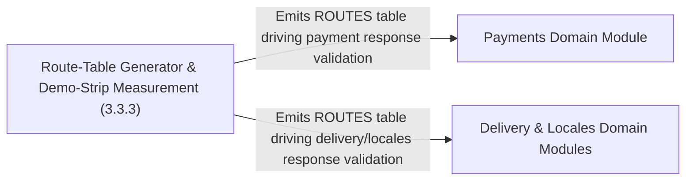

---
tags:
  - 2brain
  - 2brain/arch
  - project/boilerplate-vue-frontend
type: architecture
component: Route_Table_Generator_Demo_Strip_Measurement
---

## Details

The core of this subsystem. The route-table generator parses openapi.yaml, derives each operation's anchored path pattern, response/body schema names, and x-module stamp, sorts rows for a stable diff, and emits the generated ROUTES table (with a check-only mode). Paired with it is the report-only demo-strip measurement: assemble a scratch copy (symlinking node_modules, never copying .git), strip the demo modules, and run type-check-only/lint/build-only to measure whether the demo shop is removable. This is the contract→generated backbone edge plus the FE-D4 measure gate.

### Payments Domain Module
First-class domain module that consumes the generated ROUTES table via the HTTP response-schema map for response validation. It is a subject of the demo-strip measurement (its src/modules/payments/ folder is stripped to verify removability). Contains Pinia stores for payments, order refunds, and offline record handling.

**Related Classes/Methods**:

- `src.modules.payments.store.usePaymentsStore`:49-530
- `src.modules.payments.composables.use-order-refund.useOrderRefund`:32-147

**Source Files:**

- `src/app/components/use-language-switch.ts`
  - `src.app.components.use-language-switch.choiceLabel` (L69-L70) - Class
- `src/modules/payments/composables/use-order-refund.ts`
  - `src.modules.payments.composables.use-order-refund.useOrderRefund` (L32-L147) - Class
  - `src.modules.payments.composables.use-order-refund.useOrderRefund.watch() callback` (L55-L57) - Function
  - `src.modules.payments.composables.use-order-refund.useOrderRefund.canRefund.computed() callback` (L65-L65) - Function
  - `src.modules.payments.composables.use-order-refund.useOrderRefund.refund` (L89-L108) - Method
  - `src.modules.payments.composables.use-order-refund.useOrderRefund.refund.then() callback` (L98-L106) - Function
  - `src.modules.payments.composables.use-order-refund.useOrderRefund.refreshPayment` (L142-L145) - Method
  - `src.modules.payments.composables.use-order-refund.useOrderRefund.refreshPayment.then() callback` (L144-L144) - Function
- `src/modules/payments/composables/use-record-offline-payment.ts`
  - `src.modules.payments.composables.use-record-offline-payment.useRecordOfflinePayment` (L20-L39) - Class
  - `src.modules.payments.composables.use-record-offline-payment.useRecordOfflinePayment.recordOfflinePayment` (L34-L37) - Method
  - `src.modules.payments.composables.use-record-offline-payment.useRecordOfflinePayment.recordOfflinePayment.then() callback` (L36-L36) - Function
- `src/modules/payments/store.ts`
  - `src.modules.payments.store.usePaymentsStore` (L49-L530) - Class
  - `src.modules.payments.store.usePaymentsStore.defineStore('payments') callback` (L49-L530) - Function
  - `src.modules.payments.store.defineStore('payments') callback.fetchMethods` (L96-L102) - Class
  - `src.modules.payments.store.usePaymentsStore.defineStore('payments') callback.fetchMethods.fetchAny() callback` (L97-L101) - Function
  - `src.modules.payments.store.usePaymentsStore.defineStore('payments') callback.fetchMethods.fetchAny() callback.then() callback` (L98-L101) - Function
  - `src.modules.payments.store.defineStore('payments') callback.fetchPaymentForOrder` (L112-L118) - Class
  - `src.modules.payments.store.usePaymentsStore.defineStore('payments') callback.fetchPaymentForOrder.fetchAny() callback` (L113-L117) - Function
  - `src.modules.payments.store.usePaymentsStore.defineStore('payments') callback.fetchPaymentForOrder.fetchAny() callback.then() callback` (L114-L117) - Function
  - `src.modules.payments.store.defineStore('payments') callback.payForOrder` (L177-L202) - Class
  - `src.modules.payments.store.usePaymentsStore.defineStore('payments') callback.payForOrder.fetchAny() callback` (L183-L200) - Function
  - `src.modules.payments.store.defineStore('payments') callback.payForOrder.fetchAny() callback.then() callback` (L185-L190) - Function
  - `src.modules.payments.store.usePaymentsStore.defineStore('payments') callback.payForOrder.fetchAny() callback.then() callback` (L192-L196) - Function
  - `src.modules.payments.store.usePaymentsStore.defineStore('payments') callback.payForOrder.fetchAny() callback.catch() callback` (L197-L200) - Function
  - `src.modules.payments.store.defineStore('payments') callback.finishAtProvider` (L218-L233) - Class
  - `src.modules.payments.store.usePaymentsStore.defineStore('payments') callback.finishAtProvider.fetchAny() callback` (L219-L232) - Function
  - `src.modules.payments.store.usePaymentsStore.defineStore('payments') callback.finishAtProvider.fetchAny() callback.then() callback` (L221-L224) - Function
  - `src.modules.payments.store.defineStore('payments') callback.recordOfflinePayment` (L362-L376) - Class
  - `src.modules.payments.store.usePaymentsStore.defineStore('payments') callback.recordOfflinePayment.fetchAny() callback` (L364-L374) - Function
  - `src.modules.payments.store.usePaymentsStore.defineStore('payments') callback.recordOfflinePayment.fetchAny() callback.then() callback` (L366-L370) - Function
  - `src.modules.payments.store.usePaymentsStore.defineStore('payments') callback.recordOfflinePayment.fetchAny() callback.catch() callback` (L371-L374) - Function

### Delivery & Locales Domain Modules
First-class peer domain modules that consume the generated ROUTES table via the HTTP response-schema map for response validation. They are subjects of the demo-strip measurement (their src/modules/<name>/ folders are stripped to verify removability). Contains Pinia stores for delivery, dictionary aggregation, and locale icon sets.

**Related Classes/Methods**:

- `src.modules.delivery.store.useDeliveryStore`:59-373
- `src.ui.vuetify.icons.lucideIconSet`:121-132

**Source Files:**

- `src/app/components/use-language-switch.ts`
  - `src.app.components.use-language-switch.useLanguageSwitch.switchLanguage.catch() callback` (L60-L60) - Function
- `src/modules/delivery/store.ts`
  - `src.modules.delivery.store.useDeliveryStore` (L59-L373) - Class
  - `src.modules.delivery.store.useDeliveryStore.defineStore('delivery') callback` (L59-L373) - Function
  - `src.modules.delivery.store.useDeliveryStore.defineStore('delivery') callback.fetchMethods.fetchAny() callback` (L166-L171) - Function
  - `src.modules.delivery.store.useDeliveryStore.defineStore('delivery') callback.fetchMethods.fetchAny() callback.then() callback` (L167-L171) - Function
  - `src.modules.delivery.store.useDeliveryStore.defineStore('delivery') callback.ship.fetchAny() callback` (L250-L257) - Function
  - `src.modules.delivery.store.useDeliveryStore.defineStore('delivery') callback.ship.fetchAny() callback.then() callback` (L256-L256) - Function
  - `src.modules.delivery.store.useDeliveryStore.defineStore('delivery') callback.fulfill.fetchAny() callback` (L269-L276) - Function
  - `src.modules.delivery.store.useDeliveryStore.defineStore('delivery') callback.fulfill.fetchAny() callback.then() callback` (L275-L275) - Function
  - `src.modules.delivery.store.useDeliveryStore.defineStore('delivery') callback.deliver.fetchAny() callback` (L316-L319) - Function
  - `src.modules.delivery.store.useDeliveryStore.defineStore('delivery') callback.deliver.fetchAny() callback.then() callback` (L317-L318) - Function
- `src/modules/locales/composables/use-dictionary-aggregation.ts`
  - `src.modules.locales.composables.use-dictionary-aggregation.useDictionaryAggregation.hasBaseline.computed() callback` (L48-L48) - Function
  - `src.modules.locales.composables.use-dictionary-aggregation.useDictionaryAggregation.languages.computed() callback` (L57-L58) - Function
  - `src.modules.locales.composables.use-dictionary-aggregation.useDictionaryAggregation.languages.computed() callback.capabilities.value.filter() callback` (L58-L58) - Function
  - `src.modules.locales.composables.use-dictionary-aggregation.useDictionaryAggregation.entriesIndex` (L91-L100) - Class
  - `src.modules.locales.composables.use-dictionary-aggregation.useDictionaryAggregation.entriesIndex.computed() callback` (L91-L100) - Function
  - `src.modules.locales.composables.use-dictionary-aggregation.useDictionaryAggregation.entriesIndex.computed() callback.filter() callback` (L96-L96) - Function
  - `src.modules.locales.composables.use-dictionary-aggregation.useDictionaryAggregation.entriesIndex.computed() callback.map() callback` (L97-L97) - Function
  - `src.modules.locales.composables.use-dictionary-aggregation.useDictionaryAggregation.baselines` (L105-L109) - Class
  - `src.modules.locales.composables.use-dictionary-aggregation.useDictionaryAggregation.baselines.computed() callback` (L105-L109) - Function
  - `src.modules.locales.composables.use-dictionary-aggregation.useDictionaryAggregation.allKeys.computed() callback` (L142-L149) - Function
  - `src.modules.locales.composables.use-dictionary-aggregation.useDictionaryAggregation.missingByTag.computed() callback` (L154-L160) - Function
  - `src.modules.locales.composables.use-dictionary-aggregation.useDictionaryAggregation.missingByTag.computed() callback.languages.value.map() callback` (L156-L159) - Function
  - `src.modules.locales.composables.use-dictionary-aggregation.useDictionaryAggregation.missingByTag.computed() callback.languages.value.map() callback.allKeys.value.filter() callback` (L158-L158) - Function
  - `src.modules.locales.composables.use-dictionary-aggregation.useDictionaryAggregation.loadLanguage.then() callback` (L171-L175) - Function
  - `src.modules.locales.composables.use-dictionary-aggregation.useDictionaryAggregation.loadBoard.then() callback` (L182-L182) - Function
  - `src.modules.locales.composables.use-dictionary-aggregation.useDictionaryAggregation.loadBoard.then() callback.languages.value.map() callback` (L182-L182) - Function
  - `src.modules.locales.composables.use-dictionary-aggregation.useDictionaryAggregation.loadBoard.catch() callback` (L183-L183) - Function
- `src/ui/composables/use-copy-to-clipboard.ts`
  - `src.ui.composables.use-copy-to-clipboard.useCopyToClipboard` (L25-L34) - Class
  - `src.ui.composables.use-copy-to-clipboard.useCopyToClipboard.<function>` (L29-L33) - Function
  - `src.ui.composables.use-copy-to-clipboard.useCopyToClipboard.<function>.then() callback` (L30-L33) - Function
- `src/ui/composables/use-hold-while-submitting.ts`
  - `src.ui.composables.use-hold-while-submitting.holdWhileSubmitting` (L20-L32) - Class
  - `src.ui.composables.use-hold-while-submitting.holdWhileSubmitting.computed() callback` (L25-L31) - Function
- `src/ui/composables/use-leave-guard.ts`
  - `src.ui.composables.use-leave-guard.watch() callback` (L48-L50) - Function
- `src/ui/composables/use-list-url-state.ts`
  - `src.ui.composables.use-list-url-state.useListUrlState.ownKeys` (L112-L112) - Class
  - `src.ui.composables.use-list-url-state.useListUrlState.ownKeys.map() callback` (L112-L112) - Function
- `src/ui/composables/use-return-focus.ts`
  - `src.ui.composables.use-return-focus.useReturnFocus.onScopeDispose() callback` (L56-L61) - Function
- `src/ui/composables/use-row-actions.ts`
  - `src.ui.composables.use-row-actions.RowActionRequest` (L32-L45) - Interface
  - `src.ui.composables.use-row-actions.ConfirmedRowActionRequest` (L50-L55) - Interface
  - `src.ui.composables.use-row-actions.runConfirmed` (L105-L110) - Class
- `src/ui/vuetify/icons.ts`
  - `src.ui.vuetify.icons.lucideIconSet` (L121-L132) - Class
  - `src.ui.vuetify.icons.lucideIconSet.component` (L131-L131) - Method

### Route-Table Generator & Demo-Strip Measurement (3.3.3)
The architectural spine of the project. The route-table generator parses openapi.yaml x-module stamps to emit a generated ROUTES table (pathToPatternSource, schemaNameFor, bodySchemaNameFor, sorted by paramCount/pattern/method) with a check-only CI gate. The demo-strip measurement assembles a scratch copy, strips domain module folders, and runs type-check/lint/build gates to verify the modular/removable claim. A paired destructive twin (demo-remove.ts) and a mutation ratchet (baseline.ts with FileComparison and scoresFrom) lock in test quality on the contract-to-generated edge.

**Related Classes/Methods**:

- `scripts.contracts.generate-route-table.output`:211-238
- `scripts.contracts.generate-route-table.bodySchemaNameFor`:139-144
- `scripts.contracts.generate-route-table.pathToPatternSource`:114-118

**Source Files:**

- `scripts/contracts/generate-route-table.ts`
  - `scripts.contracts.generate-route-table.OpenApiOperation` (L39-L45) - Interface
  - `scripts.contracts.generate-route-table.OpenApiDocument` (L48-L50) - Interface
  - `scripts.contracts.generate-route-table.pathToPatternSource` (L114-L118) - Class
  - `scripts.contracts.generate-route-table.pathToPatternSource.map() callback` (L117-L117) - Function
  - `scripts.contracts.generate-route-table.bodySchemaNameFor` (L139-L144) - Class
  - `scripts.contracts.generate-route-table.bodySchemaNameFor.contentTypes.some() callback` (L141-L141) - Function
  - `scripts.contracts.generate-route-table.Row` (L147-L155) - Interface
  - `scripts.contracts.generate-route-table.paramCount.filter() callback` (L186-L186) - Function
  - `scripts.contracts.generate-route-table.rows.sort() callback` (L200-L203) - Function
  - `scripts.contracts.generate-route-table.output` (L211-L238) - Class
  - `scripts.contracts.generate-route-table.output.rows.map() callback` (L233-L233) - Function
- `scripts/demo/demo-remove-tests.ts`
  - `scripts.demo.demo-remove-tests.removeResidueSpecs.deleted` (L78-L85) - Class
  - `scripts.demo.demo-remove-tests.removeResidueSpecs.deleted.filter() callback` (L78-L85) - Function
  - `scripts.demo.demo-remove-tests.removeResidueSpecs.deleted.map() callback` (L87-L90) - Function
- `scripts/demo/demo-remove.ts`
  - `scripts.demo.demo-remove.findResidueTests` (L36-L52) - Class
  - `scripts.demo.demo-remove.findResidueTests.pattern` (L37-L37) - Class
  - `scripts.demo.demo-remove.findResidueTests.pattern.names.map() callback` (L37-L37) - Function
  - `scripts.demo.demo-remove.findResidueTests.filter() callback` (L46-L46) - Function
- `scripts/mutation/baseline.ts`
  - `scripts.mutation.baseline.MutationReport` (L60-L62) - Interface
  - `scripts.mutation.baseline.MutationBaseline` (L65-L70) - Interface
  - `scripts.mutation.baseline.FileComparison` (L76-L81) - Interface
  - `scripts.mutation.baseline.compareToBaseline` (L150-L169) - Class
  - `scripts.mutation.baseline.compareToBaseline.files.map() callback` (L157-L168) - Function
  - `scripts.mutation.baseline.missingFromReport` (L183-L189) - Class
  - `scripts.mutation.baseline.missingFromReport.filter() callback` (L188-L188) - Function
