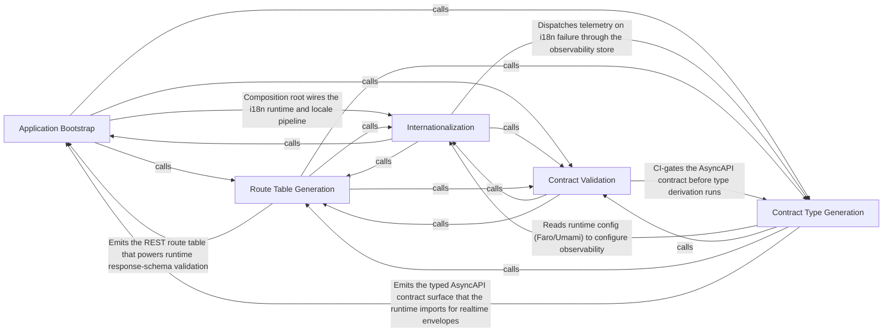

---
tags:
  - 2brain
  - 2brain/arch
  - project/boilerplate-vue-frontend
type: architecture
component: overview
---

## Details

This is a contract-first, modular Vue 3 + TypeScript e-commerce storefront. The architectural backbone runs from the contract layer (OpenAPI/AsyncAPI specs) through code-generation scripts that emit typed artifacts (AsyncAPI message types, REST route tables, error codes, operation modules, permission actions), into the runtime app where the application bootstrap wires the generated contract types and HTTP response validation into the Vue shell, and the i18n layer drives locale-aware navigation and guards. A parallel validation/verification band (AsyncAPI validation, docs reference checking, demo backend runner) keeps the contracts and documentation honest, while the demo-strip tooling produces a reduced demo profile. In short: contracts are the source of truth, generation scripts derive the typed surface, and the app shell + i18n + observability consume that surface at runtime.

### Application Bootstrap [[Expand]](./Application_Bootstrap.md)
The app entry point that boots the Vue application and carries the generated contract surface (AsyncAPI realtime envelopes, REST route table) plus the HTTP response-schema validation that enforces those contracts at runtime.

**Related Classes/Methods**:

- `src.main.bootstrapApplication`:72-179
- `contracts.asyncapi.generated.OrderCreatedEnvelope`:30-34
- `src.kernel.registry.collectModuleRoutes.routes`

**Source Files:**

- `contracts/asyncapi.generated.ts`
  - `contracts.asyncapi.generated.ObservabilityMetricsPayload` (L10-L16) - Interface
  - `contracts.asyncapi.generated.MemoryUsage` (L17-L22) - Interface
  - `contracts.asyncapi.generated.HttpMetrics` (L23-L26) - Interface
  - `contracts.asyncapi.generated.RealtimeMetrics` (L27-L29) - Interface
  - `contracts.asyncapi.generated.OrderCreatedEnvelope` (L30-L34) - Interface
  - `contracts.asyncapi.generated.OrderIdPayload` (L36-L38) - Interface
  - `contracts.asyncapi.generated.OrderPaidEnvelope` (L39-L43) - Interface
  - `contracts.asyncapi.generated.PaymentSucceededEnvelope` (L102-L106) - Interface
  - `contracts.asyncapi.generated.PaymentEventPayload` (L108-L111) - Interface
  - `contracts.asyncapi.generated.PaymentFailedEnvelope` (L112-L116) - Interface
  - `contracts.asyncapi.generated.PaymentRefundedEnvelope` (L118-L122) - Interface
  - `contracts.asyncapi.generated.PaymentRefundedPayload` (L124-L130) - Interface
  - `contracts.asyncapi.generated.ReturnRequestedEnvelope` (L184-L188) - Interface
  - `contracts.asyncapi.generated.ReturnRequestedPayload` (L190-L196) - Interface
  - `contracts.asyncapi.generated.ReturnReceivedEnvelope` (L197-L201) - Interface
  - `contracts.asyncapi.generated.ReturnReceivedPayload` (L203-L206) - Interface
  - `contracts.asyncapi.generated.ReturnClosedEnvelope` (L207-L211) - Interface
  - `contracts.asyncapi.generated.ReturnClosedPayload` (L213-L219) - Interface
  - `contracts.asyncapi.generated.SseEventPayloadMap` (L745-L752) - Interface
- `contracts/rest/index.ts`
  - `contracts.rest.index.PaginationMeta` (L163-L170) - Interface
  - `contracts.rest.index.ErrorItem` (L177-L184) - Interface
  - `contracts.rest.index.Problem` (L195-L215) - Interface
  - `contracts.rest.index.PurchaseHold` (L224-L234) - Interface
  - `contracts.rest.index.Account` (L236-L258) - Interface
  - `contracts.rest.index.SessionConfig` (L282-L292) - Interface
  - `contracts.rest.index.AntibotRungs` (L309-L314) - Interface
  - `contracts.rest.index.AntibotConfig` (L321-L327) - Interface
  - `contracts.rest.index.Operator` (L332-L353) - Interface
  - `contracts.rest.index.Config` (L355-L365) - Interface
  - `contracts.rest.index.Abilities` (L399-L441) - Interface
  - `contracts.rest.index.SessionActivity` (L443-L451) - Interface
  - `contracts.rest.index.AccountView` (L453-L477) - Interface
  - `contracts.rest.index.UserActions` (L482-L503) - Interface
  - `contracts.rest.index.User` (L505-L532) - Interface
  - `contracts.rest.index.HealthPing` (L543-L546) - Interface
  - `contracts.rest.index.LanguageActions` (L600-L610) - Interface
  - `contracts.rest.index.Language` (L616-L644) - Interface
  - `contracts.rest.index.LocaleCapabilities` (L649-L654) - Interface
  - `contracts.rest.index.CreateLocaleRequest` (L656-L670) - Interface
  - `contracts.rest.index.LocaleAppDescriptor` (L685-L690) - Interface
  - `contracts.rest.index.LocaleApps` (L692-L695) - Interface
  - `contracts.rest.index.ReplaceLocaleRequest` (L697-L709) - Interface
  - `contracts.rest.index.UpdateLocaleRequest` (L714-L726) - Interface
  - `contracts.rest.index.LocaleDictionary` (L736-L740) - Interface
  - `contracts.rest.index.LocaleMessages` (L750-L756) - Interface
  - `contracts.rest.index.LocaleEntry` (L762-L771) - Interface
  - `contracts.rest.index.LocaleEntriesResponse` (L773-L776) - Interface
  - `contracts.rest.index.ReplaceLocaleEntriesRequest` (L789-L796) - Interface
  - `contracts.rest.index.LocaleImportResult` (L801-L810) - Interface
  - `contracts.rest.index.CreateLocaleEntryRequest` (L812-L820) - Interface
  - `contracts.rest.index.UpdateLocaleEntriesRequest` (L831-L837) - Interface
  - `contracts.rest.index.ReplaceLocaleEntryRequest` (L839-L842) - Interface
  - `contracts.rest.index.Translation` (L869-L883) - Interface
  - `contracts.rest.index.EntityTranslations` (L888-L894) - Interface
  - `contracts.rest.index.ReplaceEntityTranslationsEntry` (L904-L908) - Interface
  - `contracts.rest.index.ReplaceEntityTranslationsRequest` (L913-L915) - Interface
  - `contracts.rest.index.UpdateEntityTranslationsEntry` (L925-L929) - Interface
  - `contracts.rest.index.UpdateEntityTranslationsRequest` (L934-L936) - Interface
  - `contracts.rest.index.ObservabilityDependency` (L951-L953) - Interface
  - `contracts.rest.index.ObservabilityHealthDependencies` (L958-L962) - Interface
  - `contracts.rest.index.ObservabilityHealthTelemetry` (L983-L989) - Interface
  - `contracts.rest.index.ProcessMemory` (L995-L1004) - Interface
  - `contracts.rest.index.ObservabilityHealthSystem` (L1006-L1012) - Interface
  - `contracts.rest.index.ObservabilityHealthJob` (L1018-L1022) - Interface
  - `contracts.rest.index.ObservabilityHealthQueue` (L1027-L1032) - Interface
  - `contracts.rest.index.ObservabilityHealth` (L1046-L1067) - Interface
  - `contracts.rest.index.ObservabilityMetricsLatency` (L1069-L1074) - Interface
  - `contracts.rest.index.ObservabilityMetricsSummary` (L1125-L1132) - Interface
  - `contracts.rest.index.AuditEntryItem` (L1185-L1224) - Interface
  - `contracts.rest.index.AuditLogsResponse` (L1226-L1229) - Interface
  - `contracts.rest.index.AuditEntriesResponse` (L1231-L1234) - Interface
  - `contracts.rest.index.AntibotChallengeParameters` (L1239-L1253) - Interface
  - `contracts.rest.index.AntibotChallenge` (L1258-L1262) - Interface
  - `contracts.rest.index.ProductViewedEvent` (L1271-L1275) - Interface
  - `contracts.rest.index.ProductsSearchedEvent` (L1284-L1295) - Interface
  - `contracts.rest.index.ReplaceAccountRequest` (L1299-L1320) - Interface
  - `contracts.rest.index.ReplaceAccountRequestMultipart` (L1322-L1342) - Interface
  - `contracts.rest.index.AccountDeletion` (L1344-L1349) - Interface
  - `contracts.rest.index.UpdateAccountRequest` (L1351-L1372) - Interface
  - `contracts.rest.index.UpdateAccountRequestMultipart` (L1374-L1394) - Interface
  - `contracts.rest.index.RequestEmailChangeRequest` (L1396-L1398) - Interface
  - `contracts.rest.index.EmailVerificationRequested` (L1400-L1406) - Interface
  - `contracts.rest.index.ChangePasswordRequest` (L1422-L1426) - Interface
  - `contracts.rest.index.AuthTokens` (L1428-L1435) - Interface
  - `contracts.rest.index.PasswordCheckRequest` (L1437-L1444) - Interface
  - `contracts.rest.index.PasswordCheck` (L1446-L1454) - Interface
  - `contracts.rest.index.ReauthMethods` (L1466-L1469) - Interface
  - `contracts.rest.index.ReauthPasswordRequest` (L1478-L1487) - Interface
  - `contracts.rest.index.ReauthEmailRequest` (L1496-L1510) - Interface
  - `contracts.rest.index.Session` (L1514-L1526) - Interface
  - `contracts.rest.index.SessionsResponse` (L1528-L1530) - Interface
  - `contracts.rest.index.Address` (L1532-L1543) - Interface
  - `contracts.rest.index.AddressesResponse` (L1545-L1547) - Interface
  - `contracts.rest.index.CreateAddressRequest` (L1549-L1562) - Interface
  - `contracts.rest.index.ReplaceAddressRequest` (L1564-L1577) - Interface
  - `contracts.rest.index.UpdateAddressRequest` (L1579-L1592) - Interface
  - `contracts.rest.index.VerifyEmailConfirmRequest` (L1594-L1601) - Interface
  - `contracts.rest.index.AccountRestoreRequest` (L1603-L1610) - Interface
  - `contracts.rest.index.LoginRequest` (L1633-L1638) - Interface
  - `contracts.rest.index.TwoFactorMethodSummary` (L1640-L1658) - Interface
  - `contracts.rest.index.MfaChallenge` (L1660-L1671) - Interface
  - `contracts.rest.index.DeletionPending` (L1673-L1682) - Interface
  - `contracts.rest.index.LoginRestoreRequest` (L1689-L1698) - Interface
  - `contracts.rest.index.SignupRequest` (L1700-L1711) - Interface
  - `contracts.rest.index.PasswordResetRequest` (L1713-L1715) - Interface
  - `contracts.rest.index.PasswordResetConfirmRequest` (L1717-L1728) - Interface
  - `contracts.rest.index.RefreshTokenResponse` (L1730-L1735) - Interface
  - `contracts.rest.index.AccountExport` (L1761-L1770) - Interface
  - `contracts.rest.index.ExportSession` (L1772-L1779) - Interface
  - `contracts.rest.index.ExportLinkedProvider` (L1781-L1787) - Interface
  - `contracts.rest.index.ExportTwoFactorMethod` (L1789-L1794) - Interface
  - `contracts.rest.index.ExportSignInMethods` (L1796-L1801) - Interface
  - `contracts.rest.index.ExportTaskNote` (L1824-L1827) - Interface
  - `contracts.rest.index.ExportTask` (L1829-L1841) - Interface
  - `contracts.rest.index.TaskLink` (L1873-L1876) - Interface
  - `contracts.rest.index.ExportSystemTask` (L1886-L1903) - Interface
  - `contracts.rest.index.CartItem` (L1905-L1909) - Interface
  - `contracts.rest.index.WishlistExportItem` (L1911-L1913) - Interface
  - `contracts.rest.index.OrderLineProduct` (L1938-L1964) - Interface
  - `contracts.rest.index.OrderLineCurrent` (L1966-L1969) - Interface
  - `contracts.rest.index.OrderItem` (L1971-L1991) - Interface
  - `contracts.rest.index.OrderTaxSummaryRow` (L1993-L2003) - Interface
  - `contracts.rest.index.OrderAddress` (L2005-L2012) - Interface
  - `contracts.rest.index.ExportOrder` (L2078-L2129) - Interface
  - `contracts.rest.index.OrderTimelineExportEntryBase` (L2142-L2150) - Interface
  - `contracts.rest.index.OrderTimelineDataNone` (L2155-L2157) - Interface
  - `contracts.rest.index.OrderTimelineDataStatusOverridden` (L2187-L2192) - Interface
  - `contracts.rest.index.OrderTimelineDataPaid` (L2225-L2228) - Interface
  - `contracts.rest.index.OrderTimelineDataDelivered` (L2245-L2248) - Interface
  - `contracts.rest.index.OrderTimelineDataCanceled` (L2294-L2301) - Interface
  - `contracts.rest.index.OrderTimelineDataPaymentDeclined` (L2318-L2320) - Interface
  - `contracts.rest.index.OrderTimelineDataRefund` (L2337-L2343) - Interface
  - `contracts.rest.index.OrderTimelineDataRefundFailure` (L2362-L2370) - Interface
  - `contracts.rest.index.OrderTimelineDataDispute` (L2388-L2399) - Interface
  - `contracts.rest.index.OrderTimelineDataShipmentShipped` (L2417-L2427) - Interface
  - `contracts.rest.index.OrderTimelineDataShipmentDelivered` (L2444-L2452) - Interface
  - `contracts.rest.index.OrderTimelineDataShipmentLost` (L2469-L2479) - Interface
  - `contracts.rest.index.OrderTimelineDataFulfillmentHeld` (L2496-L2500) - Interface
  - `contracts.rest.index.OrderTimelineDataFulfillmentOrderRef` (L2517-L2519) - Interface
  - `contracts.rest.index.OrderTimelineDataReturnRequested` (L2537-L2541) - Interface
  - `contracts.rest.index.OrderTimelineDataReturnApproved` (L2558-L2562) - Interface
  - `contracts.rest.index.OrderTimelineDataReturnRef` (L2579-L2581) - Interface
  - `contracts.rest.index.OrderTimelineDataReturnReceived` (L2600-L2604) - Interface
  - `contracts.rest.index.OrderTimelineDataReturnClosed` (L2621-L2627) - Interface
  - `contracts.rest.index.OrderTimelineDataInvoiceIssued` (L2644-L2648) - Interface
  - `contracts.rest.index.OrderTimelineDataCreditNoteIssued` (L2665-L2670) - Interface
  - `contracts.rest.index.OrderTimelineDataReleaseDateMoved` (L2687-L2693) - Interface
  - `contracts.rest.index.OrderTimelineDataDelayNoticeSent` (L2710-L2716) - Interface
  - `contracts.rest.index.Refund` (L2800-L2823) - Interface
  - `contracts.rest.index.ExportPayment` (L2836-L2849) - Interface
  - `contracts.rest.index.ExportInvoiceDocument` (L2851-L2857) - Interface
  - `contracts.rest.index.ShipmentLine` (L2873-L2878) - Interface
  - `contracts.rest.index.ExportShipment` (L2893-L2919) - Interface
  - `contracts.rest.index.FulfillmentOrderLine` (L2948-L2969) - Interface
  - `contracts.rest.index.ExportFulfillmentOrder` (L3012-L3036) - Interface
  - `contracts.rest.index.ExportReturn` (L3083-L3093) - Interface
  - `contracts.rest.index.ExportApiKey` (L3107-L3119) - Interface
  - `contracts.rest.index.ExportExample` (L3129-L3141) - Interface
  - `contracts.rest.index.WebhookDisabledParams` (L3156-L3158) - Interface
  - `contracts.rest.index.NotificationStaffWebhookDisabled` (L3182-L3191) - Interface
  - `contracts.rest.index.TaskOpenedParams` (L3196-L3204) - Interface
  - `contracts.rest.index.NotificationStaffTaskOpened` (L3216-L3225) - Interface
  - `contracts.rest.index.NotificationStaffTaskOverdue` (L3237-L3246) - Interface
  - `contracts.rest.index.NotificationStaffTaskDueSoon` (L3258-L3267) - Interface
  - `contracts.rest.index.TaskAssignedParams` (L3272-L3276) - Interface
  - `contracts.rest.index.NotificationStaffTaskAssigned` (L3288-L3297) - Interface
  - `contracts.rest.index.OutboxDeadParams` (L3302-L3307) - Interface
  - `contracts.rest.index.NotificationStaffOutboxDead` (L3319-L3328) - Interface
  - `contracts.rest.index.FulfillmentHeldParams` (L3348-L3354) - Interface
  - `contracts.rest.index.NotificationFulfillmentHeld` (L3359-L3368) - Interface
  - `contracts.rest.index.ShipmentLostParams` (L3388-L3398) - Interface
  - `contracts.rest.index.NotificationShipmentLost` (L3403-L3412) - Interface
  - `contracts.rest.index.ProductTitles` (L3421-L3423) - Interface
  - `contracts.rest.index.CartLineRemovedParams` (L3425-L3428) - Interface
  - `contracts.rest.index.NotificationStockAlert` (L3433-L3442) - Interface
  - `contracts.rest.index.FulfillmentDelayedParams` (L3454-L3463) - Interface
  - `contracts.rest.index.NotificationFulfillmentDelayed` (L3468-L3477) - Interface
  - `contracts.rest.index.NotificationCartLineRemoved` (L3489-L3498) - Interface
  - `contracts.rest.index.NotificationWishlistItemRemoved` (L3510-L3519) - Interface
  - `contracts.rest.index.CartMergeRefusedParams` (L3535-L3538) - Interface
  - `contracts.rest.index.NotificationCartMergeRefused` (L3543-L3552) - Interface
  - `contracts.rest.index.PurchaseHoldPlacedParams` (L3564-L3568) - Interface
  - `contracts.rest.index.NotificationStaffPurchaseHoldPlaced` (L3573-L3582) - Interface
  - `contracts.rest.index.ReturnRequestedParams` (L3594-L3597) - Interface
  - `contracts.rest.index.NotificationStaffReturnRequested` (L3602-L3611) - Interface
  - `contracts.rest.index.WorkCountParams` (L3623-L3628) - Interface
  - `contracts.rest.index.NotificationStaffTransfersDue` (L3633-L3642) - Interface
  - `contracts.rest.index.NotificationStaffPreordersLate` (L3654-L3663) - Interface
  - `contracts.rest.index.NotificationStaffDeliveryHoldsOpen` (L3675-L3684) - Interface
  - `contracts.rest.index.NotificationStaffReturnsAwaitingGoods` (L3696-L3705) - Interface
  - `contracts.rest.index.NotificationStaffReturnsUndecided` (L3717-L3726) - Interface
  - `contracts.rest.index.NotificationStaffLowStock` (L3738-L3747) - Interface
  - `contracts.rest.index.NotificationStaffUnshipped` (L3759-L3768) - Interface
  - `contracts.rest.index.NotificationStaffAwaitingTracking` (L3780-L3789) - Interface
  - `contracts.rest.index.NotificationStaffUndelivered` (L3801-L3810) - Interface
  - `contracts.rest.index.NotificationStaffStaleRefunds` (L3822-L3831) - Interface
  - `contracts.rest.index.StaffNoticeExport` (L3863-L3867) - Interface
  - `contracts.rest.index.StockAlert` (L3869-L3872) - Interface
  - `contracts.rest.index.AccountExportResponse` (L3892-L3918) - Interface
  - `contracts.rest.index.LoginTwoFactorRequest` (L3920-L3935) - Interface
  - `contracts.rest.index.TwoFactorSendRequest` (L3942-L3954) - Interface
  - `contracts.rest.index.TwoFactorDelivery` (L3956-L3968) - Interface
  - `contracts.rest.index.TwoFactorStatus` (L3970-L3982) - Interface
  - `contracts.rest.index.TwoFactorSetupRequest` (L3984-L3991) - Interface
  - `contracts.rest.index.TwoFactorSetup` (L3993-L4011) - Interface
  - `contracts.rest.index.TwoFactorConfirmRequest` (L4013-L4020) - Interface
  - `contracts.rest.index.TwoFactorConfirmed` (L4022-L4034) - Interface
  - `contracts.rest.index.TwoFactorCodeRequest` (L4036-L4043) - Interface
  - `contracts.rest.index.TwoFactorBackupCodesRegenerated` (L4045-L4053) - Interface
  - `contracts.rest.index.OAuthLink` (L4055-L4060) - Interface
  - `contracts.rest.index.OAuthLinks` (L4062-L4064) - Interface
  - `contracts.rest.index.OAuthLinkStart` (L4066-L4072) - Interface
  - `contracts.rest.index.UsersResponse` (L4091-L4094) - Interface
  - `contracts.rest.index.CreateUserRequest` (L4096-L4110) - Interface
  - `contracts.rest.index.CreateUserRequestMultipart` (L4112-L4128) - Interface
  - `contracts.rest.index.ReplaceUserByIdRequest` (L4130-L4150) - Interface
  - `contracts.rest.index.ReplaceUserByIdRequestMultipart` (L4152-L4171) - Interface
  - `contracts.rest.index.UpdateUserByIdRequest` (L4173-L4193) - Interface
  - `contracts.rest.index.UpdateUserByIdRequestMultipart` (L4195-L4214) - Interface
  - `contracts.rest.index.SearchUsersRequest` (L4216-L4233) - Interface
  - `contracts.rest.index.TaskNote` (L4267-L4272) - Interface
  - `contracts.rest.index.TaskRef` (L4277-L4282) - Interface
  - `contracts.rest.index.TaskActions` (L4287-L4302) - Interface
  - `contracts.rest.index.Task` (L4304-L4341) - Interface
  - `contracts.rest.index.TasksResponse` (L4343-L4346) - Interface
  - `contracts.rest.index.CreateContactTaskRequest` (L4348-L4377) - Interface
  - `contracts.rest.index.SearchTasksRequest` (L4379-L4391) - Interface
  - `contracts.rest.index.TaskSummary` (L4396-L4405) - Interface
  - `contracts.rest.index.AssignTaskRequest` (L4407-L4409) - Interface
  - `contracts.rest.index.CreateTaskNoteRequest` (L4411-L4417) - Interface
  - `contracts.rest.index.ProductActions` (L4454-L4463) - Interface
  - `contracts.rest.index.ProductTranslationFields` (L4465-L4468) - Interface
  - `contracts.rest.index.Product` (L4475-L4530) - Interface
  - `contracts.rest.index.ProductsResponse` (L4532-L4535) - Interface
  - `contracts.rest.index.ProductTranslationFieldsWrite` (L4537-L4548) - Interface
  - `contracts.rest.index.ProductTranslationsCreate` (L4553-L4555) - Interface
  - `contracts.rest.index.CreateProductRequest` (L4557-L4586) - Interface
  - `contracts.rest.index.CreateProductRequestMultipart` (L4588-L4623) - Interface
  - `contracts.rest.index.FacetCount` (L4625-L4629) - Interface
  - `contracts.rest.index.CatalogFacetsResponse` (L4631-L4634) - Interface
  - `contracts.rest.index.ProductTranslationsWrite` (L4639-L4641) - Interface
  - `contracts.rest.index.ReplaceProductRequest` (L4643-L4674) - Interface
  - `contracts.rest.index.ReplaceProductRequestMultipart` (L4676-L4711) - Interface
  - `contracts.rest.index.ProductTranslationFieldsPatch` (L4713-L4727) - Interface
  - `contracts.rest.index.ProductTranslationsPatch` (L4732-L4734) - Interface
  - `contracts.rest.index.UpdateProductRequest` (L4736-L4767) - Interface
  - `contracts.rest.index.UpdateProductRequestMultipart` (L4769-L4804) - Interface
  - `contracts.rest.index.SearchProductsRequest` (L4806-L4827) - Interface
  - `contracts.rest.index.CartResponseItem` (L4859-L4866) - Interface
  - `contracts.rest.index.CartSummaryResponse` (L4868-L4887) - Interface
  - `contracts.rest.index.CartShippingOption` (L4892-L4901) - Interface
  - `contracts.rest.index.CartShipping` (L4906-L4913) - Interface
  - `contracts.rest.index.CartResponse` (L4915-L4921) - Interface
  - `contracts.rest.index.AddCartItemRequest` (L4930-L4933) - Interface
  - `contracts.rest.index.UpdateCartItemByProductIdRequest` (L4935-L4937) - Interface
  - `contracts.rest.index.SetCartShippingMethodRequest` (L4939-L4947) - Interface
  - `contracts.rest.index.ExpectedTotal` (L4952-L4957) - Interface
  - `contracts.rest.index.CheckoutRequest` (L4959-L4973) - Interface
  - `contracts.rest.index.OrderActions` (L4990-L5015) - Interface
  - `contracts.rest.index.Order` (L5017-L5071) - Interface
  - `contracts.rest.index.ReorderRequest` (L5073-L5076) - Interface
  - `contracts.rest.index.MergeLineResult` (L5096-L5110) - Interface
  - `contracts.rest.index.ReorderResponse` (L5112-L5116) - Interface
  - `contracts.rest.index.WishlistItem` (L5118-L5121) - Interface
  - `contracts.rest.index.WishlistResponse` (L5123-L5125) - Interface
  - `contracts.rest.index.CreateWishlistItemRequest` (L5127-L5129) - Interface
  - `contracts.rest.index.OrdersResponse` (L5152-L5155) - Interface
  - `contracts.rest.index.OrderLineInput` (L5157-L5164) - Interface
  - `contracts.rest.index.CreateOrderRequest` (L5169-L5177) - Interface
  - `contracts.rest.index.SearchOrdersRequest` (L5179-L5206) - Interface
  - `contracts.rest.index.ReplaceOrderByIdRequest` (L5208-L5210) - Interface
  - `contracts.rest.index.UpdateOrderByIdRequest` (L5212-L5214) - Interface
  - `contracts.rest.index.CancelOrderRequest` (L5219-L5222) - Interface
  - `contracts.rest.index.StatusOverrideRequest` (L5224-L5233) - Interface
  - `contracts.rest.index.CreditNoteSummary` (L5235-L5245) - Interface
  - `contracts.rest.index.CreditNotesResponse` (L5247-L5249) - Interface
  - `contracts.rest.index.PaymentBankTransferAction` (L5274-L5285) - Interface
  - `contracts.rest.index.Dispute` (L5338-L5355) - Interface
  - `contracts.rest.index.PaymentActions` (L5360-L5371) - Interface
  - `contracts.rest.index.Payment` (L5399-L5444) - Interface
  - `contracts.rest.index.OrderPaymentsResponse` (L5446-L5448) - Interface
  - `contracts.rest.index.RecordOfflinePaymentRequest` (L5462-L5473) - Interface
  - `contracts.rest.index.FulfillmentOrderActions` (L5478-L5487) - Interface
  - `contracts.rest.index.FulfillmentOrder` (L5492-L5525) - Interface
  - `contracts.rest.index.OrderFulfillmentOrdersResponse` (L5527-L5529) - Interface
  - `contracts.rest.index.ShipmentActions` (L5534-L5541) - Interface
  - `contracts.rest.index.Shipment` (L5546-L5583) - Interface
  - `contracts.rest.index.OrderShipmentsResponse` (L5585-L5587) - Interface
  - `contracts.rest.index.PaymentMethodOption` (L5589-L5596) - Interface
  - `contracts.rest.index.PaymentMethodsResponse` (L5598-L5600) - Interface
  - `contracts.rest.index.RefundPaymentRequest` (L5602-L5607) - Interface
  - `contracts.rest.index.ConfirmPaymentRequest` (L5609-L5617) - Interface
  - `contracts.rest.index.DisputeReport` (L5622-L5646) - Interface
  - `contracts.rest.index.PaymentWebhookEvent` (L5651-L5668) - Interface
  - `contracts.rest.index.ShippingMethod` (L5670-L5693) - Interface
  - `contracts.rest.index.ShippingMethodsResponse` (L5695-L5697) - Interface
  - `contracts.rest.index.PreorderBuyer` (L5715-L5718) - Interface
  - `contracts.rest.index.PreorderFulfillmentOrder` (L5723-L5752) - Interface
  - `contracts.rest.index.PreorderFulfillmentOrdersResponse` (L5754-L5757) - Interface
  - `contracts.rest.index.PreorderProductSummary` (L5762-L5780) - Interface
  - `contracts.rest.index.PreorderProductSummariesResponse` (L5782-L5785) - Interface
  - `contracts.rest.index.ShipFulfillmentOrderRequest` (L5793-L5805) - Interface
  - `contracts.rest.index.HoldFulfillmentOrderRequest` (L5819-L5834) - Interface
  - `contracts.rest.index.UpdateShipmentRequest` (L5836-L5843) - Interface
  - `contracts.rest.index.ReturnLine` (L5873-L5886) - Interface
  - `contracts.rest.index.ReturnActions` (L5947-L5960) - Interface
  - `contracts.rest.index.Return` (L5962-L6025) - Interface
  - `contracts.rest.index.ReturnsResponse` (L6027-L6030) - Interface
  - `contracts.rest.index.CreateReturnRequest` (L6051-L6072) - Interface
  - `contracts.rest.index.ReturnOptionLine` (L6074-L6081) - Interface
  - `contracts.rest.index.CancelOptionLine` (L6086-L6091) - Interface
  - `contracts.rest.index.CancelableFulfillmentOrder` (L6096-L6107) - Interface
  - `contracts.rest.index.ReturnOptions` (L6109-L6120) - Interface
  - `contracts.rest.index.DeclineReturnRequest` (L6122-L6130) - Interface
  - `contracts.rest.index.ReceiveReturnRequest` (L6138-L6145) - Interface
  - `contracts.rest.index.InventoryLevel` (L6147-L6167) - Interface
  - `contracts.rest.index.InventoryLevelsResponse` (L6169-L6172) - Interface
  - `contracts.rest.index.PreorderLevel` (L6174-L6208) - Interface
  - `contracts.rest.index.PreorderLevelsResponse` (L6210-L6213) - Interface
  - `contracts.rest.index.StockMovement` (L6244-L6257) - Interface
  - `contracts.rest.index.StockMovementsResponse` (L6259-L6262) - Interface
  - `contracts.rest.index.ReceiptRequest` (L6264-L6276) - Interface
  - `contracts.rest.index.AdjustmentRequest` (L6278-L6287) - Interface
  - `contracts.rest.index.ReservationSweepResponse` (L6289-L6295) - Interface
  - `contracts.rest.index.WebhookRetiringSecret` (L6343-L6348) - Interface
  - `contracts.rest.index.WebhookSubscriptionActions` (L6350-L6363) - Interface
  - `contracts.rest.index.WebhookSubscription` (L6365-L6390) - Interface
  - `contracts.rest.index.WebhookSubscriptionsResponse` (L6392-L6395) - Interface
  - `contracts.rest.index.CreateWebhookSubscriptionRequest` (L6397-L6414) - Interface
  - `contracts.rest.index.WebhookSubscriptionCreated` (L6416-L6437) - Interface
  - `contracts.rest.index.ReplaceWebhookSubscriptionRequest` (L6439-L6457) - Interface
  - `contracts.rest.index.UpdateWebhookSubscriptionRequest` (L6459-L6477) - Interface
  - `contracts.rest.index.WebhookDeliveryActions` (L6517-L6520) - Interface
  - `contracts.rest.index.WebhookDelivery` (L6522-L6542) - Interface
  - `contracts.rest.index.WebhookDeliveriesResponse` (L6544-L6547) - Interface
  - `contracts.rest.index.WebhookEventCatalogEntry` (L6549-L6552) - Interface
  - `contracts.rest.index.WebhookEventCatalogResponse` (L6554-L6556) - Interface
  - `contracts.rest.index.ApiKeyActions` (L6578-L6581) - Interface
  - `contracts.rest.index.ApiKey` (L6583-L6600) - Interface
  - `contracts.rest.index.ApiKeysResponse` (L6602-L6607) - Interface
  - `contracts.rest.index.CreateApiKeyRequest` (L6609-L6624) - Interface
  - `contracts.rest.index.ApiKeyCreated` (L6626-L6639) - Interface
  - `contracts.rest.index.AssignUserRoleRequest` (L6641-L6647) - Interface
  - `contracts.rest.index.PlacePurchaseHoldRequest` (L6649-L6658) - Interface
  - `contracts.rest.index.MergeCartRequest` (L6660-L6667) - Interface
  - `contracts.rest.index.MergeCartResponse` (L6669-L6673) - Interface
  - `contracts.rest.index.OrderTimelineEntryBase` (L6686-L6693) - Interface
  - `contracts.rest.index.OrderTimelineResponse` (L7023-L7026) - Interface
  - `contracts.rest.index.CreateOrderNoteRequest` (L7028-L7035) - Interface
  - `contracts.rest.index.PaymentsResponse` (L7069-L7072) - Interface
  - `contracts.rest.index.CreatePaymentRequest` (L7074-L7076) - Interface
  - `contracts.rest.index.SearchPaymentsRequest` (L7078-L7102) - Interface
  - `contracts.rest.index.RefundListItem` (L7104-L7119) - Interface
  - `contracts.rest.index.RefundsResponse` (L7121-L7124) - Interface
  - `contracts.rest.index.PaymentAttentionItem` (L7150-L7176) - Interface
  - `contracts.rest.index.PaymentAttentionResponse` (L7178-L7180) - Interface
  - `contracts.rest.index.CancelRefundRequest` (L7182-L7189) - Interface
  - `contracts.rest.index.ReleaseDateImpact` (L7194-L7200) - Interface
  - `contracts.rest.index.MarkShipmentLostRequest` (L7202-L7216) - Interface
  - `contracts.rest.index.CloseReturnRequest` (L7218-L7225) - Interface
  - `contracts.rest.index.CancelReturnRequest` (L7227-L7234) - Interface
  - `contracts.rest.index.RecordProofOfSendingRequest` (L7236-L7251) - Interface
  - `contracts.rest.index.StatsPeriod` (L7264-L7270) - Interface
  - `contracts.rest.index.StatsLimits` (L7272-L7283) - Interface
  - `contracts.rest.index.SalesFigures` (L7285-L7321) - Interface
  - `contracts.rest.index.SalesBucket` (L7323-L7327) - Interface
  - `contracts.rest.index.SalesCurrency` (L7329-L7336) - Interface
  - `contracts.rest.index.SalesStats` (L7338-L7342) - Interface
  - `contracts.rest.index.ProductSalesRow` (L7344-L7355) - Interface
  - `contracts.rest.index.ProductStats` (L7357-L7361) - Interface
  - `contracts.rest.index.ProductSeriesBucket` (L7363-L7369) - Interface
  - `contracts.rest.index.ProductSeries` (L7371-L7378) - Interface
  - `contracts.rest.index.CategorySalesRow` (L7380-L7386) - Interface
  - `contracts.rest.index.CategoryStats` (L7388-L7392) - Interface
  - `contracts.rest.index.PaymentMixRow` (L7403-L7410) - Interface
  - `contracts.rest.index.PaymentMix` (L7412-L7416) - Interface
  - `contracts.rest.index.OperationsStats` (L7452-L7459) - Interface
  - `contracts.rest.index.CustomerStats` (L7461-L7481) - Interface
  - `contracts.rest.index.PipelineStats` (L7491-L7498) - Interface
  - `contracts.rest.index.UpdateInventoryLevelRequest` (L7500-L7507) - Interface
  - `contracts.rest.index.ExampleActions` (L7529-L7540) - Interface
  - `contracts.rest.index.Example` (L7542-L7558) - Interface
  - `contracts.rest.index.ExamplesResponse` (L7560-L7563) - Interface
  - `contracts.rest.index.CreateExampleRequest` (L7565-L7576) - Interface
  - `contracts.rest.index.SearchExamplesRequest` (L7578-L7584) - Interface
  - `contracts.rest.index.ReplaceExampleRequest` (L7586-L7597) - Interface
  - `contracts.rest.index.UpdateExampleRequest` (L7599-L7610) - Interface
  - `contracts.rest.index.ReplaceExampleCoverRequestMultipart` (L7612-L7614) - Interface
  - `contracts.rest.index.NotificationsResponse` (L7616-L7619) - Interface
  - `contracts.rest.index.ShopAddress` (L7624-L7631) - Interface
  - `contracts.rest.index.Shop` (L7633-L7653) - Interface
  - `contracts.rest.index.ShopWorkSummary` (L7658-L7684) - Interface
  - `contracts.rest.index.StockAlertsResponse` (L7691-L7693) - Interface
  - `contracts.rest.index.CreateStockAlertRequest` (L7695-L7697) - Interface
  - `contracts.rest.index.createProductWithMultipart` (L10849-L10913) - Class
  - `contracts.rest.index.createProductWithMultipart.createProductRequestMultipart.categories.forEach() callback` (L10896-L10897) - Function
  - `contracts.rest.index.createProductWithMultipart.createProductRequestMultipart.tags.forEach() callback` (L10901-L10901) - Function
  - `contracts.rest.index.replaceProductByIdWithMultipart` (L10974-L11022) - Class
  - `contracts.rest.index.replaceProductByIdWithMultipart.replaceProductRequestMultipart.categories.forEach() callback` (L11008-L11009) - Function
  - `contracts.rest.index.replaceProductByIdWithMultipart.replaceProductRequestMultipart.tags.forEach() callback` (L11011-L11011) - Function
  - `contracts.rest.index.updateProductByIdWithMultipart` (L11116-L11185) - Class
  - `contracts.rest.index.updateProductByIdWithMultipart.updateProductRequestMultipart.categories.forEach() callback` (L11168-L11169) - Function
  - `contracts.rest.index.updateProductByIdWithMultipart.updateProductRequestMultipart.tags.forEach() callback` (L11173-L11173) - Function
- `contracts/rest/routes.ts`
  - `contracts.rest.routes.GeneratedRoute` (L14-L21) - Interface
- `src/app/components/app-nav-item.ts`
  - `src.app.components.app-nav-item.AppNavItem` (L15-L49) - Interface
- `src/app/guards/locale-choice.ts`
  - `src.app.guards.locale-choice.supportedSpellingOf` (L86-L89) - Class
  - `src.app.guards.locale-choice.supportedSpellingOf.supportedLanguages.find() callback` (L88-L88) - Function
- `src/i18n/language-label.ts`
  - `src.i18n.language-label.Translator` (L12-L15) - Interface
- `src/infrastructure/analytics-consent.ts`
  - `src.infrastructure.analytics-consent.defineStore('analytics-consent') callback.trackBrowsing` (L157-L163) - Class
- `src/infrastructure/email-verification.ts`
  - `src.infrastructure.email-verification.requestEmailVerification` (L28-L29) - Class
  - `src.infrastructure.email-verification.requestEmailVerification.then() callback` (L29-L29) - Function
- `src/infrastructure/http/idempotency.ts`
  - `src.infrastructure.http.idempotency.IdempotencyKeysBySubject` (L65-L73) - Interface
  - `src.infrastructure.http.idempotency.useIdempotencyKeys` (L82-L92) - Class
  - `src.infrastructure.http.idempotency.useIdempotencyKeys.forSubject` (L86-L90) - Method
  - `src.infrastructure.http.idempotency.sendKeyed` (L104-L118) - Class
  - `src.infrastructure.http.idempotency.then() callback` (L110-L113) - Function
  - `src.infrastructure.http.idempotency.sendKeyed.then() callback` (L114-L117) - Function
- `src/infrastructure/http/index.ts`
  - `src.infrastructure.http.index.send` (L45-L58) - Class
  - `src.infrastructure.http.index.send.then() callback` (L46-L58) - Function
  - `src.infrastructure.http.index.orvalMutator` (L79-L95) - Class
  - `src.infrastructure.http.index.orvalMutator.then() callback` (L93-L93) - Function
- `src/infrastructure/http/response-schema-map.ts`
  - `src.infrastructure.http.response-schema-map.ResponseSchemaRoute` (L44-L63) - Interface
  - `src.infrastructure.http.response-schema-map.routesForModules` (L134-L143) - Class
  - `src.infrastructure.http.response-schema-map.routesForModules.ROUTES.filter() callback` (L139-L142) - Function
  - `src.infrastructure.http.response-schema-map.routesForModules.map() callback` (L143-L143) - Function
  - `src.infrastructure.http.response-schema-map.buildCoreRouteSchemas` (L156-L162) - Class
  - `src.infrastructure.http.response-schema-map.buildCoreRouteSchemas.ROUTES.filter() callback` (L158-L161) - Function
  - `src.infrastructure.http.response-schema-map.buildCoreRouteSchemas.map() callback` (L162-L162) - Function
  - `src.infrastructure.http.response-schema-map.loadResponseSchemas` (L214-L225) - Class
  - `src.infrastructure.http.response-schema-map.loadResponseSchemas.moduleResponseSchemaLoaders.map() callback` (L219-L219) - Function
  - `src.infrastructure.http.response-schema-map.then() callback` (L219-L220) - Function
  - `src.infrastructure.http.response-schema-map.loadResponseSchemas.then() callback` (L222-L225) - Function
  - `src.infrastructure.http.response-schema-map.findRoute` (L233-L242) - Class
  - `src.infrastructure.http.response-schema-map.findRoute.routeSchemas.find() callback` (L240-L240) - Function
- `src/infrastructure/http/validate.ts`
  - `src.infrastructure.http.validate.validateResponseAgainstContract.issues` (L133-L135) - Class
  - `src.infrastructure.http.validate.validateResponseAgainstContract.issues.result.error.issues.map() callback` (L134-L134) - Function
  - `src.infrastructure.http.validate.validateRequestAgainstContract.issues` (L191-L193) - Class
  - `src.infrastructure.http.validate.validateRequestAgainstContract.issues.result.error.issues.map() callback` (L192-L192) - Function
- `src/infrastructure/locale-overrides.ts`
  - `src.infrastructure.locale-overrides.RemoteLocales` (L71-L83) - Interface
  - `src.infrastructure.locale-overrides.mergeRemoteLocales.then() callback.target` (L221-L223) - Class
  - `src.infrastructure.locale-overrides.mergeRemoteLocales.then() callback.target.filter() callback` (L222-L222) - Function
- `src/infrastructure/reauth.ts`
  - `src.infrastructure.reauth.reauthMethods` (L36-L37) - Class
  - `src.infrastructure.reauth.reauthMethods.then() callback` (L37-L37) - Function
  - `src.infrastructure.reauth.sendReauthCode` (L45-L47) - Class
  - `src.infrastructure.reauth.sendReauthCode.then() callback` (L47-L47) - Function
- `src/kernel/registry.ts`
  - `src.kernel.registry.AppNavigationEntry` (L54-L136) - Interface
  - `src.kernel.registry.AppModule` (L255-L324) - Interface
  - `src.kernel.registry.routeIdentitiesOf` (L357-L367) - Class
  - `src.kernel.registry.routeIdentitiesOf.routes.flatMap() callback` (L361-L367) - Function
  - `src.kernel.registry.collectModuleRoutes.routes` (L409-L409) - Class
  - `src.kernel.registry.collectModuleRoutes.routes.appModules.flatMap() callback` (L409-L409) - Function
  - `src.kernel.registry.collectModuleNavigation` (L426-L427) - Class
  - `src.kernel.registry.collectModuleNavigation.appModules.flatMap() callback` (L427-L427) - Function
  - `src.kernel.registry.sortNavigation` (L462-L467) - Class
  - `src.kernel.registry.sortNavigation.entries.toSorted() callback` (L465-L466) - Function
  - `src.kernel.registry.collectModuleResponseSchemas` (L500-L505) - Class
  - `src.kernel.registry.collectModuleResponseSchemas.appModules.map() callback` (L504-L504) - Function
  - `src.kernel.registry.collectModuleResponseSchemas.filter() callback` (L505-L505) - Function
  - `src.kernel.registry.collectModuleLoadingKeys` (L536-L537) - Class
  - `src.kernel.registry.collectModuleLoadingKeys.appModules.flatMap() callback` (L537-L537) - Function
- `src/main.ts`
  - `src.main.bootstrapApplication` (L72-L179) - Class
  - `src.main.then() callback` (L74-L103) - Function
  - `src.main.then() callback.then() callback` (L102-L102) - Function
  - `src.main.bootstrapApplication.then() callback` (L104-L179) - Function
  - `src.main.bootstrapApplication.then() callback.catch() callback` (L139-L144) - Function
  - `src.main.bootstrapApplication.then() callback.then() callback` (L174-L178) - Function
  - `src.main.catch() callback` (L181-L183) - Function
- `src/modules/account/stores/addresses.ts`
  - `src.modules.account.stores.addresses.useAccountAddressesStore` (L31-L138) - Class
  - `src.modules.account.stores.addresses.useAccountAddressesStore.defineStore('account-addresses') callback` (L31-L138) - Function
  - `src.modules.account.stores.addresses.useAccountAddressesStore.defineStore('account-addresses') callback.fetchAddresses.fetchAny() callback` (L66-L66) - Function
  - `src.modules.account.stores.addresses.useAccountAddressesStore.defineStore('account-addresses') callback.fetchAddresses.fetchAny() callback.then() callback` (L66-L66) - Function
  - `src.modules.account.stores.addresses.useAccountAddressesStore.defineStore('account-addresses') callback.reloadBook` (L74-L74) - Class
  - `src.modules.account.stores.addresses.useAccountAddressesStore.defineStore('account-addresses') callback.reloadBook.then() callback` (L74-L74) - Function
  - `src.modules.account.stores.addresses.useAccountAddressesStore.defineStore('account-addresses') callback.addAddress.fetchAny() callback` (L92-L95) - Function
  - `src.modules.account.stores.addresses.useAccountAddressesStore.defineStore('account-addresses') callback.addAddress.fetchAny() callback.sendKeyed() callback` (L93-L94) - Function
  - `src.modules.account.stores.addresses.useAccountAddressesStore.defineStore('account-addresses') callback.addAddress.fetchAny() callback.then() callback` (L95-L95) - Function
  - `src.modules.account.stores.addresses.useAccountAddressesStore.defineStore('account-addresses') callback.updateAddress.fetchAny() callback` (L107-L107) - Function
  - `src.modules.account.stores.addresses.useAccountAddressesStore.defineStore('account-addresses') callback.updateAddress.fetchAny() callback.then() callback` (L107-L107) - Function
  - `src.modules.account.stores.addresses.useAccountAddressesStore.defineStore('account-addresses') callback.setDefaultAddress.fetchAny() callback` (L117-L117) - Function
  - `src.modules.account.stores.addresses.useAccountAddressesStore.defineStore('account-addresses') callback.setDefaultAddress.fetchAny() callback.then() callback` (L117-L117) - Function
  - `src.modules.account.stores.addresses.useAccountAddressesStore.defineStore('account-addresses') callback.removeAddress.fetchAny() callback` (L127-L127) - Function
  - `src.modules.account.stores.addresses.useAccountAddressesStore.defineStore('account-addresses') callback.removeAddress.fetchAny() callback.then() callback` (L127-L127) - Function
- `src/modules/account/stores/oauth-links.ts`
  - `src.modules.account.stores.oauth-links.startProviderLink` (L31-L42) - Class
  - `src.modules.account.stores.oauth-links.startProviderLink.then() callback` (L38-L42) - Function
  - `src.modules.account.stores.oauth-links.useAccountOAuthLinksStore` (L47-L92) - Class
  - `src.modules.account.stores.oauth-links.useAccountOAuthLinksStore.defineStore('account-oauth-links') callback` (L47-L92) - Function
  - `src.modules.account.stores.oauth-links.useAccountOAuthLinksStore.defineStore('account-oauth-links') callback.fetchLinks.fetchAny() callback` (L78-L78) - Function
  - `src.modules.account.stores.oauth-links.useAccountOAuthLinksStore.defineStore('account-oauth-links') callback.unlinkProvider.fetchAny() callback` (L89-L89) - Function
- `src/modules/account/stores/sessions.ts`
  - `src.modules.account.stores.sessions.useAccountSessionsStore.defineStore('account-sessions') callback` (L19-L70) - Function
  - `src.modules.account.stores.sessions.defineStore('account-sessions') callback.fetchSessions` (L41-L47) - Class
  - `src.modules.account.stores.sessions.useAccountSessionsStore.defineStore('account-sessions') callback.fetchSessions.fetchAny() callback` (L42-L46) - Function
  - `src.modules.account.stores.sessions.useAccountSessionsStore.defineStore('account-sessions') callback.fetchSessions.fetchAny() callback.then() callback` (L43-L46) - Function
  - `src.modules.account.stores.sessions.defineStore('account-sessions') callback.revokeSession` (L59-L62) - Class
  - `src.modules.account.stores.sessions.useAccountSessionsStore.defineStore('account-sessions') callback.revokeSession.fetchAny() callback` (L60-L61) - Function
  - `src.modules.account.stores.sessions.useAccountSessionsStore.defineStore('account-sessions') callback.revokeSession.fetchAny() callback.then() callback` (L61-L61) - Function
- `src/modules/delivery/composables/use-preorder-summaries.ts`
  - `src.modules.delivery.composables.use-preorder-summaries.usePreorderSummaries.summaries.computed() callback` (L20-L20) - Function
- `src/modules/delivery/store.ts`
  - `src.modules.delivery.store.useDeliveryStore.defineStore('delivery') callback.fetchPreorderBoard.fetchAny() callback` (L128-L133) - Function
  - `src.modules.delivery.store.useDeliveryStore.defineStore('delivery') callback.fetchPreorderBoard.fetchAny() callback.then() callback` (L129-L133) - Function
  - `src.modules.delivery.store.useDeliveryStore.defineStore('delivery') callback.fetchPreorderSummaries.fetchAny() callback` (L142-L157) - Function
  - `src.modules.delivery.store.useDeliveryStore.defineStore('delivery') callback.fetchPreorderSummaries.fetchAny() callback.collect` (L143-L152) - Class
  - `src.modules.delivery.store.useDeliveryStore.defineStore('delivery') callback.fetchPreorderSummaries.fetchAny() callback.collect.then() callback` (L148-L151) - Function
  - `src.modules.delivery.store.useDeliveryStore.defineStore('delivery') callback.fetchPreorderSummaries.fetchAny() callback.then() callback` (L153-L156) - Function
  - `src.modules.delivery.store.useDeliveryStore.defineStore('delivery') callback.readFulfillment` (L181-L187) - Class
  - `src.modules.delivery.store.useDeliveryStore.defineStore('delivery') callback.readFulfillment.then() callback` (L183-L186) - Function
  - `src.modules.delivery.store.useDeliveryStore.defineStore('delivery') callback.fetchFulfillmentForOrder.fetchAny() callback` (L196-L196) - Function
  - `src.modules.delivery.store.useDeliveryStore.defineStore('delivery') callback.process.fetchAny() callback` (L207-L207) - Function
  - `src.modules.delivery.store.useDeliveryStore.defineStore('delivery') callback.process.fetchAny() callback.then() callback` (L207-L207) - Function
  - `src.modules.delivery.store.useDeliveryStore.defineStore('delivery') callback.failKeyedWrite` (L219-L237) - Class
  - `src.modules.delivery.store.useDeliveryStore.defineStore('delivery') callback.failKeyedWrite.orderId` (L225-L227) - Class
  - `src.modules.delivery.store.useDeliveryStore.defineStore('delivery') callback.failKeyedWrite.orderId.fulfillmentOrders.value.find() callback` (L226-L226) - Function
  - `src.modules.delivery.store.defineStore('delivery') callback.ship.fetchAny() callback.then() callback` (L252-L255) - Function
  - `src.modules.delivery.store.useDeliveryStore.defineStore('delivery') callback.ship.fetchAny() callback.then() callback.then() callback` (L254-L254) - Function
  - `src.modules.delivery.store.defineStore('delivery') callback.fulfill.fetchAny() callback.then() callback` (L271-L274) - Function
  - `src.modules.delivery.store.useDeliveryStore.defineStore('delivery') callback.fulfill.fetchAny() callback.then() callback.then() callback` (L273-L273) - Function
  - `src.modules.delivery.store.useDeliveryStore.defineStore('delivery') callback.hold.fetchAny() callback` (L288-L291) - Function
  - `src.modules.delivery.store.useDeliveryStore.defineStore('delivery') callback.hold.fetchAny() callback.then() callback` (L289-L290) - Function
  - `src.modules.delivery.store.useDeliveryStore.defineStore('delivery') callback.hold.fetchAny() callback.then() callback.then() callback` (L290-L290) - Function
  - `src.modules.delivery.store.useDeliveryStore.defineStore('delivery') callback.release.fetchAny() callback` (L302-L305) - Function
  - `src.modules.delivery.store.useDeliveryStore.defineStore('delivery') callback.release.fetchAny() callback.then() callback` (L303-L304) - Function
  - `src.modules.delivery.store.useDeliveryStore.defineStore('delivery') callback.release.fetchAny() callback.then() callback.then() callback` (L304-L304) - Function
  - `src.modules.delivery.store.useDeliveryStore.defineStore('delivery') callback.deliver.fetchAny() callback.then() callback.then() callback` (L318-L318) - Function
  - `src.modules.delivery.store.useDeliveryStore.defineStore('delivery') callback.markLost.fetchAny() callback` (L331-L334) - Function
  - `src.modules.delivery.store.useDeliveryStore.defineStore('delivery') callback.markLost.fetchAny() callback.then() callback` (L332-L333) - Function
  - `src.modules.delivery.store.useDeliveryStore.defineStore('delivery') callback.markLost.fetchAny() callback.then() callback.then() callback` (L333-L333) - Function
  - `src.modules.delivery.store.useDeliveryStore.defineStore('delivery') callback.editTracking.fetchAny() callback` (L345-L348) - Function
  - `src.modules.delivery.store.useDeliveryStore.defineStore('delivery') callback.editTracking.fetchAny() callback.then() callback` (L346-L347) - Function
  - `src.modules.delivery.store.useDeliveryStore.defineStore('delivery') callback.editTracking.fetchAny() callback.then() callback.then() callback` (L347-L347) - Function
- `src/modules/example/store.ts`
  - `src.modules.example.store.useExampleStore` (L57-L213) - Class
  - `src.modules.example.store.useExampleStore.defineStore('example') callback` (L57-L213) - Function
  - `src.modules.example.store.defineStore('example') callback.createExample` (L133-L142) - Class
  - `src.modules.example.store.useExampleStore.defineStore('example') callback.createExample.then() callback` (L135-L138) - Function
  - `src.modules.example.store.useExampleStore.defineStore('example') callback.createExample.catch() callback` (L139-L142) - Function
  - `src.modules.example.store.useExampleStore.defineStore('example') callback.transitionExample.fetchAny() callback` (L153-L157) - Function
  - `src.modules.example.store.useExampleStore.defineStore('example') callback.transitionExample.fetchAny() callback.then() callback` (L154-L157) - Function
  - `src.modules.example.store.useExampleStore.defineStore('example') callback.setCover.fetchAny() callback` (L171-L175) - Function
  - `src.modules.example.store.useExampleStore.defineStore('example') callback.setCover.fetchAny() callback.then() callback` (L172-L175) - Function
  - `src.modules.example.store.useExampleStore.defineStore('example') callback.fetchPublished.fetchAny() callback` (L186-L186) - Function
- `src/modules/inventory/store.ts`
  - `src.modules.inventory.store.defineStore('inventory') callback.fetchPreorderLevels` (L160-L171) - Class
  - `src.modules.inventory.store.useInventoryStore.defineStore('inventory') callback.fetchPreorderLevels.fetchAny() callback` (L161-L171) - Function
  - `src.modules.inventory.store.useInventoryStore.defineStore('inventory') callback.fetchPreorderLevels.fetchAny() callback.collect` (L162-L166) - Class
  - `src.modules.inventory.store.useInventoryStore.defineStore('inventory') callback.fetchPreorderLevels.fetchAny() callback.collect.then() callback` (L163-L166) - Function
  - `src.modules.inventory.store.useInventoryStore.defineStore('inventory') callback.fetchPreorderLevels.fetchAny() callback.then() callback` (L167-L170) - Function
  - `src.modules.inventory.store.defineStore('inventory') callback.setLimit` (L181-L186) - Class
  - `src.modules.inventory.store.useInventoryStore.defineStore('inventory') callback.setLimit.fetchAny() callback` (L182-L185) - Function
  - `src.modules.inventory.store.useInventoryStore.defineStore('inventory') callback.setLimit.fetchAny() callback.then() callback` (L183-L184) - Function
  - `src.modules.inventory.store.useInventoryStore.defineStore('inventory') callback.setLimit.fetchAny() callback.then() callback.then() callback` (L184-L184) - Function
- `src/modules/locales/dictionaries.ts`
  - `src.modules.locales.dictionaries.DictionaryRow` (L23-L26) - Interface
  - `src.modules.locales.dictionaries.findDuplicateKey` (L61-L62) - Class
  - `src.modules.locales.dictionaries.findDuplicateKey.keys.find() callback` (L62-L62) - Function
- `src/modules/locales/store.ts`
  - `src.modules.locales.store.defineStore('locales') callback.backendApp` (L199-L201) - Class
  - `src.modules.locales.store.useLocalesStore.defineStore('locales') callback.backendApp.computed() callback` (L200-L200) - Function
  - `src.modules.locales.store.useLocalesStore.defineStore('locales') callback.backendApp.computed() callback.apps.value.find() callback` (L200-L200) - Function
  - `src.modules.locales.store.defineStore('locales') callback.appLabel` (L210-L210) - Class
  - `src.modules.locales.store.useLocalesStore.defineStore('locales') callback.appLabel.apps.value.find() callback` (L210-L210) - Function
  - `src.modules.locales.store.defineStore('locales') callback.fetchApps` (L217-L223) - Class
  - `src.modules.locales.store.useLocalesStore.defineStore('locales') callback.fetchApps.fetchAny() callback` (L218-L222) - Function
  - `src.modules.locales.store.useLocalesStore.defineStore('locales') callback.fetchApps.fetchAny() callback.then() callback` (L219-L222) - Function
  - `src.modules.locales.store.useLocalesStore.defineStore('locales') callback.upsertLanguage` (L241-L247) - Class
  - `src.modules.locales.store.useLocalesStore.defineStore('locales') callback.upsertLanguage.capabilities.value.filter() callback` (L243-L243) - Function
  - `src.modules.locales.store.useLocalesStore.defineStore('locales') callback.upsertLanguage.toSorted() callback` (L245-L245) - Function
  - `src.modules.locales.store.defineStore('locales') callback.fetchLanguage` (L270-L271) - Class
  - `src.modules.locales.store.useLocalesStore.defineStore('locales') callback.fetchLanguage.fetchAny() callback` (L271-L271) - Function
  - `src.modules.locales.store.useLocalesStore.defineStore('locales') callback.fetchLanguage.fetchAny() callback.then() callback` (L271-L271) - Function
  - `src.modules.locales.store.useLocalesStore.defineStore('locales') callback.createLanguage.fetchAny() callback.then() callback` (L280-L280) - Function
  - `src.modules.locales.store.defineStore('locales') callback.activateLanguage` (L301-L302) - Class
  - `src.modules.locales.store.useLocalesStore.defineStore('locales') callback.activateLanguage.fetchAny() callback` (L302-L302) - Function
  - `src.modules.locales.store.useLocalesStore.defineStore('locales') callback.activateLanguage.fetchAny() callback.then() callback` (L302-L302) - Function
  - `src.modules.locales.store.defineStore('locales') callback.deactivateLanguage` (L310-L311) - Class
  - `src.modules.locales.store.useLocalesStore.defineStore('locales') callback.deactivateLanguage.fetchAny() callback` (L311-L311) - Function
  - `src.modules.locales.store.useLocalesStore.defineStore('locales') callback.deactivateLanguage.fetchAny() callback.then() callback` (L311-L311) - Function
  - `src.modules.locales.store.useLocalesStore.defineStore('locales') callback.removeLanguage.fetchAny() callback.then() callback.capabilities.value.filter() callback` (L324-L324) - Function
  - `src.modules.locales.store.useLocalesStore.defineStore('locales') callback.importEntries.entries` (L399-L399) - Class
  - `src.modules.locales.store.useLocalesStore.defineStore('locales') callback.importEntries.entries.rows.map() callback` (L399-L399) - Function
  - `src.modules.locales.store.defineStore('locales') callback.savingEntityTranslations` (L480-L480) - Class
  - `src.modules.locales.store.useLocalesStore.defineStore('locales') callback.savingEntityTranslations.computed() callback` (L480-L480) - Function
- `src/modules/notifications/store.ts`
  - `src.modules.notifications.store.useNotificationsInboxStore.defineStore('notifications-inbox') callback.dismissAll.ids` (L439-L443) - Class
  - `src.modules.notifications.store.useNotificationsInboxStore.defineStore('notifications-inbox') callback.dismissAll.ids.inbox.value.filter() callback` (L441-L441) - Function
  - `src.modules.notifications.store.useNotificationsInboxStore.defineStore('notifications-inbox') callback.dismissAll.ids.map() callback` (L443-L443) - Function
- `src/modules/orders/store.ts`
  - `src.modules.orders.store.addNote` (L132-L135) - Class
  - `src.modules.orders.store.addNote.sendKeyed() callback` (L133-L134) - Function
  - `src.modules.orders.store.useOrdersStore.defineStore('orders') callback.correctShippingAddress.updateTarget() callback` (L331-L331) - Function
- `src/modules/payments/store.ts`
  - `src.modules.payments.store.usePaymentsStore.defineStore('payments') callback.rereadAfterFault` (L132-L146) - Class
  - `src.modules.payments.store.usePaymentsStore.defineStore('payments') callback.rereadAfterFault.then() callback` (L144-L146) - Function
  - `src.modules.payments.store.usePaymentsStore.defineStore('payments') callback.readPayment.fetchAny() callback` (L156-L156) - Function
  - `src.modules.payments.store.usePaymentsStore.defineStore('payments') callback.finishAtProvider.fetchAny() callback.catch() callback` (L225-L231) - Function
  - `src.modules.payments.store.defineStore('payments') callback.refundPayment` (L252-L274) - Class
  - `src.modules.payments.store.usePaymentsStore.defineStore('payments') callback.refundPayment.fetchAny() callback` (L254-L272) - Function
  - `src.modules.payments.store.usePaymentsStore.defineStore('payments') callback.refundPayment.fetchAny() callback.then() callback` (L256-L262) - Function
  - `src.modules.payments.store.usePaymentsStore.defineStore('payments') callback.refundPayment.fetchAny() callback.then() callback.then() callback` (L258-L261) - Function
  - `src.modules.payments.store.usePaymentsStore.defineStore('payments') callback.refundPayment.fetchAny() callback.catch() callback` (L263-L272) - Function
  - `src.modules.payments.store.usePaymentsStore.defineStore('payments') callback.settleRefundByHand.fetchAny() callback` (L297-L312) - Function
  - `src.modules.payments.store.usePaymentsStore.defineStore('payments') callback.settleRefundByHand.fetchAny() callback.then() callback` (L301-L304) - Function
  - `src.modules.payments.store.usePaymentsStore.defineStore('payments') callback.settleRefundByHand.fetchAny() callback.catch() callback` (L305-L311) - Function
  - `src.modules.payments.store.usePaymentsStore.defineStore('payments') callback.cancelRefund.fetchAny() callback` (L333-L347) - Function
  - `src.modules.payments.store.usePaymentsStore.defineStore('payments') callback.cancelRefund.fetchAny() callback.then() callback` (L336-L339) - Function
  - `src.modules.payments.store.usePaymentsStore.defineStore('payments') callback.cancelRefund.fetchAny() callback.catch() callback` (L340-L346) - Function
  - `src.modules.payments.store.usePaymentsStore.defineStore('payments') callback.findOrderIdByReference.fetchAny() callback` (L391-L394) - Function
  - `src.modules.payments.store.usePaymentsStore.defineStore('payments') callback.findOrderIdByReference.fetchAny() callback.then() callback` (L393-L393) - Function
  - `src.modules.payments.store.usePaymentsStore.defineStore('payments') callback.fetchPaymentsPage.fetchAny() callback` (L442-L447) - Function
  - `src.modules.payments.store.usePaymentsStore.defineStore('payments') callback.fetchPaymentsPage.fetchAny() callback.then() callback` (L443-L447) - Function
  - `src.modules.payments.store.usePaymentsStore.defineStore('payments') callback.fetchAwaitingPage.fetchAny() callback` (L461-L472) - Function
  - `src.modules.payments.store.usePaymentsStore.defineStore('payments') callback.fetchAwaitingPage.fetchAny() callback.then() callback` (L468-L472) - Function
  - `src.modules.payments.store.usePaymentsStore.defineStore('payments') callback.fetchRefundsPage.fetchAny() callback` (L482-L487) - Function
  - `src.modules.payments.store.usePaymentsStore.defineStore('payments') callback.fetchRefundsPage.fetchAny() callback.then() callback` (L483-L487) - Function
  - `src.modules.payments.store.usePaymentsStore.defineStore('payments') callback.fetchAttention.fetchAny() callback` (L497-L501) - Function
  - `src.modules.payments.store.usePaymentsStore.defineStore('payments') callback.fetchAttention.fetchAny() callback.then() callback` (L498-L501) - Function
- `src/modules/products/composables/use-product-lines.ts`
  - `src.modules.products.composables.use-product-lines.useProductLines.availabilityLabel` (L98-L111) - Method
  - `src.modules.products.composables.use-product-lines.useProductLines.isRemoved` (L112-L112) - Method
- `src/modules/products/store.ts`
  - `src.modules.products.store.useProductsStore.defineStore('products') callback.useResetOnViewerChange() callback` (L356-L362) - Function
  - `src.modules.products.store.useProductsStore.defineStore('products') callback.useResetOnViewerChange() callback.predicate` (L360-L360) - Method
  - `src.modules.products.store.useProductsStore.defineStore('products') callback.fetchProductForEdit.fetchAny() callback` (L407-L407) - Function
  - `src.modules.products.store.useProductsStore.defineStore('products') callback.loadingProductForEdit.computed() callback` (L415-L415) - Function
  - `src.modules.products.store.useProductsStore.defineStore('products') callback.loadingTranslationLocales.computed() callback` (L459-L459) - Function
  - `src.modules.products.store.useProductsStore.defineStore('products') callback.fetchTranslationLocales.fetchAny() callback` (L477-L477) - Function
  - `src.modules.products.store.useProductsStore.defineStore('products') callback.fetchTranslationLocales.then() callback` (L478-L482) - Function
  - `src.modules.products.store.useProductsStore.defineStore('products') callback.fetchTranslationLocales.catch() callback` (L483-L487) - Function
- `src/modules/returns/store.ts`
  - `src.modules.returns.store.useReturnsStore.defineStore('returns') callback.fetchReturnOptions.fetchAny() callback` (L153-L153) - Function
  - `src.modules.returns.store.useReturnsStore.defineStore('returns') callback.recordProof.updateTarget() callback` (L214-L214) - Function
  - `src.modules.returns.store.useReturnsStore.defineStore('returns') callback.close.updateTarget() callback` (L226-L226) - Function
  - `src.modules.returns.store.useReturnsStore.defineStore('returns') callback.cancel.updateTarget() callback` (L237-L237) - Function
- `src/modules/shop/shop.ts`
  - `src.modules.shop.shop.shopCurrency` (L34-L34) - Class
  - `src.modules.shop.shop.shopCurrency.computed() callback` (L34-L34) - Function
  - `src.modules.shop.shop.shopMinorUnits` (L40-L40) - Class
  - `src.modules.shop.shop.shopMinorUnits.computed() callback` (L40-L40) - Function
  - `src.modules.shop.shop.shipToCountries` (L46-L46) - Class
  - `src.modules.shop.shop.shipToCountries.computed() callback` (L46-L46) - Function
  - `src.modules.shop.shop.backorderPromiseDays` (L52-L52) - Class
  - `src.modules.shop.shop.backorderPromiseDays.computed() callback` (L52-L52) - Function
  - `src.modules.shop.shop.shopTimeZone` (L59-L59) - Class
  - `src.modules.shop.shop.shopTimeZone.computed() callback` (L59-L59) - Function
  - `src.modules.shop.shop.loadShop` (L68-L80) - Class
  - `src.modules.shop.shop.loadShop.then() callback` (L70-L73) - Function
  - `src.modules.shop.shop.loadShop.catch() callback` (L74-L78) - Function
- `src/modules/stats/store.ts`
  - `src.modules.stats.store.useStatsStore` (L48-L180) - Class
  - `src.modules.stats.store.useStatsStore.defineStore('stats') callback` (L48-L180) - Function
  - `src.modules.stats.store.useStatsStore.defineStore('stats') callback.loadDashboard.fetchAny() callback` (L123-L147) - Function
  - `src.modules.stats.store.useStatsStore.defineStore('stats') callback.loadDashboard.fetchAny() callback.then() callback` (L147-L147) - Function
  - `src.modules.stats.store.useStatsStore.defineStore('stats') callback.loadProductSales.fetchAny() callback` (L159-L163) - Function
  - `src.modules.stats.store.useStatsStore.defineStore('stats') callback.loadProductSales.fetchAny() callback.then() callback` (L160-L163) - Function
- `src/modules/tasks/store.ts`
  - `src.modules.tasks.store.useTasksStore` (L51-L215) - Class
  - `src.modules.tasks.store.useTasksStore.defineStore('tasks') callback` (L51-L215) - Function
  - `src.modules.tasks.store.useTasksStore.defineStore('tasks') callback.loadSummary.then() callback` (L134-L137) - Function
  - `src.modules.tasks.store.defineStore('tasks') callback.addNote` (L148-L151) - Class
  - `src.modules.tasks.store.useTasksStore.defineStore('tasks') callback.addNote.sendKeyed() callback` (L149-L150) - Function
  - `src.modules.tasks.store.useTasksStore.defineStore('tasks') callback.submitContact.fetchAny() callback` (L176-L185) - Function
  - `src.modules.tasks.store.useTasksStore.defineStore('tasks') callback.submitContact.fetchAny() callback.then() callback` (L178-L181) - Function
  - `src.modules.tasks.store.useTasksStore.defineStore('tasks') callback.submitContact.fetchAny() callback.catch() callback` (L182-L185) - Function
- `src/modules/users/store.ts`
  - `src.modules.users.store.defineStore('users') callback.activateUser` (L225-L231) - Class
  - `src.modules.users.store.useUsersStore.defineStore('users') callback.activateUser.fetchAny() callback` (L226-L230) - Function
  - `src.modules.users.store.useUsersStore.defineStore('users') callback.activateUser.fetchAny() callback.then() callback` (L227-L230) - Function
  - `src.modules.users.store.defineStore('users') callback.deactivateUser` (L240-L246) - Class
  - `src.modules.users.store.useUsersStore.defineStore('users') callback.deactivateUser.fetchAny() callback` (L241-L245) - Function
  - `src.modules.users.store.useUsersStore.defineStore('users') callback.deactivateUser.fetchAny() callback.then() callback` (L242-L245) - Function
  - `src.modules.users.store.defineStore('users') callback.assignRole` (L257-L263) - Class
  - `src.modules.users.store.useUsersStore.defineStore('users') callback.assignRole.fetchAny() callback` (L258-L262) - Function
  - `src.modules.users.store.useUsersStore.defineStore('users') callback.assignRole.fetchAny() callback.then() callback` (L259-L262) - Function
  - `src.modules.users.store.defineStore('users') callback.revokeRole` (L272-L278) - Class
  - `src.modules.users.store.useUsersStore.defineStore('users') callback.revokeRole.fetchAny() callback` (L273-L277) - Function
  - `src.modules.users.store.useUsersStore.defineStore('users') callback.revokeRole.fetchAny() callback.then() callback` (L274-L277) - Function
  - `src.modules.users.store.useUsersStore.defineStore('users') callback.applyAccessChange.then() callback` (L298-L301) - Function
  - `src.modules.users.store.useUsersStore.defineStore('users') callback.setPurchaseHold.fetchAny() callback` (L312-L316) - Function
  - `src.modules.users.store.useUsersStore.defineStore('users') callback.setPurchaseHold.fetchAny() callback.then() callback` (L313-L316) - Function
  - `src.modules.users.store.useUsersStore.defineStore('users') callback.liftPurchaseHold.fetchAny() callback` (L329-L333) - Function
  - `src.modules.users.store.useUsersStore.defineStore('users') callback.liftPurchaseHold.fetchAny() callback.then() callback` (L330-L333) - Function
- `src/modules/webhooks/store.ts`
  - `src.modules.webhooks.store.useWebhooksStore.defineStore('webhooks') callback.writingSubscription.computed() callback` (L170-L170) - Function
  - `src.modules.webhooks.store.useWebhooksStore.defineStore('webhooks') callback.createSecret.fetchAnySubscriptions() callback` (L185-L190) - Function
  - `src.modules.webhooks.store.useWebhooksStore.defineStore('webhooks') callback.createSecret.fetchAnySubscriptions() callback.then() callback` (L186-L190) - Function
  - `src.modules.webhooks.store.useWebhooksStore.defineStore('webhooks') callback.enableSubscription.fetchAnySubscriptions() callback` (L223-L227) - Function
  - `src.modules.webhooks.store.useWebhooksStore.defineStore('webhooks') callback.enableSubscription.fetchAnySubscriptions() callback.then() callback` (L224-L227) - Function
  - `src.modules.webhooks.store.useWebhooksStore.defineStore('webhooks') callback.disableSubscription.fetchAnySubscriptions() callback` (L238-L242) - Function
  - `src.modules.webhooks.store.useWebhooksStore.defineStore('webhooks') callback.disableSubscription.fetchAnySubscriptions() callback.then() callback` (L239-L242) - Function
  - `src.modules.webhooks.store.useWebhooksStore.defineStore('webhooks') callback.eventCatalog.computed() callback` (L310-L310) - Function
  - `src.modules.webhooks.store.useWebhooksStore.defineStore('webhooks') callback.fetchEventCatalog.then() callback` (L315-L315) - Function
- `src/modules/webhooks/types.ts`
  - `src.modules.webhooks.types.WebhookDeliveryFilters` (L12-L19) - Interface
- `src/ui/composables/use-axios-upload-progress.ts`
  - `src.ui.composables.use-axios-upload-progress.AxiosUploadProgress` (L15-L33) - Interface

### Internationalization [[Expand]](./Internationalization.md)
Locale management and i18n runtime (dictionary loading, language switching, HTML locale attributes), with the app-shell router guards (authentication, locale choice) and the router announcer as its secondary concern.

**Related Classes/Methods**:

- `src.i18n.index.changeLanguage`:391-393
- `src.i18n.index.loadLocale`:261-263
- `src.i18n.index.I18nRuntimeConfig`:26-29

**Source Files:**

- `contracts/asyncapi.generated.ts`
  - `contracts.asyncapi.generated.OrderCanceledEnvelope` (L45-L49) - Interface
  - `contracts.asyncapi.generated.OrderCanceledPayload` (L51-L54) - Interface
  - `contracts.asyncapi.generated.OrderRedactedEnvelope` (L56-L60) - Interface
  - `contracts.asyncapi.generated.ShipmentShippedEnvelope` (L62-L66) - Interface
  - `contracts.asyncapi.generated.ShipmentPayload` (L68-L73) - Interface
  - `contracts.asyncapi.generated.AnonymousSchema27` (L74-L77) - Interface
  - `contracts.asyncapi.generated.ShipmentDeliveredEnvelope` (L78-L82) - Interface
  - `contracts.asyncapi.generated.ShipmentLostEnvelope` (L84-L88) - Interface
  - `contracts.asyncapi.generated.ShipmentLostPayload` (L90-L96) - Interface
  - `contracts.asyncapi.generated.AnonymousSchema34` (L97-L100) - Interface
  - `contracts.asyncapi.generated.PaymentRefundFailedEnvelope` (L131-L135) - Interface
  - `contracts.asyncapi.generated.PaymentRefundFailedPayload` (L137-L145) - Interface
  - `contracts.asyncapi.generated.PaymentRefundReversedEnvelope` (L146-L150) - Interface
  - `contracts.asyncapi.generated.PaymentRefundReversedPayload` (L152-L159) - Interface
  - `contracts.asyncapi.generated.PaymentDisputeOpenedEnvelope` (L160-L164) - Interface
  - `contracts.asyncapi.generated.PaymentDisputePayload` (L166-L177) - Interface
  - `contracts.asyncapi.generated.PaymentDisputeUpdatedEnvelope` (L178-L182) - Interface
  - `contracts.asyncapi.generated.ExamplePublishedEnvelope` (L220-L224) - Interface
  - `contracts.asyncapi.generated.ExamplePublishedPayload` (L226-L229) - Interface
  - `contracts.asyncapi.generated.UserErasedEnvelope` (L230-L234) - Interface
  - `contracts.asyncapi.generated.UserIdPayload` (L236-L238) - Interface
  - `contracts.asyncapi.generated.UserUpdatedEnvelope` (L239-L243) - Interface
  - `contracts.asyncapi.generated.UserUpdatedPayload` (L245-L248) - Interface
  - `contracts.asyncapi.generated.NotificationCreatedPayload` (L250-L252) - Interface
  - `contracts.asyncapi.generated.NotificationStaffWebhookDisabledPayload` (L253-L261) - Interface
  - `contracts.asyncapi.generated.WebhookDisabledParamsPayload` (L264-L266) - Interface
  - `contracts.asyncapi.generated.NotificationStaffTaskOpenedPayload` (L268-L276) - Interface
  - `contracts.asyncapi.generated.TaskOpenedParamsPayload` (L279-L284) - Interface
  - `contracts.asyncapi.generated.NotificationStaffTaskOverduePayload` (L286-L294) - Interface
  - `contracts.asyncapi.generated.NotificationStaffTaskDueSoonPayload` (L298-L306) - Interface
  - `contracts.asyncapi.generated.NotificationStaffTaskAssignedPayload` (L310-L318) - Interface
  - `contracts.asyncapi.generated.TaskAssignedParamsPayload` (L321-L324) - Interface
  - `contracts.asyncapi.generated.NotificationStaffOutboxDeadPayload` (L326-L334) - Interface
  - `contracts.asyncapi.generated.OutboxDeadParamsPayload` (L337-L340) - Interface
  - `contracts.asyncapi.generated.NotificationStaffPurchaseHoldPlacedPayload` (L342-L350) - Interface
  - `contracts.asyncapi.generated.PurchaseHoldPlacedParamsPayload` (L353-L356) - Interface
  - `contracts.asyncapi.generated.NotificationFulfillmentHeldPayload` (L358-L366) - Interface
  - `contracts.asyncapi.generated.FulfillmentHeldParamsPayload` (L369-L374) - Interface
  - `contracts.asyncapi.generated.NotificationShipmentLostPayload` (L377-L385) - Interface
  - `contracts.asyncapi.generated.ShipmentLostParamsPayload` (L388-L395) - Interface
  - `contracts.asyncapi.generated.NotificationStockAlertPayload` (L398-L406) - Interface
  - `contracts.asyncapi.generated.CartLineRemovedParamsPayload` (L409-L412) - Interface
  - `contracts.asyncapi.generated.NotificationFulfillmentDelayedPayload` (L414-L422) - Interface
  - `contracts.asyncapi.generated.FulfillmentDelayedParamsPayload` (L425-L431) - Interface
  - `contracts.asyncapi.generated.NotificationCartLineRemovedPayload` (L433-L441) - Interface
  - `contracts.asyncapi.generated.NotificationWishlistItemRemovedPayload` (L445-L453) - Interface
  - `contracts.asyncapi.generated.NotificationCartMergeRefusedPayload` (L457-L465) - Interface
  - `contracts.asyncapi.generated.CartMergeRefusedParamsPayload` (L468-L470) - Interface
  - `contracts.asyncapi.generated.CartMergeRefusedLinePayload` (L471-L475) - Interface
  - `contracts.asyncapi.generated.NotificationStaffReturnRequestedPayload` (L477-L485) - Interface
  - `contracts.asyncapi.generated.ReturnRequestedParamsPayload` (L488-L491) - Interface
  - `contracts.asyncapi.generated.NotificationStaffTransfersDuePayload` (L493-L501) - Interface
  - `contracts.asyncapi.generated.WorkCountParamsPayload` (L504-L507) - Interface
  - `contracts.asyncapi.generated.NotificationStaffPreordersLatePayload` (L509-L517) - Interface
  - `contracts.asyncapi.generated.NotificationStaffDeliveryHoldsOpenPayload` (L521-L529) - Interface
  - `contracts.asyncapi.generated.NotificationStaffReturnsAwaitingGoodsPayload` (L533-L541) - Interface
  - `contracts.asyncapi.generated.NotificationStaffReturnsUndecidedPayload` (L545-L553) - Interface
  - `contracts.asyncapi.generated.NotificationStaffLowStockPayload` (L557-L565) - Interface
  - `contracts.asyncapi.generated.NotificationStaffUnshippedPayload` (L569-L577) - Interface
  - `contracts.asyncapi.generated.NotificationStaffAwaitingTrackingPayload` (L581-L589) - Interface
  - `contracts.asyncapi.generated.NotificationStaffUndeliveredPayload` (L593-L601) - Interface
  - `contracts.asyncapi.generated.NotificationStaffStaleRefundsPayload` (L605-L613) - Interface
  - `contracts.asyncapi.generated.NotificationsDeletedPayload` (L617-L620) - Interface
  - `contracts.asyncapi.generated.NotificationsReadPayload` (L621-L623) - Interface
- `src/app/guards/authentications.ts`
  - `src.app.guards.authentications.'vue-router'.RouteMeta` (L65-L91) - Interface
  - `src.app.guards.authentications.tryRestoreAuth` (L160-L176) - Class
  - `src.app.guards.authentications.tryRestoreAuth.then() callback` (L173-L173) - Function
  - `src.app.guards.authentications.tryRestoreAuth.catch() callback` (L174-L174) - Function
- `src/app/guards/locale-choice.ts`
  - `src.app.guards.locale-choice.fetchLanguageApi` (L38-L58) - Class
  - `src.app.guards.locale-choice.then() callback` (L51-L51) - Function
  - `src.app.guards.locale-choice.fetchLanguageApi.catch() callback` (L54-L54) - Function
  - `src.app.guards.locale-choice.fetchLanguageApi.then() callback` (L56-L56) - Function
  - `src.app.guards.locale-choice.localeChoice` (L136-L171) - Class
  - `src.app.guards.locale-choice.localeChoice.then() callback.then() callback` (L162-L162) - Function
  - `src.app.guards.locale-choice.localeChoice.then() callback` (L164-L164) - Function
- `src/app/router/announcer.ts`
  - `src.app.router.announcer.announceRouteChange` (L31-L36) - Class
  - `src.app.router.announcer.announceRouteChange.nextTick() callback` (L33-L35) - Function
- `src/app/router/index.ts`
  - `src.app.router.index.shellChildRoutes` (L49-L101) - Class
  - `src.app.router.index.shellChildRoutes.component` (L98-L98) - Method
  - `src.app.router.index.localeLessRedirects` (L125-L134) - Class
  - `src.app.router.index.map() callback` (L128-L128) - Function
  - `src.app.router.index.localeLessRedirects.filter() callback` (L129-L129) - Function
  - `src.app.router.index.localeLessRedirects.map() callback` (L131-L134) - Function
  - `src.app.router.index.localeLessRedirects.map() callback.redirect` (L133-L133) - Method
  - `src.app.router.index.router` (L140-L233) - Class
  - `src.app.router.index.router.scrollBehavior` (L156-L162) - Method
  - `src.app.router.index.routes.redirect` (L166-L171) - Method
  - `src.app.router.index.router.routes.children.component` (L200-L200) - Method
  - `src.app.router.index.router.routes.children.children.redirect` (L207-L214) - Method
  - `src.app.router.index.router.routes.redirect` (L223-L230) - Method
  - `src.app.router.index.router.onError() callback` (L259-L313) - Function
  - `src.app.router.index.router.onError() callback.recoverFromStaleDeploy() callback` (L272-L272) - Function
  - `src.app.router.index.router.beforeEach() callback` (L328-L333) - Function
  - `src.app.router.index.router.beforeEach() callback.then() callback` (L332-L332) - Function
  - `src.app.router.index.router.afterEach() callback` (L364-L395) - Function
- `src/app/router/stale-deploy.ts`
  - `src.app.router.stale-deploy.PreloadErrorSource` (L34-L39) - Interface
  - `src.app.router.stale-deploy.registerStaleDeployRecovery` (L52-L57) - Class
  - `src.app.router.stale-deploy.registerStaleDeployRecovery.target.addEventListener('vite:preloadError') callback` (L53-L56) - Function
- `src/app/tours/catalogue.ts`
  - `src.app.tours.catalogue.stepsOfTour` (L116-L122) - Class
  - `src.app.tours.catalogue.stepsOfTour.steps.filter() callback` (L118-L118) - Function
  - `src.app.tours.catalogue.stepsOfTour.toSorted() callback` (L120-L121) - Function
  - `src.app.tours.catalogue.visibleSteps` (L132-L135) - Class
  - `src.app.tours.catalogue.visibleSteps.steps.filter() callback` (L135-L135) - Function
- `src/app/tours/use-tour.ts`
  - `src.app.tours.use-tour.useTour.driveSteps` (L88-L92) - Class
  - `src.app.tours.use-tour.useTour.driveSteps.map() callback` (L89-L92) - Function
  - `src.app.tours.use-tour.useTour.whenAnchored` (L101-L110) - Class
  - `src.app.tours.use-tour.useTour.whenAnchored.<function>` (L102-L110) - Function
  - `src.app.tours.use-tour.useTour.startTour.isActive` (L123-L123) - Method
- `src/app/utils/error-messages.ts`
  - `src.app.utils.error-messages.isKnownErrorMessage` (L28-L29) - Class
  - `src.app.utils.error-messages.isKnownErrorMessage.KNOWN_ERROR_MESSAGE_PREFIXES.some() callback` (L29-L29) - Function
- `src/app/utils/static-pages.ts`
  - `src.app.utils.static-pages.staticPageParagraphs` (L38-L45) - Class
  - `src.app.utils.static-pages.staticPageParagraphs.messages.map() callback` (L44-L44) - Function
- `src/i18n/index.ts`
  - `src.i18n.index.I18nRuntimeConfig` (L26-L29) - Interface
  - `src.i18n.index.runtimeLocaleValue` (L38-L42) - Function
  - `src.i18n.index.TranslationDictionaries` (L48-L55) - Interface
  - `src.i18n.index.bundledLocales.map() callback` (L73-L74) - Function
  - `src.i18n.index.bundledLocales` (L73-L75) - Class
  - `src.i18n.index.i18n.modifiers.customSnakeCase` (L157-L157) - Method
  - `src.i18n.index._loadLocale` (L186-L206) - Function
  - `src.i18n.index._loadLocale.then() callback` (L196-L200) - Function
  - `src.i18n.index._loadLocale.then() callback.then() callback` (L198-L199) - Function
  - `src.i18n.index._loadLocale.catch() callback` (L202-L202) - Function
  - `src.i18n.index.mergeDictionaries` (L218-L224) - Class
  - `src.i18n.index.mergeDictionaries.mergeWith() callback` (L222-L223) - Function
  - `src.i18n.index.loadBundledDictionary` (L240-L253) - Function
  - `src.i18n.index.loadBundledDictionary.catch() callback` (L246-L246) - Function
  - `src.i18n.index.loadBundledDictionary.map() callback` (L247-L247) - Function
  - `src.i18n.index.loadBundledDictionary.then() callback` (L248-L252) - Function
  - `src.i18n.index.loadLocale` (L261-L263) - Function
  - `src.i18n.index._updateLocale` (L286-L306) - Function
  - `src.i18n.index._updateLocale.map() callback` (L292-L292) - Function
  - `src.i18n.index._updateLocale.then() callback` (L293-L304) - Function
  - `src.i18n.index.updateLocale` (L315-L317) - Function
  - `src.i18n.index._ensureFallbackLoaded` (L331-L348) - Function
  - `src.i18n.index._ensureFallbackLoaded.then() callback` (L342-L343) - Function
  - `src.i18n.index._ensureFallbackLoaded.catch() callback` (L346-L346) - Function
  - `src.i18n.index.applyHtmlLocaleAttributes` (L359-L363) - Function
  - `src.i18n.index._changeLanguage` (L373-L383) - Function
  - `src.i18n.index.then() callback` (L379-L379) - Function
  - `src.i18n.index._changeLanguage.then() callback` (L382-L382) - Function
  - `src.i18n.index.changeLanguage` (L391-L393) - Function
  - `src.i18n.index.getDefaultLocale` (L403-L416) - Function
- `src/i18n/router-link.ts`
  - `src.i18n.router-link.prefixLocalePath` (L24-L28) - Function
  - `src.i18n.router-link.routerLinkI18n` (L41-L57) - Function
- `src/infrastructure/browser-storage.ts`
  - `src.infrastructure.browser-storage.BrowserStorageItem` (L40-L67) - Interface
  - `src.infrastructure.browser-storage.browserStorageFor` (L100-L104) - Class
  - `src.infrastructure.browser-storage.browserStorageFor.BROWSER_STORAGE_ITEMS.filter() callback` (L104-L104) - Function
- `src/infrastructure/create-sse-client.ts`
  - `src.infrastructure.create-sse-client.SseClientCallbacks` (L27-L41) - Interface
  - `src.infrastructure.create-sse-client.SseClient` (L46-L48) - Interface
  - `src.infrastructure.create-sse-client.passesContract.issues` (L100-L102) - Class
  - `src.infrastructure.create-sse-client.passesContract.issues.result.error.issues.map() callback` (L101-L101) - Function
  - `src.infrastructure.create-sse-client.createSseClient` (L122-L203) - Class
  - `src.infrastructure.create-sse-client.createSseClient.open` (L150-L179) - Class
  - `src.infrastructure.create-sse-client.createSseClient.open.source.addEventListener('open') callback` (L157-L160) - Function
  - `src.infrastructure.create-sse-client.createSseClient.open.source.addEventListener('error') callback` (L161-L165) - Function
  - `src.infrastructure.create-sse-client.createSseClient.open.source.addEventListener() callback` (L169-L177) - Function
  - `src.infrastructure.create-sse-client.createSseClient.close` (L197-L201) - Method
- `src/infrastructure/http/keepalive.ts`
  - `src.infrastructure.http.keepalive.sendKeepalive` (L22-L44) - Class
  - `src.infrastructure.http.keepalive.sendKeepalive.catch() callback` (L43-L43) - Function
- `src/infrastructure/locale-overrides.ts`
  - `src.infrastructure.locale-overrides.fetchRemoteLocales` (L176-L177) - Class
  - `src.infrastructure.locale-overrides.fetchRemoteLocales.then() callback` (L177-L177) - Function
  - `src.infrastructure.locale-overrides.fetchLocaleOverrides` (L188-L191) - Class
  - `src.infrastructure.locale-overrides.fetchLocaleOverrides.then() callback` (L190-L190) - Function
  - `src.infrastructure.locale-overrides.fetchLocaleOverrides.catch() callback` (L191-L191) - Function
  - `src.infrastructure.locale-overrides.mergeRemoteLocales` (L214-L230) - Class
  - `src.infrastructure.locale-overrides.mergeRemoteLocales.then() callback` (L215-L230) - Function
  - `src.infrastructure.locale-overrides.mergeRemoteLocales.then() callback.added` (L224-L224) - Class
  - `src.infrastructure.locale-overrides.withLocaleOverrides` (L239-L243) - Class
  - `src.infrastructure.locale-overrides.withLocaleOverrides.then() callback` (L243-L243) - Function
  - `src.infrastructure.locale-overrides.refreshRunningLocale` (L262-L266) - Class
  - `src.infrastructure.locale-overrides.refreshRunningLocale.then() callback` (L265-L265) - Function
  - `src.infrastructure.locale-overrides.refreshRunningLocale.catch() callback` (L266-L266) - Function
- `src/infrastructure/reauth.ts`
  - `src.infrastructure.reauth.defineStore('reauth') callback.reauth` (L67-L76) - Class
- `src/infrastructure/runtime-config.ts`
  - `src.infrastructure.runtime-config.RuntimeConfig` (L14-L36) - Interface
  - `src.infrastructure.runtime-config.runtimeValue` (L47-L51) - Function
  - `src.infrastructure.runtime-config.readToursEnabled` (L70-L74) - Function
- `src/infrastructure/tour-seen.ts`
  - `src.infrastructure.tour-seen.readKeys` (L55-L62) - Class
  - `src.infrastructure.tour-seen.readKeys.filter() callback` (L61-L61) - Function
  - `src.infrastructure.tour-seen.keys` (L82-L82) - Class
- `src/infrastructure/utils/errors.ts`
  - `src.infrastructure.utils.errors.firstApiMessage` (L28-L37) - Class
  - `src.infrastructure.utils.errors.firstApiMessage.find() callback` (L35-L35) - Function
  - `src.infrastructure.utils.errors.hasErrorCode` (L142-L146) - Class
  - `src.infrastructure.utils.errors.hasErrorCode.some() callback` (L145-L145) - Function
- `src/infrastructure/utils/formatters.ts`
  - `src.infrastructure.utils.formatters.AddressLineParts` (L251-L262) - Interface
- `src/infrastructure/utils/logger.ts`
  - `src.infrastructure.utils.logger.LogScopes` (L47-L51) - Interface
  - `src.infrastructure.utils.logger.resolveScopes` (L78-L89) - Class
  - `src.infrastructure.utils.logger.resolveScopes.map() callback` (L86-L86) - Function
- `src/infrastructure/utils/money.ts`
  - `src.infrastructure.utils.money.sumDecimals` (L97-L103) - Class
  - `src.infrastructure.utils.money.sumDecimals.scale` (L98-L98) - Class
  - `src.infrastructure.utils.money.sumDecimals.scale.amounts.map() callback` (L98-L98) - Function
  - `src.infrastructure.utils.money.sumDecimals.amounts.reduce() callback` (L100-L100) - Function
- `src/infrastructure/utils/request-ticket.ts`
  - `src.infrastructure.utils.request-ticket.RequestTickets` (L32-L41) - Interface
  - `src.infrastructure.utils.request-ticket.createRequestTickets` (L48-L85) - Class
  - `src.infrastructure.utils.request-ticket.createRequestTickets.take` (L65-L78) - Method
  - `src.infrastructure.utils.request-ticket.createRequestTickets.take.Object.assign() callback` (L71-L75) - Function
  - `src.infrastructure.utils.request-ticket.createRequestTickets.take.isSameEra` (L76-L76) - Method
  - `src.infrastructure.utils.request-ticket.createRequestTickets.reset` (L79-L83) - Method
- `src/infrastructure/utils/uploads.ts`
  - `src.infrastructure.utils.uploads.imageUploadSchema` (L75-L81) - Class
  - `src.infrastructure.utils.uploads.error` (L76-L76) - Method
  - `src.infrastructure.utils.uploads.imageUploadSchema.error` (L79-L79) - Method
- `src/infrastructure/utils/use-link-token.ts`
  - `src.infrastructure.utils.use-link-token.useLinkTokenCleanup` (L44-L49) - Class
  - `src.infrastructure.utils.use-link-token.useLinkTokenCleanup.onMounted() callback` (L45-L48) - Function
- `src/kernel/inbox-notices.ts`
  - `src.kernel.inbox-notices.InboxNotice` (L20-L29) - Interface
  - `src.kernel.inbox-notices.useInboxNotices` (L36-L45) - Class
  - `src.kernel.inbox-notices.useInboxNotices.computed() callback` (L39-L43) - Function
  - `src.kernel.inbox-notices.useInboxNotices.computed() callback.persistentMessages.value.flatMap() callback` (L40-L42) - Function
- `src/kernel/order-link.ts`
  - `src.kernel.order-link.useOrderLink` (L18-L28) - Class
  - `src.kernel.order-link.useOrderLink.<function>` (L24-L27) - Function
  - `src.kernel.order-link.useOrderNumberLink` (L37-L49) - Class
  - `src.kernel.order-link.useOrderNumberLink.<function>` (L43-L48) - Function
- `src/kernel/registry.ts`
  - `src.kernel.registry.AppNotice` (L229-L243) - Interface
  - `src.kernel.registry.AppNotice.describe` (L236-L236) - Method
  - `src.kernel.registry.AppNotice.target` (L242-L242) - Method
- `src/kernel/use-badge-refresh.ts`
  - `src.kernel.use-badge-refresh.watch() callback` (L83-L86) - Function
- `src/modules/account/schemas.ts`
  - `src.modules.account.schemas.addressText` (L28-L29) - Class
  - `src.modules.account.schemas.addressText.error` (L29-L29) - Method
  - `src.modules.account.schemas.requiredAddressText` (L38-L39) - Class
  - `src.modules.account.schemas.requiredAddressText.error` (L39-L39) - Method
  - `src.modules.account.schemas.addressSchema.country.error` (L61-L61) - Method
  - `src.modules.account.schemas.loginPasswordSchema` (L68-L71) - Class
  - `src.modules.account.schemas.loginPasswordSchema.error` (L71-L71) - Method
  - `src.modules.account.schemas.signupPasswordConfirmSchema` (L76-L78) - Class
  - `src.modules.account.schemas.signupPasswordConfirmSchema.error` (L77-L77) - Method
  - `src.modules.account.schemas.resetPasswordConfirmSchema` (L84-L88) - Class
  - `src.modules.account.schemas.resetPasswordConfirmSchema.error` (L87-L87) - Method
- `src/modules/api-keys/schemas.ts`
  - `src.modules.api-keys.schemas.apiKeyNameSchema` (L15-L18) - Class
  - `src.modules.api-keys.schemas.apiKeyNameSchema.error` (L18-L18) - Method
  - `src.modules.api-keys.schemas.apiKeyPermissionsSchema` (L24-L26) - Class
  - `src.modules.api-keys.schemas.apiKeyPermissionsSchema.error` (L26-L26) - Method
  - `src.modules.api-keys.schemas.apiKeyExpiresAtSchema` (L35-L40) - Class
  - `src.modules.api-keys.schemas.error` (L36-L36) - Method
  - `src.modules.api-keys.schemas.apiKeyExpiresAtSchema.refine() callback` (L38-L38) - Function
  - `src.modules.api-keys.schemas.apiKeyExpiresAtSchema.error` (L39-L39) - Method
- `src/modules/api-keys/store.ts`
  - `src.modules.api-keys.store.useApiKeysStore` (L25-L141) - Class
  - `src.modules.api-keys.store.useApiKeysStore.defineStore('api-keys') callback` (L25-L141) - Function
  - `src.modules.api-keys.store.defineStore('api-keys') callback.mintCredential` (L81-L97) - Class
  - `src.modules.api-keys.store.useApiKeysStore.defineStore('api-keys') callback.mintCredential.fetchAny() callback` (L82-L96) - Function
  - `src.modules.api-keys.store.useApiKeysStore.defineStore('api-keys') callback.mintCredential.fetchAny() callback.then() callback` (L83-L96) - Function
  - `src.modules.api-keys.store.defineStore('api-keys') callback.revokeCredential` (L111-L122) - Class
  - `src.modules.api-keys.store.useApiKeysStore.defineStore('api-keys') callback.revokeCredential.fetchAny() callback` (L112-L112) - Function
  - `src.modules.api-keys.store.useApiKeysStore.defineStore('api-keys') callback.revokeCredential.then() callback` (L112-L122) - Function
- `src/modules/cart/composables/use-cart-focus-refresh.ts`
  - `src.modules.cart.composables.use-cart-focus-refresh.useCartFocusRefresh` (L17-L45) - Class
  - `src.modules.cart.composables.use-cart-focus-refresh.useCartFocusRefresh.refresh` (L23-L27) - Class
  - `src.modules.cart.composables.use-cart-focus-refresh.useCartFocusRefresh.refresh.catch() callback` (L24-L26) - Function
  - `src.modules.cart.composables.use-cart-focus-refresh.useCartFocusRefresh.onScopeDispose() callback` (L41-L44) - Function
- `src/modules/cart/composables/use-cart-stock-poll.ts`
  - `src.modules.cart.composables.use-cart-stock-poll.useCartStockPoll.stillOwner` (L55-L57) - Class
  - `src.modules.cart.composables.use-cart-stock-poll.useCartStockPoll.stillOwner.computed() callback` (L56-L56) - Function
- `src/modules/cart/composables/use-checkout-draft.ts`
  - `src.modules.cart.composables.use-checkout-draft.CheckoutDraft` (L13-L20) - Interface
- `src/modules/cart/composables/use-guest-cart.ts`
  - `src.modules.cart.composables.use-guest-cart.useGuestCart` (L25-L131) - Class
  - `src.modules.cart.composables.use-guest-cart.useGuestCart.guestQuantity.computed() callback` (L34-L34) - Function
  - `src.modules.cart.composables.use-guest-cart.hasGuestLines` (L39-L39) - Class
  - `src.modules.cart.composables.use-guest-cart.useGuestCart.hasGuestLines.computed() callback` (L39-L39) - Function
  - `src.modules.cart.composables.use-guest-cart.useGuestCart.watch() callback` (L44-L46) - Function
  - `src.modules.cart.composables.use-guest-cart.useGuestCart.onScopeDispose() callback` (L61-L61) - Function
- `src/modules/cart/composables/use-line-quantity.ts`
  - `src.modules.cart.composables.use-line-quantity.useLineQuantity.senderFor.send` (L89-L113) - Class
  - `src.modules.cart.composables.use-line-quantity.useLineQuantity.senderFor.send.debounce() callback` (L89-L113) - Function
  - `src.modules.cart.composables.use-line-quantity.useLineQuantity.senderFor.send.debounce() callback.request` (L92-L111) - Class
  - `src.modules.cart.composables.use-line-quantity.useLineQuantity.senderFor.send.debounce() callback.request.then() callback` (L95-L95) - Function
  - `src.modules.cart.composables.use-line-quantity.useLineQuantity.senderFor.send.debounce() callback.request.catch() callback` (L96-L99) - Function
  - `src.modules.cart.composables.use-line-quantity.useLineQuantity.senderFor.send.debounce() callback.request.finally() callback` (L100-L111) - Function
  - `src.modules.cart.composables.use-line-quantity.settle` (L198-L204) - Class
  - `src.modules.cart.composables.use-line-quantity.useLineQuantity.settle.then() callback` (L200-L203) - Function
  - `src.modules.cart.composables.use-line-quantity.useLineQuantity.settle.then() callback.results.some() callback` (L201-L201) - Function
- `src/modules/cart/domain/checkout-attempt.ts`
  - `src.modules.cart.domain.checkout-attempt.checkoutFingerprint.lines.map() callback` (L27-L27) - Function
- `src/modules/cart/domain/guest-cart.ts`
  - `src.modules.cart.domain.guest-cart.GuestCartLine` (L13-L22) - Interface
  - `src.modules.cart.domain.guest-cart.addGuestLine` (L77-L89) - Class
  - `src.modules.cart.domain.guest-cart.addGuestLine.lines.map() callback` (L87-L87) - Function
  - `src.modules.cart.domain.guest-cart.setGuestLineQuantity` (L101-L111) - Class
  - `src.modules.cart.domain.guest-cart.setGuestLineQuantity.lines.map() callback` (L108-L109) - Function
  - `src.modules.cart.domain.guest-cart.removeGuestLines` (L120-L123) - Class
  - `src.modules.cart.domain.guest-cart.removeGuestLines.lines.filter() callback` (L123-L123) - Function
  - `src.modules.cart.domain.guest-cart.subtractGuestLines` (L134-L142) - Class
  - `src.modules.cart.domain.guest-cart.subtractGuestLines.lines.flatMap() callback` (L138-L142) - Function
  - `src.modules.cart.domain.guest-cart.guestCartQuantity` (L150-L151) - Class
  - `src.modules.cart.domain.guest-cart.guestCartQuantity.lines.reduce() callback` (L151-L151) - Function
- `src/modules/cart/domain/merge-report.ts`
  - `src.modules.cart.domain.merge-report.MergeReportLine` (L14-L36) - Interface
  - `src.modules.cart.domain.merge-report.changedMergeLines` (L62-L71) - Class
  - `src.modules.cart.domain.merge-report.changedMergeLines.lines.filter() callback` (L64-L64) - Function
  - `src.modules.cart.domain.merge-report.changedMergeLines.map() callback` (L65-L71) - Function
- `src/modules/cart/idempotent-calls.ts`
  - `src.modules.cart.idempotent-calls.sendCheckout` (L62-L75) - Class
  - `src.modules.cart.idempotent-calls.sendCheckout.catch() callback` (L69-L74) - Function
  - `src.modules.cart.idempotent-calls.sendCheckout.catch() callback.then() callback` (L73-L73) - Function
- `src/modules/cart/store.ts`
  - `src.modules.cart.store.useCartStore.defineStore('cart') callback.fetchTracked` (L116-L125) - Class
  - `src.modules.cart.store.useCartStore.defineStore('cart') callback.fetchTracked.finally() callback` (L121-L124) - Function
  - `src.modules.cart.store.useCartStore.defineStore('cart') callback.replaceCartFrom` (L281-L294) - Class
  - `src.modules.cart.store.useCartStore.defineStore('cart') callback.replaceCartFrom.fetchTracked() callback` (L286-L294) - Function
  - `src.modules.cart.store.useCartStore.defineStore('cart') callback.replaceCartFrom.fetchTracked() callback.then() callback` (L288-L293) - Function
  - `src.modules.cart.store.useCartStore.defineStore('cart') callback.replaceCart` (L303-L307) - Class
  - `src.modules.cart.store.useCartStore.defineStore('cart') callback.replaceCart.replaceCartFrom() callback` (L307-L307) - Function
  - `src.modules.cart.store.useCartStore.defineStore('cart') callback.fetchCart.then() callback` (L315-L315) - Function
  - `src.modules.cart.store.useCartStore.defineStore('cart') callback.fetchCart.then() callback.replaceCart() callback` (L315-L315) - Function
  - `src.modules.cart.store.useCartStore.defineStore('cart') callback.pollCart.then() callback` (L341-L345) - Function
  - `src.modules.cart.store.useCartStore.defineStore('cart') callback.pollCart.finally() callback` (L346-L348) - Function
  - `src.modules.cart.store.useCartStore.defineStore('cart') callback.addCartItemAction.replaceCart() callback` (L373-L376) - Function
  - `src.modules.cart.store.useCartStore.defineStore('cart') callback.addCartItemAction.replaceCart() callback.sendKeyed() callback` (L374-L375) - Function
  - `src.modules.cart.store.useCartStore.defineStore('cart') callback.updateCartItem.replaceCart() callback` (L387-L387) - Function
  - `src.modules.cart.store.useCartStore.defineStore('cart') callback.setShippingMethod.replaceCart() callback` (L399-L399) - Function
  - `src.modules.cart.store.useCartStore.defineStore('cart') callback.removeCartItemAction.replaceCart() callback` (L408-L408) - Function
  - `src.modules.cart.store.useCartStore.defineStore('cart') callback.clearCartAction.replaceCart() callback` (L416-L416) - Function
  - `src.modules.cart.store.useCartStore.defineStore('cart') callback.settleFailedCheckout` (L430-L451) - Class
  - `src.modules.cart.store.useCartStore.defineStore('cart') callback.settleFailedCheckout.then() callback` (L447-L447) - Function
  - `src.modules.cart.store.useCartStore.defineStore('cart') callback.checkout.fetchTracked() callback` (L473-L511) - Function
  - `src.modules.cart.store.useCartStore.defineStore('cart') callback.checkout.fetchTracked() callback.then() callback` (L486-L502) - Function
  - `src.modules.cart.store.useCartStore.defineStore('cart') callback.checkout.fetchTracked() callback.catch() callback` (L503-L509) - Function
  - `src.modules.cart.store.useCartStore.defineStore('cart') callback.checkout.fetchTracked() callback.catch() callback.then() callback` (L504-L509) - Function
  - `src.modules.cart.store.defineStore('cart') callback.reorder.replaceCartFrom() callback` (L522-L525) - Function
  - `src.modules.cart.store.useCartStore.defineStore('cart') callback.reorder.replaceCartFrom() callback.sendKeyed() callback` (L523-L524) - Function
  - `src.modules.cart.store.useCartStore.defineStore('cart') callback.reorder.replaceCartFrom() callback` (L526-L526) - Function
  - `src.modules.cart.store.useCartStore.defineStore('cart') callback.sendMerge` (L538-L558) - Class
  - `src.modules.cart.store.useCartStore.defineStore('cart') callback.sendMerge.fetchTracked() callback` (L539-L558) - Function
  - `src.modules.cart.store.useCartStore.defineStore('cart') callback.sendMerge.fetchTracked() callback.then() callback` (L542-L549) - Function
  - `src.modules.cart.store.useCartStore.defineStore('cart') callback.sendMerge.fetchTracked() callback.catch() callback` (L550-L557) - Function
  - `src.modules.cart.store.defineStore('cart') callback.mergeGuestCart` (L593-L621) - Class
  - `src.modules.cart.store.defineStore('cart') callback.mergeGuestCart.then() callback` (L600-L603) - Function
  - `src.modules.cart.store.useCartStore.defineStore('cart') callback.mergeGuestCart.then() callback` (L605-L620) - Function
  - `src.modules.cart.store.useCartStore.defineStore('cart') callback.mergeGuestCart.then() callback.second.then() callback` (L612-L619) - Function
  - `src.modules.cart.store.useCartStore.defineStore('cart') callback.seedAfterSignIn.read` (L637-L649) - Class
  - `src.modules.cart.store.useCartStore.defineStore('cart') callback.seedAfterSignIn.read.catch() callback` (L638-L648) - Function
  - `src.modules.cart.store.useCartStore.defineStore('cart') callback.seedAfterSignIn.settled` (L651-L654) - Class
  - `src.modules.cart.store.useCartStore.defineStore('cart') callback.seedAfterSignIn.settled.read.then() callback` (L653-L653) - Function
  - `src.modules.cart.store.useCartStore.defineStore('cart') callback.seedAfterSignIn.settled.then() callback` (L658-L661) - Function
  - `src.modules.cart.store.useCartStore.defineStore('cart') callback.seedAfterSignIn.catch() callback` (L662-L664) - Function
- `src/modules/delivery/domain/ship-lines.ts`
  - `src.modules.delivery.domain.ship-lines.ShipLineInput` (L12-L17) - Interface
  - `src.modules.delivery.domain.ship-lines.ShipLinesVerdict` (L22-L27) - Interface
  - `src.modules.delivery.domain.ship-lines.shippableLines` (L35-L36) - Class
  - `src.modules.delivery.domain.ship-lines.shippableLines.lines.filter() callback` (L36-L36) - Function
  - `src.modules.delivery.domain.ship-lines.readShipLines.rows` (L49-L56) - Class
  - `src.modules.delivery.domain.ship-lines.readShipLines.rows.map() callback` (L49-L56) - Function
  - `src.modules.delivery.domain.ship-lines.readShipLines.picked` (L57-L57) - Class
  - `src.modules.delivery.domain.ship-lines.readShipLines.picked.rows.filter() callback` (L57-L57) - Function
  - `src.modules.delivery.domain.ship-lines.readShipLines.valid.rows.every() callback` (L59-L59) - Function
  - `src.modules.delivery.domain.ship-lines.readShipLines.lines.picked.map() callback` (L60-L60) - Function
  - `src.modules.delivery.domain.ship-lines.shipmentCount` (L74-L84) - Class
  - `src.modules.delivery.domain.ship-lines.shipmentCount.physical` (L78-L78) - Class
  - `src.modules.delivery.domain.ship-lines.shipmentCount.physical.fulfillmentOrders.filter() callback` (L78-L78) - Function
  - `src.modules.delivery.domain.ship-lines.shipmentCount.parcelIds` (L79-L79) - Class
  - `src.modules.delivery.domain.ship-lines.shipmentCount.parcelIds.physical.map() callback` (L79-L79) - Function
  - `src.modules.delivery.domain.ship-lines.shipmentCount.shipments.filter() callback` (L81-L81) - Function
  - `src.modules.delivery.domain.ship-lines.shipmentCount.physical.filter() callback` (L82-L82) - Function
- `src/modules/delivery/store.ts`
  - `src.modules.delivery.store.defineStore('delivery') callback.fetchPreorderBoard` (L127-L134) - Class
  - `src.modules.delivery.store.defineStore('delivery') callback.fetchPreorderSummaries` (L141-L157) - Class
  - `src.modules.delivery.store.defineStore('delivery') callback.fetchFulfillmentForOrder` (L196-L196) - Class
  - `src.modules.delivery.store.defineStore('delivery') callback.process` (L206-L207) - Class
  - `src.modules.delivery.store.useDeliveryStore.defineStore('delivery') callback.failKeyedWrite.reread` (L230-L233) - Class
  - `src.modules.delivery.store.useDeliveryStore.defineStore('delivery') callback.failKeyedWrite.reread.catch() callback` (L233-L233) - Function
  - `src.modules.delivery.store.useDeliveryStore.defineStore('delivery') callback.failKeyedWrite.reread.then() callback` (L234-L236) - Function
  - `src.modules.delivery.store.defineStore('delivery') callback.hold` (L287-L292) - Class
  - `src.modules.delivery.store.defineStore('delivery') callback.release` (L301-L306) - Class
  - `src.modules.delivery.store.defineStore('delivery') callback.markLost` (L330-L335) - Class
  - `src.modules.delivery.store.defineStore('delivery') callback.editTracking` (L344-L349) - Class
- `src/modules/example/composables/use-example-transition.ts`
  - `src.modules.example.composables.use-example-transition.changeStatus` (L38-L51) - Class
  - `src.modules.example.composables.use-example-transition.useExampleTransition.changeStatus.then() callback` (L44-L46) - Function
  - `src.modules.example.composables.use-example-transition.useExampleTransition.changeStatus.catch() callback` (L47-L50) - Function
- `src/modules/example/provided.ts`
  - `src.modules.example.provided.ProvidedExample` (L19-L24) - Interface
- `src/modules/example/schemas.ts`
  - `src.modules.example.schemas.exampleTitleSchema` (L15-L18) - Class
  - `src.modules.example.schemas.exampleTitleSchema.error` (L18-L18) - Method
  - `src.modules.example.schemas.exampleBodySchema` (L24-L27) - Class
  - `src.modules.example.schemas.error` (L26-L26) - Method
  - `src.modules.example.schemas.exampleBodySchema.error` (L27-L27) - Method
- `src/modules/example/store.ts`
  - `src.modules.example.store.defineStore('example') callback.setCover` (L170-L176) - Class
- `src/modules/locales/composables/use-dictionary-aggregation.ts`
  - `src.modules.locales.composables.use-dictionary-aggregation.useDictionaryAggregation` (L27-L223) - Function
  - `src.modules.locales.composables.use-dictionary-aggregation.appKind` (L40-L42) - Class
  - `src.modules.locales.composables.use-dictionary-aggregation.useDictionaryAggregation.appKind.computed() callback` (L41-L41) - Function
  - `src.modules.locales.composables.use-dictionary-aggregation.useDictionaryAggregation.appKind.computed() callback.apps.value.find() callback` (L41-L41) - Function
  - `src.modules.locales.composables.use-dictionary-aggregation.hasBaseline` (L47-L49) - Class
  - `src.modules.locales.composables.use-dictionary-aggregation.languages` (L57-L59) - Class
  - `src.modules.locales.composables.use-dictionary-aggregation.useDictionaryAggregation.appOptions.computed() callback` (L64-L65) - Function
  - `src.modules.locales.composables.use-dictionary-aggregation.appOptions` (L64-L66) - Class
  - `src.modules.locales.composables.use-dictionary-aggregation.useDictionaryAggregation.appOptions.computed() callback.apps.value.map() callback` (L65-L65) - Function
  - `src.modules.locales.composables.use-dictionary-aggregation.allKeys` (L142-L149) - Class
  - `src.modules.locales.composables.use-dictionary-aggregation.missingByTag` (L154-L161) - Class
  - `src.modules.locales.composables.use-dictionary-aggregation.loadLanguage` (L166-L175) - Class
  - `src.modules.locales.composables.use-dictionary-aggregation.loadBoard` (L180-L183) - Class
- `src/modules/locales/composables/use-dictionary-cell-editor.ts`
  - `src.modules.locales.composables.use-dictionary-cell-editor.useDictionaryCellEditor.handleCellClear.finally() callback` (L237-L239) - Function
- `src/modules/locales/dictionaries.ts`
  - `src.modules.locales.dictionaries.flattenDictionary` (L39-L50) - Class
  - `src.modules.locales.dictionaries.flattenDictionary.flatMap() callback` (L44-L50) - Function
  - `src.modules.locales.dictionaries.foldNumericNodes` (L118-L134) - Class
  - `src.modules.locales.dictionaries.foldNumericNodes.folded` (L122-L127) - Class
  - `src.modules.locales.dictionaries.foldNumericNodes.folded.map() callback` (L123-L126) - Function
  - `src.modules.locales.dictionaries.foldNumericNodes.keys.every() callback` (L129-L129) - Function
  - `src.modules.locales.dictionaries.foldNumericNodes.keys.toSorted() callback` (L131-L131) - Function
  - `src.modules.locales.dictionaries.foldNumericNodes.map() callback` (L132-L132) - Function
- `src/modules/locales/schemas.ts`
  - `src.modules.locales.schemas.tag.error` (L46-L46) - Method
  - `src.modules.locales.schemas.localesLanguageSchema.tag.error` (L48-L48) - Method
  - `src.modules.locales.schemas.name.error` (L51-L51) - Method
  - `src.modules.locales.schemas.localesLanguageSchema.name.error` (L52-L52) - Method
  - `src.modules.locales.schemas.nativeName.error` (L55-L55) - Method
  - `src.modules.locales.schemas.localesLanguageSchema.nativeName.error` (L57-L57) - Method
  - `src.modules.locales.schemas.localesEntrySchema.app.error` (L84-L84) - Method
  - `src.modules.locales.schemas.localesEntrySchema.key.error` (L85-L85) - Method
  - `src.modules.locales.schemas.localesEntrySchema.value.error` (L86-L86) - Method
- `src/modules/locales/store.ts`
  - `src.modules.locales.store.LocaleEntriesFilters` (L55-L59) - Interface
  - `src.modules.locales.store.fetchApiDictionary` (L75-L84) - Class
  - `src.modules.locales.store.fetchApiDictionary.then() callback` (L77-L82) - Function
  - `src.modules.locales.store.fetchApiDictionary.then() callback.map() callback` (L80-L80) - Function
  - `src.modules.locales.store.fetchApiDictionary.catch() callback` (L84-L84) - Function
  - `src.modules.locales.store.fetchBundledDictionary` (L93-L96) - Class
  - `src.modules.locales.store.fetchBundledDictionary.then() callback` (L94-L95) - Function
  - `src.modules.locales.store.fetchBundledDictionary.then() callback.map() callback` (L95-L95) - Function
  - `src.modules.locales.store.useLocalesStore` (L128-L517) - Class
  - `src.modules.locales.store.useLocalesStore.defineStore('locales') callback` (L128-L517) - Function
  - `src.modules.locales.store.defineStore('locales') callback.fetchLanguages` (L254-L262) - Class
  - `src.modules.locales.store.useLocalesStore.defineStore('locales') callback.fetchLanguages.fetchAny() callback` (L255-L261) - Function
  - `src.modules.locales.store.useLocalesStore.defineStore('locales') callback.fetchLanguages.fetchAny() callback.then() callback` (L256-L261) - Function
  - `src.modules.locales.store.defineStore('locales') callback.createLanguage` (L279-L280) - Class
  - `src.modules.locales.store.useLocalesStore.defineStore('locales') callback.createLanguage.fetchAny() callback` (L280-L280) - Function
  - `src.modules.locales.store.defineStore('locales') callback.editLanguage` (L292-L293) - Class
  - `src.modules.locales.store.useLocalesStore.defineStore('locales') callback.editLanguage.fetchAny() callback` (L293-L293) - Function
  - `src.modules.locales.store.useLocalesStore.defineStore('locales') callback.editLanguage.fetchAny() callback.then() callback` (L293-L293) - Function
  - `src.modules.locales.store.defineStore('locales') callback.removeLanguage` (L321-L326) - Class
  - `src.modules.locales.store.useLocalesStore.defineStore('locales') callback.removeLanguage.fetchAny() callback` (L322-L325) - Function
  - `src.modules.locales.store.useLocalesStore.defineStore('locales') callback.removeLanguage.fetchAny() callback.then() callback` (L323-L325) - Function
  - `src.modules.locales.store.defineStore('locales') callback.addEntry` (L339-L348) - Class
  - `src.modules.locales.store.useLocalesStore.defineStore('locales') callback.addEntry.fetchAny() callback` (L340-L347) - Function
  - `src.modules.locales.store.useLocalesStore.defineStore('locales') callback.addEntry.fetchAny() callback.then() callback` (L341-L347) - Function
  - `src.modules.locales.store.defineStore('locales') callback.editEntry` (L359-L365) - Class
  - `src.modules.locales.store.useLocalesStore.defineStore('locales') callback.editEntry.fetchAny() callback` (L360-L364) - Function
  - `src.modules.locales.store.useLocalesStore.defineStore('locales') callback.editEntry.fetchAny() callback.then() callback` (L361-L364) - Function
  - `src.modules.locales.store.defineStore('locales') callback.removeEntry` (L375-L376) - Class
  - `src.modules.locales.store.useLocalesStore.defineStore('locales') callback.removeEntry.deleteTarget() callback` (L376-L376) - Function
  - `src.modules.locales.store.defineStore('locales') callback.importEntries` (L391-L411) - Class
  - `src.modules.locales.store.useLocalesStore.defineStore('locales') callback.importEntries.fetchAny() callback` (L400-L409) - Function
  - `src.modules.locales.store.useLocalesStore.defineStore('locales') callback.importEntries.fetchAny() callback.then() callback` (L404-L409) - Function
  - `src.modules.locales.store.defineStore('locales') callback.fetchAllEntries` (L425-L435) - Class
  - `src.modules.locales.store.useLocalesStore.defineStore('locales') callback.fetchAllEntries.fetchAny() callback` (L426-L435) - Function
  - `src.modules.locales.store.useLocalesStore.defineStore('locales') callback.fetchAllEntries.fetchAny() callback.collect` (L428-L433) - Class
  - `src.modules.locales.store.useLocalesStore.defineStore('locales') callback.fetchAllEntries.fetchAny() callback.collect.then() callback` (L429-L433) - Function
  - `src.modules.locales.store.defineStore('locales') callback.fetchEntityTranslations` (L449-L453) - Class
  - `src.modules.locales.store.useLocalesStore.defineStore('locales') callback.fetchEntityTranslations.fetchAny() callback` (L453-L453) - Function
  - `src.modules.locales.store.defineStore('locales') callback.saveEntityTranslations` (L465-L475) - Class
  - `src.modules.locales.store.useLocalesStore.defineStore('locales') callback.saveEntityTranslations.fetchAny() callback` (L471-L471) - Function
- `src/modules/notifications/composables/use-inbox-lifecycle.ts`
  - `src.modules.notifications.composables.use-inbox-lifecycle.useInboxLifecycle` (L47-L131) - Class
  - `src.modules.notifications.composables.use-inbox-lifecycle.useInboxLifecycle.mayRead` (L62-L62) - Class
  - `src.modules.notifications.composables.use-inbox-lifecycle.useInboxLifecycle.mayRead.computed() callback` (L62-L62) - Function
  - `src.modules.notifications.composables.use-inbox-lifecycle.useInboxLifecycle.start` (L99-L109) - Class
  - `src.modules.notifications.composables.use-inbox-lifecycle.useInboxLifecycle.start.onEvent` (L103-L107) - Method
  - `src.modules.notifications.composables.use-inbox-lifecycle.watch() callback` (L116-L116) - Function
  - `src.modules.notifications.composables.use-inbox-lifecycle.useInboxLifecycle.watch() callback` (L126-L126) - Function
- `src/modules/notifications/composables/use-notification-link.ts`
  - `src.modules.notifications.composables.use-notification-link.useNotificationLink` (L21-L59) - Class
  - `src.modules.notifications.composables.use-notification-link.useNotificationLink.located` (L39-L50) - Class
  - `src.modules.notifications.composables.use-notification-link.useNotificationLink.located.matched.some() callback` (L44-L44) - Function
  - `src.modules.notifications.composables.use-notification-link.useNotificationLink.<function>` (L52-L58) - Function
- `src/modules/notifications/notices.ts`
  - `src.modules.notifications.notices.foundationNotices.'notifications.staff.webhook-disabled'.describe` (L124-L124) - Method
  - `src.modules.notifications.notices.foundationNotices.'notifications.staff.webhook-disabled'.target` (L125-L128) - Method
  - `src.modules.notifications.notices.foundationNotices.'notifications.staff.outbox-dead'.describe` (L131-L132) - Method
  - `src.modules.notifications.notices.foundationNotices.'notifications.staff.outbox-dead'.target` (L133-L134) - Method
- `src/modules/notifications/store.ts`
  - `src.modules.notifications.store.ReadGuard` (L59-L76) - Interface
  - `src.modules.notifications.store.InboxMeta` (L87-L97) - Interface
  - `src.modules.notifications.store.deleteOnServer` (L172-L175) - Class
  - `src.modules.notifications.store.deleteOnServer.then() callback` (L174-L174) - Function
  - `src.modules.notifications.store.deleteOnServer.catch() callback` (L175-L175) - Function
  - `src.modules.notifications.store.useNotificationsInboxStore` (L183-L472) - Class
  - `src.modules.notifications.store.useNotificationsInboxStore.defineStore('notifications-inbox') callback` (L183-L472) - Function
  - `src.modules.notifications.store.useNotificationsInboxStore.defineStore('notifications-inbox') callback.inbox.computed() callback` (L207-L211) - Function
  - `src.modules.notifications.store.useNotificationsInboxStore.defineStore('notifications-inbox') callback.inbox` (L207-L212) - Class
  - `src.modules.notifications.store.useNotificationsInboxStore.defineStore('notifications-inbox') callback.inbox.computed() callback.persistentMessages.value.flatMap() callback` (L208-L211) - Function
  - `src.modules.notifications.store.useNotificationsInboxStore.defineStore('notifications-inbox') callback.items.computed() callback` (L217-L226) - Function
  - `src.modules.notifications.store.defineStore('notifications-inbox') callback.items` (L217-L227) - Class
  - `src.modules.notifications.store.useNotificationsInboxStore.defineStore('notifications-inbox') callback.items.computed() callback.inbox.value.map() callback` (L218-L226) - Function
  - `src.modules.notifications.store.defineStore('notifications-inbox') callback.unreadCount` (L232-L232) - Class
  - `src.modules.notifications.store.useNotificationsInboxStore.defineStore('notifications-inbox') callback.unreadCount.computed() callback` (L232-L232) - Function
  - `src.modules.notifications.store.useNotificationsInboxStore.defineStore('notifications-inbox') callback.unreadCount.computed() callback.items.value.filter() callback` (L232-L232) - Function
  - `src.modules.notifications.store.defineStore('notifications-inbox') callback.hasWork` (L237-L237) - Class
  - `src.modules.notifications.store.useNotificationsInboxStore.defineStore('notifications-inbox') callback.hasWork.computed() callback` (L237-L237) - Function
  - `src.modules.notifications.store.useNotificationsInboxStore.defineStore('notifications-inbox') callback.hasWork.computed() callback.items.value.some() callback` (L237-L237) - Function
  - `src.modules.notifications.store.useNotificationsInboxStore.defineStore('notifications-inbox') callback.project` (L249-L265) - Class
  - `src.modules.notifications.store.useNotificationsInboxStore.defineStore('notifications-inbox') callback.project.onDismiss` (L261-L261) - Method
  - `src.modules.notifications.store.useNotificationsInboxStore.defineStore('notifications-inbox') callback.report` (L272-L273) - Class
  - `src.modules.notifications.store.useNotificationsInboxStore.defineStore('notifications-inbox') callback.report.notifyErrorMessages() callback` (L273-L273) - Function
  - `src.modules.notifications.store.useNotificationsInboxStore.defineStore('notifications-inbox') callback.applyRead.live` (L284-L284) - Class
  - `src.modules.notifications.store.useNotificationsInboxStore.defineStore('notifications-inbox') callback.applyRead.live.rows.map() callback` (L284-L284) - Function
  - `src.modules.notifications.store.defineStore('notifications-inbox') callback.sync` (L310-L322) - Class
  - `src.modules.notifications.store.useNotificationsInboxStore.defineStore('notifications-inbox') callback.sync.then() callback` (L315-L317) - Function
  - `src.modules.notifications.store.useNotificationsInboxStore.defineStore('notifications-inbox') callback.sync.finally() callback` (L319-L321) - Function
  - `src.modules.notifications.store.defineStore('notifications-inbox') callback.receiveCreated` (L338-L341) - Class
  - `src.modules.notifications.store.useNotificationsInboxStore.defineStore('notifications-inbox') callback.receiveCreated.noteForReads() callback` (L339-L339) - Function
  - `src.modules.notifications.store.useNotificationsInboxStore.defineStore('notifications-inbox') callback.drop` (L358-L365) - Class
  - `src.modules.notifications.store.useNotificationsInboxStore.defineStore('notifications-inbox') callback.drop.doomed` (L359-L359) - Class
  - `src.modules.notifications.store.useNotificationsInboxStore.defineStore('notifications-inbox') callback.drop.doomed.inbox.value.map() callback` (L359-L359) - Function
  - `src.modules.notifications.store.useNotificationsInboxStore.defineStore('notifications-inbox') callback.drop.noteForReads() callback` (L360-L363) - Function
  - `src.modules.notifications.store.useNotificationsInboxStore.defineStore('notifications-inbox') callback.stampRead` (L382-L389) - Class
  - `src.modules.notifications.store.useNotificationsInboxStore.defineStore('notifications-inbox') callback.stampRead.noteForReads() callback` (L383-L385) - Function
  - `src.modules.notifications.store.defineStore('notifications-inbox') callback.markAllRead` (L407-L416) - Class
  - `src.modules.notifications.store.useNotificationsInboxStore.defineStore('notifications-inbox') callback.markAllRead.unread` (L408-L410) - Class
  - `src.modules.notifications.store.useNotificationsInboxStore.defineStore('notifications-inbox') callback.markAllRead.unread.items.value.filter() callback` (L409-L409) - Function
  - `src.modules.notifications.store.useNotificationsInboxStore.defineStore('notifications-inbox') callback.markAllRead.unread.map() callback` (L409-L409) - Function
  - `src.modules.notifications.store.useNotificationsInboxStore.defineStore('notifications-inbox') callback.markAllRead.then() callback` (L414-L414) - Function
  - `src.modules.notifications.store.defineStore('notifications-inbox') callback.dismiss` (L425-L428) - Class
  - `src.modules.notifications.store.useNotificationsInboxStore.defineStore('notifications-inbox') callback.dismiss.noteForReads() callback` (L426-L426) - Function
  - `src.modules.notifications.store.defineStore('notifications-inbox') callback.dismissAll` (L438-L449) - Class
  - `src.modules.notifications.store.useNotificationsInboxStore.defineStore('notifications-inbox') callback.dismissAll.then() callback` (L445-L447) - Function
- `src/modules/notifications/types.ts`
  - `src.modules.notifications.types.InboxItem` (L13-L44) - Interface
- `src/modules/observability/composables/use-admin-observability.ts`
  - `src.modules.observability.composables.use-admin-observability.UseAdminObservabilityReturn` (L21-L58) - Interface
  - `src.modules.observability.composables.use-admin-observability.fetchHealth` (L107-L107) - Class
  - `src.modules.observability.composables.use-admin-observability.useAdminObservability.fetchHealth.then() callback` (L107-L107) - Function
  - `src.modules.observability.composables.use-admin-observability.fetchMetrics` (L112-L112) - Class
  - `src.modules.observability.composables.use-admin-observability.useAdminObservability.fetchMetrics.then() callback` (L112-L112) - Function
  - `src.modules.observability.composables.use-admin-observability.fetchAll` (L119-L119) - Class
  - `src.modules.observability.composables.use-admin-observability.useAdminObservability.fetchAll.then() callback` (L119-L119) - Function
- `src/modules/observability/composables/use-audit-trail.ts`
  - `src.modules.observability.composables.use-audit-trail.UseAuditTrailReturn` (L27-L40) - Interface
  - `src.modules.observability.composables.use-audit-trail.entries` (L87-L87) - Class
  - `src.modules.observability.composables.use-audit-trail.useAuditTrail.entries.computed() callback` (L87-L87) - Function
  - `src.modules.observability.composables.use-audit-trail.total` (L92-L92) - Class
  - `src.modules.observability.composables.use-audit-trail.useAuditTrail.total.computed() callback` (L92-L92) - Function
  - `src.modules.observability.composables.use-audit-trail.pages` (L97-L97) - Class
  - `src.modules.observability.composables.use-audit-trail.useAuditTrail.pages.computed() callback` (L97-L97) - Function
  - `src.modules.observability.composables.use-audit-trail.fetchPage` (L106-L106) - Class
  - `src.modules.observability.composables.use-audit-trail.useAuditTrail.fetchPage.then() callback` (L106-L106) - Function
- `src/modules/observability/store.ts`
  - `src.modules.observability.store.useObservabilityRealtimeStore` (L16-L117) - Class
  - `src.modules.observability.store.useObservabilityRealtimeStore.defineStore('observability-realtime') callback` (L16-L117) - Function
- `src/modules/observability/types.ts`
  - `src.modules.observability.types.AdminKpiCard` (L21-L30) - Interface
  - `src.modules.observability.types.AdminAuditFilters` (L35-L52) - Interface
  - `src.modules.observability.types.RealtimeMetricsEntry` (L58-L75) - Interface
- `src/modules/observability/use-realtime-observability.ts`
  - `src.modules.observability.use-realtime-observability.connect` (L71-L114) - Class
  - `src.modules.observability.use-realtime-observability.useRealtimeObservability.connect.onOpen` (L77-L77) - Method
  - `src.modules.observability.use-realtime-observability.useRealtimeObservability.connect.onError` (L78-L81) - Method
  - `src.modules.observability.use-realtime-observability.useRealtimeObservability.connect.onEvent` (L82-L112) - Method
- `src/modules/orders/composables/use-order-documents.ts`
  - `src.modules.orders.composables.use-order-documents.useOrderDocuments` (L20-L186) - Class
  - `src.modules.orders.composables.use-order-documents.invoiceAvailable` (L34-L34) - Class
  - `src.modules.orders.composables.use-order-documents.useOrderDocuments.invoiceAvailable.computed() callback` (L34-L34) - Function
  - `src.modules.orders.composables.use-order-documents.useOrderDocuments.withInvoice` (L60-L73) - Class
  - `src.modules.orders.composables.use-order-documents.useOrderDocuments.withInvoice.then() callback` (L66-L68) - Function
  - `src.modules.orders.composables.use-order-documents.useOrderDocuments.withInvoice.catch() callback` (L69-L69) - Function
  - `src.modules.orders.composables.use-order-documents.useOrderDocuments.withInvoice.finally() callback` (L70-L72) - Function
  - `src.modules.orders.composables.use-order-documents.viewInvoice` (L89-L95) - Class
  - `src.modules.orders.composables.use-order-documents.useOrderDocuments.viewInvoice.withInvoice() callback` (L90-L95) - Function
  - `src.modules.orders.composables.use-order-documents.useOrderDocuments.viewInvoice.withInvoice() callback.tab.addEventListener('load') callback` (L93-L93) - Function
  - `src.modules.orders.composables.use-order-documents.useOrderDocuments.loadCreditNotes` (L125-L138) - Class
  - `src.modules.orders.composables.use-order-documents.useOrderDocuments.loadCreditNotes.then() callback` (L132-L134) - Function
  - `src.modules.orders.composables.use-order-documents.useOrderDocuments.loadCreditNotes.catch() callback` (L135-L137) - Function
  - `src.modules.orders.composables.use-order-documents.useOrderDocuments.watch() callback` (L143-L148) - Function
  - `src.modules.orders.composables.use-order-documents.downloadCreditNote` (L160-L173) - Class
  - `src.modules.orders.composables.use-order-documents.useOrderDocuments.downloadCreditNote.then() callback` (L166-L168) - Function
  - `src.modules.orders.composables.use-order-documents.useOrderDocuments.downloadCreditNote.catch() callback` (L169-L169) - Function
  - `src.modules.orders.composables.use-order-documents.useOrderDocuments.downloadCreditNote.finally() callback` (L170-L172) - Function
- `src/modules/orders/composables/use-order-hero.ts`
  - `src.modules.orders.composables.use-order-hero.heroTitle` (L32-L32) - Class
  - `src.modules.orders.composables.use-order-hero.useOrderHero.heroTitle.computed() callback` (L32-L32) - Function
  - `src.modules.orders.composables.use-order-hero.useOrderHero.heroDescription.computed() callback` (L38-L39) - Function
  - `src.modules.orders.composables.use-order-hero.heroDescription` (L38-L40) - Class
  - `src.modules.orders.composables.use-order-hero.orderStatus` (L45-L48) - Class
  - `src.modules.orders.composables.use-order-hero.useOrderHero.orderStatus.computed() callback` (L45-L48) - Function
- `src/modules/orders/domain/timeline.ts`
  - `src.modules.orders.domain.timeline.TimelineTools` (L33-L44) - Interface
  - `src.modules.orders.domain.timeline.describeTimelineEntry.parts` (L296-L298) - Class
  - `src.modules.orders.domain.timeline.describeTimelineEntry.parts.filter() callback` (L297-L297) - Function
- `src/modules/orders/schemas.ts`
  - `src.modules.orders.schemas.ordersSchema.email.error` (L28-L28) - Method
  - `src.modules.orders.schemas.addressText` (L41-L45) - Class
  - `src.modules.orders.schemas.addressText.error` (L45-L45) - Method
  - `src.modules.orders.schemas.requiredAddressText` (L53-L54) - Class
  - `src.modules.orders.schemas.requiredAddressText.error` (L54-L54) - Method
  - `src.modules.orders.schemas.shippingAddressCorrectionSchema.country.error` (L69-L69) - Method
- `src/modules/payments/composables/use-order-refund.ts`
  - `src.modules.payments.composables.use-order-refund.useOrderRefund.settleable.computed() callback` (L70-L73) - Function
  - `src.modules.payments.composables.use-order-refund.useOrderRefund.settleable.computed() callback.filter() callback` (L72-L72) - Function
  - `src.modules.payments.composables.use-order-refund.useOrderRefund.cancelNotice` (L115-L122) - Method
  - `src.modules.payments.composables.use-order-refund.useOrderRefund.settle` (L130-L133) - Method
  - `src.modules.payments.composables.use-order-refund.useOrderRefund.settle.then() callback` (L132-L132) - Function
- `src/modules/payments/composables/use-paged-table.ts`
  - `src.modules.payments.composables.use-paged-table.PagedTable` (L21-L28) - Interface
  - `src.modules.payments.composables.use-paged-table.usePagedTable` (L37-L75) - Class
  - `src.modules.payments.composables.use-paged-table.usePagedTable.pageTotal.computed() callback` (L54-L54) - Function
  - `src.modules.payments.composables.use-paged-table.usePagedTable.load.catch() callback` (L62-L63) - Function
  - `src.modules.payments.composables.use-paged-table.usePagedTable.watch() callback` (L67-L67) - Function
  - `src.modules.payments.composables.use-paged-table.usePagedTable.onMounted() callback` (L69-L72) - Function
- `src/modules/payments/composables/use-row-select.ts`
  - `src.modules.payments.composables.use-row-select.useRowSelect` (L16-L33) - Class
  - `src.modules.payments.composables.use-row-select.useRowSelect.watch() callback` (L25-L30) - Function
  - `src.modules.payments.composables.use-row-select.useRowSelect.watch() callback.picked` (L27-L27) - Class
  - `src.modules.payments.composables.use-row-select.useRowSelect.watch() callback.picked.rows.value.find() callback` (L27-L27) - Function
- `src/modules/payments/refund-notice.ts`
  - `src.modules.payments.refund-notice.RefundNotice` (L18-L23) - Interface
- `src/modules/payments/schemas.ts`
  - `src.modules.payments.schemas.cancelRefundNoteSchema` (L20-L27) - Class
  - `src.modules.payments.schemas.cancelRefundNoteSchema.error` (L25-L26) - Method
- `src/modules/payments/store.ts`
  - `src.modules.payments.store.defineStore('payments') callback.readPayment` (L156-L156) - Class
  - `src.modules.payments.store.defineStore('payments') callback.cancelRefund` (L328-L348) - Class
  - `src.modules.payments.store.defineStore('payments') callback.cancelRefund.fetchAny() callback.then() callback` (L335-L335) - Function
  - `src.modules.payments.store.defineStore('payments') callback.fetchAwaitingPage` (L460-L473) - Class
  - `src.modules.payments.store.defineStore('payments') callback.fetchRefundsPage` (L481-L488) - Class
  - `src.modules.payments.store.defineStore('payments') callback.fetchAttention` (L496-L502) - Class
- `src/modules/products/composables/use-release-date-confirm.ts`
  - `src.modules.products.composables.use-release-date-confirm.ReleaseDateImpact` (L20-L25) - Interface
  - `src.modules.products.composables.use-release-date-confirm.useReleaseDateConfirm.confirmReleaseDateMove.then() callback` (L73-L82) - Function
  - `src.modules.products.composables.use-release-date-confirm.useReleaseDateConfirm.confirmReleaseDateMove.catch() callback` (L86-L86) - Function
- `src/modules/products/schemas.ts`
  - `src.modules.products.schemas.productsTitleSchema` (L30-L35) - Class
  - `src.modules.products.schemas.productsTitleSchema.error` (L34-L34) - Method
  - `src.modules.products.schemas.productsPriceSchema` (L41-L49) - Class
  - `src.modules.products.schemas.productsPriceSchema.transform() callback` (L44-L44) - Function
  - `src.modules.products.schemas.productsPriceSchema.error` (L47-L47) - Method
  - `src.modules.products.schemas.productTranslationFieldsSchema.description.error` (L63-L63) - Method
- `src/modules/products/store.ts`
  - `src.modules.products.store.defineStore('products') callback.fetchProductForEdit` (L406-L410) - Class
  - `src.modules.products.store.defineStore('products') callback.loadingProductForEdit` (L415-L415) - Class
- `src/modules/products/translation-tab-errors.ts`
  - `src.modules.products.translation-tab-errors.translationTabErrorCountsFromServerError.container` (L92-L99) - Class
  - `src.modules.products.translation-tab-errors.translationTabErrorCountsFromServerError.container.find() callback` (L97-L98) - Function
  - `src.modules.products.translation-tab-errors.translationTabErrorCountsFromServerError.issues` (L103-L113) - Class
  - `src.modules.products.translation-tab-errors.translationTabErrorCountsFromServerError.issues.items.flatMap() callback` (L103-L113) - Function
- `src/modules/products/translations-body.ts`
  - `src.modules.products.translations-body.toCreateTranslations` (L25-L44) - Class
  - `src.modules.products.translations-body.toCreateTranslations.flatMap() callback` (L29-L42) - Function
  - `src.modules.products.translations-body.toPatchTranslations` (L53-L66) - Class
  - `src.modules.products.translations-body.toPatchTranslations.map() callback` (L57-L65) - Function
- `src/modules/returns/schemas.ts`
  - `src.modules.returns.schemas.declineReasonSchema.refine() callback` (L30-L30) - Function
  - `src.modules.returns.schemas.declineReasonSchema` (L30-L32) - Class
  - `src.modules.returns.schemas.declineReasonSchema.error` (L31-L31) - Method
  - `src.modules.returns.schemas.declineMessageSchema` (L38-L46) - Class
  - `src.modules.returns.schemas.declineMessageSchema.error` (L42-L45) - Method
  - `src.modules.returns.schemas.closeNoteSchema` (L52-L58) - Class
  - `src.modules.returns.schemas.closeNoteSchema.error` (L56-L57) - Method
  - `src.modules.returns.schemas.cancelNoteSchema` (L64-L72) - Class
  - `src.modules.returns.schemas.cancelNoteSchema.error` (L68-L71) - Method
  - `src.modules.returns.schemas.returnNoteSchema` (L77-L83) - Class
  - `src.modules.returns.schemas.returnNoteSchema.error` (L81-L82) - Method
- `src/modules/returns/store.ts`
  - `src.modules.returns.store.defineStore('returns') callback.recordProof` (L213-L214) - Class
  - `src.modules.returns.store.defineStore('returns') callback.close` (L225-L226) - Class
- `src/modules/shop-tasks/describe.ts`
  - `src.modules.shop-tasks.describe.productName.wanted` (L52-L52) - Class
  - `src.modules.shop-tasks.describe.productName.wanted.preferred.map() callback` (L52-L52) - Function
  - `src.modules.shop-tasks.describe.describeMergeRefused.lines.notice.params.lines.map() callback` (L87-L91) - Function
  - `src.modules.shop-tasks.describe.describeLost` (L171-L188) - Class
  - `src.modules.shop-tasks.describe.describeLost.filter() callback` (L186-L186) - Function
- `src/modules/shop-tasks/notices.ts`
  - `src.modules.shop-tasks.notices.summaryNotice` (L58-L62) - Class
  - `src.modules.shop-tasks.notices.summaryNotice.describe` (L59-L60) - Method
  - `src.modules.shop-tasks.notices.summaryNotice.target` (L61-L61) - Method
  - `src.modules.shop-tasks.notices.shopNotices.'shop-tasks.cart-line-removed'.target` (L76-L76) - Method
  - `src.modules.shop-tasks.notices.shopNotices.'shop-tasks.wishlist-item-removed'.target` (L80-L80) - Method
  - `src.modules.shop-tasks.notices.shopNotices.'shop-tasks.stock-alert'.target` (L85-L88) - Method
  - `src.modules.shop-tasks.notices.shopNotices.'shop-tasks.cart-merge-refused'.target` (L93-L93) - Method
  - `src.modules.shop-tasks.notices.shopNotices.'shop-tasks.staff.purchase-hold-placed'.describe` (L99-L102) - Method
  - `src.modules.shop-tasks.notices.shopNotices.'shop-tasks.staff.purchase-hold-placed'.target` (L103-L106) - Method
  - `src.modules.shop-tasks.notices.shopNotices.'shop-tasks.staff.return-requested'.describe` (L109-L109) - Method
  - `src.modules.shop-tasks.notices.shopNotices.'shop-tasks.staff.return-requested'.target` (L110-L113) - Method
- `src/modules/shop-tasks/store.ts`
  - `src.modules.shop-tasks.store.defineStore('shop-tasks') callback.loadSummary` (L35-L43) - Class
- `src/modules/stock-alerts/store.ts`
  - `src.modules.stock-alerts.store.useStockAlertsStore` (L19-L117) - Class
  - `src.modules.stock-alerts.store.useStockAlertsStore.defineStore('stock-alerts') callback` (L19-L117) - Function
  - `src.modules.stock-alerts.store.useStockAlertsStore.defineStore('stock-alerts') callback.askedProductIds` (L36-L36) - Class
  - `src.modules.stock-alerts.store.useStockAlertsStore.defineStore('stock-alerts') callback.askedProductIds.computed() callback` (L36-L36) - Function
  - `src.modules.stock-alerts.store.useStockAlertsStore.defineStore('stock-alerts') callback.askedProductIds.computed() callback.items.value.map() callback` (L36-L36) - Function
  - `src.modules.stock-alerts.store.useStockAlertsStore.defineStore('stock-alerts') callback.replaceItems` (L59-L65) - Class
  - `src.modules.stock-alerts.store.useStockAlertsStore.defineStore('stock-alerts') callback.replaceItems.fetchAny() callback` (L60-L64) - Function
  - `src.modules.stock-alerts.store.useStockAlertsStore.defineStore('stock-alerts') callback.replaceItems.fetchAny() callback.then() callback` (L61-L64) - Function
  - `src.modules.stock-alerts.store.defineStore('stock-alerts') callback.fetchStockAlerts` (L72-L72) - Class
  - `src.modules.stock-alerts.store.useStockAlertsStore.defineStore('stock-alerts') callback.fetchStockAlerts.replaceItems() callback` (L72-L72) - Function
  - `src.modules.stock-alerts.store.defineStore('stock-alerts') callback.ensureStockAlerts` (L82-L89) - Class
  - `src.modules.stock-alerts.store.useStockAlertsStore.defineStore('stock-alerts') callback.ensureStockAlerts.catch() callback` (L83-L87) - Function
  - `src.modules.stock-alerts.store.defineStore('stock-alerts') callback.ask` (L98-L98) - Class
  - `src.modules.stock-alerts.store.useStockAlertsStore.defineStore('stock-alerts') callback.ask.replaceItems() callback` (L98-L98) - Function
  - `src.modules.stock-alerts.store.defineStore('stock-alerts') callback.cancel` (L106-L106) - Class
  - `src.modules.stock-alerts.store.useStockAlertsStore.defineStore('stock-alerts') callback.cancel.replaceItems() callback` (L106-L106) - Function
  - `src.modules.stock-alerts.store.useStockAlertsStore.defineStore('stock-alerts') callback.useResetOnViewerChange() callback` (L111-L114) - Function
- `src/modules/tasks/composables/use-task-badge.ts`
  - `src.modules.tasks.composables.use-task-badge.useTaskNoticeCount` (L28-L34) - Class
  - `src.modules.tasks.composables.use-task-badge.useTaskNoticeCount.computed() callback` (L32-L32) - Function
  - `src.modules.tasks.composables.use-task-badge.useTaskNoticeCount.computed() callback.notices.value.filter() callback` (L32-L32) - Function
  - `src.modules.tasks.composables.use-task-badge.useTaskBadge` (L41-L74) - Class
  - `src.modules.tasks.composables.use-task-badge.useTaskBadge.readerId.computed() callback` (L53-L54) - Function
  - `src.modules.tasks.composables.use-task-badge.useTaskBadge.readerId` (L53-L55) - Class
  - `src.modules.tasks.composables.use-task-badge.watch() callback` (L59-L62) - Function
  - `src.modules.tasks.composables.use-task-badge.useTaskBadge.watch() callback` (L67-L69) - Function
  - `src.modules.tasks.composables.use-task-badge.useTaskBadge.computed() callback` (L71-L72) - Function
- `src/modules/tasks/schemas.ts`
  - `src.modules.tasks.schemas.cappedText` (L23-L24) - Class
  - `src.modules.tasks.schemas.cappedText.error` (L24-L24) - Method
  - `src.modules.tasks.schemas.contactSchema.email.error` (L34-L34) - Method
  - `src.modules.tasks.schemas.contactSchema.subject.error` (L37-L37) - Method
  - `src.modules.tasks.schemas.contactSchema.message.error` (L40-L40) - Method
- `src/modules/users/composables/use-user-summary.ts`
  - `src.modules.users.composables.use-user-summary.useUserSummary.heroTitle.computed() callback` (L31-L31) - Function
  - `src.modules.users.composables.use-user-summary.useUserSummary.heroDescription.computed() callback` (L34-L34) - Function
  - `src.modules.users.composables.use-user-summary.useUserSummary.userRole.computed() callback` (L40-L40) - Function
  - `src.modules.users.composables.use-user-summary.useUserSummary.userStatus.computed() callback` (L43-L44) - Function
- `src/modules/users/schemas.ts`
  - `src.modules.users.schemas.usersEmailSchema` (L19-L21) - Class
  - `src.modules.users.schemas.error` (L20-L20) - Method
  - `src.modules.users.schemas.usersEmailSchema.error` (L21-L21) - Method
  - `src.modules.users.schemas.usersUsernameSchema` (L26-L29) - Class
  - `src.modules.users.schemas.usersUsernameSchema.error` (L29-L29) - Method
  - `src.modules.users.schemas.usersPasswordSchema` (L36-L39) - Class
  - `src.modules.users.schemas.usersPasswordSchema.error` (L39-L39) - Method
- `src/modules/webhooks/schemas.ts`
  - `src.modules.webhooks.schemas.webhookUrlSchema` (L25-L32) - Class
  - `src.modules.webhooks.schemas.webhookUrlSchema.error` (L31-L31) - Method
  - `src.modules.webhooks.schemas.webhookEventTypesSchema` (L38-L40) - Class
  - `src.modules.webhooks.schemas.webhookEventTypesSchema.error` (L40-L40) - Method
  - `src.modules.webhooks.schemas.webhookCreateSchema.description.error` (L51-L51) - Method
- `src/modules/webhooks/store.ts`
  - `src.modules.webhooks.store.SubscriptionFilters` (L48-L53) - Interface
  - `src.modules.webhooks.store.DeliveryFilters` (L56-L59) - Interface
  - `src.modules.webhooks.store.useWebhooksStore` (L75-L362) - Class
  - `src.modules.webhooks.store.useWebhooksStore.defineStore('webhooks') callback` (L75-L362) - Function
  - `src.modules.webhooks.store.defineStore('webhooks') callback.createSubscription` (L152-L159) - Class
  - `src.modules.webhooks.store.useWebhooksStore.defineStore('webhooks') callback.createSubscription.fetchAnySubscriptions() callback` (L153-L158) - Function
  - `src.modules.webhooks.store.useWebhooksStore.defineStore('webhooks') callback.createSubscription.fetchAnySubscriptions() callback.then() callback` (L154-L158) - Function
  - `src.modules.webhooks.store.defineStore('webhooks') callback.removeSecret` (L204-L212) - Class
  - `src.modules.webhooks.store.useWebhooksStore.defineStore('webhooks') callback.removeSecret.fetchAnySubscriptions() callback` (L206-L210) - Function
  - `src.modules.webhooks.store.useWebhooksStore.defineStore('webhooks') callback.removeSecret.fetchAnySubscriptions() callback.then() callback` (L207-L210) - Function
  - `src.modules.webhooks.store.defineStore('webhooks') callback.replayDelivery` (L289-L290) - Class
  - `src.modules.webhooks.store.useWebhooksStore.defineStore('webhooks') callback.replayDelivery.updateTargetDelivery() callback` (L290-L290) - Function
  - `src.modules.webhooks.store.defineStore('webhooks') callback.fetchEventCatalog` (L315-L315) - Class
- `src/modules/wishlist/store.ts`
  - `src.modules.wishlist.store.useWishlistStore.defineStore('wishlist') callback.replaceItems` (L53-L60) - Class
  - `src.modules.wishlist.store.useWishlistStore.defineStore('wishlist') callback.replaceItems.fetchAny() callback` (L54-L60) - Function
  - `src.modules.wishlist.store.useWishlistStore.defineStore('wishlist') callback.replaceItems.fetchAny() callback.then() callback` (L56-L59) - Function
  - `src.modules.wishlist.store.useWishlistStore.defineStore('wishlist') callback.fetchWishlist.replaceItems() callback` (L87-L87) - Function
  - `src.modules.wishlist.store.useWishlistStore.defineStore('wishlist') callback.addToWishlist.replaceItems() callback` (L115-L115) - Function
  - `src.modules.wishlist.store.useWishlistStore.defineStore('wishlist') callback.removeFromWishlist.replaceItems() callback` (L124-L124) - Function
  - `src.modules.wishlist.store.useWishlistStore.defineStore('wishlist') callback.moveToCart.replaceItems() callback` (L135-L135) - Function
  - `src.modules.wishlist.store.useWishlistStore.defineStore('wishlist') callback.moveToCart.then() callback` (L135-L138) - Function
  - `src.modules.wishlist.store.useWishlistStore.defineStore('wishlist') callback.moveToCart.then() callback.then() callback` (L138-L138) - Function
- `src/ui/composables/use-leave-guard.ts`
  - `src.ui.composables.use-leave-guard.UseLeaveGuardReturn` (L16-L22) - Interface
  - `src.ui.composables.use-leave-guard.useLeaveGuard` (L32-L94) - Class
  - `src.ui.composables.use-leave-guard.useLeaveGuard.onBeforeRouteLeave() callback` (L54-L63) - Function
  - `src.ui.composables.use-leave-guard.useLeaveGuard.watch() callback` (L81-L84) - Function
  - `src.ui.composables.use-leave-guard.useLeaveGuard.onScopeDispose() callback` (L87-L87) - Function
  - `src.ui.composables.use-leave-guard.useLeaveGuard.markSaved` (L90-L92) - Method
- `src/ui/composables/use-row-actions.ts`
  - `src.ui.composables.use-row-actions.useRowActions.runConfirmed.singleFlight() callback` (L106-L109) - Function

### Route Table Generation [[Expand]](./Route_Table_Generation.md)
Build tooling that generates the REST route table from the OpenAPI document, alongside the demo-strip tooling that removes demo modules and measures the resulting footprint.

**Related Classes/Methods**:

- `scripts.contracts.generate-route-table.output`:211-238
- `scripts.contracts.generate-route-table.bodySchemaNameFor`:139-144
- `scripts.demo.demo-remove-tests.removeResidueSpecs`:77-91

**Source Files:**

- `scripts/contracts/generate-route-table.ts`
  - `scripts.contracts.generate-route-table.OpenApiOperation` (L39-L45) - Interface
  - `scripts.contracts.generate-route-table.OpenApiDocument` (L48-L50) - Interface
  - `scripts.contracts.generate-route-table.pathToPatternSource` (L114-L118) - Class
  - `scripts.contracts.generate-route-table.pathToPatternSource.map() callback` (L117-L117) - Function
  - `scripts.contracts.generate-route-table.bodySchemaNameFor` (L139-L144) - Class
  - `scripts.contracts.generate-route-table.bodySchemaNameFor.contentTypes.some() callback` (L141-L141) - Function
  - `scripts.contracts.generate-route-table.Row` (L147-L155) - Interface
  - `scripts.contracts.generate-route-table.paramCount.filter() callback` (L186-L186) - Function
  - `scripts.contracts.generate-route-table.rows.sort() callback` (L200-L203) - Function
  - `scripts.contracts.generate-route-table.output` (L211-L238) - Class
  - `scripts.contracts.generate-route-table.output.rows.map() callback` (L233-L233) - Function
- `scripts/demo/demo-remove-tests.ts`
  - `scripts.demo.demo-remove-tests.RemovalNote` (L17-L22) - Interface
  - `scripts.demo.demo-remove-tests.requiredModules` (L36-L44) - Class
  - `scripts.demo.demo-remove-tests.requiredModules.map() callback` (L42-L42) - Function
  - `scripts.demo.demo-remove-tests.requiredModules.filter() callback` (L43-L43) - Function
  - `scripts.demo.demo-remove-tests.walkTypeScript` (L47-L54) - Class
  - `scripts.demo.demo-remove-tests.walkTypeScript.flatMap() callback` (L49-L53) - Function
  - `scripts.demo.demo-remove-tests.removeResidueSpecs` (L77-L91) - Class
  - `scripts.demo.demo-remove-tests.removeResidueSpecs.deleted` (L78-L85) - Class
  - `scripts.demo.demo-remove-tests.removeResidueSpecs.deleted.filter() callback` (L78-L85) - Function
  - `scripts.demo.demo-remove-tests.removeResidueSpecs.deleted.filter() callback.needs` (L80-L80) - Class
  - `scripts.demo.demo-remove-tests.removeResidueSpecs.deleted.filter() callback.needs.find() callback` (L80-L80) - Function
  - `scripts.demo.demo-remove-tests.removeResidueSpecs.deleted.map() callback` (L87-L90) - Function
  - `scripts.demo.demo-remove-tests.headerProblems` (L113-L126) - Class
  - `scripts.demo.demo-remove-tests.headerProblems.flatMap() callback` (L114-L126) - Function
  - `scripts.demo.demo-remove-tests.headerProblems.flatMap() callback.required.filter() callback` (L124-L124) - Function
  - `scripts.demo.demo-remove-tests.headerProblems.flatMap() callback.map() callback` (L125-L125) - Function
- `scripts/demo/demo-remove.ts`
  - `scripts.demo.demo-remove.findResidueTests` (L36-L52) - Class
  - `scripts.demo.demo-remove.findResidueTests.pattern` (L37-L37) - Class
  - `scripts.demo.demo-remove.findResidueTests.pattern.names.map() callback` (L37-L37) - Function
  - `scripts.demo.demo-remove.findResidueTests.filter() callback` (L46-L46) - Function
- `scripts/mutation/baseline.ts`
  - `scripts.mutation.baseline.MutationReport` (L60-L62) - Interface
  - `scripts.mutation.baseline.MutationBaseline` (L65-L70) - Interface
  - `scripts.mutation.baseline.FileComparison` (L76-L81) - Interface
  - `scripts.mutation.baseline.compareToBaseline` (L150-L169) - Class
  - `scripts.mutation.baseline.compareToBaseline.files.map() callback` (L157-L168) - Function
  - `scripts.mutation.baseline.missingFromReport` (L183-L189) - Class
  - `scripts.mutation.baseline.missingFromReport.filter() callback` (L188-L188) - Function
- `scripts/mutation/check-baseline.ts`
  - `scripts.mutation.check-baseline.map() callback` (L72-L72) - Function
  - `scripts.mutation.check-baseline.counts.held.comparisons.filter() callback` (L84-L84) - Function
  - `scripts.mutation.check-baseline.counts.improved.comparisons.filter() callback` (L85-L85) - Function
  - `scripts.mutation.check-baseline.counts.added.comparisons.filter() callback` (L86-L86) - Function
  - `scripts.mutation.check-baseline.counts.removed.comparisons.filter() callback` (L87-L87) - Function
  - `scripts.mutation.check-baseline.comparisons.filter() callback` (L108-L108) - Function
- `src/app/components/use-language-switch.ts`
  - `src.app.components.use-language-switch.useLanguageSwitch.switchLanguage.catch() callback` (L60-L60) - Function
  - `src.app.components.use-language-switch.choiceLabel` (L69-L70) - Class
  - `src.app.components.use-language-switch.useLanguageSwitch.choiceLabel.t` (L70-L70) - Method
  - `src.app.components.use-language-switch.useLanguageSwitch.choiceLabel.te` (L70-L70) - Method
- `src/infrastructure/http/idempotency.ts`
  - `src.infrastructure.http.idempotency.IdempotencyKeyKeeper` (L19-L36) - Interface
  - `src.infrastructure.http.idempotency.useIdempotencyKey` (L45-L62) - Class
  - `src.infrastructure.http.idempotency.useIdempotencyKey.withKey` (L53-L57) - Method
  - `src.infrastructure.http.idempotency.useIdempotencyKey.settle` (L58-L60) - Method
- `src/infrastructure/utils/use-blocking-error.ts`
  - `src.infrastructure.utils.use-blocking-error.UseBlockingErrorReturn` (L18-L49) - Interface
  - `src.infrastructure.utils.use-blocking-error.useBlockingError` (L58-L85) - Class
  - `src.infrastructure.utils.use-blocking-error.useBlockingError.report` (L72-L76) - Method
  - `src.infrastructure.utils.use-blocking-error.useBlockingError.warn` (L77-L80) - Method
  - `src.infrastructure.utils.use-blocking-error.useBlockingError.clear` (L81-L83) - Method
- `src/infrastructure/utils/use-missing-record.ts`
  - `src.infrastructure.utils.use-missing-record.useMissingRecord` (L30-L51) - Class
  - `src.infrastructure.utils.use-missing-record.useMissingRecord.<function>` (L34-L50) - Function
  - `src.infrastructure.utils.use-missing-record.useMissingRecord.<function>.status` (L35-L35) - Class
  - `src.infrastructure.utils.use-missing-record.useMissingRecord.<function>.status.find() callback` (L35-L35) - Function
- `src/infrastructure/utils/use-reset-on-viewer-change.ts`
  - `src.infrastructure.utils.use-reset-on-viewer-change.useResetOnViewerChange` (L22-L32) - Class
  - `src.infrastructure.utils.use-reset-on-viewer-change.watch() callback` (L27-L27) - Function
  - `src.infrastructure.utils.use-reset-on-viewer-change.useResetOnViewerChange.watch() callback` (L28-L30) - Function
- `src/infrastructure/utils/use-stale-record.ts`
  - `src.infrastructure.utils.use-stale-record.UseStaleRecordReturn` (L17-L39) - Interface
  - `src.infrastructure.utils.use-stale-record.useStaleRecord` (L48-L74) - Class
  - `src.infrastructure.utils.use-stale-record.useStaleRecord.handle` (L59-L64) - Method
  - `src.infrastructure.utils.use-stale-record.useStaleRecord.reloadLatest` (L65-L69) - Method
  - `src.infrastructure.utils.use-stale-record.useStaleRecord.clear` (L70-L72) - Method
- `src/modules/cart/domain/checkout-errors.ts`
  - `src.modules.cart.domain.checkout-errors.CheckoutShortfallLine` (L27-L32) - Interface
  - `src.modules.cart.domain.checkout-errors.UnavailableCartLine` (L39-L42) - Interface
- `src/modules/cart/store.ts`
  - `src.modules.cart.store.useCartStore` (L62-L700) - Class
  - `src.modules.cart.store.useCartStore.defineStore('cart') callback` (L62-L700) - Function
  - `src.modules.cart.store.defineStore('cart') callback.cartItems` (L135-L135) - Class
  - `src.modules.cart.store.useCartStore.defineStore('cart') callback.cartItems.computed() callback` (L135-L135) - Function
  - `src.modules.cart.store.defineStore('cart') callback.cartSummary` (L140-L140) - Class
  - `src.modules.cart.store.useCartStore.defineStore('cart') callback.cartSummary.computed() callback` (L140-L140) - Function
  - `src.modules.cart.store.defineStore('cart') callback.cartShipping` (L146-L146) - Class
  - `src.modules.cart.store.useCartStore.defineStore('cart') callback.cartShipping.computed() callback` (L146-L146) - Function
  - `src.modules.cart.store.useCartStore.defineStore('cart') callback.liveSummary` (L158-L158) - Class
  - `src.modules.cart.store.useCartStore.defineStore('cart') callback.liveSummary.computed() callback` (L158-L158) - Function
  - `src.modules.cart.store.defineStore('cart') callback.badgeQuantity` (L196-L200) - Class
  - `src.modules.cart.store.useCartStore.defineStore('cart') callback.badgeQuantity.computed() callback` (L197-L199) - Function
  - `src.modules.cart.store.useCartStore.defineStore('cart') callback.badgeMoney.computed() callback` (L207-L210) - Function
  - `src.modules.cart.store.defineStore('cart') callback.badgeMoney` (L207-L211) - Class
  - `src.modules.cart.store.useCartStore.defineStore('cart') callback.useResetOnViewerChange() callback` (L227-L240) - Function
  - `src.modules.cart.store.defineStore('cart') callback.fetchSummary` (L248-L262) - Class
  - `src.modules.cart.store.useCartStore.defineStore('cart') callback.fetchSummary.then() callback` (L251-L254) - Function
  - `src.modules.cart.store.useCartStore.defineStore('cart') callback.fetchSummary.catch() callback` (L255-L261) - Function
  - `src.modules.cart.store.defineStore('cart') callback.fetchCart` (L314-L315) - Class
  - `src.modules.cart.store.useCartStore.defineStore('cart') callback.addCartItemAction` (L372-L377) - Class
  - `src.modules.cart.store.defineStore('cart') callback.updateCartItem` (L386-L387) - Class
  - `src.modules.cart.store.defineStore('cart') callback.setShippingMethod` (L398-L399) - Class
  - `src.modules.cart.store.useCartStore.defineStore('cart') callback.removeCartItemAction` (L407-L408) - Class
  - `src.modules.cart.store.useCartStore.defineStore('cart') callback.clearCartAction` (L416-L416) - Class
  - `src.modules.cart.store.defineStore('cart') callback.checkout` (L472-L511) - Class
  - `src.modules.cart.store.defineStore('cart') callback.reorder` (L520-L528) - Class
- `src/modules/delivery/store.ts`
  - `src.modules.delivery.store.useDeliveryStore` (L59-L373) - Class
  - `src.modules.delivery.store.useDeliveryStore.defineStore('delivery') callback` (L59-L373) - Function
  - `src.modules.delivery.store.defineStore('delivery') callback.fetchMethods` (L165-L172) - Class
  - `src.modules.delivery.store.useDeliveryStore.defineStore('delivery') callback.fetchMethods.fetchAny() callback` (L166-L171) - Function
  - `src.modules.delivery.store.useDeliveryStore.defineStore('delivery') callback.fetchMethods.fetchAny() callback.then() callback` (L167-L171) - Function
  - `src.modules.delivery.store.defineStore('delivery') callback.ship` (L248-L259) - Class
  - `src.modules.delivery.store.useDeliveryStore.defineStore('delivery') callback.ship.fetchAny() callback` (L250-L257) - Function
  - `src.modules.delivery.store.useDeliveryStore.defineStore('delivery') callback.ship.fetchAny() callback.then() callback` (L256-L256) - Function
  - `src.modules.delivery.store.defineStore('delivery') callback.fulfill` (L267-L278) - Class
  - `src.modules.delivery.store.useDeliveryStore.defineStore('delivery') callback.fulfill.fetchAny() callback` (L269-L276) - Function
  - `src.modules.delivery.store.useDeliveryStore.defineStore('delivery') callback.fulfill.fetchAny() callback.then() callback` (L275-L275) - Function
  - `src.modules.delivery.store.defineStore('delivery') callback.deliver` (L315-L320) - Class
  - `src.modules.delivery.store.useDeliveryStore.defineStore('delivery') callback.deliver.fetchAny() callback` (L316-L319) - Function
  - `src.modules.delivery.store.useDeliveryStore.defineStore('delivery') callback.deliver.fetchAny() callback.then() callback` (L317-L318) - Function
- `src/modules/inventory/composables/use-product-picker.ts`
  - `src.modules.inventory.composables.use-product-picker.ProductPickerOption` (L14-L17) - Interface
  - `src.modules.inventory.composables.use-product-picker.useProductPicker` (L37-L98) - Class
  - `src.modules.inventory.composables.use-product-picker.useProductPicker.runSearch` (L50-L58) - Class
  - `src.modules.inventory.composables.use-product-picker.useProductPicker.runSearch.debounce() callback` (L50-L58) - Function
  - `src.modules.inventory.composables.use-product-picker.useProductPicker.runSearch.debounce() callback.then() callback` (L52-L54) - Function
  - `src.modules.inventory.composables.use-product-picker.useProductPicker.runSearch.debounce() callback.catch() callback` (L57-L57) - Function
  - `src.modules.inventory.composables.use-product-picker.useProductPicker.watch() callback` (L62-L62) - Function
  - `src.modules.inventory.composables.use-product-picker.options` (L68-L74) - Class
  - `src.modules.inventory.composables.use-product-picker.useProductPicker.options.computed() callback` (L68-L74) - Function
  - `src.modules.inventory.composables.use-product-picker.useProductPicker.options.computed() callback.products` (L69-L72) - Class
  - `src.modules.inventory.composables.use-product-picker.useProductPicker.options.computed() callback.products.results.value.some() callback` (L70-L70) - Function
  - `src.modules.inventory.composables.use-product-picker.useProductPicker.options.computed() callback.products.map() callback` (L73-L73) - Function
  - `src.modules.inventory.composables.use-product-picker.pin` (L82-L95) - Class
  - `src.modules.inventory.composables.use-product-picker.useProductPicker.pin.results.value.some() callback` (L83-L83) - Function
  - `src.modules.inventory.composables.use-product-picker.useProductPicker.pin.then() callback` (L89-L91) - Function
  - `src.modules.inventory.composables.use-product-picker.useProductPicker.pin.catch() callback` (L94-L94) - Function
- `src/modules/inventory/store.ts`
  - `src.modules.inventory.store.useInventoryStore` (L61-L277) - Class
  - `src.modules.inventory.store.useInventoryStore.defineStore('inventory') callback` (L61-L277) - Function
  - `src.modules.inventory.store.defineStore('inventory') callback.fetchMovements` (L126-L134) - Class
  - `src.modules.inventory.store.useInventoryStore.defineStore('inventory') callback.fetchMovements.fetchAny() callback` (L127-L134) - Function
  - `src.modules.inventory.store.useInventoryStore.defineStore('inventory') callback.fetchMovements.fetchAny() callback.then() callback` (L129-L133) - Function
  - `src.modules.inventory.store.defineStore('inventory') callback.fetchLevels` (L143-L151) - Class
  - `src.modules.inventory.store.useInventoryStore.defineStore('inventory') callback.fetchLevels.fetchAny() callback` (L144-L151) - Function
  - `src.modules.inventory.store.useInventoryStore.defineStore('inventory') callback.fetchLevels.fetchAny() callback.then() callback` (L146-L150) - Function
  - `src.modules.inventory.store.defineStore('inventory') callback.receive` (L196-L209) - Class
  - `src.modules.inventory.store.useInventoryStore.defineStore('inventory') callback.receive.fetchAny() callback` (L198-L207) - Function
  - `src.modules.inventory.store.useInventoryStore.defineStore('inventory') callback.receive.fetchAny() callback.then() callback` (L200-L203) - Function
  - `src.modules.inventory.store.useInventoryStore.defineStore('inventory') callback.receive.fetchAny() callback.catch() callback` (L204-L207) - Function
  - `src.modules.inventory.store.defineStore('inventory') callback.adjust` (L219-L232) - Class
  - `src.modules.inventory.store.useInventoryStore.defineStore('inventory') callback.adjust.fetchAny() callback` (L221-L230) - Function
  - `src.modules.inventory.store.useInventoryStore.defineStore('inventory') callback.adjust.fetchAny() callback.then() callback` (L223-L226) - Function
  - `src.modules.inventory.store.useInventoryStore.defineStore('inventory') callback.adjust.fetchAny() callback.catch() callback` (L227-L230) - Function
  - `src.modules.inventory.store.defineStore('inventory') callback.sweep` (L239-L246) - Class
  - `src.modules.inventory.store.useInventoryStore.defineStore('inventory') callback.sweep.fetchAny() callback` (L240-L245) - Function
  - `src.modules.inventory.store.useInventoryStore.defineStore('inventory') callback.sweep.fetchAny() callback.then() callback` (L241-L244) - Function
  - `src.modules.inventory.store.defineStore('inventory') callback.sweep.fetchAny() callback.then() callback.then() callback` (L243-L243) - Function
  - `src.modules.inventory.store.useInventoryStore.defineStore('inventory') callback.sweep.fetchAny() callback.then() callback.then() callback` (L244-L244) - Function
  - `src.modules.inventory.store.useInventoryStore.defineStore('inventory') callback.reloadAfterWrite` (L257-L260) - Class
  - `src.modules.inventory.store.defineStore('inventory') callback.reloadAfterWrite.then() callback` (L259-L259) - Function
  - `src.modules.inventory.store.useInventoryStore.defineStore('inventory') callback.reloadAfterWrite.then() callback` (L260-L260) - Function
- `src/modules/locales/composables/use-dictionary-aggregation.ts`
  - `src.modules.locales.composables.use-dictionary-aggregation.useDictionaryAggregation.hasBaseline.computed() callback` (L48-L48) - Function
  - `src.modules.locales.composables.use-dictionary-aggregation.useDictionaryAggregation.languages.computed() callback` (L57-L58) - Function
  - `src.modules.locales.composables.use-dictionary-aggregation.useDictionaryAggregation.languages.computed() callback.capabilities.value.filter() callback` (L58-L58) - Function
  - `src.modules.locales.composables.use-dictionary-aggregation.useDictionaryAggregation.entriesIndex` (L91-L100) - Class
  - `src.modules.locales.composables.use-dictionary-aggregation.useDictionaryAggregation.entriesIndex.computed() callback` (L91-L100) - Function
  - `src.modules.locales.composables.use-dictionary-aggregation.useDictionaryAggregation.entriesIndex.computed() callback.filter() callback` (L96-L96) - Function
  - `src.modules.locales.composables.use-dictionary-aggregation.useDictionaryAggregation.entriesIndex.computed() callback.map() callback` (L97-L97) - Function
  - `src.modules.locales.composables.use-dictionary-aggregation.useDictionaryAggregation.baselines` (L105-L109) - Class
  - `src.modules.locales.composables.use-dictionary-aggregation.useDictionaryAggregation.baselines.computed() callback` (L105-L109) - Function
  - `src.modules.locales.composables.use-dictionary-aggregation.useDictionaryAggregation.allKeys.computed() callback` (L142-L149) - Function
  - `src.modules.locales.composables.use-dictionary-aggregation.useDictionaryAggregation.missingByTag.computed() callback` (L154-L160) - Function
  - `src.modules.locales.composables.use-dictionary-aggregation.useDictionaryAggregation.missingByTag.computed() callback.languages.value.map() callback` (L156-L159) - Function
  - `src.modules.locales.composables.use-dictionary-aggregation.useDictionaryAggregation.missingByTag.computed() callback.languages.value.map() callback.allKeys.value.filter() callback` (L158-L158) - Function
  - `src.modules.locales.composables.use-dictionary-aggregation.useDictionaryAggregation.loadLanguage.then() callback` (L171-L175) - Function
  - `src.modules.locales.composables.use-dictionary-aggregation.useDictionaryAggregation.loadBoard.then() callback` (L182-L182) - Function
  - `src.modules.locales.composables.use-dictionary-aggregation.useDictionaryAggregation.loadBoard.then() callback.languages.value.map() callback` (L182-L182) - Function
  - `src.modules.locales.composables.use-dictionary-aggregation.useDictionaryAggregation.loadBoard.catch() callback` (L183-L183) - Function
- `src/modules/locales/composables/use-dictionary-cell-editor.ts`
  - `src.modules.locales.composables.use-dictionary-cell-editor.useDictionaryCellEditor` (L52-L309) - Function
  - `src.modules.locales.composables.use-dictionary-cell-editor.useDictionaryCellEditor.markSaved` (L120-L125) - Class
  - `src.modules.locales.composables.use-dictionary-cell-editor.useDictionaryCellEditor.markSaved.setTimeout() callback` (L122-L124) - Function
  - `src.modules.locales.composables.use-dictionary-cell-editor.useDictionaryCellEditor.settleWrite` (L138-L152) - Class
  - `src.modules.locales.composables.use-dictionary-cell-editor.useDictionaryCellEditor.settleWrite.request.then() callback` (L140-L143) - Function
  - `src.modules.locales.composables.use-dictionary-cell-editor.useDictionaryCellEditor.settleWrite.catch() callback` (L144-L152) - Function
  - `src.modules.locales.composables.use-dictionary-cell-editor.handleCellBlur` (L168-L185) - Class
  - `src.modules.locales.composables.use-dictionary-cell-editor.useDictionaryCellEditor.handleCellBlur.request.then() callback` (L183-L183) - Function
  - `src.modules.locales.composables.use-dictionary-cell-editor.handleCellClear` (L200-L240) - Class
  - `src.modules.locales.composables.use-dictionary-cell-editor.useDictionaryCellEditor.handleCellClear.then() callback` (L218-L236) - Function
  - `src.modules.locales.composables.use-dictionary-cell-editor.useDictionaryCellEditor.handleCellClear.then() callback.then() callback` (L227-L233) - Function
- `src/modules/payments/composables/use-order-refund.ts`
  - `src.modules.payments.composables.use-order-refund.useOrderRefund` (L32-L147) - Class
  - `src.modules.payments.composables.use-order-refund.useOrderRefund.watch() callback` (L55-L57) - Function
  - `src.modules.payments.composables.use-order-refund.useOrderRefund.canRefund.computed() callback` (L65-L65) - Function
  - `src.modules.payments.composables.use-order-refund.useOrderRefund.refund` (L89-L108) - Method
  - `src.modules.payments.composables.use-order-refund.useOrderRefund.refund.then() callback` (L98-L106) - Function
  - `src.modules.payments.composables.use-order-refund.useOrderRefund.refreshPayment` (L142-L145) - Method
  - `src.modules.payments.composables.use-order-refund.useOrderRefund.refreshPayment.then() callback` (L144-L144) - Function
- `src/modules/payments/composables/use-record-offline-payment.ts`
  - `src.modules.payments.composables.use-record-offline-payment.useRecordOfflinePayment` (L20-L39) - Class
  - `src.modules.payments.composables.use-record-offline-payment.useRecordOfflinePayment.recordOfflinePayment` (L34-L37) - Method
  - `src.modules.payments.composables.use-record-offline-payment.useRecordOfflinePayment.recordOfflinePayment.then() callback` (L36-L36) - Function
- `src/modules/payments/store.ts`
  - `src.modules.payments.store.usePaymentsStore` (L49-L530) - Class
  - `src.modules.payments.store.usePaymentsStore.defineStore('payments') callback` (L49-L530) - Function
  - `src.modules.payments.store.defineStore('payments') callback.fetchMethods` (L96-L102) - Class
  - `src.modules.payments.store.usePaymentsStore.defineStore('payments') callback.fetchMethods.fetchAny() callback` (L97-L101) - Function
  - `src.modules.payments.store.usePaymentsStore.defineStore('payments') callback.fetchMethods.fetchAny() callback.then() callback` (L98-L101) - Function
  - `src.modules.payments.store.defineStore('payments') callback.fetchPaymentForOrder` (L112-L118) - Class
  - `src.modules.payments.store.usePaymentsStore.defineStore('payments') callback.fetchPaymentForOrder.fetchAny() callback` (L113-L117) - Function
  - `src.modules.payments.store.usePaymentsStore.defineStore('payments') callback.fetchPaymentForOrder.fetchAny() callback.then() callback` (L114-L117) - Function
  - `src.modules.payments.store.defineStore('payments') callback.payForOrder` (L177-L202) - Class
  - `src.modules.payments.store.usePaymentsStore.defineStore('payments') callback.payForOrder.fetchAny() callback` (L183-L200) - Function
  - `src.modules.payments.store.defineStore('payments') callback.payForOrder.fetchAny() callback.then() callback` (L185-L190) - Function
  - `src.modules.payments.store.usePaymentsStore.defineStore('payments') callback.payForOrder.fetchAny() callback.then() callback` (L192-L196) - Function
  - `src.modules.payments.store.usePaymentsStore.defineStore('payments') callback.payForOrder.fetchAny() callback.catch() callback` (L197-L200) - Function
  - `src.modules.payments.store.defineStore('payments') callback.finishAtProvider` (L218-L233) - Class
  - `src.modules.payments.store.usePaymentsStore.defineStore('payments') callback.finishAtProvider.fetchAny() callback` (L219-L232) - Function
  - `src.modules.payments.store.usePaymentsStore.defineStore('payments') callback.finishAtProvider.fetchAny() callback.then() callback` (L221-L224) - Function
  - `src.modules.payments.store.defineStore('payments') callback.recordOfflinePayment` (L362-L376) - Class
  - `src.modules.payments.store.usePaymentsStore.defineStore('payments') callback.recordOfflinePayment.fetchAny() callback` (L364-L374) - Function
  - `src.modules.payments.store.usePaymentsStore.defineStore('payments') callback.recordOfflinePayment.fetchAny() callback.then() callback` (L366-L370) - Function
  - `src.modules.payments.store.usePaymentsStore.defineStore('payments') callback.recordOfflinePayment.fetchAny() callback.catch() callback` (L371-L374) - Function
- `src/modules/returns/store.ts`
  - `src.modules.returns.store.useReturnsStore` (L45-L265) - Class
  - `src.modules.returns.store.useReturnsStore.defineStore('returns') callback` (L45-L265) - Function
  - `src.modules.returns.store.defineStore('returns') callback.openReturn` (L110-L127) - Class
  - `src.modules.returns.store.useReturnsStore.defineStore('returns') callback.openReturn.fetchAny() callback` (L112-L121) - Function
  - `src.modules.returns.store.useReturnsStore.defineStore('returns') callback.openReturn.fetchAny() callback.then() callback` (L114-L117) - Function
  - `src.modules.returns.store.useReturnsStore.defineStore('returns') callback.openReturn.fetchAny() callback.catch() callback` (L118-L121) - Function
  - `src.modules.returns.store.useReturnsStore.defineStore('returns') callback.openReturn.then() callback` (L122-L126) - Function
  - `src.modules.returns.store.defineStore('returns') callback.fetchOrderReturns` (L137-L142) - Class
  - `src.modules.returns.store.useReturnsStore.defineStore('returns') callback.fetchOrderReturns.fetchAny() callback` (L138-L138) - Function
  - `src.modules.returns.store.useReturnsStore.defineStore('returns') callback.fetchOrderReturns.then() callback` (L138-L142) - Function
  - `src.modules.returns.store.defineStore('returns') callback.approve` (L161-L161) - Class
  - `src.modules.returns.store.useReturnsStore.defineStore('returns') callback.approve.updateTarget() callback` (L161-L161) - Function
  - `src.modules.returns.store.defineStore('returns') callback.decline` (L172-L177) - Class
  - `src.modules.returns.store.useReturnsStore.defineStore('returns') callback.decline.updateTarget() callback` (L174-L174) - Function
  - `src.modules.returns.store.defineStore('returns') callback.receive` (L187-L203) - Class
  - `src.modules.returns.store.useReturnsStore.defineStore('returns') callback.receive.updateTarget() callback` (L190-L199) - Function
  - `src.modules.returns.store.useReturnsStore.defineStore('returns') callback.receive.updateTarget() callback.then() callback` (L192-L195) - Function
  - `src.modules.returns.store.useReturnsStore.defineStore('returns') callback.receive.updateTarget() callback.catch() callback` (L196-L199) - Function
- `src/modules/wishlist/store.ts`
  - `src.modules.wishlist.store.useWishlistStore` (L26-L162) - Class
  - `src.modules.wishlist.store.useWishlistStore.defineStore('wishlist') callback` (L26-L162) - Function
  - `src.modules.wishlist.store.useWishlistStore.defineStore('wishlist') callback.savedProductIds` (L72-L72) - Class
  - `src.modules.wishlist.store.useWishlistStore.defineStore('wishlist') callback.savedProductIds.computed() callback` (L72-L72) - Function
  - `src.modules.wishlist.store.useWishlistStore.defineStore('wishlist') callback.savedProductIds.computed() callback.items.value.map() callback` (L72-L72) - Function
  - `src.modules.wishlist.store.defineStore('wishlist') callback.fetchWishlist` (L87-L87) - Class
  - `src.modules.wishlist.store.defineStore('wishlist') callback.ensureWishlist` (L98-L105) - Class
  - `src.modules.wishlist.store.useWishlistStore.defineStore('wishlist') callback.ensureWishlist.catch() callback` (L99-L103) - Function
  - `src.modules.wishlist.store.defineStore('wishlist') callback.addToWishlist` (L114-L115) - Class
  - `src.modules.wishlist.store.defineStore('wishlist') callback.removeFromWishlist` (L123-L124) - Class
  - `src.modules.wishlist.store.defineStore('wishlist') callback.moveToCart` (L134-L139) - Class
  - `src.modules.wishlist.store.useWishlistStore.defineStore('wishlist') callback.useResetOnViewerChange() callback` (L145-L149) - Function
- `src/ui/composables/use-copy-to-clipboard.ts`
  - `src.ui.composables.use-copy-to-clipboard.useCopyToClipboard` (L25-L34) - Class
  - `src.ui.composables.use-copy-to-clipboard.useCopyToClipboard.<function>` (L29-L33) - Function
  - `src.ui.composables.use-copy-to-clipboard.useCopyToClipboard.<function>.then() callback` (L30-L33) - Function
- `src/ui/composables/use-hold-while-submitting.ts`
  - `src.ui.composables.use-hold-while-submitting.holdWhileSubmitting` (L20-L32) - Class
  - `src.ui.composables.use-hold-while-submitting.holdWhileSubmitting.computed() callback` (L25-L31) - Function
- `src/ui/composables/use-leave-guard.ts`
  - `src.ui.composables.use-leave-guard.watch() callback` (L48-L50) - Function
- `src/ui/composables/use-list-url-state.ts`
  - `src.ui.composables.use-list-url-state.useListUrlState.ownKeys` (L112-L112) - Class
  - `src.ui.composables.use-list-url-state.useListUrlState.ownKeys.map() callback` (L112-L112) - Function
  - `src.ui.composables.use-list-url-state.useListUrlState.hydrate.present.ownKeys.some() callback` (L119-L119) - Function
- `src/ui/composables/use-media-query.ts`
  - `src.ui.composables.use-media-query.useMediaQuery` (L19-L46) - Class
  - `src.ui.composables.use-media-query.useMediaQuery.onScopeDispose() callback` (L41-L43) - Function
- `src/ui/composables/use-return-focus.ts`
  - `src.ui.composables.use-return-focus.useReturnFocus.onScopeDispose() callback` (L56-L61) - Function
  - `src.ui.composables.use-return-focus.useReturnFocus.onScopeDispose() callback.nextTick() callback` (L60-L60) - Function
- `src/ui/composables/use-row-actions.ts`
  - `src.ui.composables.use-row-actions.RowActionErrorSink` (L18-L27) - Interface
  - `src.ui.composables.use-row-actions.RowActionRequest` (L32-L45) - Interface
  - `src.ui.composables.use-row-actions.ConfirmedRowActionRequest` (L50-L55) - Interface
  - `src.ui.composables.use-row-actions.UseRowActionsReturn` (L60-L70) - Interface
  - `src.ui.composables.use-row-actions.useRowActions.run.then() callback` (L95-L95) - Function
  - `src.ui.composables.use-row-actions.useRowActions.run.catch() callback` (L96-L96) - Function
  - `src.ui.composables.use-row-actions.runConfirmed` (L105-L110) - Class
  - `src.ui.composables.use-row-actions.useRowActions.runConfirmed.singleFlight() callback.then() callback` (L109-L109) - Function
- `src/ui/composables/use-theme-color-meta.ts`
  - `src.ui.composables.use-theme-color-meta.useThemeColorMeta` (L18-L36) - Class
  - `src.ui.composables.use-theme-color-meta.watch() callback` (L26-L26) - Function
  - `src.ui.composables.use-theme-color-meta.useThemeColorMeta.watch() callback` (L27-L33) - Function
- `src/ui/composables/use-touch-friendly-size.ts`
  - `src.ui.composables.use-touch-friendly-size.useIsTouch` (L24-L30) - Class
  - `src.ui.composables.use-touch-friendly-size.useIsTouch.computed() callback` (L29-L29) - Function
  - `src.ui.composables.use-touch-friendly-size.useTouchTarget` (L49-L52) - Class
  - `src.ui.composables.use-touch-friendly-size.useTouchTarget.computed() callback` (L51-L51) - Function
  - `src.ui.composables.use-touch-friendly-size.useTouchChipSize` (L60-L63) - Class
  - `src.ui.composables.use-touch-friendly-size.useTouchChipSize.computed() callback` (L62-L62) - Function
- `src/ui/dialog.ts`
  - `src.ui.dialog.DialogRequest` (L16-L44) - Interface
  - `src.ui.dialog.DialogEntry` (L49-L58) - Interface
  - `src.ui.dialog.useDialogStore` (L76-L109) - Class
  - `src.ui.dialog.useDialogStore.defineStore('dialog') callback` (L76-L109) - Function
  - `src.ui.dialog.defineStore('dialog') callback.confirm` (L93-L96) - Class
  - `src.ui.dialog.useDialogStore.defineStore('dialog') callback.confirm.<function>` (L94-L96) - Function
- `src/ui/directives/focusable-scroll.ts`
  - `src.ui.directives.focusable-scroll.vFocusableScroll` (L20-L34) - Class
  - `src.ui.directives.focusable-scroll.vFocusableScroll.mounted` (L21-L28) - Method
  - `src.ui.directives.focusable-scroll.vFocusableScroll.updated` (L29-L33) - Method
- `src/ui/organisms/data-table-headers.ts`
  - `src.ui.organisms.data-table-headers.CoreDataTableFieldHeader` (L17-L37) - Interface
  - `src.ui.organisms.data-table-headers.CoreDataTableSyntheticHeader` (L46-L67) - Interface
- `src/ui/types.ts`
  - `src.ui.types.DetailFieldRow` (L54-L71) - Interface
- `src/ui/vuetify/icons.ts`
  - `src.ui.vuetify.icons.lucideIconSet` (L121-L132) - Class
  - `src.ui.vuetify.icons.lucideIconSet.component` (L131-L131) - Method

### Contract Type Generation [[Expand]](./Contract_Type_Generation.md)
Generators that derive the typed contract surface — AsyncAPI message/channel types, error codes, operation modules, and permission actions — with the observability config/store as a secondary concern.

**Related Classes/Methods**:

- `scripts.contracts.generate-asyncapi-types.collectChannelMessageEntries`:174-191
- `scripts.contracts.generate-asyncapi-types.messageTypeBlocks`:432-440

**Source Files:**

- `scripts/audit/code-shape/scripts/generate-shallow-candidates.ts`
  - `scripts.audit.code-shape.scripts.generate-shallow-candidates.scriptOf.lines` (L40-L40) - Class
  - `scripts.audit.code-shape.scripts.generate-shallow-candidates.scriptOf.lines.map() callback` (L40-L40) - Function
  - `scripts.audit.code-shape.scripts.generate-shallow-candidates.virtualFiles` (L53-L58) - Class
  - `scripts.audit.code-shape.scripts.generate-shallow-candidates.virtualFiles.map() callback` (L54-L57) - Function
  - `scripts.audit.code-shape.scripts.generate-shallow-candidates.readConfig.raw.ts.readConfigFile() callback` (L62-L63) - Function
  - `scripts.audit.code-shape.scripts.generate-shallow-candidates.readConfig.raw` (L62-L64) - Class
  - `scripts.audit.code-shape.scripts.generate-shallow-candidates.fileExists` (L81-L81) - Function
  - `scripts.audit.code-shape.scripts.generate-shallow-candidates.getSourceFile` (L82-L87) - Function
  - `scripts.audit.code-shape.scripts.generate-shallow-candidates.resolveModuleNameLiterals` (L93-L112) - Function
  - `scripts.audit.code-shape.scripts.generate-shallow-candidates.resolveModuleNameLiterals.literals.map() callback` (L94-L112) - Function
- `scripts/audit/code-shape/scripts/shallow-candidates.ts`
  - `scripts.audit.code-shape.scripts.shallow-candidates.FunctionFacts` (L46-L64) - Interface
  - `scripts.audit.code-shape.scripts.shallow-candidates.FileFacts` (L69-L78) - Interface
  - `scripts.audit.code-shape.scripts.shallow-candidates.ShallowReport` (L83-L92) - Interface
  - `scripts.audit.code-shape.scripts.shallow-candidates.Usage` (L97-L102) - Interface
  - `scripts.audit.code-shape.scripts.shallow-candidates.NamedFunction` (L107-L112) - Interface
  - `scripts.audit.code-shape.scripts.shallow-candidates.callArgumentsOf` (L150-L156) - Class
  - `scripts.audit.code-shape.scripts.shallow-candidates.callArgumentsOf.call.arguments.some() callback` (L153-L153) - Function
  - `scripts.audit.code-shape.scripts.shallow-candidates.projectFiles` (L164-L171) - Class
  - `scripts.audit.code-shape.scripts.shallow-candidates.projectFiles.filter() callback` (L168-L170) - Function
  - `scripts.audit.code-shape.scripts.shallow-candidates.collectUsage.record` (L186-L207) - Class
  - `scripts.audit.code-shape.scripts.shallow-candidates.collectUsage.record.symbol.declarations.some() callback` (L193-L193) - Function
  - `scripts.audit.code-shape.scripts.shallow-candidates.forwardTarget.own.declared.parameters.map() callback` (L284-L287) - Function
  - `scripts.audit.code-shape.scripts.shallow-candidates.forwardTarget.own` (L284-L288) - Class
  - `scripts.audit.code-shape.scripts.shallow-candidates.forwardTarget.passed` (L289-L294) - Class
  - `scripts.audit.code-shape.scripts.shallow-candidates.forwardTarget.passed.call.arguments.map() callback` (L289-L294) - Function
  - `scripts.audit.code-shape.scripts.shallow-candidates.optionalNeverPassed` (L306-L317) - Class
  - `scripts.audit.code-shape.scripts.shallow-candidates.optionalNeverPassed.declared.parameters.filter() callback` (L311-L314) - Function
  - `scripts.audit.code-shape.scripts.shallow-candidates.optionalNeverPassed.map() callback` (L316-L316) - Function
  - `scripts.audit.code-shape.scripts.shallow-candidates.publishedFiles.queue` (L377-L377) - Class
  - `scripts.audit.code-shape.scripts.shallow-candidates.publishedFiles.queue.filter() callback` (L377-L377) - Function
  - `scripts.audit.code-shape.scripts.shallow-candidates.findShallowCandidates.inScope` (L459-L461) - Class
  - `scripts.audit.code-shape.scripts.shallow-candidates.findShallowCandidates.inScope.scope.some() callback` (L461-L461) - Function
  - `scripts.audit.code-shape.scripts.shallow-candidates.findShallowCandidates.smallAndRare.functions.filter() callback` (L494-L494) - Function
  - `scripts.audit.code-shape.scripts.shallow-candidates.findShallowCandidates.passThroughs.functions.filter() callback` (L496-L496) - Function
  - `scripts.audit.code-shape.scripts.shallow-candidates.findShallowCandidates.optionalNeverPassed.functions.filter() callback` (L498-L498) - Function
  - `scripts.audit.code-shape.scripts.shallow-candidates.findShallowCandidates.lazyFiles.files.filter() callback` (L502-L505) - Function
  - `scripts.audit.code-shape.scripts.shallow-candidates.findShallowCandidates.lazyFiles.toSorted() callback` (L508-L508) - Function
- `scripts/audit/css-invasive/report.ts`
  - `scripts.audit.css-invasive.report.countsByCheck.counts.map() callback` (L17-L17) - Function
  - `scripts.audit.css-invasive.report.countsByCheck.counts` (L17-L20) - Class
  - `scripts.audit.css-invasive.report.print` (L38-L51) - Class
  - `scripts.audit.css-invasive.report.print.findings.map() callback` (L46-L46) - Function
  - `scripts.audit.css-invasive.report.then() callback` (L54-L56) - Function
  - `scripts.audit.css-invasive.report.catch() callback` (L57-L62) - Function
- `scripts/audit/css-invasive/scan.ts`
  - `scripts.audit.css-invasive.scan.CheckInfo` (L41-L46) - Interface
  - `scripts.audit.css-invasive.scan.CssFinding` (L114-L127) - Interface
  - `scripts.audit.css-invasive.scan.RawHit` (L132-L135) - Interface
  - `scripts.audit.css-invasive.scan.Allowance` (L140-L153) - Interface
  - `scripts.audit.css-invasive.scan.Scan` (L156-L161) - Interface
  - `scripts.audit.css-invasive.scan.compoundsOf.compounds.compounds.filter() callback` (L231-L231) - Function
  - `scripts.audit.css-invasive.scan.isBareElement` (L235-L237) - Class
  - `scripts.audit.css-invasive.scan.compound.some() callback` (L236-L236) - Function
  - `scripts.audit.css-invasive.scan.isBareElement.compound.some() callback` (L237-L237) - Function
  - `scripts.audit.css-invasive.scan.deepReachesElement` (L243-L248) - Class
  - `scripts.audit.css-invasive.scan.deepReachesElement.deeps.some() callback` (L244-L247) - Function
  - `scripts.audit.css-invasive.scan.deepReachesElement.deeps.some() callback.deep.nodes.some() callback` (L245-L246) - Function
  - `scripts.audit.css-invasive.scan.deepReachesElement.deeps.some() callback.deep.nodes.some() callback.compounds.some() callback` (L246-L246) - Function
  - `scripts.audit.css-invasive.scan.classesOf` (L251-L257) - Class
  - `scripts.audit.css-invasive.scan.classesOf.selector.walkClasses() callback` (L253-L255) - Function
  - `scripts.audit.css-invasive.scan.usesDeep` (L260-L267) - Class
  - `scripts.audit.css-invasive.scan.usesDeep.selector.walk() callback` (L262-L265) - Function
  - `scripts.audit.css-invasive.scan.RuleContext` (L272-L277) - Interface
  - `scripts.audit.css-invasive.scan.declsOf` (L287-L288) - Class
  - `scripts.audit.css-invasive.scan.declsOf.rule.nodes.filter() callback` (L288-L288) - Function
  - `scripts.audit.css-invasive.scan.RULE_CHECKS` (L313-L365) - Class
  - `scripts.audit.css-invasive.scan.<function>.selectors.filter() callback` (L319-L321) - Function
  - `scripts.audit.css-invasive.scan.<function>.selectors.filter() callback.some() callback` (L320-L320) - Function
  - `scripts.audit.css-invasive.scan.RULE_CHECKS.<function>.selectors.filter() callback` (L341-L341) - Function
  - `scripts.audit.css-invasive.scan.RULE_CHECKS.<function>.selectors.filter() callback.some() callback` (L341-L341) - Function
  - `scripts.audit.css-invasive.scan.RULE_CHECKS.<function>` (L360-L363) - Function
  - `scripts.audit.css-invasive.scan.RULE_CHECKS.<function>.filter() callback` (L362-L362) - Function
  - `scripts.audit.css-invasive.scan.RULE_CHECKS.<function>.filter() callback.KNOBS.disallowedUnits.some() callback` (L362-L362) - Function
  - `scripts.audit.css-invasive.scan.RULE_CHECKS.<function>.map() callback` (L363-L363) - Function
  - `scripts.audit.css-invasive.scan.ruleHits` (L386-L402) - Class
  - `scripts.audit.css-invasive.scan.ruleHits.RULE_CHECKS.flatMap() callback` (L388-L401) - Function
  - `scripts.audit.css-invasive.scan.ruleHits.RULE_CHECKS.flatMap() callback.pieces` (L389-L389) - Class
  - `scripts.audit.css-invasive.scan.ruleHits.RULE_CHECKS.flatMap() callback.pieces.map() callback` (L389-L389) - Function
  - `scripts.audit.css-invasive.scan.cssAllowances` (L418-L433) - Class
  - `scripts.audit.css-invasive.scan.cssAllowances.root.walkComments() callback` (L420-L431) - Function
  - `scripts.audit.css-invasive.scan.classesIn` (L436-L446) - Class
  - `scripts.audit.css-invasive.scan.classesIn.container.walkRules() callback` (L438-L444) - Function
  - `scripts.audit.css-invasive.scan.classesIn.container.walkRules() callback.nodes.flatMap() callback` (L442-L442) - Function
  - `scripts.audit.css-invasive.scan.tailwindUtilities` (L455-L463) - Class
  - `scripts.audit.css-invasive.scan.tailwindUtilities.candidates` (L456-L456) - Class
  - `scripts.audit.css-invasive.scan.tailwindUtilities.candidates.parsed.flatMap() callback` (L456-L456) - Function
  - `scripts.audit.css-invasive.scan.tailwindUtilities.walkAtRules('layer') callback` (L459-L461) - Function
  - `scripts.audit.css-invasive.scan.scanCss.parsed` (L474-L474) - Class
  - `scripts.audit.css-invasive.scan.scanCss.parsed.sources.map() callback` (L474-L474) - Function
  - `scripts.audit.css-invasive.scan.scanCss.hits.parsed.flatMap() callback` (L476-L482) - Function
  - `scripts.audit.css-invasive.scan.scanCss.hits.parsed.flatMap() callback.root.walkRules() callback` (L478-L480) - Function
  - `scripts.audit.css-invasive.scan.scanCss.allowances.parsed.flatMap() callback` (L485-L485) - Function
  - `scripts.audit.css-invasive.scan.TemplateNode` (L497-L512) - Interface
  - `scripts.audit.css-invasive.scan.TemplateProp` (L517-L530) - Interface
  - `scripts.audit.css-invasive.scan.childrenOf` (L537-L538) - Class
  - `scripts.audit.css-invasive.scan.childrenOf.filter() callback` (L538-L538) - Function
  - `scripts.audit.css-invasive.scan.vuetifyComponent` (L554-L558) - Class
  - `scripts.audit.css-invasive.scan.vuetifyComponent.tag.replaceAll() callback` (L557-L557) - Function
  - `scripts.audit.css-invasive.scan.TemplateContext` (L574-L577) - Interface
  - `scripts.audit.css-invasive.scan.staticAttribute` (L580-L581) - Class
  - `scripts.audit.css-invasive.scan.staticAttribute.node.props.find() callback` (L581-L581) - Function
  - `scripts.audit.css-invasive.scan.titleAttribute` (L584-L589) - Class
  - `scripts.audit.css-invasive.scan.titleAttribute.node.props.find() callback` (L586-L588) - Function
  - `scripts.audit.css-invasive.scan.ClassSource` (L601-L606) - Interface
  - `scripts.audit.css-invasive.scan.tokensOf` (L635-L636) - Class
  - `scripts.audit.css-invasive.scan.tokensOf.strings.flatMap() callback` (L636-L636) - Function
  - `scripts.audit.css-invasive.scan.dynamicClassTokens` (L666-L686) - Class
  - `scripts.audit.css-invasive.scan.dynamicClassTokens.expression` (L670-L673) - Class
  - `scripts.audit.css-invasive.scan.dynamicClassTokens.expression.node.props.find() callback` (L671-L672) - Function
  - `scripts.audit.css-invasive.scan.dynamicClassTokens.first` (L681-L681) - Class
  - `scripts.audit.css-invasive.scan.dynamicClassTokens.first.source.names.flatMap() callback` (L681-L681) - Function
  - `scripts.audit.css-invasive.scan.dynamicClassTokens.second.first.flatMap() callback` (L682-L683) - Function
  - `scripts.audit.css-invasive.scan.dynamicClassTokens.second` (L682-L684) - Class
  - `scripts.audit.css-invasive.scan.dynamicClassTokens.second.first.flatMap() callback.binding.names.flatMap() callback` (L683-L683) - Function
  - `scripts.audit.css-invasive.scan.dynamicClassTokens.flatMap() callback` (L685-L685) - Function
  - `scripts.audit.css-invasive.scan.ElementOffence` (L701-L710) - Interface
  - `scripts.audit.css-invasive.scan.ELEMENT_CHECKS` (L719-L767) - Class
  - `scripts.audit.css-invasive.scan.<function>` (L722-L728) - Function
  - `scripts.audit.css-invasive.scan.<function>.filter() callback` (L724-L724) - Function
  - `scripts.audit.css-invasive.scan.<function>.map() callback` (L725-L728) - Function
  - `scripts.audit.css-invasive.scan.ELEMENT_CHECKS.<function>.filter() callback` (L746-L746) - Function
  - `scripts.audit.css-invasive.scan.ELEMENT_CHECKS.<function>.map() callback` (L747-L750) - Function
  - `scripts.audit.css-invasive.scan.ELEMENT_CHECKS.<function>` (L754-L765) - Function
  - `scripts.audit.css-invasive.scan.elementsOf` (L770-L776) - Class
  - `scripts.audit.css-invasive.scan.elementsOf.nodes.flatMap() callback` (L771-L776) - Function
  - `scripts.audit.css-invasive.scan.templateAllowances` (L789-L802) - Class
  - `scripts.audit.css-invasive.scan.templateAllowances.nodes.flatMap() callback` (L790-L802) - Function
  - `scripts.audit.css-invasive.scan.templateAllowances.nodes.flatMap() callback.next` (L791-L791) - Class
  - `scripts.audit.css-invasive.scan.templateAllowances.nodes.flatMap() callback.next.find() callback` (L791-L791) - Function
  - `scripts.audit.css-invasive.scan.rootOverrideHits` (L814-L848) - Class
  - `scripts.audit.css-invasive.scan.rootOverrideHits.onVuetify` (L819-L823) - Class
  - `scripts.audit.css-invasive.scan.rootOverrideHits.onVuetify.elements.filter() callback` (L821-L821) - Function
  - `scripts.audit.css-invasive.scan.rootOverrideHits.onVuetify.flatMap() callback` (L822-L822) - Function
  - `scripts.audit.css-invasive.scan.rootOverrideHits.descriptor.styles.flatMap() callback` (L825-L847) - Function
  - `scripts.audit.css-invasive.scan.rootOverrideHits.descriptor.styles.flatMap() callback.walkRules() callback` (L827-L845) - Function
  - `scripts.audit.css-invasive.scan.rootOverrideHits.descriptor.styles.flatMap() callback.walkRules() callback.named` (L828-L831) - Class
  - `scripts.audit.css-invasive.scan.rootOverrideHits.descriptor.styles.flatMap() callback.walkRules() callback.named.nodes.flatMap() callback` (L830-L830) - Function
  - `scripts.audit.css-invasive.scan.rootOverrideHits.descriptor.styles.flatMap() callback.walkRules() callback.named.filter() callback` (L831-L831) - Function
  - `scripts.audit.css-invasive.scan.rootOverrideHits.descriptor.styles.flatMap() callback.walkRules() callback.real` (L832-L832) - Class
  - `scripts.audit.css-invasive.scan.rootOverrideHits.descriptor.styles.flatMap() callback.walkRules() callback.real.filter() callback` (L832-L832) - Function
  - `scripts.audit.css-invasive.scan.rootOverrideHits.descriptor.styles.flatMap() callback.walkRules() callback.snippet.real.map() callback` (L841-L841) - Function
  - `scripts.audit.css-invasive.scan.scanTemplate.elements` (L867-L870) - Class
  - `scripts.audit.css-invasive.scan.scanTemplate.elements.map() callback` (L867-L870) - Function
  - `scripts.audit.css-invasive.scan.scanTemplate.hits.elements.flatMap() callback` (L872-L883) - Function
  - `scripts.audit.css-invasive.scan.scanTemplate.hits.elements.flatMap() callback.ELEMENT_CHECKS.flatMap() callback` (L873-L882) - Function
  - `scripts.audit.css-invasive.scan.scanTemplate.hits.elements.flatMap() callback.ELEMENT_CHECKS.flatMap() callback.map() callback` (L874-L881) - Function
  - `scripts.audit.css-invasive.scan.vuetifyClasses` (L910-L919) - Class
  - `scripts.audit.css-invasive.scan.vuetifyClasses.flatMap() callback` (L913-L915) - Function
  - `scripts.audit.css-invasive.scan.vuetifyClasses.map() callback` (L916-L916) - Function
  - `scripts.audit.css-invasive.scan.scriptsOf` (L961-L967) - Class
  - `scripts.audit.css-invasive.scan.scriptsOf.flatMap() callback` (L964-L965) - Function
  - `scripts.audit.css-invasive.scan.scanScript.hits.flatMap() callback` (L980-L1000) - Function
  - `scripts.audit.css-invasive.scan.scanScript.hits.flatMap() callback.filter() callback` (L982-L982) - Function
  - `scripts.audit.css-invasive.scan.scanScript.hits.flatMap() callback.flatMap() callback` (L983-L1000) - Function
  - `scripts.audit.css-invasive.scan.scanScript.hits.flatMap() callback.flatMap() callback.unknown` (L991-L993) - Class
  - `scripts.audit.css-invasive.scan.scanScript.hits.flatMap() callback.flatMap() callback.unknown.map() callback` (L992-L992) - Function
  - `scripts.audit.css-invasive.scan.scanScript.hits.flatMap() callback.flatMap() callback.unknown.filter() callback` (L993-L993) - Function
  - `scripts.audit.css-invasive.scan.scanScript.allowances.lines.flatMap() callback` (L1002-L1009) - Function
  - `scripts.audit.css-invasive.scan.shippedScripts` (L1014-L1017) - Class
  - `scripts.audit.css-invasive.scan.shippedScripts.filter() callback` (L1016-L1016) - Function
  - `scripts.audit.css-invasive.scan.vuetifyParts` (L1022-L1027) - Class
  - `scripts.audit.css-invasive.scan.vuetifyParts.map() callback` (L1025-L1025) - Function
  - `scripts.audit.css-invasive.scan.vuetifyParts.filter() callback` (L1026-L1026) - Function
  - `scripts.audit.css-invasive.scan.applyAllowances` (L1042-L1072) - Class
  - `scripts.audit.css-invasive.scan.applyAllowances.kept` (L1043-L1043) - Class
  - `scripts.audit.css-invasive.scan.applyAllowances.kept.hits.filter() callback` (L1043-L1043) - Function
  - `scripts.audit.css-invasive.scan.applyAllowances.kept.hits.filter() callback.allowances.some() callback` (L1043-L1043) - Function
  - `scripts.audit.css-invasive.scan.applyAllowances.own` (L1044-L1070) - Class
  - `scripts.audit.css-invasive.scan.applyAllowances.own.allowances.flatMap() callback` (L1044-L1070) - Function
  - `scripts.audit.css-invasive.scan.applyAllowances.own.allowances.flatMap() callback.covered` (L1045-L1045) - Class
  - `scripts.audit.css-invasive.scan.applyAllowances.own.allowances.flatMap() callback.covered.hits.filter() callback` (L1045-L1045) - Function
  - `scripts.audit.css-invasive.scan.applyAllowances.own.allowances.flatMap() callback.broad` (L1046-L1048) - Class
  - `scripts.audit.css-invasive.scan.applyAllowances.own.allowances.flatMap() callback.broad.covered.some() callback` (L1047-L1047) - Function
  - `scripts.audit.css-invasive.scan.applyAllowances.kept.map() callback` (L1071-L1071) - Function
  - `scripts.audit.css-invasive.scan.scanApp` (L1079-L1091) - Class
  - `scripts.audit.css-invasive.scan.scanApp.templates` (L1082-L1082) - Class
  - `scripts.audit.css-invasive.scan.scanApp.templates.map() callback` (L1082-L1082) - Function
  - `scripts.audit.css-invasive.scan.scanApp.scripts` (L1083-L1083) - Class
  - `scripts.audit.css-invasive.scan.scanApp.scripts.map() callback` (L1083-L1083) - Function
  - `scripts.audit.css-invasive.scan.scanApp.hits.all.flatMap() callback` (L1086-L1086) - Function
  - `scripts.audit.css-invasive.scan.scanApp.allowances.all.flatMap() callback` (L1087-L1087) - Function
  - `scripts.audit.css-invasive.scan.scanApp.toSorted() callback` (L1089-L1089) - Function
- `scripts/audit/design-manual/scripts/bands.ts`
  - `scripts.audit.design-manual.scripts.bands.FixedBox` (L43-L52) - Interface
- `scripts/audit/design-manual/scripts/capture-matrix.ts`
  - `scripts.audit.design-manual.scripts.capture-matrix.CaptureCaseShape` (L14-L25) - Interface
  - `scripts.audit.design-manual.scripts.capture-matrix.PlannedShot` (L30-L39) - Interface
  - `scripts.audit.design-manual.scripts.capture-matrix.expandCase` (L113-L152) - Class
  - `scripts.audit.design-manual.scripts.capture-matrix.expandCase.sizes` (L134-L136) - Class
  - `scripts.audit.design-manual.scripts.capture-matrix.expandCase.sizes.PREPARED_SIZES.filter() callback` (L136-L136) - Function
  - `scripts.audit.design-manual.scripts.capture-matrix.expandCase.sizes.flatMap() callback` (L137-L140) - Function
  - `scripts.audit.design-manual.scripts.capture-matrix.expandCase.extra` (L145-L145) - Class
  - `scripts.audit.design-manual.scripts.capture-matrix.expandCase.extra.locales.filter() callback` (L145-L145) - Function
  - `scripts.audit.design-manual.scripts.capture-matrix.expandCase.PLAIN_SHOTS.filter() callback` (L147-L147) - Function
  - `scripts.audit.design-manual.scripts.capture-matrix.expandCase.map() callback` (L147-L148) - Function
  - `scripts.audit.design-manual.scripts.capture-matrix.expandCase.extra.map() callback` (L150-L150) - Function
  - `scripts.audit.design-manual.scripts.capture-matrix.expandCaptureCases` (L162-L175) - Class
  - `scripts.audit.design-manual.scripts.capture-matrix.expandCaptureCases.expanded` (L167-L167) - Class
  - `scripts.audit.design-manual.scripts.capture-matrix.expandCaptureCases.expanded.shapes.map() callback` (L167-L167) - Function
  - `scripts.audit.design-manual.scripts.capture-matrix.expandCaptureCases.expanded.flatMap() callback` (L170-L170) - Function
  - `scripts.audit.design-manual.scripts.capture-matrix.ActionRowShape` (L186-L193) - Interface
  - `scripts.audit.design-manual.scripts.capture-matrix.PlannedActionShot` (L198-L201) - Interface
  - `scripts.audit.design-manual.scripts.capture-matrix.expandActionRow` (L234-L245) - Class
  - `scripts.audit.design-manual.scripts.capture-matrix.expandActionRow.flatMap() callback` (L236-L243) - Function
  - `scripts.audit.design-manual.scripts.capture-matrix.expandActionRow.flatMap() callback.PREPARED_SIZES.map() callback` (L237-L243) - Function
  - `scripts.audit.design-manual.scripts.capture-matrix.expandActionRows.expanded` (L258-L258) - Class
  - `scripts.audit.design-manual.scripts.capture-matrix.expandActionRows.expanded.rows.map() callback` (L258-L258) - Function
- `scripts/audit/design-manual/scripts/capture-scope.ts`
  - `scripts.audit.design-manual.scripts.capture-scope.ScopeInput` (L24-L33) - Interface
  - `scripts.audit.design-manual.scripts.capture-scope.ScopeResult` (L38-L43) - Interface
  - `scripts.audit.design-manual.scripts.capture-scope.scopeToSpecs` (L69-L102) - Class
  - `scripts.audit.design-manual.scripts.capture-scope.scopeToSpecs.collect.specs.names.flatMap() callback` (L73-L73) - Function
  - `scripts.audit.design-manual.scripts.capture-scope.scopeToSpecs.changedFiles.some() callback.SHARED_PREFIXES.some() callback` (L80-L80) - Function
  - `scripts.audit.design-manual.scripts.capture-scope.scopeToSpecs.touched` (L82-L89) - Class
  - `scripts.audit.design-manual.scripts.capture-scope.scopeToSpecs.touched.changedFiles.filter() callback` (L85-L85) - Function
  - `scripts.audit.design-manual.scripts.capture-scope.scopeToSpecs.touched.map() callback` (L86-L86) - Function
  - `scripts.audit.design-manual.scripts.capture-scope.scopeToSpecs.touched.filter() callback` (L87-L87) - Function
- `scripts/audit/design-manual/scripts/capture-task.ts`
  - `scripts.audit.design-manual.scripts.capture-task.StitchSegmentRequest` (L18-L23) - Interface
  - `scripts.audit.design-manual.scripts.capture-task.StitchRequest` (L28-L39) - Interface
  - `scripts.audit.design-manual.scripts.capture-task.stitchDesignCapture` (L57-L84) - Class
  - `scripts.audit.design-manual.scripts.capture-task.stitchDesignCapture.segments` (L58-L61) - Class
  - `scripts.audit.design-manual.scripts.capture-task.stitchDesignCapture.segments.request.segments.map() callback` (L58-L61) - Function
  - `scripts.audit.design-manual.scripts.capture-task.stitchDesignCapture.map() callback` (L73-L83) - Function
  - `scripts.audit.design-manual.scripts.capture-task.RecordShotRequest` (L89-L94) - Interface
  - `scripts.audit.design-manual.scripts.capture-task.recordDesignShot.kept` (L109-L114) - Class
  - `scripts.audit.design-manual.scripts.capture-task.kept.filter() callback` (L112-L112) - Function
  - `scripts.audit.design-manual.scripts.capture-task.recordDesignShot.kept.filter() callback` (L113-L113) - Function
- `scripts/audit/design-manual/scripts/capture.ts`
  - `scripts.audit.design-manual.scripts.capture.sweptModules` (L41-L44) - Class
  - `scripts.audit.design-manual.scripts.capture.sweptModules.filter() callback` (L42-L43) - Function
  - `scripts.audit.design-manual.scripts.capture.changedFiles` (L47-L52) - Class
  - `scripts.audit.design-manual.scripts.capture.changedFiles.filter() callback` (L51-L51) - Function
  - `scripts.audit.design-manual.scripts.capture.changedFiles.map() callback` (L52-L52) - Function
  - `scripts.audit.design-manual.scripts.capture.runCapture` (L60-L78) - Class
  - `scripts.audit.design-manual.scripts.capture.runCapture.<function>` (L61-L78) - Function
  - `scripts.audit.design-manual.scripts.capture.runCapture.<function>.child.on('close') callback` (L74-L77) - Function
  - `scripts.audit.design-manual.scripts.capture.readParts` (L81-L92) - Class
  - `scripts.audit.design-manual.scripts.capture.readParts.filter() callback` (L85-L85) - Function
  - `scripts.audit.design-manual.scripts.capture.readParts.map() callback` (L86-L90) - Function
  - `scripts.audit.design-manual.scripts.capture.readParts.map() callback.filter() callback` (L89-L89) - Function
  - `scripts.audit.design-manual.scripts.capture.readParts.map() callback.map() callback` (L90-L90) - Function
  - `scripts.audit.design-manual.scripts.capture.viewportsOf` (L99-L105) - Class
  - `scripts.audit.design-manual.scripts.capture.viewportsOf.shots.map() callback` (L101-L101) - Function
  - `scripts.audit.design-manual.scripts.capture.viewportsOf.map() callback` (L101-L104) - Function
  - `scripts.audit.design-manual.scripts.capture.then() callback` (L132-L150) - Function
  - `scripts.audit.design-manual.scripts.capture.then() callback.parts` (L133-L137) - Class
  - `scripts.audit.design-manual.scripts.capture.then() callback.parts.map() callback` (L133-L137) - Function
  - `scripts.audit.design-manual.scripts.capture.then() callback.tiles` (L143-L146) - Class
  - `scripts.audit.design-manual.scripts.capture.then() callback.tiles.manifest.shots.reduce() callback` (L144-L144) - Function
  - `scripts.audit.design-manual.scripts.capture.catch() callback` (L151-L156) - Function
- `scripts/audit/design-manual/scripts/check-report.ts`
  - `scripts.audit.design-manual.scripts.check-report.CitationSources` (L14-L21) - Interface
  - `scripts.audit.design-manual.scripts.check-report.CitationFailure` (L26-L33) - Interface
  - `scripts.audit.design-manual.scripts.check-report.CheckResult` (L38-L43) - Interface
  - `scripts.audit.design-manual.scripts.check-report.cellsOf` (L58-L64) - Class
  - `scripts.audit.design-manual.scripts.check-report.cellsOf.map() callback` (L64-L64) - Function
  - `scripts.audit.design-manual.scripts.check-report.columnsOf.find.index` (L75-L75) - Class
  - `scripts.audit.design-manual.scripts.check-report.columnsOf.find.index.header.findIndex() callback` (L75-L75) - Function
  - `scripts.audit.design-manual.scripts.check-report.columnsOf.id.find() callback` (L79-L79) - Function
  - `scripts.audit.design-manual.scripts.check-report.columnsOf.item.find() callback` (L80-L80) - Function
  - `scripts.audit.design-manual.scripts.check-report.columnsOf.tile.find() callback` (L81-L81) - Function
  - `scripts.audit.design-manual.scripts.check-report.columnsOf.source.find() callback` (L82-L82) - Function
  - `scripts.audit.design-manual.scripts.check-report.columnsOf.severity.find() callback` (L83-L83) - Function
  - `scripts.audit.design-manual.scripts.check-report.columnsOf.fix.find() callback` (L84-L84) - Function
  - `scripts.audit.design-manual.scripts.check-report.checkReport` (L148-L187) - Class
  - `scripts.audit.design-manual.scripts.check-report.checkReport.cells.every() callback` (L171-L171) - Function
- `scripts/audit/design-manual/scripts/manifest.ts`
  - `scripts.audit.design-manual.scripts.manifest.InputFact` (L24-L35) - Interface
  - `scripts.audit.design-manual.scripts.manifest.PageGeometry` (L40-L53) - Interface
  - `scripts.audit.design-manual.scripts.manifest.DesignTile` (L58-L69) - Interface
  - `scripts.audit.design-manual.scripts.manifest.DesignShot` (L74-L109) - Interface
  - `scripts.audit.design-manual.scripts.manifest.DesignCaptureManifest` (L114-L131) - Interface
  - `scripts.audit.design-manual.scripts.manifest.mergeManifests.shots.parts.flatMap() callback` (L147-L147) - Function
  - `scripts.audit.design-manual.scripts.manifest.mergeManifests.viewports.parts.flatMap() callback` (L155-L155) - Function
  - `scripts.audit.design-manual.scripts.manifest.mergeManifests.chromeSources.parts.flatMap() callback` (L156-L156) - Function
- `scripts/audit/design-manual/scripts/plan-batches.ts`
  - `scripts.audit.design-manual.scripts.plan-batches.BatchBudget` (L25-L30) - Interface
  - `scripts.audit.design-manual.scripts.plan-batches.Batch` (L38-L49) - Interface
  - `scripts.audit.design-manual.scripts.plan-batches.BatchPlan` (L54-L59) - Interface
  - `scripts.audit.design-manual.scripts.plan-batches.CaseGroup` (L65-L70) - Interface
  - `scripts.audit.design-manual.scripts.plan-batches.groupByCase` (L75-L93) - Class
  - `scripts.audit.design-manual.scripts.plan-batches.groupByCase.shot.tiles.reduce() callback` (L88-L88) - Function
  - `scripts.audit.design-manual.scripts.plan-batches.planBatches` (L99-L141) - Class
  - `scripts.audit.design-manual.scripts.plan-batches.planBatches.group.shots.map() callback` (L126-L126) - Function
  - `scripts.audit.design-manual.scripts.plan-batches.planBatches.planned.flatMap() callback` (L132-L138) - Function
  - `scripts.audit.design-manual.scripts.plan-batches.planBatches.planned` (L132-L139) - Class
  - `scripts.audit.design-manual.scripts.plan-batches.planBatches.planned.flatMap() callback.batches.map() callback` (L135-L138) - Function
- `scripts/audit/design-manual/scripts/plan.ts`
  - `scripts.audit.design-manual.scripts.plan.shots` (L28-L30) - Class
  - `scripts.audit.design-manual.scripts.plan.shots.manifest.shots.filter() callback` (L29-L29) - Function
- `scripts/audit/design-manual/scripts/stitch.ts`
  - `scripts.audit.design-manual.scripts.stitch.Segment` (L35-L40) - Interface
  - `scripts.audit.design-manual.scripts.stitch.StitchInput` (L45-L54) - Interface
  - `scripts.audit.design-manual.scripts.stitch.Tile` (L59-L64) - Interface
- `scripts/audit/unused-locale-keys/scan.ts`
  - `scripts.audit.unused-locale-keys.scan.Dictionary` (L16-L18) - Interface
  - `scripts.audit.unused-locale-keys.scan.leafPathsOf` (L28-L34) - Class
  - `scripts.audit.unused-locale-keys.scan.leafPathsOf.flatMap() callback` (L29-L34) - Function
  - `scripts.audit.unused-locale-keys.scan.dynamicPrefixesOf` (L43-L47) - Class
  - `scripts.audit.unused-locale-keys.scan.dynamicPrefixesOf.map() callback` (L47-L47) - Function
  - `scripts.audit.unused-locale-keys.scan.unusedPaths` (L57-L64) - Class
  - `scripts.audit.unused-locale-keys.scan.unusedPaths.filter() callback` (L63-L63) - Function
  - `scripts.audit.unused-locale-keys.scan.unusedPaths.filter() callback.prefixes.some() callback` (L63-L63) - Function
  - `scripts.audit.unused-locale-keys.scan.scanLocaleKeys.sourceText` (L81-L83) - Class
  - `scripts.audit.unused-locale-keys.scan.scanLocaleKeys.sourceText.map() callback` (L82-L82) - Function
  - `scripts.audit.unused-locale-keys.scan.scanLocaleKeys.dictionaries` (L86-L86) - Class
  - `scripts.audit.unused-locale-keys.scan.scanLocaleKeys.dictionaries.files.map() callback` (L86-L86) - Function
  - `scripts.audit.unused-locale-keys.scan.scanLocaleKeys.haystack.dictionaries.map() callback` (L87-L87) - Function
  - `scripts.audit.unused-locale-keys.scan.scanLocaleKeys.haystack` (L87-L89) - Class
  - `scripts.audit.unused-locale-keys.scan.scanLocaleKeys.unused.dictionaries.flatMap() callback` (L91-L92) - Function
  - `scripts.audit.unused-locale-keys.scan.scanLocaleKeys.unused.dictionaries.flatMap() callback.map() callback` (L92-L92) - Function
- `scripts/contracts/generate-asyncapi-types.ts`
  - `scripts.contracts.generate-asyncapi-types.AsyncApiChannel` (L44-L54) - Interface
  - `scripts.contracts.generate-asyncapi-types.AsyncApiMessage` (L57-L59) - Interface
  - `scripts.contracts.generate-asyncapi-types.JsonSchema` (L62-L73) - Interface
  - `scripts.contracts.generate-asyncapi-types.AsyncApiDocument` (L76-L82) - Interface
  - `scripts.contracts.generate-asyncapi-types.toPascalCase` (L117-L124) - Class
  - `scripts.contracts.generate-asyncapi-types.toPascalCase.map() callback` (L123-L123) - Function
  - `scripts.contracts.generate-asyncapi-types.collectChannelMessageEntries` (L174-L191) - Class
  - `scripts.contracts.generate-asyncapi-types.collectChannelMessageEntries.filter() callback` (L180-L180) - Function
  - `scripts.contracts.generate-asyncapi-types.collectChannelMessageEntries.map() callback` (L181-L190) - Function
  - `scripts.contracts.generate-asyncapi-types.collectChannelMessageEntries.toSorted() callback` (L191-L191) - Function
  - `scripts.contracts.generate-asyncapi-types.inlineReferences` (L201-L213) - Class
  - `scripts.contracts.generate-asyncapi-types.inlineReferences.schema.map() callback` (L202-L202) - Function
  - `scripts.contracts.generate-asyncapi-types.inlineReferences.map() callback` (L211-L211) - Function
  - `scripts.contracts.generate-asyncapi-types.renderPayloadSchemas.rows` (L230-L237) - Class
  - `scripts.contracts.generate-asyncapi-types.renderPayloadSchemas.rows.entries.map() callback` (L231-L236) - Function
  - `scripts.contracts.generate-asyncapi-types.renderChannelNamespace.entries` (L301-L303) - Class
  - `scripts.contracts.generate-asyncapi-types.renderChannelNamespace.entries.channelNames.map() callback` (L302-L302) - Function
  - `scripts.contracts.generate-asyncapi-types.modelNameConstraints` (L338-L340) - Class
  - `scripts.contracts.generate-asyncapi-types.modelNameConstraints.NAMING_FORMATTER` (L339-L339) - Method
  - `scripts.contracts.generate-asyncapi-types.sseMessageNames` (L415-L424) - Class
  - `scripts.contracts.generate-asyncapi-types.sseMessageNames.filter() callback` (L416-L416) - Function
  - `scripts.contracts.generate-asyncapi-types.sseMessageNames.map() callback` (L417-L423) - Function
  - `scripts.contracts.generate-asyncapi-types.sseMessageNames.toSorted() callback` (L424-L424) - Function
  - `scripts.contracts.generate-asyncapi-types.channelNamespaceBlocks` (L427-L429) - Class
  - `scripts.contracts.generate-asyncapi-types.channelNamespaceBlocks.map() callback` (L428-L428) - Function
  - `scripts.contracts.generate-asyncapi-types.messageTypeBlocks` (L432-L440) - Class
  - `scripts.contracts.generate-asyncapi-types.messageTypeBlocks.map() callback` (L433-L439) - Function
  - `scripts.contracts.generate-asyncapi-types.buildOutput.sections` (L450-L482) - Class
  - `scripts.contracts.generate-asyncapi-types.buildOutput.sections.sseEntries.map() callback` (L470-L470) - Function
  - `scripts.contracts.generate-asyncapi-types.then() callback` (L492-L520) - Function
  - `scripts.contracts.generate-asyncapi-types.then() callback.restModels` (L493-L493) - Class
  - `scripts.contracts.generate-asyncapi-types.then() callback.restModels.models.flatMap() callback` (L493-L493) - Function
  - `scripts.contracts.generate-asyncapi-types.then() callback.modelBlocks.models.filter() callback` (L495-L495) - Function
  - `scripts.contracts.generate-asyncapi-types.then() callback.modelBlocks.map() callback` (L497-L498) - Function
  - `scripts.contracts.generate-asyncapi-types.catch() callback` (L521-L524) - Function
- `scripts/contracts/generate-error-codes.ts`
  - `scripts.contracts.generate-error-codes.ErrorCodeEntry` (L29-L32) - Interface
  - `scripts.contracts.generate-error-codes.OpenApiDocument` (L35-L37) - Interface
  - `scripts.contracts.generate-error-codes.rows` (L95-L95) - Class
  - `scripts.contracts.generate-error-codes.rows.codes.map() callback` (L95-L95) - Function
- `scripts/contracts/generate-operation-modules.ts`
  - `scripts.contracts.generate-operation-modules.OpenApiOperation` (L29-L33) - Interface
  - `scripts.contracts.generate-operation-modules.OpenApiDocument` (L36-L38) - Interface
  - `scripts.contracts.generate-operation-modules.entries.sort() callback` (L111-L111) - Function
  - `scripts.contracts.generate-operation-modules.rows` (L114-L116) - Class
  - `scripts.contracts.generate-operation-modules.rows.entries.map() callback` (L115-L115) - Function
- `scripts/contracts/generate-route-table.ts`
  - `scripts.contracts.generate-route-table.segmentToPatternSource` (L98-L105) - Class
  - `scripts.contracts.generate-route-table.segmentToPatternSource.map() callback` (L101-L103) - Function
- `scripts/contracts/generate-shared-rules.ts`
  - `scripts.contracts.generate-shared-rules.formatted` (L60-L65) - Class
  - `scripts.contracts.generate-shared-rules.formatted.then() callback` (L63-L64) - Function
  - `scripts.contracts.generate-shared-rules.writeRule` (L74-L87) - Class
  - `scripts.contracts.generate-shared-rules.writeRule.then() callback` (L83-L86) - Function
  - `scripts.contracts.generate-shared-rules.map() callback` (L89-L89) - Function
- `scripts/contracts/generate-upload-types.ts`
  - `scripts.contracts.generate-upload-types.MediaType` (L24-L26) - Interface
  - `scripts.contracts.generate-upload-types.OpenApiDocument` (L29-L34) - Interface
  - `scripts.contracts.generate-upload-types.map() callback` (L86-L86) - Function
  - `scripts.contracts.generate-upload-types.types` (L94-L94) - Class
  - `scripts.contracts.generate-upload-types.types.map() callback` (L94-L94) - Function
- `scripts/contracts/permission-vocabulary-render.ts`
  - `scripts.contracts.permission-vocabulary-render.PermissionVocabulary` (L13-L28) - Interface
  - `scripts.contracts.permission-vocabulary-render.stringList` (L41-L48) - Class
  - `scripts.contracts.permission-vocabulary-render.stringList.value.every() callback` (L45-L45) - Function
  - `scripts.contracts.permission-vocabulary-render.fieldOfEach` (L75-L85) - Class
  - `scripts.contracts.permission-vocabulary-render.fieldOfEach.entries.map() callback` (L79-L84) - Function
  - `scripts.contracts.permission-vocabulary-render.assertUnique.repeat` (L95-L95) - Class
  - `scripts.contracts.permission-vocabulary-render.assertUnique.repeat.list.find() callback` (L95-L95) - Function
  - `scripts.contracts.permission-vocabulary-render.readPermissionVocabulary.ruleIds.ruleActions.map() callback` (L135-L135) - Function
  - `scripts.contracts.permission-vocabulary-render.readPermissionVocabulary.pairs.subjects.map() callback` (L140-L140) - Function
  - `scripts.contracts.permission-vocabulary-render.renderList.rows` (L160-L160) - Class
  - `scripts.contracts.permission-vocabulary-render.renderList.rows.items.map() callback` (L160-L160) - Function
  - `scripts.contracts.permission-vocabulary-render.renderPermissionVocabulary.pairRows` (L176-L181) - Class
  - `scripts.contracts.permission-vocabulary-render.renderPermissionVocabulary.pairRows.map() callback` (L177-L180) - Function
  - `scripts.contracts.permission-vocabulary-render.renderPermissionVocabulary.pairRows.map() callback.list` (L178-L178) - Class
  - `scripts.contracts.permission-vocabulary-render.renderPermissionVocabulary.pairRows.map() callback.list.actions.map() callback` (L178-L178) - Function
- `scripts/contracts/shared-rules/browser-storage.ts`
  - `scripts.contracts.shared-rules.browser-storage.InventoryRow` (L13-L26) - Interface
  - `scripts.contracts.shared-rules.browser-storage.BrowserStorageDocument` (L29-L34) - Interface
  - `scripts.contracts.shared-rules.browser-storage.repeated` (L42-L43) - Class
  - `scripts.contracts.shared-rules.browser-storage.repeated.ids.filter() callback` (L43-L43) - Function
  - `scripts.contracts.shared-rules.browser-storage.buildBrowserStorage.backendRows` (L57-L62) - Class
  - `scripts.contracts.shared-rules.browser-storage.buildBrowserStorage.backendRows.map() callback` (L58-L61) - Function
  - `scripts.contracts.shared-rules.browser-storage.buildBrowserStorage.ownRows` (L63-L65) - Class
  - `scripts.contracts.shared-rules.browser-storage.buildBrowserStorage.ownRows.map() callback` (L64-L64) - Function
  - `scripts.contracts.shared-rules.browser-storage.buildBrowserStorage.clash` (L67-L67) - Class
  - `scripts.contracts.shared-rules.browser-storage.buildBrowserStorage.clash.filter() callback` (L67-L67) - Function
  - `scripts.contracts.shared-rules.browser-storage.buildBrowserStorage.missing` (L74-L74) - Class
  - `scripts.contracts.shared-rules.browser-storage.buildBrowserStorage.missing.filter() callback` (L74-L74) - Function
  - `scripts.contracts.shared-rules.browser-storage.buildBrowserStorage.unknown` (L77-L77) - Class
  - `scripts.contracts.shared-rules.browser-storage.buildBrowserStorage.unknown.own.order.filter() callback` (L77-L77) - Function
  - `scripts.contracts.shared-rules.browser-storage.buildBrowserStorage.names.map() callback` (L81-L81) - Function
  - `scripts.contracts.shared-rules.browser-storage.buildBrowserStorage.items.own.order.map() callback` (L85-L85) - Function
  - `scripts.contracts.shared-rules.browser-storage.buildBrowserStorage.names.items.map() callback` (L88-L88) - Function
- `scripts/contracts/shared-rules/generate-spec.ts`
  - `scripts.contracts.shared-rules.generate-spec.GeneratedExport` (L19-L28) - Interface
  - `scripts.contracts.shared-rules.generate-spec.GenerateSpec` (L31-L36) - Interface
  - `scripts.contracts.shared-rules.generate-spec.KeyedEntry` (L39-L44) - Interface
- `scripts/contracts/shared-rules/render.ts`
  - `scripts.contracts.shared-rules.render.docblock` (L26-L34) - Class
  - `scripts.contracts.shared-rules.render.docblock.lines.map() callback` (L31-L31) - Function
  - `scripts.contracts.shared-rules.render.renderKeyed.keys` (L59-L59) - Class
  - `scripts.contracts.shared-rules.render.renderKeyed.keys.entries.map() callback` (L59-L59) - Function
  - `scripts.contracts.shared-rules.render.renderKeyed.rows` (L61-L64) - Class
  - `scripts.contracts.shared-rules.render.renderKeyed.rows.entries.map() callback` (L62-L63) - Function
  - `scripts.contracts.shared-rules.render.withNumericSeparators` (L75-L78) - Class
  - `scripts.contracts.shared-rules.render.withNumericSeparators.json.replaceAll() callback` (L76-L77) - Function
  - `scripts.contracts.shared-rules.render.renderGenerated` (L104-L108) - Class
  - `scripts.contracts.shared-rules.render.renderGenerated.spec.exports.map() callback` (L107-L107) - Function
- `scripts/contracts/shared-rules/rules.ts`
  - `scripts.contracts.shared-rules.rules.staticPagesSchema.pages.refine() callback` (L73-L73) - Function
  - `scripts.contracts.shared-rules.rules.toursSchema.tours.refine() callback` (L91-L91) - Function
  - `scripts.contracts.shared-rules.rules.SharedRule` (L98-L112) - Interface
  - `scripts.contracts.shared-rules.rules.SHARED_RULES.'browser-storage'.derive` (L120-L124) - Method
- `scripts/css-sources.ts`
  - `scripts.css-sources.CssSource` (L23-L34) - Interface
  - `scripts.css-sources.vueFiles` (L42-L47) - Class
  - `scripts.css-sources.vueFiles.flatMap() callback` (L43-L47) - Function
  - `scripts.css-sources.sfcStyles` (L63-L70) - Class
  - `scripts.css-sources.sfcStyles.descriptor.styles.map() callback` (L64-L70) - Function
  - `scripts.css-sources.cssSources` (L77-L80) - Class
  - `scripts.css-sources.cssSources.flatMap() callback` (L79-L79) - Function
  - `scripts.css-sources.documentCssSources` (L87-L96) - Class
  - `scripts.css-sources.documentCssSources.map() callback` (L89-L95) - Function
- `scripts/demo/demo-remove-registry.ts`
  - `scripts.demo.demo-remove-registry.removeModuleFolders` (L19-L24) - Class
  - `scripts.demo.demo-remove-registry.removeModuleFolders.names.map() callback` (L20-L24) - Function
  - `scripts.demo.demo-remove-registry.filterLines` (L32-L35) - Class
  - `scripts.demo.demo-remove-registry.filterLines.lines.filter() callback` (L34-L34) - Function
  - `scripts.demo.demo-remove-registry.stripModuleRegistry` (L46-L62) - Class
  - `scripts.demo.demo-remove-registry.stripModuleRegistry.variables` (L51-L56) - Class
  - `scripts.demo.demo-remove-registry.stripModuleRegistry.variables.map() callback` (L54-L54) - Function
  - `scripts.demo.demo-remove-registry.stripModuleRegistry.variables.filter() callback` (L55-L55) - Function
  - `scripts.demo.demo-remove-registry.stripModuleRegistry.filterLines() callback` (L60-L60) - Function
- `scripts/design-policy.ts`
  - `scripts.design-policy.themeColorNames` (L37-L49) - Class
  - `scripts.design-policy.themeColorNames.base` (L38-L41) - Class
  - `scripts.design-policy.themeColorNames.base.filter() callback` (L39-L39) - Function
  - `scripts.design-policy.themeColorNames.steps.flatMap() callback` (L42-L43) - Function
  - `scripts.design-policy.themeColorNames.steps` (L42-L44) - Class
  - `scripts.design-policy.themeColorNames.steps.flatMap() callback.Array.from() callback` (L43-L43) - Function
  - `scripts.design-policy.themeColorNames.declaredOn` (L47-L47) - Class
  - `scripts.design-policy.themeColorNames.declaredOn.filter() callback` (L47-L47) - Function
  - `scripts.design-policy.themeColorNames.map() callback` (L48-L48) - Function
  - `scripts.design-policy.AmbiguousUtility` (L55-L62) - Interface
  - `scripts.design-policy.RestrictedClass` (L68-L73) - Interface
- `scripts/eslint/design-config.ts`
  - `scripts.eslint.design-config.designLintConfig` (L53-L121) - Class
  - `scripts.eslint.design-config.designLintConfig.restrictedClasses` (L63-L72) - Class
  - `scripts.eslint.design-config.designLintConfig.restrictedClasses.DESIGN_POLICY.ambiguousUtilities.filter() callback` (L66-L66) - Function
  - `scripts.eslint.design-config.designLintConfig.restrictedClasses.map() callback` (L67-L71) - Function
  - `scripts.eslint.design-config.designLintConfig.map() callback` (L111-L119) - Function
- `scripts/eslint/mobile-strategy.ts`
  - `scripts.eslint.mobile-strategy.TemplateAttribute` (L27-L34) - Interface
  - `scripts.eslint.mobile-strategy.TemplateElement` (L37-L41) - Interface
  - `scripts.eslint.mobile-strategy.hasAttribute` (L44-L49) - Class
  - `scripts.eslint.mobile-strategy.hasAttribute.element.startTag.attributes.some() callback` (L45-L49) - Function
  - `scripts.eslint.mobile-strategy.directiveNamed` (L52-L58) - Class
  - `scripts.eslint.mobile-strategy.directiveNamed.element.startTag.attributes.find() callback` (L54-L57) - Function
  - `scripts.eslint.mobile-strategy.mobileStrategy` (L61-L112) - Class
  - `scripts.eslint.mobile-strategy.mobileStrategy.ESLintUtils.RuleCreator() callback` (L62-L62) - Function
  - `scripts.eslint.mobile-strategy.mobileStrategy.create` (L79-L111) - Method
- `scripts/eslint/no-hover-only.ts`
  - `scripts.eslint.no-hover-only.TemplateAttribute` (L27-L35) - Interface
  - `scripts.eslint.no-hover-only.TemplateElement` (L38-L42) - Interface
  - `scripts.eslint.no-hover-only.listensFor` (L71-L74) - Class
  - `scripts.eslint.no-hover-only.listensFor.element.startTag.attributes.some() callback` (L73-L73) - Function
  - `scripts.eslint.no-hover-only.setsAttribute` (L77-L85) - Class
  - `scripts.eslint.no-hover-only.setsAttribute.element.startTag.attributes.find() callback` (L78-L85) - Function
  - `scripts.eslint.no-hover-only.staticClasses` (L88-L91) - Class
  - `scripts.eslint.no-hover-only.staticClasses.element.startTag.attributes.find() callback` (L90-L90) - Function
  - `scripts.eslint.no-hover-only.noHoverOnly.ESLintUtils.RuleCreator() callback` (L94-L94) - Function
  - `scripts.eslint.no-hover-only.noHoverOnly` (L94-L173) - Class
  - `scripts.eslint.no-hover-only.noHoverOnly.create` (L115-L172) - Method
- `scripts/eslint/stylesheet-classes.ts`
  - `scripts.eslint.stylesheet-classes.StylesheetClasses` (L15-L20) - Interface
  - `scripts.eslint.stylesheet-classes.classesOfCss` (L31-L40) - Class
  - `scripts.eslint.stylesheet-classes.classesOfCss.walkRules() callback` (L34-L38) - Function
  - `scripts.eslint.stylesheet-classes.ignorePatterns` (L103-L104) - Class
  - `scripts.eslint.stylesheet-classes.ignorePatterns.map() callback` (L104-L104) - Function
- `scripts/eslint/template-directive-description.ts`
  - `scripts.eslint.template-directive-description.TemplateComment` (L27-L30) - Interface
  - `scripts.eslint.template-directive-description.templateDirectiveDescription` (L49-L74) - Class
  - `scripts.eslint.template-directive-description.templateDirectiveDescription.ESLintUtils.RuleCreator() callback` (L50-L50) - Function
  - `scripts.eslint.template-directive-description.templateDirectiveDescription.create` (L63-L73) - Method
- `scripts/eslint/theme-token.ts`
  - `scripts.eslint.theme-token.TemplateNode` (L31-L35) - Interface
  - `scripts.eslint.theme-token.TemplateAttribute` (L38-L47) - Interface
  - `scripts.eslint.theme-token.themeToken.ESLintUtils.RuleCreator() callback` (L74-L74) - Function
  - `scripts.eslint.theme-token.themeToken` (L74-L164) - Class
  - `scripts.eslint.theme-token.themeToken.create` (L93-L163) - Method
  - `scripts.eslint.theme-token.themeToken.create.scriptVisitor` (L112-L121) - Class
  - `scripts.eslint.theme-token.themeToken.create.scriptVisitor.Literal` (L113-L115) - Method
  - `scripts.eslint.theme-token.themeToken.create.scriptVisitor.TemplateElement` (L116-L120) - Method
  - `scripts.eslint.theme-token.themeToken.create.templateVisitor` (L143-L150) - Class
  - `scripts.eslint.theme-token.themeToken.create.templateVisitor.VAttribute` (L145-L149) - Method
- `scripts/lighthouse/analytics-sink.ts`
  - `scripts.lighthouse.analytics-sink.startAnalyticsSink` (L39-L63) - Class
  - `scripts.lighthouse.analytics-sink.startAnalyticsSink.<function>` (L40-L63) - Function
  - `scripts.lighthouse.analytics-sink.startAnalyticsSink.<function>.server` (L41-L57) - Class
  - `scripts.lighthouse.analytics-sink.startAnalyticsSink.<function>.server.createServer() callback` (L41-L57) - Function
  - `scripts.lighthouse.analytics-sink.startAnalyticsSink.<function>.server.createServer() callback.request.on('end') callback` (L54-L56) - Function
  - `scripts.lighthouse.analytics-sink.startAnalyticsSink.<function>.server.listen('127.0.0.1') callback` (L60-L62) - Function
- `scripts/lighthouse/audit-environment.ts`
  - `scripts.lighthouse.audit-environment.generatorScripts` (L41-L45) - Class
  - `scripts.lighthouse.audit-environment.generatorScripts.filter() callback` (L43-L43) - Function
  - `scripts.lighthouse.audit-environment.generatorScripts.map() callback` (L45-L45) - Function
- `scripts/lighthouse/baseline.ts`
  - `scripts.lighthouse.baseline.CaseMetrics` (L19-L32) - Interface
  - `scripts.lighthouse.baseline.BaselineEnvironment` (L35-L42) - Interface
  - `scripts.lighthouse.baseline.LighthouseBaseline` (L45-L52) - Interface
  - `scripts.lighthouse.baseline.RatchetResult` (L58-L67) - Interface
  - `scripts.lighthouse.baseline.dropped` (L111-L111) - Class
  - `scripts.lighthouse.baseline.ratchet.dropped.filter() callback` (L111-L111) - Function
- `scripts/lighthouse/chrome.ts`
  - `scripts.lighthouse.chrome.AuditBrowser` (L36-L43) - Interface
  - `scripts.lighthouse.chrome.launchAuditBrowser` (L48-L65) - Class
  - `scripts.lighthouse.chrome.launchAuditBrowser.then() callback` (L51-L64) - Function
  - `scripts.lighthouse.chrome.launchAuditBrowser.then() callback.then() callback` (L60-L64) - Function
  - `scripts.lighthouse.chrome.launchAuditBrowser.then() callback.then() callback.close` (L63-L63) - Method
  - `scripts.lighthouse.chrome.launchAuditBrowser.then() callback.then() callback.close.then() callback` (L63-L63) - Function
- `scripts/lighthouse/collect.ts`
  - `scripts.lighthouse.collect.MeasuredRun` (L23-L30) - Interface
  - `scripts.lighthouse.collect.answerChallenge` (L39-L46) - Class
  - `scripts.lighthouse.collect.then() callback` (L44-L44) - Function
  - `scripts.lighthouse.collect.answerChallenge.then() callback` (L46-L46) - Function
  - `scripts.lighthouse.collect.signIn` (L55-L83) - Class
  - `scripts.lighthouse.collect.signIn.then() callback.page.$eval('form') callback` (L66-L68) - Function
  - `scripts.lighthouse.collect.signIn.then() callback.page.waitForFunction() callback` (L76-L76) - Function
  - `scripts.lighthouse.collect.signIn.then() callback` (L77-L77) - Function
  - `scripts.lighthouse.collect.signIn.catch() callback` (L78-L83) - Function
  - `scripts.lighthouse.collect.toReport.audits.map() callback` (L95-L103) - Function
  - `scripts.lighthouse.collect.toReport.categories.map() callback` (L106-L109) - Function
  - `scripts.lighthouse.collect.measureOnce` (L117-L125) - Class
  - `scripts.lighthouse.collect.measureOnce.then() callback` (L121-L125) - Function
  - `scripts.lighthouse.collect.measureCase` (L144-L167) - Class
  - `scripts.lighthouse.collect.measureCase.then() callback` (L158-L165) - Function
  - `scripts.lighthouse.collect.measureCase.then() callback.sequentially() callback` (L159-L164) - Function
  - `scripts.lighthouse.collect.collectCase` (L177-L188) - Class
  - `scripts.lighthouse.collect.collectCase.then() callback` (L183-L187) - Function
  - `scripts.lighthouse.collect.collectCase.then() callback.then() callback` (L186-L186) - Function
  - `scripts.lighthouse.collect.collectCase.then() callback.finally() callback` (L187-L187) - Function
- `scripts/lighthouse/evaluate.ts`
  - `scripts.lighthouse.evaluate.AuditResult` (L13-L22) - Interface
  - `scripts.lighthouse.evaluate.Report` (L25-L41) - Interface
  - `scripts.lighthouse.evaluate.CaseRuns` (L44-L49) - Interface
  - `scripts.lighthouse.evaluate.Evaluation` (L55-L62) - Interface
  - `scripts.lighthouse.evaluate.median.sorted` (L102-L102) - Class
  - `scripts.lighthouse.evaluate.median.sorted.values.toSorted() callback` (L102-L102) - Function
  - `scripts.lighthouse.evaluate.mediansOf.lcp.runs.map() callback` (L128-L128) - Function
  - `scripts.lighthouse.evaluate.mediansOf.fcp.runs.map() callback` (L129-L129) - Function
  - `scripts.lighthouse.evaluate.mediansOf.tbt.runs.map() callback` (L130-L130) - Function
  - `scripts.lighthouse.evaluate.mediansOf.si.runs.map() callback` (L131-L131) - Function
  - `scripts.lighthouse.evaluate.mediansOf.cls.runs.map() callback` (L132-L132) - Function
  - `scripts.lighthouse.evaluate.mediansOf.performance.runs.map() callback` (L133-L133) - Function
  - `scripts.lighthouse.evaluate.weighted` (L137-L140) - Class
  - `scripts.lighthouse.evaluate.weighted.filter() callback` (L139-L139) - Function
  - `scripts.lighthouse.evaluate.weighted.map() callback` (L140-L140) - Function
  - `scripts.lighthouse.evaluate.failsMostly` (L152-L153) - Class
  - `scripts.lighthouse.evaluate.failsMostly.runs.filter() callback` (L153-L153) - Function
  - `scripts.lighthouse.evaluate.foreignRequests` (L165-L173) - Class
  - `scripts.lighthouse.evaluate.foreignRequests.map() callback` (L167-L167) - Function
  - `scripts.lighthouse.evaluate.foreignRequests.filter() callback` (L168-L173) - Function
  - `scripts.lighthouse.evaluate.auditFailures` (L204-L220) - Class
  - `scripts.lighthouse.evaluate.auditFailures.runs.some() callback` (L217-L217) - Function
  - `scripts.lighthouse.evaluate.timingWarnings.warnings` (L238-L243) - Class
  - `scripts.lighthouse.evaluate.timingWarnings.warnings.filter() callback` (L239-L239) - Function
  - `scripts.lighthouse.evaluate.timingWarnings.warnings.map() callback` (L241-L242) - Function
  - `scripts.lighthouse.evaluate.benchmarkWarning.now` (L257-L259) - Class
  - `scripts.lighthouse.evaluate.benchmarkWarning.now.runs.flatMap() callback` (L258-L258) - Function
  - `scripts.lighthouse.evaluate.benchmarkWarning.now.runs.flatMap() callback.entry.runs.map() callback` (L258-L258) - Function
  - `scripts.lighthouse.evaluate.insightWarnings` (L269-L272) - Class
  - `scripts.lighthouse.evaluate.insightWarnings.REPORT_ONLY_AUDITS.filter() callback` (L270-L270) - Function
  - `scripts.lighthouse.evaluate.insightWarnings.map() callback` (L271-L271) - Function
  - `scripts.lighthouse.evaluate.closestToMedian.lcps` (L318-L318) - Class
  - `scripts.lighthouse.evaluate.closestToMedian.lcps.runs.map() callback` (L318-L318) - Function
- `scripts/lighthouse/pull-baseline.ts`
  - `scripts.lighthouse.pull-baseline.then() callback` (L24-L26) - Function
  - `scripts.lighthouse.pull-baseline.catch() callback` (L27-L32) - Function
- `scripts/lighthouse/route.ts`
  - `scripts.lighthouse.route.resolveRoute` (L17-L26) - Class
  - `scripts.lighthouse.route.resolveRoute.route.replaceAll() callback` (L18-L26) - Function
- `scripts/lighthouse/run.ts`
  - `scripts.lighthouse.run.discoverCases` (L45-L55) - Class
  - `scripts.lighthouse.run.map() callback` (L48-L48) - Function
  - `scripts.lighthouse.run.discoverCases.filter() callback` (L49-L49) - Function
  - `scripts.lighthouse.run.discoverCases.map() callback` (L50-L53) - Function
  - `scripts.lighthouse.run.discoverCases.map() callback.then() callback` (L51-L53) - Function
  - `scripts.lighthouse.run.discoverCases.then() callback` (L55-L55) - Function
  - `scripts.lighthouse.run.readScenario` (L67-L74) - Class
  - `scripts.lighthouse.run.readScenario.then() callback` (L69-L69) - Function
  - `scripts.lighthouse.run.readScenario.catch() callback` (L70-L74) - Function
  - `scripts.lighthouse.run.writeReports` (L77-L89) - Class
  - `scripts.lighthouse.run.writeReports.measured.map() callback` (L87-L87) - Function
  - `scripts.lighthouse.run.collectAll.runs.measured.map() callback` (L102-L102) - Function
  - `scripts.lighthouse.run.then() callback` (L109-L150) - Function
  - `scripts.lighthouse.run.then() callback.then() callback` (L111-L148) - Function
  - `scripts.lighthouse.run.then() callback.then() callback.then() callback` (L113-L147) - Function
  - `scripts.lighthouse.run.then() callback.then() callback.finally() callback` (L148-L148) - Function
  - `scripts.lighthouse.run.then() callback.finally() callback` (L150-L150) - Function
  - `scripts.lighthouse.run.catch() callback` (L152-L155) - Function
- `scripts/lighthouse/summary.ts`
  - `scripts.lighthouse.summary.row.cells.TIMING.map() callback` (L18-L21) - Function
  - `scripts.lighthouse.summary.row.cells` (L18-L22) - Class
  - `scripts.lighthouse.summary.renderSummary` (L32-L51) - Class
  - `scripts.lighthouse.summary.renderSummary.map() callback` (L43-L43) - Function
  - `scripts.lighthouse.summary.renderSummary.evaluation.failures.map() callback` (L46-L46) - Function
  - `scripts.lighthouse.summary.renderSummary.evaluation.warnings.map() callback` (L49-L49) - Function
- `scripts/module-manifest.ts`
  - `scripts.module-manifest.ModuleManifest` (L43-L48) - Interface
  - `scripts.module-manifest.stringList` (L63-L64) - Class
  - `scripts.module-manifest.stringList.value.filter() callback` (L64-L64) - Function
  - `scripts.module-manifest.loadModuleManifest.folders` (L75-L78) - Class
  - `scripts.module-manifest.loadModuleManifest.folders.filter() callback` (L76-L76) - Function
  - `scripts.module-manifest.loadModuleManifest.folders.map() callback` (L77-L77) - Function
  - `scripts.module-manifest.demoModuleNames` (L127-L130) - Class
  - `scripts.module-manifest.demoModuleNames.filter() callback` (L129-L129) - Function
  - `scripts.module-manifest.demoModuleNames.map() callback` (L130-L130) - Function
- `scripts/mutation/overlay.ts`
  - `scripts.mutation.overlay.ReportMutant` (L13-L18) - Interface
  - `scripts.mutation.overlay.ReportTest` (L21-L26) - Interface
  - `scripts.mutation.overlay.StrykerReport` (L29-L33) - Interface
  - `scripts.mutation.overlay.mergeTests.idMaps.reports.map() callback` (L45-L61) - Function
  - `scripts.mutation.overlay.overlayReport.remap` (L76-L76) - Class
  - `scripts.mutation.overlay.overlayReport.remap.ids.map() callback` (L76-L76) - Function
  - `scripts.mutation.overlay.overlayReport.kept` (L77-L77) - Class
  - `scripts.mutation.overlay.overlayReport.kept.filter() callback` (L77-L77) - Function
  - `scripts.mutation.overlay.files` (L80-L96) - Class
  - `scripts.mutation.overlay.overlayReport.files.kept.map() callback` (L82-L82) - Function
  - `scripts.mutation.overlay.files.map() callback` (L83-L83) - Function
  - `scripts.mutation.overlay.overlayReport.files.map() callback` (L84-L95) - Function
  - `scripts.mutation.overlay.overlayReport.files.map() callback.mutants.entry.mutants.map() callback` (L88-L93) - Function
  - `scripts.mutation.overlay.renderHtml.at` (L111-L111) - Class
  - `scripts.mutation.overlay.renderHtml.at.lines.findIndex() callback` (L111-L111) - Function
- `scripts/mutation/pull-report.ts`
  - `scripts.mutation.pull-report.files.map() callback` (L38-L41) - Function
  - `scripts.mutation.pull-report.then() callback` (L45-L50) - Function
  - `scripts.mutation.pull-report.catch() callback` (L51-L54) - Function
- `scripts/mutation/run-tests.ts`
  - `scripts.mutation.run-tests.strykerArguments` (L132-L138) - Class
  - `scripts.mutation.run-tests.strykerArguments.passthrough.some() callback` (L134-L134) - Function
  - `scripts.mutation.run-tests.partial` (L167-L169) - Class
  - `scripts.mutation.run-tests.partial.passthrough.some() callback` (L168-L168) - Function
  - `scripts.mutation.run-tests.main` (L194-L241) - Class
  - `scripts.mutation.run-tests.main.stryker.stdout.on('data') callback` (L214-L234) - Function
  - `scripts.mutation.run-tests.main.stryker.on('exit') callback` (L236-L240) - Function
- `scripts/tailwind-build.ts`
  - `scripts.tailwind-build.tailwindBuilder.compiler` (L26-L37) - Class
  - `scripts.tailwind-build.tailwindBuilder.compiler.loadStylesheet` (L29-L36) - Method
- `src/infrastructure/analytics-consent.ts`
  - `src.infrastructure.analytics-consent.useAnalyticsConsentStore` (L84-L213) - Class
- `src/infrastructure/observability/config.ts`
  - `src.infrastructure.observability.config.FaroConfig` (L14-L36) - Interface
  - `src.infrastructure.observability.config.UmamiConfig` (L41-L50) - Interface
  - `src.infrastructure.observability.config.originToRegExp` (L58-L61) - Function
  - `src.infrastructure.observability.config.readUmamiConfig` (L69-L82) - Function
  - `src.infrastructure.observability.config.readUmamiRequireConsent` (L91-L95) - Function
  - `src.infrastructure.observability.config.umamiOriginPattern` (L107-L111) - Function
  - `src.infrastructure.observability.config.readFaroConfig` (L129-L161) - Function
- `src/infrastructure/observability/store.ts`
  - `src.infrastructure.observability.store.ApiRejectEnvelope` (L161-L168) - Interface
  - `src.infrastructure.observability.store.describeApiRejectError` (L191-L194) - Class
  - `src.infrastructure.observability.store.describeApiRejectError.filter() callback` (L193-L193) - Function
  - `src.infrastructure.observability.store.useObservabilityStore` (L217-L502) - Class
  - `src.infrastructure.observability.store.useObservabilityStore.defineStore('observability') callback` (L217-L502) - Function
  - `src.infrastructure.observability.store.defineStore('observability') callback.initFaro` (L268-L348) - Class
  - `src.infrastructure.observability.store.useObservabilityStore.defineStore('observability') callback.initFaro.then() callback` (L280-L332) - Function
  - `src.infrastructure.observability.store.useObservabilityStore.defineStore('observability') callback.initFaro.catch() callback` (L333-L345) - Function
  - `src.infrastructure.observability.store.normalizeContext` (L510-L512) - Function
  - `src.infrastructure.observability.store.normalizeContext.mapValues() callback` (L511-L511) - Function
- `src/infrastructure/utils/forms.ts`
  - `src.infrastructure.utils.forms.shapeObject` (L108-L121) - Class
  - `src.infrastructure.utils.forms.filter() callback` (L115-L115) - Function
  - `src.infrastructure.utils.forms.shapeObject.map() callback` (L117-L118) - Function
  - `src.infrastructure.utils.forms.shapeObject.filter() callback` (L120-L120) - Function
  - `src.infrastructure.utils.forms.toRequestBody` (L169-L179) - Class
  - `src.infrastructure.utils.forms.toRequestBody.then() callback` (L175-L178) - Function
  - `src.infrastructure.utils.forms.uploadThenClear` (L204-L221) - Class
  - `src.infrastructure.utils.forms.uploadThenClear.clears` (L212-L214) - Class
  - `src.infrastructure.utils.forms.uploadThenClear.clears.entries.filter() callback` (L213-L213) - Function
  - `src.infrastructure.utils.forms.uploadThenClear.rest` (L215-L217) - Class
  - `src.infrastructure.utils.forms.uploadThenClear.rest.entries.filter() callback` (L216-L216) - Function
  - `src.infrastructure.utils.forms.uploadThenClear.then() callback` (L218-L219) - Function
  - `src.infrastructure.utils.forms.omitNulls` (L232-L238) - Class
  - `src.infrastructure.utils.forms.omitNulls.keys.filter() callback` (L237-L237) - Function
  - `src.infrastructure.utils.forms.omitNulls.map() callback` (L237-L237) - Function
- `src/infrastructure/utils/money.ts`
  - `src.infrastructure.utils.money.normalizeAmount.mark` (L176-L176) - Class
  - `src.infrastructure.utils.money.normalizeAmount.mark.parts.find() callback` (L176-L176) - Function
- `src/infrastructure/utils/single-flight.ts`
  - `src.infrastructure.utils.single-flight.singleFlight` (L15-L33) - Class
  - `src.infrastructure.utils.single-flight.singleFlight.<function>` (L19-L32) - Function
- `src/infrastructure/utils/sort.ts`
  - `src.infrastructure.utils.sort.SingleSort` (L17-L22) - Interface
  - `src.infrastructure.utils.sort.sortTokensOf.tokens` (L86-L89) - Class
  - `src.infrastructure.utils.sort.sortTokensOf.tokens.map() callback` (L88-L88) - Function
  - `src.infrastructure.utils.sort.sortTokensOf.tokens.filter() callback` (L89-L89) - Function
  - `src.infrastructure.utils.sort.sortTokensOf.valid` (L90-L90) - Class
  - `src.infrastructure.utils.sort.sortTokensOf.valid.tokens.filter() callback` (L90-L90) - Function
  - `src.infrastructure.utils.sort.sortFieldsOf` (L100-L102) - Class
  - `src.infrastructure.utils.sort.sortFieldsOf.map() callback` (L101-L101) - Function
- `src/modules/orders/domain/reorder.ts`
  - `src.modules.orders.domain.reorder.ReorderedOrderLine` (L13-L16) - Interface
- `src/modules/orders/store.ts`
  - `src.modules.orders.store.listCreditNotes` (L158-L159) - Class
  - `src.modules.orders.store.listCreditNotes.then() callback` (L159-L159) - Function
  - `src.modules.orders.store.useOrdersStore` (L171-L399) - Class
  - `src.modules.orders.store.useOrdersStore.defineStore('orders') callback` (L171-L399) - Function
  - `src.modules.orders.store.defineStore('orders') callback.hardDeleteOrder` (L268-L269) - Class
  - `src.modules.orders.store.useOrdersStore.defineStore('orders') callback.hardDeleteOrder.deleteTarget() callback` (L269-L269) - Function
  - `src.modules.orders.store.defineStore('orders') callback.restoreOrder` (L278-L279) - Class
  - `src.modules.orders.store.useOrdersStore.defineStore('orders') callback.restoreOrder.updateTarget() callback` (L279-L279) - Function
  - `src.modules.orders.store.defineStore('orders') callback.cancelOrder` (L296-L304) - Class
  - `src.modules.orders.store.useOrdersStore.defineStore('orders') callback.cancelOrder.updateTarget() callback` (L298-L301) - Function
  - `src.modules.orders.store.useOrdersStore.defineStore('orders') callback.cancelOrder.updateTarget() callback.then() callback` (L300-L300) - Function
  - `src.modules.orders.store.defineStore('orders') callback.overrideStatus` (L318-L319) - Class
  - `src.modules.orders.store.useOrdersStore.defineStore('orders') callback.overrideStatus.updateTarget() callback` (L319-L319) - Function
  - `src.modules.orders.store.defineStore('orders') callback.fetchInvoice` (L352-L352) - Class
  - `src.modules.orders.store.useOrdersStore.defineStore('orders') callback.fetchInvoice.fetchAny() callback` (L352-L352) - Function
  - `src.modules.orders.store.defineStore('orders') callback.fetchCreditNote` (L362-L363) - Class
  - `src.modules.orders.store.useOrdersStore.defineStore('orders') callback.fetchCreditNote.fetchAny() callback` (L363-L363) - Function
- `src/modules/products/composables/use-product-lines.ts`
  - `src.modules.products.composables.use-product-lines.ProductLines` (L17-L65) - Interface
  - `src.modules.products.composables.use-product-lines.useProductLines` (L85-L114) - Class
  - `src.modules.products.composables.use-product-lines.useProductLines.loadProducts` (L93-L94) - Method
  - `src.modules.products.composables.use-product-lines.useProductLines.titleOf` (L96-L97) - Method
- `src/modules/products/composables/use-translated-entity-form.ts`
  - `src.modules.products.composables.use-translated-entity-form.TranslatedForm` (L26-L31) - Interface
  - `src.modules.products.composables.use-translated-entity-form.TranslatedEntityFormOptions` (L36-L72) - Interface
  - `src.modules.products.composables.use-translated-entity-form.useTranslatedEntityForm` (L86-L232) - Class
  - `src.modules.products.composables.use-translated-entity-form.useTranslatedEntityForm.validation` (L103-L107) - Class
  - `src.modules.products.composables.use-translated-entity-form.useTranslatedEntityForm.validation.onInvalid` (L106-L106) - Method
  - `src.modules.products.composables.use-translated-entity-form.openTags` (L117-L117) - Class
  - `src.modules.products.composables.use-translated-entity-form.useTranslatedEntityForm.openTags.useTranslationTabOrder() callback` (L117-L117) - Function
  - `src.modules.products.composables.use-translated-entity-form.watch() callback` (L127-L129) - Function
  - `src.modules.products.composables.use-translated-entity-form.useTranslatedEntityForm.watch() callback` (L196-L205) - Function
  - `src.modules.products.composables.use-translated-entity-form.handleSubmitFailure` (L215-L221) - Class
  - `src.modules.products.composables.use-translated-entity-form.useTranslatedEntityForm.handleSubmitFailure.onUnmapped` (L220-L220) - Method
- `src/modules/products/store.ts`
  - `src.modules.products.store.idBatches` (L142-L145) - Class
  - `src.modules.products.store.idBatches.Array.from() callback` (L143-L144) - Function
  - `src.modules.products.store.useProductsStore` (L153-L546) - Class
  - `src.modules.products.store.useProductsStore.defineStore('products') callback` (L153-L546) - Function
  - `src.modules.products.store.defineStore('products') callback.hardDeleteProduct` (L377-L378) - Class
  - `src.modules.products.store.useProductsStore.defineStore('products') callback.hardDeleteProduct.deleteTarget() callback` (L378-L378) - Function
  - `src.modules.products.store.defineStore('products') callback.restoreProduct` (L387-L393) - Class
  - `src.modules.products.store.useProductsStore.defineStore('products') callback.restoreProduct.fetchAny() callback` (L388-L392) - Function
  - `src.modules.products.store.useProductsStore.defineStore('products') callback.restoreProduct.fetchAny() callback.then() callback` (L389-L392) - Function
  - `src.modules.products.store.defineStore('products') callback.fetchProductsByIds` (L430-L442) - Class
  - `src.modules.products.store.useProductsStore.defineStore('products') callback.fetchProductsByIds.fetchMultiple() callback` (L432-L439) - Function
  - `src.modules.products.store.useProductsStore.defineStore('products') callback.fetchProductsByIds.fetchMultiple() callback.map() callback` (L434-L437) - Function
  - `src.modules.products.store.useProductsStore.defineStore('products') callback.fetchProductsByIds.fetchMultiple() callback.map() callback.then() callback` (L436-L436) - Function
  - `src.modules.products.store.useProductsStore.defineStore('products') callback.fetchProductsByIds.fetchMultiple() callback.then() callback` (L439-L439) - Function
  - `src.modules.products.store.defineStore('products') callback.fetchFacets` (L504-L510) - Class
  - `src.modules.products.store.useProductsStore.defineStore('products') callback.fetchFacets.fetchAny() callback` (L505-L509) - Function
  - `src.modules.products.store.useProductsStore.defineStore('products') callback.fetchFacets.fetchAny() callback.then() callback` (L506-L509) - Function
- `src/modules/users/composables/use-user-access-dialog.ts`
  - `src.modules.users.composables.use-user-access-dialog.UserAccessDialogTarget` (L17-L29) - Interface
  - `src.modules.users.composables.use-user-access-dialog.UserAccessDialogRequestOptions` (L36-L40) - Interface
  - `src.modules.users.composables.use-user-access-dialog.UserAccessDialogResult` (L47-L51) - Interface
  - `src.modules.users.composables.use-user-access-dialog.useUserAccessDialog` (L59-L119) - Class
  - `src.modules.users.composables.use-user-access-dialog.useUserAccessDialog.confirm` (L116-L116) - Method
  - `src.modules.users.composables.use-user-access-dialog.useUserAccessDialog.cancel` (L117-L117) - Method
- `src/modules/users/store.ts`
  - `src.modules.users.store.useUsersStore` (L73-L368) - Class
  - `src.modules.users.store.useUsersStore.defineStore('users') callback` (L73-L368) - Function
  - `src.modules.users.store.defineStore('users') callback.hardDeleteUser` (L200-L201) - Class
  - `src.modules.users.store.useUsersStore.defineStore('users') callback.hardDeleteUser.deleteTarget() callback` (L201-L201) - Function
  - `src.modules.users.store.defineStore('users') callback.restoreUser` (L210-L216) - Class
  - `src.modules.users.store.useUsersStore.defineStore('users') callback.restoreUser.fetchAny() callback` (L211-L215) - Function
  - `src.modules.users.store.useUsersStore.defineStore('users') callback.restoreUser.fetchAny() callback.then() callback` (L212-L215) - Function
- `src/ui/composables/use-any-filter-choice.ts`
  - `src.ui.composables.use-any-filter-choice.useAnyFilterChoice` (L23-L30) - Class
  - `src.ui.composables.use-any-filter-choice.useAnyFilterChoice.get` (L28-L28) - Method
  - `src.ui.composables.use-any-filter-choice.useAnyFilterChoice.set` (L29-L29) - Method
- `src/ui/composables/use-deleted-filter-options.ts`
  - `src.ui.composables.use-deleted-filter-options.DeletedFilterOption` (L14-L19) - Interface
  - `src.ui.composables.use-deleted-filter-options.useDeletedFilterOptions` (L26-L33) - Class
  - `src.ui.composables.use-deleted-filter-options.useDeletedFilterOptions.computed() callback` (L28-L32) - Function
- `src/ui/composables/use-list-search.ts`
  - `src.ui.composables.use-list-search.ListSearchOptions` (L11-L25) - Interface
  - `src.ui.composables.use-list-search.ListSearchHandlers` (L30-L35) - Interface
  - `src.ui.composables.use-list-search.useListSearch` (L43-L58) - Class
  - `src.ui.composables.use-list-search.useListSearch.handleSearch` (L46-L50) - Method
  - `src.ui.composables.use-list-search.useListSearch.handleReset` (L51-L57) - Method
- `src/ui/composables/use-list-url-state.ts`
  - `src.ui.composables.use-list-url-state.ListUrlStateOptions` (L25-L39) - Interface
  - `src.ui.composables.use-list-url-state.ListUrlState` (L44-L50) - Interface
  - `src.ui.composables.use-list-url-state.useListUrlState.hydrate.present` (L119-L119) - Class
  - `src.ui.composables.use-list-url-state.useListUrlState.sync.foreign` (L153-L155) - Class
  - `src.ui.composables.use-list-url-state.useListUrlState.sync.foreign.filter() callback` (L154-L154) - Function
- `src/ui/composables/use-return-focus.ts`
  - `src.ui.composables.use-return-focus.useReturnFocus` (L17-L62) - Class
  - `src.ui.composables.use-return-focus.useReturnFocus.watch() callback` (L42-L52) - Function
  - `src.ui.composables.use-return-focus.useReturnFocus.watch() callback.nextTick() callback` (L51-L51) - Function
- `src/ui/composables/use-row-actions.ts`
  - `src.ui.composables.use-row-actions.run` (L90-L97) - Class
  - `src.ui.composables.use-row-actions.run.then() callback` (L93-L93) - Function
- `src/ui/composables/use-server-sort.ts`
  - `src.ui.composables.use-server-sort.ServerSortOptions` (L15-L20) - Interface
  - `src.ui.composables.use-server-sort.ServerSort` (L25-L30) - Interface
  - `src.ui.composables.use-server-sort.useServerSort.sortBy.get` (L58-L58) - Method
  - `src.ui.composables.use-server-sort.useServerSort.sortBy.set` (L59-L59) - Method
  - `src.ui.composables.use-server-sort.useServerSort.choice.get` (L63-L63) - Method
  - `src.ui.composables.use-server-sort.useServerSort.choice.set` (L64-L64) - Method
- `src/ui/composables/use-touch-friendly-size.ts`
  - `src.ui.composables.use-touch-friendly-size.useTouchFriendlySize` (L38-L41) - Class
  - `src.ui.composables.use-touch-friendly-size.useTouchFriendlySize.computed() callback` (L40-L40) - Function
- `src/ui/composables/use-translation-tab-order.ts`
  - `src.ui.composables.use-translation-tab-order.useTranslationTabOrder` (L23-L34) - Class
  - `src.ui.composables.use-translation-tab-order.useTranslationTabOrder.computed() callback` (L27-L34) - Function
  - `src.ui.composables.use-translation-tab-order.computed() callback.tags.filter() callback` (L30-L30) - Function
  - `src.ui.composables.use-translation-tab-order.useTranslationTabOrder.computed() callback.tags` (L30-L30) - Class
  - `src.ui.composables.use-translation-tab-order.useTranslationTabOrder.computed() callback.tags.filter() callback` (L32-L32) - Function

### Contract Validation [[Expand]](./Contract_Validation.md)
Verification tooling that validates the AsyncAPI contract and checks documentation references/facts, with the demo backend runner as a secondary concern.

**Related Classes/Methods**:

- `scripts.contracts.validate-asyncapi.isInvalid`:38-43
- `scripts.docs.check-references.resolves`:355-356
- `scripts.docs.document-facts.DocumentPage`:18-23
- `scripts.demo.run-backend.boot`:51-96

**Source Files:**

- `scripts/contracts/generate-asyncapi-types.ts`
  - `scripts.contracts.generate-asyncapi-types.renderLiteralArray.lines` (L251-L251) - Class
  - `scripts.contracts.generate-asyncapi-types.renderLiteralArray.lines.values.map() callback` (L251-L251) - Function
  - `scripts.contracts.generate-asyncapi-types.renderPayloadMap.rows` (L266-L270) - Class
  - `scripts.contracts.generate-asyncapi-types.renderPayloadMap.rows.entries.map() callback` (L268-L268) - Function
  - `scripts.contracts.generate-asyncapi-types.then() callback.modelBlocks` (L494-L499) - Class
- `scripts/contracts/validate-asyncapi.ts`
  - `scripts.contracts.validate-asyncapi.isInvalid` (L38-L43) - Class
  - `scripts.contracts.validate-asyncapi.isInvalid.diagnostics.some() callback` (L40-L42) - Function
  - `scripts.contracts.validate-asyncapi.files.map() callback` (L50-L62) - Function
  - `scripts.contracts.validate-asyncapi.files.map() callback.then() callback` (L51-L62) - Function
  - `scripts.contracts.validate-asyncapi.then() callback` (L65-L69) - Function
  - `scripts.contracts.validate-asyncapi.catch() callback` (L70-L73) - Function
- `scripts/demo/run-backend.ts`
  - `scripts.demo.run-backend.boot` (L51-L96) - Class
  - `scripts.demo.run-backend.boot.process.on() callback` (L87-L89) - Function
  - `scripts.demo.run-backend.boot.child.on('close') callback` (L91-L95) - Function
  - `scripts.demo.run-backend.setInterval() callback` (L114-L114) - Function
- `scripts/docs/check-references.ts`
  - `scripts.docs.check-references.Finding` (L141-L144) - Interface
  - `scripts.docs.check-references.allowed` (L199-L205) - Class
  - `scripts.docs.check-references.allowed.ALLOWED.some() callback` (L201-L204) - Function
  - `scripts.docs.check-references.readAliases` (L213-L222) - Class
  - `scripts.docs.check-references.readAliases.map() callback` (L218-L221) - Function
  - `scripts.docs.check-references.trackedTargets.roots.files.map() callback` (L259-L259) - Function
  - `scripts.docs.check-references.throughAliases.alias.aliases.find() callback` (L336-L337) - Function
  - `scripts.docs.check-references.throughAliases.alias` (L336-L338) - Class
  - `scripts.docs.check-references.resolves` (L355-L356) - Class
  - `scripts.docs.check-references.resolves.SPELLINGS.some() callback` (L356-L356) - Function
  - `scripts.docs.check-references.Scan` (L359-L362) - Interface
  - `scripts.docs.check-references.Claim` (L365-L368) - Interface
  - `scripts.docs.check-references.factFindings.byPath` (L486-L486) - Class
  - `scripts.docs.check-references.factFindings.byPath.pages.map() callback` (L486-L486) - Function
  - `scripts.docs.check-references.run.roots` (L509-L509) - Class
  - `scripts.docs.check-references.run.roots.ALLOWED.map() callback` (L509-L509) - Function
  - `scripts.docs.check-references.run.pages` (L517-L523) - Class
  - `scripts.docs.check-references.run.pages.filter() callback` (L523-L523) - Function
  - `scripts.docs.check-references.run.documentPages` (L540-L543) - Class
  - `scripts.docs.check-references.run.documentPages.pages.map() callback` (L540-L543) - Function
- `scripts/docs/document-facts.ts`
  - `scripts.docs.document-facts.DocumentPage` (L18-L23) - Interface
  - `scripts.docs.document-facts.PackageFacts` (L28-L35) - Interface
  - `scripts.docs.document-facts.FactFinding` (L40-L45) - Interface
  - `scripts.docs.document-facts.npmScriptsCited` (L54-L56) - Class
  - `scripts.docs.document-facts.npmScriptsCited.map() callback` (L55-L55) - Function
  - `scripts.docs.document-facts.missingScripts` (L65-L70) - Class
  - `scripts.docs.document-facts.missingScripts.pages.flatMap() callback` (L66-L69) - Function
  - `scripts.docs.document-facts.missingScripts.pages.flatMap() callback.filter() callback` (L68-L68) - Function
  - `scripts.docs.document-facts.missingScripts.pages.flatMap() callback.map() callback` (L69-L69) - Function
  - `scripts.docs.document-facts.staleListings` (L97-L100) - Class
  - `scripts.docs.document-facts.staleListings.filter() callback` (L99-L99) - Function
  - `scripts.docs.document-facts.staleListings.map() callback` (L100-L100) - Function
  - `scripts.docs.document-facts.fencedContractImports` (L108-L127) - Class
  - `scripts.docs.document-facts.fencedContractImports.fences` (L109-L109) - Class
  - `scripts.docs.document-facts.fencedContractImports.fences.map() callback` (L109-L109) - Function
  - `scripts.docs.document-facts.fencedContractImports.fences.flatMap() callback` (L110-L125) - Function
  - `scripts.docs.document-facts.fencedContractImports.fences.flatMap() callback.flatMap() callback` (L113-L124) - Function
  - `scripts.docs.document-facts.fences.flatMap() callback.flatMap() callback.map() callback` (L117-L121) - Function
  - `scripts.docs.document-facts.fencedContractImports.fences.flatMap() callback.flatMap() callback.map() callback` (L124-L124) - Function
  - `scripts.docs.document-facts.unknownContractImports` (L136-L147) - Class
  - `scripts.docs.document-facts.unknownContractImports.pages.flatMap() callback` (L140-L146) - Function
  - `scripts.docs.document-facts.unknownContractImports.pages.flatMap() callback.filter() callback` (L142-L142) - Function
  - `scripts.docs.document-facts.unknownContractImports.pages.flatMap() callback.map() callback` (L143-L146) - Function
  - `scripts.docs.document-facts.exportedNames` (L156-L163) - Class
  - `scripts.docs.document-facts.exportedNames.map() callback` (L162-L162) - Function
- `scripts/mutation/baseline.ts`
  - `scripts.mutation.baseline.scoresFromReport.scored` (L101-L101) - Class
  - `scripts.mutation.baseline.scoresFromReport.scored.mutants.filter() callback` (L101-L101) - Function
  - `scripts.mutation.baseline.scoresFromReport.killed` (L109-L109) - Class
  - `scripts.mutation.baseline.scoresFromReport.killed.scored.filter() callback` (L109-L109) - Function
  - `scripts.mutation.baseline.formatUnrecorded.unrecorded` (L222-L222) - Class
  - `scripts.mutation.baseline.formatUnrecorded.unrecorded.comparisons.filter() callback` (L222-L222) - Function
  - `scripts.mutation.baseline.formatUnrecorded.lines` (L225-L225) - Class
  - `scripts.mutation.baseline.formatUnrecorded.lines.unrecorded.map() callback` (L225-L225) - Function
  - `scripts.mutation.baseline.formatRegressions.regressed` (L238-L238) - Class
  - `scripts.mutation.baseline.formatRegressions.regressed.comparisons.filter() callback` (L238-L238) - Function
  - `scripts.mutation.baseline.formatRegressions.lines` (L241-L244) - Class
  - `scripts.mutation.baseline.formatRegressions.lines.regressed.map() callback` (L242-L243) - Function
- `scripts/pairing/spec-identity.ts`
  - `scripts.pairing.spec-identity.SharedFile` (L29-L34) - Interface
  - `scripts.pairing.spec-identity.SpecComparison` (L130-L140) - Interface
  - `scripts.pairing.spec-identity.normalise` (L161-L173) - Class
  - `scripts.pairing.spec-identity.normalise.value.map() callback` (L162-L162) - Function
  - `scripts.pairing.spec-identity.compareSharedFiles` (L209-L239) - Class
  - `scripts.pairing.spec-identity.compareSharedFiles.SHARED_FILES.map() callback` (L214-L239) - Function
  - `scripts.pairing.spec-identity.sharedFileProblems` (L242-L243) - Class
  - `scripts.pairing.spec-identity.sharedFileProblems.comparisons.filter() callback` (L243-L243) - Function
  - `scripts.pairing.spec-identity.formatSharedFileProblems.lines` (L260-L276) - Class
  - `scripts.pairing.spec-identity.formatSharedFileProblems.lines.problems.map() callback` (L260-L276) - Function
- `src/app/components/use-focus-tooltip.ts`
  - `src.app.components.use-focus-tooltip.FocusTooltip` (L16-L33) - Interface
  - `src.app.components.use-focus-tooltip.useFocusTooltip` (L52-L71) - Class
  - `src.app.components.use-focus-tooltip.useFocusTooltip.openTooltipOnRealFocus` (L61-L63) - Method
  - `src.app.components.use-focus-tooltip.useFocusTooltip.closeTooltip` (L64-L69) - Method
  - `src.app.components.use-focus-tooltip.useFocusTooltip.closeTooltip.setTimeout() callback` (L66-L68) - Function
- `src/app/components/use-language-switch.ts`
  - `src.app.components.use-language-switch.switchLanguage` (L48-L62) - Class
- `src/app/guards/authentications.ts`
  - `src.app.guards.authentications.restoreSessionIfNeeded` (L142-L149) - Class
  - `src.app.guards.authentications.restoreSessionIfNeeded.then() callback` (L147-L147) - Function
  - `src.app.guards.authentications.restoreSessionIfNeeded.catch() callback` (L148-L148) - Function
- `src/app/tours/catalogue.ts`
  - `src.app.tours.catalogue.TourDefinition` (L21-L32) - Interface
- `src/app/tours/use-tour.ts`
  - `src.app.tours.use-tour.startTour` (L119-L161) - Class
  - `src.app.tours.use-tour.startTour.then() callback` (L128-L133) - Function
  - `src.app.tours.use-tour.useTour.startTour.then() callback.then() callback` (L132-L132) - Function
  - `src.app.tours.use-tour.useTour.startTour.then() callback` (L135-L156) - Function
  - `src.app.tours.use-tour.useTour.startTour.catch() callback` (L157-L160) - Function
- `src/infrastructure/analytics-consent.ts`
  - `src.infrastructure.analytics-consent.useAnalyticsConsentStore.defineStore('analytics-consent') callback` (L84-L213) - Function
  - `src.infrastructure.analytics-consent.defineStore('analytics-consent') callback.effective` (L100-L103) - Class
  - `src.infrastructure.analytics-consent.useAnalyticsConsentStore.defineStore('analytics-consent') callback.effective.computed() callback` (L100-L103) - Function
  - `src.infrastructure.analytics-consent.defineStore('analytics-consent') callback.promptOpen` (L123-L123) - Class
  - `src.infrastructure.analytics-consent.useAnalyticsConsentStore.defineStore('analytics-consent') callback.promptOpen.computed() callback` (L123-L123) - Function
  - `src.infrastructure.analytics-consent.useAnalyticsConsentStore.defineStore('analytics-consent') callback.trackBrowsing.catch() callback` (L160-L162) - Function
- `src/infrastructure/browser-storage.ts`
  - `src.infrastructure.browser-storage.BROWSER_STORAGE_ITEMS` (L87-L89) - Class
  - `src.infrastructure.browser-storage.BROWSER_STORAGE_ITEMS.BROWSER_STORAGE_DATA.map() callback` (L88-L88) - Function
- `src/infrastructure/config.ts`
  - `src.infrastructure.config.loadConfig` (L34-L46) - Class
  - `src.infrastructure.config.loadConfig.then() callback` (L36-L39) - Function
  - `src.infrastructure.config.loadConfig.catch() callback` (L40-L44) - Function
- `src/infrastructure/http/antibot.ts`
  - `src.infrastructure.http.antibot.fetchAntibotConfig` (L57-L61) - Class
  - `src.infrastructure.http.antibot.fetchAntibotConfig.then() callback` (L58-L61) - Function
- `src/infrastructure/http/envelope.ts`
  - `src.infrastructure.http.envelope.ApiErrorItem` (L19-L24) - Interface
- `src/infrastructure/http/interceptors.ts`
  - `src.infrastructure.http.interceptors.onResponseReject` (L222-L227) - Class
  - `src.infrastructure.http.interceptors.onResponseReject.then() callback` (L225-L226) - Function
- `src/infrastructure/http/problem.ts`
  - `src.infrastructure.http.problem.readProblemBody` (L46-L58) - Class
  - `src.infrastructure.http.problem.readProblemBody.then() callback` (L56-L56) - Function
- `src/infrastructure/http/reauth-prompt.ts`
  - `src.infrastructure.http.reauth-prompt.PendingStepUp` (L17-L32) - Interface
  - `src.infrastructure.http.reauth-prompt.useReauthPromptStore` (L41-L90) - Class
  - `src.infrastructure.http.reauth-prompt.useReauthPromptStore.defineStore('reauth-prompt') callback` (L41-L90) - Function
  - `src.infrastructure.http.reauth-prompt.defineStore('reauth-prompt') callback.isOpen` (L50-L50) - Class
  - `src.infrastructure.http.reauth-prompt.useReauthPromptStore.defineStore('reauth-prompt') callback.isOpen.computed() callback` (L50-L50) - Function
  - `src.infrastructure.http.reauth-prompt.defineStore('reauth-prompt') callback.requiredMethods` (L55-L55) - Class
  - `src.infrastructure.http.reauth-prompt.useReauthPromptStore.defineStore('reauth-prompt') callback.requiredMethods.computed() callback` (L55-L55) - Function
  - `src.infrastructure.http.reauth-prompt.defineStore('reauth-prompt') callback.requestStepUp` (L64-L67) - Class
  - `src.infrastructure.http.reauth-prompt.useReauthPromptStore.defineStore('reauth-prompt') callback.requestStepUp.<function>` (L65-L67) - Function
- `src/infrastructure/http/refresh.ts`
  - `src.infrastructure.http.refresh.NO_REFRESH_ROUTES` (L39-L39) - Class
  - `src.infrastructure.http.refresh.NO_REFRESH_ROUTES.ROUTES.filter() callback` (L39-L39) - Function
  - `src.infrastructure.http.refresh.shouldSkipRefresh` (L48-L54) - Class
  - `src.infrastructure.http.refresh.shouldSkipRefresh.NO_REFRESH_ROUTES.some() callback` (L52-L52) - Function
  - `src.infrastructure.http.refresh.onResponseRejectWithRefresh` (L128-L170) - Class
  - `src.infrastructure.http.refresh.onResponseRejectWithRefresh.then() callback` (L150-L161) - Function
- `src/infrastructure/http/single-flight.ts`
  - `src.infrastructure.http.single-flight.singleFlight` (L15-L23) - Class
  - `src.infrastructure.http.single-flight.singleFlight.<function>` (L17-L22) - Function
  - `src.infrastructure.http.single-flight.singleFlight.<function>.finally() callback` (L18-L20) - Function
  - `src.infrastructure.http.single-flight.exclusiveRunner` (L32-L40) - Class
  - `src.infrastructure.http.single-flight.exclusiveRunner.<function>` (L36-L39) - Function
  - `src.infrastructure.http.single-flight.exclusiveRunner.<function>.finally() callback` (L37-L39) - Function
- `src/infrastructure/http/step-up.ts`
  - `src.infrastructure.http.step-up.requestFreshSession.singleFlight() callback` (L43-L44) - Function
  - `src.infrastructure.http.step-up.requestFreshSession` (L43-L45) - Class
  - `src.infrastructure.http.step-up.methodsOf` (L53-L58) - Class
  - `src.infrastructure.http.step-up.methodsOf.methods.filter() callback` (L56-L56) - Function
  - `src.infrastructure.http.step-up.onResponseRejectWithStepUp` (L68-L95) - Class
  - `src.infrastructure.http.step-up.onResponseRejectWithStepUp.then() callback` (L73-L95) - Function
  - `src.infrastructure.http.step-up.onResponseRejectWithStepUp.then() callback.then() callback` (L85-L89) - Function
  - `src.infrastructure.http.step-up.onResponseRejectWithStepUp.then() callback.catch() callback` (L91-L91) - Function
- `src/infrastructure/locale-overrides.ts`
  - `src.infrastructure.locale-overrides.readRemoteLocales` (L120-L149) - Class
  - `src.infrastructure.locale-overrides.readRemoteLocales.then() callback` (L122-L148) - Function
  - `src.infrastructure.locale-overrides.readRemoteLocales.catch() callback` (L149-L149) - Function
  - `src.infrastructure.locale-overrides.mergeRemoteLocales.then() callback.added.target.filter() callback` (L224-L224) - Function
- `src/infrastructure/locale-preference.ts`
  - `src.infrastructure.locale-preference.persistLocalePreference` (L27-L34) - Class
  - `src.infrastructure.locale-preference.persistLocalePreference.then() callback` (L32-L32) - Function
  - `src.infrastructure.locale-preference.persistLocalePreference.catch() callback` (L33-L33) - Function
- `src/infrastructure/observability/config.ts`
  - `src.infrastructure.observability.config.propagationTargets` (L119-L121) - Function
- `src/infrastructure/observability/store.ts`
  - `src.infrastructure.observability.store.SpanAttribute` (L61-L64) - Interface
  - `src.infrastructure.observability.store.OtlpPayload` (L69-L71) - Interface
  - `src.infrastructure.observability.store.spanAttributes` (L80-L84) - Class
  - `src.infrastructure.observability.store.flatMap() callback` (L82-L82) - Function
  - `src.infrastructure.observability.store.spanAttributes.flatMap() callback` (L84-L84) - Function
  - `src.infrastructure.observability.store.EventPayload` (L128-L131) - Interface
  - `src.infrastructure.observability.store.defineStore('observability') callback.setFaroConsent` (L358-L379) - Class
  - `src.infrastructure.observability.store.useObservabilityStore.defineStore('observability') callback.setFaroConsent.then() callback` (L368-L374) - Function
  - `src.infrastructure.observability.store.useObservabilityStore.defineStore('observability') callback.setFaroConsent.catch() callback` (L376-L378) - Function
- `src/infrastructure/reauth.ts`
  - `src.infrastructure.reauth.useReauthStore` (L52-L79) - Class
  - `src.infrastructure.reauth.useReauthStore.defineStore('reauth') callback` (L52-L79) - Function
  - `src.infrastructure.reauth.useReauthStore.defineStore('reauth') callback.reauth.then() callback` (L70-L72) - Function
  - `src.infrastructure.reauth.useReauthStore.defineStore('reauth') callback.reauth.finally() callback` (L73-L75) - Function
- `src/infrastructure/runtime-config.ts`
  - `src.infrastructure.runtime-config.readApiUrl` (L59-L61) - Function
- `src/infrastructure/session.ts`
  - `src.infrastructure.session.SessionViewer` (L110-L152) - Interface
  - `src.infrastructure.session.useSessionStore` (L182-L792) - Class
  - `src.infrastructure.session.useSessionStore.defineStore('session') callback` (L182-L792) - Function
  - `src.infrastructure.session.defineStore('session') callback.hasSession` (L223-L223) - Class
  - `src.infrastructure.session.useSessionStore.defineStore('session') callback.hasSession.computed() callback` (L223-L223) - Function
  - `src.infrastructure.session.defineStore('session') callback.isAuth` (L230-L230) - Class
  - `src.infrastructure.session.useSessionStore.defineStore('session') callback.isAuth.computed() callback` (L230-L230) - Function
  - `src.infrastructure.session.defineStore('session') callback.loadSessionMode` (L410-L418) - Class
  - `src.infrastructure.session.useSessionStore.defineStore('session') callback.loadSessionMode.then() callback` (L411-L418) - Function
  - `src.infrastructure.session.defineStore('session') callback.reloadAbilities` (L444-L456) - Class
  - `src.infrastructure.session.useSessionStore.defineStore('session') callback.reloadAbilities.then() callback` (L447-L450) - Function
  - `src.infrastructure.session.useSessionStore.defineStore('session') callback.reloadAbilities.catch() callback` (L451-L451) - Function
  - `src.infrastructure.session.useSessionStore.defineStore('session') callback.reloadAbilities.finally() callback` (L452-L454) - Function
  - `src.infrastructure.session.defineStore('session') callback.refreshToken` (L523-L557) - Class
  - `src.infrastructure.session.useSessionStore.defineStore('session') callback.refreshToken.then() callback` (L533-L546) - Function
  - `src.infrastructure.session.useSessionStore.defineStore('session') callback.refreshToken.catch() callback` (L547-L551) - Function
  - `src.infrastructure.session.useSessionStore.defineStore('session') callback.refreshToken.finally() callback` (L552-L554) - Function
  - `src.infrastructure.session.defineStore('session') callback.restoreFromCookies` (L569-L576) - Class
  - `src.infrastructure.session.useSessionStore.defineStore('session') callback.restoreFromCookies.then() callback` (L572-L576) - Function
  - `src.infrastructure.session.useSessionStore.defineStore('session') callback.restoreFromCookies.then() callback.then() callback` (L574-L574) - Function
  - `src.infrastructure.session.defineStore('session') callback.loadViewer` (L583-L601) - Class
  - `src.infrastructure.session.useSessionStore.defineStore('session') callback.loadViewer.then() callback` (L584-L601) - Function
  - `src.infrastructure.session.defineStore('session') callback.touchSession` (L657-L661) - Class
  - `src.infrastructure.session.useSessionStore.defineStore('session') callback.touchSession.catch() callback` (L661-L661) - Function
  - `src.infrastructure.session.useSessionStore.defineStore('session') callback.rereadSession` (L670-L674) - Class
  - `src.infrastructure.session.defineStore('session') callback.rereadSession.then() callback` (L672-L672) - Function
  - `src.infrastructure.session.useSessionStore.defineStore('session') callback.rereadSession.then() callback` (L673-L673) - Function
  - `src.infrastructure.session.useSessionStore.defineStore('session') callback.rereadSession.catch() callback` (L674-L674) - Function
  - `src.infrastructure.session.useSessionStore.defineStore('session') callback.onScopeDispose() callback` (L695-L695) - Function
  - `src.infrastructure.session.defineStore('session') callback.logout` (L745-L746) - Class
  - `src.infrastructure.session.useSessionStore.defineStore('session') callback.logout.then() callback` (L746-L746) - Function
  - `src.infrastructure.session.defineStore('session') callback.logoutAll` (L755-L756) - Class
  - `src.infrastructure.session.useSessionStore.defineStore('session') callback.logoutAll.then() callback` (L756-L756) - Function
- `src/infrastructure/tour-seen.ts`
  - `src.infrastructure.tour-seen.markTourSeen.keys.filter() callback` (L82-L82) - Function
- `src/infrastructure/utils/request-ticket.ts`
  - `src.infrastructure.utils.request-ticket.RequestClaim` (L16-L27) - Interface
- `src/kernel/registry.ts`
  - `src.kernel.registry.AppTourStep` (L145-L178) - Interface
  - `src.kernel.registry.NoticeContext` (L183-L200) - Interface
  - `src.kernel.registry.collectModuleTours` (L434-L435) - Class
  - `src.kernel.registry.collectModuleTours.appModules.flatMap() callback` (L435-L435) - Function
- `src/kernel/use-badge-refresh.ts`
  - `src.kernel.use-badge-refresh.BadgeRefreshOptions` (L25-L41) - Interface
  - `src.kernel.use-badge-refresh.useBadgeRefresh` (L54-L111) - Class
  - `src.kernel.use-badge-refresh.useBadgeRefresh.refresh` (L64-L75) - Class
  - `src.kernel.use-badge-refresh.useBadgeRefresh.refresh.then() callback` (L67-L69) - Function
  - `src.kernel.use-badge-refresh.useBadgeRefresh.refresh.catch() callback` (L70-L74) - Function
  - `src.kernel.use-badge-refresh.useBadgeRefresh.staffNoticeCount` (L77-L79) - Class
  - `src.kernel.use-badge-refresh.useBadgeRefresh.staffNoticeCount.computed() callback` (L78-L78) - Function
  - `src.kernel.use-badge-refresh.useBadgeRefresh.staffNoticeCount.computed() callback.notices.value.filter() callback` (L78-L78) - Function
  - `src.kernel.use-badge-refresh.useBadgeRefresh.watch() callback` (L96-L98) - Function
  - `src.kernel.use-badge-refresh.useBadgeRefresh.onScopeDispose() callback` (L108-L110) - Function
- `src/kernel/work-counts.ts`
  - `src.kernel.work-counts.useWorkCount` (L25-L26) - Class
  - `src.kernel.work-counts.useWorkCount.computed() callback` (L26-L26) - Function
- `src/main.ts`
  - `src.main.then() callback.watch() callback` (L163-L163) - Function
  - `src.main.bootstrapApplication.then() callback.watch() callback` (L165-L165) - Function
- `src/modules/account/composables/use-countdown.ts`
  - `src.modules.account.composables.use-countdown.useCountdown` (L21-L74) - Class
  - `src.modules.account.composables.use-countdown.useCountdown.watch() callback` (L47-L54) - Function
  - `src.modules.account.composables.use-countdown.useCountdown.watch() callback.setInterval() callback` (L51-L53) - Function
  - `src.modules.account.composables.use-countdown.secondsLeft` (L63-L71) - Class
  - `src.modules.account.composables.use-countdown.useCountdown.secondsLeft.computed() callback` (L63-L71) - Function
  - `src.modules.account.composables.use-countdown.useExpiryCountdown` (L83-L84) - Class
  - `src.modules.account.composables.use-countdown.useExpiryCountdown.computed() callback` (L84-L84) - Function
  - `src.modules.account.composables.use-countdown.useCountdownAnnouncement` (L118-L146) - Class
  - `src.modules.account.composables.use-countdown.useCountdownAnnouncement.watch() callback` (L135-L141) - Function
  - `src.modules.account.composables.use-countdown.useCountdownAnnouncement.watch() callback.threshold` (L136-L136) - Class
  - `src.modules.account.composables.use-countdown.useCountdownAnnouncement.watch() callback.threshold.ANNOUNCEMENT_THRESHOLDS.find() callback` (L136-L136) - Function
- `src/modules/account/composables/use-password-breach-check.ts`
  - `src.modules.account.composables.use-password-breach-check.usePasswordBreachCheck` (L21-L81) - Class
  - `src.modules.account.composables.use-password-breach-check.usePasswordBreachCheck.send` (L43-L58) - Class
  - `src.modules.account.composables.use-password-breach-check.usePasswordBreachCheck.send.debounce() callback` (L43-L58) - Function
  - `src.modules.account.composables.use-password-breach-check.usePasswordBreachCheck.send.debounce() callback.then() callback` (L47-L50) - Function
  - `src.modules.account.composables.use-password-breach-check.usePasswordBreachCheck.send.debounce() callback.catch() callback` (L51-L54) - Function
  - `src.modules.account.composables.use-password-breach-check.usePasswordBreachCheck.send.debounce() callback.finally() callback` (L55-L57) - Function
  - `src.modules.account.composables.use-password-breach-check.usePasswordBreachCheck.onScopeDispose() callback` (L78-L78) - Function
- `src/modules/account/composables/use-password-strength.ts`
  - `src.modules.account.composables.use-password-strength.loadZxcvbn` (L22-L50) - Class
  - `src.modules.account.composables.use-password-strength.loadZxcvbn.then() callback` (L29-L41) - Function
  - `src.modules.account.composables.use-password-strength.loadZxcvbn.catch() callback` (L45-L48) - Function
  - `src.modules.account.composables.use-password-strength.usePasswordStrength` (L61-L85) - Class
  - `src.modules.account.composables.use-password-strength.usePasswordStrength.watch() callback` (L66-L80) - Function
  - `src.modules.account.composables.use-password-strength.usePasswordStrength.watch() callback.then() callback` (L75-L78) - Function
  - `src.modules.account.composables.use-password-strength.usePasswordStrength.watch() callback.catch() callback` (L79-L79) - Function
- `src/modules/account/stores/addresses.ts`
  - `src.modules.account.stores.addresses.defineStore('account-addresses') callback.fetchAddresses` (L65-L66) - Class
  - `src.modules.account.stores.addresses.defineStore('account-addresses') callback.addAddress` (L91-L96) - Class
  - `src.modules.account.stores.addresses.defineStore('account-addresses') callback.updateAddress` (L106-L107) - Class
  - `src.modules.account.stores.addresses.defineStore('account-addresses') callback.setDefaultAddress` (L116-L117) - Class
  - `src.modules.account.stores.addresses.defineStore('account-addresses') callback.removeAddress` (L126-L127) - Class
- `src/modules/account/stores/auth.ts`
  - `src.modules.account.stores.auth.useAccountAuthStore` (L61-L317) - Class
  - `src.modules.account.stores.auth.useAccountAuthStore.defineStore('account-auth') callback` (L61-L317) - Function
  - `src.modules.account.stores.auth.useAccountAuthStore.defineStore('account-auth') callback.toLoginOutcome` (L84-L111) - Class
  - `src.modules.account.stores.auth.useAccountAuthStore.defineStore('account-auth') callback.toLoginOutcome.then() callback` (L110-L110) - Function
  - `src.modules.account.stores.auth.defineStore('account-auth') callback.login` (L134-L152) - Class
  - `src.modules.account.stores.auth.useAccountAuthStore.defineStore('account-auth') callback.login.fetchAny() callback` (L140-L148) - Function
  - `src.modules.account.stores.auth.useAccountAuthStore.defineStore('account-auth') callback.login.fetchAny() callback.then() callback` (L148-L148) - Function
  - `src.modules.account.stores.auth.useAccountAuthStore.defineStore('account-auth') callback.login.then() callback` (L149-L152) - Function
  - `src.modules.account.stores.auth.defineStore('account-auth') callback.signup` (L179-L217) - Class
  - `src.modules.account.stores.auth.useAccountAuthStore.defineStore('account-auth') callback.signup.fetchAny() callback` (L197-L216) - Function
  - `src.modules.account.stores.auth.useAccountAuthStore.defineStore('account-auth') callback.signup.fetchAny() callback.then() callback` (L209-L212) - Function
  - `src.modules.account.stores.auth.useAccountAuthStore.defineStore('account-auth') callback.signup.fetchAny() callback.catch() callback` (L213-L216) - Function
  - `src.modules.account.stores.auth.defineStore('account-auth') callback.setAvatarAfterSignup` (L231-L237) - Class
  - `src.modules.account.stores.auth.defineStore('account-auth') callback.setAvatarAfterSignup.then() callback` (L235-L235) - Function
  - `src.modules.account.stores.auth.useAccountAuthStore.defineStore('account-auth') callback.setAvatarAfterSignup.then() callback` (L236-L236) - Function
  - `src.modules.account.stores.auth.defineStore('account-auth') callback.requestPasswordReset` (L248-L249) - Class
  - `src.modules.account.stores.auth.useAccountAuthStore.defineStore('account-auth') callback.requestPasswordReset.fetchAny() callback` (L249-L249) - Function
  - `src.modules.account.stores.auth.defineStore('account-auth') callback.confirmPasswordReset` (L262-L277) - Class
  - `src.modules.account.stores.auth.useAccountAuthStore.defineStore('account-auth') callback.confirmPasswordReset.fetchAny() callback` (L268-L276) - Function
  - `src.modules.account.stores.auth.useAccountAuthStore.defineStore('account-auth') callback.confirmPasswordReset.fetchAny() callback.then() callback` (L274-L276) - Function
  - `src.modules.account.stores.auth.defineStore('account-auth') callback.logout` (L287-L294) - Class
  - `src.modules.account.stores.auth.useAccountAuthStore.defineStore('account-auth') callback.logout.then() callback` (L289-L293) - Function
  - `src.modules.account.stores.auth.defineStore('account-auth') callback.logoutEverywhere` (L301-L306) - Class
  - `src.modules.account.stores.auth.useAccountAuthStore.defineStore('account-auth') callback.logoutEverywhere.then() callback` (L302-L305) - Function
- `src/modules/account/stores/deletion-restore.ts`
  - `src.modules.account.stores.deletion-restore.PendingRestore` (L23-L32) - Interface
  - `src.modules.account.stores.deletion-restore.useAccountDeletionRestoreStore` (L37-L113) - Class
  - `src.modules.account.stores.deletion-restore.useAccountDeletionRestoreStore.defineStore('account-deletion-restore') callback` (L37-L113) - Function
  - `src.modules.account.stores.deletion-restore.defineStore('account-deletion-restore') callback.restoreAndSignIn` (L94-L110) - Class
  - `src.modules.account.stores.deletion-restore.useAccountDeletionRestoreStore.defineStore('account-deletion-restore') callback.restoreAndSignIn.fetchAny() callback` (L97-L108) - Function
  - `src.modules.account.stores.deletion-restore.useAccountDeletionRestoreStore.defineStore('account-deletion-restore') callback.restoreAndSignIn.fetchAny() callback.then() callback` (L101-L108) - Function
  - `src.modules.account.stores.deletion-restore.useAccountDeletionRestoreStore.defineStore('account-deletion-restore') callback.restoreAndSignIn.fetchAny() callback.then() callback.then() callback` (L105-L107) - Function
- `src/modules/account/stores/oauth-links.ts`
  - `src.modules.account.stores.oauth-links.defineStore('account-oauth-links') callback.fetchLinks` (L78-L78) - Class
  - `src.modules.account.stores.oauth-links.defineStore('account-oauth-links') callback.unlinkProvider` (L88-L89) - Class
- `src/modules/account/stores/oauth-providers.ts`
  - `src.modules.account.stores.oauth-providers.oauthStartUrl.parameters` (L71-L75) - Class
  - `src.modules.account.stores.oauth-providers.oauthStartUrl.parameters.filter() callback` (L72-L73) - Function
  - `src.modules.account.stores.oauth-providers.useAccountOAuthProvidersStore` (L84-L134) - Class
  - `src.modules.account.stores.oauth-providers.useAccountOAuthProvidersStore.defineStore('account-oauth-providers') callback` (L84-L134) - Function
  - `src.modules.account.stores.oauth-providers.defineStore('account-oauth-providers') callback.fetchProviders` (L116-L127) - Class
  - `src.modules.account.stores.oauth-providers.useAccountOAuthProvidersStore.defineStore('account-oauth-providers') callback.fetchProviders.fetchAny() callback` (L118-L125) - Function
  - `src.modules.account.stores.oauth-providers.useAccountOAuthProvidersStore.defineStore('account-oauth-providers') callback.fetchProviders.fetchAny() callback.then() callback` (L119-L125) - Function
  - `src.modules.account.stores.oauth-providers.useAccountOAuthProvidersStore.defineStore('account-oauth-providers') callback.fetchProviders.catch() callback` (L126-L126) - Function
- `src/modules/account/stores/profile.ts`
  - `src.modules.account.stores.profile.useAccountProfileStore` (L69-L599) - Class
  - `src.modules.account.stores.profile.useAccountProfileStore.defineStore('account-profile') callback` (L69-L599) - Function
  - `src.modules.account.stores.profile.defineStore('account-profile') callback.fetchProfile` (L148-L180) - Class
  - `src.modules.account.stores.profile.useAccountProfileStore.defineStore('account-profile') callback.fetchProfile.fetchTarget() callback` (L150-L169) - Function
  - `src.modules.account.stores.profile.useAccountProfileStore.defineStore('account-profile') callback.fetchProfile.fetchTarget() callback.then() callback` (L151-L169) - Function
  - `src.modules.account.stores.profile.useAccountProfileStore.defineStore('account-profile') callback.fetchProfile.then() callback` (L172-L179) - Function
  - `src.modules.account.stores.profile.useAccountProfileStore.defineStore('account-profile') callback.fetchProfile.then() callback.then() callback` (L178-L178) - Function
  - `src.modules.account.stores.profile.defineStore('account-profile') callback.updateProfile` (L247-L300) - Class
  - `src.modules.account.stores.profile.useAccountProfileStore.defineStore('account-profile') callback.updateProfile.updateTarget() callback` (L268-L282) - Function
  - `src.modules.account.stores.profile.defineStore('account-profile') callback.updateProfile.updateTarget() callback.uploadThenClear() callback` (L273-L274) - Function
  - `src.modules.account.stores.profile.useAccountProfileStore.defineStore('account-profile') callback.updateProfile.updateTarget() callback.uploadThenClear() callback` (L275-L275) - Function
  - `src.modules.account.stores.profile.useAccountProfileStore.defineStore('account-profile') callback.updateProfile.updateTarget() callback.then() callback` (L278-L282) - Function
  - `src.modules.account.stores.profile.useAccountProfileStore.defineStore('account-profile') callback.updateProfile.then() callback` (L292-L298) - Function
  - `src.modules.account.stores.profile.useAccountProfileStore.defineStore('account-profile') callback.updateProfile.then() callback.then() callback` (L298-L298) - Function
  - `src.modules.account.stores.profile.defineStore('account-profile') callback.requestEmailChange` (L339-L347) - Class
  - `src.modules.account.stores.profile.useAccountProfileStore.defineStore('account-profile') callback.requestEmailChange.fetchAny() callback` (L341-L344) - Function
  - `src.modules.account.stores.profile.useAccountProfileStore.defineStore('account-profile') callback.requestEmailChange.fetchAny() callback.then() callback` (L342-L343) - Function
  - `src.modules.account.stores.profile.useAccountProfileStore.defineStore('account-profile') callback.requestEmailChange.fetchAny() callback.then() callback.then() callback` (L343-L343) - Function
  - `src.modules.account.stores.profile.defineStore('account-profile') callback.cancelPendingEmailChange` (L356-L363) - Class
  - `src.modules.account.stores.profile.useAccountProfileStore.defineStore('account-profile') callback.cancelPendingEmailChange.fetchAny() callback` (L358-L359) - Function
  - `src.modules.account.stores.profile.useAccountProfileStore.defineStore('account-profile') callback.cancelPendingEmailChange.fetchAny() callback.then() callback.then() callback` (L359-L359) - Function
  - `src.modules.account.stores.profile.defineStore('account-profile') callback.resendPendingEmail` (L375-L378) - Class
  - `src.modules.account.stores.profile.useAccountProfileStore.defineStore('account-profile') callback.resendPendingEmail.fetchAny() callback` (L376-L376) - Function
  - `src.modules.account.stores.profile.useAccountProfileStore.defineStore('account-profile') callback.resendPendingEmail.then() callback` (L377-L377) - Function
  - `src.modules.account.stores.profile.defineStore('account-profile') callback.changePassword` (L395-L400) - Class
  - `src.modules.account.stores.profile.useAccountProfileStore.defineStore('account-profile') callback.changePassword.fetchAny() callback` (L396-L399) - Function
  - `src.modules.account.stores.profile.useAccountProfileStore.defineStore('account-profile') callback.changePassword.fetchAny() callback.then() callback` (L397-L399) - Function
  - `src.modules.account.stores.profile.defineStore('account-profile') callback.confirmEmailVerification` (L410-L415) - Class
  - `src.modules.account.stores.profile.useAccountProfileStore.defineStore('account-profile') callback.confirmEmailVerification.fetchAny() callback` (L411-L414) - Function
  - `src.modules.account.stores.profile.useAccountProfileStore.defineStore('account-profile') callback.confirmEmailVerification.fetchAny() callback.then() callback` (L412-L413) - Function
  - `src.modules.account.stores.profile.useAccountProfileStore.defineStore('account-profile') callback.confirmEmailVerification.fetchAny() callback.then() callback.then() callback` (L413-L413) - Function
  - `src.modules.account.stores.profile.defineStore('account-profile') callback.confirmEmailChange` (L426-L431) - Class
  - `src.modules.account.stores.profile.useAccountProfileStore.defineStore('account-profile') callback.confirmEmailChange.fetchAny() callback` (L427-L430) - Function
  - `src.modules.account.stores.profile.useAccountProfileStore.defineStore('account-profile') callback.confirmEmailChange.fetchAny() callback.then() callback` (L428-L429) - Function
  - `src.modules.account.stores.profile.useAccountProfileStore.defineStore('account-profile') callback.confirmEmailChange.fetchAny() callback.then() callback.then() callback` (L429-L429) - Function
  - `src.modules.account.stores.profile.defineStore('account-profile') callback.undoEmailChange` (L442-L443) - Class
  - `src.modules.account.stores.profile.useAccountProfileStore.defineStore('account-profile') callback.undoEmailChange.fetchAny() callback` (L443-L443) - Function
  - `src.modules.account.stores.profile.defineStore('account-profile') callback.watch() callback` (L448-L448) - Function
  - `src.modules.account.stores.profile.useAccountProfileStore.defineStore('account-profile') callback.watch() callback` (L449-L451) - Function
  - `src.modules.account.stores.profile.useAccountProfileStore.defineStore('account-profile') callback.$onAction() callback` (L456-L463) - Function
  - `src.modules.account.stores.profile.useAccountProfileStore.defineStore('account-profile') callback.$onAction() callback.after() callback` (L458-L462) - Function
  - `src.modules.account.stores.profile.useAccountProfileStore.defineStore('account-profile') callback.$onAction() callback.after() callback.catch() callback` (L459-L461) - Function
  - `src.modules.account.stores.profile.defineStore('account-profile') callback.requestAccountDelete` (L492-L498) - Class
  - `src.modules.account.stores.profile.useAccountProfileStore.defineStore('account-profile') callback.requestAccountDelete.fetchAny() callback` (L493-L493) - Function
  - `src.modules.account.stores.profile.useAccountProfileStore.defineStore('account-profile') callback.requestAccountDelete.fetchAny() callback.then() callback` (L493-L493) - Function
  - `src.modules.account.stores.profile.useAccountProfileStore.defineStore('account-profile') callback.requestAccountDelete.then() callback` (L493-L498) - Function
  - `src.modules.account.stores.profile.defineStore('account-profile') callback.requestAccountExport` (L512-L513) - Class
  - `src.modules.account.stores.profile.useAccountProfileStore.defineStore('account-profile') callback.requestAccountExport.fetchAny() callback` (L513-L513) - Function
  - `src.modules.account.stores.profile.useAccountProfileStore.defineStore('account-profile') callback.requestAccountExport.fetchAny() callback.then() callback` (L513-L513) - Function
  - `src.modules.account.stores.profile.defineStore('account-profile') callback.fetchAccountExport` (L522-L528) - Class
  - `src.modules.account.stores.profile.useAccountProfileStore.defineStore('account-profile') callback.fetchAccountExport.fetchAny() callback` (L523-L527) - Function
  - `src.modules.account.stores.profile.useAccountProfileStore.defineStore('account-profile') callback.fetchAccountExport.fetchAny() callback.catch() callback` (L524-L527) - Function
  - `src.modules.account.stores.profile.defineStore('account-profile') callback.downloadAccountExport` (L541-L544) - Class
  - `src.modules.account.stores.profile.useAccountProfileStore.defineStore('account-profile') callback.downloadAccountExport.fetchAny() callback` (L542-L542) - Function
  - `src.modules.account.stores.profile.useAccountProfileStore.defineStore('account-profile') callback.downloadAccountExport.then() callback` (L543-L543) - Function
  - `src.modules.account.stores.profile.defineStore('account-profile') callback.restoreAccount` (L553-L553) - Class
  - `src.modules.account.stores.profile.useAccountProfileStore.defineStore('account-profile') callback.restoreAccount.fetchAny() callback` (L553-L553) - Function
  - `src.modules.account.stores.profile.defineStore('account-profile') callback.uploadingAvatar` (L558-L558) - Class
  - `src.modules.account.stores.profile.useAccountProfileStore.defineStore('account-profile') callback.uploadingAvatar.computed() callback` (L558-L558) - Function
  - `src.modules.account.stores.profile.defineStore('account-profile') callback.removingAvatar` (L563-L563) - Class
  - `src.modules.account.stores.profile.useAccountProfileStore.defineStore('account-profile') callback.removingAvatar.computed() callback` (L563-L563) - Function
  - `src.modules.account.stores.profile.defineStore('account-profile') callback.savingProfile` (L568-L568) - Class
  - `src.modules.account.stores.profile.useAccountProfileStore.defineStore('account-profile') callback.savingProfile.computed() callback` (L568-L568) - Function
  - `src.modules.account.stores.profile.defineStore('account-profile') callback.changingPendingEmail` (L573-L573) - Class
  - `src.modules.account.stores.profile.useAccountProfileStore.defineStore('account-profile') callback.changingPendingEmail.computed() callback` (L573-L573) - Function
- `src/modules/account/stores/sessions.ts`
  - `src.modules.account.stores.sessions.useAccountSessionsStore` (L19-L70) - Class
- `src/modules/account/stores/two-factor.ts`
  - `src.modules.account.stores.two-factor.LoginChallenge` (L44-L50) - Interface
  - `src.modules.account.stores.two-factor.useAccountTwoFactorStore` (L60-L446) - Class
  - `src.modules.account.stores.two-factor.useAccountTwoFactorStore.defineStore('account-two-factor') callback` (L60-L446) - Function
  - `src.modules.account.stores.two-factor.useAccountTwoFactorStore.defineStore('account-two-factor') callback.applyResendCooldown` (L124-L129) - Class
  - `src.modules.account.stores.two-factor.useAccountTwoFactorStore.defineStore('account-two-factor') callback.applyResendCooldown.promise.catch() callback` (L125-L129) - Function
  - `src.modules.account.stores.two-factor.defineStore('account-two-factor') callback.fetchStatus` (L137-L143) - Class
  - `src.modules.account.stores.two-factor.useAccountTwoFactorStore.defineStore('account-two-factor') callback.fetchStatus.fetchAny() callback` (L138-L142) - Function
  - `src.modules.account.stores.two-factor.useAccountTwoFactorStore.defineStore('account-two-factor') callback.fetchStatus.fetchAny() callback.then() callback` (L139-L142) - Function
  - `src.modules.account.stores.two-factor.defineStore('account-two-factor') callback.setupMethod` (L160-L176) - Class
  - `src.modules.account.stores.two-factor.useAccountTwoFactorStore.defineStore('account-two-factor') callback.setupMethod.fetchAny() callback` (L163-L173) - Function
  - `src.modules.account.stores.two-factor.useAccountTwoFactorStore.defineStore('account-two-factor') callback.setupMethod.fetchAny() callback.then() callback` (L164-L173) - Function
  - `src.modules.account.stores.two-factor.defineStore('account-two-factor') callback.sendMethodCode` (L186-L196) - Class
  - `src.modules.account.stores.two-factor.useAccountTwoFactorStore.defineStore('account-two-factor') callback.sendMethodCode.fetchAny() callback` (L189-L193) - Function
  - `src.modules.account.stores.two-factor.useAccountTwoFactorStore.defineStore('account-two-factor') callback.sendMethodCode.fetchAny() callback.then() callback` (L190-L193) - Function
  - `src.modules.account.stores.two-factor.defineStore('account-two-factor') callback.confirmMethod` (L208-L217) - Class
  - `src.modules.account.stores.two-factor.useAccountTwoFactorStore.defineStore('account-two-factor') callback.confirmMethod.fetchAny() callback` (L210-L215) - Function
  - `src.modules.account.stores.two-factor.useAccountTwoFactorStore.defineStore('account-two-factor') callback.confirmMethod.fetchAny() callback.then() callback` (L211-L215) - Function
  - `src.modules.account.stores.two-factor.useAccountTwoFactorStore.defineStore('account-two-factor') callback.confirmMethod.fetchAny() callback.then() callback.then() callback` (L214-L214) - Function
  - `src.modules.account.stores.two-factor.defineStore('account-two-factor') callback.removeMethod` (L227-L231) - Class
  - `src.modules.account.stores.two-factor.useAccountTwoFactorStore.defineStore('account-two-factor') callback.removeMethod.fetchAny() callback` (L228-L228) - Function
  - `src.modules.account.stores.two-factor.useAccountTwoFactorStore.defineStore('account-two-factor') callback.removeMethod.fetchAny() callback.then() callback` (L228-L228) - Function
  - `src.modules.account.stores.two-factor.defineStore('account-two-factor') callback.disableAll` (L239-L243) - Class
  - `src.modules.account.stores.two-factor.useAccountTwoFactorStore.defineStore('account-two-factor') callback.disableAll.fetchAny() callback` (L240-L240) - Function
  - `src.modules.account.stores.two-factor.useAccountTwoFactorStore.defineStore('account-two-factor') callback.disableAll.fetchAny() callback.then() callback` (L240-L240) - Function
  - `src.modules.account.stores.two-factor.defineStore('account-two-factor') callback.regenerateBackupCodes` (L255-L263) - Class
  - `src.modules.account.stores.two-factor.useAccountTwoFactorStore.defineStore('account-two-factor') callback.regenerateBackupCodes.fetchAny() callback` (L257-L261) - Function
  - `src.modules.account.stores.two-factor.useAccountTwoFactorStore.defineStore('account-two-factor') callback.regenerateBackupCodes.fetchAny() callback.then() callback` (L258-L261) - Function
  - `src.modules.account.stores.two-factor.useAccountTwoFactorStore.defineStore('account-two-factor') callback.regenerateBackupCodes.fetchAny() callback.then() callback.then() callback` (L260-L260) - Function
  - `src.modules.account.stores.two-factor.defineStore('account-two-factor') callback.sendingCode` (L270-L270) - Class
  - `src.modules.account.stores.two-factor.useAccountTwoFactorStore.defineStore('account-two-factor') callback.sendingCode.computed() callback` (L270-L270) - Function
  - `src.modules.account.stores.two-factor.defineStore('account-two-factor') callback.confirmingCode` (L275-L275) - Class
  - `src.modules.account.stores.two-factor.useAccountTwoFactorStore.defineStore('account-two-factor') callback.confirmingCode.computed() callback` (L275-L275) - Function
  - `src.modules.account.stores.two-factor.defineStore('account-two-factor') callback.mutatingWithCode` (L281-L283) - Class
  - `src.modules.account.stores.two-factor.useAccountTwoFactorStore.defineStore('account-two-factor') callback.mutatingWithCode.computed() callback` (L282-L282) - Function
  - `src.modules.account.stores.two-factor.defineStore('account-two-factor') callback.sendLoginCode` (L361-L372) - Class
  - `src.modules.account.stores.two-factor.useAccountTwoFactorStore.defineStore('account-two-factor') callback.sendLoginCode.fetchAny() callback` (L365-L369) - Function
  - `src.modules.account.stores.two-factor.useAccountTwoFactorStore.defineStore('account-two-factor') callback.sendLoginCode.fetchAny() callback.then() callback` (L366-L369) - Function
  - `src.modules.account.stores.two-factor.defineStore('account-two-factor') callback.submitLoginCode` (L384-L418) - Class
  - `src.modules.account.stores.two-factor.useAccountTwoFactorStore.defineStore('account-two-factor') callback.submitLoginCode.fetchAny() callback` (L387-L416) - Function
  - `src.modules.account.stores.two-factor.useAccountTwoFactorStore.defineStore('account-two-factor') callback.submitLoginCode.fetchAny() callback.then() callback` (L394-L416) - Function
  - `src.modules.account.stores.two-factor.useAccountTwoFactorStore.defineStore('account-two-factor') callback.submitLoginCode.fetchAny() callback.then() callback.then() callback` (L412-L415) - Function
- `src/modules/cart/checkout-attempt-storage.ts`
  - `src.modules.cart.checkout-attempt-storage.CheckoutAttempt` (L23-L36) - Interface
- `src/modules/cart/composables/use-cart-stock-poll.ts`
  - `src.modules.cart.composables.use-cart-stock-poll.useCartStockPoll` (L37-L128) - Class
  - `src.modules.cart.composables.use-cart-stock-poll.watch() callback` (L66-L68) - Function
  - `src.modules.cart.composables.use-cart-stock-poll.useCartStockPoll.tick` (L93-L97) - Class
  - `src.modules.cart.composables.use-cart-stock-poll.useCartStockPoll.tick.catch() callback` (L94-L96) - Function
  - `src.modules.cart.composables.use-cart-stock-poll.useCartStockPoll.watch() callback` (L113-L120) - Function
  - `src.modules.cart.composables.use-cart-stock-poll.useCartStockPoll.onScopeDispose() callback` (L124-L127) - Function
- `src/modules/cart/composables/use-checkout-refusals.ts`
  - `src.modules.cart.composables.use-checkout-refusals.CheckoutRefusalHooks` (L38-L43) - Interface
  - `src.modules.cart.composables.use-checkout-refusals.useCheckoutRefusals.refetchCart` (L132-L136) - Class
  - `src.modules.cart.composables.use-checkout-refusals.refetchCart.then() callback` (L134-L134) - Function
  - `src.modules.cart.composables.use-checkout-refusals.useCheckoutRefusals.refetchCart.then() callback` (L135-L135) - Function
- `src/modules/cart/composables/use-guest-cart.ts`
  - `src.modules.cart.composables.use-guest-cart.guestQuantity` (L34-L34) - Class
- `src/modules/cart/domain/checkout-errors.ts`
  - `src.modules.cart.domain.checkout-errors.listDetail` (L173-L182) - Class
  - `src.modules.cart.domain.checkout-errors.listDetail.filter() callback` (L181-L181) - Function
  - `src.modules.cart.domain.checkout-errors.listDetail.map() callback` (L181-L181) - Function
  - `src.modules.cart.domain.checkout-errors.VERDICT_BY_CODE` (L198-L243) - Class
  - `src.modules.cart.domain.checkout-errors.<function>` (L202-L202) - Function
  - `src.modules.cart.domain.checkout-errors.VERDICT_BY_CODE.<function>` (L242-L242) - Function
- `src/modules/cart/domain/guest-cart.ts`
  - `src.modules.cart.domain.guest-cart.addGuestLine.existing` (L83-L83) - Class
  - `src.modules.cart.domain.guest-cart.addGuestLine.existing.lines.find() callback` (L83-L83) - Function
  - `src.modules.cart.domain.guest-cart.subtractGuestLines.lines.flatMap() callback.taken` (L139-L139) - Class
  - `src.modules.cart.domain.guest-cart.subtractGuestLines.lines.flatMap() callback.taken.sent.find() callback` (L139-L139) - Function
  - `src.modules.cart.domain.guest-cart.MergeAttempt` (L200-L209) - Interface
- `src/modules/cart/store.ts`
  - `src.modules.cart.store.defineStore('cart') callback.pollCart` (L334-L349) - Class
  - `src.modules.cart.store.defineStore('cart') callback.settleFailedCheckout.then() callback` (L438-L438) - Function
  - `src.modules.cart.store.defineStore('cart') callback.seedAfterSignIn` (L634-L666) - Class
  - `src.modules.cart.store.defineStore('cart') callback.seedAfterSignIn.settled.read.then() callback` (L652-L652) - Function
- `src/modules/example/domain/publication.ts`
  - `src.modules.example.domain.publication.Publication` (L21-L26) - Interface
- `src/modules/example/module.ts`
  - `src.modules.example.module.'@/infrastructure/utils/logger.ts'.LogScopes` (L21-L23) - Interface
- `src/modules/example/store.ts`
  - `src.modules.example.store.ExampleFilters` (L45-L49) - Interface
  - `src.modules.example.store.defineStore('example') callback.transitionExample` (L152-L158) - Class
  - `src.modules.example.store.defineStore('example') callback.fetchPublished` (L186-L186) - Class
- `src/modules/inventory/domain/preorder-rows.ts`
  - `src.modules.inventory.domain.preorder-rows.PreorderRow` (L13-L24) - Interface
  - `src.modules.inventory.domain.preorder-rows.preorderRows` (L33-L60) - Class
  - `src.modules.inventory.domain.preorder-rows.preorderRows.toSorted() callback` (L55-L58) - Function
- `src/modules/locales/domain/translation-drafts.ts`
  - `src.modules.locales.domain.translation-drafts.toUpdateEntityTranslationsBody` (L23-L41) - Class
  - `src.modules.locales.domain.translation-drafts.toUpdateEntityTranslationsBody.map() callback` (L27-L40) - Function
  - `src.modules.locales.domain.translation-drafts.toUpdateEntityTranslationsBody.map() callback.fields.map() callback` (L33-L36) - Function
- `src/modules/orders/domain/reorder.ts`
  - `src.modules.orders.domain.reorder.ReorderOutcome` (L21-L26) - Interface
  - `src.modules.orders.domain.reorder.reorderOutcome.nameOf` (L41-L43) - Class
  - `src.modules.orders.domain.reorder.reorderOutcome.nameOf.orderLines.map() callback` (L42-L42) - Function
  - `src.modules.orders.domain.reorder.reorderOutcome.named` (L44-L47) - Class
  - `src.modules.orders.domain.reorder.reorderOutcome.named.results.filter() callback` (L46-L46) - Function
  - `src.modules.orders.domain.reorder.reorderOutcome.named.map() callback` (L47-L47) - Function
- `src/modules/orders/domain/timeline.ts`
  - `src.modules.orders.domain.timeline.TimelineLine` (L49-L54) - Interface
  - `src.modules.orders.domain.timeline.DETAILS` (L222-L268) - Class
  - `src.modules.orders.domain.timeline.DETAILS.paid` (L223-L225) - Method
  - `src.modules.orders.domain.timeline.DETAILS.delivered` (L226-L228) - Method
  - `src.modules.orders.domain.timeline.DETAILS.canceled` (L229-L232) - Method
  - `src.modules.orders.domain.timeline.DETAILS.refund_failed` (L237-L245) - Method
  - `src.modules.orders.domain.timeline.DETAILS.shipment_shipped` (L248-L251) - Method
  - `src.modules.orders.domain.timeline.DETAILS.shipment_delivered` (L252-L254) - Method
  - `src.modules.orders.domain.timeline.DETAILS.shipment_lost` (L255-L258) - Method
  - `src.modules.orders.domain.timeline.DETAILS.fulfillment_held` (L259-L261) - Method
- `src/modules/orders/store.ts`
  - `src.modules.orders.store.defineStore('orders') callback.correctShippingAddress` (L330-L331) - Class
- `src/modules/payments/schemas.ts`
  - `src.modules.payments.schemas.error` (L23-L23) - Method
- `src/modules/payments/store.ts`
  - `src.modules.payments.store.defineStore('payments') callback.rereadAfterFault.then() callback` (L140-L140) - Function
  - `src.modules.payments.store.defineStore('payments') callback.settleRefundByHand` (L296-L313) - Class
  - `src.modules.payments.store.defineStore('payments') callback.settleRefundByHand.fetchAny() callback.then() callback` (L300-L300) - Function
  - `src.modules.payments.store.defineStore('payments') callback.findOrderIdByReference` (L390-L395) - Class
  - `src.modules.payments.store.defineStore('payments') callback.fetchPaymentsPage` (L441-L448) - Class
- `src/modules/products/composables/use-release-date-confirm.ts`
  - `src.modules.products.composables.use-release-date-confirm.confirmReleaseDateMove` (L59-L88) - Class
- `src/modules/products/store.ts`
  - `src.modules.products.store.defineStore('products') callback.loadingTranslationLocales` (L459-L459) - Class
  - `src.modules.products.store.defineStore('products') callback.fetchTranslationLocales` (L476-L487) - Class
- `src/modules/products/translation-tab-errors.ts`
  - `src.modules.products.translation-tab-errors.TranslationIssue` (L16-L19) - Interface
- `src/modules/returns/store.ts`
  - `src.modules.returns.store.defineStore('returns') callback.fetchReturnOptions` (L152-L153) - Class
  - `src.modules.returns.store.defineStore('returns') callback.cancel` (L236-L237) - Class
- `src/modules/shop-tasks/composables/use-shop-work-feed.ts`
  - `src.modules.shop-tasks.composables.use-shop-work-feed.useShopWorkFeed` (L15-L34) - Class
  - `src.modules.shop-tasks.composables.use-shop-work-feed.useShopWorkFeed.readerId.computed() callback` (L20-L26) - Function
  - `src.modules.shop-tasks.composables.use-shop-work-feed.readerId` (L20-L27) - Class
  - `src.modules.shop-tasks.composables.use-shop-work-feed.useShopWorkFeed.read` (L31-L31) - Method
- `src/modules/shop-tasks/describe.ts`
  - `src.modules.shop-tasks.describe.productName.anyTitle` (L53-L53) - Class
  - `src.modules.shop-tasks.describe.productName.anyTitle.find() callback` (L53-L53) - Function
  - `src.modules.shop-tasks.describe.lines` (L87-L92) - Class
- `src/modules/shop-tasks/notices.ts`
  - `src.modules.shop-tasks.notices.summaryNotices` (L67-L67) - Class
  - `src.modules.shop-tasks.notices.summaryNotices.SUMMARY_CODES.map() callback` (L67-L67) - Function
- `src/modules/shop-tasks/store.ts`
  - `src.modules.shop-tasks.store.useShopTasksStore` (L19-L46) - Class
  - `src.modules.shop-tasks.store.useShopTasksStore.defineStore('shop-tasks') callback` (L19-L46) - Function
  - `src.modules.shop-tasks.store.useShopTasksStore.defineStore('shop-tasks') callback.loadSummary.fetchAny() callback` (L36-L36) - Function
  - `src.modules.shop-tasks.store.useShopTasksStore.defineStore('shop-tasks') callback.loadSummary.then() callback` (L41-L43) - Function
- `src/modules/stats/domain/chart.ts`
  - `src.modules.stats.domain.chart.ChartSeries` (L11-L18) - Interface
  - `src.modules.stats.domain.chart.ChartModel` (L23-L32) - Interface
  - `src.modules.stats.domain.chart.chartTable.header.chart.series.map() callback` (L45-L45) - Function
  - `src.modules.stats.domain.chart.chartTable.rows.chart.labels.map() callback` (L46-L49) - Function
  - `src.modules.stats.domain.chart.chartTable.rows.chart.labels.map() callback.chart.series.map() callback` (L48-L48) - Function
- `src/modules/stats/domain/csv.ts`
  - `src.modules.stats.domain.csv.toCsv` (L46-L47) - Class
  - `src.modules.stats.domain.csv.toCsv.map() callback.row.map() callback` (L47-L47) - Function
- `src/modules/stats/domain/mermaid.ts`
  - `src.modules.stats.domain.mermaid.xyChartSource` (L51-L61) - Class
  - `src.modules.stats.domain.mermaid.xyChartSource.chart.labels.map() callback` (L55-L55) - Function
  - `src.modules.stats.domain.mermaid.xyChartSource.chart.series.map() callback` (L58-L59) - Function
  - `src.modules.stats.domain.mermaid.xyChartSource.chart.series.map() callback.values.map() callback` (L59-L59) - Function
  - `src.modules.stats.domain.mermaid.pieChartSource` (L70-L78) - Class
  - `src.modules.stats.domain.mermaid.pieChartSource.chart.labels.flatMap() callback` (L74-L75) - Function
- `src/modules/stats/domain/period.ts`
  - `src.modules.stats.domain.period.StatsPeriodChoice` (L14-L21) - Interface
  - `src.modules.stats.domain.period.periodFromQuery.candidate.interval.find() callback` (L127-L127) - Function
- `src/modules/stats/store.ts`
  - `src.modules.stats.store.defineStore('stats') callback.loadDashboard` (L121-L149) - Class
  - `src.modules.stats.store.defineStore('stats') callback.loadDashboard.fetchAny() callback.then() callback` (L125-L127) - Function
  - `src.modules.stats.store.defineStore('stats') callback.loadProductSales` (L158-L164) - Class
- `src/modules/tasks/schemas.ts`
  - `src.modules.tasks.schemas.email.error` (L32-L32) - Method
- `src/modules/tasks/store.ts`
  - `src.modules.tasks.store.defineStore('tasks') callback.loadSummary` (L133-L137) - Class
  - `src.modules.tasks.store.defineStore('tasks') callback.submitContact` (L175-L186) - Class
- `src/modules/users/badge-store.ts`
  - `src.modules.users.badge-store.useUsersBadgeStore` (L19-L50) - Class
  - `src.modules.users.badge-store.useUsersBadgeStore.defineStore('users-badge') callback` (L19-L50) - Function
  - `src.modules.users.badge-store.defineStore('users-badge') callback.loadReviewTotal` (L40-L47) - Class
  - `src.modules.users.badge-store.useUsersBadgeStore.defineStore('users-badge') callback.loadReviewTotal.fetchAny() callback` (L43-L43) - Function
  - `src.modules.users.badge-store.useUsersBadgeStore.defineStore('users-badge') callback.loadReviewTotal.then() callback` (L45-L47) - Function
- `src/modules/users/composables/use-review-badge.ts`
  - `src.modules.users.composables.use-review-badge.useReviewBadge` (L19-L33) - Class
  - `src.modules.users.composables.use-review-badge.useReviewBadge.readerId.computed() callback` (L25-L25) - Function
  - `src.modules.users.composables.use-review-badge.useReviewBadge.read` (L26-L26) - Method
  - `src.modules.users.composables.use-review-badge.useReviewBadge.clear` (L27-L29) - Method
- `src/modules/users/composables/use-role-options.ts`
  - `src.modules.users.composables.use-role-options.RoleOption` (L16-L19) - Interface
  - `src.modules.users.composables.use-role-options.useRoleOptions` (L27-L49) - Class
  - `src.modules.users.composables.use-role-options.roleOptions` (L39-L46) - Class
  - `src.modules.users.composables.use-role-options.useRoleOptions.roleOptions.map() callback` (L44-L44) - Function
  - `src.modules.users.composables.use-role-options.useRoleOptions.grantableRoles` (L48-L48) - Method
- `src/modules/users/composables/use-user-summary.ts`
  - `src.modules.users.composables.use-user-summary.heroTitle` (L31-L31) - Class
  - `src.modules.users.composables.use-user-summary.heroDescription` (L34-L34) - Class
  - `src.modules.users.composables.use-user-summary.userRole` (L40-L40) - Class
  - `src.modules.users.composables.use-user-summary.userStatus` (L43-L45) - Class
- `src/modules/users/store.ts`
  - `src.modules.users.store.defineStore('users') callback.applyAccessChange` (L289-L301) - Class
  - `src.modules.users.store.defineStore('users') callback.setPurchaseHold` (L311-L317) - Class
  - `src.modules.users.store.defineStore('users') callback.liftPurchaseHold` (L328-L334) - Class
- `src/modules/webhooks/badge-store.ts`
  - `src.modules.webhooks.badge-store.useWebhooksBadgeStore` (L19-L49) - Class
  - `src.modules.webhooks.badge-store.useWebhooksBadgeStore.defineStore('webhooks-badge') callback` (L19-L49) - Function
  - `src.modules.webhooks.badge-store.defineStore('webhooks-badge') callback.loadAutoDisabledTotal` (L39-L46) - Class
  - `src.modules.webhooks.badge-store.useWebhooksBadgeStore.defineStore('webhooks-badge') callback.loadAutoDisabledTotal.fetchAny() callback` (L42-L42) - Function
  - `src.modules.webhooks.badge-store.useWebhooksBadgeStore.defineStore('webhooks-badge') callback.loadAutoDisabledTotal.then() callback` (L44-L46) - Function
- `src/modules/webhooks/composables/use-auto-disabled-badge.ts`
  - `src.modules.webhooks.composables.use-auto-disabled-badge.useAutoDisabledBadge` (L19-L35) - Class
  - `src.modules.webhooks.composables.use-auto-disabled-badge.useAutoDisabledBadge.readerId.computed() callback` (L25-L26) - Function
  - `src.modules.webhooks.composables.use-auto-disabled-badge.useAutoDisabledBadge.read` (L28-L28) - Method
  - `src.modules.webhooks.composables.use-auto-disabled-badge.useAutoDisabledBadge.clear` (L29-L31) - Method
- `src/modules/webhooks/domain/subscription-status.ts`
  - `src.modules.webhooks.domain.subscription-status.SubscriptionStatusFilter` (L32-L35) - Interface
- `src/modules/webhooks/store.ts`
  - `src.modules.webhooks.store.defineStore('webhooks') callback.writingSubscription` (L170-L170) - Class
  - `src.modules.webhooks.store.defineStore('webhooks') callback.createSecret` (L183-L192) - Class
  - `src.modules.webhooks.store.defineStore('webhooks') callback.enableSubscription` (L221-L229) - Class
  - `src.modules.webhooks.store.defineStore('webhooks') callback.disableSubscription` (L236-L244) - Class
  - `src.modules.webhooks.store.defineStore('webhooks') callback.eventCatalog` (L310-L310) - Class
- `src/vite-env.d.ts`
  - `src.vite-env.d.ViteTypeOptions` (L14-L16) - Interface
  - `src.vite-env.d.ImportMetaEnv` (L24-L50) - Interface
