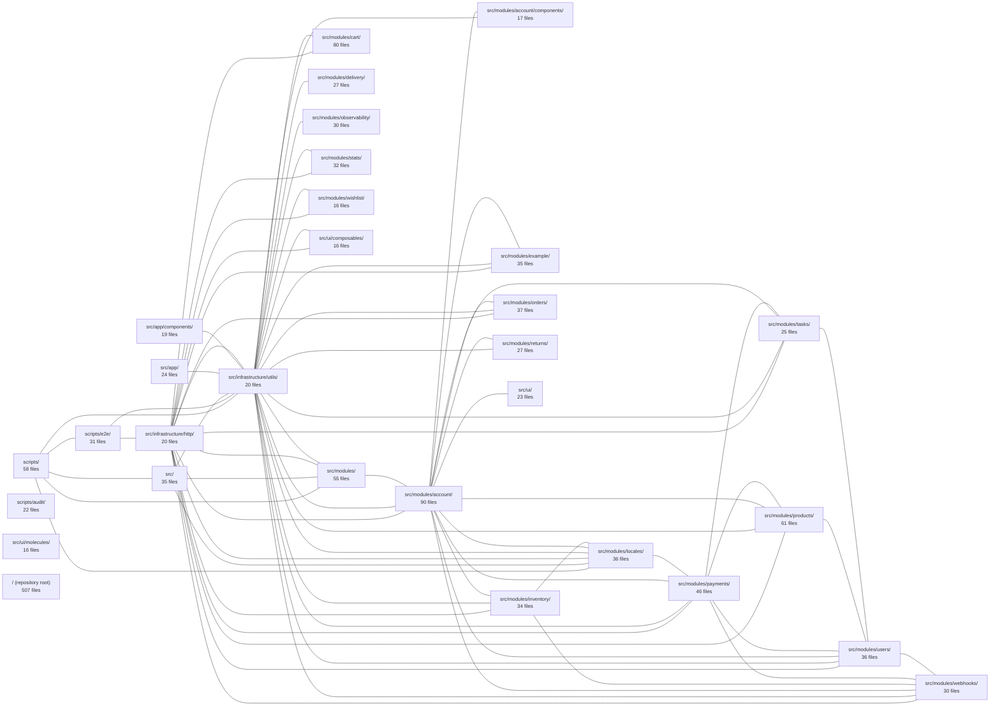

---
tags:
  - 2brain
  - 2brain/index
  - project/boilerplate-vue-frontend
type: index
modules: 30
updated: 2026-11-10T08:42:38.519526+00:00
---

# boilerplate-vue-frontend

`boilerplate-vue-frontend` is a Vue.js front-end template structured around a modular, domain-driven layout: business features (account, cart, orders, payments, products, wishlist, and others) each live in their own directory under `src/modules/`, while shared HTTP utilities and general helpers are grouped in `src/infrastructure/` and reusable UI primitives in `src/ui/`. The application shell and top-level components sit in `src/app/`, and build, audit, and end-to-end test tooling are collected under `scripts/`.

## Module map

_15 lower-traffic connection(s) hidden to keep the diagram readable._

## Modules
- [[boilerplate-vue-frontend_scripts|scripts/]] — 58 files, 10 connected modules
- [[boilerplate-vue-frontend_scripts_audit|scripts/audit/]] — 22 files, 4 connected modules
- [[boilerplate-vue-frontend_scripts_e2e|scripts/e2e/]] — 31 files, 5 connected modules
- [[boilerplate-vue-frontend_src|src/]] — 35 files, 7 connected modules
- [[boilerplate-vue-frontend_src_app|src/app/]] — 24 files, 2 connected modules
- [[boilerplate-vue-frontend_src_app_components|src/app/components/]] — 19 files, 3 connected modules
- [[boilerplate-vue-frontend_src_infrastructure_http|src/infrastructure/http/]] — 20 files, 18 connected modules
- [[boilerplate-vue-frontend_src_infrastructure_utils|src/infrastructure/utils/]] — 20 files, 26 connected modules
- [[boilerplate-vue-frontend_src_modules|src/modules/]] — 55 files, 8 connected modules
- [[boilerplate-vue-frontend_src_modules_account|src/modules/account/]] — 90 files, 16 connected modules
- [[boilerplate-vue-frontend_src_modules_account_components|src/modules/account/components/]] — 17 files, 2 connected modules
- [[boilerplate-vue-frontend_src_modules_cart|src/modules/cart/]] — 80 files, 6 connected modules
- [[boilerplate-vue-frontend_src_modules_delivery|src/modules/delivery/]] — 27 files, 2 connected modules
- [[boilerplate-vue-frontend_src_modules_example|src/modules/example/]] — 35 files, 4 connected modules
- [[boilerplate-vue-frontend_src_modules_inventory|src/modules/inventory/]] — 34 files, 7 connected modules
- [[boilerplate-vue-frontend_src_modules_locales|src/modules/locales/]] — 36 files, 8 connected modules
- [[boilerplate-vue-frontend_src_modules_observability|src/modules/observability/]] — 30 files, 4 connected modules
- [[boilerplate-vue-frontend_src_modules_orders|src/modules/orders/]] — 37 files, 5 connected modules
- [[boilerplate-vue-frontend_src_modules_payments|src/modules/payments/]] — 46 files, 10 connected modules
- [[boilerplate-vue-frontend_src_modules_products|src/modules/products/]] — 61 files, 7 connected modules
- [[boilerplate-vue-frontend_src_modules_returns|src/modules/returns/]] — 27 files, 3 connected modules
- [[boilerplate-vue-frontend_src_modules_stats|src/modules/stats/]] — 32 files, 4 connected modules
- [[boilerplate-vue-frontend_src_modules_tasks|src/modules/tasks/]] — 25 files, 7 connected modules
- [[boilerplate-vue-frontend_src_modules_users|src/modules/users/]] — 36 files, 9 connected modules
- [[boilerplate-vue-frontend_src_modules_webhooks|src/modules/webhooks/]] — 30 files, 8 connected modules
- [[boilerplate-vue-frontend_src_modules_wishlist|src/modules/wishlist/]] — 16 files, 5 connected modules
- [[boilerplate-vue-frontend_src_ui|src/ui/]] — 23 files, 3 connected modules
- [[boilerplate-vue-frontend_src_ui_composables|src/ui/composables/]] — 16 files, 4 connected modules
- [[boilerplate-vue-frontend_src_ui_molecules|src/ui/molecules/]] — 16 files, 0 connected modules
- [[boilerplate-vue-frontend_ROOT|/ (repository root)]] — 507 files, 27 connected modules
