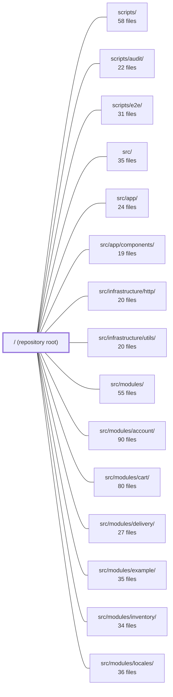

---
tags:
  - 2brain
  - 2brain/module
  - project/boilerplate-vue-frontend
type: module
module: / (repository root)
files: 507
updated: 2026-11-10T08:34:41.189299+00:00
---

# / (repository root)

## Purpose

The repository root of a contract-first Vue 3 + TypeScript SPA boilerplate. It holds the project's top-level tooling configuration, the generated API contracts (REST and AsyncAPI) that every other module codes against, Docker-based deployment definitions, and a self-contained VitePress documentation site. The app is designed to run with no backend at all; when a backend is present, all shapes are pinned to the contracts bundled here.

## Key parts

- **Generated API contracts** — `openapi.yaml` and `asyncapi.yaml` are bundled (read-only) specs. `contracts/rest/` holds the derived TypeScript types, Zod schemas, error-code catalogue, route-lookup tables, and upload MIME types. `contracts/authorization-keys.yaml` + `permission-vocabulary.ts` define the permission model. `contracts/cookies.yaml` and `contracts/frontend-links.yaml` keep backend-emitted values in sync with the frontend. All are regenerated via `npm run contracts:bundle` / `npm run gen:api`; never hand-edited.
- **Deployment & containers** — `docker-compose.yml` (dev: Vite + VitePress), `docker-compose.production.yml` (prod: static bundle on nginx), and `docker/Dockerfile{,.production,.docs}` plus `docker/docker-entrypoint.d/` scripts that inject runtime config, `security.txt`, and robots directives at container start.
- **Documentation site** — `docs/` is a VitePress project (config in `docs/.vitepress/config.mts`, custom theme in `theme/index.ts`) covering getting-started, design-system theory, and tooling guides (Docker, env vars, observability, Umami, visual regression, touch testing).
- **Project-level configuration** — `eslint.config.ts` (flat config with architectural tier and module-boundary rules), `cypress.config.ts` (e2e viewport, profiles, Node tasks), `knip.config.ts` (dead-code audit), `index.html` (DOM shell and script load order), `mutation-baseline.json` (mutation-testing reference scores).
- **Meta / onboarding** — `README.md`, `INSTALL.md`, `SECURITY.md`, `CLAUDE.md` (coding conventions, e.g. ban on `any`).

## How it connects

- **`src/` and its modules** consume the generated types in `contracts/` and the OpenAPI/AsyncAPI specs; every module's `openapi.yaml` and `authorization.yaml` fragment feeds back into the bundled files at the root.
- **`scripts/` and `scripts/audit/`** produce or validate the root-level generated artifacts (contract bundling, codegen, knip, mutation baselines, ESLint boundary checks).
- **`scripts/e2e/`** is exercised through the task registry declared in `cypress.config.ts`.
- **`docker/`** builds and serves the compiled output of `src/app/` and the VitePress site defined under `docs/`.
- **`src/ui/` and `src/ui/composables/`** are styled per the design-system rules documented in `docs/theory/design-system.md` and enforced by the ESLint design-policy rules in `eslint.config.ts`.

## Where to start

Read **`README.md`** for the one-paragraph project pitch and the two-repo mental model, then **`openapi.yaml`** (or the smaller `contracts/rest/index.ts`) to see the shape of every API surface the frontend will talk to. Together they answer "what does this app do?" and "what data crosses the wire?" before you ever open a component.

## Connected modules

[[boilerplate-vue-frontend_scripts|scripts/]] · [[boilerplate-vue-frontend_scripts_audit|scripts/audit/]] · [[boilerplate-vue-frontend_scripts_e2e|scripts/e2e/]] · [[boilerplate-vue-frontend_src|src/]] · [[boilerplate-vue-frontend_src_app|src/app/]] · [[boilerplate-vue-frontend_src_app_components|src/app/components/]] · [[boilerplate-vue-frontend_src_infrastructure_http|src/infrastructure/http/]] · [[boilerplate-vue-frontend_src_infrastructure_utils|src/infrastructure/utils/]] · [[boilerplate-vue-frontend_src_modules|src/modules/]] · [[boilerplate-vue-frontend_src_modules_account|src/modules/account/]] · [[boilerplate-vue-frontend_src_modules_cart|src/modules/cart/]] · [[boilerplate-vue-frontend_src_modules_delivery|src/modules/delivery/]] · [[boilerplate-vue-frontend_src_modules_example|src/modules/example/]] · [[boilerplate-vue-frontend_src_modules_inventory|src/modules/inventory/]] · [[boilerplate-vue-frontend_src_modules_locales|src/modules/locales/]] · … and 12 more

## Files
- `CLAUDE.md` — MUST NOT use `any` — use `unknown` plus type narrowing.
- `INSTALL.md` — What this frontend needs from outside the code before it is yours: a domain, a certificate, a brand,
- `README.md` — > Vue 3 + TypeScript SPA. Contract-first, modular, and able to run with no backend at all.
- `SECURITY.md` — Please report security vulnerabilities through GitHub's private
- `asyncapi.yaml` — A **generated, read-only** AsyncAPI 3.0.0 document that serves as the single bundled contract for all real-time and event-driven flows (SSE streams and outbound webhooks) in the boilerplate. It is produced by `npm run contracts:bundle` by merging the root fragment and every module's AsyncAPI fragment into one addressable reference. Downstream tooling (type generation, Spectral lint rules, API documentation) consumes this file rather than the individual fragments.
- `contracts/asyncapi.generated.ts` — Auto-generated TypeScript type definitions for all AsyncAPI event envelopes, payloads, and discriminants described in the project's AsyncAPI specification. It exists to give the codebase a typed contract for every published domain event (orders, shipments, payments, disputes, returns, user lifecycle, notifications) without hand-writing interfaces.
- `contracts/authorization-keys.yaml` — Generated bundle of every permission rule and permission set in the system, spliced by `npm run regenerate` from one fragment per owning module (`src/modules/<name>/authorization.yaml`) plus a root residual for app-level `core` rules. It is the single source of truth for the action vocabulary, the rule-to-role mapping target, and the step-up/credential metadata that both Node and PHP backends consume. `--check` (wired into `complete`) fails the build if the bundle drifts from the fragments.
- `contracts/cookies.yaml` — Single source of truth for every cookie the backend sets. It defines each cookie's name, purpose, secrecy, and lifetime so that the setting code, the log scrubber, and the GDPR documentation all agree on the same set.
- `contracts/frontend-links.yaml` — Single source of truth for every URL path the backend embeds in mail, sitemap, and work-notice links under the frontend's `/<locale>/` root. It exists so the frontend receives the same list (`sync:frontend`) and its tests can walk the router against it, guaranteeing a backend-emitted link never lands on a 404 in the reader's inbox.
- `contracts/permission-vocabulary.ts` — Generated TypeScript vocabulary that enumerates every permission action, subject, rule id, permission-set name, authorization scope, and step-up tier declared in the shared authorization keys. It exists so that the rest of the codebase can import a single source of truth for permission identifiers and their valid pairings without re-parsing YAML at runtime.
- `contracts/rest/error-codes.ts` — Generated catalogue of every error code the REST contract declares. It exists so that consumers (clients, test harnesses, docs) can reference a single stable set of string identifiers for all API error conditions without hard-coding literals.
- `contracts/rest/index.ts` — Auto-generated (orval v8.20.0) TypeScript type definitions for the project's OpenAPI REST contract. It exists so that every consumer—server handlers, client views, tests—shares a single, versioned definition of request/response shapes, pagination semantics, RFC 9457 error structure, and the i18n contract (language selection, `Content-Language`, `Vary` behaviour). The file is regenerated from the OpenAPI spec; manual edits are overwritten.
- `contracts/rest/operation-modules.ts` — Auto-generated lookup table that maps every REST `@api` function to the backend module slug that owns it. It exists so other code and tests can resolve "which module is responsible for this operation?" without re-parsing the OpenAPI spec.
- `contracts/rest/routes.ts` — Auto-generated lookup table that maps every REST operation to its response-validation metadata (schema name, optional body schema, owning backend module, and a `noRefresh` auth flag). It is the single source of truth consumed by the HTTP infrastructure layer to resolve response schemas at runtime. Regenerated from `openapi.yaml` via `npm run gen:api`; never edited by hand.
- `contracts/rest/schemas.zod.ts` — Generated (orval v8.20.0) Zod schemas that model the response payloads of the Boilerplate API's REST endpoints. The file exists to give TypeScript clients, test suites, and SDK consumers a single, codegen-oriented source of truth for response shapes without re-deriving them from the OpenAPI spec at build time.
- `contracts/rest/upload-types.ts` — Auto-generated contract types that define the set of image media types accepted by the `imageUpload` API endpoint. It exists so client and server code share a single, spec-derived source of truth for upload validation without duplicating MIME-type strings.
- `cypress.config.ts` — Central Cypress configuration for all browser-based e2e suites. It pins the viewport (so visual baselines are comparable), selects the demo-vs-live backend profile via env flags, registers every Node-side task (image diff, a11y, layout, touch, design capture, webhooks, device sessions), and wires up flaky-test reporting and spec-duration tracking. Specs stay profile-agnostic; this file and the env it loads decide where they point.
- `docker-compose.production.yml` — Defines the production deployment stack for the frontend: it builds a static bundle via `docker/Dockerfile.production` and serves it with nginx. It is the counterpart to `docker-compose.yml` (development, Vite dev server + bind mounts) and is intended to be run with `docker compose -f docker-compose.production.yml up -d --build`.
- `docker-compose.yml` — Development Docker Compose configuration for the frontend. It defines two services — the Vue/Vite dev server and the VitePress docs site — so the full frontend stack can be run in containers with a single `docker compose up`.
- `docker/Dockerfile` — Builds a minimal Alpine-based Node image that runs the Vite dev server for local development. It exists so `docker-compose up` can start the app without a local Node/npm install.
- `docker/Dockerfile.docs` — Multi-stage Docker build that compiles the VitePress documentation site into static files and serves them with Nginx. It exists so the docs site can be run as a lightweight, standalone container without carrying the full Node.js runtime.
- `docker/Dockerfile.production` — Multi-stage Dockerfile that produces the deployable frontend image: Vite builds static assets in a Node-based build stage, then nginx serves them in a minimal runtime stage with no Node, no npm, and no source. It is the production counterpart to `docker/Dockerfile` (which runs the Vite dev server). One image is promoted across environments; configuration changes are applied at container start via entrypoint scripts rather than at build time.
- `docker/docker-entrypoint.d/40-generate-runtime-config.sh` — Generates `config.js` (a `window.__APP_CONFIG` object literal) into the web root from `VITE_*` environment variables each time the container starts. This makes runtime configuration a restart, not a rebuild. It runs automatically because the official nginx image sources every executable `*.sh` under `/docker-entrypoint.d/` before launching nginx.
- `docker/docker-entrypoint.d/41-generate-security-txt.sh` — Docker entrypoint hook that (re)generates `/.well-known/security.txt` (RFC 9116) from container environment variables at every startup. It is opt-in: if the required variables are absent, nothing is written and nginx returns 404, so a fork cannot accidentally publish an upstream's contact information.
- `docker/docker-entrypoint.d/42-generate-robots.sh` — Runs at every container start to decide whether this deployment is eligible for search-engine indexing, then materialises that decision into two files the running nginx can serve: a `robots.txt` and an `nginx map` snippet that drives the `X-Robots-Tag` response header. The "off" path is the default and is deliberately designed so that even a crawler that can't fetch a page still sees a readable `noindex` signal.
- `docs/.vitepress/config.mts` — VitePress site configuration that defines the documentation site's metadata, navigation, sidebar structure, Mermaid rendering options, and social links for the Boilerplate Vue Frontend docs.
- `docs/.vitepress/theme/index.ts` — Custom VitePress theme entry point that extends the default theme to add a click-to-zoom overlay for Mermaid diagrams rendered in the documentation. It also loads project-specific stylesheet (`custom.css`).
- `docs/getting-started.md` — From a fresh clone to a running storefront: two repos, three commands, no Docker.
- `docs/theory/design-system.md` — How the styling is split between two libraries, and the rules that keep the split from drifting.
- `docs/tools/docker-and-podman.md` — This repo ships a small `docker-compose.yml`: the Vite dev server and the VitePress docs site,
- `docs/tools/environment.md` — Source of truth: [`.env-example`](https://github.com/Guebbit/boilerplate-vue-frontend/blob/main/.env-example).
- `docs/tools/observability.md` — The FE observability layer covers two complementary concerns, both wired into a **single Pinia store** at `src/infrastructure/observability/store.ts`. Everything runs against a **self-hosted, local stack** (Docker/Podman) — there are no external SaaS accounts.
- `docs/tools/touch-testing.md` — A phone is not a narrow desktop. A finger cannot hover, taps fire compatibility mouse events, and a
- `docs/tools/umami.md` — The _why_. Every operational rule — the event taxonomy, the env vars, the code examples, the
- `docs/tools/visual-regression.md` — Photographing a handful of screens and comparing them, pixel by pixel, against committed baseline images.
- `eslint.config.ts` — The flat ESLint configuration for the repository. It wires together all lint plugins (Vue, TypeScript, Cypress, Vitest, JSDoc, Unicorn, boundaries, etc.), defines the architectural tier ladder and module-boundary policies enforced at lint time, and integrates project-specific rule sets, design-policy checks, and the module-manifest dependency graph. It is the single entry point that `eslint` reads via the flat-config format.
- `index.html` — The static HTML entry point for the Vue 3 storefront. It provides the minimal DOM shell (`#app`), a framework-free loading splash, browser metadata, and the script-loading order (runtime config → app bundle) before any JavaScript executes.
- `knip.config.ts` — Configuration for [knip](https://knip.dev), a tool that lists unused files, exports, and dependencies by walking imports from entry points. This file supplements what knip's built-in plugins already discover (from `package.json`, Vite, ESLint) by declaring entry points and ignore patterns that no plugin can infer. It is consumed by the `code-shape` audit process, not by any gate.
- `mutation-baseline.json` — Stores the last-known mutation-testing scores (percentage of mutants killed, 0–100) for every tracked source file. It serves as a reference point so that CI can detect score regressions or improvements relative to the previous run. The file is a generated artifact, not hand-edited.
- `openapi.yaml` — This is the **generated, bundled** OpenAPI 3.1.0 contract for the Boilerplate API. It is produced by `npm run contracts:bundle` from `shared/contracts/openapi.root.yaml` plus per-module specs in `src/modules/*/openapi.yaml`. It is the single stable spec consumed by code generators (client/server stubs, DTOs, SDKs) across multiple projects and languages. **Do not edit it by hand.**
- `orval.config.ts` — Orval build configuration that generates a typed Axios API client and Zod schemas from `./openapi.yaml`. It exists so the runtime HTTP layer and the validation layer are both derived from a single OpenAPI spec, keeping them in sync automatically.
- `package.json` — Project manifest for **boilerplate-vue-frontend** (v3.0.0, private, AGPL-3.0-or-later). Declares the Vue 3 / Vite / Vuetify / Tailwind CSS frontend stack, defines every npm script (dev, build, test, lint, codegen, audit, docs, container), pins engine requirements (Node ^24, npm ≥ 11.16), and controls which transitive dependencies are permitted to run install-time scripts via `allowScripts`.
- `public/favicon/safari-pinned-tab.svg` — A black, single-color SVG favicon used by Safari for pinned tabs (the small icon shown in the tab bar). It is a vector trace of the Guebbit logo, providing a crisp, resolution-independent mark that Safari displays when the site is pinned to the tab strip.
- `release-please-config.json` — Configuration file for [release-please](https://github.com/googleapis/release-please) that defines how automated releases are generated for this repository. It tells the release-please tool which release strategy to use and where to write the changelog.
- `shared/rules/schemas/browser-storage.schema.json` — JSON Schema (draft 2020-12) that validates a declarative browser-storage configuration object. It enforces the shape, naming conventions, and allowed enum values so that any file describing which cookies/storage entries the project uses can be machine-checked before it is consumed by tooling.
- `shared/rules/schemas/notification-screens.schema.json` — A JSON Schema (draft 2020-12) that validates the shape of a notification-screen mapping configuration. It ensures the `summaryScreens` object uses fully-qualified staff screen identifiers as keys and restricts values to a fixed set of known shop-task screens, preventing typos or unknown screen references in notification routing rules.
- `shared/rules/schemas/static-pages.schema.json` — A JSON Schema (draft 2020-12) that validates the structure of a static-pages configuration object. It enforces that the object contains exactly one required `pages` property — a non-empty array of lowercase-letter slugs — and rejects any extra top-level keys.
- `shared/rules/schemas/tours.schema.json` — A JSON Schema (draft 2020-12) that defines the validation contract for a tours configuration object. It constrains the shape, naming, and per-tour settings so that any producer or consumer of a "tours" payload can be checked against a single canonical definition.
- `spectral.yaml` — Spectral linting configuration that enforces project-specific OpenAPI conventions on top of the shared `spectral:oas` preset. It exists to catch 3.0-to-3.1 migration mistakes, common typos, and naming inconsistencies before they reach codegen or review.
- `stryker.config.json` — Stryker Mutator configuration that defines which source files are subject to mutation testing, how tests are run (via Vitest), where reports land, and the quality thresholds that must be met. It is the single source of truth that the CI mutation workflow and local `npx stryker run` both consume.
- `tests/cross-cutting/a11y-coverage.spec.ts` — A structural (static-analysis) test that guarantees every route declared by a module's `routes.ts` — and every route in the shell router — is visited by a corresponding a11y sweep. It does not run axe or a browser; it reads source files with regex and asserts that no route is left unvisited. It exists because a missing sweep file produces zero failing assertions, so without this meta-check a deleted or never-written sweep would pass silently.
- `tests/cross-cutting/badge-name.spec.ts` — A cross-cutting invariant test that scans every `.vue` file under `src/` and asserts each `<v-badge>` element carries an accessible name (`label`, `aria-label`, or `aria-hidden`). It exists because Vuetify's badge renders a decorative wrapper with no accessible name by default, the missing attribute is visually invisible, and no linter knows what a `v-badge` is. The test pins the rule rather than enforcing it through a shared component, since badges appear in structurally different locations (list entries vs. icon buttons) that can't share markup.
- `tests/cross-cutting/ci-covers-the-gate.spec.ts` — Guard test that verifies every leaf check in the `npm run complete` gate chain has a corresponding CI job in `.github/workflows/`. It exists to close the bypass path where a contributor uses `--no-verify` or opens a PR from a fork: without this invariant, a new local-only check would pass the gate but never run in CI, leaving the PR green. The test is one-directional—CI may legitimately run *more* than the gate (e.g. `mutation.yml`, `lighthouse.yml` are scheduled-only).
- `tests/cross-cutting/css-invasiveness.spec.ts` — A Vitest gate that enforces "zero invasive CSS" in the app. Invasive means: selectors reaching into Vuetify internals, raw `z-index` values, redefined utility classes, native `title` tooltips, and scripts that query Vuetify's DOM. The test scans the entire codebase, asserts no findings, and also fires every check against a minimal sample to guarantee a check cannot silently stop matching and pass the ratchet by finding nothing. The only escape hatch is a `/* css-allow <check> -- <why> */` comment.
- `tests/cross-cutting/design-arbitrary-values.spec.ts` — Cross-cutting design-lint test that enforces a single rule across the entire codebase: no Tailwind arbitrary-value class (e.g. `w-[420px]`) may appear in more than `arbitraryRepeatLimit` places. A repeated value is a signal that it belongs as a named token in `main.css`, not as a scattered inline value. Lint tools check one file at a time and cannot see this pattern; this test closes that gap.
- `tests/cross-cutting/design-tokens.spec.ts` — Vitest spec that enforces the "stylesheet half" of the design-token lint. Where the `local/theme-token` rule covers scripts and templates at the AST level, this file validates what that lint cannot read: raw CSS in `main.css`, SFC `<style>` blocks, Vuetify's computed theme, boot-surface files, and WCAG contrast for secondary text.
- `tests/cross-cutting/entry-chunk-budget.spec.ts` — Guards the production entry-chunk size against silent bloat. It runs a real `vite build` (forced to `NODE_ENV=production`) into a scratch temp directory, then asserts that the single JS file named by `index.html`'s `<script type="module">` tag stays under a raw-byte budget, and that the generated Zod schema chunk remains a separate, lazily-loaded file rather than being inlined into the entry graph.
- `tests/cross-cutting/example-template.spec.ts` — A cross-cutting convention guard with two checks: (1) every file path cited in the module-template docs section of `docs/theory/modules.md` must actually exist under `src/modules/example/`, and (2) no module's `domain/` folder may export a status-transition table (`NEXT_STATUSES` / `TRANSITIONS`), enforcing that transition logic lives server-side only.
- `tests/cross-cutting/form-idiom.spec.ts` — A cross-cutting enforcement test that scans every `.vue` file under `src/modules` and asserts a single form idiom: every `useStructureFormValidation(...)` call supplies `revalidateOn` and `onInvalid`, every page-level form supplies `formElement`, and every routed record-editing view calls `useLeaveGuard`. It exists because five forms shipped missing at least one of these, and the failures were invisible to unit tests (a screen-reader user gets no focus signal on failed submit).
- `tests/cross-cutting/journey-headers.spec.ts` — Validates that every cross-module e2e spec under `tests/e2e/specs/` carries a well-formed `// requires-module:` header (naming only real modules, or `none`). This guarantees `npm run demo:remove` can safely delete journey specs alongside the modules they depend on. It exercises the same checker logic used by the unit tests in `scripts/demo/demo-remove-tests.spec.ts`, but against the actual repository tree.
- `tests/cross-cutting/list-url-state.spec.ts` — A convention-enforcement test that guarantees every module component mounting the shared `<ListPagination` pager also calls `useListUrlState` to keep filters and page in the URL. It exists to prevent drift: a paged list that skips the composable would lose bookmarkable, reloadable, shareable state, and this test is the single tripwire that catches that omission.
- `tests/cross-cutting/module-coupling.spec.ts` — Cross-cutting static-analysis test that enforces a module's `@api` (generated REST client) calls stay within the backend modules declared in its `dependsOn` coupling. It closes a gap left by the ESLint boundary rules: those rules prevent a module from importing a sibling's *source*, but say nothing about calling another module's *backend operation* through the shared `@api` barrel.
- `tests/cross-cutting/module-file-shapes.spec.ts` — Cross-cutting guard that enforces a single source of truth for size bounds. Because the backend contract generates constants (e.g. `createWebhookSubscriptionBodyUrlMax`), any numeric literal in a module's `schemas.ts` is a second copy that will drift silently. This test walks every enabled module's folder, reads each `schemas.ts`, and fails if a hard-coded number appears in a size-constraining Zod call.
- `tests/cross-cutting/module-groups.spec.ts` — Vitest spec that enforces every enabled module explicitly declares a valid `group` in its `src/modules/<name>/module.yaml` (the "foundation | shop" axis). A missing or invalid group fails the build rather than defaulting silently, making module categorization a deliberate choice. Together with `eslint.config.ts`'s `foundation-may-not-import-shop` rule (which enforces import *direction*), this spec enforces *completeness*: every module is accounted for on the axis.
- `tests/cross-cutting/module-map.spec.ts` — Validates that the Mermaid context map in `docs/modules/index.md` (under the heading "The whole map") contains only edges that the `moduleDependsOn` manifest permits. It does **not** compare the map to actual source imports; it guards against the visual diagram drifting out of sync with the declared dependency policy.
- `tests/cross-cutting/mutate-scope.spec.ts` — Guards against the silent failure mode of Stryker's `mutate` glob patterns: if a directory is renamed or moved, the glob simply matches nothing and those files quietly drop out of mutation coverage. This test turns that silent gap into a red CI run.
- `tests/cross-cutting/mutation-safe-imports.spec.ts` — Static guard that verifies every dynamic-import specifier (template-literal `import(…)` and `import.meta.glob(…)`) inside Stryker's `mutate` scope carries a `Stryker disable` directive. Without it, Stryker's template-literal mutator would corrupt the specifier string, the instrumented build would fail to transform, and the mutation dry-run would die with a sandbox-path error that misleads readers into thinking the setup is broken rather than a specific line is unguarded.
- `tests/cross-cutting/page-window-density.spec.ts` — Regression guard for a runtime guarantee of `@guebbit/vue-toolkit`: `pageItemList` is always dense—no `undefined` elements, no sparse-array holes—because the toolkit's internal `searchGet → getRecords` pipeline ends in `.filter(Boolean)`. The spec exists to catch a future toolkit change that would start returning holes, failing loudly here instead of letting four views silently render `undefined`.
- `tests/cross-cutting/pinned-browser-image.spec.ts` — A Vitest spec that guards CI consistency: it reads every YAML workflow in `.github/workflows`, extracts the pinned `cypress/included` image reference from each, and asserts that all of them pin the **same** image by both semver tag and `sha256` digest. This prevents a situation where one workflow silently runs a different (or newer) Chrome than another, which would invalidate cross-nightly timing and pixel comparisons.
- `tests/cross-cutting/published-language.spec.ts` — A cross-cutting architectural test that enforces one rule across every module under `src/modules/`: **a module's barrel (`index.ts`) must export only names that at least one sibling module actually imports.** It walks the filesystem directly (no code imports), parses every barrel's `export { … }` clauses, scans all non-test source files for `import { … } from '@/modules/<name>'` statements, and fails if any export has no sibling consumer or if a barrel exists for a module nothing imports.
- `tests/cross-cutting/registry.spec.ts` — Cross-cutting invariant tests that iterate every enabled module in the registry and assert structural rules each one must satisfy (navigation entries, route naming, i18n dictionaries) **without naming any specific domain**. The file is designed to keep passing when a module is deleted — it simply tests one fewer case. It exists to catch silent failures (broken navigation links, duplicate i18n keys, missing locale coverage) that no per-module spec or runtime warning would gate.
- `tests/cross-cutting/route-name-coupling.spec.ts` — Detects unguarded cross-module route-name string references (e.g. `router.push({ name: 'OrderTarget' })`) that ESLint boundary rules cannot see because they are plain literals. By reading source text of every enabled module, it ensures any route name a module references either belongs to that module, the app shell, a declared `dependsOn` sibling, or is protected by a `hasRoute` / `linkIfRouted` guard.
- `tests/cross-cutting/schemas-i18n.spec.ts` — Cross-cutting spec that proves two i18n guarantees independently of any domain module: (1) a Zod schema whose error messages are **thunks** (`() => translate(…)`) resolves in whichever locale is active at parse time, with no schema rebuild; and (2) the `revalidateOn` option of `useStructureFormValidation` re-translates error strings already rendered on screen when the locale changes. Both are tested against the real `@/i18n` instance with a synthetic schema so the file survives deletion of any domain module.
- `tests/cross-cutting/sitemap-document.spec.ts` — A Vitest spec that serves as both the generator and the guard for the route table embedded in `docs/theory/sitemap.md`. It reads the enabled modules' route records, builds the expected Markdown table, and asserts the page's table matches. When `UPDATE_SITEMAP=1` is set, it rewrites the block between the `<!-- sitemap:start -->` / `<!-- sitemap:end -->` markers in-place. It lives as a spec (not a standalone script) because the route records lazy-load `.vue` views through `@/` aliases that only the Vite/Vitest pipeline can resolve.
- `tests/cross-cutting/utility-collisions.spec.ts` — Cross-cutting test that verifies the collision list in `scripts/design-policy.ts` stays in sync with reality. It compiles both Vuetify's and Tailwind's utility CSS, compares the declarations class-by-class, and asserts that (1) every genuine collision is listed, (2) no `rounded*` name collides, and (3) Tailwind is scoped to `src/` only. A library upgrade that introduces (or removes) a collision fails the build here.
- `tests/cross-cutting/viewport-matrix.spec.ts` — A cross-cutting guard that enforces viewport sizes live in exactly one module (`scripts/e2e/viewports.ts`) and are applied through exactly one seam (`tests/support/e2e/apply-viewport.ts`). It also validates the `<meta name="viewport">` tag in `index.html` for accessibility (zoom allowed, scale ≥ 1). The goal is to prevent a "size typed twice" drift where a spec and the matrix disagree on a width, hiding a layout bug.
- `tests/e2e/fixtures/not-an-image.txt` — not an image, on purpose
- `tests/e2e/specs/a11y.cy.ts` — Accessibility sweep for "shell" routes — pages that belong to no module (landing page, prose pages, error page) — plus the shared chrome (app bar, drawer, language menu, theme toggle, account and administration menus) that every page renders. Module-owned routes keep their a11y sweeps inside their own module so deleting a domain removes its coverage; this file is the residual, unowned set.
- `tests/e2e/specs/commerce.cy.ts` — End-to-end Cypress spec that walks the full commerce lifecycle across two sessions: the customer selects express shipping, is declined, completes a 3-D Secure payment, and cancels a paid order; the admin corrects the order to `processing`, ships it through the shipment panel, marks it delivered, and verifies the inventory ledger received the delivery with the correct counter movement. Exists to prove the payment state machine, the shipment panel, and the inventory ledger behave as a connected system, not as isolated features.
- `tests/e2e/specs/consent.cy.ts` — End-to-end Cypress spec that verifies the analytics consent banner lifecycle: the Umami tracker script must not load before the visitor answers, "Accept" must inject it, "Decline" must keep it out across reloads, and the footer "Privacy choices" link must let a consenting visitor withdraw. All tests self-skip when Umami is not configured.
- `tests/e2e/specs/contract-hook.cy.ts` — A single-test positive control that proves the global `[contract]` hook actually fires and fails a test when the page logs a `console.error` containing `[contract]`. Without this check, a silently dead hook would be indistinguishable from a suite with no drift.
- `tests/e2e/specs/harness.antibot.cy.ts` — Verifies that the antibot shard/matrix run actually boots the human-challenge provider (altcha). Without this check, a mis-wired run would silently pass every `*.antibot.cy.ts` journey by falling into the "provider is off" branch. This spec is the canary that confirms the harness wiring is correct.
- `tests/e2e/specs/harness.cy.ts` — A single E2E spec that proves the journey-harness utilities work before any journey spec relies on them. It exercises `cy.travel`, session-mode reporting, persona and staff login flows, a second-device session, signed payment webhooks, the webhook sink, the job lever, browser helpers (clipboard, `window.open` stub), and `cy.restore`'s cache-clearing. Because the harness is shared infrastructure, it is validated here once rather than incidentally by whichever journey lands first.
- `tests/e2e/specs/journey.cy.ts` — A single end-to-end Cypress test that walks the full shop lifecycle as a real user would: a guest browses products and hits the sign-in wall, then an authenticated customer filters, buys, checks out, cancels, and verifies the shelf restocks. All post-login navigation is done through in-app links and buttons (no deep `cy.visit`), so surviving state across steps proves the flow shares one session.
- `tests/e2e/specs/journeys/ac1-lost-my-phone.cy.ts` — End-to-end journey test for Acceptance Criterion 1 ("I lost my phone"): a customer whose second factor is unreachable signs in with a one-use backup code. The test verifies that each code burns after a single use, that regenerating the set invalidates every old code (used or not), and—on the demo profile—that step-up re-authentication (password + code) is enforced after the sensitive/critical time windows lapse.
- `tests/e2e/specs/journeys/ac11-i-moved-house.cy.ts` — End-to-end acceptance test (AC11) that verifies the single-source-of-truth contract for customer addresses: edits and new-default changes made in the profile are immediately reflected in the checkout address picker, and vice-versa. Covers the full round-trip of edit → add-default → checkout pre-select → delete-all → re-add-from-checkout, with no payment step.
- `tests/e2e/specs/journeys/ac12-my-privacy-choices-stick.cy.ts` — End-to-end acceptance test for **AC12** (analytics-consent persistence). Verifies that a visitor who signs up without enabling analytics has no Umami tracker, no stored consent, and no recorded events; that turning the switch on in the profile loads the tracker and starts recording; and that the choice survives logout/login cycles. Also confirms that a signed-in account's own record overrides the guest cookie, and that withdrawing consent via Privacy choices updates the account (not a cookie).
- `tests/e2e/specs/journeys/ac13-my-password-start-to-finish.cy.ts` — End-to-end journey test for the full password lifecycle (AC13): changing a password from the profile page, recovering it via a mailed reset link, and verifying the failure modes along the way (breached-password warnings on all three forms, wrong-current-password rejection, single-use reset links, device sign-out on change and reset, and indistinguishable acknowledgement for unknown addresses).
- `tests/e2e/specs/journeys/ac14-my-details-and-my-picture.cy.ts` — Cypress e2e test for the "My details and my picture" journey (AC14). Verifies that a customer can edit username, phone, and website; that cleared fields persist as `null` rather than empty strings; that an uploaded avatar survives a reload and can be removed back to a placeholder; that a stale save (another device wrote first) is rejected with HTTP 412 and the latest record is offered; and that "reset" discards unsaved input.
- `tests/e2e/specs/journeys/ac15-provider-account-proves-it-is-me.cy.ts` — End-to-end journey test for AC15: verifies that a provider (OAuth) account—which has no password—can re-authenticate via a mailed code during checkout. The test walks the full happy-and-unhappy path: sign-in through the fake provider, fill a cart, let the critical window lapse, receive the re-auth dialog, reject a wrong code, accept the correct code, and confirm the original checkout proceeds to order confirmation.
- `tests/e2e/specs/journeys/ac16-two-factor-awkward-edges.cy.ts` — End-to-end journey test for AC16 covering the "awkward edge" cases of two-factor authentication: an unverified account being blocked from arming 2FA, replacing and cancelling a factor, login-challenge guess limits and expiry, and an email-only account disabling 2FA without spending a backup code. Requires a mailbox for verification links and all codes.
- `tests/e2e/specs/journeys/ac17-copied-session-cookie.cy.ts` — E2E journey test for acceptance criterion 17: a stolen session cookie must be refused after rotation and logout. It verifies two invariants — (1) in `jwt` mode, replaying a pre-rotation cookie past the grace window returns 401 and revokes all sessions for the account; (2) in both modes, a cookie copied before logout refreshes nothing once the server has logged the user out.
- `tests/e2e/specs/journeys/ac18-a-bot-shaped-login.antibot.cy.ts` — E2E journey test for AC18: verifies that the human-check (Altcha) widget appears at the correct threshold during login (only after the account's failure budget is half-spent), and that password-reset and signup requests require the check token from the very first submission. Runs exclusively in the **antibot** shard, where the backend pins the per-account login budget at 6.
- `tests/e2e/specs/journeys/ac2-authenticator-app.cy.ts` — End-to-end journey test for the TOTP authenticator app (AC2). Verifies the full lifecycle in a single test: enrol from a secret, reject a wrong code / accept a right one, sign in with a generated code, replace the authenticator via a backup code (lost-phone path), confirm the old secret no longer works, disable 2FA with a code from the new secret, and confirm login no longer prompts for a code.
- `tests/e2e/specs/journeys/ac20-the-link-in-my-mail-went-stale.cy.ts` — End-to-end journey test for AC20: emailed links (verify, password-reset, deletion-restore) must expire after their respective TTLs and present a human-readable error on their own page, while a freshly requested link still works. The test also covers the admin-invite setup flow (admin creates a user → setup mail → recipient sets a password). Because it manipulates the demo backend's clock, it is gated to demo mode.
- `tests/e2e/specs/journeys/ac21-it-was-not-me.cy.ts` — E2E journey test for Acceptance Criterion 21: a thief with a stolen session changes the account's email address, and the old (legitimate) address can undo the change whether it is still pending or already confirmed. Verifies that only the newest undo link is valid, a spent link is dead, and undoing severs any session authenticated under the thief's address.
- `tests/e2e/specs/journeys/ac22-i-disconnected-the-provider.cy.ts` — End-to-end (Cypress) acceptance test for **AC22**: an account that has both a password and an OAuth provider connected removes the provider. The test verifies the full removal journey — re-authentication when the fresh-login window has lapsed, email notifications for the method change, the password continuing to work, a reset confirmation reflecting "no provider connected," and the provider's next sign-in being refused until the owner reconnects it.
- `tests/e2e/specs/journeys/ac24-someone-is-guessing-my-codes.cy.ts` — E2E journey test for AC24: verifies that an account tolerates 5 wrong 2FA guesses per challenge and 10 across challenges, that the 10th wrong guess triggers a 15-minute lock with an owner notification email, that a correct code is refused during the lock (and not consumed), and that only a password reset lifts the lock. Runs against the seeded `twoFactor` persona.
- `tests/e2e/specs/journeys/ac25-what-i-agreed-to.cy.ts` — E2E journey test for AC25 ("What I agreed to"). Verifies that the signup form displays a live password-strength meter, rejects submission when the terms checkbox is unchecked, records `termsAcceptedAt` / `termsVersion` and the analytics-consent toggle with timestamps, and that a provider (OAuth) signup stamps the terms without soliciting an analytics answer.
- `tests/e2e/specs/journeys/ac3-prove-it-is-still-you.cy.ts` — E2E journey test for AC3 ("Prove it's still you"): verifies that when the re-authentication window lapses, both checkout and data export trigger a password re-auth dialog rather than failing outright, that a wrong password is rejected with an in-dialog error, that cancel abandons the action with a human-readable API error, and that the correct password resumes the original action. Uses demo-mode time travel (`cy.travel`) to simulate elapsed time.
- `tests/e2e/specs/journeys/ac4-my-laptop-was-stolen.cy.ts` — End-to-end acceptance test for AC4 ("My laptop was stolen"). Verifies three session-revocation flows: logging out everywhere from one device invalidates the other, a stolen tab's session is killed immediately (401 on refresh / cleared cookie), and revoking the current session logs the tab out cleanly.
- `tests/e2e/specs/journeys/ac5-changed-my-mind-about-my-email.cy.ts` — End-to-end journey test for Acceptance Criterion 5 ("I changed my mind about my new email"). It verifies the full lifecycle of a pending email-address change that is never confirmed: resending the link (and invalidating the previous one), canceling the change (killing all outstanding links), the old address remaining usable, and rejection of an address already held by another account. The test seeds the pending state via the `pendingEmail` persona rather than typing through the change request.
- `tests/e2e/specs/journeys/ac6-give-me-my-data.cy.ts` — Cypress e2e journey test for Acceptance Criterion 6 ("Give me my data"). It verifies the full GDPR export flow: a customer requests an export from their profile, receives a download link by email, downloads a JSON file, and confirms that file contains their own profile, addresses, orders, sessions, and sign-in methods while excluding secrets and other users' data. A second test (demo-backend only) verifies that an export link expires after roughly a week and that re-requesting produces a fresh, downloadable export.
- `tests/e2e/specs/journeys/ac7-delete-account-with-open-orders.cy.ts` — E2E Cypress journey for acceptance criterion AC7: a customer deletes their account while one order is paid-and-open and another is unpaid. Verifies the full lifecycle — immediate lock, grace-period purge, stock release on the unpaid order, detachment of the paid order as a staff-shippable invoice, and a final sweep that scrubs personal data from the unpaid order while leaving the invoice intact.
- `tests/e2e/specs/journeys/at1-launch-a-new-language.cy.ts` — End-to-end Cypress journey (AT1) that walks the full lifecycle of launching a new language (`de`): an editor registers it inactive, populates its frontend dictionary three ways (manual key, JSON import with merge, inline edit), trims and exports it, activates it, verifies guest-visible storefront rendering and product-translation behavior in both active and draft (inactive) states, and finally confirms the fallback `en` language is undeletable while the new one deletes cleanly.
- `tests/e2e/specs/journeys/at10-the-last-administrator-removes-itself.cy.ts` — End-to-end test for the AT10 journey: the shop's sole administrator deactivates their own account through the "manage access" UI. The test verifies that the lock-out is immediate and irreversible through the application — the session drops, login is refused, admin-only pages close to remaining staff, the moderator cannot reassign the `admin` role, and no in-app repair path exists.
- `tests/e2e/specs/journeys/at11-a-staff-member-walks-away.cy.ts` — End-to-end test for acceptance test **AT11** (idle session timeout). Verifies that shopper sessions never idle out while staff sessions expire after 30 minutes, that the "Still there?" prompt appears in the final two minutes, that "Stay signed in" resets the clock, that ignoring the prompt signs the user out and redirects to login (remembering the originating page), and that the **server** enforces the limit independently of the tab (returning `SESSION_IDLE` / 401).
- `tests/e2e/specs/journeys/at2-fix-a-typo-in-the-dictionary.cy.ts` — Cypress E2E journey test for the **AT2** acceptance criterion: an editor fixes a typo in the dictionary board (a multi-language column view), verifies the storefront reflects the correction, clears the entry to confirm English fallback (Spanish ships no locale file), completes a brand-new key in all five languages so it drops out of the "incomplete only" filter, and replaces Spanish's Frontend dictionary from a file import while confirming the API app of the same language is untouched. It also exercises import validation (invalid JSON) and duplicate-key rejection.
- `tests/e2e/specs/journeys/at4-housekeeping-on-the-admin-page.cy.ts` — Cypress e2e journey test for **AT4 · Housekeeping on the admin page**. It verifies that a shop administrator who is also the installation operator can (1) refresh the admin overview and confirm the parked-queue rows match the API response, (2) filter and reset the platform audit trail by action, and (3) connect, read, and disconnect the realtime event stream.
- `tests/e2e/specs/journeys/at5-audit-filters.cy.ts` — E2E story that verifies every filter on the shop's audit page (action, actor, outcome, since, and reset) correctly narrows or restores the audit trail. It seeds one known success action (admin cancels an order) and one known failure (a refused login), then asserts each filter isolates exactly the rows that should match.
- `tests/e2e/specs/journeys/at5-lists-keep-their-view.cy.ts` — E2E journey test (AT5) verifying that staff-facing lists encode their active filter in the URL address, so a page reload or a freshly opened copied link restores the same filtered rows. Also asserts that requesting a page beyond the last one renders no rows (and a way back to page 1) without crashing. A second block covers the inventory board and ledger, which live-filter with prefixed query keys and have no explicit search button.
- `tests/e2e/specs/journeys/at5-orders-filters.cy.ts` — End-to-end test verifying that every filter on the staff orders list (`/en/sales/orders`) correctly narrows the visible rows to matching orders and that "reset" restores the full list. It covers status, id, email, awaiting-transfer, deleted, payment/fulfillment/return status, created and paid date windows, and product-id filters.
- `tests/e2e/specs/journeys/at5-payments-filters.cy.ts` — E2E spec that verifies every filter on the Sales → Payments page (payments tab and refunds tab) actually narrows the row list to matching entries and empties it when the filter window contains no data. It relies on seeded subjects to supply known payment attributes, then asserts inclusion and exclusion by order id.
- `tests/e2e/specs/journeys/at5-products-filters.cy.ts` — E2E test (Cypress) verifying that the staff-facing products list correctly narrows results when the **active/inactive**, **deleted**, **ID**, and **price-range** filters are applied, and that **reset** restores the full list. Seeded witness products (`product.inactive`, `product.softDeleted`, `product.rich`, `product.inStock`) serve as assertions for inclusion/exclusion under each filter state.
- `tests/e2e/specs/journeys/at5-stock-ledger-filters.cy.ts` — E2E journey test (AT5) that verifies the stock-ledger UI filters work correctly: the reason dropdown narrows movements to one type, the product combobox narrows to one product, and the board's "low stock only" toggle shrinks the board. Each filter is then reset to confirm the full list returns.
- `tests/e2e/specs/journeys/at5-task-filters.cy.ts` — End-to-end journey test for the Tasks page filter controls (text, email, status) and the reset action. It verifies that each filter narrows the task inbox to the matching entries and that reset restores the full list. Because the `shop` seed contains no tasks, the test writes three of its own via the admin API.
- `tests/e2e/specs/journeys/at5-users-filters.cy.ts` — E2E journey test (AT5) that verifies every filter on the Users list page—email, ID, active/inactive, free-text, and deleted—narrows the table to the expected rows, and that "reset" restores the full list. It relies on two seeded users as witnesses: a normal customer (appears under its own email filter) and a banned account named `marcus` (appears only under "Inactive").
- `tests/e2e/specs/journeys/at5-webhooks-filters.cy.ts` — End-to-end journey test for the webhook subscriptions list "Status" filter. It seeds one enabled and one paused subscription, then verifies that filtering by Enabled / Paused each surfaces only the matching row, and that resetting the filter restores both.
- `tests/e2e/specs/journeys/at7-staff-accounts.cy.ts` — Cypress e2e journey test covering the full staff-account lifecycle: an admin creates a warehouse-role account in Italian (no password field), the recipient follows a localized setup-mail link to set their password, and the new staff member sees only their warehouse-scoped menu. A second test verifies that phone/website/avatar edits persist and that a concurrent-save (stale-record) conflict is detected and resolved.
- `tests/e2e/specs/journeys/at9-the-platform-operator-is-not-the-shop.cy.ts` — E2E test for story AT9: verifies that the platform operator role is strictly separated from shop roles. The operator sees only platform pages (admin, realtime) and is turned back from shop pages (users, audit, inventory, etc.). Its audit trail hides IP addresses (shown as a digest) and omits protected-role (`role_protected`) refusal rows. The seeded `root`/`admin` account, which holds both roles, can see everything.
- `tests/e2e/specs/journeys/bo1-the-buyer-backorders.cy.ts` — End-to-end Cypress journey test for backorder purchasing. It verifies that when a product has partial stock and backorder enabled, a buyer can add more units than are on the shelf; the order records the backordered quantity and a promise date; the owed portion stays on hold until stock arrives, at which point the hold is released and the full order ships.
- `tests/e2e/specs/journeys/bo2-an-expired-hold-serves-the-waiting-buyer.cy.ts` — End-to-end Cypress test for the BO2 business journey: when a cart hold on the last in-stock unit expires, the freed unit must be allocated to the buyer who already paid for a backorder (oldest payment first), not to the next random shopper. The scenario exercises product creation, cart holds, backorder, payment, hold expiry via clock-jump, and the reservation-sweep job.
- `tests/e2e/specs/journeys/bo3-notify-me-when-it-is-back.cy.ts` — E2E journey test for the **BO3 · Notify me when it is back** feature. It verifies the full stock-alert lifecycle from a signed-in shopper's perspective: request notification on a sold-out product, confirm the button state changes to "You'll be told", restock the item as admin, then assert exactly one email (linking to the product) and one inbox row arrive, and that the request is subsequently cleared.
- `tests/e2e/specs/journeys/cu1-first-purchase.cy.ts` — End-to-end smoke test for the complete first-purchase journey (CU1): a brand-new visitor signs up, verifies via a mailed link, browses a category, adds two products to the cart, enters a shipping address at checkout, pays by card, and confirms that every monetary figure on the order page and invoice matches the cart totals. The test's core assertion is that the money stays identical from cart → order → tax breakdown → email.
- `tests/e2e/specs/journeys/cu10-digital-product-alone-and-mixed.cy.ts` — E2E journey test for use-case CU10: a digital product (video course) bought alone and alongside a physical product. Verifies that a digital-only cart skips shipping method/address/delivery cost, still records a billing address, and that adding a physical line restores shipping with "same as shipping" billing. Also confirms a stale shipping selection is silently ignored once the basket goes digital-only, and that the made-to-order physical line carries a no-withdrawal notice while the digital line does not. No payment is performed; assertions stop at the created order.
- `tests/e2e/specs/journeys/cu11-cancel-paid-order.cy.ts` — Cypress E2E test for the CU11 journey: a customer cancels a paid, not-yet-dispatched order and verifies the three downstream effects — full card refund, inventory restoration, and credit-note issuance. It also confirms the buyer receives two emails (cancellation and refund) and that the order page reflects the new state.
- `tests/e2e/specs/journeys/cu12-buy-again-catalogue-changed.cy.ts` — End-to-end test for journey CU12: a customer re-orders from a past order whose three products have diverged (one unchanged, one with a replaced image, one deleted). It verifies that the order page renders live-catalogue images (never a frozen copy or a broken one), that "buy again" names the line it could not restore, and that the resulting cart contains exactly the still-purchasable items. No payment occurs.
- `tests/e2e/specs/journeys/cu13-my-order-history.cy.ts` — Cypress E2E journey test (CU13) that verifies a customer's order-history list is personal, numbered (not DB-id'd), filterable by status, paginable, and that a delivered order's detail page renders its number, statuses, payment/shipping info, and invoice link. It cross-checks every UI claim against the API for the same account.
- `tests/e2e/specs/journeys/cu15-another-address-and-a-note.cy.ts` — End-to-end journey test (CU15) verifying that a customer with one saved address can add a second at checkout, ship to the new one, bill to the original, leave an order note, and that both the customer profile and the admin order view reflect the correct addresses and note.
- `tests/e2e/specs/journeys/cu16-a-whole-purchase-in-italian.cy.ts` — End-to-end Cypress spec that walks a full purchase in Italian—language switch, browse, cart, checkout, card payment, VAT summary, and Italian-language e-mails—verifying that every customer-facing string, money format, and outbound mail respects the locale the user selected. It guards against any copy, amount spelling, or link URL slipping back to English mid-flow.
- `tests/e2e/specs/journeys/cu17-the-cart-does-the-maths.cy.ts` — End-to-end Cypress test for CU17 ("The cart does the maths"). Verifies that every numeric element in the cart stays internally consistent—bar count, bar money, per-line `unit × quantity = total`, items + shipping = grand total—and that rapid quantity-stepping debounces to a single API call carrying the final value. Also covers the per-line quantity cap (UI disables, server refuses, product page shows an error) and the clear-cart → empty-state → back-to-catalogue flow. No payment is exercised.
- `tests/e2e/specs/journeys/cu18-the-wishlist-from-both-doors.cy.ts` — E2E journey (CU18) verifying that wishlist state is consistent across three surfaces—product grid card, product detail page, and the dedicated wishlist page—and that "move to cart" increments quantity rather than overwriting. Every UI assertion is paired with an API readback for the same account. No payment occurs.
- `tests/e2e/specs/journeys/cu19-transfer-order-paid-by-card.cy.ts` — End-to-end (Cypress) test for use case **CU19**: a customer begins checkout with bank-transfer payment, sees the transfer instructions, then pays the *same* order by card. The test verifies that the order state is internally consistent after the switch (payment method reads "Card", not "Bank transfer"), the transfer panel disappears, an invoice appears, the admin can locate the paid order by the RF reference, and no offline payment form is offered.
- `tests/e2e/specs/journeys/cu2-unverified-cannot-buy-yet.cy.ts` — End-to-end journey test (CU2) that verifies an unverified account's purchase is refused with a specific, API-sourced error message rather than a generic failure, and that the same cart — unchanged in item count — completes checkout after the user follows the mailed verification link. It also asserts the resend banner honours a server-side cooldown.
- `tests/e2e/specs/journeys/cu20-too-many-unpaid-orders.cy.ts` — E2E test for use case CU20: the shop enforces a per-account cap on open (pending) orders, defaulting to two. This spec verifies that a third order is refused with a human-readable message listing each open order (rather than a generic error), that the refusal is identical for bank transfer and card, that the cart survives the refusal, and that cancelling one open order frees a slot so the same basket can then complete and be paid.
- `tests/e2e/specs/journeys/cu22-my-returns-page.cy.ts` — Cypress end-to-end test for journey **CU22** ("My returns page tells me where each one stands"). It verifies that a customer with four returns in different states can list, filter, and open each return; see decline reasons, refund amounts, and handling deductions; confirm that return lines match the originating order; and navigate back to an order that displays the return. Three of the four returns are seeded (one declined, one pending, one closed cancellation); the fourth is opened via the UI as a customer would.
- `tests/e2e/specs/journeys/cu23-the-days-run-out.cy.ts` — End-to-end journey test verifying that the withdrawal (right of withdrawal) window has a hard calendar-day boundary: the UI disables the button and the API returns `RETURN_WINDOW_CLOSED` once the deadline passes, while the legal-guarantee path (defective goods) remains available. The deadline is read dynamically from `Order.withdrawUntil` so the spec works regardless of the configured window length.
- `tests/e2e/specs/journeys/cu24-prove-you-are-human.antibot.cy.ts` — E2E journey test for the antibot (human-check) flow. Verifies that a logged-in customer's first card payment attempt carries no altcha widget (grace), that the widget appears and must be solved on retry after a decline, and that a guest's contact form always requires the check up front—refusing submission without a valid token (`ANTIBOT_VERIFICATION_FAILED`) and accepting it with one.
- `tests/e2e/specs/journeys/cu25-one-purchase-one-row-per-event.cy.ts` — E2E test (CU25) that verifies a single purchase journey—declined card, successful retry, then order cancellation—produces **exactly one** Umami analytics row per backend event (`order_created`, `checkout_completed`, `payment_declined`, `payment_succeeded`, `order_canceled`). It exists to catch the backend double-emitting or silently dropping analytics events.
- `tests/e2e/specs/journeys/cu26-a-pulled-product-leaves-a-message.cy.ts` — Cypress E2E journey test for scenario **CU26**: an editor soft-deletes a product that a customer has in both their cart and wishlist. Verifies that the customer receives a live toast, the bell badge increments to 2, both notifications persist across reloads, individual deletion is permanent, and "Clear all" empties the bell — all without a page refresh for the initial delivery.
- `tests/e2e/specs/journeys/cu27-my-cart-before-i-had-an-account.cy.ts` — End-to-end spec for CU27: a guest fills a browser-local cart, then signs in and the cart merges into the account's cart. It verifies that the guest cart survives reloads, that checkout is gated behind sign-in, and that the merge handles four distinct outcomes — clean merge, quantity summation, a product removed from the catalogue, and a line exceeding available stock — each with the correct alert/bell/line-flag behaviour.
- `tests/e2e/specs/journeys/cu28-the-merge-answer-got-lost.cy.ts` — Cypress E2E journey test for CU28: a guest signs in, the server applies the cart merge, but the HTTP response is replaced by a 502 before it reaches the browser. The test verifies the browser keeps its local cart copy, that a retry under the same idempotency key does not double the quantity, and that signing out clears the pending merge so a subsequent sign-in sends nothing.
- `tests/e2e/specs/journeys/cu29-the-order-answer-got-lost.cy.ts` — End-to-end test for use case CU29: the server successfully places an order but the response is lost in transit (replaced by a 502). Verifies that the customer can press "Place order" again and the API, honoring the `Idempotency-Key`, returns the *first* order instead of creating a duplicate. The test asserts order count, request identity (key + body), and cart consumption via API reads, not UI state.
- `tests/e2e/specs/journeys/cu29b-the-order-answer-got-lost-then-i-edited-the-note.cy.ts` — E2E test for journey CU29b: the customer's first `POST /cart/checkout` succeeds server-side but the response is replaced by a 502, so the UI shows an error. The customer then edits the order note and re-submits. The test asserts that (1) the second request carries a **different** `Idempotency-Key` (a reused key with a changed body would yield 422), (2) the response is not a 422, and (3) the page settles on either the existing order or an empty cart — never on a checkout button that can never succeed.
- `tests/e2e/specs/journeys/cu3-bank-transfer.cy.ts` — Cypress e2e smoke test for the CU3 "bank transfer" checkout journey. It verifies the full two-sided flow: the customer selects bank-transfer payment, reads the transfer instructions (IBAN, reference, deadline), copies them; the admin locates the order by that reference and records the offline payment; the customer then sees the order as paid. It exists to prove the shared bank reference is the single handle connecting all three surfaces (customer screen, admin search, confirmation mail).
- `tests/e2e/specs/journeys/cu30-cancel-the-rest.cy.ts` — End-to-end Cypress journey test for CU30: canceling the unshipped portion of a partially fulfilled order. It verifies that the server-computed refund is displayed (never client-side math), the confirm dialog round-trips correctly, a `closed` cancellation is recorded, the payment transitions to `partially_refunded`, and the buyer receives the expected acknowledgement and refund emails.
- `tests/e2e/specs/journeys/cu31-it-arrived-broken.cy.ts` — End-to-end Cypress journey test for CU31 ("It arrived broken"). It walks a two-line delivered order through a full multi-role return cycle — customer submits a defective-goods partial return, support approves, warehouse receives — then a second return of the remaining units as "wrong item" — verifying form validation, refund amounts (in cents, from the API), credit notes, and mail notifications at each step.
- `tests/e2e/specs/journeys/cu32-a-faulty-item-is-replaced.cy.ts` — End-to-end journey test for CU32: a customer reports a defective item and requests a replacement. The test drives the full lifecycle—customer opens a return, support approves, warehouse receives with the replacement wish preselected, the order reopens with no refund, the replacement ships and arrives through the standard fulfillment pipeline, and the replaced unit remains returnable under its extended guarantee.
- `tests/e2e/specs/journeys/cu32-my-transfer-was-never-paid.cy.ts` — End-to-end journey test for **CU32 – My transfer was never paid**. It verifies the full lifecycle: customer checks out via bank transfer (reading the hold-duration notice), the stock hold expires with no payment (order is canceled, leaves the awaiting-transfer list, customer page offers no pay/cancel actions), and then the money arrives late (admin locates the canceled order by reference, records the transfer, and the payment appears under "money to hand back").
- `tests/e2e/specs/journeys/cu33-taken-off-sale-at-the-till.cy.ts` — Cypress E2E journey test (CU33) verifying that a product which cannot be bought right now—either taken off sale (`purchasable: false`) or deactivated (`active: false`)—is clearly marked across every shopper-facing surface (product card, product page, wishlist, cart) and that checkout either names the offending line and writes no order, or lets the remaining basket through once that line is removed.
- `tests/e2e/specs/journeys/cu34-what-my-timeline-says.cy.ts` — E2E Cypress test for story **CU34 · What my timeline says**. Verifies that an order's timeline is correctly audience-filtered: the customer (page and API) never sees staff-only entries (`fulfillment_held`, `fulfillment_released`) or actor metadata, while the admin sees them with a "staff-only" marker and the acting user. Also confirms the filtering persists after the admin takes further actions (releasing the hold and issuing a partial refund).
- `tests/e2e/specs/journeys/cu4-card-slow-to-settle.cy.ts` — E2E journey test for the "slow-settle" card payment case (CU4). It verifies two outcomes when a card is submitted but the provider has not yet confirmed: (1) the order stays *pending* with a single "Finish" (sync) button, and clicking it completes the payment; (2) if the customer cancels while the payment is still processing, the system refunds the payment and the order remains canceled.
- `tests/e2e/specs/journeys/cu4b-a-slow-opening-cart-read.cy.ts` — E2E journey test for the "CU4b" scenario: a customer opens the cart page via the app bar (route change, not reload) and picks a shipping method while the initial `GET /cart` read is still in flight. Verifies that the radio button reflects the server's current state and the checkout button stays enabled, regardless of which response (read vs. pick) arrives last.
- `tests/e2e/specs/journeys/cu5-price-moves-while-in-cart.cy.ts` — End-to-end journey test (CU5) verifying that a product repriced while sitting in a customer's cart updates the cart line and total on reload, while a confirmed order keeps the price that was in effect at checkout. Confirms the "live cart vs. frozen order" price semantics across two distinct repricing events.
- `tests/e2e/specs/journeys/cu5b-the-cart-changed-behind-an-open-page.cy.ts` — E2E test for Cucumber story CU5b: verifying that the cart page re-reads server state when the window regains focus, and that an order attempt is refused (409) when the server-side total has changed since the page rendered, after which a second confirmation at the updated total succeeds.
- `tests/e2e/specs/journeys/cu6-out-of-stock-between-wishlist-and-checkout.cy.ts` — End-to-end journey test for scenario CU6: a customer has a product in their wishlist, an admin stocktake drives its stock to zero, and the customer then moves it to the cart. Verifies that adding to cart bypasses stock checks, the cart marks the line "Sold out" and disables "Place order," and removing that line lets the rest of the basket complete checkout normally.
- `tests/e2e/specs/journeys/cu7-two-shoppers-one-last-unit.cy.ts` — End-to-end journey test (CU7) that verifies concurrent-availability semantics: when two shoppers both have the last unit of a product in their carts, the first checkout holds it, the second shopper's cart line flips to "Sold out" and the checkout button disables, and once the first order is cancelled the hold releases so the second shopper can complete checkout successfully.
- `tests/e2e/specs/journeys/cu8-product-pulled-while-buying.cy.ts` — End-to-end (Cypress) test for the **CU8** journey: a product is taken off sale by an editor while a customer is mid-purchase. It verifies two distinct removal paths—soft delete and deactivation—and confirms each produces the expected cart, wishlist, and order-state consequences for the customer.
- `tests/e2e/specs/journeys/cu9-shipping-rules-at-the-till.cy.ts` — End-to-end test for CU9 ("Shipping rules at the till"). Verifies that the cart enforces every delivery rule the shop exposes at checkout: free-shipping threshold, weight-based method refusal with fallback, pickup requiring no shipping address, and rejection of an address in a non-supported country. All assertions read prices in cents from the rendered page and check server-side refusal messages; no payment/card logic is exercised.
- `tests/e2e/specs/journeys/double-press.cy.ts` — E2E test for FR19: verifies that a fast double-press (`dblclick`) on any money-moving control (cancel, refund, ship, record-payment, withdraw) produces at most one server-side effect, at most one confirmation dialog, no error alert, and—if two requests escape—both carry the same `Idempotency-Key`. Six rows cover the full set of personas and controls that move money or stock.
- `tests/e2e/specs/journeys/fr1-double-click-place-order.cy.ts` — End-to-end test for FR1 (double-click "Place order"): verifies that rapidly pressing the checkout button twice on a slow connection results in exactly **one** order. It confirms the button is disabled while the request is in flight and that any duplicate request carries the same `Idempotency-Key`, so the API returns the first result rather than creating a second order.
- `tests/e2e/specs/journeys/fr10-i-added-to-cart-as-a-guest.cy.ts` — End-to-end journey test for FR10: a guest adds a product to a browser-based cart, is told checkout requires an account, and—after logging in or signing up via the app bar—is returned to the same product page (not Home) where one click completes the add-to-cart. Verifies the `continue=` redirect round-trip for both auth paths.
- `tests/e2e/specs/journeys/fr11-one-device-two-people.cy.ts` — End-to-end test for FR11 (one device, two people). Verifies that when a second person signs in on the same browser tab without a reload, the cart badge, cart total, and wishlist hearts belong to the second person—no state from the first person leaks. Also verifies that a `logout` message posted on the `session` BroadcastChannel from another tab signs out this tab and clears the bar.
- `tests/e2e/specs/journeys/fr12-keyboard-only-purchase.cy.ts` — End-to-end Cypress test proving that a full purchase lifecycle—browse, add to cart, choose shipping, fill the address dialog, pay, cancel, and confirm refund—can be completed without a single mouse interaction. It validates keyboard-only reachability (Tab / Shift+Tab / Enter / Space / Arrow / Escape) and the two dialog focus contracts: a dialog traps focus while open and returns it to the trigger on Escape.
- `tests/e2e/specs/journeys/fr13-a-slow-network.cy.ts` — End-to-end journey test for **FR13 (a slow network)**. Verifies that every shopper-facing control (add-to-cart, wishlist toggle, cart quantity steppers, invoice buttons) displays a visible busy state while a response is pending, that a rapid double-click produces exactly one request, and that a debounced cart-quantity change still reaches the server even when the user navigates away inside the debounce window.
- `tests/e2e/specs/journeys/fr14-a-big-grid-does-not-trip-the-limit.cy.ts` — E2E regression test for FR14: verifies that a signed-in shopper browsing a 50-card product grid, flipping through three pages, and opening one product incurs exactly **one** `GET /wishlist` request and **zero** HTTP 429 responses. The concern it guards against is that each product card's wishlist "heart" independently querying the server, which would burn the backend's per-minute rate-limit budget (`NODE_RATE_LIMIT_MAX`) across a single page view.
- `tests/e2e/specs/journeys/fr15-a-deploy-lands-mid-session.cy.ts` — E2E journey test for FR15: verifies that when a mid-session deploy removes a lazy chunk from the server, the app recovers by reloading the target page exactly once, and—if the chunk is *still* missing after that single reload—displays the error page rather than entering an infinite reload loop. Simulates the 404 via `cy.intercept` rather than an actual redeploy.
- `tests/e2e/specs/journeys/fr17-switch-language-mid-checkout.cy.ts` — End-to-end journey test for **FR17**: switching the app language to Italian while in the middle of checkout. Verifies that a delivery method, a newly added address, and a free-text delivery note all survive the language switch, that the resulting order page is in Italian with the note intact, and that the confirmation email is sent in Italian.
- `tests/e2e/specs/journeys/fr18-keyboard-only-warehouse-shift.cy.ts` — End-to-end Cypress test (FR18) that verifies a warehouse user can complete an entire order lifecycle — sign in, start a paid express order, ship it with a tracking code, cancel the ship dialog, re-ship, and mark it delivered — using **only** keyboard input (Tab, typing, Enter, Escape) with zero pointer/click interactions. The test asserts the order ends in `delivered` state via the API.
- `tests/e2e/specs/journeys/fr19-a-double-press-on-money.cy.ts` — E2E spec for FR19: verifies that a rapid double-press (`.dblclick()`) on a money-moving or destructive control (cancel order, withdraw, ship) produces exactly one effect. Each write is artificially delayed 1.5 s so the in-flight/disabled state is observable, then the spec confirms the dialog never doubles, the API sees a single state change, and no error is rendered.
- `tests/e2e/specs/journeys/fr2-back-button-after-paying.cy.ts` — End-to-end Cypress spec for feature requirement FR2: after a customer completes a card payment, pressing the browser Back button lands on an empty cart, Forward returns to the still-paid order page (with no opportunity to pay again), and a reload leaves everything unchanged. It also asserts via the API that exactly one settled payment exists for the order and the order status is `paid`.
- `tests/e2e/specs/journeys/fr20-my-staff-session-idled-out.cy.ts` — End-to-end test for the FR20 journey: an editor types a price, walks away, and the system (a) shows a "still there?" idle dialog at 28.5 minutes, (b) extends the session and preserves typed values when the user clicks **Stay**, and (c) terminates the session past the 30-minute staff limit, redirecting to the login page with the edit URL remembered via a `continue` query parameter. Verifies WCAG 2.2.1 (warning + extension) and confirms typed values are **not** preserved across an idle sign-out.
- `tests/e2e/specs/journeys/fr21-signed-in-from-another-tab.cy.ts` — Cypress journey test for FR21 ("I signed in from another tab"). Verifies that when a second browser tab signs in, the current tab detects the session change without a reload: a guest cart line is merged into the new customer's cart exactly once, and a tab already acting as one customer cleanly switches to the second customer without mixing identities.
- `tests/e2e/specs/journeys/fr22-back-after-a-staff-write.cy.ts` — End-to-end test for FR22: verifies that after a warehouse user ships a paid express order and presses the browser **Back** button, the orders list reflects the shipped status (not a stale cached "paid"), and that **Forward** and **reload** both show the shipment with no re-ship button. It guards against browser-history caching desyncing the list from the order detail after a staff write.
- `tests/e2e/specs/journeys/fr23-a-busy-staff-session-still-ends.cy.ts` — Cypress e2e journey test for FR23: verifies that a staff (editor) session is terminated by the 24-hour absolute cap even when the user stays active (never idles), and that the resulting login page remembers the page the editor was on. Also confirms a shopper session has no such cap and persists past 24 hours.
- `tests/e2e/specs/journeys/fr4-reload-in-the-middle-of-checkout.cy.ts` — Cypress end-to-end test for Feature Requirement 4: a browser reload (refresh, crashed tab, phone wake-up) occurring mid-checkout must not lose state. The suite verifies two layers of persistence—(1) server-persisted state (delivery method, default address, cart lines) survives a plain `cy.reload()`, and (2) browser-only state (notes text, payment method, a non-default address, an in-flight quantity update still inside its 400 ms debounce) is recovered from a `checkout-draft` entry in `sessionStorage` and is fully cleared on logout so the next user sees nothing.
- `tests/e2e/specs/journeys/fr5-shopping-on-a-phone.cy.ts` — End-to-end journey test (FR5) that validates a full mobile shopping flow — guest sign-in via drawer menu, product purchase by card with a new address added mid-checkout, and logout — at a 390 × 844 touch-screen viewport. It exists to guarantee that every step of the purchase is reachable and fits on a small phone screen without horizontal scroll or off-screen dialogs.
- `tests/e2e/specs/journeys/fr6-too-many-attempts.cy.ts` — End-to-end spec for the FR6 requirement (rate-limiting on repeated wrong passwords). It verifies that when the backend returns a 429, the login form displays the rate-limit message instead of repeating "wrong password", stays on the login page with the email field preserved, and that the next correct attempt succeeds once the budget resets. The 429 is intentionally stubbed via `cy.intercept` so that a real budget is never consumed and does not leak into subsequent specs.
- `tests/e2e/specs/journeys/fr7-the-api-goes-away.cy.ts` — End-to-end Cypress test for Feature Requirement 7: what happens when the API becomes unreachable mid-session. It verifies that the page the visitor is on stays intact, error messages are human-readable sentences (not raw codes), half-typed form data is preserved on failure, the health banner appears only after the browser's `online` event re-triggers the health probe, and the same submit button works again once the API responds. The API failure is faked with `forceNetworkError`; the test never depends on a real backend.
- `tests/e2e/specs/journeys/fr8-session-expired-while-typing.cy.ts` — Cypress e2e journey test verifying that a customer who is mid-way through filling the address form does **not** lose their input when the access token expires. In JWT mode the client must transparently refresh the token and replay the save (401 → refresh → 201); in cookie mode the save simply succeeds (201) with no refresh call. The test confirms no login redirect and no "session expired" message appear.
- `tests/e2e/specs/journeys/fr9-a-link-i-was-sent.cy.ts` — End-to-end journey test for FR9 ("I was sent a link, but I'm not logged in"). It verifies that an unauthenticated visitor who opens an order or return link is prompted to log in on that same page, that signing in lands them on the *linked* record (not home), that another customer's order or return surfaces a 404 error page (never a loading spinner or crash), and that a staff-only link bounces a customer to home with a notice while a manager signs in and lands on the edit page.
- `tests/e2e/specs/journeys/in1-a-key-does-what-it-was-given.cy.ts` — E2E journey test (IN1) that verifies an API key's permission boundary end-to-end: the admin mints a read-only key (`read:WebhookSubscription`) with a one-day expiry, the secret is shown once and then never appears again, the key successfully reads but is refused a write it was not granted, and after revocation the key authenticates nothing. Also covers the notification mail (secret never leaked) and the "logout everywhere" action that bulk-revokes admin-minted keys.
- `tests/e2e/specs/journeys/in2-a-key-follows-its-minter.cy.ts` — End-to-end journey test (IN2) that verifies the invariant "a key is only as good as its minter": an API key's effective permissions and liveness track the minter's current role and status in real time. It promotes a shopper to admin, mints a single-permission read key, then confirms that banning the minter yields 401, demoting yields 403 (floored to customer rules), and restoring either state brings the key back to 200.
- `tests/e2e/specs/journeys/in3-an-order-fires-a-signed-webhook.cy.ts` — End-to-end Cypress journey verifying that placing a storefront order fires an `order.created` webhook whose payload is cryptographically signed under the subscription's secret. It also exercises secret rotation: after the admin adds a new secret, a replayed delivery verifies under both; after the old secret is deleted, only the new one verifies.
- `tests/e2e/specs/journeys/in4-replay-a-failed-delivery.cy.ts` — End-to-end test for the "Replay a failed delivery" admin journey (IN4). Verifies two failure modes and their recovery: (1) an endpoint that is unreachable — each Replay is counted as an additional attempt and the row shows the error; (2) a subscription the shop has disabled — the Replay button is absent, the API returns 409, and re-enabling the subscription allows the same Replay to deliver successfully to the receiver.
- `tests/e2e/specs/journeys/in6-keep-a-webhook-healthy.cy.ts` — End-to-end journey test (Cypress) verifying the full webhook-subscription lifecycle from the manager's UI: SSRF-guard refusal of unsafe addresses, one-time secret display/rotation/removal, pausing and re-enabling, list filtering, delivery behaviour while off vs. on, admin visibility, and final deletion. It exists to confirm that webhooks are a first-class manager capability and that the SSRF guard, secret ring, and delivery log all behave correctly through a realistic user flow.
- `tests/e2e/specs/journeys/in7-a-key-has-limits.cy.ts` — End-to-end journey test (IN7) verifying the full lifecycle of API-key limits: a key cannot hold permissions its minter lacks, it can perform only the single write it was granted (not even read it back), it cannot touch session-only routes, and it stops working once its expiry passes. The expiry assertions run only on the demo backend because they rely on `cy.travel` to advance the server clock.
- `tests/e2e/specs/journeys/in8-an-endpoint-that-never-answers.cy.ts` — E2E test (demo-only) for the full webhook retry-and-auto-disable lifecycle when a subscribed endpoint consistently returns 503. Verifies that deliveries climb the six-attempt retry ladder to `exhausted`, the subscription auto-disables only after ≥ 5 consecutive failed chains with the oldest ≥ 3 days old, a staff notification and audit row are written, no delivery rows are created while disabled, and re-enabling with a working URL clears the failure count and allows replay.
- `tests/e2e/specs/journeys/lp1-a-parcel-is-lost.cy.ts` — End-to-end Cypress test covering the **LP1 "A parcel is lost"** journey. It verifies the full lifecycle when a warehouse reports a shipped parcel lost: the order reverts to *processing*, the buyer receives a public message (but never the internal note), the units can be re-shipped, or alternatively the buyer can cancel and be refunded with the order settling as *canceled* (not *delivered*).
- `tests/e2e/specs/journeys/n1-withdraw-before-dispatch.cy.ts` — End-to-end spec for journey **N1 · Withdraw before dispatch**: a customer who paid by card cancels the order while it is still in the shop (before dispatch). Verifies the EU Consumer Rights Directive Art. 11a flow — the withdrawal button asks twice, then the order is canceled, fully refunded (including delivery), stock is restored, a closed zero-line return is created, and an acknowledgement mail is sent.
- `tests/e2e/specs/journeys/n2-withdraw-after-delivery.cy.ts` — End-to-end journey test for the **N2 · Withdraw after delivery** flow. Verifies the full lifecycle of an EU consumer withdrawal (Art. 9) on a delivered order: the return opens pre-approved, the warehouse receives goods with a handling deduction (Art. 14(2)), the refund equals *paid − deduction*, inventory is restocked, the payment records a partial refund with a credit note, and the customer sees the final state and receives acknowledgement emails.
- `tests/e2e/specs/journeys/op1-fulfill-paid-order.cy.ts` — Smoke-level E2E journey test that walks a paid express order from "paid" to "delivered" through the admin shipment panel. It asserts the correct set of action buttons is present (and the rest absent) at every intermediate state, verifies the tracking code is mailed to the customer on shipment, and confirms the delivery email carries the withdrawal deadline.
- `tests/e2e/specs/journeys/op10-editors-product-cradle-to-grave.cy.ts` — End-to-end journey spec that exercises the full lifecycle of an editor-created product — creation in two languages, deactivation, soft-delete, restore, and hard-delete — verifying guest visibility (and the guest API cache invalidation) at each stage. A second scenario confirms that the "opening count" (stock receipt) field is invisible to editors/managers but functional for admins, and that refused access is recorded in the audit log with the missing permission name.
- `tests/e2e/specs/journeys/op10b-the-flags-through-the-form.cy.ts` — End-to-end Cypress spec (journey OP10b) that verifies product flags—`requiresShipping`, `noWithdrawal`, `purchasable`—survive the create-and-edit form round-trip, and that taking a product off sale from the edit form is reflected in the staff list's sale-status filter and in the guest-facing product page.
- `tests/e2e/specs/journeys/op11-a-moderator-bans-a-customer.cy.ts` — E2E test (Cypress) for journey OP11: a moderator bans a customer by switching their account off from the user page, then reactivates it. Verifies that the ban takes effect immediately on the customer's next API call (no token-grace period), that a fresh login is refused while banned, and that reactivation restores access without leaving ghost sessions.
- `tests/e2e/specs/journeys/op13-each-role-sees-what-it-may.cy.ts` — Smoke-level e2e spec (OP13) that verifies the UI enforces role-based access control for four roles — guest, editor, moderator, and customer. It walks each role through the same set of pages (admin menu, product screens, order screens, and unauthorized addresses) and asserts that the user is either allowed through or turned back to Home with a notice, matching the permissions declared in `shared/rules/authorization-roles.yaml`.
- `tests/e2e/specs/journeys/op14-audit-trail-follows-the-action.cy.ts` — E2E Cypress journey test (OP14) that verifies the shop's audit trail records and displays the correct action, actor role, and outcome for a sequence of admin operations on orders (edit email, cancel, start, ship, deliver, status-override) and on a user (update phone). It also asserts that the "history" buttons on order and user pages open the audit list narrowed to the right target, and that the rendered rows match what the API returns.
- `tests/e2e/specs/journeys/op15-order-housekeeping.cy.ts` — E2E Cypress spec for the OP15 "Order housekeeping" journey. It verifies that a shop manager can soft-delete a canceled order (hiding it from the customer while keeping it on the staff list), restore it, and hard-delete only a canceled, never-paid order. It also asserts that paid and still-open orders never surface a delete action, and that canceling an order frees its reserved inventory back to the shelf.
- `tests/e2e/specs/journeys/op16-the-shop-managers-morning.cy.ts` — End-to-end journey test (OP16) that verifies the **shop manager** role's full morning workflow: running orders, returns, and prices while confirming the UI exposes **no controls** the backend would refuse (no refund, no ship, no stock writes, no task actions, no admin/keys/audit pages). It also covers the read-only sales dashboard, CSV order export, and the return-receive→close flow.
- `tests/e2e/specs/journeys/op17-warehouse-shift.cy.ts` — Cypress E2E journey test for the **warehouse** role. In a single scenario it exercises the full warehouse workflow — receiving a stock delivery, shipping an express order with a tracking code, marking it delivered, fulfilling a digital order by hand, and receiving a returned parcel with a handling deduction — while simultaneously asserting negative permissions: no edit/cancel on orders, no sweep-reservations, no return approve/decline, and no access to admin pages.
- `tests/e2e/specs/journeys/op18-support-desk.cy.ts` — End-to-end Cypress journey test covering the **support** role's full workflow: a visitor submits a contact form, support works the inbox (filter, annotate, resolve), edits a customer's phone number, and declines a return with a customer-visible reason. It also verifies what support *cannot* do (create/delete accounts, access the Audit page, reset 2FA, ban users) and confirms that every mutating action lands in the admin audit trail under the `support` role. A second spec exercises inbox pagination (10-per-page).
- `tests/e2e/specs/journeys/op19-only-a-role-manager-hands-out-roles.cy.ts` — End-to-end test for the OP19 access-control rule: only a role manager (the administrator) may assign or revoke staff roles. It verifies that the UI hides role controls from lower-privilege actors, that the server rejects unauthorized `assign-role` / `revoke-role` / `deactivate` / `PATCH` calls with `403 ROLE_MANAGEMENT_REQUIRED`, that an admin promotion takes effect on next sign-in (after authenticator enrollment), and that both grants and refusals are recorded in the audit trail.
- `tests/e2e/specs/journeys/op20-staff-prove-its-still-them.cy.ts` — End-to-end journey test (Cypress) verifying that irreversible staff actions (refund, forced status override, receiving a returned parcel, hard-deleting an account) trigger a re-authentication password dialog when the sign-in is older than the critical window (300 s), while ordinary actions (start, ship, deliver) never do. It also asserts the dialog's interaction contract: a wrong password keeps the dialog open, cancel writes nothing, and the correct password carries the action through exactly once.
- `tests/e2e/specs/journeys/op21-stock-counters-follow-an-order.cy.ts` — Cypress end-to-end test (story OP21) that walks a single product through its full stock lifecycle — reservation at checkout, payment, a second order placed then canceled, a refused over-write-off, a successful write-off, and finally shipment — asserting after each step that the inventory board's on-hand / reserved / available counters, the movement ledger (reasons and order links), and a guest's product page all reflect the correct state. It exists to catch regressions in the coupling between order state transitions and stock bookkeeping.
- `tests/e2e/specs/journeys/op22-defective-item-comes-back.cy.ts` — End-to-end journey test for **OP22 · A defective item comes back**. It exercises the non-withdrawal return path: a customer reports faulty goods, support either approves or declines (with a coded reason + message), the warehouse receives the approved parcel, and the customer verifies both outcomes, the full refund (delivery included), the inventory restock, a credit note, and the mailed notifications. The test also confirms role isolation (support cannot "receive", warehouse cannot "approve") and that a declined return releases its quantity back into the returnable options.
- `tests/e2e/specs/journeys/op23-cash-goes-back-by-hand.cy.ts` — End-to-end Cypress test for the "cash refund by hand" journey: a cash-paid order is cancelled with a refund that stays **pending** (no provider to call), then a moderator manually marks the cash as returned. The test also verifies the invoice remains downloadable and a credit note appears after the settlement.
- `tests/e2e/specs/journeys/op24-ship-in-two-goes.cy.ts` — E2E journey test for the "partial shipment" flow (OP24): an order seeded with one already-shipped unit is completed by the admin shipping the remainder as a second shipment, then delivering each shipment independently. The test verifies that order status, fulfillment status, the customer-facing email sequence, and the withdrawal deadline all transition correctly only after the *last* shipment is delivered.
- `tests/e2e/specs/journeys/op25-hold-release.cy.ts` — Cypress E2E journey test for OP25: verifying the full staff hold/release lifecycle of a fulfillment group. It confirms that a seeded "High risk" hold is displayed correctly, that release makes the group shippable, that re-holding requires a reason (plus optional note and buyer message), that the buyer receives a masked notice and a transactional email, and that the timeline properly hides staff-only detail from the buyer.
- `tests/e2e/specs/journeys/op26-a-goodwill-refund-in-part.cy.ts` — E2E journey test for OP26: verifying the admin's partial-refund flow from the order edit page. It exercises client-side validation (zero, negative, sub-cent), server-side rejection (over-refund), idempotency under a double-click, the partial→full refund lifecycle, and the customer-facing aftermath (mail, credit notes, payment status).
- `tests/e2e/specs/journeys/op27-the-shop-in-numbers.cy.ts` — End-to-end journey spec covering the manager's stats dashboard ("The shop in numbers"). It verifies that a product's sold-count transitions from zero to two after a purchase, that the product row links through to the correct order, that refunds reflect in the totals card, that the revenue table exports a matching CSV, and that week/month regrouping produces the exact bucket count the date range touches. It exists to lock down the stats module's display logic and cross-page navigation in one coherent story.
- `tests/e2e/specs/journeys/op28-demoted-while-at-work.cy.ts` — E2E journey test verifying the full lifecycle of a role revocation mid-session: a warehouse worker loses their role while inside the stock room, the server rejects the next write, the SPA reflects the demotion without a reload, a re-grant only appears on the next load, and a ban (deactivation) severs the session entirely until lifted.
- `tests/e2e/specs/journeys/op30-correct-a-tracking-code.cy.ts` — End-to-end journey test (Cypress) covering partial shipment of a two-unit paid order, correction of a mistyped tracking code, and the ship-dialog edge cases: cancel, out-of-range quantities, and a stale dialog when another actor ships the remainder first. It verifies that the buyer ultimately sees only corrected codes, that the audit log records the edit, and that delivery notifications carry the right values.
- `tests/e2e/specs/journeys/op31-a-refund-the-provider-refuses.cy.ts` — End-to-end journey test for **OP31**: a moderator initiates a refund on a paid order, the (fake) card network refuses it, and the test walks through the full lifecycle — refusal shown in the drawer and Refunds tab, staff-only timeline entry, the open refund surfacing in the Needs-attention tab after a time jump, and the retry sweep completing the refund once the provider clears it, ending with the payment marked *Refunded* and the buyer's refund-issued email delivered.
- `tests/e2e/specs/journeys/op32-people-and-keys-ask-a-fresh-session.cy.ts` — E2E journey (OP32) verifying that sensitive admin actions—role grant/removal, account creation with a role, and API-key minting—trigger a re-authentication password dialog once the sign-in exceeds the 5-minute critical window, while less sensitive actions (phone edit, key revocation) do not. It also confirms the dialog stays open on a wrong password and carries the action forward exactly once with the correct one.
- `tests/e2e/specs/journeys/op33-money-doors-ask-a-fresh-session.cy.ts` — End-to-end journey test (OP33) verifying that the shop's "money door" operations—order export, staff-initiated cancellation of paid orders, offline payment recording, and remainder cancellation—trigger a re-authentication dialog once the session outlives the sensitive (900 s) or critical (300 s) window, while a customer cancelling their own order is never challenged regardless of session age. The test is demo-only and relies on advancing the demo backend's clock to simulate passage of time.
- `tests/e2e/specs/journeys/op34-staff-buy-like-anyone.cy.ts` — Cypress E2E journey test for **OP34**: staff members (warehouse worker, moderator) purchase from the storefront and pay by card like any customer, and a moderator can refund their *own* order. Verifies that the refund permission is role-based (not owner-based) and that the resulting audit row is tagged with `metadata.ownOrder: true`.
- `tests/e2e/specs/journeys/op35-staff-sessions-idle-out.cy.ts` — Verifies that a staff (warehouse) session is invalidated once the server-published idle timeout is exceeded, while a shopper session spanning the same interval remains valid. The test advances the demo backend's clock to simulate elapsed time, making it a demo-only journey.
- `tests/e2e/specs/journeys/op36-the-payments-pages-two-doors.cy.ts` — E2E journey test (OP36) that exercises two distinct payment workflows on the moderator's payments page: recording a bank transfer via the Awaiting tab (verifying the row disappears and the buyer receives a confirmation email) and refunding a card payment from the payment drawer (verifying the "No" path writes nothing, the "Yes" path refunds the remainder, and the buyer ends with a refund plus a credit note).
- `tests/e2e/specs/journeys/op37-the-manager-exports-what-the-filter-shows.cy.ts` — End-to-end test verifying that when a manager filters the orders list to "Paid" and clicks Export, the browser-downloaded CSV is byte-for-byte identical to the server response, contains exactly one line per listed order (plus a header), and includes every order number visible on screen. It deliberately avoids any CSV parsing, relying only on string equality and substring checks.
- `tests/e2e/specs/journeys/op38-two-staff-edit-one-product.cy.ts` — E2E test for the OP38 journey: verifying that an optimistic-concurrency guard (`If-Match` → `412`) prevents a lost update when two staff members edit the same product. It confirms the stale editor is refused, shown the conflict message, offered a "reload latest" action, and can then save on top of the admin's newer price.
- `tests/e2e/specs/journeys/op39-a-new-product-arrives-with-its-first-count.cy.ts` — Cypress end-to-end test for journey **OP39**: an admin creates a new product (with an opening quantity of 7) through the product form, and the spec verifies that the inventory board reflects 7 on-hand / 0 reserved / 7 available and that the movement ledger contains exactly one "Received" row for that product. It exists to guard the combined product-creation + initial-count flow across the `account`, `inventory`, and `products` modules.
- `tests/e2e/specs/journeys/op4-refund-delivered-order.cy.ts` — End-to-end test for journey OP4: verifying that a moderator can refund the payment on a **delivered** order without changing the order's status. Confirms the UI only offers "refund only" (cancel actions are disabled), the payment transitions to fully refunded, a credit note is issued, the customer sees the refund on their order page, and the customer receives a notification email.
- `tests/e2e/specs/journeys/op40-the-shop-in-two-languages.cy.ts` — Cypress end-to-end journey test verifying that a customer whose saved language is Italian receives the shipment-confirmation email in Italian (not the warehouse's English), that the product editor retains a typed Italian-formatted price across two language switches, that a stale save is rejected with an Italian error message, and that the shop manager's order-list status chips render in Italian rather than English.
- `tests/e2e/specs/journeys/op41-a-buyer-disputes-the-payment.cy.ts` — E2E journey test (OP41) that verifies the full chargeback lifecycle: a signed payment-webhook dispute opens, the moderator sees the order in "Needs attention" with an evidence deadline, the payment drawer shows the chargeback and suppresses the refund button, the staff timeline records `dispute_opened` (while the buyer's timeline does not), and when the shop wins the dispute the refund button returns, the attention row clears, and the timeline records `dispute_closed`.
- `tests/e2e/specs/journeys/op42-a-wrong-note-is-withdrawn.cy.ts` — E2E journey test for OP42: verifies that a staff-written order note is invisible to the buyer (page and API), and that withdrawing the note's text leaves the timeline row in place but strips its text and the remove button — all while the buyer's view remains clean.
- `tests/e2e/specs/journeys/op43-a-proof-of-sending-opens-the-refund.cy.ts` — End-to-end Cypress journey test for OP43: a customer withdraws from a delivered order, the warehouse records the carrier's proof of sending, and that action opens the refund. The test verifies the full lifecycle — proof recorded once (second attempt → 409), cancel no longer available, the refund sits in "Needs attention" with its legal deadline, and a sweep job eventually processes it once the simulated provider unblocks it.
- `tests/e2e/specs/journeys/op5-cancel-only-or-refund.cy.ts` — End-to-end test verifying that "cancel only" and "cancel and refund" are two distinct, correctly sequenced operations on a paid order. Cancel only frees stock and marks the order canceled while leaving the payment captured (refund still available); cancel and refund performs both in one action and issues a credit note. Two seeded paid orders exercise each branch, with stock, payment status, credit notes, and customer email all asserted.
- `tests/e2e/specs/journeys/op8-day-in-the-stock-room.cy.ts` — End-to-end Cypress journey test for the warehouse stock-room workflow (OP8). It verifies that recording a delivery, writing off damaged units, filtering the inventory board to low-stock items, and reading the movement ledger with notes all stay consistent for a single product, and that the product page reflects the final count.
- `tests/e2e/specs/journeys/op9-expired-holds-are-swept.cy.ts` — Cypress E2E journey test verifying that when a card-payment hold expires (past the 30-minute `NODE_RESERVATION_TTL_MINUTES` default), an admin-triggered sweep cancels the order, returns the reserved units to the product shelf, records the release in the inventory ledger as `expire`, emails the customer a "payment not completed" notice, and removes the pay form from the order. Runs only in demo mode.
- `tests/e2e/specs/journeys/ps1-a-preorder-product-in-the-form.cy.ts` — Cypress E2E spec for the PS1 journey: verifying that setting a future release date turns a product into a preorder, that changing the date is a simple field edit, and that clearing the date removes the preorder state entirely. Exists to lock in the editor-facing contract for the preorder toggle driven by the release-date field.
- `tests/e2e/specs/journeys/ps2-the-buyer-preorders.cy.ts` — Cypress E2E spec covering the buyer's preorder journey (journey PS2). It verifies that a product with a future release date and an open preorder allowance is surfaced as "Preorder" on the product page, cart line, and placed order (with a ship-from date), and that once the allowance is fully consumed the product reads "Out of stock" to subsequent shoppers.
- `tests/e2e/specs/journeys/ps3-the-board-from-allowance-to-allocation.cy.ts` — End-to-end Cypress test for the PS3 journey: verifying the full preorder lifecycle from the warehouse setting a backorder allowance, through a customer placing and paying two preorders, to the admin seeing them on the preorder board, stock receipt allocating both orders, and the warehouse shipping one. Exists to guard the cross-module interaction between inventory, orders, and the admin preorder board.
- `tests/e2e/specs/journeys/ps4-the-board-through-a-delay.cy.ts` — E2E journey test that verifies the full lifecycle of a delayed preorder: an admin moves a paid preorder's release date later via the preorder board, the board reflects the slip, the buyer receives a delay email, a post-deadline sweep sends a second notice, and—critically—no automatic cancellation occurs even a month later. It exists to guard the policy that delays are communicated but never auto-resolved; a human must decide.
- `tests/e2e/specs/journeys/ps5-my-preorder-is-late.cy.ts` — End-to-end journey test (PS5) that verifies the buyer-side experience when a preorder's release date is delayed: the customer receives a delay notice and a lateness notice (mail + in-app bell) but is never prompted to consent or answer; one buyer may cancel from the order page while the other's order remains open after a further month of inactivity.
- `tests/e2e/specs/journeys/sb1-clearing-one-bell-tab-keeps-the-other.cy.ts` — End-to-end test (Cypress) verifying that the notification bell's "Clear all" action is scoped to a single tab: clearing the "Mine" tab does not erase "Work" notices, and vice-versa. Reloads are used after each clear to confirm the server—not just the client—respects the per-tab scope.
- `tests/e2e/specs/journeys/vi1-browse-the-catalogue.cy.ts` — Cypress journey test (VI1) that drives a guest user through the full catalogue-browsing workflow—filtering by tag and price band, sorting, paginating, verifying URL-as-state (reload, back, shared link), resetting, and reaching the empty state. All expectations are derived at runtime from `cy.publicProducts()` so the test stays valid as seed data changes; no product, tag, or price is hardcoded.
- `tests/e2e/specs/journeys/vi2-find-your-way-around.cy.ts` — E2E journey test (VI2) that verifies a signed-out guest can navigate the shop: Home link, logo, footer prose pages, FAQ → contact form, About → catalogue, theme persistence across reload, locale fallback, 404 handling, and the soft-deleted-product edge case. Exists to lock in that no guest-facing route or link leaves the user on a stuck loading state or a wrong page.
- `tests/e2e/specs/journeys/vi3-a-guest-writes-to-the-shop.cy.ts` — E2E journey test that walks a guest (no account) through the shop's contact form on the **Italian** site and verifies four behaviors in one scenario: the form clears after a successful send; the operator's notification mail is written in the shop's default language (English) regardless of the sender's language; a bot filling the hidden honeypot is acknowledged but never mailed; and the sixth message from the same address hits the rate limit, is refused with a human-readable error, and leaves the typed input intact.
- `tests/e2e/specs/journeys/vi4-a-guest-says-no-to-analytics.cy.ts` — End-to-end test for the guest analytics-consent journey (VI4). Verifies that a first-time visitor who declines the consent banner keeps the banner and Umami tracker absent across a reload, sends no `analytics-consent` header on catalogue requests, and leaves no `products_searched` rows in Umami; then, in a fresh session, accepting consent loads the tracker, attaches the header, and produces one Umami row per accepted search. The test self-skips when the consent build is not present (no banner rendered).
- `tests/e2e/specs/journeys/vi5-a-guest-cart-shrinks.cy.ts` — Cypress e2e journey test (VI5) that verifies a guest's cart never trusts the locally-stored copy for prices or product state. It simulates an editor changing the shop (repricing, deleting, setting a product off-sale) via the API, then asserts the browser cart reflects those changes only after a reload. It also exercises quantity stepping, line removal, and full cart clearing (including `localStorage` wipe).
- `tests/e2e/specs/keyboard.cy.ts` — E2e spec that verifies keyboard-driven accessibility behaviours of the app shell—Tab order, focus trapping, focus restoration, and Escape handling—things that a static axe sweep cannot observe because they require real key events. Every case targets a specific focus/keyboard behaviour implemented in a shell component (`LayoutDefault.vue`, `AppNavigation.vue`, `DialogHost.vue`, etc.) that no unit test can exercise.
- `tests/e2e/specs/layout-checks.cy.ts` — End-to-end spec that validates the layout-check collector by planting deliberately wrong (and deliberately right-looking) markup into a live page and asserting the checks name exactly the right things. It proves each check can both fire and stay silent, covering overflow, clipped text, covered controls, input font size, overlay fit, text-spacing clipping, scroll-x, and the 44 px comfort tier.
- `tests/e2e/specs/locale.cy.ts` — Cypress e2e spec that exercises the application's locale layer end-to-end using Italian (`/it`) as the non-English target. Every other spec in the suite visits `/en/…`, so this file is the only place the `:locale` router segment, the `localeChoice` guard, dynamic dictionary imports, `<html lang>` attribute, in-place language switching, and persisted language preferences are actually verified against a second language.
- `tests/e2e/specs/resilience.cy.ts` — Asserts that every FOUNDATION route renders without uncaught exceptions, without caught-and-logged console errors, and without horizontal scroll. It is deliberately value-agnostic (no exact titles, counts, or prices) to catch rendering/layout regressions that dataset-specific specs miss.
- `tests/e2e/specs/sitemap-addresses.cy.ts` — Cypress e2e test that verifies every URL listed in the backend's sitemap (`/sitemap/pages.xml` and the first products file referenced by `/sitemap/index.xml`) resolves to a real, indexable page in the frontend. It catches the case where a frontend route was renamed but the backend's page list or product-link template still points at the old name.
- `tests/e2e/specs/storefront.cy.ts` — E2E spec for the storefront surface shipped in the customer release: facet chips on the product listing, stock display and add-to-cart gating on the product page, and the order page's cancel and buy-again actions. It verifies the UI honours invariants the API already enforces (public-scope facet counts, the stock gate, the single order write path).
- `tests/e2e/specs/touch.cy.ts` — Validates the touch contract of the shell UI: that CDP touch emulation flips the relevant media queries (`hover`, `pointer`, `ontouchstart`) and that real finger interactions (taps, swipes) via `cypress-real-events` work on phone and tablet viewports. Covers the app drawer, user/admin menus, tooltips, language switcher, notifications, and a final "scan" that flags controls or data reachable only by hover.
- `tests/e2e/specs/tours.cy.ts` — Cypress E2E spec that exercises the guided-tour feature in a browser: verifying the welcome tour appears on first sight of an account, can be skipped and stays closed, reopens from the account menu, and that page-specific tours open via the `?tour=` query parameter (and the parameter is stripped). It exists because every other spec in the suite runs with tours disabled globally, so this is the only place the feature is tested.
- `tests/e2e/specs/uploads.cy.ts` — End-to-end tests for the two image-upload flows that exist in every deployment regardless of whether the shop module is present: **User create** (avatar via `createUserWithMultipart`) and **Signup** (avatar as a follow-up `PATCH /account`). Product-form upload tests were moved out of this file (to `src/modules/products/tests/e2e/uploads.cy.ts`) so this spec can run against a minimal build.
- `tests/e2e/visual/visual.cy.ts` — Visual regression snapshots for the "shell" screens — pages that belong to no domain module (landing page, static prose pages, 404 error page). Module-owned screens keep their baselines under `src/modules/<name>/tests/e2e/__snapshots__/`, so this file is the catch-all for what has no owner. It is deliberately excluded from `npm run complete`; the pixel diff is a report, not a gate.
- `tests/lighthouse/site.ts` — Defines the Lighthouse audit cases and exception set for the site shell (the public landing page at `/en`). These cases are module-agnostic — they cover the shell itself rather than any specific feature module.
- `tests/support/e2e/a11y-sweep.ts` — Shared helper that runs one accessibility and layout sweep across a set of routes at a given authentication level. It lives in `tests/support/` so that every module's `a11y.cy.ts` spec can import it without re-implementing the audit loop, while remaining free of any domain-specific route list — callers supply their own routes, keeping coverage co-located with the module that owns them.
- `tests/support/e2e/a11y-task.ts` — Node-side handler for the `cy.checkPageA11y()` accessibility sweep. It persists axe violations that the browser-side check only logs (and thus loses in `cypress run`), writing one JSON report per spec under `reports/a11y/` so that future threshold changes start from historical data.
- `tests/support/e2e/action-table.ts` — A table-driven Cypress runner for single-control E2E scenarios where a UI action is answered with a failure envelope or an empty list. Unlike journey tests (one story per file), each row here is one control with no narrative arc; rows are defined per-module and executed by this shared runner. Supports six action kinds (`form`, `dialog`, `row`, `read`, `empty`, `slow`) and an optional design-capture mode that photographs the loading and terminal states instead of asserting them.
- `tests/support/e2e/admin-api-task.ts` — Provides Cypress Node-side tasks (`adminApi`, `guestApi`) that make authenticated or unauthenticated HTTP calls to the backend API via plain `fetch`, keeping the browser's cookie jar and session state untouched. This lets e2e specs provision or verify data as a specific account without interfering with the page under test.
- `tests/support/e2e/apply-viewport.ts` — Single entry point for resizing the Cypress browser to a named device profile. It sets the viewport dimensions, toggles touch emulation, and immediately asserts the window actually received the requested size—so a silently clamped window fails at the point of setup rather than surfacing as a confusing assertion failure deep in a spec.
- `tests/support/e2e/commands.ts` — Cypress custom-command definitions for the e2e test suite. It registers a set of high-level, reusable actions (restore, login, navigation, mail inspection, visual comparison, a11y checks, network settling, etc.) onto Cypress's global `Chainable` so that every spec and journey file can express intent in one line rather than repeating multi-step UI sequences. It also declares the TypeScript types for those commands via `declare global` merging.
- `tests/support/e2e/design-capture.ts` — Defines the `cy.captureDesign()` custom Cypress command (registered on `Cypress.Chainable` in this file), which photographs a rendered page in viewport-sized pieces and records DOM metadata (fixed/sticky elements, form inputs, heading outline) into a capture manifest. It is explicitly evidence-collection, not a test: it produces PNGs and structured facts that a downstream AI reviewer reads, since that reviewer cannot open a browser. A wrongly-sized piece fails the test; the design itself never does.
- `tests/support/e2e/dialog-keyboard.ts` — Shared Cypress helper that asserts the full WAI-ARIA modal-dialog keyboard contract in a single call: focus enters the dialog on open, Tab stays trapped inside, Escape closes the dialog and restores focus to the opener, and no mutation API calls are fired as a side-effect. Exists so that per-module e2e specs don't each re-implement the same multi-step keyboard sequence.
- `tests/support/e2e/e2e.ts` — Cypress support entry point for the e2e suite. It is auto-loaded before every spec file and is responsible for registering third-party plugins, importing all local test-helper modules, configuring global error handling, and establishing a clean per-test starting state.
- `tests/support/e2e/envelope.ts` — Test-support helper that validates a stubbed response status is actually declared in the OpenAPI contract before allowing the stub to exercise it, preventing tests from covering server-impossible branches. Also serves as a barrel re-export point so spec files import error-code and problem-envelope helpers from a single location.
- `tests/support/e2e/fixtures.ts` — Defines Cypress custom commands that let specs reference demo data by a **guarantee name** (e.g. `product.inStock`) instead of a backend-specific id or title. Because the shared contract deliberately keeps `Id` format-free, a spec that hard-codes an id would adopt a constraint the contract refused to make. These commands resolve the named guarantee to a concrete record at runtime, keeping specs portable across backends.
- `tests/support/e2e/harness.ts` — Typed helper functions that let E2E specs drive the Node-side test harness — a second browser device, unauthenticated or API-key calls, payment-webhook delivery, webhook capture, TOTP generation, and simulated multi-tab sessions. Each function wraps a `cy.task` call (registered in `cypress.config.ts`) and returns a `Cypress.Chainable` with a concrete return type so specs stay fully typed without learning the task names.
- `tests/support/e2e/images.ts` — Shared helper for every e2e spec that uploads an image. Because a RabbitMQ broker runs the image digest asynchronously off the HTTP request, a page's first paint can still show a pre-digest (or placeholder) value. This file provides a reload-and-re-read polling loop (`pollForImageSource`) and a canonical regex (`UPLOAD_PATH`) for recognising a post-digest upload, so specs don't each reimplement the wait.
- `tests/support/e2e/integrator.ts` — Shared step functions for the integrator journeys (IN1–IN8) and related webhooks e2e specs. It encapsulates the repeatable actions those specs perform—locating the seeded receiver, placing an order as the customer, reading the delivery log, and inspecting captured webhooks—using the webhooks module's own vocabulary. Kept separate from `steps.ts` so that the webhooks domain language stays isolated.
- `tests/support/e2e/journey.ts` — Defines the custom Cypress commands that a "journey" spec (one long `it` walking an entire user story) is built from: naming phases, moving the demo backend's clock, running background jobs, and small browser-side aids. It exists so that a failure in a 30-step journey reports *which step* broke, and so that time-sensitive or background-job logic can be exercised deterministically.
- `tests/support/e2e/layout-checks.ts` — Implements geometry-based responsive-layout checks (overflow, overlay fit, target-size comfort) that run inside the a11y sweep at each viewport size. Because Vuetify sets `overflow-x: hidden`, a sideways scrollbar never appears; instead each element's bounding box is read directly and the offending element is named. The file registers two Cypress custom commands (`cy.checkLayout`, `cy.checkTargetComfort`) and a synchronous `collectLayoutFindings` collector that returns plain data for reporting.
- `tests/support/e2e/layout-task.ts` — The Node.js-side task that persists layout findings to disk as JSON. It exists because `cypress run` discards the browser log, so advisory and accepted findings (which don't fail the spec) would otherwise be lost. The browser cannot write files, hence the task.
- `tests/support/e2e/login-challenge.ts` — Provides a single reusable Cypress helper that programmatically solves the two-factor (TOTP) challenge page so e2e journey specs don't each have to duplicate that logic.
- `tests/support/e2e/resilience.ts` — Shared resilience assertions for E2E tests. Provides a pair of checks—no unexpected console output and the page fits its viewport—so that every route (central spec or per-module spec) is held to the same bar without duplicating logic or magic values.
- `tests/support/e2e/role-sweep.ts` — Provides `sweepRoles`, a reusable test harness that walks a module's pages once per staff persona and asserts each persona gets exactly the pages, menu links, and buttons its CASL permissions allow. Expected access is derived at runtime from `GET /account` (the same endpoint `session.can` reads), so no hand-typed permission matrix can go stale.
- `tests/support/e2e/scenario.ts` — Support file that loads the running backend's scenario description (seeded account credentials and subject row ids) and exposes them to spec files. It exists because specs must reference backend-generated ids and per-deployment-overridable passwords without hardcoding them, and Cypress has no synchronous fetch—so the description is loaded once per spec file and read synchronously thereafter.
- `tests/support/e2e/security-steps.ts` — Shared Cypress step functions for account-security E2E journeys (2FA, backup codes, password reset, authenticator enrolment). Acts as a step library in the same style as `steps.ts` — plain `cy`-based functions with no internal state — so multiple journey specs exercise the same flows identically.
- `tests/support/e2e/spec-report.ts` — Provides a read-merge-write helper for per-spec JSON report files used by E2E audit tasks. Each spec gets its own report file; entries are keyed by the audited state's label so that re-running a state overwrites its entry rather than duplicating it. Exists so that multiple Cypress tasks can persist structured audit results to disk without each implementing their own file I/O.
- `tests/support/e2e/steps.ts` — Shared E2E step functions for Cypress journey specs. Contains plain `cy`-based helpers that multiple stories perform identically—reading money from the screen, driving the storefront cart flow, filling auth/address forms, placing checkouts via API, and polling for eventually-consistent side effects. Deliberately not custom commands, so a spec's call site makes the action explicit.
- `tests/support/e2e/sweep-state.ts` — Shared "reach-the-state-under-audit" logic for every e2e sweep (a11y, layout, visual, design capture). Centralises route resolution, viewport application, network settling, dark-theme switching, and the optional `prepare` step so each sweep spec does not duplicate the sequence.
- `tests/support/e2e/touch-task.ts` — Node-side task handler that persists touch-reachability findings to disk (`reports/touch/<spec>.json`). It exists because hint-level findings (those that don't fail a test) would otherwise be invisible in `cypress run` output, and the browser cannot write files directly. The output is CI-uploaded alongside a11y reports.
- `tests/support/e2e/touch.ts` — Defines Cypress custom commands and a DOM-collection helper that emulate a real touchscreen in headless Chromium, so E2E specs can exercise Vuetify's touch-only CSS and verify that every control is reachable without a hover or mouse pointer.
- `tests/support/e2e/umami.ts` — Shared test-support helpers that let Cypress specs read Umami's own analytics API — log in, count recorded events/pageviews since a given moment, and poll until a fire-and-forget write becomes visible. It exists because neither this repo's nor the backend's test suite can answer "how many rows landed in Umami" without a live stack where both trackers point at the same instance.
- `tests/support/e2e/visual-sweep.ts` — Domain-agnostic helper that runs a visual-regression sweep over a set of screens at a given auth level. For each screen it iterates over the requested viewports (and optionally dark theme), settles the page, and calls `cy.compareSnapshot`, producing per-viewport baseline PNGs beside the calling spec. It exists so every module's visual spec shares one implementation of viewport, freezing, settling, and snapshotting logic.
- `tests/support/e2e/visual-task.ts` — Cypress Node task that performs pixel-level image comparison behind the visual snapshot command. It runs in the Node process (not the browser) so it can read committed baseline PNGs from the filesystem, compare them against a freshly captured screenshot using `pixelmatch`, and produce a diff image on failure. It is hand-rolled rather than plugin-based so the tolerance values and missing-baseline behaviour are explicit and editable.
- `tests/support/lighthouse/case.ts` — Defines the type-level contract for a single Lighthouse audit case — the route to load, the persona to sign in as, optional pre-audit interactions, SEO opt-in, and accepted audit exceptions. It lives in `tests/support/` so both module-local case files and the shared `tests/lighthouse/site.ts` can import the same shape without circular dependencies.
- `tests/support/problem-stub.ts` — Builds RFC 9457 Problem+JSON rejection responses for Cypress stubs. It centralises the shape (status, headers, body) and the `errors[]` array so every e2e stub matches exactly what `rejectResponse` on the backend produces, preventing hand-typed drift from going unnoticed.
- `tests/support/scenario-description.ts` — Defines the shared TypeScript types that describe what a running backend reports about its seeded test state (accounts and row IDs per guarantee). The module is intentionally framework-free so that both the Cypress e2e suite and the Node-based Lighthouse runner consume the same shape without importing each other.
- `tests/support/stub.ts` — Provides a single, named escape hatch (`asStub`) for casting hand-built test stubs to framework types (e.g. `RouteLocationNormalized`, `AxiosError`) that are too large to construct fully in a test. It exists so that every test suite uses one searchable spelling instead of scattered `as unknown as T` double-casts, which a `no-restricted-syntax` rule bans elsewhere in the codebase.
- `tests/support/unit/account-view.ts` — Test-support fixture that produces the same shape the server returns for `GET /account` (or at sign-in): the account record plus packed CASL abilities and an idle-clock timestamp. Specs import it instead of hand-rolling the response object, ensuring the `abilities` envelope is always well-formed.
- `tests/support/unit/async-answers.ts` — Test-support helpers that let cart specs settle mocked API calls by hand. It provides typed access to a held promise and its settlers, plus the two rejection shapes the app's HTTP layer can produce, so tests can control answer order and failure mode explicitly.
- `tests/support/unit/axe.ts` — Centralises the axe-core accessibility audit used across unit specs. Because jsdom cannot compute layout, two axe rules would always produce false negatives; this file disables them in one place and exports a single helper that returns violations as readable strings for easy `toEqual([])` assertions.
- `tests/support/unit/badge-host.ts` — Test helper that mounts a badge composable (or any setup function) inside a real Vue component with a working `vue-router`, so that route-change watchers and `visibilitychange`-driven logic execute the same way they do in the app shell.
- `tests/support/unit/config-answer.ts` — Shared unit-test fixture that builds a `GET /config` response conforming to the API contract. It gives every spec a realistic, fully-shaped answer with sensible "minimal" defaults (JWT session, no OAuth, no challenge) while allowing any single field to be overridden, so tests never re-declare the full object.
- `tests/support/unit/contract-data.ts` — Zod-schema-driven payload generator that introspects a Zod 4 schema's internal definition to produce one valid payload and a set of payloads that each violate exactly one constraint. It powers the form property specs (e.g. "does this form accept every legal body, and refuse each one-field-broken one?"). Forked from a BE repo and intentionally not kept in step.
- `tests/support/unit/expect-warning.ts` — Test-support utility that turns unannounced `[Vue warn]` messages into test failures. It wraps `console.warn` and `console.error` for the duration of each test, records any Vue-prefixed warning, and at teardown fails the test if a warning fired without being declared or a declared warning never fired. This prevents green runs from silently hiding Vue/Vuetify deprecation warnings.
- `tests/support/unit/fixtures.ts` — Typed factory functions that produce valid contract entities (Order, Payment, Account, User, Return, Product, InventoryLevel, PreorderLevel, PreorderProductSummary, PreorderFulfillmentOrder, FulfillmentOrder) for unit specs. Every factory runs its output through the generated Orval response schema (`contractBody`) so that a contract field added or made required becomes a compile-time or factory-time error across all consuming specs, rather than a runtime parse failure deep in a mounted view.
- `tests/support/unit/jsdom-quiet-css.environment.ts` — Custom Vitest environment that wraps the built-in jsdom environment and filters out one class of noise: the "Could not parse CSS stylesheet" errors jsdom emits when it encounters Vuetify's `@media` nested inside `@layer`. All other jsdom output and all other CSS processing remain intact, so computed-style assertions still work.
- `tests/support/unit/knobs.ts` — Defines environment-variable-driven "knobs" that control how aggressively the generative (property-based) unit tests run. It exists so the pre-commit test gate stays fast by default while allowing a developer to dial up rigor locally without editing source. The file is an intentional, unsynced fork of the backend `tests/support/knobs.ts`.
- `tests/support/unit/mounted-vm.ts` — Provides two small typed wrappers around `@vue/test-utils`'s `wrapper.vm` so that the `ComponentPublicInstance` cast happens in exactly one place. Without this, every unit test that calls `.vm.$nextTick()` or `.vm.$emit()` would need an ad-hoc cast, because TypeScript-ESLint cannot reliably resolve a `.vue` SFC's instance type through `VueWrapper`.
- `tests/support/unit/msw-server.ts` — Single shared MSW (Mock Service Worker) server instance for the unit-test suite. It provides a `fetch`/XHR/`node:http(s)` interceptor that refuses any request not explicitly mocked, ensuring tests never hit the network. It is intentionally created with zero handlers so that specs must declare their own expectations.
- `tests/support/unit/orval-fixture-schema.ts` — Validates hand-typed test fixtures against the real contract schemas (Zod) before a mock resolves them, closing the gap where a spec that mocks `orvalMutator` directly bypasses `orvalMutator`'s own response validation. A fixture that silently drifts from the generated contract is caught here at test time instead of passing forever.
- `tests/support/unit/pattern-samples.ts` — Provides a single lookup table of known-good string values for regex patterns declared in the OpenAPI contract. When a generator walks the contract and encounters a pattern it cannot synthesize on its own (e.g. locale tags, ISO codes, ObjectIds), it consults this table instead of guessing. A pattern with no registered entry causes a loud failure rather than emitting a value the contract would reject.
- `tests/support/unit/reset-shop.ts` — A test-support module that re-exports `resetShop` so sibling-module specs can reset the loaded shop state between test cases. The `shop` barrel does not expose this function (no production consumer needs it), so this file provides a test-only entry point.
- `tests/support/unit/setup.ts` — Vitest global setup that polyfills browser APIs missing from jsdom (needed by Vuetify components), resets the shared TanStack Query cache and per-test state before every test, enforces a zero-tolerance policy on undeclared `[Vue warn]` messages, and manages the MSW request-interception lifecycle. It is the single file loaded by Vitest's `setupFiles` option for the `unit` project.
- `tests/support/unit/watch-handle.ts` — Provides a single reusable factory (`noopWatchHandle`) that returns a stand-in `IWatchHandle<T | undefined>` satisfying the vue-toolkit 5 watcher contract, so unit specs can mock a store's `watchTarget`/`watchOne` methods without wiring up a real TanStack watcher. It centralises the shape (data, isFetching, isPending, dataUpdatedAt, stop, refetch, suspense, error) so four separate spec files don't each hand-roll the same object.
- `tests/support/unit/wire-modules.ts` — Provides a single helper (`wireModulesIntoCore`) that unit specs call at module scope to register every enabled module's locale dictionaries, notices, and (conditionally) response-schema rows into the core runtime — replicating what `src/main.ts` does at boot. Without this step, specs would silently run with missing vocabulary and no contract validation, passing tests that should fail.
- `tests/unit/app/analytics-consent-banner.spec.ts` — Unit tests for the `AppAnalyticsConsentBanner` Vue component, verifying its visibility logic (hidden when Umami is unconfigured, visible while the guest's choice is `unknown`, hidden after a decision), the conditional wording (crash-report vs. usage-statistics copy depending on which backends are configured), and the Accept/Decline button behaviour and visual parity.
- `tests/unit/app/app-navigation.spec.ts` — Unit test for the `AppNavigation` shell component. It verifies the core invariant that a nav entry is rendered **iff** the resolved route's `meta.access` (and `can` permission) would let the current visitor enter that route — without carrying any independent visibility flag. It also asserts ordering by `order`, section placement (bar / account menu / admin menu), pinned-entry promotion, and badge rendering.
- `tests/unit/app/branding.spec.ts` — Vitest spec that locks down the two brand-override knobs a derived project changes (`brandName` and `brandLogoSource`). It verifies the resolution priority (runtime config → build-time env → hardcoded default) and that logo paths are correctly resolved against the app's base path, including edge-case URL formats.
- `tests/unit/app/browser-storage-table.spec.ts` — Unit tests for the `BrowserStorageTable` Vue component (the privacy page's "Cookies and storage" section). Verifies that the table renders one row per storage item, displays session lifetimes only after the session config resolves, conditionally shows analytics/Faro consent rows, and names Cloudflare as a third party only when the antibot provider is Turnstile.
- `tests/unit/app/error-messages.spec.ts` — Unit tests for the `isKnownErrorMessage` predicate (exported from `@/app/utils/error-messages`), which both `Error.vue` and the router's `onError` hook use to decide whether a string is a first-party i18n key or an arbitrary external error. Ensuring only known keys pass guarantees that raw messages (e.g. dynamic-import failures, network errors) never leak into the rendered page, the URL, or Umami pageview metadata.
- `tests/unit/app/error-page.spec.ts` — Unit tests for `Error.vue`, the shell's catch-all error page. Verifies that the view renders a status code in the heading, translates messages that match the app's own i18n keys, folds any free-form or missing message into a generic key (never displaying it verbatim), carries its own root `id`, and links back Home under the current locale.
- `tests/unit/app/guards/authentications-restore.spec.ts` — Unit tests for `tryRestoreAuth`, the Vue Router guard that rehydrates a visitor's session from the `isAuth` cookie before `enforceRouteAccess` runs. It verifies the guard's call ordering into the session store, its short-circuit logic (guest vs. returning visitor vs. already-authenticated), and its "always resolve, never redirect" contract so a failure never strands the visitor on a blank page.
- `tests/unit/app/guards/authentications.spec.ts` — Unit tests for the two exported guard functions `canAccess` and `enforceRouteAccess` from `@/app/guards/authentications`. The file verifies that the pure access-decision logic (`canAccess`) handles every combination of route meta, visitor standing, and CASL rules correctly, and that the side-effecting guard (`enforceRouteAccess`) produces the right redirect target and toast message for each rejection case.
- `tests/unit/app/guards/locale-choice.spec.ts` — Unit tests for the locale router guard (`localeChoice`) and its underlying dictionary loader (`fetchLanguageApi`). The guard must pick exactly one of three outcomes per navigation — proceed, load-then-proceed, or redirect — and a wrong pick (especially returning a redirect when it should return `true`) causes an infinite navigation loop. The suite also pins the merge contract: bundled dictionary first, per-key overrides on top, and a hard guarantee that `fetchLanguageApi` always resolves, never rejects.
- `tests/unit/app/health-banner.spec.ts` — Unit-test suite for the `AppHealthBanner` Vue component. It verifies the component's contract: the banner is hidden while the API is reachable, appears the instant the liveness probe reports a failure, and disappears on recovery. It also asserts that the `aria-live` status region remains mounted at all times so screen readers can announce the state change.
- `tests/unit/app/idle-session-dialog.spec.ts` — Unit tests for the `IdleSessionDialog` component (the "still there?" prompt shown before a staff session times out). The session store is fully mocked so this file validates only the dialog's UI logic—when it opens, what it displays, and which store actions it calls—without exercising the store's own behavior (covered in `session.spec.ts`).
- `tests/unit/app/language-switcher.spec.ts` — Dedicated unit tests for `AppLanguageSwitcher`, verifying that the component renders one option per supported language, marks the active locale, re-enters the current route under a new locale (preserving params and query), falls back to Home on navigation failure, and handles draft-language previews (labeling, cues, and skipping account-level persistence). Exists as a focused mount separate from the indirect coverage `app-navigation.spec.ts` provides.
- `tests/unit/app/layout-default.spec.ts` — Unit spec for `LayoutDefault.vue`, the single app shell the router mounts for every route. It verifies the layout's own behaviour — hero rendering from route meta, content centering, session-expiry re-entry, the operator footer line, and the privacy-choices link — while stubbing all chrome components (navigation, banners, dialogs) that have their own dedicated specs.
- `tests/unit/app/legal-placeholder.spec.ts` — Unit tests for the `LegalPlaceholder` Vue component, which renders a visible warning and a headings-only checklist on the Terms and Privacy pages when their real content has not been written yet. The tests verify that the placeholder communicates the missing-text state and that the checklist headings are derived from the page's own i18n dictionary branch.
- `tests/unit/app/oauth-callback.spec.ts` — Unit tests (Vitest) for the `oauthCallbackLocation` router helper, verifying that an OAuth redirect preserves the visitor's original locale when the build supports it, falls back to the default locale otherwise, rejects malformed locale values, and forwards all other query parameters while stripping `locale` from the query string.
- `tests/unit/app/operator-identity-block.spec.ts` — Unit tests for the `OperatorIdentityBlock` Vue component, verifying its e-Commerce Directive Art. 5 display contract: the block renders nothing until config is loaded, always shows the required operator fields (legal name, address, email), and conditionally shows phone, VAT number, trade register, and registration number only when the operator actually has them.
- `tests/unit/app/privacy-page.spec.ts` — Unit test for the `PrivacyPage` Vue component. Verifies that the GDPR Art. 13(1)(a) controller identity is rendered in the DOM once the public configuration has resolved.
- `tests/unit/app/reauth-dialog-error-message.spec.ts` — Pins the one error-message branch in `ReauthDialog.vue` that is easy to regress: only a **422** status should render the "wrong password" dictionary key; every other failure (401, 5xx, network) must surface the rejection envelope's own `message`. The file exists separately from the general `reauth-dialog.spec.ts` coverage because it requires an unstubbed `VDialog` (Vuetify teleports to `document.body`) and an identity `t` function, neither of which is compatible with the other spec's stubbed mount and real-locale setup.
- `tests/unit/app/reauth-dialog.spec.ts` — Unit tests for the `ReauthDialog` component's own UI responsibilities: what it renders for each challenge method, how it submits the form, how it displays inline errors on failure, and how it resolves or rejects the pending step-up promise. This is the "dialog side" of re-authentication, complementing `step-up.spec.ts` (interceptor park/replay) and `reauth-dialog-error-message.spec.ts` (422-vs-else wording in isolation).
- `tests/unit/app/route-permission-types.spec.ts` — Compile-time type test verifying that the `RoutePermission` tuple type (imported from `@/app/guards/authentications`) correctly accepts only declared `[action, subject]` pairs and rejects any undeclared combination. The assertions are enforced by the TypeScript compiler (`vue-tsc`), not by runtime `expect()` calls.
- `tests/unit/app/router/announcer.spec.ts` — Unit tests for `src/app/router/announcer.ts`, covering the live-region route announcement (`routeAnnouncement`, `announceRouteChange`) and the one-shot main-landmark focus request/consume pair (`requestMainFocus`, `consumeMainFocus`). It exists to pin down two timing-sensitive behaviours: the async clear-then-set announcement pattern and the pending-flag survival across a missing `<main>` element.
- `tests/unit/app/router/frontend-links.spec.ts` — Validates that every backend-originated link (notification emails, sitemap) defined in `contracts/frontend-links.yaml` resolves to a real, non-catch-all route on the frontend router, and that each staff "summary" link with query parameters actually targets a list view that reads those parameters. A renamed or removed route fails here in CI rather than surfacing as a 404 in a reader's inbox.
- `tests/unit/app/router/navigation.spec.ts` — Unit tests for the four navigation helpers exported by `@/app/router/navigation`: `loginContinueTo`, `signUpContinueTo`, `returnPathOf`, and `signInLocation`. The suite exists to pin the error-page branch (a visitor should not be bounced back to the error they just recovered from) and the `params: undefined` contract that keeps vue-router from mis-resolving locale-less route names.
- `tests/unit/app/router/router.spec.ts` — Unit tests for the app-level router (`@/app/router`). Verifies the router's own wiring—locale redirect, 404 catch-alls, document-title/announcer side-effects, robots-meta injection, and static-page route naming—while deliberately mocking out the auth enforcement so that a dropped `meta.access` declaration is caught here rather than in the guard's own spec.
- `tests/unit/app/router/stale-deploy.spec.ts` — Unit tests for the stale-deploy recovery mechanism: verifies that a page whose lazily-imported route chunk 404s (because a newer deploy replaced the asset manifest) recovers with exactly one reload to the correct target, and never loops.
- `tests/unit/app/staff-enrollment-banner.spec.ts` — Unit tests for the `AppStaffEnrollmentBanner` component, verifying its visibility contract: the banner is driven by the session's `secondFactorRequired` flag combined with a signed-in viewer, not by a hardcoded role check. It exists to lock down the three visibility states (guest, already-enrolled staff, pending staff) so the banner can't regress into showing for the wrong audience.
- `tests/unit/app/terms-page.spec.ts` — Unit test for the `TermsPage` view. Verifies that the page renders the Terms version string once `GET /config` has resolved, and that no version element exists before the config loads.
- `tests/unit/app/tour-host.spec.ts` — Unit tests for `AppTourHost.vue`, verifying the two triggers that open a tour: the one-time welcome tour for a newly-signed-in user (gated on abilities loading, never on the sign-in screen, never repeated) and the `?tour=` query-parameter mechanism (known ids open and strip the param, unknown ids are silently dropped). `useTour` is fully mocked so driver.js internals are out of scope here.
- `tests/unit/app/tours.spec.ts` — Unit and integration tests for the guided-tour subsystem. It verifies the pure step-assembly helpers (filtering by tour name, ordering, dropping absent anchors), guarantees that every tour the build contributes is known to the catalogue and has i18n copy in both English and Italian, and exercises `useTour` driving a real driver.js popover in jsdom (open, record-as-seen, focus restoration, accessibility).
- `tests/unit/app/use-focus-tooltip.spec.ts` — Unit tests for the `useFocusTooltip` composable. Verifies three behavioral contracts: the tooltip opens only on keyboard (`:focus-visible`) focus, closes asynchronously *after* the blur task completes (not during it), and exposes a `canHover` flag driven by the `(hover: hover)` media query.
- `tests/unit/app/verification-banner.spec.ts` — Unit tests for the `AppVerificationBanner` Vue component. They verify that banner visibility is driven solely by `viewer.verified` and not by any shop permission (e.g. the `Cart` subject), ensuring platform-only operators and unverified customers both see the banner while verified users do not.
- `tests/unit/app/vue-error-handler.spec.ts` — Unit tests for `handleUncaughtVueError` (the `app.config.errorHandler` implementation), verifying that an uncaught Vue error is forwarded to Faro, surfaces a user-facing toast, and never throws a secondary error that would mask the original.
- `tests/unit/docker/robots-entrypoint.spec.ts` — Vitest spec that verifies the runtime contract of `docker/docker-entrypoint.d/42-generate-robots.sh` and the `nginx.conf` it feeds. It locks in the default-off indexing policy (noindex + nofollow everywhere), the opt-in semantics of `VITE_ROBOTS_INDEX`, the sitemap line generation, and the invariant that `X-Robots-Tag` is emitted in every nginx block that already sets the security headers.
- `tests/unit/docker/runtime-config-entrypoint.spec.ts` — Validates the two halves of the runtime-config contract: that `index.html` anchors its `config.js` `<script>` to the app base (so cold deep links boot correctly), and that the Docker entrypoint script `40-generate-runtime-config.sh` emits a well-formed `config.js` from `VITE_*` environment variables under the correct root.
- `tests/unit/docker/security-txt-entrypoint.spec.ts` — Unit tests for the Docker entrypoint script `41-generate-security-txt.sh`, verifying that a RFC 9116 `security.txt` file is written to the web root only when both required fields (Contact and Expires) are supplied, that a stale file is cleaned up when configuration is withdrawn, and that a newline in a value cannot inject a spurious header line.
- `tests/unit/i18n/i18n.spec.ts` — Unit tests for the i18n locale machinery (`@/i18n`) exercised against a **real** `vue-i18n` instance rather than a mock. It verifies that locale loading, dictionary registration, language switching, HTML attribute sync, and per-key fallback all behave correctly. The complementary spec `tests/unit/app/guards/locale-choice.spec.ts` mocks `@/i18n` entirely to test the router guard in isolation; this file covers everything underneath.
- `tests/unit/i18n/language-label.spec.ts` — Unit tests for the `languageLabel` function, which resolves the display name of a language in the app's language switcher. The tests verify the full fallback chain and the "read label in the viewer's language" rule.
- `tests/unit/infrastructure/analytics-consent.spec.ts` — Unit tests for the guest analytics consent store (`@/infrastructure/analytics-consent.ts`). Covers the three-state cookie round-trip, the consent-prompt lifecycle (`promptOpen` / `reopen`), Umami tracker gating, account-answer priority over the cookie, the `trackBrowsing` relay call, and the `isAnalyticsConsentEnabled` build flag.
- `tests/unit/infrastructure/blank-build-environment.spec.ts` — Guarantees that a `VITE_*` variable left blank (empty string) in `.env` is treated as "not set" by every consumer that reads build-time configuration. The underlying modules use `||` rather than `??` so an empty string falls through to the hardcoded default; this spec locks that behavior in by re-importing each affected module with the variable stubbed to `''` and asserting the default still takes effect.
- `tests/unit/infrastructure/browser-storage.spec.ts` — Unit tests (Vitest) for the `@/infrastructure/browser-storage` module. Verifies that the browser-storage inventory is complete (one row per named item, all backend-declared cookies present, all three storage kinds covered), that every row has a translated purpose and lifetime in English and Italian, and that `browserStorageFor` correctly includes or excludes rows based on which optional features (analytics, Faro) the shop has configured.
- `tests/unit/infrastructure/create-sse-client.spec.ts` — Unit tests for `createSseClient` (from `@/infrastructure/create-sse-client`). Verifies that the SSE client correctly routes named AsyncAPI events to callbacks, handles lifecycle events, tolerates malformed frames, enforces contract validation, and reconnects with exponential backoff when the browser gives up on a connection.
- `tests/unit/infrastructure/email-verification.spec.ts` — Unit tests for `src/infrastructure/email-verification.ts`. Verifies that `requestEmailVerification` passes through the server's own resend-cooldown value, and that `emailVerifyResendRetryAfter` returns `undefined` for errors that are not the shared 429 resend cooldown.
- `tests/unit/infrastructure/http/antibot.spec.ts` — Unit tests for the four antibot helpers exported by `@/infrastructure/http/antibot.ts`: `withAntibotToken` (the header merge every gated form's submit passes through), `isAntibotVerificationFailed` (the retry signal read off a 401 by login/payment), and the two thin `@api` re-exports (`fetchAntibotConfig`, `fetchAntibotChallenge`). Because `human-check.spec.ts` mocks both re-exports away to isolate `HumanCheck.vue`'s branching, this file is the sole test proving they delegate to the correct generated call.
- `tests/unit/infrastructure/http/client.spec.ts` — Vitest spec that verifies the shared axios instance (`src/infrastructure/http/client.ts`) is configured correctly at import time: base URL, timeout, credential handling, and the precedence of runtime `__APP_CONFIG` over build-time `VITE_*` environment variables. It exists to catch the silent failure mode where a missing env var causes relative calls to hit the dev server or a hung request to hang indefinitely.
- `tests/unit/infrastructure/http/download.spec.ts` — Unit tests for the two functions in `@/infrastructure/http/download.ts`: `onDownloadResponse` (an axios success interceptor that upgrades a named `Blob` to a `File`) and `saveDownload` (a guard that persists only `File` instances). The file exists to pin the naming, passthrough, and error-boundary behavior of the download pipeline so that a server-supplied filename is respected and un-named blobs can never be silently saved under an invented name.
- `tests/unit/infrastructure/http/envelope.spec.ts` — Unit tests for the two problem-details reader functions (`getFirstApiError`, `getRetryAfter`) exported by the HTTP envelope module. Each case is named after the concrete response shape it validates rather than an abstract scenario, ensuring the readers handle the real envelopes that `onResponseReject` and its callers (step-up, 2FA store, CSV export) actually produce.
- `tests/unit/infrastructure/http/etag.spec.ts` — Unit-test suite for the ETag tracking module (`@/infrastructure/http/etag.ts`). Verifies the full conditional-write lifecycle: capturing an `ETag` from a response, replaying it as `If-Match` on subsequent write requests, evicting stale tags, and the boundary conditions (which methods participate, which URLs map to the same resource, caller override, and global reset).
- `tests/unit/infrastructure/http/http-etag.spec.ts` — Integration-level test for the ETag/If-Match conditional-write flow through the **real** MSW node interceptor chain. It verifies the full round-trip: a `GET` response's `ETag` header is re-sent as `If-Match` on the next `PATCH`, a `PATCH` response's new `ETag` chains into the following write, an action that returns no tag clears the stored tag, and a server-side `412 Precondition Failed` surfaces to the caller as the API's problem shape. It uses a live MSW server (rather than a stubbed adapter) because interceptor registration order and the exact headers that arrive at the server are only observable this way.
- `tests/unit/infrastructure/http/http-refresh.spec.ts` — Tests the 401 → refresh → replay interceptor flow against a real MSW node interceptor rather than a stubbed axios adapter. This ensures the actual `instance.interceptors.response` chain runs, the replay travels back through the same axios instance, and the `_refreshed` flag correctly prevents a second refresh attempt — behaviors a hand-rolled adapter would not reproduce. It is complementary to `http.spec.ts`, which covers error normalisation with plain unit stubs.
- `tests/unit/infrastructure/http/http-request.spec.ts` — Unit tests for the `onRequest` and `onRequestReject` axios interceptors exported by `src/infrastructure/http/index.ts`. They verify header-attachment logic (Authorization, Accept-Language, Analytics-Consent) and the `noteActivity` signal under various session states (token, cookie, anonymous) and consent states, ensuring the interceptor neither mis-authenticates nor mis-localizes requests.
- `tests/unit/infrastructure/http/http-validate-requests.spec.ts` — Unit-tests the request-validation layer of `orvalMutator` (gated by `VITE_VALIDATE_REQUESTS`) against a live MSW server, proving that a skipped `toRequestBody` call is loudly rejected, a conforming body passes through byte-for-byte, and the behavior is correct across dev, PROD report-only, and PROD+throw configurations.
- `tests/unit/infrastructure/http/http-validate-responses.spec.ts` — Tests the `orvalMutator` contract-validation layer (gated by `VITE_VALIDATE_RESPONSES`) against a real MSW-intercepted HTTP server, exercising the full interceptor chain that a stubbed axios adapter would bypass. Covers default-on/off behavior by MODE, RFC 9457 problem handling, schema pass/fail, 204/202 short-circuits, blob/text exemptions, error-envelope shape, Faro diagnostic reporting, and the PROD report-only mode.
- `tests/unit/infrastructure/http/http.spec.ts` — Unit tests for `onResponseReject` (exported from `@/infrastructure/http`), verifying that every axios rejection—whether the API sent a well-formed problem-details body or the failure is a raw transport/gateway error—is normalized into a consistent, user-safe shape before it reaches the UI. The file exists to guard the error-normalization contract, especially the boundary between API-provided messages and locally synthesized fallbacks.
- `tests/unit/infrastructure/http/idempotency.spec.ts` — Unit tests for the idempotency-key helpers in `@/infrastructure/http/idempotency.ts`. The central concern is the **keep-vs-mint decision**: a key retained too long causes duplicate charges/signups/sends; a key minted too eagerly causes the server to reject a retry as a reused key on a different body. These tests pin down exactly which response shapes trigger each outcome.
- `tests/unit/infrastructure/http/keepalive.spec.ts` — Unit tests for `sendKeepalive`, the last request a page can issue while it is being torn down. Verifies that the call uses native `fetch` with `keepalive: true` (not axios, which dies with the page), carries the correct authentication depending on session mode, is a no-op when unsigned, and never throws to the caller.
- `tests/unit/infrastructure/http/orval-mutator.spec.ts` — Unit-tests the header and option merge logic inside `orvalMutator` (exported from `src/infrastructure/http/index.ts`). It is the only spec that drives the mutator with **both** a generated `config` and a caller `options` object sharing overlapping header keys, proving that `config` wins on conflict — a precedence the antibot token and multipart boundary paths rely on.
- `tests/unit/infrastructure/http/passive.spec.ts` — Unit tests for `asPassive`, the helper that injects a `Session-Passive: true` header into outgoing HTTP request configs. The tests lock in the merge contract so that every self-made read (refresh, abilities, notifications sync) is correctly marked as passive on the server without clobbering caller-provided options.
- `tests/unit/infrastructure/http/problem.spec.ts` — Unit tests for the two problem-details helpers the HTTP client uses when it did not parse a response itself: `readProblemBody` (extracts a structured problem from text, Blob, or an already-parsed object) and `syntheticProblem` (fabricates one when nothing answered, e.g. a network timeout).
- `tests/unit/infrastructure/http/response-schema-map.spec.ts` — Guards the two invariants of the generated route-to-response-schema lookup table (`resolveResponseSchema` / `resolveRequestSchema`) that are invisible in a code review: regex **anchoring** (both `^` and `$` on every pattern) and **row ordering** (literal paths listed before parameterised siblings). It also verifies that the table covers every operation in `openapi.yaml`, that request-body schemas resolve, that no duplicate rows exist, and that the app's actual `@api` import call sites all resolve to a real schema.
- `tests/unit/infrastructure/http/single-flight.spec.ts` — Unit tests for the `singleFlight` and `exclusiveRunner` helpers exported by `@/infrastructure/http/single-flight.ts`. They verify the deduplication contract that `refresh.ts` and `step-up.ts` rely on when a 401 triggers a shared token-recovery flow: concurrent callers must collapse into one in-flight promise, while sequential calls (success or failure) must always produce a fresh attempt.
- `tests/unit/infrastructure/http/step-up.spec.ts` — Unit test for the `REAUTH_REQUIRED` step-up (park-and-retry) mechanics in the HTTP interceptor. It verifies that a 401 demanding fresh authentication parks the in-flight request, opens the reauth prompt, and replays the request exactly once on success — or rejects it on cancel / second failure. Uses MSW against a real axios instance (same pattern as `http-refresh.spec.ts`) because a broken replay silently leaves requests hanging rather than throwing.
- `tests/unit/infrastructure/http/url.spec.ts` — Unit tests for the `toPathname` normalisation function, which converts a raw URL (relative, absolute, or undefined) into a bare pathname. Correct output is critical because two downstream consumers — the response-schema route table and `refresh.ts`'s excluded-paths set — rely on exact-shape string comparison; a missing slash or residual query string causes a route to be silently skipped.
- `tests/unit/infrastructure/idle-session-store.spec.ts` — Unit tests for the idle-session clock on the Pinia session store. Verifies that idle-timeout metadata is taken from server responses (sign-in, `GET /account`, or the touch endpoint), advanced by the local tab's activity, and cleared when the session ends. Only the HTTP transport (`orvalMutator`) is mocked; all store logic runs for real.
- `tests/unit/infrastructure/locale-overrides.spec.ts` — Unit tests for `src/infrastructure/locale-overrides.ts`, the runtime locale-discovery and message-override tier. Every test defends two invariants: (1) **no function here may be load-bearing** — the bundled `src/locales/*.json` is the floor and every call must resolve (never reject) so the app remains fully usable when the API is unreachable or silent; (2) **the merge is deep and per-key** — a shallow merge would silently delete sibling keys under an edited group, the most likely real-world regression this tier could ship with.
- `tests/unit/infrastructure/locale-preference.spec.ts` — Unit tests for `persistLocalePreference` (from `src/infrastructure/locale-preference.ts`). The file validates one invariant from every angle: **choosing a language always resolves successfully, regardless of what the account API does.** It exists to pin that contract so `AppLanguageSwitcher` can fire the call without awaiting or handling rejections.
- `tests/unit/infrastructure/observability.spec.ts` — Unit tests for the observability Pinia store, covering the Umami analytics injection/consent flow and the safety guarantees of `captureException` while Faro is disabled. The file was written to close the repo's largest untested surface (123 unmutated mutants in the telemetry module).
- `tests/unit/infrastructure/observability/config.spec.ts` — Unit tests for the four observability helpers exported by `src/infrastructure/observability/config.ts` (`originToRegExp`, `readUmamiConfig`, `readUmamiRequireConsent`, `readFaroConfig`). Because every reader is a pure function of the environment, the suite's only test seam is stubbing `VITE_*` variables per case; these tests pin down fallback defaults, the two opt-out branches (Faro off without a collector URL, Umami off without a website ID), and the runtime-`__APP_CONFIG` override path.
- `tests/unit/infrastructure/observability/store-faro.spec.ts` — Unit tests for the Faro-enabled half of `src/infrastructure/observability/store.ts`. While the companion `observability.spec.ts` covers the disabled state, this file verifies the repo's own mapping: the config object handed to `initializeFaro`, the one-shot init promise, consent-driven pause/unpause of the transport, trace-header propagation, and the token-stripping `beforeSend` hook. Both Faro SDKs are mocked at the module boundary; only this repo's arguments are asserted, never SDK-internal behaviour.
- `tests/unit/infrastructure/reauth.spec.ts` — Unit tests for the step-up re-proof store (`useReauthStore`) and its two helper functions in `src/infrastructure/reauth.ts`. Verifies that a successful reauth swaps the token in the session store and a refused reauth leaves the existing token untouched, while the `reauthing` flag tracks in-flight state. Only the `@api` network boundary is mocked; the Pinia stores themselves run for real.
- `tests/unit/infrastructure/runtime-config.spec.ts` — Unit tests for the two exports of `src/infrastructure/runtime-config.ts` (`runtimeValue` and `readToursEnabled`), verifying how they read and normalize the `__APP_CONFIG` object that a server-side container injects into `globalThis` at runtime.
- `tests/unit/infrastructure/safe-storage.spec.ts` — Unit tests for the `safe-storage` utility module. Verifies that JSON read/write through `localStorage`/`sessionStorage` is always non-throwing (damaged text → `undefined`, blocked storage → silent no-op) and that prefix-based bulk removal targets only the intended keys.
- `tests/unit/infrastructure/session.spec.ts` — Unit tests for the Pinia session store (`src/infrastructure/session.ts`). The store is exercised for real; only the `@api` network layer is mocked. Covers `setAccessToken` (rememberMe cookie, Secure flag, lifetime), `loadViewer` (projection fields, abilities, checkout), and related cookie/session behaviour. Step-up, verification-mail, and language-preference calls live in sibling spec files.
- `tests/unit/infrastructure/theme-preference.spec.ts` — Unit tests for the cookie round-trip of `readThemePreference` / `writeThemePreference` in `@/infrastructure/theme-preference.ts`. Verifies that a theme preference written to a `themePreference` cookie is read back correctly, that unrecognised values are treated as "no preference", and that writes overwrite prior values.
- `tests/unit/infrastructure/tour-seen.spec.ts` — Unit tests (Vitest) for the `tour-seen` infrastructure module. They verify the key-generation scheme, the localStorage-backed "already seen" record (capping, deduplication, expiry), and that malformed or damaged stored data degrades gracefully rather than throwing.
- `tests/unit/infrastructure/utils/day-range.spec.ts` — Vitest spec that pins down the contract of `startOfDayInstant` / `endOfDayInstant`: a valid ISO date string maps to the first and last local instant of that calendar day, and any string that does not represent a real day yields `undefined` (meaning "no filter applied").
- `tests/unit/infrastructure/utils/errors.spec.ts` — Unit tests for the error-handling utilities in `@/infrastructure/utils/errors.ts`. Verifies the classification logic (transport failure vs. answered response), the "absence" detection used by stores, the message-extraction priority chain, and the user-facing notification path (including its observability side-effect).
- `tests/unit/infrastructure/utils/formatters.property.spec.ts` — Property-based tests (via `fast-check`) that assert invariants for `formatText`, `formatCurrency`, `formatFlag`, `formatDateTime`, `formatDate`, and the upload-size/type predicates across **all** possible inputs—not just hand-picked examples. It exists to catch boundary, encoding, and degradation bugs that sampling-based suites structurally cannot reach.
- `tests/unit/infrastructure/utils/formatters.spec.ts` — Vitest test suite for the display-formatter utilities in `@/infrastructure/utils/formatters`. Written specifically because a Stryker mutation run scored the formatters file at 0 %—every mutant survived because no test exercised the fallback branches (missing/empty data) that users only encounter when a field is null. Each formatter gets coverage of its "happy path" *and* its empty-value fallback.
- `tests/unit/infrastructure/utils/forms.spec.ts` — Unit tests (Vitest) for the four form-shaping utilities exported from `@/infrastructure/utils/forms.ts`. The suite verifies that raw form values are translated into schema-valid request bodies: empty strings become explicit `null` clears, unchanged fields are dropped against a baseline, nested objects are diffed recursively, and multipart uploads are split from subsequent clear requests.
- `tests/unit/infrastructure/utils/images.spec.ts` — Unit tests for `resolveImageUrl` and `placeholderImageUrl` in `@/infrastructure/utils/images`. The critical behaviour under test is that a server-relative path returned by the API (e.g. `/images/<hash>.png`) is prefixed with the API origin so it renders when the frontend and API live on different origins. The file also pins down which input shapes must pass through untouched and which degenerate inputs yield `undefined` (triggering the placeholder).
- `tests/unit/infrastructure/utils/logger.spec.ts` — Unit tests for the `@/infrastructure/utils/logger` module. The logger is the single console boundary the whole app routes through, so a mistaken scope or level comparison either silences real errors or leaks per-navigation noise into production. These tests pin both filtering axes (scope and level) and the intentional asymmetry that `warn`/`error` are never suppressed.
- `tests/unit/infrastructure/utils/money.spec.ts` — Vitest unit-test suite for the decimal-text money utilities in `src/infrastructure/utils/money.ts`. It verifies that all arithmetic (round-trip conversion, summing, multiplying, comparing) is exact and free of IEEE-754 float drift, and that locale-format normalisation (`it`/`en`) produces clean, server-acceptable decimal strings. Expected values are hand-computed from the inputs rather than derived from the implementation.
- `tests/unit/infrastructure/utils/request-ticket.spec.ts` — Unit tests for `createRequestTickets`, verifying that the ticket-based ordering guarantees hold regardless of network delivery order: the latest request's answer always wins, a reset invalidates all prior-era tickets, and the first answer of a new era applies cleanly.
- `tests/unit/infrastructure/utils/single-flight.spec.ts` — Vitest unit tests for the `singleFlight` utility, verifying its core contract: while a call is in-flight, subsequent calls are dropped (returning `undefined`), and after settlement—whether success or failure—the guard releases so the next call proceeds.
- `tests/unit/infrastructure/utils/sort.spec.ts` — Unit tests for the `@/infrastructure/utils/sort.ts` module, covering the client-side sort grammar: parsing CSV sort strings from URLs, converting to/from Vuetify's `{ key, order }[]` table format, generating sort tokens, and validating tokens against a contract-defined allow-list. The counterpart server contract lives in `docs/api/sorting.md`.
- `tests/unit/infrastructure/utils/uploads.spec.ts` — Unit tests that pin the client-side upload rules (accepted MIME types, size boundary, and the Zod validation schema) against a hand-maintained copy of the backend's limits. They exist because nothing in the build pipeline will flag a silent drift between `@/infrastructure/utils/uploads.ts` and the backend's `storage.ts`, so the exact boundary conditions are asserted here.
- `tests/unit/infrastructure/utils/use-ambient-error.spec.ts` — Unit tests for the `useAmbientError` composable, which handles errors from fire-and-forget reads that have no dedicated view to display them in. The tests verify that a failure both surfaces a user-facing toast and reports the original error to the observability pipeline, including the case where no API response was ever received (e.g., network failure).
- `tests/unit/infrastructure/utils/use-blocking-error.spec.ts` — Unit tests for the `useBlockingError` composable. The central concern is pinning the one behavioral split that distinguishes this hook from `notifyErrorMessages`: `report()` must forward the error to Faro, while `warn()` must not. The observability store is stubbed because the real `captureException` is a no-op until Faro connects, so asserting against it would pass vacuously.
- `tests/unit/infrastructure/utils/use-link-token.spec.ts` — Unit tests for the `use-link-token` utility module, covering three concerns: extracting a one-time token from a URL fragment, distinguishing that fragment from a genuine in-page anchor, and the cleanup composable that strips the token from the URL on mount without adding a history entry.
- `tests/unit/infrastructure/utils/use-missing-record.spec.ts` — Unit tests for the `useMissingRecord` hook, verifying its branching logic: a 404 or 403 response triggers a router redirect to the Error page, while any other failure (e.g. 500, network error) triggers a toast notification and an exception capture without leaving the page. All external dependencies (router, toast store, observability, i18n) are stubbed so the only behavior under test is which of the two paths a given status/error selects.
- `tests/unit/infrastructure/utils/use-reset-on-viewer-change.spec.ts` — Unit tests for the `useResetOnViewerChange` composable, verifying that a store's per-person state is reset **only** when the viewer leaves (signs out) or is replaced by a different person — and explicitly **not** on first sign-in or on a same-person record refresh.
- `tests/unit/infrastructure/utils/use-stale-record.spec.ts` — Unit tests for the `useStaleRecord` composable. Verifies that a 412 rejection is recognised, surfaced as a blocking warning, and that the reload path clears the warning before re-reading the record, while non-412 or non-envelope rejections are passed through untouched.
- `tests/unit/kernel/inbox-notices.spec.ts` — Unit tests for the `@/kernel/inbox-notices.ts` module. Verifies that `useInboxNotices()` surfaces only messages stamped by the inbox (via `meta.source: 'inbox'`) and that the notice registry (`registerNotices` / `noticeOf`) answers only the codes actually registered, with no prototype-pollution leaks.
- `tests/unit/kernel/module-setup.spec.ts` — Unit tests for `runModuleSetups` (exported from `@/kernel/registry`), verifying that `main.ts`'s post-mount hook invokes each enabled module's boot work exactly once, leaves disabled modules untouched, and tolerates modules that declare no `setup` function.
- `tests/unit/kernel/nav-badges.spec.ts` — Verifies that each staff navigation entry's badge reads **only its own** key from the shop-summary work-count store, covering the five screens backed by `GET /shop-tasks/summary`. Also confirms the badge reflects the latest count when the summary is updated.
- `tests/unit/kernel/order-number-link.spec.ts` — Unit tests for `useOrderNumberLink` (from `@/kernel/order-link`), verifying that the hook produces a `SalesOrders` route with an `orderNumber` query param only when that route is registered and a number is supplied, and returns `undefined` otherwise.
- `tests/unit/kernel/registry.spec.ts` — Unit tests for the module registry (`@/kernel/registry`), verifying that route deduplication, navigation ordering/grouping, and per-module aggregation (loading keys, tours, notices) behave correctly and fail loudly at build time rather than producing a blank page at runtime.
- `tests/unit/kernel/route-link.spec.ts` — Unit tests for the `linkIfRouted` helper in `src/kernel/route-link.ts`. The file verifies that the helper returns the correct Vue-router location object (or `undefined`) depending on whether a route name exists in the current build, and that params vs. query are shaped correctly.
- `tests/unit/kernel/slots.spec.ts` — Unit tests for the kernel's slot mechanism: verifying that `collectModuleSlots` correctly aggregates slot contributions from multiple modules, and that the `useSlot` composable renders (or renders nothing for) the slots provided at composition time. Exists to lock down the decoupled "contribute-to-a-slot / read-from-a-slot" contract without requiring a full app mount.
- `tests/unit/kernel/use-badge-refresh.spec.ts` — Unit tests for the `useBadgeRefresh` kernel composable. Verifies which events trigger a forced vs. normal badge read, when no read is attempted, how sign-out clears state, and that repeated read failures preserve the badge count while notifying the user only once.
- `tests/unit/kernel/work-counts.spec.ts` — Unit tests for the kernel's work-counts module, verifying the writer→reader→clear lifecycle: `setWorkCounts` replaces the entire map, `useWorkCount` exposes a reactive per-key value, and `clearWorkCounts` resets every key.
- `tests/unit/scripts/audit/capture-matrix.spec.ts` — Unit tests for the `capture-matrix` script. They verify the pure expansion logic that turns audit "cases" and "action rows" into concrete screenshot shots (viewport × theme × locale combinations) with stable, unique IDs, and that helper utilities (`slugOf`, `moduleOfSpec`, `withLocale`, `statesOfAction`) produce the expected strings and arrays.
- `tests/unit/scripts/audit/capture-scope.spec.ts` — Unit tests for `scopeToSpecs`, verifying that a typed scope (empty string, module name, file path, `shell`, or `--diff`) resolves to the correct set of Cypress spec file paths, and that invalid inputs raise a `RangeError`.
- `tests/unit/scripts/audit/capture-task.spec.ts` — Vitest unit tests for the three exported functions in `capture-task.ts` (`stitchDesignCapture`, `recordDesignShot`, `estimatedTokensOf`). The file verifies tile-stitching geometry, JSONL row-append/replace semantics, and the token-estimation formula used on the Node half of `cy.captureDesign()`.
- `tests/unit/scripts/audit/check-report.spec.ts` — Vitest unit tests for `checkReport`, the function that validates a Markdown findings table in an audit report against a set of `CitationSources`. It ensures every cited tile, source line, checklist item, severity, and fix passes (or produces a precise failure record) without trusting the report's own claims.
- `tests/unit/scripts/audit/design-manifest.spec.ts` — Vitest unit tests for `mergeManifests`, verifying that multiple design-capture manifest parts combine into a single manifest with the correct shots, header metadata, viewports, and chrome sources—and that invalid inputs are rejected.
- `tests/unit/scripts/audit/design-stitch.spec.ts` — Unit tests for the design-manual audit pipeline's page-capture logic: computing scroll steps, stitching viewport screenshots into a single full-page PNG, slicing that PNG into bounded tiles, and classifying fixed chrome (headers/footers) as bands. The tests use synthetic flat-colour PNGs so expected pixel values can be asserted without external fixtures.
- `tests/unit/scripts/audit/plan-batches.spec.ts` — Unit tests for `planBatches`, which partitions a captured `DesignShot` manifest into reviewable batches constrained by image-token and tile budgets. The spec verifies grouping, budget-splitting, and edge-case behavior so the batching logic can be refactored safely.
- `tests/unit/scripts/audit/unused-locale-keys.spec.ts` — Unit tests for the three core helpers in the unused-locale-keys audit script. Verifies that leaf-path extraction, dynamic-prefix detection, and the final "unused" diff all behave correctly against small inline fixtures, so the audit script can be trusted before it runs against real locale files.
- `tests/unit/scripts/contracts/permission-vocabulary-render.spec.ts` — Unit tests for the `readPermissionVocabulary` / `renderPermissionVocabulary` contract pair. Verifies that the YAML reader enforces structural invariants (order preservation, no duplicates, referential integrity against declared lists) and that the renderer emits a deterministic set of TypeScript const arrays, union types, and a subject→actions pair map.
- `tests/unit/scripts/contracts/shared-rules-render.spec.ts` — Unit tests for the pure rendering half of the shared-rules generator. Verifies that `deriveKey` produces stable identifiers and that `renderGenerated` emits correct TypeScript output (header, keyed-list objects, verbatim dumps) for both export shapes defined by `GenerateSpec`.
- `tests/unit/scripts/contracts/shared-rules.spec.ts` — Vitest suite that guards the shared-rules registry and the `buildBrowserStorage` merge function. It verifies that every committed YAML in `shared/rules/` still satisfies its schema, that the registry has the expected three entries, and that the merge between the backend cookie list and the frontend display order either succeeds or rejects each known disagreement mode. A final block runs the merge against the real repo inventory to catch drift before it ships.
- `tests/unit/scripts/demo/demo-remove-registry.spec.ts` — Unit tests for the two registry-editing functions in `scripts/demo/demo-remove-registry.ts`. Each case runs against a throwaway temp directory (scratch checkout) to verify exactly which lines a module removal drops and which it leaves untouched, without touching the real repository tree.
- `tests/unit/scripts/demo/demo-remove-tests.spec.ts` — Vitest spec for `scripts/demo/demo-remove-tests.ts`. It verifies that the three exported helpers (`requiredModules`, `removeResidueSpecs`, `headerProblems`) correctly parse `// requires-module:` headers, delete (or leave) e2e spec files based on a removed-module list, and flag missing or invalid headers in journey specs — all exercised against a throwaway temp tree so the real checkout is untouched.
- `tests/unit/scripts/demo/scratch-directory.spec.ts` — Unit tests for `scripts/demo/scratch-directory.ts`. Verifies that the per-process scratch directory used by a spawned demo backend (Mongo data) is created under the user cache rather than `os.tmpdir()`, is short enough for `tsx`'s Unix socket path, is removed cleanly including mongod leftovers, tolerates missing targets, and sweeps only the abandoned runs of dead PIDs on creation.
- `tests/unit/scripts/design-lint-config.spec.ts` — Vitest suite that exercises the Tailwind CSS half of the design lint end-to-end: it feeds Vue `<template>` snippets through an ESLint instance built with the `better-tailwindcss` plugin and the project's `@theme`, then asserts which rule IDs fire. The file exists to catch regressions in the lint config—broken stylesheet paths, missing scale entries, or misconfigured restricted lists—by turning them into explicit test failures rather than silent "unknown class" noise.
- `tests/unit/scripts/document-facts.spec.ts` — Unit tests for the pure parsing functions in `scripts/docs/document-facts.ts` (the "pure half" of the docs-reference check). Each rule is exercised against a small inline fixture rather than a real tree, so a rule that stops recognizing the construct it targets fails here instead of silently passing a page it can no longer read.
- `tests/unit/scripts/e2e/antibot-backend.spec.ts` — Unit tests for the antibot backend configuration and flag-detection helpers defined in `scripts/e2e/antibot-backend.ts`. It verifies that the environment constant is safe for spec execution (low altcha cost, small login budget) and that the live GitHub workflow actually boots with the same values, catching drift between the JS constant and the YAML that cannot import it.
- `tests/unit/scripts/e2e/browser-launch.spec.ts` — Unit tests for the three browser-window helpers exported by `scripts/e2e/browser-launch.ts`. They verify how a headless Playwright run gets its window size (via Electron preferences or a `--window-size` flag) and its pointer-type emulation, and confirm that each helper is a no-op for browser targets it does not apply to.
- `tests/unit/scripts/e2e/cents.spec.ts` — Unit tests for the `cents` and `sumCents` helpers in `scripts/e2e/cents.ts`. They verify that monetary strings read off a screen are correctly parsed into integer cent values regardless of locale formatting (decimal comma vs. point, symbol position, surrounding prose), and that the helpers fail loudly rather than silently zeroing out unparseable text.
- `tests/unit/scripts/e2e/contract-mismatch.spec.ts` — Vitest unit tests for the `isContractMismatch` predicate, which classifies `console.error` messages to distinguish genuine OpenAPI contract failures (logged by `validate.ts`) from unrelated noise. The tests exist to guard against both false positives (failing innocent tests) and false negatives (silently letting schema drift through).
- `tests/unit/scripts/e2e/cypress-spec-globs.spec.ts` — Guard test that the five places defining "which Cypress specs exist" actually agree. It resolves the `--spec` globs hardcoded in `package.json` npm scripts against the real filesystem and compares the resulting file sets to those produced by the constants in `scripts/e2e/cypress-spec-globs.ts`, catching the silent failure mode where a shallow `tests/e2e` glob and its recursive form look alike but schedule different suites. It also asserts that config files and helper scripts reference the shared constants rather than inlining their own glob strings.
- `tests/unit/scripts/e2e/declared-statuses.spec.ts` — Vitest unit test for the `declaredStatuses` helper, verifying that it correctly extracts the numeric HTTP status codes declared for a given method and path in an OpenAPI (YAML) spec, and that it safely returns an empty array when the operation or path is absent.
- `tests/unit/scripts/e2e/device-session.spec.ts` — Unit tests for the `scripts/e2e/device-session.ts` module. Verifies that a "second device" in E2E scripts correctly manages its own session cookie across both `jwt` and `cookie` session modes—covering login, token/cookie rotation on refresh, and request header assembly—using a stubbed `fetch` so no real network calls are made.
- `tests/unit/scripts/e2e/flaky-report.spec.ts` — Unit tests for the `flaky-report` module. They verify the core filter (only tests that passed on a *later* attempt are flaky), the append/read/reset file-round-trip, and the CI-vs-local formatting of the report. The file exists to pin down the narrow "flaky" definition and ensure the report never crashes on malformed input.
- `tests/unit/scripts/e2e/layout-findings.spec.ts` — Unit test suite for the layout-finding rule engine in `scripts/e2e/layout-findings.ts`. It verifies the contract around a finding: how reasons are validated, how case-level options (viewport narrowing, per-finding allowances) are enforced, how findings are filtered to the blocking set, and what the failure message and size matrix look like.
- `tests/unit/scripts/e2e/live-rate-limit-guard.spec.ts` — Unit tests for the `assertLiveRateLimitStore` guard that runs before any live E2E spec. The guard exists to fail fast when a live run is started without a valid Redis URL for the rate limiter, preventing a delayed, silent 429 on a card journey hours into the run. These tests pin down exactly when the guard throws and when it stays silent.
- `tests/unit/scripts/e2e/live-shard.spec.ts` — Unit tests for the live shard-splitting logic in `scripts/e2e/live-shard`. Verifies that the nightly "live split" partitions every spec file into exactly one slice, distributes the heaviest files across slices, and that the slice-request parser handles all valid and invalid inputs correctly.
- `tests/unit/scripts/e2e/mail-filters.spec.ts` — Vitest unit tests for the three email-matching helpers exported by `scripts/e2e/mail-filters.ts`. They pin down the selection semantics E2E specs rely on when picking "the" email from a profile that may be ambiguous (multiple templates, locales, or order numbers).
- `tests/unit/scripts/e2e/mail-message.spec.ts` — Unit tests (Vitest) for the two helpers in `scripts/e2e/mail-message.ts` that E2E flows use to read rendered email back into a normalized "outbox" shape. They verify that the six-digit sign-in code, the exact reset link (token intact), plain-text preference, attachments, and the `mailMentions` substring search all behave correctly when fed realistic Mailpit message objects.
- `tests/unit/scripts/e2e/payment-webhook.spec.ts` — Unit tests for the E2E payment-webhook signing and delivery helpers in `scripts/e2e/payment-webhook.ts`. Verifies that the signature format matches the backend's verification scheme (`t=<unix>,v1=<HMAC-SHA256 hex of "<t>.<body>"`) and that the HTTP POST sends the correctly signed body, honours the environment secret, and returns HTTP status codes rather than throwing.
- `tests/unit/scripts/e2e/problem-stub.spec.ts` — Unit test (Vitest) that pins the contract of the `rejectEnvelope` stub builder used in Cypress e2e flows: the returned body must satisfy the generated `Problem` type, the response must carry the RFC 7807 media type, and the body shape must match the expected envelope exactly.
- `tests/unit/scripts/e2e/reset-command.spec.ts` — Unit tests for `withScenario`, the helper that substitutes a named scenario into a reset command's `{scenario}` placeholder before `cy.restore(scenario)` runs it. The tests guard against the silent failure mode where a named scenario is passed to a command that cannot accept one, causing the spec to assert against the wrong (default) rows.
- `tests/unit/scripts/e2e/shard-balancer.spec.ts` — Unit tests for the LPT (Longest-Processing-Time) shard-balancing algorithm in `scripts/e2e/shard-balancer.ts`. The file verifies that `weighSpecs` assigns correct weights and ordering, that `balanceShards` distributes specs across shards as expected, and that the real `SECONDS` timing table is non-degenerate. It exists because the balancer is the only algorithmic logic in the otherwise process-orchestration `scripts/` directory.
- `tests/unit/scripts/e2e/shard-process.spec.ts` — Unit tests for the `runWatched` watchdog from `scripts/e2e/shard-process.ts`, using `node -e <inline script>` as a stand-in for Cypress. Validates the three core behaviors: hanging process detection, liveness via continued output, and non-zero exit reporting.
- `tests/unit/scripts/e2e/shard-verdict.spec.ts` — Unit tests for the shard-verdict logic that decides whether a parallel Cypress test shard succeeded. A shard passes only if it exited 0, was not killed by a signal, did not hang, and finished every assigned spec. This file exercises both the verdict decision (`judgeShard`) and the Cypress-output parser (`countFinishedSpecs`) that feeds it.
- `tests/unit/scripts/e2e/shot-size.spec.ts` — Unit tests for the `shotSizeProblem` guard in the E2E screenshot pipeline. Ensures that a clamped or mismatched screenshot is never silently accepted as a visual baseline by verifying the diagnostic message returned for each failure mode.
- `tests/unit/scripts/e2e/spec-durations.spec.ts` — Unit tests for the `readSpecDurations` / `recordSpecDuration` pair in the E2E shard-balancer script. Verifies that per-file duration weights are keyed by full spec path (not basename), that repeated runs overwrite prior values, and that malformed JSONL lines are tolerated rather than fatal. All I/O is driven against a throwaway temp directory so the real `reports/` tree is never touched.
- `tests/unit/scripts/e2e/step-prefix.spec.ts` — Unit test for the `prefixWithStep` helper, verifying that e2e failure messages are annotated with the step they occurred in—without double-annotating—so that a journey's error output tells you *where* it broke.
- `tests/unit/scripts/e2e/totp.spec.ts` — Unit tests for the TOTP code-minting and login-code distribution logic in `scripts/e2e/totp.ts`. Validates that generated codes conform to RFC 6238, that the "earliest step first" consumption order works, that the module waits correctly when steps are exhausted, and that the API-clock variant (`loginTotpCodeFor`) handles both a live backend clock and its fallback path.
- `tests/unit/scripts/e2e/touch-findings.spec.ts` — Unit tests for the `touch-findings` classifier. Each rule in `scripts/e2e/touch-findings.ts` gets a "red probe" (input that should trigger a finding) and a "green probe" (input that should pass cleanly), covering five finding kinds plus the grouping and gating behavior.
- `tests/unit/scripts/e2e/webhook-sink.spec.ts` — Vitest unit tests for the E2E webhook sink script. Exercises the Standard Webhooks signature verifier, the port-allocation invariants, and the live HTTPS sink server (record, clear, path-based 503, port-conflict refusal) without relying on any external service.
- `tests/unit/scripts/e2e/webhook-tester.spec.ts` — Unit tests for `readWebhookTester` (the sink-side reader that fetches captured requests from the tester over HTTPS). Spins up a real TLS listener on loopback using the committed test leaf so the reader must negotiate HTTPS and trust only the test CA, then asserts ordering, header casing, missing-session, and error-path behavior.
- `tests/unit/scripts/eslint/mobile-strategy.spec.ts` — Unit tests for the `mobile-strategy` ESLint rule, which enforces mobile-friendly rendering strategies in Vue templates (fullscreen dialogs, restricted data-table usage, and named scroll directives). Every test case is a `.vue` SFC so the rule's template-aware logic is exercised through `vue-eslint-parser`.
- `tests/unit/scripts/eslint/no-hover-only.spec.ts` — Unit tests for the `no-hover-only` ESLint rule. Validates that the rule correctly flags interactions reachable only via hover or gesture (e.g. hover-only menus, context-menu-only actions, clipped `title` tooltips) while accepting patterns that provide an alternative input path (click, tap, full-width text).
- `tests/unit/scripts/eslint/stylesheet-classes.spec.ts` — Unit tests for the `scripts/eslint/stylesheet-classes` module, which extracts the set of CSS class names the app defines so the `no-unknown-classes` ESLint rule can differentiate a legitimately styled class from a typo.
- `tests/unit/scripts/eslint/template-directive-description.spec.ts` — Unit tests for the `templateDirectiveDescription` ESLint rule. Verifies that the rule correctly flags `eslint-disable` directives inside Vue `<template>` blocks when they carry no descriptive comment (e.g. `<!-- eslint-disable-next-line vue/no-v-html --`) while leaving well-documented directives and non-directive comments untouched.
- `tests/unit/scripts/eslint/theme-token.spec.ts` — Unit tests for the `theme-token` ESLint rule, verifying that it correctly flags hard-coded colour literals and unknown theme tokens while accepting legitimate Vuetify theme references. The rule is exercised separately through a TypeScript parser (`.ts` sources) and `vue-eslint-parser` (`.vue` sources) so that template-level colour attributes and inline styles are also covered.
- `tests/unit/scripts/lighthouse/analytics-sink.spec.ts` — Unit tests for the `startAnalyticsSink` loopback HTTP server, verifying that it accepts analytics POSTs with `204`, serves an empty `/script.js` endpoint with `200`, attaches CORS headers to every response (including preflight), and fails with `EADDRINUSE` when the target port is already bound.
- `tests/unit/scripts/lighthouse/audit-environment.spec.ts` — Unit tests that guarantee the Lighthouse audit build runs entirely in a loopback environment: every baked URL resolves to `localhost` or `127.0.0.1`, analytics endpoints target the sink container's port, and the container's own generator scripts are discovered in the expected order.
- `tests/unit/scripts/lighthouse/baseline.spec.ts` — Unit tests for the `ratchet` function in `scripts/lighthouse/baseline.ts`, verifying the ratchet invariant: a committed Lighthouse baseline can only improve (or gain new cases) — it never degrades. Ensures the baseline-enforcement logic handles improvements, regressions, new cases, dropped cases, and cold-start correctly.
- `tests/unit/scripts/lighthouse/chrome.spec.ts` — Vitest unit tests that verify the Chrome launch flags and Lighthouse runner options produced by the Lighthouse helper scripts, ensuring network egress is locked, sandboxing is applied correctly per privilege level, and the phone-emulation profile stays in sync with Lighthouse's own mobile preset.
- `tests/unit/scripts/lighthouse/evaluate.spec.ts` — Unit test suite for `scripts/lighthouse/evaluate.ts`. Verifies the pass/fail/warning logic of Lighthouse audit evaluation: which conditions hard-fail a case, which only produce warnings (timing drift, CLS), how exceptions and site-wide overrides work, and the pure helpers `median` and `closestToMedian`.
- `tests/unit/scripts/lighthouse/route.spec.ts` — Unit test suite for the `resolveRoute` utility that expands `{subject:…}` placeholders in a Lighthouse case's route into concrete published values. Ensures the placeholder grammar, pass-through behavior, and the failure mode (naming the missing subject and listing what *is* published) all behave as intended.
- `tests/unit/scripts/module-manifest.spec.ts` — Unit tests for `scripts/module-manifest.ts`. Validates that `loadModuleManifest` correctly reads `group` and `dependsOn` from each module's `module.yaml` and surfaces problems (missing file, invalid group); that `demoModuleNames` selects only `shop`/`example` groups; and that `assertAcyclicModuleEdges` rejects dependency cycles while tolerating legitimate shapes like diamonds and backend-only references.
- `tests/unit/scripts/mutation/baseline.spec.ts` — Unit tests for the mutation-testing ratchet (`scripts/mutation/baseline.ts`). They pin the core asymmetry of the gate—improvements move the baseline up, regressions never move it down—and exercise scoring, comparison, ratchet updates, human-readable formatting, and the partial-run guard, all against synthetic Stryker-shaped reports so no long mutation run is needed.
- `tests/unit/scripts/mutation/overlay.spec.ts` — Vitest spec for `scripts/mutation/overlay.ts`. It verifies that `overlayReport` correctly merges a partial mutation run over a full report on disk (preserving per-file mutants, disambiguating test ids, and guaranteeing unique mutant ids) and that `renderHtml` splices a report JSON into a Stryker viewer page with the expected escaping.
- `tests/unit/scripts/pairing/paired-backend-path.spec.ts` — Unit tests for `scripts/pairing/paired-backend-path.ts`, verifying the resolution order (shell env → `.env` file → sibling-directory default) and the placeholder-substitution helpers for demo/reset commands. Every case runs in a throwaway temp directory so the checkout's real `.env` never leaks into assertions.
- `tests/unit/scripts/pairing/spec-identity.spec.ts` — Vitest suite that exercises the cross-repo contract-check logic in `scripts/pairing/spec-identity.ts` against synthetic temp-directory fixtures. It verifies that `compareSharedFiles` correctly identifies matches, drifts, and missing files between a frontend and a backend copy of shared spec files, and that `fingerprint` normalises YAML so formatting-only differences (quoting, key order, block-scalar chomping) do not produce false drift reports. It deliberately does **not** require the sibling checkout to be present.
- `tests/unit/scripts/repo-root-resolution.spec.ts` — Guards against a silent mis-resolution class of bug: any `scripts/` file that climbs to the repo root with a hard-coded number of `..` segments will silently retarget if the file is moved one folder deeper. This test reads every `scripts/**/*.ts` file as **text**, extracts each `path.resolve/join(import.meta.dirname, …)` walk, and asserts the result actually lands on the repo root (identified by the presence of `package.json`).
- `tests/unit/scripts/testing/github-artifacts.spec.ts` — Unit tests for the `newestArtifact` selection logic in `scripts/testing/github-artifacts.ts`. Verifies that, given a list of GitHub workflow-run artifacts, the function picks the correct one (newest, non-expired, same branch, matching name) or yields no result. Driven entirely against synthetic data—no network or GitHub CLI calls.
- `tests/unit/support/contract-data.spec.ts` — Vitest suite that pins the `validPayload` / `invalidPayloads` helpers (Zod-driven payload generators) against a small, in-file schema. Because the schemas are hand-written here rather than imported from the real contract, a red test means the generator is broken, not that the API contract changed.
- `tests/unit/support/expect-warning.spec.ts` — Unit tests for the Vue-warning watcher utility. Verifies that `createWarningWatcher` correctly flags undeclared `[Vue warn]` messages, accepts declared ones, ignores non-Vue output, and restores the console it wrapped. Also exercises `expectWarning`, the convenience function the setup file exposes to tests.
- `tests/unit/support/fixtures.spec.ts` — Unit tests that pin down the behavioral contract of the fixture factories (`aUser`, `aShop`, `aProduct`): factories must reject values the Zod schema would refuse, must reject fields the schema does not declare, and must return the object exactly as the caller built it without silently injecting schema defaults.
- `tests/unit/ui/card-detail.spec.ts` — Unit tests for the `CardDetail.vue` organism, verifying that the conditional heading (title, optional subtitle, and `title-actions` slot) renders correctly and that the card remains a bare shell when no `title` is provided.
- `tests/unit/ui/copy-button.spec.ts` — Unit test for `CopyButton.vue` that verifies the button's public contract: it always renders an icon, exposes the caller-supplied label as its accessible name, passes through the caller's `data-test` hook, and delegates the actual clipboard write to the toolkit's `copyToClipboard` (mocked here) with exactly the text provided.
- `tests/unit/ui/data-table.spec.ts` — Unit tests for the `DataTable.vue` organism, verifying the accessibility and interaction guarantees that consuming list pages (products, orders, users) rely on without asserting them themselves: region naming, conditional sortability, keyboard-reachable row selection, server-vs-client sort semantics, and loading-state visuals.
- `tests/unit/ui/dialog-shell.spec.ts` — Unit tests for `DialogShell.vue` (`@/ui/organisms/DialogShell.vue`), the `v-dialog` wrapper that every form dialog sits inside. The tests verify the shell's wiring — heading/ARIA linkage, attribute fall-through, fullscreen binding, and focus restoration — while stubbing Vuetify's overlay so only the shell's own logic is exercised.
- `tests/unit/ui/dialog.spec.ts` — Unit test suite for the `useDialogStore` Pinia store. It verifies the store's core contract: `confirm` enqueues a question and returns a Promise, and `answer` resolves the next queued question with the viewer's boolean decision — in strict FIFO order, one click per question.
- `tests/unit/ui/field-error.spec.ts` — Unit tests for the `fieldErrorProps` binding helper, verifying that a Vuetify field's `error-messages` and `aria-invalid` attributes stay in lockstep with the current message list. The `aria-invalid` contract is critical because screen readers announce it and the toolkit's `revealErrors()` uses it as a focus target.
- `tests/unit/ui/focusable-scroll.spec.ts` — Unit tests that pin the accessibility contract of the `v-focusable-scroll` directive when applied to a real Vuetify `v-table`. They verify that the *inner* scroller (`.v-table__wrapper`)—not the outer `.v-table`—receives `tabindex`, an optional `role="region"`, and a reactive `aria-label`, satisfying axe's `scrollable-region-focusable` rule.
- `tests/unit/ui/form-card.spec.ts` — Unit tests for `FormCard.vue` that pin the contract between a page component and its form element. Rather than asserting markup appearance, the suite verifies the seam created by `defineExpose`: that a parent page's `formElement` ref actually resolves to a real `<form>` element, that slotted fields live inside it (so `querySelector`-based focus management works), and that submit is emitted to the parent instead of triggering a browser navigation. A second block covers the card's UI props (size classes, back-link presence, slot ordering, submit-button attributes).
- `tests/unit/ui/form-image-upload.spec.ts` — Unit tests for the `FormImageUpload.vue` component, focusing on behaviors that are invisible in the UI but leak resources or violate the single-file contract: object-URL creation/revocation across the three mutation paths (replace, clear, unmount), preview URL resolution, progress-bar visibility semantics (`0` vs `undefined`), and array-to-single-file collapse. Exists because the component owns a browser resource (`URL.createObjectURL`) whose failure to release is silent and accumulates over a session.
- `tests/unit/ui/human-check.spec.ts` — Unit tests for `HumanCheck.vue`, the provider-neutral anti-bot challenge widget. The file verifies that the component renders the correct vendor branch (Altcha, Cloudflare Turnstile, or nothing) based on the `GET /config` response, and that it degrades gracefully when the config API is unreachable. The actual vendor widgets are mocked out entirely — the goal is to test the *branching logic*, not the third-party libraries.
- `tests/unit/ui/inline-error-alert.spec.ts` — Unit test for `InlineErrorAlert.vue` covering its single render boundary (whether a `message` prop causes output) and confirming that type/attribute pass-throughs work as expected. The test philosophy, stated in the file's header comment, is to test the boundary in isolation and verify pass-throughs rather than re-testing the underlying `v-alert`.
- `tests/unit/ui/lazy-image.spec.ts` — Unit tests for `LazyImage.vue` that pin down the component's four core behaviors: placeholder fallback (by absence and by load failure), accessible `alt` text per tier, `loading="lazy"`/`eager` selection, and the optional blurred thumbnail layer. The suite exists because these decisions are invisible in visual tests until they are wrong.
- `tests/unit/ui/list-empty-state.spec.ts` — Unit test for `ListEmptyState.vue`, the shared "no rows" empty-state component. It verifies three rendering contracts: the title text and decorative icon appearance, the conditional `actions` slot, and attribute fallthrough to the component root.
- `tests/unit/ui/list-pagination.spec.ts` — Spec for the `ListPagination.vue` molecule, whose entire logic is a single `v-if="length > 1"` gate over Vuetify's `v-pagination`. The spec exists to pin the three render boundaries (0 pages, 1 page, 2 pages) that a happy-path example would miss, plus the component's model contract, aria-label forwarding, focus-fallback behavior, and test-hook attribute.
- `tests/unit/ui/list-search-actions.spec.ts` — Unit tests for the `ListSearchActions.vue` component — the Search/Reset button row that closes every admin list's filter form. Verifies button types, emit behavior, the `hookPrefix` namespacing mechanism, loading-state handling, and default-slot ordering.
- `tests/unit/ui/page-size-select.spec.ts` — Unit tests for the `PageSizeSelect.vue` component, verifying that its thin wrapper logic — default size mapping, label fallback, `v-model` passthrough, and the `data-test` hook — behaves as intended without exercising Vuetify's own menu/overlay internals.
- `tests/unit/ui/record-aside-card.spec.ts` — Structural spec for `RecordAsideCard.vue`. Because the component holds no record logic (it is a presentational card beside detail/edit pages), the tests assert only markup shape: root element, title/description rendering, field-row ordering, test hooks, slot behavior, and the empty state.
- `tests/unit/ui/row-deleted-chip.spec.ts` — Unit tests for the `RowDeletedChip.vue` component, verifying that the "Deleted" marker renders the correct i18n label, exposes the `data-test="row-deleted"` hook (the contract e2e specs rely on), and applies the expected Vuetify chip styling (small, tonal, warning).
- `tests/unit/ui/secret-reveal-modal.spec.ts` — Unit test for `SecretRevealModal.vue` covering the two behaviors that carry actual logic in an otherwise static dialog: the copy-to-clipboard success/failure toast path, and the modal's ownership of its dialog card (visibility tied to the `secret` prop, and unique ARIA ids when multiple instances coexist).
- `tests/unit/ui/sort-select.spec.ts` — Unit tests for the `SortSelect.vue` component, verifying that it prepends a default-order option (value `null`) before caller-supplied options, and that `v-model` binding (inbound `modelValue` / outbound `update:modelValue`) works correctly through Vuetify's `VSelect`.
- `tests/unit/ui/translation-tabs.spec.ts` — Unit test for `TranslationTabs.vue` that guards the component's ARIA shape against regressions into two known-bad patterns: a focusable child inside `role="tab"` (`nested-interactive`) and a stray `<button>` sibling inside `role="tablist"` (`aria-required-children`). It also covers the remove-button lifecycle, tab/panel wiring (`id` / `aria-controls`), and draft-language display. Runs in under a second without a browser cluster, unlike the e2e sweep that originally caught the bug.
- `tests/unit/ui/use-axios-upload-progress.spec.ts` — Vitest spec for the `useAxiosUploadProgress` composable. It pins down the two decisions the wrapper makes on top of the underlying toolkit: tracking is activated only when a file is actually attached, and a raw `AxiosProgressEvent` fraction is converted into the 0–100 percentage the progress bar consumes.
- `tests/unit/ui/use-copy-to-clipboard.spec.ts` — Unit tests for the `useCopyToClipboard` composable. Verifies two outcomes: a successful clipboard write fires a success toast with the i18n `copied` message, and a failed write fires a danger toast carrying the caller-supplied i18n key.
- `tests/unit/ui/use-hold-while-submitting.spec.ts` — Unit tests for the `holdWhileSubmitting` composable. The composable ensures an edit form's hydration source does not move while a save is in flight, and that a rolled-back save (record reverts to its original value) is not treated as a change worth re-hydrating from. These tests pin that contract.
- `tests/unit/ui/use-leave-guard.spec.ts` — Unit tests for the `useLeaveGuard` composable. Verifies that navigation is blocked (via a confirmation dialog) when a staff form is dirty, allowed silently when the form is clean or has just been saved, and suppressed entirely when the user's session has ended. Also asserts correct `beforeunload` (browser-tab-close) behavior tied to dirty state.
- `tests/unit/ui/use-list-url-state.spec.ts` — Unit tests for the `useListUrlState` and `useListSearch` composables. Verifies that list-page filters, page number, and page size are correctly read from and written to URL query parameters, that invalid values are dropped, that prefixed keys isolate multiple lists, and that search/reset handlers behave as expected. Uses a real `vue-router` with `createMemoryHistory` so the query assertions match actual navigation payloads.
- `tests/unit/ui/use-media-query.spec.ts` — Unit tests for the `useMediaQuery` composable. Verifies that the ref it returns reflects the current `matches` state, updates reactively when the media query changes, passes the caller's query string verbatim to `window.matchMedia`, and removes its event listener when the owning Vue effect scope is stopped.
- `tests/unit/ui/use-return-focus.spec.ts` — Unit tests for the `useReturnFocus` composable, verifying that a dialog with no activator returns focus to the control that opened it—and only when that control is still in the DOM. Each test drives the composable through Vue's reactivity system and asserts on `document.activeElement`.
- `tests/unit/ui/use-row-actions.spec.ts` — Unit tests for the `useRowActions` composable. Verifies the `run` pipeline (clear alert → write → toast → follow-up), that failures are reported to the alert sink without rethrowing, and that `runConfirmed` gates the entire pipeline behind a confirm dialog (including a "no" short-circuit and concurrent-call deduplication).
- `tests/unit/ui/use-server-sort.spec.ts` — Unit tests for the `useServerSort` composable, verifying that a single `filters.sort` CSV is correctly exposed as two reactive editors (a table-header sort model and a select value) and that each editor writes back to the shared filter and triggers a re-search exactly once.
- `tests/unit/ui/use-theme-color-meta.spec.ts` — Unit tests for the `useThemeColorMeta` composable. They verify that mounting the composable (under a real Vuetify instance) writes the active theme's surface colour into every `<meta name="theme-color">` tag, and that a subsequent theme switch updates those tags to the new theme's surface.
- `tests/unit/ui/use-touch-friendly-size.spec.ts` — Unit tests for the `useTouchFriendlySize`, `useTouchTarget`, and `useTouchChipSize` composables. Verifies that row-action buttons return `'small'` on wide screens with a fine pointer and `'large'`/`TOUCH_TARGET_PX`/`'x-large'` when the viewport is narrow (`mobile`) or the primary pointer is coarse.
- `tsconfig.app.json` — TypeScript project configuration for the main application build. It extends the Vue DOM preset, scopes type-checking to application source and API contracts (excluding module-level tests), and establishes the path aliases used across the codebase.
- `tsconfig.cypress.json` — TypeScript project-reference config that compiles the Cypress e2e test suite (specs, support files, and their transitive app/contract/script dependencies) as an isolated TS project. It exists so that e2e files—excluded from `tsconfig.app.json`—are still type-checked, get Cypress ambient types, and satisfy the project-references graph without polluting the app build.
- `tsconfig.json` — Root TypeScript **project-references** (solution-style) config for the workspace. It does not compile any source files itself; it exists as a single entry point that lets tooling and editors discover the four per-environment configs via `tsc --build` or IDE integration.
- `tsconfig.node.json` — A TypeScript project-reference config that type-checks the Node.js-side tooling and support files (build configs, scripts, e2e/lighthouse test helpers) against the Node 24 type definitions. It exists to isolate server/tooling code from the browser-facing `tsconfig.json`, allowing independent compilation settings (Bundler resolution, Node types) without polluting the app's type environment.
- `tsconfig.vitest.json` — TypeScript project-reference configuration for the Vitest unit-test type-check. It extends `tsconfig.app.json` and narrows the included files to the scope relevant to unit and cross-cutting tests (contracts, `src`, co-located module specs, `tests/`), while explicitly excluding Cypress e2e specs so they are not type-checked under Vitest's ambient types.
- `vite.config.ts` — Vite configuration for the application's dev server, build, and plugin stack. It wires together Vue 3, Vuetify, Tailwind CSS, and custom HTML transformation, defines path aliases, controls chunk splitting, and coordinates the dev-server port with the Docker Compose setup.
- `vitest.config.mutation.ts` — Vitest configuration consumed exclusively by Stryker's Vitest runner (`npm run test:mutation`). It layers a small set of sandbox-compatibility overrides on top of the shared base config so that the dry run and mutant runs succeed inside Stryker's `.stryker-tmp/sandbox-*` copy of the project.
- `vitest.config.ts` — Vitest configuration for the unit and component test suite (jsdom-based: pure functions, stores, composables, single Vue components). It resolves and merges the app's Vite config with test-specific settings, producing a single object that downstream configs can build on.

---
[[boilerplate-vue-frontend_INDEX|← boilerplate-vue-frontend index]]
