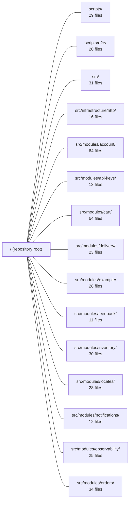

---
tags:
  - 2brain
  - 2brain/module
  - project/boilerplate-vue-frontend
type: module
module: / (repository root)
files: 331
updated: 2026-10-17T02:49:39.384269+00:00
---

# / (repository root)

## Purpose

The repository root is the build, contract, and deployment shell for **boilerplate-vue-frontend** — a Vue 3 + TypeScript SPA that is contract-first (OpenAPI for REST, AsyncAPI for events), modular by domain, and designed to run with or without a live backend. This level owns the project manifest, the generated and hand-written contract files, the Docker deployment pipeline, the documentation site configuration, cross-cutting quality gates (lint, mutation testing, CI tooling), and the public static assets that ship with every build.

## Key parts

- **Project manifest & build config** — `package.json`, `eslint.config.ts`, `orval.config.ts`, `stryker.config.json`, `spectral.yaml`, `release-please-config.json`, `cypress.config.ts`. Together they define the task surface, enforce the architectural tier ladder and module boundaries at lint time, drive codegen from specs, gate mutation-test quality, lint the OpenAPI contract, and wire automated releases.
- **Contract sources & generated artifacts** — `openapi.yaml` and `asyncapi.yaml` are the bundled, canonical specs. The `contracts/` directory holds every generated consumer-facing file: typed REST types (`contracts/rest/index.ts`), Zod schemas (`contracts/rest/schemas.zod.ts`), error codes, route tables, permission actions, and AsyncAPI event types. These are regenerated by `npm run gen:*` commands and must not be hand-edited.
- **Deployment & runtime config** — `docker-compose.yml` (dev: Vite + VitePress), `docker-compose.production.yml` (prod: static bundle in nginx), `docker/Dockerfile.production`, and the two entrypoint hooks under `docker/docker-entrypoint.d/` that emit `config.js` and `security.txt` from environment variables at container start.
- **Documentation site** — `docs/.vitepress/config.mts` and `docs/.vitepress/theme/index.ts` configure the VitePress site (navigation, sidebar, Mermaid zoom). `docs/tools/` holds how-to pages for live e2e and visual regression.
- **Cross-cutting test guards** — `tests/cross-cutting/` contains Vitest specs that enforce structural invariants no single-module test can catch: a11y sweep coverage, backend module pairing, badge accessibility, and destructive-dialog naming.
- **Static assets & boot shell** — `index.html` is the SPA entry point (splash, PWA metadata, config script). `public/` holds favicons, brand SVGs, and the no-image placeholder.
- **Project documentation** — `README.md`, `INSTALL.md`, `SECURITY.md`, and `CLAUDE.md` cover onboarding, external prerequisites, vulnerability reporting, and AI-assistant coding conventions.

## How it connects

- **`src/` and all `src/modules/*`** — The root's contract files (`contracts/rest/*`, `contracts/asyncapi.generated.ts`, `contracts/permission-actions.ts`, `contracts/authorization-keys.yaml`) are the typed interfaces every module's API client, route guards, and event handlers import. The ESLint tier ladder defined in `eslint.config.ts` is the rule set those modules are linted against. The `cypress.config.ts` Node tasks provide the server-side helpers each module's e2e specs call.
- **`src/infrastructure/http/`** — Consumes the generated `contracts/rest/index.ts` (axios functions) and `contracts/rest/schemas.zod.ts` (runtime validation) to build the shared API client layer; the root's `orval.config.ts` is what keeps those files in lockstep with `openapi.yaml`.
- **`scripts/` and `scripts/e2e/`** — The `package.json` task scripts and `cypress.config.ts` invoke these scripts; the `docker-entrypoint.d/` hooks and `docker-compose*` files are the production counterparts to what those scripts do locally.

## Where to start

1. **`README.md`** — Two minutes of context on what the project is, its contract-first philosophy, and the demo-vs-live run modes.
2. **`contracts/rest/index.ts`** (generated, ~read-only) — Skim the exported types and function signatures to see the shape of the API surface every module talks to; it is the single file that tells you "what the frontend can ask the backend to do" in one glance.

## Connected modules

[[boilerplate-vue-frontend_scripts|scripts/]] · [[boilerplate-vue-frontend_scripts_e2e|scripts/e2e/]] · [[boilerplate-vue-frontend_src|src/]] · [[boilerplate-vue-frontend_src_infrastructure_http|src/infrastructure/http/]] · [[boilerplate-vue-frontend_src_modules_account|src/modules/account/]] · [[boilerplate-vue-frontend_src_modules_api-keys|src/modules/api-keys/]] · [[boilerplate-vue-frontend_src_modules_cart|src/modules/cart/]] · [[boilerplate-vue-frontend_src_modules_delivery|src/modules/delivery/]] · [[boilerplate-vue-frontend_src_modules_example|src/modules/example/]] · [[boilerplate-vue-frontend_src_modules_feedback|src/modules/feedback/]] · [[boilerplate-vue-frontend_src_modules_inventory|src/modules/inventory/]] · [[boilerplate-vue-frontend_src_modules_locales|src/modules/locales/]] · [[boilerplate-vue-frontend_src_modules_notifications|src/modules/notifications/]] · [[boilerplate-vue-frontend_src_modules_observability|src/modules/observability/]] · [[boilerplate-vue-frontend_src_modules_orders|src/modules/orders/]] · … and 7 more

## Files
- `CLAUDE.md` — MUST NOT use `any` — use `unknown` plus type narrowing.
- `INSTALL.md` — What this frontend needs from outside the code before it is yours: a domain, a certificate, a brand,
- `README.md` — > Vue 3 + TypeScript SPA. Contract-first, modular, and able to run with no backend at all.
- `SECURITY.md` — Please report security vulnerabilities through GitHub's private
- `asyncapi.yaml` — Generated AsyncAPI 3.0.0 specification that bundles all real-time and event-driven contracts (SSE streams and outbound webhooks) from individual module fragments into a single, canonical document. It exists as the single source of truth for the shapes, semantics, and delivery mechanics of every non-HTTP event in the boilerplate, enabling downstream consumers (type generation, Spectral rules, documentation) to operate against one file.
- `contracts/asyncapi.generated.ts` — Auto-generated TypeScript type definitions and constants for all AsyncAPI event channels in the project. It is the single source of truth for event names, payload shapes, and channel identifiers, produced from `asyncapi.yaml` by `npm run gen:asyncapi`. It exists so that producers, consumers, and the SSE layer all agree on wire formats without hand-maintained duplication.
- `contracts/authorization-keys.yaml` — The single, canonical catalogue of every permission rule and the action vocabulary it uses. It is a **generated bundle**: `npm run authorization:bundle` splices one fragment per owning module (`src/modules/<name>/authorization.yaml`) plus a root residual for `core` rules. It is committed byte-for-byte identical in both backend repositories so that the two codebases share one authorization source of truth without either repo's formatter mutating it.
- `contracts/permission-actions.ts` — Generated contract file that defines the closed set of valid permission actions in the system. It exists as a single source of truth for TypeScript consumers (frontend, backend, tests) so that every action string used in permission checks is type-checked against the same list. Regenerate it rather than editing by hand.
- `contracts/rest/error-codes.ts` — Auto-generated enumeration of every error code declared in the OpenAPI contract. It exists as the single typed reference for all REST error codes so that consumers (client SDKs, error-handling middleware, test suites) can match against a known set rather than raw strings. Adding a new code is additive and never a breaking change.
- `contracts/rest/index.ts` — Auto-generated (orval v8.20.0) TypeScript type definitions for the project's stable OpenAPI REST contract. It is the single source of shared types — scalar aliases, envelope shapes, error structures, and domain interfaces (User, Locale, Language, Health) — that both the API client layer and feature modules import to stay type-safe against the server. **Do not edit manually.**
- `contracts/rest/operation-modules.ts` — Auto-generated lookup table that maps every `@api` function name to the backend module string that owns the corresponding OpenAPI operation. It exists so consumers (routing, auth scoping, analytics attribution, tests) can resolve "which module does this operation belong to?" without re-parsing the spec.
- `contracts/rest/routes.ts` — Auto-generated route table for the REST API contract. It is produced by `npm run gen:api` from `openapi.yaml` and provides a flat, typed list of every HTTP operation (method + path pattern) along with the schema names the backend must validate. It serves as the single source of truth the response-validation layer and schema-lookup machinery iterate over.
- `contracts/rest/schemas.zod.ts` — Auto-generated (orval v8.20.0) Zod schemas that validate the request and response shapes for the Boilerplate REST API's operational endpoints (health, liveness, readiness, `security.txt`) and its locale/internationalization surface (listing, creating, replacing languages; listing translation apps; fetching the API's own message dictionary). Exists so that server handlers and any client-side validation share a single, type-safe contract derived from the OpenAPI spec.
- `cypress.config.ts` — Cypress configuration for all browser-based e2e suites. It pins the viewport, configures retry/memory behavior, wires Node-side tasks (filesystem access, server-side API calls, webhook sinks) that the browser cannot perform, and exposes tier-filter tags to `@cypress/grep`. The same spec set runs under a **demo** or **live** profile, selected at runtime via the `liveProfile` flag rather than via separate configs.
- `docker-compose.production.yml` — Production deployment stack for the frontend. Unlike `docker-compose.yml` (which bind-mounts the working tree and runs the Vite dev server), this file builds the static bundle into a single nginx-based image and serves it. It exists so a deploy command is one `docker compose up` invocation rather than a hand-rolled build-and-serve pipeline.
- `docker-compose.yml` — Docker Compose file for the **development** frontend stack. It defines two services — a Vite dev server (`app`) and a VitePress docs site behind Nginx (`docs`) — so the entire frontend can run in containers with the same configuration a developer uses on the host.
- `docker/Dockerfile.production` — Production Dockerfile for the frontend. Builds a static asset bundle with Vite (Stage 1, Node) and ships a minimal nginx image (Stage 2) that serves those files. The counterpart `docker/Dockerfile` is a development image that runs the Vite dev server with hot reload; this file is the deployable half. The design goal is a single image promoted across staging → production, where a config change requires only a restart, not a rebuild.
- `docker/docker-entrypoint.d/40-generate-runtime-config.sh` — Generates `/usr/share/nginx/html/config.js` from the container's environment variables at every startup, so a config change is a restart rather than a rebuild. It is auto-sourced by the official nginx image's entrypoint, which executes every `*.sh` under `/docker-entrypoint.d/` before starting nginx.
- `docker/docker-entrypoint.d/41-generate-security-txt.sh` — Container-startup hook that writes `/.well-known/security.txt` (RFC 9116) into the nginx HTML root, sourced entirely from runtime environment variables. It is off by default: without both required variables set, no file is created and nginx's existing `location` block returns 404. Placing the logic at runtime (like `config.js`) ensures a fork never ships a stale or foreign contact address baked into the image.
- `docs/.vitepress/config.mts` — VitePress site configuration that defines the documentation site's identity, navigation structure, sidebar hierarchy, and Mermaid diagram styling. It exists as the single source of truth for how the project's docs are presented, so adding a new page or section only requires editing this file and the corresponding Markdown file.
- `docs/.vitepress/theme/index.ts` — Custom VitePress theme that extends the default theme to add a click-to-zoom overlay for Mermaid diagrams rendered in the documentation. Because VitePress hydrates content after initial render, a `MutationObserver` is used to attach zoom behavior to newly inserted diagram elements.
- `docs/tools/live-e2e.md` — The demo profile ([The demo profile](./demo-profile.md)) runs the same API this one does, minus the infrastructure: in-memory Mongo, cache and queue disabled. What it cannot prove is full-stack behaviour — a real Redis, a real broker, a session cookie crossing a real network — and that gap is closed by running the same Cypress specs against the fully-composed backend instead.
- `docs/tools/visual-regression.md` — Photographing a handful of screens and comparing them, pixel by pixel, against committed baseline images.
- `eslint.config.ts` — Flat ESLint configuration (TypeScript) that enforces the project's architectural rules at lint time: a strict tier ladder (i18n → infrastructure → ui → kernel → modules → app), per-module dependency boundaries via `eslint-plugin-boundaries`, and integration with Vue, Cypress, Vitest, JSDoc, and other lint plugins. Module folders are discovered from the filesystem at config-load time, so adding a domain requires no edit to this file.
- `index.html` — The HTML shell and boot entry point for a Vue 3 storefront SPA. It defines the pre-JavaScript UI (a static splash spinner), wires up favicons and PWA metadata, and loads the runtime-config script followed by the application bundle (`/src/main.ts`).
- `openapi.yaml` — Generated OpenAPI 3.1.0 contract for the Boilerplate API. It is the single bundled spec produced by `npm run contracts:bundle` from `shared/contracts/openapi.root.yaml` and per-module `src/modules/*/openapi.yaml` files. It exists to serve as the stable, codegen-oriented source of truth for client/server stubs, DTOs, and SDKs across multiple projects and languages.
- `orval.config.ts` — Orval configuration that generates two artifacts from `openapi.yaml`: typed axios request functions (`contracts/rest/index.ts`) and Zod schemas (`contracts/rest/schemas.zod.ts`). It exists so the API client layer is always in lockstep with the OpenAPI spec rather than hand-maintained.
- `package.json` — Project manifest for **boilerplate-vue-frontend** (v3.0.0, private, ESM). It declares the runtime and development dependency sets, pins the Node/npm engine requirements, defines the full task surface (dev, build, test, lint, codegen, docs, container orchestration), and whitelists which packages may execute install scripts.
- `public/favicon/safari-pinned-tab.svg` — Safari pinned-tab icon (a black-and-white, single-color favicon variant). Browsers use this file to render the site's icon in Safari's pinned tab bar, where color is not supported—hence the solid black fill.
- `public/images/guebbit-logo-colored.svg` — Colored vector logo for the guebbit brand, exported from Adobe Illustrator. Serves as the scalable source asset for the full-color mark used across the site, with a PNG fallback available for contexts that require raster images.
- `public/images/guebbit-logo.svg` — Monochrome (black) SVG logo for the **guebbit** brand. Serves as the primary site logo image, typically referenced in the header or hero section. The `<desc>` block embeds SEO-oriented metadata (brand name, tagline, keywords) within a custom `xmlns:guebbit` namespace.
- `public/images/guebbit-logotype.svg` — Static SVG logotype for the **guebbit** brand (a web development / e-commerce / digital-solutions company). It renders the full wordmark "guebbit" as vector `<path>` elements so it scales without raster artifacts. The file is a self-contained asset meant to be referenced directly by HTML/CSS (e.g. `` or `background-image`), not embedded in a build pipeline.
- `public/images/no-image-placeholder.svg` — Static SVG fallback icon shown when a valid image cannot be displayed. It renders the standard "broken picture" glyph (frame + sun + mountains) in a neutral gray so the UI has a recognizable placeholder instead of a blank or broken-image icon.
- `release-please-config.json` — Configuration file for [release-please](https://github.com/googleapis/release-please), the automated release tooling. It tells release-please how to derive version numbers, where to write the changelog, and how to treat this repository's package layout. It is consumed by the `release-please-action` in the CI workflow.
- `spectral.yaml` — Spectral linter configuration that extends the stock `spectral:oas` ruleset with project-specific rules enforcing OpenAPI 3.1 correctness, naming conventions for operations and schemas, and parameter hygiene. It acts as the gatekeeper for `openapi.yaml` and is invoked from CI.
- `stryker.config.json` — Stryker Mutator configuration that defines which source files are subjected to mutation testing, how tests are executed (via Vitest), what reporters emit, and the quality thresholds that gate CI. It exists to make the mutation-testing run reproducible and tunable without touching test code.
- `tests/cross-cutting/a11y-coverage.spec.ts` — A Vitest spec that enforces a11y coverage structurally: it reads every module's `routes.ts` and its co-located `a11y.cy.ts` sweep, then asserts that every declared route is visited by the sweep (and vice-versa). It does **not** run axe or open a browser — it catches the absence of a sweep, which no in-Cypress assertion could report because a missing spec simply never runs.
- `tests/cross-cutting/backend-pairing.spec.ts` — A Vitest spec that enforces cross-repository pairing between this repo's enabled modules and their counterparts in `boilerplate-node-backend`. It exists because nothing in a frontend build fails when the backend renames, splits, or adds a module — the two module maps drift silently until someone is lost. Living in a spec (not prose docs) means a broken pairing fails the test gate rather than just going stale on a wiki page.
- `tests/cross-cutting/badge-name.spec.ts` — Static-analysis guard that every `<v-badge>` in shipped Vue components carries an accessible name (`label`, `aria-label`, or `aria-hidden`). A missing name is visually invisible and uncatchable by lint, so the invariant is pinned here rather than enforced by a shared component (which would only cover two of the four badge surfaces and still miss the icon-button case).
- `tests/cross-cutting/destructive-confirm-naming.spec.ts` — Cross-cutting guard test that enforces a single convention: every destructive (`color: 'error'`) confirm dialog must name its target via a `t(key, { … })` interpolation param, so a visitor can tell *which* row they are about to delete. It exists to prevent new components from regressing to bare "delete this item?" wording.
- `tests/cross-cutting/entry-chunk-budget.spec.ts` — Guards against the production entry chunk (the single JS file every visitor downloads before any other code runs) growing past a raw-byte ceiling. It performs a real `vite build` into a throwaway temp directory and asserts both a size budget and that the large Zod schema contract chunk remains code-split (i.e., not referenced by the HTML shell at parse time).
- `tests/cross-cutting/form-idiom.spec.ts` — Enforces a single form idiom across every `.vue` component in `src/modules` that calls `useStructureFormValidation`. It statically scans source text (via the TypeScript compiler API) to verify three rules: every call supplies `revalidateOn`, `invalidFieldSelector`, and `onInvalid`; no view declares its own `showErrors` ref alongside the composable's `showFormErrors`; and page forms (outside `components/`) pass a `formElement`. The file exists because thirteen real forms proved the toolkit's defaults are not sufficient on their own — missing options cause silent accessibility failures (no focus move on invalid submit) that no unit test would catch.
- `tests/cross-cutting/journey-headers.spec.ts` — Cross-cutting integration test that verifies every journey spec under `tests/e2e/specs/journeys/` declares a valid `// requires-module:` header (or `none`). Without this header, `npm run demo:remove` would strip the referenced module but leave the journey spec orphaned, causing a later failure. This spec runs the header-checker against the real repo tree (the checker's own unit tests live in `tests/unit/scripts/demo/demo-remove-tests.spec.ts`).
- `tests/cross-cutting/module-coupling.spec.ts` — Enforces that a module's `@api` (generated REST client) calls target only backend modules declared in its coupling (`MODULE_EDGES`). This closes a gap ESLint boundary rules leave open: a module importing another module's backend operation through the `@api` barrel without declaring the edge.
- `tests/cross-cutting/module-file-shapes.spec.ts` — Enforces that every file inside a `src/modules/*` folder matches a named, catalogued shape (`module.ts`, `routes.ts`, `store.ts`, `views/*.vue`, etc.). Any file that matches no entry in the catalogue fails the test by name, making the module vocabulary an enforced invariant rather than a convention. It also enforces per-module exclusivity (`onlyIn`) for shapes reserved to a single domain.
- `tests/cross-cutting/module-groups.spec.ts` — Enforces the **completeness** half of the foundation | shop module-axis guarantee: every enabled module must have a `MODULE_GROUPS` label, no stale labels may linger for disabled modules, and both group values must be in active use. It pairs with the `foundation-may-not-import-shop` ESLint rule (which enforces *direction*) to make the axis a deliberate, non-omissible choice when adding modules.
- `tests/cross-cutting/mutate-scope.spec.ts` — Guarantees that the `mutate` globs declared in `stryker.config.json` still resolve to at least one real file. A glob that silently matches nothing (e.g. after a directory rename) would stop measuring code without any error; this test turns that quiet gap into a red test run.
- `tests/cross-cutting/mutation-safe-imports.spec.ts` — Static guard that every template-literal `import(...)` and `import.meta.glob(...)` specifier inside the Stryker mutation scope is preceded by a `// Stryker disable` directive. Without it, Stryker's template-literal mutator would replace the specifier with an empty string, causing the instrumented build to fail during the dry-run phase with an unhelpful sandbox-path error before a single mutant is evaluated.
- `tests/cross-cutting/page-window-density.spec.ts`
- `tests/cross-cutting/published-language.spec.ts` — A cross-cutting architectural test that enforces the rule "a module publishes exactly what a sibling imports." It scans every module's `index.ts` barrel against all source-file imports and fails if any export has no sibling consumer or if a barrel exists for a module nobody imports. It exists to catch the slow rot of barrels accumulating dead exports that outlive their reason.
- `tests/cross-cutting/registry.spec.ts` — A cross-cutting spec that iterates the enabled-module registry and asserts invariants every module must satisfy—navigation/route integrity, i18n namespace ownership, and translation-key liveness—without ever naming a specific domain. Deleting any module simply reduces the number of cases exercised; the file never hardcodes a module name, keeping it valid regardless of which modules are present.
- `tests/cross-cutting/route-name-coupling.spec.ts` — Detects cross-module route-name references (e.g. `router.push({ name: 'SiblingRoute' })`) that lack both a `MODULE_EDGES` coupling and a runtime guard (`hasRoute` / `linkIfRouted`). Because route names are plain strings invisible to import-based boundary rules, this spec scans **source text** to catch the coupling that `eslint.config.ts` cannot see, preventing a deleted module from causing a runtime `vue-router` throw.
- `tests/cross-cutting/schemas-i18n.spec.ts` — Verifies the cross-cutting contract that Zod schemas with thunked error messages (`{ error: () => translate('…') }`) resolve in the active locale at parse time, and that `useStructureFormValidation`'s `revalidateOn` option re-translates errors already rendered on screen after a locale switch. Uses a deliberately invented schema and synthetic locale dictionary so the spec survives deletion of any real domain module.
- `tests/cross-cutting/sitemap-document.spec.ts` — Serves as both the **test** and the **generator** for the route table embedded in `docs/theory/sitemap.md`. It asserts that the markdown table between the `<!-- sitemap:start -->` / `<!-- sitemap:end -->` markers exactly matches the routes contributed by `enabledModules`, and (when `UPDATE_SITEMAP=1` is set) rewrites that block in place. It lives as a spec rather than a script because the route records lazy-load `.vue` views through `@/` aliases, which only the Vitest/Vite pipeline can resolve.
- `tests/cross-cutting/store-location.spec.ts` — Enforces a file-layout convention for Pinia stores: every module must declare its stores in exactly one of two shapes — `store.ts` (single store) or `stores/*.ts` (multiple stores) — and never both. It scans `src/modules` for any file containing a `defineStore(` call and asserts the file sits in a permitted location, so that path-based tooling and readers have one unambiguous answer to "where is this store?"
- `tests/e2e/fixtures/not-an-image.txt` — not an image, on purpose
- `tests/e2e/specs/a11y.cy.ts` — Accessibility e2e sweep for the "shell" — routes that belong to no module (landing page, four prose pages, error page) and the shared chrome every page renders (app bar, navigation drawer, language menu, theme toggle, account/admin menus). Module-owned routes have their own sweeps under `src/modules/<name>/tests/e2e/a11y.cy.ts`; this file exists so that deleting a domain does not orphan a11y coverage, and so shared chrome is audited once rather than duplicated per module.
- `tests/e2e/specs/commerce.cy.ts` — End-to-end Cypress spec that walks the full commerce arc: a customer buys a product, exercises the payment panel (declined card → 3-D Secure challenge → successful payment), cancels a paid order; then an admin moves that paid order to processing, ships it through the shipment panel, marks it delivered, and verifies the inventory ledger recorded the receipt with the correct counters. The two `it` blocks are deliberately self-contained (each builds its own state, never relies on a prior test's store).
- `tests/e2e/specs/consent.cy.ts`
- `tests/e2e/specs/harness.antibot.cy.ts`
- `tests/e2e/specs/harness.cy.ts` — Meta-spec that validates the journey-harness infrastructure itself (`cy.travel`, session mode, persona/staff accounts, second device, signed webhooks, webhook sink, job lever, and browser helpers) so that journey specs can rely on those primitives without re-proving them. Each capability is exercised once here; if it breaks, the failure points at the harness rather than at whichever journey spec happened to run first.
- `tests/e2e/specs/journey.cy.ts` — End-to-end test that walks the full customer lifecycle in one continuous session: a guest browses and hits the sign-in wall, then an authenticated user filters, buys, checks out, cancels, and verifies the shelf's stock count recovers. After login the test navigates exclusively through in-app links and buttons (no `cy.visit`) to prove state survives across pages without a full reload.
- `tests/e2e/specs/journeys/ac1-lost-my-phone.cy.ts` — Cypress end-to-end journey test for acceptance criterion AC1 ("I lost my phone"). Verifies the full backup-code sign-in flow: a code is single-use, a second attempt with the same code is rejected, a different code still works, and regenerating the code set invalidates every old code (used or unused) while a new code signs in successfully.
- `tests/e2e/specs/journeys/ac11-i-moved-house.cy.ts` — End-to-end test for the "I moved house" acceptance criteria. Verifies that address edits and a new default set in the profile are reflected in the checkout address picker, and that removing all addresses is visible in both the profile and checkout, where a new address can then be added directly from the picker. No payment is exercised.
- `tests/e2e/specs/journeys/ac12-my-privacy-choices-stick.cy.ts` — E2E journey test for acceptance criterion AC12: a visitor's analytics-consent choice (Umami) must persist correctly across the full lifecycle — signup without consent, enabling via the profile, logout/re-login, and withdrawal through Privacy Choices. It verifies that the tracker script, the localStorage opt-out flag, the API-stored `analyticsConsent` field, and actual backend event rows all agree with the user's choice at each step.
- `tests/e2e/specs/journeys/ac13-my-password-start-to-finish.cy.ts` — End-to-end journey test for AC13 ("My password, start to finish"). It verifies the full password lifecycle: changing a password from the profile, recovering one via a mailed reset link, breached-password warnings on all three forms, API-worded rejections for wrong credentials, session invalidation on other devices, single-use reset links, and enumeration-safe responses for unknown addresses.
- `tests/e2e/specs/journeys/ac14-my-details-and-my-picture.cy.ts` — Cypress E2E journey test for acceptance criterion 14: a customer edits their username, phone, and website on the profile page; uploads and removes an avatar; encounters a 412 conflict when another device saves first; and can discard unsaved input via "reset." It exists to verify the full round-trip of detail editing, image lifecycle, optimistic-concurrency handling, and form reset in one integrated flow.
- `tests/e2e/specs/journeys/ac15-provider-account-proves-it-is-me.cy.ts` — E2E journey test for AC15: verifies that a provider (fake OAuth) account with no password can complete a re-authentication challenge via a mailed code during checkout. It exercises the full flow—code request, cooldown lock, wrong-code rejection, and correct-code carry-through—confirming the user resumes the exact checkout that triggered the 401.
- `tests/e2e/specs/journeys/ac16-two-factor-awkward-edges.cy.ts` — End-to-end journey test (AC16) that exercises the awkward edge cases of email two-factor authentication: arming is blocked until the address is verified, a cancelled factor replacement leaves the panel in the correct state, the resend button enforces a cooldown countdown, the sixth wrong guess is refused with a 429, an expired challenge disables its submit button, and an email-only account can disable 2FA by mailing itself a code without spending a backup code.
- `tests/e2e/specs/journeys/ac17-copied-session-cookie.cy.ts` — Cypress e2e spec for acceptance criterion AC17: a stolen (copied) `__Host-session` refresh cookie must be refused after the rotation grace window, revoking every session of the account. A second case verifies that server-side logout invalidates the session so a previously copied cookie can no longer refresh. The "thief" is simulated as a bare Node HTTP request carrying only the copied cookie value.
- `tests/e2e/specs/journeys/ac18-a-bot-shaped-login.antibot.cy.ts` — E2E journey test for AC18: verifies that the anti-bot "human check" (Altcha) is introduced on the login form only after the account's failure budget is half-spent (3 wrong passwords out of a budget of 6), while password-reset and signup requests require the check from the very first submission and are rejected (401) without its token. Runs exclusively in the **antibot shard**.
- `tests/e2e/specs/journeys/ac2-authenticator-app.cy.ts` — Cypress E2E journey test for AC2 (TOTP authenticator app). It walks a single user through the complete lifecycle — enrol from a visible secret, sign in with a generated code, replace the authenticator via a backup code (lost-phone flow), and finally disable 2FA — verifying that each step produces the expected UI state.
- `tests/e2e/specs/journeys/ac20-the-link-in-my-mail-went-stale.cy.ts` — End-to-end (Cypress) test for acceptance criterion 20: emailed action links (verify, password-reset, account-deletion) must expire after their respective windows and present a clear in-page error, while a freshly re-issued link still succeeds. The final scenario covers the admin-invite flow (setup mail → invitee sets password → sign-in). The test is demo-only because it advances the backend clock with `cy.travel`.
- `tests/e2e/specs/journeys/ac3-prove-it-is-still-you.cy.ts` — Journey test for AC3 (re-authentication). Verifies that when a customer's fresh-login window has lapsed, sensitive actions (checkout, data export) surface a re-auth dialog instead of failing; a wrong password is rejected with a user-friendly error; cancel abandons the pending action; and the correct password resumes the exact action that triggered the dialog.
- `tests/e2e/specs/journeys/ac4-my-laptop-was-stolen.cy.ts` — E2E journey test for AC4 ("My laptop was stolen"): verifies that a "log out everywhere" action from one device immediately invalidates all other sessions (refresh refused, next API call returns 401, user lands on login), and that revoking the current session logs the local tab out cleanly.
- `tests/e2e/specs/journeys/ac5-changed-my-mind-about-my-email.cy.ts` — E2E journey test for Acceptance Criteria 5: a user who requested an email-address change (but has not yet confirmed) can **resend** the confirmation link (old link is invalidated), **cancel** the change (all links die, original address restored), or discover the desired address is **taken by another account**. It exercises the full pending-email lifecycle from the `pendingEmail` persona in a single integration test.
- `tests/e2e/specs/journeys/ac6-give-me-my-data.cy.ts` — E2E test for AC6 (GDPR data portability). Verifies that a customer who requests an account export from the profile page receives an emailed link, downloads a JSON file, and that the file contains only their own data (profile, addresses, orders, sign-in methods) while excluding all secrets and other users' information.
- `tests/e2e/specs/journeys/ac7-delete-account-with-open-orders.cy.ts` — End-to-end test for acceptance criterion 7: a user deletes their account while holding both a paid and an unpaid open order. Verifies that the paid order is detached from the user but preserved as a shippable invoice, and the unpaid order is cancelled with its personal data scrubbed by the reaping sweep.
- `tests/e2e/specs/journeys/at1-launch-a-new-language.cy.ts` — End-to-end journey test that walks the full lifecycle of launching a new language (German, tag `de`) as an **editor** role: register it inactive, populate its frontend dictionary three ways (manual entry, JSON merge-import, inline edit), trim a key, export and verify the file, activate the language, confirm a guest sees it in the switcher and reads German text on the storefront, then assert the fallback `en` refuses deletion while the new language deletes cleanly. It exists to lock down the editor's `locales.any.*` permission story end-to-end.
- `tests/e2e/specs/journeys/at10-the-last-administrator-removes-itself.cy.ts` — End-to-end (Cypress) journey test that pins the behaviour when a shop's sole administrator deactivates their own account. It verifies the intentional lock-out: the session ends immediately, the login is refused with the correct credentials, admin-only pages become inaccessible to remaining staff, the admin role cannot be re-assigned, and the account cannot be reactivated through the application (repair is a database-level technician task by design).
- `tests/e2e/specs/journeys/at2-fix-a-typo-in-the-dictionary.cy.ts` — End-to-end test (journey AT2) that walks an editor through the dictionary board: fixing a Spanish hero string, clearing it to verify English fallback, completing a brand-new key across all five languages so the "incomplete only" filter hides it, and performing a file-based replace import that purges omitted entries from the Frontend app while leaving the API app's entries intact.
- `tests/e2e/specs/journeys/at4-housekeeping-on-the-admin-page.cy.ts` — End-to-end journey test (AT4) that verifies the admin/operator housekeeping workflow: refreshing the admin overview, filtering the platform audit trail by action, and driving the realtime stream (connect → read raw events → disconnect). It exists to confirm the operator can perform these routine tasks without error against the full application.
- `tests/e2e/specs/journeys/at5-audit-filters.cy.ts`
- `tests/e2e/specs/journeys/at5-feedback-filters.cy.ts`
- `tests/e2e/specs/journeys/at5-orders-filters.cy.ts` — End-to-end Cypress spec verifying that every staff-level filter on the Orders list (status, id, email, awaiting-transfer, deleted) narrows the visible rows to exactly the matching set, that **Reset** restores the full list, and that the pager advances without duplicating rows or losing items when the page size grows.
- `tests/e2e/specs/journeys/at5-products-filters.cy.ts` — E2e journey test (AT5) that verifies each product-list filter—active/inactive, deleted/not-deleted, exact ID, and min/max price range—correctly narrows the visible rows, and that "reset" restores the original full list. Seeded witness subjects (an inactive product, a soft-deleted product, and a rich-priced product) serve as the positive and negative assertions for every filter.
- `tests/e2e/specs/journeys/at5-stock-ledger-filters.cy.ts`
- `tests/e2e/specs/journeys/at5-users-filters.cy.ts` — Cypress e2e journey test that verifies every filter control on the **Users** list page (email, id, active/inactive, free-text, and deleted) correctly narrows the visible rows to matching users, and that **Reset** restores the full unfiltered list. It uses the seeded customer account and the banned `marcus` account as known witnesses to assert positive and negative matches.
- `tests/e2e/specs/journeys/at5-webhooks-filters.cy.ts` — End-to-end test for the **Status (Enabled/Disabled) filter** on the Webhooks → Subscriptions list page. It creates one enabled and one disabled webhook subscription, then verifies that the filter narrows the list to only the matching rows and that resetting the filter restores both.
- `tests/e2e/specs/journeys/at7-staff-accounts.cy.ts` — Cypress E2E journey covering the AT7 "Staff accounts" acceptance test. It verifies two full user stories: (1) an admin creates a warehouse-role account with a locale, the new member receives a setup mail in that language, sets a password via the mailed link, and sees only the warehouse-scoped menu; (2) the admin edits an existing user's phone, website, and avatar, confirms persistence across reload, and exercises the stale-record guard when another save lands first.
- `tests/e2e/specs/journeys/at9-the-platform-operator-is-not-the-shop.cy.ts` — Cypress e2e journey test verifying that the **operator** role is confined to platform pages (admin, realtime) and is redirected home with a notice when accessing shop pages (users, audit, inventory), while the **root** user (who doubles as administrator) sees and can reach both halves.
- `tests/e2e/specs/journeys/cu1-first-purchase.cy.ts` — Smoke-level end-to-end journey (tag `@smoke`) for a brand-new visitor: sign up, verify via mailed link, browse a category, add two products, add an address in the checkout dialog, pay by card, and verify that every monetary amount is identical across cart, order page, tax summary, invoice PDF, and confirmation email. Exists to catch regressions in the full first-purchase flow and to assert amount consistency in **cents** at every hand-off.
- `tests/e2e/specs/journeys/cu10-digital-product-alone-and-mixed.cy.ts` — Cypress journey test (CU10) that verifies checkout behaviour for a digital product (video course) in two configurations — alone and alongside a physical made-to-order item — and for a stale shipping selection that survives removal of the last physical line. It asserts that a digital-only cart skips the shipping step entirely, that a mixed cart restores shipping with the whole basket counted toward the free-shipping threshold, and that a leftover shipping choice is silently ignored rather than rejected.
- `tests/e2e/specs/journeys/cu11-cancel-paid-order.cy.ts` — E2E journey test for **CU11**: a customer cancels a paid (not yet dispatched) order and verifies the three consequences — full card refund, inventory units returned to the shelf, and a credit note issued against the invoice. It also asserts that declining the confirmation dialog leaves the order untouched.
- `tests/e2e/specs/journeys/cu12-buy-again-catalogue-changed.cy.ts` — End-to-end test for use-case CU12: a customer re-orders an old order whose three products have each met a different fate (untouched, image-replaced, deleted). Verifies that the order page renders live catalogue images (never frozen, never broken) and that the buy-again flow names the dropped line while the cart accepts only what is still purchasable. No payment occurs.
- `tests/e2e/specs/journeys/cu13-my-order-history.cy.ts` — E2E journey test for CU13 (My Order History). Verifies that a logged-in customer sees only their own orders (by order number, never database ID), can narrow the list by status, and that a delivered order's detail page renders payment status, fulfillment status, shipping, parcel, and an invoice link that opens in a new tab. Cross-checks every UI claim against the API for the same account.
- `tests/e2e/specs/journeys/cu15-another-address-and-a-note.cy.ts` — End-to-end journey test for CU15: a customer who already has one saved address adds a second at checkout, ships to the new one, bills to the original, and leaves a note for the shop. It verifies that checkout does not force the pre-existing entry, that billing defaults to "same as shipping" until explicitly overridden, that the frozen order carries both addresses and the note correctly, and that the admin can read the same data. No payment step is exercised.
- `tests/e2e/specs/journeys/cu16-a-whole-purchase-in-italian.cy.ts` — End-to-end journey (CU16) that drives a full Italian-language purchase: the customer switches the UI to Italian, adds two products to the cart (total exceeding one thousand), checks out with standard shipping, pays by card, verifies the VAT summary, and confirms the transactional emails arrive in Italian with Italian-locale links. It exists to guard against any fragment of the flow remaining in English — copy, currency formatting, VAT labels, and mail subjects all follow the selected language.
- `tests/e2e/specs/journeys/cu17-the-cart-does-the-maths.cy.ts` — End-to-end test for story CU17 ("The cart does the maths"). It walks a logged-in customer through adding two products (one from a grid card, one from a detail page), adjusting quantity with rapid clicks, verifying that every visible number—bar badge, bar money, per-line `unit × qty = total`, items + shipping = grand total—stays internally consistent after each action. It also asserts that the UI debounces rapid quantity clicks into a single API call carrying the final quantity, and that removing/clearing the cart correctly resets the bar and surfaces the empty state.
- `tests/e2e/specs/journeys/cu18-the-wishlist-from-both-doors.cy.ts` — End-to-end journey test (CU18) that verifies wishlist state consistency across three UI surfaces—grid card, product detail page, and the dedicated wishlist page—and confirms that "move to cart" adds quantity on top of an existing cart line rather than replacing it. All assertions about list contents are read back from the API for the same account. No payment step is exercised.
- `tests/e2e/specs/journeys/cu19-transfer-order-paid-by-card.cy.ts` — E2E journey test (Cypress) for CU19: a customer begins checkout with bank transfer, is shown the transfer instructions, then switches to paying by card before the transfer lands. Verifies that the order settles as card-paid (status, payment method, invoice), the transfer UI disappears, and the admin can locate the paid order via the RF reference with no offline-payment form offered.
- `tests/e2e/specs/journeys/cu2-unverified-cannot-buy-yet.cy.ts` — End-to-end test for the CU2 journey: a visitor signs up, adds a product to the cart, and hits checkout while still unverified. The test asserts the refusal message is specific (the API's own sentence, not a generic error), that the resend link respects a server cooldown, and—critically—that after following the emailed verification link the *same* cart (verified by item count, not re-added) checks out successfully. Nothing in this test pays real money.
- `tests/e2e/specs/journeys/cu20-too-many-unpaid-orders.cy.ts` — E2E journey test for **CU20 – Too many unpaid orders**. Verifies that the shop caps open (pending) orders per account at two, regardless of payment method: a third order is refused with a specific sentence listing the existing unpaid orders (not a generic error), the cart items survive, cancelling frees a slot, paying reduces the open count, and a new transfer order is accepted again.
- `tests/e2e/specs/journeys/cu22-my-returns-page.cy.ts` — Cypress e2e spec for user story CU22: the "My returns" page must list all of a customer's returns (a declined defective request, a pending defective request, a received withdrawal, plus a pre-seeded closed cancellation), support status/reason filters (including combined and empty states), show correct per-return detail (decline reason, refund minus deduction, line items matching the order), and provide bidirectional links between each return and its parent order.
- `tests/e2e/specs/journeys/cu23-the-days-run-out.cy.ts` — E2E journey test for user story CU23 ("The days run out"): verifies that the withdrawal button and its deadline label persist through the last calendar day of the return window, disappear once that day has passed, and that the API rejects a withdrawal attempt with the `RETURN_WINDOW_CLOSED` error code. The deadline is always read from the order's `actions.withdrawUntil` field, so the test adapts to any configured window length.
- `tests/e2e/specs/journeys/cu24-prove-you-are-human.antibot.cy.ts` — End-to-end test for user story CU24 ("Prove you are human"). Verifies that the anti-bot human-check (altcha) widget appears **only after a payment decline** for a logged-in customer's retry, while a **guest contact form shows the check from the start** and refuses submission without a valid token. Runs exclusively in the antibot shard where the backend boots the altcha provider at low cost.
- `tests/e2e/specs/journeys/cu25-one-purchase-one-row-per-event.cy.ts` — E2E journey test (CU25) that drives a full purchase — checkout, declined card, retry payment, order cancellation — and asserts Umami receives **exactly one** new analytics row per event (`order_created`, `checkout_completed`, `payment_declined`, `payment_succeeded`, `order_cancelled`). It exists to catch the backend double-emitting an analytics event while still attributing all rows to the server (the frontend emits none of its own).
- `tests/e2e/specs/journeys/cu26-a-pulled-product-leaves-a-message.cy.ts` — End-to-end test for journey **CU26**: an editor soft-deletes a product, and a customer who has it in both cart and wishlist is notified live (toast + badge) and retains those notifications in the bell panel until explicitly deleting them or clearing all. The test verifies the full notification lifecycle—delivery, persistence across reloads, individual deletion, and bulk clear—without requiring a page reload to see the toast.
- `tests/e2e/specs/journeys/cu27-my-cart-before-i-had-an-account.cy.ts` — E2E test for journey CU27: a guest fills a browser-local cart, then signs in and the cart is merged into the account. Covers four scenarios — plain merge, quantity summation on an existing line, a product that was delisted while sitting in the guest cart, and a line exceeding available stock. Each scenario asserts the merge-alert content, its persistence (or dismissal) across reloads, and the server-side cart state.
- `tests/e2e/specs/journeys/cu28-the-merge-answer-got-lost.cy.ts` — E2E test for CU28: a guest cart merge succeeds on the server but the response is lost in transit (replaced by a 502). Verifies three invariants—the browser retains its guest copy, a retried merge under the same idempotency key does not double the quantity, and a sign-out clears both the device copy and the pending merge so the next sign-in sends nothing.
- `tests/e2e/specs/journeys/cu29-the-order-answer-got-lost.cy.ts` — E2E test for CU29: a customer's `POST /cart/checkout` succeeds on the server but the response is lost in transit (swapped to a 502). The test verifies the customer can safely press "Place order" again and that the idempotency mechanism returns the *first* order rather than creating a second one.
- `tests/e2e/specs/journeys/cu29b-the-order-answer-got-lost-then-i-edited-the-note.cy.ts` — E2E journey test for scenario CU29b: the first `POST /cart/checkout` succeeds server-side but its response is replaced with a 502 (simulating a lost answer). The customer then edits the order note and retries. The test asserts the page always lands in a coherent state—either the order page or an empty cart—never on a checkout button that can never succeed.
- `tests/e2e/specs/journeys/cu3-bank-transfer.cy.ts` — End-to-end Cypress spec (tagged `@smoke`) that walks the full bank-transfer payment journey from both sides: the customer checks out with a bank-transfer payment method and reads the IBAN / reference / deadline instructions; the admin locates the order by that reference in the sales UI and records the offline payment; the customer reloads the order and sees it as paid. The central concern is that the *reference* is the single shared handle across all three screens (checkout panel, admin search, order-confirmation e-mail).
- `tests/e2e/specs/journeys/cu30-cancel-the-rest.cy.ts` — End-to-end journey test for CU30: cancelling the unshipped portion of a partially-fulfilled order. Verifies that the cancel offer and its refund amount come from the server (not computed client-side), that a confirmation step prevents premature cancellation, and that after confirming, a closed cancellation record exists and the payment reflects a partial refund.
- `tests/e2e/specs/journeys/cu4-card-slow-to-settle.cy.ts` — Cypress E2E journey test for the "slow card settle" scenario (CU4). Verifies that when a card payment is in a `processing` state, the UI honestly shows a waiting state (no invoice, no re-charge form) with a single **Finish** button to re-poll the provider. Covers two endings: the provider eventually confirms the payment, or the customer cancels and the system auto-refunds.
- `tests/e2e/specs/journeys/cu4b-a-slow-opening-cart-read.cy.ts` — E2E test verifying that the cart page correctly handles a race between the initial `GET /cart` read (triggered by opening the cart page) and a `PUT /cart/shipping-method` pick. Two response-ordering scenarios are covered: the read landing *after* the pick is confirmed, and the read landing *before* the pick's answer. In both cases the shipping-method radio must reflect the server's value and the checkout button must remain enabled.
- `tests/e2e/specs/journeys/cu5-price-moves-while-in-cart.cy.ts` — End-to-end journey test (CU5) verifying that a live cart tracks a product's current price after a repricing, while a confirmed order retains the price frozen at checkout time. It exercises the boundary between "cart is a live view" and "order is a snapshot."
- `tests/e2e/specs/journeys/cu5b-the-cart-changed-behind-an-open-page.cy.ts` — End-to-end test for journey CU5b: verifying that a cart page reacts correctly when the server-side cart state changes while the page remains open. It covers two sub-scenarios — quantity changed by a "second tab" (API), and price repriced by an editor behind the open page — and asserts the page re-reads, surfaces the conflict (409), and lets the customer retry at the corrected total.
- `tests/e2e/specs/journeys/cu6-out-of-stock-between-wishlist-and-checkout.cy.ts` — End-to-end journey test for use case **CU6**: a product goes out of stock (via an admin stocktake) after the customer has saved it to their wishlist but before they move it to the cart. Verifies that adding to cart does not check stock, the cart flags the line as "Sold out" and disables the checkout button, and that removing that line unblocks the rest of the basket.
- `tests/e2e/specs/journeys/cu7-two-shoppers-one-last-unit.cy.ts` — E2E journey test for scenario **CU7**: two shoppers both hold the last unit of a product in their carts. The first shopper's checkout places a stock hold; the second shopper's cart shows "Sold out" and the checkout button is disabled. After the first shopper cancels the order, the hold is released and the second shopper completes the purchase. The test also verifies that the product page's stock flag transitions in lockstep with the hold/release.
- `tests/e2e/specs/journeys/cu8-product-pulled-while-buying.cy.ts` — End-to-end journey test (CU8) verifying two distinct paths for what happens when an editor pulls a product while a customer is mid-purchase. Path 1 (soft delete) asserts the product vanishes from both cart and wishlist and that a subsequent restore brings it back on sale but *not* back into either list. Path 2 (deactivation) asserts an already-placed pending order retains its line and can still be paid successfully.
- `tests/e2e/specs/journeys/cu9-shipping-rules-at-the-till.cy.ts` — End-to-end Cypress journey test for use-case CU9: it verifies the cart's server-side shipping rules (free-shipping threshold, weight-based method refusal, pickup requiring no shipping address, and ship-to-country restriction) by reading prices in cents and checking server error messages rendered in the UI. It never performs a payment.
- `tests/e2e/specs/journeys/fr1-double-click-place-order.cy.ts` — End-to-end test for feature requirement 1: a customer double-clicks the "Place order" button on a slow connection and exactly one order is created. The test verifies the button is disabled while the first request is in flight and that any duplicate request carries the same `Idempotency-Key`, so the API deduplicates rather than creating a second order.
- `tests/e2e/specs/journeys/fr10-i-added-to-cart-as-a-guest.cy.ts` — E2E journey test for FR10: a guest can add a product to a browser-local cart but must authenticate to check out. Verifies that "Log in" and "Sign up" in the app bar carry a `continue=` return address so the user lands back on the same product page (not home) after authentication, and that one click then adds the item to the cart.
- `tests/e2e/specs/journeys/fr11-one-device-two-people.cy.ts` — End-to-end test for **FR11 (one device, two people)**. Verifies that when a second person signs in on the same tab after a first person's session ends, the UI shows only the second person's cart and wishlist — nothing from the first person lingers. Also verifies that a logout broadcast from a second tab (via `BroadcastChannel`) signs out this tab and clears the cart badge.
- `tests/e2e/specs/journeys/fr12-keyboard-only-purchase.cy.ts` — End-to-end Cypress journey test proving that a full purchase lifecycle—browse products, add to cart, select shipping, fill the address dialog, choose a payment method, place the order, pay, cancel, and receive a refund—can be completed using only keyboard input (Tab, Shift+Tab, Enter, Space, Arrow keys, Escape). It also verifies the two dialog contracts: focus moves into the dialog on open, stays trapped inside while open, and returns to the triggering control on Escape.
- `tests/e2e/specs/journeys/fr13-a-slow-network.cy.ts` — E2E journey test for FR13 ("A slow network"). Verifies that every user-facing control (add-to-cart, wishlist toggle, cart quantity steppers, invoice buttons) correctly signals a busy state (disabled + corner activity indicator), sends exactly one request even under rapid interaction, and still delivers a debounced step to the server when the user navigates away before the debounce window closes.
- `tests/e2e/specs/journeys/fr14-a-big-grid-does-not-trip-the-limit.cy.ts`
- `tests/e2e/specs/journeys/fr15-a-deploy-lands-mid-session.cy.ts` — Cypress e2e journey test for FR15-A: verifies that when a deploy lands mid-session and the cart route's lazy chunk returns 404, the app recovers by issuing exactly one document-level reload to the cart address. If the chunk is still missing after that single reload (i.e. the build is broken, not just stale), the tab renders the error page instead of looping. Requires a production build because Vite's preload-error path does not fire under `vite dev`.
- `tests/e2e/specs/journeys/fr2-back-button-after-paying.cy.ts` — End-to-end journey test for FR2: after a customer checks out and pays by card, pressing browser **Back → Forward → Reload** must not resurrect the consumed cart. The test asserts the cart page is empty, the order page still shows a succeeded payment with no re-payment affordance, and the API confirms exactly one settled payment and an empty cart.
- `tests/e2e/specs/journeys/fr4-reload-in-the-middle-of-checkout.cy.ts` — E2E test for FR4: what survives a mid-checkout page reload. Two scenarios verify that (1) server-persisted state (delivery method, default address, cart lines) is intact after a reload and still places exactly one correct order, and (2) browser-only state (note, payment choice, a non-default address, an in-debounce quantity change) is preserved via a `checkout-draft` sessionStorage mechanism and is cleared on logout so the next user sees nothing.
- `tests/e2e/specs/journeys/fr5-shopping-on-a-phone.cy.ts` — E2E Cypress journey test that verifies the full guest-to-customer purchase flow is usable at a phone-class viewport (390 × 844). It asserts that the drawer menu (not the top bar) carries login, signup, section links, and logout; that no page overflows horizontally; and that the address dialog fits inside the viewport. It reuses the same seeded product and payment fixture as CU1's desktop journey.
- `tests/e2e/specs/journeys/fr6-too-many-attempts.cy.ts`
- `tests/e2e/specs/journeys/fr7-the-api-goes-away.cy.ts`
- `tests/e2e/specs/journeys/fr8-session-expired-while-typing.cy.ts` — End-to-end journey test for **FR8**: a user fills in the address form, the access token lapses mid-session, and the save still succeeds because the client silently refreshes the token and replays the original request. The test asserts the exact HTTP sequence (401 → refresh 200 → replay 201) and confirms no data was lost and no login screen appeared. It is a demo-only scenario, gated to `jwt` session mode.
- `tests/e2e/specs/journeys/fr9-a-link-i-was-sent.cy.ts` — E2E test for FR9: a guest who opens an order (or return) link from a mail without an active session must be redirected to login *on that same page*, logged in, and land on the exact linked record—not the home page. It also verifies that a record belonging to a different customer surfaces a 404 error page (never a stuck loading state or crash), so the visitor gains no information about whether the record exists.
- `tests/e2e/specs/journeys/in1-a-key-does-what-it-was-given.cy.ts` — End-to-end test (journey **IN1**) that verifies an API key can perform exactly the scope it was minted with and nothing more. It walks through the full lifecycle: admin creates a key with a single `read:WebhookSubscription` permission and a one-day expiry, the secret is revealed once and hidden thereafter, the key successfully reads, is refused a write, and is rejected entirely once revoked.
- `tests/e2e/specs/journeys/in3-an-order-fires-a-signed-webhook.cy.ts` — Cypress end-to-end test for journey **IN3**: after a customer completes a purchase, the order-created webhook is delivered to the receiver with a valid HMAC signature, and the signature continues to verify correctly through a secret rotation (both secrets during overlap, only the new one after the old is deleted). Covers both the **live** profile (broker delivers immediately) and the **demo** profile (admin must click Replay to trigger delivery).
- `tests/e2e/specs/journeys/in4-replay-a-failed-delivery.cy.ts` — E2E test for the IN4 journey: an admin replays a failed webhook delivery from the delivery log. It covers two distinct failure modes — an endpoint that is down (each replay increments the attempt counter and the row shows *why* it failed) and a subscription the shop has switched off (replay is refused until re-enabled, then the same replay delivers to the receiver).
- `tests/e2e/specs/journeys/in6-keep-a-webhook-healthy.cy.ts` — Journey test (IN6) that exercises the full webhook-subscription lifecycle from the manager UI: SSRF-guard refusal of unsafe URLs, one-time secret reveal/rotation/removal, enable/disable toggling, delivery verification against an order, and deletion. It deliberately runs as the *manager* role to confirm webhooks are not an admin-only feature.
- `tests/e2e/specs/journeys/in7-a-key-has-limits.cy.ts` — E2E journey test verifying that an API key is bounded by the permissions of the admin who minted it: it can perform only the single write it was granted, cannot read that write back, cannot touch session-only routes (`/account`, `/api-keys`), and becomes unusable once its expiry passes.
- `tests/e2e/specs/journeys/n1-withdraw-before-dispatch.cy.ts` — E2E smoke test for the EU right-of-withdrawal flow (Art. 11a) when the order has **not yet been dispatched**. Verifies the full customer journey: two-step confirmation dialog, order cancellation, full refund (goods + delivery), stock release, a closed return record with zero lines, and an acknowledgement email — all from the shopper's perspective with admin reads where needed.
- `tests/e2e/specs/journeys/n2-withdraw-after-delivery.cy.ts` — End-to-end test for journey **N2 — Withdraw after delivery**. Verifies the full customer-rights flow: a delivered order is still inside the withdrawal window, the customer exercises the right (double-click confirm), a return is auto-created as `approved`, the warehouse receives the goods with a handling-damage deduction, the refund equals *paid − deduction* (checked in cents), the payment reports a partial refund, a credit note is issued, inventory is restocked, and the customer sees the closed state with an email notification.
- `tests/e2e/specs/journeys/n3-two-staff-edit-one-product.cy.ts`
- `tests/e2e/specs/journeys/op1-fulfil-paid-order.cy.ts` — Smoke-tagged E2E journey that walks a paid express order through its full lifecycle (paid → processing → shipped → delivered) via the admin shipment panel, asserting at every step that only the correct action button is visible and that express shipping is gated behind a tracking code. Also verifies the customer receives a mail containing the tracking code and can view it on their own order page.
- `tests/e2e/specs/journeys/op10-editors-product-cradle-to-grave.cy.ts` — End-to-end journey test (OP10) that exercises the full product lifecycle from an editor's perspective: creating a bilingual product with price, weight, tax class, category, tag, and image; then deactivating, soft-deleting, restoring, and hard-deleting it. Each state transition is verified both from the editor's admin UI and from a guest's HTTP read, confirming that guest-facing visibility tracks the product's status. It also confirms that a pre-seeded order referencing a hard-deleted product remains readable.
- `tests/e2e/specs/journeys/op11-a-moderator-bans-a-customer.cy.ts` — End-to-end (Cypress) journey test for **OP11**: a moderator disables a customer's account via the user management UI. It verifies that the ban takes effect immediately (the next API call from an already-authenticated device is rejected with 401, and a fresh login is refused), and that reactivating the account restores access.
- `tests/e2e/specs/journeys/op13-each-role-sees-what-it-may.cy.ts` — E2E smoke test that walks the four application roles (guest, editor, moderator, customer) through the same set of pages and asserts each is permitted or denied exactly as the backend `shared/authorization-roles.yaml` specifies. It verifies menu visibility, page-level access, and row-level data (e.g. an editor sees zero orders, a moderator sees all) in a single linear test.
- `tests/e2e/specs/journeys/op14-audit-trail-follows-the-action.cy.ts` — E2E journey test (Cypress) verifying that the shop's audit trail records the correct action, actor role, and outcome for a sequence of admin operations on orders (email edit, cancel, ship, forced delivery, status override) and a user (phone update). It also asserts that the "history" button on an order or user detail page navigates to the audit list narrowed to that specific target, and that the rendered rows match the API rows one-to-one.
- `tests/e2e/specs/journeys/op15-order-housekeeping.cy.ts` — End-to-end journey test for the OP15 "Order housekeeping" feature. It verifies the full lifecycle of order deletion from a shop manager's perspective: soft delete hides an order from the customer while keeping a marked row on the staff list, restore brings it back, hard delete is offered only for a cancelled-and-unpaid order, and that cancelling first returns held inventory units to the shelf.
- `tests/e2e/specs/journeys/op16-the-shop-managers-morning.cy.ts` — E2E Cypress journey (OP16) that verifies the **manager** role sees and can use exactly the shop-operations surface (orders, returns, inventory read, feedback read, product pricing) while every admin/platform control is absent or disabled. It also confirms the manager retains customer capabilities (basket, add-to-cart) and that a price change is immediately visible to a guest.
- `tests/e2e/specs/journeys/op17-warehouse-shift.cy.ts` — A single-scenario Cypress journey test that exercises the **warehouse** role end-to-end: receiving an inventory delivery, shipping a physical order with a tracking code, fulfilling a digital order without shipping, and receiving a returned parcel with a handling deduction. It also verifies that the warehouse role is denied access to other admin pages and cannot cancel or edit orders. The scenario exists to confirm the warehouse's read-only + fulfilment boundary across the full order lifecycle.
- `tests/e2e/specs/journeys/op18-support-desk.cy.ts` — End-to-end Cypress journey that exercises the **support** role against a live application. It verifies that support can work the feedback inbox (filter, annotate, resolve), edit a customer's phone number, and decline a return with a customer-visible reason — while confirming what support *cannot* do (create/delete users, reset 2FA, ban, or open the Audit page). Every permitted action is cross-checked against the admin audit trail.
- `tests/e2e/specs/journeys/op19-only-a-role-manager-hands-out-roles.cy.ts` — Cypress E2E journey test for OP19 ("Only a role manager hands out roles"). Verifies the permission rule that assigning or revoking a staff role requires the `assign:Role` capability, held only by the administrator. It covers both the negative path (moderator/support UI disables the role picker; server returns 409 on a manual PATCH) and the positive path (admin promotes a seeded `unverified` customer to `warehouse`; the promoted user's next session shows the inventory menu; the grant is recorded in the audit trail). A second story confirms a moderator cannot demote an admin (UI hides edit controls; server returns 403).
- `tests/e2e/specs/journeys/op20-staff-prove-its-still-them.cy.ts` — End-to-end journey for **OP20** (re-authentication on irreversible staff actions). Verifies that once a session is older than the critical window (300 s), destructive actions—refunds, manual status overrides, forced delivery, return receipt, hard-deleting a user—prompt a password dialog mid-action, while ordinary actions (start, ship) never do. Confirms the dialog's three paths: wrong password keeps it open, cancel writes nothing, correct password carries the action forward exactly once. Demo-only; time is advanced via the backend's clock.
- `tests/e2e/specs/journeys/op21-stock-counters-follow-an-order.cy.ts` — End-to-end journey test that walks a single product through the full stock lifecycle—reservation, payment, cancellation/release, and write-off—and asserts at each step that the inventory board's on-hand / reserved / available counts are correct, the ledger names each movement and links it to the originating order, and a guest's cached product page reflects "out of stock" immediately once stock hits zero.
- `tests/e2e/specs/journeys/op22-defective-item-comes-back.cy.ts` — End-to-end test for journey **OP22**: a customer reports a defective item (non-withdrawal return). It walks the full approval → receive → refund path with two seeded requests — one approved, one declined with a customer-visible reason — verifying that each role (support, warehouse, customer) sees and can act only on their slice of the flow.
- `tests/e2e/specs/journeys/op23-cash-goes-back-by-hand.cy.ts` — End-to-end journey test for the "cash refund by hand" workflow: when a cash-paid order is cancelled there is no payment provider to call, so the shop must record the refund manually. The test verifies the full sequence — invoice still downloads before and after, the "refund pending" state appears after cancel, the moderator marks the refund as done by hand, no provider interaction occurs, and a credit note is issued alongside the original invoice.
- `tests/e2e/specs/journeys/op24-ship-in-two-goes.cy.ts` — End-to-end journey test for the "ship in two goes" workflow (OP24). Verifies that when an order is partially fulfilled (1 of 3 units already shipped), the admin can ship the remainder as a second shipment, that each shipment can be marked delivered independently, and that the order only reaches `shipped` / `delivered` status and exposes the customer withdrawal deadline after the *last* shipment has left / arrived.
- `tests/e2e/specs/journeys/op25-hold-release.cy.ts` — E2E Cypress spec for story **OP25**: a staff member views an order on hold, releases it, then holds it again by selecting a reason and adding a note. The test verifies that the order card's displayed status, hold reason, and action buttons stay in sync with the API-level `fulfillmentStatus` at every step.
- `tests/e2e/specs/journeys/op4-refund-delivered-order.cy.ts` — End-to-end Cypress test for operation **OP4**: a moderator refunds a *delivered* order. Verifies that the refund returns the money (payment status → `refunded`, `amountRefunded` = full amount), the order status stays `delivered` (neither cancel button was available), a credit note is issued, and the customer sees the refund and credit note on their own order page.
- `tests/e2e/specs/journeys/op5-cancel-only-or-refund.cy.ts` — End-to-end test for the operator journey "OP5": verifying that **cancel only** and **cancel and refund** on a paid order are distinct operations. Cancel-only cancels the order and restores stock while leaving the payment captured (so "refund only" remains available afterwards); cancel-and-refund performs both in one press. Also asserts that a credit note is issued for each refund and that shelf stock is restored for both orders.
- `tests/e2e/specs/journeys/op8-day-in-the-stock-room.cy.ts`
- `tests/e2e/specs/journeys/op9-expired-holds-are-swept.cy.ts` — End-to-end (Cypress) test for the OP9 journey: a customer checks out by card, never pays, the 30-minute hold expires, and an admin triggers the sweep. Asserts the order is cancelled, inventory is restored, the ledger records an `expire` reason, and the customer receives a notification email with the pay form removed.
- `tests/e2e/specs/journeys/ps1-a-preorder-product-in-the-form.cy.ts` — E2E journey test (PS1) that verifies the preorder lifecycle driven entirely through the product edit form: setting a future release date turns a product into a preorder, changing the date is a plain edit that persists, and clearing the date ends the preorder. Written as a single spec covering create → verify → edit → clear.
- `tests/e2e/specs/journeys/ps2-the-buyer-preorders.cy.ts` — End-to-end test for the buyer preorder journey (PS2). Verifies that a product with a future release date and an open preorder allowance is purchasable as a preorder: the product page offers "Preorder", the cart line labels it as such, and the placed order displays the ship date. Exists to guard the full cross-role flow (editor creates, admin opens allowance, customer buys) in a single browser session.
- `tests/e2e/specs/journeys/vi1-browse-the-catalogue.cy.ts` — Cypress end-to-end journey test (VI1) that exercises the guest product-catalogue browsing flow: filtering by a dynamic tag and a computed price band, sorting by price and name, changing page size, verifying that the URL preserves and restores the full view state (reload, browser back, fresh visit), confirming reset clears everything, and ending with a nonsense search that surfaces the empty-state UI. All expected values are derived at runtime from the live public product list, so the test adapts to seed changes without hard-coding product names, tags, or prices.
- `tests/e2e/specs/journeys/vi2-find-your-way-around.cy.ts`
- `tests/e2e/specs/journeys/vi3-a-guest-writes-to-the-shop.cy.ts` — Cypress end-to-end journey test (VI3) that verifies the full guest contact-form experience on the Italian site: successful submission without a name, operator mail in the shop's language (not the guest's), silent drop of honeypot/spam submissions, and the per-address rate-limit budget (5 messages) that refuses the sixth with a localized error while preserving the user's typed content.
- `tests/e2e/specs/journeys/vi4-a-guest-says-no-to-analytics.cy.ts` — E2E test that verifies the full analytics-consent journey for a guest visitor: declining hides the banner permanently for that session, blocks the Umami tag, and ensures no `x-analytics-consent` header is sent; then a fresh session where the visitor accepts loads the tag, sends the header, and produces `products_searched` rows in Umami that are counted against the actual intercepted requests.
- `tests/e2e/specs/keyboard.cy.ts`
- `tests/e2e/specs/locale.cy.ts` — End-to-end Cypress spec for the application's internationalisation layer. Every other spec in the suite runs under `/en`, so the `:locale` router segment, the `localeChoice` guard, the dynamic dictionary import, and the `<html lang>` attribute are only exercised here. It also covers the in-app language switcher, the persistence of a registered visitor's choice, and the presence of API-offered locales that have no client-side dictionary.
- `tests/e2e/specs/resilience.cy.ts` — Shell-generic resilience spec for the FOUNDATION pages that ship with every deployment of this boilerplate. Unlike the dataset-specific specs (cart, orders, products), it names no values and asserts only two things per route: the page renders without an unexpected console log, and it does not overflow the viewport horizontally. It exists to catch the quiet failures—broken images, caught TypeErrors, 300 px tables—that value-asserting specs stay green on.
- `tests/e2e/specs/storefront.cy.ts` — Cypress end-to-end spec for the customer-facing storefront surface: catalogue facet chips, product-page stock gating, and order-page cancel/buy-again actions. It pins that the pages honour invariants the API already enforces (public-scope facet counts, the stock gate, the single buyer-driven order write).
- `tests/e2e/specs/uploads.cy.ts` — E2E tests that exercise image-upload through the two flows that ship with every deployment regardless of catalogue: **User create** (admin creates a user with an avatar) and **Signup** (new account + follow-up avatar PATCH). Product-form upload tests were extracted to `src/modules/products/tests/e2e/uploads.cy.ts`, leaving only these foundation-level cases here.
- `tests/e2e/visual/visual.cy.ts` — Visual-regression baselines for the **shell**: the application-level screens that have no owning module — the landing page, static prose pages (about, FAQ), and the 404 error page. Because every module keeps its own snapshots under `src/modules/<name>/tests/e2e/__snapshots__/`, this file is the catch-all for screens that would otherwise be orphaned.
- `tests/support/e2e/a11y-sweep.ts` — Shared helper that runs an axe-core accessibility sweep over a set of routes at a given authentication level. It lives under `tests/support/` so every module can import it without hardcoding a central route list — the routes stay owned by each module's spec, and a cross-cutting coverage spec (`tests/cross-cutting/a11y-coverage.spec.ts`) verifies no route is missed.
- `tests/support/e2e/a11y-task.ts` — Persists every axe accessibility finding to disk as a JSON file (one per spec) so that non-blocking violations—those below the `serious`/`critical` threshold that only get logged in the browser—survive the test run. This gives CI a durable artifact to upload and provides a baseline to compare against when the a11y threshold is later tightened.
- `tests/support/e2e/admin-api-task.ts` — Provides two Cypress tasks — `adminApi` and `guestApi` — that perform API calls from Node (outside the browser) so the page's own cookie jar and session state remain untouched. This lets specs provision backend data and verify guest-facing behavior without the browser accidentally attaching or mutating its live session.
- `tests/support/e2e/commands.ts` — Defines the full set of custom Cypress commands available to every e2e spec in this project. It augments the global `Cypress.Chainable` interface so specs can call semantic actions (`cy.loginAs()`, `cy.restore()`, `cy.emailTo()`, …) instead of repeating low-level selectors and API calls. The file also centralises timeout budgets and the two reset strategies (demo vs. live) behind a single `cy.restore()` entry point.
- `tests/support/e2e/e2e.ts` — Cypress support file, auto-loaded before every e2e spec. It registers third-party plugins, imports the project's local support modules, installs a narrow uncaught-exception filter, and seeds a `beforeEach` hook that resets browser state and pre-denies analytics consent so tests run under a clean, deterministic baseline.
- `tests/support/e2e/fixtures.ts` — Defines a set of custom Cypress commands (`cy.*`) that let E2E specs reference demo data by a named **guarantee** (e.g. `product.inStock`) or a **role** (e.g. `admin`) rather than hard-coding backend-specific IDs or titles. It also provides server-side create/mutate helpers for specs that must assert a visibility *transition* (soft-delete, deactivate) or for modules that have no seeded fixture at all (webhooks, API keys).
- `tests/support/e2e/harness.ts` — Typed wrapper functions over `cy.task` calls that give E2E specs a clean, compiler-checked interface to the Node-side harness (second-device login, API-key calls, guest calls, payment-webhook posting, and webhook capture/verification). The actual logic lives in `scripts/e2e/`; this file only names what each task returns so a spec can chain on a concrete type.
- `tests/support/e2e/images.ts` — Shared test helpers for specs that upload an image. Because a RabbitMQ broker computes the image digest **after** the HTTP response (off the request path), neither application pushes the final `src` to the browser. The only way a spec can observe the post-digest value is to reload the page and re-read the attribute, which is exactly what `pollForImageSource` does.
- `tests/support/e2e/integrator.ts` — Shared step functions for the integrator journeys (IN1–IN7). Encapsulates the repetitive webhooks-module workflow—locating the shop's seeded demo receiver, placing an order via API to trigger a webhook, and reading the delivery log and receiver capture as structured data. Kept separate from `steps.ts` because it speaks the webhooks module's own vocabulary rather than generic UI steps.
- `tests/support/e2e/journey.ts` — Extends the global Cypress namespace with four custom commands (`step`, `travel`, `grantClipboard`, `stubWindowOpen`) purpose-built for long, multi-phase "journey" specs. It also hooks `Cypress.on('fail')` so that every failure message is automatically prefixed with the current step name, making CI output pinpoint *where* in a story a test broke.
- `tests/support/e2e/resilience.ts` — Shared resilience assertions for Cypress e2e specs. It provides a fixed pair of checks—no unexpected console output, no horizontal overflow—so that every route in the app (central spec or per-module) is held to the same bar without each spec re-declaring the rules or hard-coding magic values.
- `tests/support/e2e/scenario.ts` — Defines the typed contract for the scenario a running backend seeds, and exposes Cypress commands to retrieve seeded account credentials and row IDs by name. It exists so spec files never hard-code passwords or IDs that are backend-specific and overridable per deployment; instead they ask the backend (or its description file) by guarantee name.
- `tests/support/e2e/security-steps.ts` — Shared, assertion-light Cypress steps for the account-security journeys (AC1, AC2, AC13, AC16, AC17). Each function drives a single UI interaction — submitting the login form, entering a backup code, dismissing the one-time reveal screen, or signing in as a second device — so that journey specs can compose them without repeating selectors or branching on demo-vs-live backend.
- `tests/support/e2e/steps.ts` — Shared Cypress step functions used by multiple E2E journey and commerce specs. It extracts UI-driving logic (adding to cart, filling forms, shipping, checking out, reading money) that two or more stories perform identically, so each spec reads `addToCart('product.rich')` rather than re-implementing the same clicks. Story-unique steps intentionally stay in their own spec file.
- `tests/support/e2e/umami.ts` — Shared Cypress helpers for reading Umami's own API during e2e runs: log in, count events/pageviews recorded since a timestamp, and poll until a fire-and-forget write becomes visible. Exists because the question "how many rows does Umami hold?" is only answerable against a live Umami instance, which neither repo's unit suite can provide.
- `tests/support/e2e/visual-sweep.ts` — Shared Cypress helper that runs one visual-regression sweep over a list of screens at a given authentication level. It exists so every module's visual spec can declare its screens in a uniform shape without duplicating the visit → settle → freeze → snapshot pipeline, while keeping baselines colocated with each module rather than in a central folder.
- `tests/support/e2e/visual-task.ts` — Implements the image-comparison logic behind `cy.compareSnapshot()`. It runs in Cypress' Node process (the browser cannot read baseline files from disk) and decides whether a screenshot matches its committed baseline using `pixelmatch`. The comparison is hand-rolled rather than plugin-based so that the two tolerance knobs and the missing-baseline behaviour are visible and adjustable in this file.
- `tests/support/stub.ts` — Provides a single, named cast helper for hand-built test stubs that cannot structurally satisfy the real framework type they substitute for (e.g. a fake `RouteLocationNormalized` or `AxiosError`). It centralizes the one unavoidable type-assertion so that `as unknown as T` is never scattered across individual test suites.
- `tests/support/unit/cart-fixtures.ts` — Typed factories and small helpers for cart test specs that interleave or hold back API answers by hand. It builds whole `CartResponse` objects from their lines (so totals are always consistent with line quantities) and provides the envelope shapes the generated client and HTTP layer expect, letting specs assert on complete carts rather than hand-copied numbers.
- `tests/support/unit/cart-interleave.ts` — Test harness that lets a spec control the order in which mock API responses are delivered to the cart store. Each action started through this module holds its response back behind a gate, so a spec can interleave multiple in-flight requests and choose which one "arrives" first.
- `tests/support/unit/fixtures.ts` — Typed factory functions that produce valid, schema-conformant instances of contract entities (Order, Payment, FulfillmentOrder, Shipment, etc.) for use in unit test specs. They are typed against the generated contract types in `@types`, so any field the contract adds or makes required becomes a compile-time error in every consuming spec simultaneously, rather than a runtime parse failure discovered late in a single test.
- `tests/support/unit/jsdom-quiet-css.environment.ts` — A custom Vitest environment (`jsdom-quiet-css`) that wraps the built-in jsdom environment and injects a filtered `VirtualConsole` to suppress the "Could not parse CSS stylesheet" errors jsdom emits when it encounters Vuetify's nested `@media`-in-`@layer` rules. All other CSS parsing, computed-style assertions, and jsdom error reporting remain fully intact.
- `tests/support/unit/mount-cart-page.ts` — Test helper that mounts the real `Cart.vue` page against the **real** cart store, leaving only the network layer (`@api`) to the spec. It exists for specs that need to observe store↔page interactions when responses cross (interleavings, double-submits, stale refusals), where stubbing store methods (as `cart-view.spec.ts` does) would hide the behavior under test.
- `tests/support/unit/mounted-vm.ts` — Centralises the TypeScript cast from `wrapper.vm` (typed as `unknown` by `@vue/test-utils`) to `ComponentPublicInstance` in one place, so that individual spec files never repeat the unsafe cast and the project avoids enabling the `allowComponentTypeUnsafety` ESLint option.
- `tests/support/unit/setup.ts`
- `tests/support/unit/track-stores.ts` — Provides a small helper that tracks every cart store a spec creates so they can all be `$dispose()`d after the case, preventing the `storage` listener each store attaches to `globalThis` from leaking across tests.
- `tests/support/unit/watch-handle.ts` — Provides a shared no-op factory for `IWatchHandle` (from `@guebbit/vue-toolkit`) so that unit specs can stub out a store's `watchTarget`/`watchOne` watchers without any real TanStack watcher ever being created. It exists to give four view specs a single, correct implementation of vue-toolkit 5's expanded handle shape instead of each spec re-deriving it.
- `tests/support/unit/wire-modules.ts` — Replicates the module-wiring that `src/main.ts` performs at boot so that unit tests run against the same locale dictionaries and (when enabled) response-schema validation as production. Without it, tests silently pass with keys rendering as their own names and unmapped responses going unvalidated.
- `tests/unit/app/analytics-consent-banner.spec.ts` — Unit test for the `AppAnalyticsConsentBanner` component. Verifies the three visibility states (hidden when Umami is unconfigured, visible while the guest's choice is `unknown`, hidden after a button press) and confirms that the Accept/Decline buttons call the correct store actions without visual bias toward one option.
- `tests/unit/app/app-navigation.spec.ts` — Unit tests for `AppNavigation.vue` that verify the component filters and renders navigation entries based solely on the resolved route's `meta.access` and permission, rather than any independent visibility flag. The spec asserts that entries appear in the correct section (bar, account, admin), are ordered by `order`, respect auth/permission gates, and that hidden entries are fully absent from the DOM (not merely `v-show`-hidden) to preserve tab-order accessibility.
- `tests/unit/app/branding.spec.ts`
- `tests/unit/app/error-messages.spec.ts` — Unit tests for the `isKnownErrorMessage` predicate (and its companion constant `GENERIC_ERROR_KEY`) exported from `@/app/utils/error-messages`. The predicate is the single gate that both `Error.vue` and the router's `onError` hook consult to decide whether a message is a known app-internal key (translatable) or an arbitrary external string (must not leak into the UI, URL, or Umami analytics). This spec locks down that classification.
- `tests/unit/app/error-page.spec.ts` — Unit tests for `Error.vue`, the shell's catch-all error page. Verifies that the component displays the router-supplied status, translates messages that match the app's own i18n keys (`error-page.*` / `navigation.*`), folds any other free-form text into a generic message rather than rendering it verbatim, and links back Home under the active locale.
- `tests/unit/app/guards/authentications-restore.spec.ts` — Unit tests for the `tryRestoreAuth` navigation guard (exported from `@/app/guards/authentications`). This guard runs on every router navigation before `enforceRouteAccess` and converts session cookies back into a live session. The tests verify the guard's ordering of store calls, its short-circuit conditions (no cookie, session already held, viewer already known), and its hard contract: **always resolve, never reject**—a rejection would abort the navigation and strand the visitor on a blank page.
- `tests/unit/app/guards/authentications.spec.ts` — Unit tests for the `canAccess` pure function and the `enforceRouteAccess` route guard from `@/app/guards/authentications`. They pin down the full truth table of access decisions (guest, auth, open, guest-only routes combined with CASL-style permission rules) and the redirect/toast behavior the guard produces when a visitor is denied.
- `tests/unit/app/guards/locale-choice.spec.ts` — Unit tests for the locale router guard (`localeChoice`) and its underlying `fetchLanguageApi` helper. The guard runs on every navigation and must decide whether to proceed, load a missing locale, or redirect to inject a default — the test suite pins all three branches, the dictionary merge/override semantics, and a specific race condition where a slow in-flight language switch must not activate after a faster one has already taken over.
- `tests/unit/app/health-banner.spec.ts` — Unit-test suite for `AppHealthBanner.vue` that verifies the component's reactive wiring to the `useLivenessProbe` hook: the banner is hidden while the API is healthy, appears when the probe reports a outage, and disappears again on recovery. The liveness probe is mocked so the tests exercise only the component's `down → banner` contract, not the toolkit's internal retry logic.
- `tests/unit/app/idle-session-dialog.spec.ts` — Unit test for the `IdleSessionDialog` component (the "still there?" staff idle-timeout prompt). It verifies the dialog's lifecycle against a mocked session store: when it opens (within the 2-minute warning window), what its buttons do, and what happens when the countdown expires. The store itself is out of scope — that belongs to `session.spec.ts`.
- `tests/unit/app/language-switcher.spec.ts` — Dedicated unit test for the `AppLanguageSwitcher` component, verifying its contract in isolation (menu rendering, active-locale marking, locale-prefixed route re-entry, fallback navigation, and trigger-button labeling). It exists to test the component on its own rather than relying on the indirect coverage obtained by mounting it as a child inside `app-navigation.spec.ts`.
- `tests/unit/app/layout-default.spec.ts` — Unit test for `LayoutDefault.vue`, the single app-shell layout the router mounts for every route. It verifies only the shell's own responsibilities—hero title rendering (including opt-out and centering), `RouterView` passthrough, session-expiry re-entry, and the privacy-choices link—while all chrome sub-components are stubbed out, since they are covered by their own specs.
- `tests/unit/app/oauth-callback.spec.ts`
- `tests/unit/app/reauth-dialog-error-message.spec.ts` — Pins the error-message branch in `ReauthDialog.vue`: a 422 response must show the "wrong password" dictionary key, while any other failure (500, 401, network drop) must surface the API's own message instead. This file exists separately from `reauth-dialog.spec.ts` because it requires a real (unstubbed) `VDialog` — Vuetify teleports dialog content to `document.body` — and an identity `t` function so assertions read dictionary keys rather than locale-dependent translations.
- `tests/unit/app/reauth-dialog.spec.ts` — Mounts the `ReauthDialog` component and verifies its full interaction contract once the reauth prompt store is open: password submit, OTP second-factor submit, email-code flow for password-less accounts, inline 422 error display, and cancel rejection. It exists because no other spec previously mounted this dialog — `step-up.spec.ts` drives the store directly to cover interceptor park/replay, leaving the dialog's own submit/cancel/error behavior untested until here.
- `tests/unit/app/router/announcer.spec.ts`
- `tests/unit/app/router/navigation.spec.ts` — Unit tests for the four navigation helpers exported by `@/app/router/navigation`. The file exists to pin down branch behavior that no other spec exercised: the error-page exclusion in `continue` query building, the locale-optional param shape, the auth-page "don't remember your sibling" rule in `returnPathOf`, and the guard in `signInLocation` that falls back to Home when the sign-in route is absent from the build.
- `tests/unit/app/router/router.spec.ts` — Verifies the router's *wiring* rather than its policy: that the auth-restore and access-enforcement hooks are actually attached, that every route declares the metadata it should (title, locale), that the locale redirect and 404 catch-alls behave as documented, and that the static-page route names are correct. The enforcement logic itself is proven in `tests/unit/app/guards/authentications.spec.ts`; here it is mocked so the test isolates the router's own navigation behaviour.
- `tests/unit/app/router/stale-deploy.spec.ts` — Unit tests for the stale-deploy recovery mechanism in the app router. They verify that when a lazily-imported route chunk 404s because a newer deploy replaced the asset manifest, the browser recovers with exactly one reload to the original target and never retries a second time within the same session.
- `tests/unit/app/use-focus-tooltip.spec.ts` — Unit tests for the `useFocusTooltip` composable, verifying two critical behaviors: the nav tooltip opens only on keyboard (focus-visible) focus and closes asynchronously after blur completes—never synchronously during blur, which would cause Vuetify to steal focus back and trap Tab in the top bar.
- `tests/unit/app/verification-banner.spec.ts` — Unit tests for the `AppVerificationBanner` Vue component, verifying that banner visibility is driven solely by `viewer.verified` (true/false/absent) and is independent of any shop-level permission such as `checkout:Cart`. The suite locks in the behavior that an unverified user on a platform-only build (no `Cart` subject) still sees the banner, while a verified user does not.
- `tests/unit/app/vue-error-handler.spec.ts` — Unit tests for `handleUncaughtVueError` (the app-level `app.config.errorHandler`). They verify that an error thrown by a Vue component's render/setup/watcher is reported to the observability store (Faro), surfaces a generic toast to the user, and — critically — that the handler itself never throws a secondary error.
- `tests/unit/demo-modules.spec.ts` — Guarantees that the `DEMO_MODULE_NAMES` manifest stays in lockstep with the modules actually mounted at runtime (`enabledModules`). It catches two failure modes: a listed name that no module mounts (making `npm run demo:remove` a no-op that misreports), and a mounted shop module that is missing from the list (silently surviving a strip).
- `tests/unit/docker/security-txt-entrypoint.spec.ts` — Unit tests for the Docker entrypoint hook `41-generate-security-txt.sh`, verifying that the RFC 9116 `security.txt` file is published only when both required fields (`Contact` and `Expires`) are configured, and that it is removed when the configuration is withdrawn.
- `tests/unit/i18n/i18n.spec.ts` — Integration-style unit test for the i18n module's core functions (`_loadLocale`, `_updateLocale`, `_changeLanguage`, `getDefaultLocale`, `supportedLanguages`) run against a **real** `vue-i18n` instance rather than a mock. It exists to verify the actual locale-loading, merging, fallback, and DOM-sync behavior that `tests/unit/app/guards/locale-choice.spec.ts` deliberately leaves untested by mocking `@/i18n` wholesale.
- `tests/unit/i18n/language-label.spec.ts` — Unit tests for the `languageLabel` function, verifying its four-level fallback chain for producing a human-readable language name in the UI language switcher: app translation → manifest native name → `Intl.DisplayNames` → raw BCP-47 code.
- `tests/unit/infrastructure/analytics-consent.spec.ts` — Vitest spec for the `analytics-consent` infrastructure module. It verifies the Pinia store's three-state consent flow (`unknown` / `granted` / `denied`), the cookie round-trip, the Umami tracker gate (script injection, `umami.disabled` flag), the `trackBrowsing` relay guard, and the `isAnalyticsConsentEnabled` build-time flag.
- `tests/unit/infrastructure/blank-build-environment.spec.ts` — Verifies that a blank (empty-string) `VITE_*` value in `.env` is treated as "not set" by every module that reads build variables at module scope. The tests exist because `??` would let `''` through, producing `NaN` timeouts, blank locales, and blank glyphs; the codebase uses `||` instead, and this spec pins that behavior.
- `tests/unit/infrastructure/create-sse-client.spec.ts` — Unit tests for the `createSseClient` infrastructure module. Verifies that the SSE client correctly routes named AsyncAPI events to caller callbacks, exposes lifecycle hooks (`onOpen`, `onError`, `close`), handles malformed frames, enforces AsyncAPI contract validation (gated behind `VITE_VALIDATE_RESPONSES`), and reconnects with exponential backoff when the browser permanently closes a source.
- `tests/unit/infrastructure/http/antibot.spec.ts`
- `tests/unit/infrastructure/http/client.spec.ts`
- `tests/unit/infrastructure/http/envelope.spec.ts`
- `tests/unit/infrastructure/http/etag.spec.ts` — Unit test suite for the `@/infrastructure/http/etag` module. Verifies the client-side conditional-write protocol: that ETags returned by reads/writes are remembered per resource path, re-sent as `If-Match` on subsequent mutating requests, invalidated when a tag-less action mutates the resource, and fully cleared on demand.
- `tests/unit/infrastructure/http/http-etag.spec.ts` — End-to-end test of the ETag-based conditional-write mechanism (optimistic concurrency) through the **real** interceptor chain on a live MSW node interceptor. It verifies that a read's `ETag` is replayed as `If-Match` on the next write, that a write's response tag replaces the stored one, that an action answering no tag clears it, and that a stale write surfaces as the API's 412 to the caller.
- `tests/unit/infrastructure/http/http-refresh.spec.ts` — Unit tests for the **401 → refresh → replay** interceptor chain in the HTTP client. Unlike `http.spec.ts` (which stubs the axios adapter for error-normalisation), this file spins up a real HTTP server via MSW's Node interceptor so that `instance.interceptors.response` actually executes, the replay traverses the same axios instance, and the `_refreshed` guard is exercised. This matters because a broken refresh is silent to both the type system and the e2e suite — it only logs the user out later.
- `tests/unit/infrastructure/http/http-request.spec.ts` — Unit tests for the `onRequest` and `onRequestReject` interceptors in `src/infrastructure/http/index.ts`. Verifies that outgoing requests carry the correct `Authorization`, `Accept-Language`, and `X-Analytics-Consent` headers under every authentication and consent state, and that `onRequestReject` passes setup failures through unchanged.
- `tests/unit/infrastructure/http/http-validate-requests.spec.ts` — Unit tests for `orvalMutator`'s request-validation layer (gated by `VITE_VALIDATE_REQUESTS`). Unlike the response-validation spec, these run against a live MSW (Mock Service Worker) HTTP server so the full mutator → network path executes. The suite proves two invariants: a body that violates the operation's JSON schema is **rejected before anything is sent**, and a conforming body is **forwarded byte-for-byte** (the layer validates but never rewrites).
- `tests/unit/infrastructure/http/http-validate-responses.spec.ts` — Exercises the `VITE_VALIDATE_RESPONSES` contract-validation layer of `orvalMutator` against a real MSW-backed HTTP server (not a stubbed axios adapter) so the full interceptor chain the mutator runs through is actually hit. It pins down the on/off default, strict-schema rejection, PROD report-only mode, Faro diagnostic reporting, and the lazy-schema-loading edge cases.
- `tests/unit/infrastructure/http/http.spec.ts` — Unit tests for `onResponseReject`, the axios response-reject interceptor exported from `@/infrastructure/http`. The suite verifies that every HTTP failure—whether a well-formed API reject envelope, a 401/403 state change, a 5xx server error, or a pure transport failure—is normalised into a consistent error shape with user-safe messages before it reaches the UI.
- `tests/unit/infrastructure/http/idempotency.spec.ts` — Unit tests for `useIdempotencyKey`, the helper that attaches an idempotency-key header to outgoing HTTP requests and decides whether to reuse or regenerate that key after each response. The tests lock down two critical behaviors: the key must be **kept** across retryable failures (transport errors, 5xx) and **regenerated** after definitive outcomes (success, 4xx). Getting either side wrong causes either duplicate charges or server-side "reused key" rejections.
- `tests/unit/infrastructure/http/keepalive.spec.ts` — Unit tests for `sendKeepalive`, the last request a page can fire during unload. The tests verify that the call uses native `fetch` with `keepalive: true` (not axios, which is destroyed with the page), attaches the correct auth header depending on session mode, is a silent no-op for signed-out callers, and never throws to the page-teardown caller.
- `tests/unit/infrastructure/http/orval-fixture-schema.ts` — Provides shared helpers that validate hand-typed mock fixtures (responses and request bodies) against the same Zod contract schemas production uses, before a test's mock resolves them. This catches fixtures that have silently drifted from the generated API contract—a gap invisible when a spec mocks `orvalMutator` or a generated client function directly, bypassing runtime validation.
- `tests/unit/infrastructure/http/orval-mutator.spec.ts` — Unit tests for `orvalMutator`'s header-merge precedence logic in `src/infrastructure/http/index.ts`. This spec exists because no other test in the repo exercises the case where both a generated `config` and a caller-supplied `options` object carry overlapping header keys — the precedence rule (config wins) that the antibot token and multipart-boundary paths depend on.
- `tests/unit/infrastructure/http/response-schema-map.spec.ts` — Unit tests for the route → response-schema lookup map (`response-schema-map.ts`). Verifies that `resolveResponseSchema` and `resolveRequestSchema` correctly map a `method` + concrete path to the right Zod schema, that the generated route table covers every `openapi.yaml` operation, and that pattern anchoring and ordering invariants hold—two properties invisible in a code review of the table itself.
- `tests/unit/infrastructure/http/single-flight.spec.ts`
- `tests/unit/infrastructure/http/step-up.spec.ts` — Unit-tests the `REAUTH_REQUIRED` step-up (park-and-replay) mechanics of the HTTP interceptor. It uses MSW to stub a real HTTP server and drives the flow through the actual interceptor chain (via `orvalMutator`) rather than mocking the interceptor internals, because a broken park/retry silently hangs a request or lets an un-stepped-up request through. The reauth dialog is never mounted; its outcome is driven directly through `useReauthPromptStore()`.
- `tests/unit/infrastructure/http/url.spec.ts`
- `tests/unit/infrastructure/idle-session-store.spec.ts` — Unit tests for the **idle clock** slice of the Pinia session store. Verifies that the idle timeout is read from the server's `touch` response, advanced by the client's own `noteActivity()`, cleared by `signalIdle()`, and handled gracefully when the touch request fails. Only the HTTP transport is mocked; all store logic runs for real.
- `tests/unit/infrastructure/locale-overrides.spec.ts` — Unit tests for the runtime locale-discovery and override tier (`src/infrastructure/locale-overrides.ts`). Every test defends the same invariant: the remote/locale-override layer must never be load-bearing — each function resolves (never rejects) and degrades to the bundled `src/locales/*.json` floor. A second invariant is the merge itself: overrides win **per key** and the merge is **deep**, so a single edited string cannot delete siblings under its group.
- `tests/unit/infrastructure/observability.spec.ts` — Unit tests for `useObservabilityStore` (the Pinia store in `@/infrastructure/observability/store.ts`). This file was added to cover the previously zero-coverage telemetry surface, which carried 123 uncovered mutants. It exercises the Umami analytics integration (consent gating, script injection, identity APIs) and verifies that every Faro-dependent method is a safe no-op when Faro is not initialised.
- `tests/unit/infrastructure/observability/config.spec.ts` — Unit tests for the three env-reader functions (`readFaroConfig`, `readUmamiConfig`, `readUmamiRequireConsent`) and the `originToRegExp` helper exported from `@/infrastructure/observability/config`. The tests exist to pin down fallback defaults, blank/missing-value guards, the "both values required" rule for Umami, runtime-config override precedence, and the `ignoreUrls` logic that prevents Faro from instrumenting its own telemetry endpoints.
- `tests/unit/infrastructure/observability/store-faro.spec.ts` — Unit tests for the **Faro-enabled** path of `src/infrastructure/observability/store.ts`. While `observability.spec.ts` covers the disabled state, this file verifies what this repo actually hands to the Faro SDKs: the `initializeFaro` config object, the one-shot init-promise semantics (idempotency, retry-after-failure, no-collector short-circuit), consent-driven instrumentation add/remove, and the token-stripping helpers (`stripSensitiveUrlParts`, `stripTokensFromTelemetry`). Both SDK modules are mocked at the boundary so only this repo's own arguments are asserted.
- `tests/unit/infrastructure/runtime-config.spec.ts` — Unit tests for the `runtimeValue` helper in `@/infrastructure/runtime-config.ts`. They pin down the contract for how the app reads optional runtime configuration from `globalThis.__APP_CONFIG`, ensuring correct behavior in environments where `config.js` has never been injected (dev, unit tests, vite preview).
- `tests/unit/infrastructure/session.spec.ts` — Unit tests for `src/infrastructure/session.ts`, covering three behaviors: `persistLocalePreference` (fire-and-forget locale write that must never reject), the `isAuth`/`rememberMe` cookie pair managed by `setAccessToken`, and the `loadViewer` projection. The Pinia store under test is real; only the `@api` network boundary is mocked.
- `tests/unit/infrastructure/shop.spec.ts` — Unit tests for the shop reactive store (`loadShop`, `shopCurrency`, `shipToCountries`). Verifies the store's contract: it starts empty, populates only from a real API response, deduplicates concurrent/repeated reads into a single request, and recovers from a failed fetch without ever emitting a guessed default.
- `tests/unit/infrastructure/theme-preference.spec.ts`
- `tests/unit/infrastructure/utils/day-range.spec.ts` — Vitest unit tests for the `startOfDayInstant` / `endOfDayInstant` pair in `@/infrastructure/utils/day-range.ts`, verifying that a calendar day maps to its first and last local millisecond, and that any input that is not a real calendar day yields `undefined` (i.e. "no filter").
- `tests/unit/infrastructure/utils/errors.spec.ts`
- `tests/unit/infrastructure/utils/formatters.property.spec.ts`
- `tests/unit/infrastructure/utils/formatters.spec.ts`
- `tests/unit/infrastructure/utils/forms.spec.ts` — Unit tests for the four form-body utilities in `@/infrastructure/utils/forms.ts`. The suite locks down the contract that form values (`''`, `undefined`, `null`) are normalized against a Zod schema before being sent to the API, ensuring that "cleared" fields, unchanged fields, and nested diffs all produce a body the target schema accepts.
- `tests/unit/infrastructure/utils/images.spec.ts` — Unit tests for `src/infrastructure/utils/images.ts`, verifying that `resolveImageUrl` correctly prefixes API-relative image paths with the API origin (read from the live axios instance) while leaving already-fetchable URLs untouched, and that `placeholderImageUrl` returns the bundled fallback asset path. The tests exist because the original bug — rendering nothing on cross-origin deployments — was invisible to e2e assertions that only checked the `src` attribute string.
- `tests/unit/infrastructure/utils/logger.spec.ts` — Unit tests for the app-wide console boundary logger (`@/infrastructure/utils/logger`). Because every other module routes its console output through this single logger, a wrong level or scope comparison either silences real errors or ships per-navigation noise to production. The tests pin down both filtering axes (scope and level) and their environment-dependent defaults, using a fresh-import pattern to control the exact configuration the module sees.
- `tests/unit/infrastructure/utils/request-ticket.spec.ts` — Vitest spec for the `createRequestTickets` utility. It verifies the ticket-ordering contract: a later request's answer always wins over an earlier one regardless of network delivery order, a `reset()` invalidates all prior-era tickets, and the first answer of a new era applies cleanly.
- `tests/unit/infrastructure/utils/sort.spec.ts` — Unit tests (Vitest) for the client-side sorting utilities in `@/infrastructure/utils/sort.ts`. Covers the round-trip conversions between three representations of a sort order: a CSV string carried in the URL, Vuetify's `{ key, order }[]` table model, and the contract's validated token list.
- `tests/unit/infrastructure/utils/uploads.spec.ts` — Unit tests that pin the client-side upload rules (accepted MIME types, 5 MB size boundary, and the Zod validation schema) to their backend counterparts in `storage.ts`. Because the client values are a hand-maintained copy of the backend's, this file guards against silent drift in what the browser rejects versus what the API accepts. It deliberately does **not** assert security properties — the backend gates every upload independently.
- `tests/unit/infrastructure/utils/use-blocking-error.spec.ts` — Unit tests for the `useBlockingError` composable. It verifies the three public methods (`report`, `warn`, `clear`) and — most importantly — asserts the behavioural boundary that `warn` must **not** report to Faro while `report` **must**. The observability store is fully mocked because the real `captureException` is a no-op until Faro connects, which would make any assertion against it pass vacuously.
- `tests/unit/infrastructure/utils/use-link-token.spec.ts` — Unit tests for the one-time-link-token utilities (`readLinkToken`, `isAnchorHash`, `useLinkTokenCleanup`). They verify that a token embedded in a URL fragment is correctly parsed, that key/value fragments are distinguished from in-page anchors, and that the Vue composable strips the token from the URL via `router.replace` (no new history entry) exactly once after mount.
- `tests/unit/infrastructure/utils/use-missing-record.spec.ts` — Unit tests for the `useMissingRecord` composable, verifying the routing vs. toast decision it makes based on an API response status: 404/403 redirect to a dedicated Error page, while any other failure (HTTP or network) stays on the page and surfaces a toast.
- `tests/unit/infrastructure/utils/use-reset-on-viewer-change.spec.ts` — Unit tests for the `useResetOnViewerChange` composable, verifying that a store's per-person state is reset only when the viewer actually leaves (signs out) or is replaced by a different account — and *not* on the initial sign-in or on a refresh of the same person's record.
- `tests/unit/infrastructure/utils/use-stale-record.spec.ts`
- `tests/unit/kernel/registry.spec.ts` — Vitest unit tests for the `@/kernel/registry` module. They verify that route collection, uniqueness enforcement, navigation aggregation/sorting/grouping, and loading-key collection all behave correctly and fail loudly on misconfiguration — the stated philosophy being that a startup error naming the offending path is strictly preferable to a silent blank page.
- `tests/unit/kernel/route-link.spec.ts` — Unit tests for `linkIfRouted` (exported from `@/kernel/route-link`), verifying that the helper returns the correct Vue-router location shape—or `undefined`—depending on whether the named route exists in the current build. It covers the general "route-gate" pattern used when there is no `MODULE_EDGES` coupling behind a route name.
- `tests/unit/kernel/slots.spec.ts` — Unit tests for the slot mechanism in the kernel: verifying that `collectModuleSlots` correctly merges per-slot contributions from multiple modules, and that `useSlot` on the owning side renders whatever the composition root provided via `SLOTS_KEY` — or renders nothing when nothing was provided.
- `tests/unit/scripts/demo/demo-remove-registry.spec.ts` — Unit test suite for the four registry-editing functions in `scripts/demo/demo-remove-registry.ts`. Each test runs against a fresh temporary directory (a "scratch checkout") to verify exactly which lines a module-removal operation drops and which it leaves untouched, rather than testing against the real repo tree.
- `tests/unit/scripts/demo/demo-remove-tests.spec.ts` — Unit tests for the `demo-remove-tests` script that remove residue e2e spec files after a demo module is deleted. The tests run against a throwaway temp directory (not the real checkout) to verify which files a header check or an import reference causes to be deleted, and which are left alone.
- `tests/unit/scripts/demo/scratch-directory.spec.ts` — Unit tests for `scripts/demo/scratch-directory.ts`. Verifies that the demo backend's MongoDB scratch directory is placed in a per-process location under `~/.cache` (off tmpfs, short enough for `tsx`'s Unix socket), that removal is recursive and idempotent, and that creating a new scratch directory sweeps leftover directories from previously-killed runs while leaving foreign (non-pid-named) directories untouched.
- `tests/unit/scripts/document-facts.spec.ts` — Unit-test suite for the pure extraction and validation helpers in `scripts/docs/document-facts.ts`. Every rule is exercised against small inline fixture strings rather than the real file tree, so a parsing or matching regression fails here immediately instead of silently passing against docs the code can no longer read.
- `tests/unit/scripts/e2e/antibot-backend.spec.ts` — Unit test suite for `scripts/e2e/antibot-backend.ts`. Verifies that the antibot backend environment constants are set to values solvable in a spec, that those same values are embedded in the live CI workflow YAML, and that the `wantsAntibotBackend` flag parser works correctly.
- `tests/unit/scripts/e2e/cents.spec.ts` — Vitest unit tests for the `cents` and `sumCents` helpers in `scripts/e2e/cents.ts`. Verifies that currency strings rendered in any locale (US thousands-separator, EU decimal-comma, symbol-prefix vs. suffix, embedded in surrounding text) are parsed to the same integer-cent value, and that unparseable input throws rather than silently returning zero.
- `tests/unit/scripts/e2e/cypress-spec-globs.spec.ts` — Vitest unit test that verifies the `--spec` glob arguments hard-coded in `package.json` npm scripts resolve to the **same set of spec files** as the canonical constants exported by `scripts/e2e/cypress-spec-globs.ts`. It compares resolved file lists (via `globSync`) rather than raw strings, guarding against the subtle failure where a shallow `tests/e2e` glob and its recursive `**` form look nearly identical but schedule different suites. A second suite of tests also enforces that downstream config files reference the shared constant rather than re-spelling globs inline.
- `tests/unit/scripts/e2e/device-session.spec.ts` — Unit test suite for the `scripts/e2e/device-session.ts` module. It verifies the pure logic of a "second device" — how it selects, retains, and rotates its session credentials (access token vs. `__Host-session` cookie) across login, refresh, and arbitrary API calls, in both `jwt` and `cookie` session modes. All network I/O is replaced by queued stub responses so the tests exercise only the device's decision-making, not the transport.
- `tests/unit/scripts/e2e/flaky-report.spec.ts` — Unit tests for the flaky-report module that surfaces which e2e tests passed only on a retry. It pins the filter rule (a first-attempt pass and a total failure are *not* flaky), verifies the JSONL file round-trip, and checks the CI-aware output formatting.
- `tests/unit/scripts/e2e/live-shard.spec.ts` — Unit tests for the live-shard splitting algorithm in `scripts/e2e/live-shard.ts`. Verifies that the nightly E2E suite can be partitioned into duration-balanced slices (heaviest specs spread across slices), that the partition is a total cover with no duplicates, that results are stable regardless of input order, and that invalid inputs are rejected.
- `tests/unit/scripts/e2e/mail-message.spec.ts` — Unit tests for the two mail-parsing helpers that E2E specs use to read delivered emails back into a flat, assertable shape. Verifies that `parseMailpitMessage` correctly extracts sign-in codes, password-reset links with tokens, plain-text bodies, and attachment file names from a rendered Mailpit message, and that `mailMentions` performs whitespace-insensitive substring matching across both inbox and outbox representations.
- `tests/unit/scripts/e2e/payment-webhook.spec.ts` — Unit tests for the `scripts/e2e/payment-webhook.ts` module, verifying that webhook payloads are signed with the correct `t=<unix seconds>,v1=<hex HMAC-SHA256>` scheme and delivered via `fetch` with the expected headers, URL, and body.
- `tests/unit/scripts/e2e/reset-command.spec.ts` — Unit tests for the `withScenario` helper that substitutes a named scenario into a reset-command template before `cy.restore(scenario)` executes it on a live profile. The tests exist to catch the silent failure mode where a mismatch between the provided scenario name and the command's placeholder would reseed the default profile and let a spec assert against the wrong rows.
- `tests/unit/scripts/e2e/shard-balancer.spec.ts` — Unit tests for the LPT (Longest-Processing-Time) shard-balancing algorithm in `scripts/e2e/shard-balancer.ts`. The tests use small, hand-built duration tables instead of the real `SECONDS` values so that the algorithmic properties (sorting, packing, edge cases) remain legible and deterministic.
- `tests/unit/scripts/e2e/spec-durations.spec.ts` — Unit tests for the per-file E2E spec duration tracking used by the shard balancer. Verifies that `readSpecDurations` and `recordSpecDuration` correctly persist and retrieve durations keyed by full spec path, handle duplicate basenames, keep the latest value on re-runs, and degrade gracefully on corrupt JSONL lines — all against a throwaway temp directory so the real `reports/` tree is never touched.
- `tests/unit/scripts/e2e/step-prefix.spec.ts`
- `tests/unit/scripts/e2e/totp.spec.ts` — Unit tests for the `totpCode` helper used by e2e journeys. Verifies that the six-digit code it mints is well-formed, matches RFC 6238 known-answer vectors, advances correctly with `stepsFromNow`, and round-trips through the same `otplib` `verify` call the backend uses.
- `tests/unit/scripts/e2e/webhook-sink.spec.ts` — Vitest suite that exercises the webhook sink module end-to-end: it validates the Standard Webhooks signature-checking function in isolation, asserts port-range invariants, and spins up a real HTTPS listener to confirm request recording, path-based 503 simulation, and port-conflict rejection.
- `tests/unit/scripts/e2e/webhook-tester.spec.ts` — Unit tests for `readWebhookTester`, verifying that it speaks HTTPS to a tester sink, parses the captured-request list into the sink's shape, sorts by `captured_at_unix_milli`, lower-cases header names, and handles non-200/404 responses.
- `tests/unit/scripts/module-edges.spec.ts` — Unit tests for the `assertAcyclicModuleEdges` cycle-detection walker. It exists because the per-module lint rule in `eslint.config.ts` only checks each module against its *own* entry, so a two-way dependency (e.g. `cart → orders` and `orders → cart`) would pass lint undetected. This suite exercises the whole-graph walk with both the real `MODULE_EDGES` map and synthetic fixture graphs, since the actual lint-time invocation (via `eslint.config.ts`) is not loadable in a unit test.
- `tests/unit/scripts/mutation/baseline.spec.ts` — Unit tests for the per-file mutation-score ratchet implemented in `scripts/mutation/baseline.ts`. The spec exists to pin the ratchet's core asymmetry—improvements raise the baseline, regressions never lower it—and to lock in the scoring, comparison, formatting, and partial-run-guard behaviors so that a silent re-recording of a regression is caught before it can launder a drop.
- `tests/unit/scripts/mutation/github-artifacts.spec.ts` — Unit tests for the artifact-selection logic in `scripts/mutation/github-artifacts.ts`. They verify which baseline artifact `npm run test:mutation:pull` would pick, using only synthetic in-memory lists — no GitHub API or CLI calls.
- `tests/unit/scripts/pairing/paired-backend-path.spec.ts` — Unit tests for `scripts/pairing/paired-backend-path.ts`, covering the resolution order (shell env → `.env` file → sibling-directory default), the empty/whitespace guard that prevents `''` from collapsing to the repo root, and the three command/limit resolvers that substitute `{backend}` and `{describeTo}` placeholders. Every case runs in a throwaway temp directory with a mocked `process.cwd()` so the checkout's own `.env` never contaminates expectations.
- `tests/unit/scripts/pairing/spec-identity.spec.ts` — Vitest suite that exercises the cross-repo contract-comparison logic in `scripts/pairing/spec-identity.ts` entirely against synthetic temp directories. It verifies that the comparison function correctly reports matches, drifts, and missing files between a frontend and a backend copy of shared spec files, and that the YAML-aware `fingerprint` normalizes formatting differences while still catching real content changes. It does **not** assert that the two real repos agree today — that is the job of the dedicated `check:spec-identity` CI job.
- `tests/unit/scripts/repo-root-resolution.spec.ts` — Guards against a silent misconfiguration: scripts under `scripts/` that hard-code a fixed number of `..` segments to reach the repo root will silently target the wrong directory if moved one folder deeper. This test scans every `scripts/**/*.ts` file for that pattern, resolves the walk for real, and asserts the result actually is the repo root.
- `tests/unit/ui/data-table.spec.ts` — Unit tests for `DataTable.vue` that verify the accessibility and behavioral contract every list page relies on without restating it: region naming via `aria-label`, the busy flag, header sortability being inert unless the caller actually bound a sort model, server-side vs. client-side sort semantics, and keyboard-selectable rows.
- `tests/unit/ui/dialog.spec.ts`
- `tests/unit/ui/focusable-scroll.spec.ts` — Unit test for the `v-focusable-scroll` directive as applied to a Vuetify `v-table`. It pins the DOM contract required by the axe `scrollable-region-focusable` rule: the inner scroller element must be keyboard-focusable and, when given a name, exposed as a labelled region.
- `tests/unit/ui/form-card.spec.ts` — Unit test for `FormCard.vue` that pins the public `defineExpose` seam: it verifies the `<form>` element is actually reachable via the exposed `formElement` ref and that slotted fields live inside it. It complements `tests/cross-cutting/form-idiom` (which checks the consumer side — that a page *passes* a `formElement`) by checking the provider side (that something is *on the other end*). Without this, a broken `defineExpose` would be silent: pages would still render errors but lose keyboard/screen-reader focus on submit.
- `tests/unit/ui/form-counter-input.spec.ts` — Unit tests for the `FormCounterInput` Vue component. They verify basic rendering, v-model value binding, min/max clamping via the split increment/decrement buttons, and that the component correctly surfaces an `ariaLabel` and `errorMessages` to the user.
- `tests/unit/ui/form-image-upload.spec.ts` — Unit tests for `FormImageUpload.vue`, the component that owns a blob-URL resource (via `URL.createObjectURL`/`revokeObjectURL`). The spec pins the three leak scenarios (replace, clear, unmount), preview precedence, the `progress === 0` vs `undefined` distinction, and field-level behavior (accept attribute, array collapsing, disabled state). It exists because none of these failures surface elsewhere—especially the resource leaks, which are invisible in the UI until a long session accumulates unreleased images.
- `tests/unit/ui/human-check.spec.ts` — Unit-test suite for the `HumanCheck.vue` provider-neutral widget. It verifies that the component renders the correct vendor branch (Altcha, Cloudflare Turnstile, or nothing) based on the `GET /antibot/config` response, and that network failures are handled gracefully. All real vendor logic (Altcha proof-of-work, Turnstile script) is mocked so the tests exercise *branch selection*, not third-party libraries.
- `tests/unit/ui/inline-error-alert.spec.ts` — Unit tests for `InlineErrorAlert.vue` that verify the component's single meaningful decision point (conditional rendering based on `message`) and confirm that everything else — tone colour, displayed text, `role="alert"`, and arbitrary attributes — is a direct Vuetify `v-alert` pass-through. The file exists to guard the one branch that is *not* a pass-through while lightly asserting the rest in the same mount.
- `tests/unit/ui/lazy-image.spec.ts`
- `tests/unit/ui/list-pagination.spec.ts` — Spec for `ListPagination.vue`, a thin wrapper over `v-pagination` whose only logic is `v-if="length > 1"`. The file exists to pin the three render-boundary cases (0, 1, 2 pages) that a happy-path test would never exercise, plus to verify model behavior, `aria-label` forwarding, and the focus-fallback mechanism when the pager unmounts.
- `tests/unit/ui/page-size-select.spec.ts` — Unit tests for `PageSizeSelect.vue`, verifying that the component correctly maps a sizes array into `{ value, label }` items for Vuetify's `v-select`, passes through a caller-supplied label unchanged, exposes a stable `data-test` attribute, and forwards `v-model` bidirectionally. The tests assert against the mounted `VSelect`'s props directly rather than simulating dropdown interaction, because Vuetify teleports the menu overlay to `document.body` (same pattern noted in `reauth-dialog.spec.ts`).
- `tests/unit/ui/secret-reveal-modal.spec.ts` — Unit test for `SecretRevealModal.vue`'s copy-to-clipboard button. It guards the failure path: when `copyToClipboard` resolves `false` (permission denied, no Clipboard API, `execCommand` refused), the modal must surface a DANGER toast rather than silently letting the user believe the one-time secret was copied.
- `tests/unit/ui/sort-select.spec.ts` — Unit tests for the `SortSelect.vue` component. Verifies two contracts: (1) the component prepends a default-order option (value `null`) before any caller-supplied options in the items array, and (2) `v-model` is wired correctly through Vuetify's `VSelect` — both reading the incoming `modelValue` and emitting `update:modelValue` on change.
- `tests/unit/ui/translation-tabs.spec.ts` — Unit-test guard for the ARIA shape of `TranslationTabs.vue`'s tab bar. It asserts that the remove button lives **outside** the `role="tablist"` (satisfying both `nested-interactive` and `aria-required-children`), that it emits `remove` with the correct tag, and that each tab exposes `id`/`aria-controls` for a caller to pair with a panel. Exists as a sub-second regression guard where a full e2e axe sweep is too slow to run on every commit.
- `tests/unit/ui/use-axios-upload-progress.spec.ts` — Unit tests for the `useAxiosUploadProgress` composable, covering its two core responsibilities: conditionally wiring an `onUploadProgress` callback into an Axios request only when a file is actually attached, and converting the raw 0–1 `AxiosProgressEvent.progress` fraction into the 0–100 integer percentage the progress bar consumes.
- `tests/unit/ui/use-list-url-state.spec.ts` — Unit tests for the two list-page composables (`useListUrlState` and `useListSearch`) and the `parseUrlParameter` helper they rely on. The suite drives them through a real `vue-router` instance backed by `createMemoryHistory` so that the query strings read and written are the same ones a production navigation would carry.
- `tests/unit/ui/use-query-synced-filters.spec.ts` — Unit tests for the `useQuerySyncedFilters` composable (extracted from `WebhookDeliveries.vue`'s ad-hoc URL-query logic). Verifies that filters can be hydrated from a URL query on initial load and written back to the query on change, using a **real** `vue-router` instance with memory history rather than a mocked router.
- `tests/unit/ui/use-return-focus.spec.ts`
- `tests/unit/ui/use-server-sort.spec.ts` — Unit tests for the `useServerSort` composable, verifying that a single `filters.sort` CSV string is correctly read into and written back from two UI bindings (a table-header sort model and a select dropdown value), and that each write triggers exactly one re-search from page 1 while preserving other filters.
- `tests/unit/ui/vuetify-selectors.spec.ts`
- `tsconfig.app.json`
- `tsconfig.cypress.json` — TypeScript project-reference configuration for the Cypress e2e test suite. It extends `tsconfig.app.json` to inherit compiler settings while claiming the e2e test files that `tsconfig.app.json` explicitly excludes, giving them Cypress ambient types (`cypress`, `node`, `jsdom`) instead of the app's types.
- `tsconfig.json`
- `tsconfig.node.json` — Project-level TypeScript configuration for all Node.js-side files (build tooling, test runners, scripts, and e2e task helpers). It exists so that editor and type-checker behavior for these files is distinct from the application source (which is typically handled by a separate `tsconfig.json` or `tsconfig.app.json`).
- `tsconfig.vitest.json`
- `vite.config.ts` — Vite build and dev-server configuration for a Vue 3 + Vuetify + Tailwind SPA. It wires up plugins, path aliases, environment-driven base URL/port, and build-time chunking so the app can be developed locally, containerised, and shipped to production from a single source of truth.
- `vitest.config.mutation.ts` — Vitest configuration consumed only by Stryker's mutation-testing runner (`npm run test:mutation`). It layers a thin override on top of the shared `vitest.config.ts` to fix three sandbox-specific problems: dropping the explicit `root` path (which would resolve to the sandbox directory and crash vitest), pinning the worker pool to one (to avoid Stryker's concurrency multiplier blowing up memory), and excluding spec files that read source text or docs the sandbox does not contain.
- `vitest.config.ts` — Vitest configuration for the unit and component test suite (pure functions, stores, composables, single Vue components mounted with `@vue/test-utils`). It defines the jsdom environment, discovery globs, and runner settings for everything that can execute outside a real browser. Anything requiring a live browser, service worker, or navigation belongs to Cypress; mutation testing layers its own overrides on top of this file.

---
[[boilerplate-vue-frontend_INDEX|← boilerplate-vue-frontend index]]
