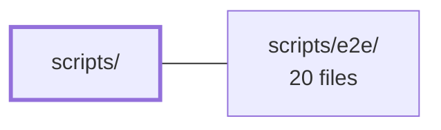

---
tags:
  - 2brain
  - 2brain/module
  - project/boilerplate-vue-frontend
type: module
module: scripts/
files: 29
updated: 2026-10-17T02:49:53.163832+00:00
---

# scripts/

## Purpose

The `scripts/` directory holds every build-time, CI, and developer-workflow utility that is **not** production runtime code. It generates typed contract artifacts from the repo's OpenAPI and AsyncAPI specs, manages the demo-module strip workflow, enforces cross-repo spec identity with the paired backend, gates mutation-testing scores, and provides tooling for documentation validation and test-result reporting.

## Key parts

- **`contracts/`** – The largest sub-area. A family of code generators that turn `openapi.yaml`, `asyncapi.yaml`, and `authorization-keys.yaml` into typed TypeScript modules (route tables, error-code enums, permission-action unions, operation-module maps, SSE channel types). Shared utilities (`generated-file.ts`, `permission-actions-render.ts`) keep the write/verify tail and pure render logic testable, while `strip-schema-descriptions.ts` post-processes Orval output and `validate-asyncapi.ts` replaces the removed AsyncAPI CLI.
- **`demo/`** – Tooling for the "strip the demo shop" workflow: `demo-remove.ts` (destructive removal), `measure-demo-strip.ts` (report-only scratch-copy build check), `run-backend.ts` (spawns the paired backend for single-process e2e), `scratch-directory.ts` (disk-backed temp dir for memory servers), and supporting modules (`demo-module-names.ts`, `demo-remove-registry.ts`, `demo-remove-tests.ts`).
- **`pairing/`** – Locates the paired backend checkout (`paired-backend-path.ts`) and enforces byte-identity of shared contract files between the two repos (`spec-identity.ts`, `check-spec-identity.ts`), preventing silent spec drift.
- **`mutation/`** – Per-file mutation-score ratchet on top of Stryker: `baseline.ts` and `check-baseline.ts` implement the ratchet, `run-tests.ts` wraps `stryker run` with OOM/concurrency safeguards, and `pull-baseline.ts` / `github-artifacts.ts` fetch the nightly CI baseline artifact for local review.
- **`docs/`** – Validation scripts (`check-references.ts` for dead file-path citations, `document-facts.ts` for pure text-level claims about `package.json` and the generated contract).
- **`module-edges.ts` / `module-groups.ts`** – Hand-maintained whitelists that declare which frontend modules may import which backend modules, and which strategic group (`foundation`, `shop`, `example`) each module belongs to.
- **`testing/report-results.ts`** – Transforms a Jest/Vitest JSON report into a module-shaped summary (ownership, per-module cost, timing).

## How it connects

- **`/` (repository root):** Every generator and checker reads canonical artifacts that live at the repo root—`openapi.yaml`, `asyncapi.yaml`, `package.json`, `src/modules.ts`, `src/demo-modules.ts`, `mutation-baseline.json`. The scripts are the only consumers that mutate or validate those files outside of a normal `src/` import.
- **`scripts/e2e/`:** The pairing sub-area (`paired-backend-path.ts`) is imported by `cypress.config.ts` and the e2e shard runner to agree on which backend checkout to target. `demo/remove-tests.ts` deletes cross-module specs that live under `tests/e2e/`, and `run-backend.ts` is the process that `start-server-and-test` probes for readiness before the e2e suite launches.

## Where to start

1. **`scripts/contracts/generated-file.ts`** – It is the ~30-line utility every other contract generator ends with, so reading it first makes the write/verify pattern (`--check` vs. write) immediately familiar before you encounter it in each generator.
2. **`scripts/pairing/paired-backend-path.ts`** – Understanding how this repo finds its paired backend explains why several other scripts (demo runner, e2e config, spec-identity check) all route through the same lookup, and it is the shortest path to grasping the two-repo model that many `scripts/` commands assume.

## Connected modules

[[boilerplate-vue-frontend_ROOT|/ (repository root)]] · [[boilerplate-vue-frontend_scripts_e2e|scripts/e2e/]]

## Files
- `scripts/contracts/generate-asyncapi-types.ts` — Generates the frontend's realtime contract types (payload interfaces, channel constants, SSE event-name/payload maps, and inlined JSON Schema maps) from the bundled `asyncapi.yaml`. It exists so the frontend repo has a typed, build-time-checked view of every SSE channel its dashboard consumes, without hand-maintaining those types. This copy is the frontend half of a paired shared script; the backend copy diverges in output (queue-payload Zod validators vs. inlined JSON Schema for `create-sse-client.ts`).
- `scripts/contracts/generate-error-codes.ts` — Generates a TypeScript `ERROR_CODES` const object and an `ErrorCode` union type from the `x-error-codes` extension in `openapi.yaml`. It exists so call sites can reference error codes as identifiers (with JSDoc on hover) without the contract's `errors[].code` field becoming a closed enum — keeping new codes additive per Zalando API guideline #112.
- `scripts/contracts/generate-operation-modules.ts` — Reads `openapi.yaml` and emits a TypeScript file exporting an `OPERATION_MODULES` record that maps every generated `@api` function name to the backend module owning that operation (via the `x-module` extension). This gives `tests/cross-cutting/module-coupling.spec.ts` a concrete map to verify a module isn't importing another domain's endpoint — something the contract itself never states.
- `scripts/contracts/generate-permission-actions.ts` — Generates a TypeScript `permission-actions` module (a runtime array plus a derived union type) from the `actions:` section of an `authorization-keys.yaml` file. It exists to keep the permission-action vocabulary in code in lockstep with the YAML source of truth, and is byte-identical across the paired frontend and backend repos.
- `scripts/contracts/generate-route-table.ts` — Code generator that reads the repo-root `openapi.yaml`, extracts one row per declared operation (HTTP method, anchored URL pattern, response/body schema export names, `x-module`), sorts them for correct `find()` resolution, and emits a TypeScript module exporting a `ROUTES: GeneratedRoute[]` array. It exists so `response-schema-map.ts` and each module's `response-schemas.ts` get their route→schema table from a single regenerated artifact rather than hand-maintained lists.
- `scripts/contracts/generated-file.ts` — A single shared utility that every contract generator calls as its final step: write the generated file to disk, or (under `--check`) verify the on-disk copy matches the expected output and fail if it doesn't. Keeping this logic in one place avoids duplicating the write/verify tail across every generator.
- `scripts/contracts/permission-actions-render.ts` — The pure, side-effect-free half of the permission-action code generator. It reads the `actions:` list out of the shared `authorization-keys.yaml` document and renders the TypeScript module that carries that list as a frozen array plus a union type. All I/O lives in the sibling script; this file exists so the logic can be unit-tested without touching the filesystem.
- `scripts/contracts/strip-schema-descriptions.ts` — Post-processing step in the `gen:api` pipeline that removes every `.describe(...)` call orval emits into the generated Zod schema file. These calls carry OpenAPI description text as string literals (~1,700 of them) into the runtime bundle, but the schemas are only ever `.safeParse()`d and never introspected for `.description`, so the strings are dead weight. Orval provides no config flag to suppress them, so this script strips them after generation.
- `scripts/contracts/validate-asyncapi.ts` — CLI script that validates one or more AsyncAPI documents using `@asyncapi/parser` and its default Spectral ruleset (`spectral:asyncapi/recommended`). It exists to replace the `asyncapi validate` command now that `@asyncapi/cli` (~446 MB, telemetry included) has been removed from the project. Run via `npm run lint:asyncapi`.
- `scripts/demo/demo-module-names.ts` — Provides a single shared way for the two `scripts/demo/` scripts to obtain the list of names from `DEMO_MODULE_NAMES` in `src/demo-modules.ts`. It reads the value out of the source **text** (via regex) instead of a live `import`, because `scripts/**` and `src/**` belong to separate TypeScript project references and a cross-project import would break `vue-tsc --build` (TS6307).
- `scripts/demo/demo-remove-registry.ts` — Shared implementation of the registry-level edits a demo-module removal makes. It is consumed by both `demo-remove.ts` (which applies the edits to the live checkout) and `measure-demo-strip.ts` (which applies the same edits to a scratch copy and then checks whether the remainder still builds). Keeping the logic in one place ensures the measurement exercises the *same* coupling the real removal hits, rather than merely re-reporting what `demo:remove` already does.
- `scripts/demo/demo-remove-tests.ts` — Removes cross-module E2E specs (under `tests/e2e/`) that reference a module being deleted, and validates the `// requires-module:` headers on remaining specs. It is the frontend test-cleanup step in the `demo:remove` workflow, paired with the backend's `scripts/ops/demo-remove-tests.ts`.
- `scripts/demo/demo-remove.ts` — Destructive demo script (`npm run demo:remove`) that removes every module listed in `src/demo-modules.ts` from the current checkout: its folder, its registry entries in `src/modules.ts`, its entries in `scripts/module-edges.ts`, the manifest files, and any cross-module specs that reference it. It exists so a new-project template can be "stripped" of its sample modules in one command.
- `scripts/demo/measure-demo-strip.ts` — Report-only measurement script that answers "how far *is* the demo shop removable?" by stripping all named demo modules from a scratch copy of the frontend checkout and then running `type-check-only`, `lint`, and `build-only` against what remains. It deliberately never touches the real working tree—failures are a punch list, not a merge blocker.
- `scripts/demo/run-backend.ts` — Thin CLI wrapper (`npm run backend:demo`) that spawns the paired backend's demo profile for **single-process** e2e runs (serial, visual, dev, spec). It resolves *which* backend to start via the same pairing logic as the test suite, picks the correct start command from `BACKEND_DEMO_COMMAND`, and hands a ready process to `start-server-and-test`'s readiness probe. Without it, the suite would need to resolve path, command, port, and env itself.
- `scripts/demo/scratch-directory.ts` — Provides a disk-backed scratch directory for demo backends (primarily `mongodb-memory-server`) that this repo spawns. It redirects `TMPDIR` away from the RAM-backed `/tmp` (which fills up when a killed `mongod` leaves ~200 MB behind) and onto the user's disk under `~/.cache`. Each call also sweeps directories abandoned by previously crashed or killed runs, bounding the cost of a leak to one run-cycle.
- `scripts/docs/check-references.ts` — Validates that every file path cited in an inline code span across the docs actually exists in this repo's tree (or the paired backend's tree). Catches the "dead fact" class of rot that `docs:build` cannot detect: a page naming a file that was renamed, merged, or deleted. Runs as `npm run check:docs-references`.
- `scripts/docs/document-facts.ts` — Pure text-level fact checks that verify what documentation pages claim about `package.json` scripts, dependencies, and the generated `@api` / `@api/schemas` contract. The file is deliberately I/O-free (no git tree, no file reads) so that every rule is a plain function a unit spec can drive with a string fixture.
- `scripts/module-edges.ts` — Hand-maintained whitelist of which frontend modules may reach which backend modules. A new cross-module coupling is a deliberate edit to this list rather than an unexamined import. The per-edge rationale (conformist / customer-supplier / published-language) is prose in the dependent module's `module.ts` docblock, not here.
- `scripts/module-groups.ts` — Hand-maintained mapping of every enabled frontend module to its strategic group (`foundation`, `shop`, or `example`). It is the frontend mirror of the paired backend's `module.yaml#group` field and exists so that import-direction rules and spec tests have an explicit, human-chosen classification to enforce.
- `scripts/mutation/baseline.ts` — Implements a per-file mutation-score ratchet on top of Stryker's global thresholds. Because Stryker's `high`/`low`/`break` settings apply to the entire mutate scope as one pooled number, a strong file can mask a weak one. This module records each file's score in a committed JSON file (`mutation-baseline.json`), then enforces that no file drops below its recorded value — while allowing scores to ratchet upward via `--update`. It exists so that widening the mutate scope does not dilute per-file signal into an unactionable average.
- `scripts/mutation/check-baseline.ts` — CLI entry point for the per-file mutation ratchet. It reads the latest Stryker report (`reports/mutation/mutation.json`) and compares every file's mutation-coverage score against the committed `mutation-baseline.json`, exiting non-zero if any file regressed or has no baseline entry. With `--update` it records improvements and new files. It deliberately does **not** invoke Stryker, so a CI pipeline can split the expensive run and this cheap gate into separate steps.
- `scripts/mutation/github-artifacts.ts` — Defines the constants, types, and a single pure selector for identifying which `mutation-baseline` GitHub Actions artifact to download. It exists to keep the "which artifact" logic separate from `pull-baseline.ts`, which handles the network calls and file I/O.
- `scripts/mutation/pull-baseline.ts` — Pulls the newest mutation-testing baseline artifact uploaded by the nightly CI run (which has no repo write access) and overwrites the local `mutation-baseline.json` so a developer can review the diff and commit it. Invoked via `npm run test:mutation:pull`.
- `scripts/mutation/run-tests.ts` — A thin wrapper around `npx stryker run` that adds three capabilities a JSON config cannot provide: resolving concurrency and heap from the local machine (via `.env`), clearing Stryker's `.stryker-tmp/` sandbox before starting (so a killed run doesn't leave a duplicate project copy), and aborting the run if the worker OOM-restart loop is detected.
- `scripts/pairing/check-spec-identity.ts` — CLI entry point (`npm run check:spec-identity`) that verifies the shared contract files in this repo are byte-identical to those in the paired backend repo. It exists to catch spec drift between the two halves of a paired-repo setup, and is wired into CI (`ci.yml`) and the pre-commit gate (`npm run complete`).
- `scripts/pairing/paired-backend-path.ts` — Shared resolution logic for locating and interacting with the paired backend checkout from the frontend repo. Centralises the `BACKEND_PATH` fallback chain, template-substituted reset/demo commands, and the shard ceiling so that `cypress.config.ts`, the e2e shard runner, the spec-identity checker, and the demo runner all agree on *which* backend they mean without each re-implementing the lookup.
- `scripts/pairing/spec-identity.ts` — Defines the cross-repo contract identity check: a canonical list of files that must remain identical between this frontend repo and whichever backend it is paired with, plus the comparison and reporting machinery to detect a silent fork. A one-line spec edit in one checkout produces a still-valid-but-divergent spec that neither CI suite flags; this file makes the drift visible.
- `scripts/testing/report-results.ts` — CLI script (`npm run test:report`) that reads a runner's JSON test report (Jest `--json` or Vitest `json` reporter) and prints three things a raw log does not: which **module** owns each failure, a per-module cost table, and where the time went. It exists to give a module-shaped view of test results in a codebase that is organised around deletable modules but otherwise only exposes layer-shaped or flat tooling.

---
[[boilerplate-vue-frontend_INDEX|← boilerplate-vue-frontend index]]
