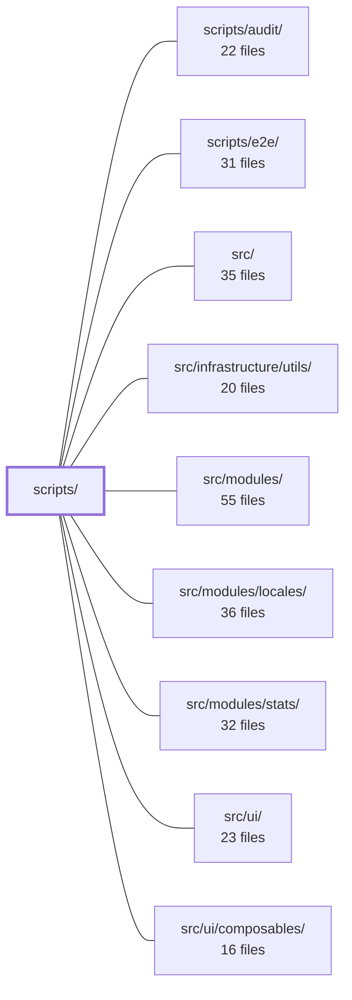

---
tags:
  - 2brain
  - 2brain/module
  - project/boilerplate-vue-frontend
type: module
module: scripts/
files: 58
updated: 2026-11-10T08:34:58.965651+00:00
---

# scripts/

## Purpose

Build-time and CI tooling that keeps the repository's generated code, lint rules, performance baselines, and documentation in lockstep with their upstream sources (OpenAPI, AsyncAPI, YAML registries, CSS). Every script here either *derives* a committed artefact from a single source of truth, *validates* a claim in the codebase, or *executes* a one-off environment (headless Chrome, scratch MongoDB) that a developer or CI job needs.

## Key parts

- **`contracts/`** — The largest sub-group. A family of code generators (AsyncAPI types, error codes, route table, permission vocabulary, upload types, shared-rules, operation-module map) plus their pure rendering helpers (`shared-rules/render.ts`, `permission-vocabulary-render.ts`), the shared write-or-verify tail (`generated-file.ts`), and two post-processing validators (`strip-schema-descriptions.ts`, `validate-asyncapi.ts`). Each generator exposes a `--check` mode so CI can fail the build on drift.
- **`eslint/`** — Four custom ESLint rules (mobile-strategy, no-hover-only, template-directive-description, theme-token), the Tailwind design-config spliced into the flat config, and `stylesheet-classes.ts` which derives the allow-list from the codebase. `index.ts` aggregates the rules for a single import.
- **`lighthouse/`** — A self-contained performance-audit pipeline: isolated Chrome launch, loopback analytics sink, production build, N-run collection, pure evaluation against a ratcheted baseline, and a nightly-baseline pull helper.
- **`demo/`** — One-shot scripts to add/remove the demo modules, boot the paired backend in a scratch directory, and clean up cross-module e2e specs.
- **`docs/`** — Pure-function fact-checks and dead-file-path detection for the VitePress documentation.
- **Top-level utilities** — `design-policy.ts` (tunable knobs for design-lint rules), `css-sources.ts` (line-mapped CSS inventory for the stylesheet audit), and `fail-script.ts` (dependency-free exit handler).

## How it connects

- **`/` (repository root):** Every script is invoked through root `package.json` commands (`gen:api`, `demo:remove`, `lighthouse`, `check`). The contract generators write files into `src/` and `shared/` that the root build then compiles.
- **`src/` / `src/modules/` / `src/infrastructure/utils/`:** Generated contract types, permission vocabulary, route tables, and error-code constants are consumed by application code across all modules. The ESLint rules inspect Vue templates and theme tokens that live in `src/`.
- **`src/ui/` / `src/ui/composables/`:** `theme-token.ts` reads the Vuetify theme from `src/ui/vuetify/theme.ts`; `stylesheet-classes.ts` parses `src/**/*.css` and SFC style blocks to build the class allow-list.
- **`scripts/e2e/`:** `demo/demo-remove-tests.ts` deletes e2e specs that reference removed modules; `demo/run-backend.ts` and `demo/scratch-directory.ts` provide the backend a developer or CI needs before e2e suites run.
- **`scripts/audit/`:** `css-sources.ts` and `design-policy.ts` supply the data and configuration the CSS-invasiveness audit consumes.
- **`src/modules/locales/` / `src/modules/stats/`:** Lighthouse baseline metrics and document fact-checks reference module names and locale data as their ground-truth inputs.

## Where to start

1. **`scripts/contracts/generate-asyncapi-types.ts`** — it is the most frequently regenerated file, shows the generator pattern (read YAML → produce TS → call `generated-file.ts` with `--check`), and the types it emits are imported across the entire `src/` tree.
2. **`scripts/design-policy.ts`** — a single, dependency-free data module. Reading it gives you the vocabulary (severities, thresholds, colour maps) that both the ESLint rules and the CSS audit reference, making those files much easier to follow.

## Connected modules

[[boilerplate-vue-frontend_ROOT|/ (repository root)]] · [[boilerplate-vue-frontend_scripts_audit|scripts/audit/]] · [[boilerplate-vue-frontend_scripts_e2e|scripts/e2e/]] · [[boilerplate-vue-frontend_src|src/]] · [[boilerplate-vue-frontend_src_infrastructure_utils|src/infrastructure/utils/]] · [[boilerplate-vue-frontend_src_modules|src/modules/]] · [[boilerplate-vue-frontend_src_modules_locales|src/modules/locales/]] · [[boilerplate-vue-frontend_src_modules_stats|src/modules/stats/]] · [[boilerplate-vue-frontend_src_ui|src/ui/]] · [[boilerplate-vue-frontend_src_ui_composables|src/ui/composables/]]

## Files
- `scripts/contracts/generate-asyncapi-types.ts` — Generates the repository's realtime TypeScript contract types (payload interfaces, channel constants, SSE event maps, and inlined JSON Schemas) from `asyncapi.yaml`. It exists so that both the type system and the runtime SSE-frame validator (`create-sse-client.ts`) stay in lockstep with the published AsyncAPI document, and so a CI gate (`--check`) can fail the build if the generated file drifts from the source contract.
- `scripts/contracts/generate-error-codes.ts` — Generates a TypeScript error-code catalogue (`ERROR_CODES` constant + `ErrorCode` union type) from the `x-error-codes` extension in `openapi.yaml`. It exists so call sites can reference named constants instead of retyping string literals, while the contract itself keeps `errors[].code` as an open `string` (Zalando guideline #112) so adding a code is never a breaking change.
- `scripts/contracts/generate-operation-modules.ts` — Generates a `Record<string, string>` mapping every orval-generated `@api` function name to the backend module that owns its operation, derived from `x-module` stamps in `openapi.yaml`. It exists so that `tests/cross-cutting/module-coupling.spec.ts` has a contract-sourced ground truth to verify a module isn't importing another domain's endpoint, without hand-maintaining the map.
- `scripts/contracts/generate-permission-vocabulary.ts` — CLI generator that reads an authorization-keys YAML document and emits a TypeScript `permission-vocabulary` module containing runtime arrays and union types for actions, subjects, rule IDs, set names, scopes, step-up tiers, and the subject-to-actions pair map. It exists so the permission vocabulary is derived from a single YAML source rather than hand-maintained in each repo.
- `scripts/contracts/generate-route-table.ts` — Code generator that reads the bundled `openapi.yaml` and emits a route-table file (one row per operation) containing the HTTP method, an anchored URL regex, the `@api/schemas` export name for the response body, the body-schema name, the owning `x-module`, a `noRefresh` flag, and `REDIRECT_QUERY_ENUMS`. It exists so `response-schema-map.ts` and each module's `response-schemas.ts` can resolve their routes *before* the ~350 KB zod schema chunk is loaded.
- `scripts/contracts/generate-shared-rules.ts` — Generates two artifacts for every entry in the shared-rules registry: a JSON Schema file (`shared/rules/schemas/<name>.schema.json`) so other frontends can validate the same YAML without Zod, and a committed TypeScript `as const` file that application code imports. Supports a `--check` mode (used in CI) that writes nothing and exits 1 if any output is stale.
- `scripts/contracts/generate-upload-types.ts` — Reads `openapi.yaml`, extracts the single `encoding.imageUpload.contentType` value declared across all multipart `imageUpload` parts, and generates a TypeScript module exporting that list as a typed constant. This ensures the backend file filter and the frontend file picker both consume one authoritative source rather than duplicating the list.
- `scripts/contracts/generated-file.ts` — Shared write-or-verify tail that every contract generator in this folder ends with. It centralises the "write the file" vs. "compare and fail" logic so generators stay focused on producing content. The file is kept **byte-identical across both repos** in the pair.
- `scripts/contracts/permission-vocabulary-render.ts` — Pure (no-filesystem) half of the permission-vocabulary code generator. It parses the closed lists declared in the shared `authorization-keys` YAML document, validates them, and renders the TypeScript source (`as const` arrays, union types, and a subject→actions pair map) that downstream code imports to reference permission keys without free-form strings.
- `scripts/contracts/shared-rules/browser-storage.ts` — Pure build-time function that merges two sources of browser-storage data—backend cookies synced as `contracts/cookies.yaml` and this repo's own `shared/rules/browser-storage.yaml`—into a single, display-ordered inventory document. The `order` array is the single source of display ordering, so the build fails if a newly added cookie is not given a place. No filesystem access, making every validation path unit-testable.
- `scripts/contracts/shared-rules/generate-spec.ts` — Pure type module that defines the **spec** a rules file uses to declare how it should be compiled into a committed `as const` TypeScript file. It is consumed at build time by `generate-shared-rules.ts` (and its renderer), never at runtime. Keeping these shapes in a dedicated file ensures the frontend and backend generators read the same rule contract.
- `scripts/contracts/shared-rules/render.ts` — Pure text-rendering half of the shared-rules code generator. Given a parsed (schema-checked) rules document and a `GenerateSpec`, it produces the full source text of a `.generated.ts` file. Because it has no filesystem I/O, it can be exercised directly in unit tests.
- `scripts/contracts/shared-rules/rules.ts` — Central registry of every frontend-owned rules YAML file under `shared/rules/`. Each entry defines a Zod schema that validates the YAML, an optional `derive` step that merges in backend data, and a `GenerateSpec` that tells the codegen which constants to emit. Adding a new rules file means writing one schema and one row in `SHARED_RULES`; everything else (JSON-Schema export, TS generation) is handled by `generate-shared-rules.ts`.
- `scripts/contracts/strip-schema-descriptions.ts` — Strips every `.describe(...)` call from orval-generated Zod schema files. Orval has no flag to suppress OpenAPI `description` text, and the resulting string literals (~1,700) are dead weight in the runtime bundle because the schemas are only ever `.safeParse()`d, never introspected for `.description`. The script runs as the last step of `gen:api`, after orval emits the file, so both the committed output and the `api-freshness` CI job see the stripped version.
- `scripts/contracts/validate-asyncapi.ts` — Standalone CLI script that validates AsyncAPI documents using `@asyncapi/parser` with its default Spectral ruleset (`spectral:asyncapi/recommended`). It exists to replace the `asyncapi validate` command from `@asyncapi/cli`, eliminating that package's ~446 MB footprint and telemetry while producing identical diagnostics.
- `scripts/css-sources.ts` — Collects every piece of CSS the app ships with—`main.css`, all SFC `<style>` blocks, and the splash `<style>` in `index.html`—into a uniform `CssSource[]` shape. Each entry records the line on which its CSS begins so that PostCSS node positions can be mapped back to the original file. This module exists as the single data-gathering layer for the stylesheet specs and the CSS-invasiveness audit.
- `scripts/demo/demo-remove-registry.ts` — Provides the filesystem and source-editing operations that remove demo modules from a checkout. It is called by `demo-remove.ts` to physically delete module folders and strip their registrations from `src/modules.ts`, so the removed modules no longer appear in the build or runtime.
- `scripts/demo/demo-remove-tests.ts` — The frontend test-cleanup step of the demo-remove workflow (twin to the backend's `scripts/ops/demo-remove-tests.ts`). It deletes cross-module spec files under `tests/e2e/` that reference an already-removed module, and validates that every spec under `tests/e2e/specs/` carries a well-formed `// requires-module:` header. Module-owned specs (under `src/modules/<name>/tests/`) are out of scope—they go with their folder.
- `scripts/demo/demo-remove.ts` — A one-shot demo script (`npm run demo:remove`) that deletes every module belonging to the `shop` or `example` group, removes their folders, strips their registry entries, and deletes cross-module e2e specs that reference them. It runs against the current checkout and leaves a grep-based residue report for anything it couldn't safely remove.
- `scripts/demo/run-backend.ts` — Thin exec wrapper that boots the paired backend's demo profile as `npm run backend:demo`. It exists because `start-server-and-test` (and a human) need a single, already-resolved command to spawn a backend, while the actual command to run is owned by `BACKEND_DEMO_COMMAND` (which may differ between the two paired backends). It also manages a scratch directory for the backend's in-memory Mongo and forwards lifecycle signals so cleanup runs.
- `scripts/demo/scratch-directory.ts` — Provides a disk-backed scratch directory (under `~/.cache/`) for demo MongoDB backends spawned by this repo, replacing the RAM-backed `os.tmpdir()`. Because killed backends (SIGTERM, ^C, crash) leave ~200 MB of mongod data behind, the module also sweeps stale scratch directories whose owning process is no longer running, bounding the cost of any leak to one subsequent run.
- `scripts/design-policy.ts` — Central configuration module for all design-lint rules. It imports the Vuetify theme's colour maps and exports every tunable knob—severity levels, class patterns, thresholds, and colour-name derivations—that the ESLint design rules and cross-cutting design specs read. Keeping the knobs here (pure data, no side effects) means a spec can load the policy without a browser, and tuning enforcement is a single-file edit.
- `scripts/docs/check-references.ts` — Validates that every file path **claimed** in inline code spans across the VitePress docs actually exists in the repo (or the paired backend repo). Catches the "dead fact" class of rot that `docs:build`'s dead-link check does not cover: a page citing a file that was renamed, merged, or deleted. Runs as a step of `npm run check`.
- `scripts/docs/document-facts.ts` — Pure text-based fact checks for documentation pages. Each exported function takes a page's markdown (and a set of known names) and reports claims that do not hold — without touching the filesystem or git tree. This separation keeps every rule a plain, fixture-drivable function, distinct from the file-path sweep in `check-references.ts`.
- `scripts/eslint/design-config.ts` — Produces the Tailwind-specific ESLint flat-config blocks that `eslint.config.ts` splices in. It wires the `eslint-plugin-better-tailwindcss` plugin to the project's design policy (severities, restricted classes, canonicalisation) and to the live stylesheet class set read from `src/styles/main.css`, so that a new `@theme` token becomes a recognised class immediately and equivalent arbitrary values are flagged for canonicalisation.
- `scripts/eslint/index.ts` — Registry that aggregates the four project-local ESLint rules into a single default export (a rule-name → implementation map). It exists so `eslint.config.ts` can reference all custom rules through one import, and so each rule remains independently unit-testable via `RuleTester`.
- `scripts/eslint/mobile-strategy.ts` — Defines the `mobile-strategy` ESLint rule for Vue templates. It enforces three phone-specific patterns: dialogs must bind `fullscreen`, data tables must be rendered through a designated wrapper component, and plain `<v-table>` elements must carry a named `v-focusable-scroll` directive so their scroll region is keyboard-reachable.
- `scripts/eslint/no-hover-only.ts` — A custom ESLint rule (`no-hover-only`) that flags Vue template elements whose interactions are reachable only via hover or mouse gesture. The four checks catch hover handlers without a `@click` fallback, `open-on-hover` menus without `open-on-click`, gesture-only affordances (context menu, drag/drop, `v-touch`), and native `title` tooltips on text-truncated elements. The goal is to surface UI that is unusable on touch devices or with a keyboard.
- `scripts/eslint/stylesheet-classes.ts` — Reads the project's CSS class definitions from `src/**/*.css` files and Vue SFC `<style>` blocks, splitting them into **global** classes (valid in any file) and **scoped** classes (valid only in the SFC that defines them). This lets the `no-unknown-classes` ESLint rule derive its allow-list from the codebase itself instead of maintaining a hard-coded list.
- `scripts/eslint/template-directive-description.ts` — A custom ESLint rule that flags `eslint-disable` comments inside Vue SFC **template** blocks when they lack a ` -- <reason>` suffix. It plugs a gap: the standard `@eslint-community/eslint-comments/require-description` plugin only inspects script comments, so a bare `<!-- eslint-disable no-undef -->` in a template currently passes unchecked.
- `scripts/eslint/theme-token.ts` — A custom ESLint rule for Vue single-file components that enforces a single-source-of-truth policy for colours: every colour in source must be a named theme colour (defined in `src/ui/vuetify/theme.ts`), never a raw hex/rgb/CSS-name literal or an unrecognised theme variable. It exists as an AST-aware editor-integrated rule rather than a test spec so that violations surface at the exact line during editing.
- `scripts/fail-script.ts` — A minimal, dependency-free exit handler for scripts that do not go through the shared `runScript` wrapper. It logs the rejection and sets a non-zero exit code. It lives in its own file with zero imports so that tooling (e.g. a docs generator) can pull it in without transitively loading the logger, config, or Mongoose the way `run-script.ts` does.
- `scripts/lighthouse/analytics-sink.ts` — A loopback-only HTTP stand-in for Faro's collector endpoint and Umami's script host, used during Lighthouse audits. By pointing `VITE_FARO_URL` and `VITE_UMAMI_SRC` at this server, the audited page exercises its real consent-banner and Faro-boot code paths while guaranteeing no telemetry leaves the machine.
- `scripts/lighthouse/audit-environment.ts` — Defines the fixed, loopback-only environment variables and container-start generator list that the Lighthouse audit build receives. It was extracted from `build.ts` so the unit test suite can import these pure definitions without pulling in the full build pipeline.
- `scripts/lighthouse/baseline.ts` — Defines the Lighthouse timing baseline data model and the **ratchet** function that merges a fresh run into the committed baseline, allowing metrics to only improve (or stay flat). It exists so that performance numbers are tracked as a ratchet over time—improvements are recorded automatically, regressions are silently ignored, and a human commit is the only way to raise a number. Nothing in the baseline gates a build; it is purely a report artifact that forks inherit as data, not a verdict.
- `scripts/lighthouse/build.ts` — Builds the exact production artifacts that Lighthouse will audit: a `vite` production build into `dist-lighthouse`, followed by the same Docker entrypoint generator scripts that write `config.js`, `security.txt`, `robots.txt`, etc. Using the real generators guarantees no second copy of key whitelists exists and that Lighthouse measures what production actually serves. A dedicated build (rather than `build:e2e`) is used because `build:e2e` enables response validation, which Lighthouse would count as app cost.
- `scripts/lighthouse/chrome.ts` — Launches a headless Chrome instance with all network egress locked down (no external DNS resolution, no proxy escape) and attaches a Puppeteer connection, so that a subsequent Lighthouse audit runs in a fully isolated, loopback-only environment.
- `scripts/lighthouse/collect.ts` — The I/O half of the Lighthouse runner. It drives a real Chrome browser through each test case—signing in a persona via the login form (including 2FA), running the case's `prepare` step, then executing Lighthouse N times—and hands back the measured reports for `evaluate` to score.
- `scripts/lighthouse/evaluate.ts` — Pure (no I/O) evaluation layer that turns the Lighthouse reports collected for every test case into a structured `Evaluation` of hard **failures**, soft **warnings**, and per-metric **medians**. It encodes the gating policy from decision D3: structural issues (page loads, stays out of login, no external requests) and named performance audits gate the run; timing regressions and report-only audits only warn.
- `scripts/lighthouse/pull-baseline.ts` — Downloads the Lighthouse baseline artifact uploaded by the nightly `lighthouse.yml` CI run and writes it over the local `lighthouse-baseline.json`. It exists because the nightly job has no repository write access, so it publishes the proposed baseline as an artifact for a human (or developer) to fetch, review, and commit manually.
- `scripts/lighthouse/route.ts` — Pure utility that resolves a test-case route string by replacing every `{subject:<guarantee name>}` placeholder with the concrete row id the backend publishes via `/__test/scenario`. It isolates the name→id substitution so callers (e.g. the lighthouse collect step) can work with fully-resolved routes without caring about the placeholder syntax.
- `scripts/lighthouse/run.ts` — Entry-point script for the Lighthouse audit pipeline (`npm run test:lighthouse`). It discovers all test cases, launches a headless Chrome, collects repeated measurements per case, evaluates the results against a stored baseline, and writes JSON/HTML/Markdown reports. Configuration is driven entirely by environment variables rather than CLI flags.
- `scripts/lighthouse/settings.ts` — Pure-data module that defines the Lighthouse configuration (categories, skipped audits, and CLI flags) for the mobile performance run. It exists so the profile is a single importable artifact that a unit test can pin against Lighthouse's own preset, keeping the runner (`collect.ts`) free of configuration logic.
- `scripts/lighthouse/summary.ts` — Pure formatter that turns an `Evaluation` (plus an optional committed baseline) into a single Markdown string — a per-case table, a green/red verdict line, and failure/warning lists. Designed to be dropped into a terminal, a report folder, or a nightly step summary without any I/O.
- `scripts/lighthouse/update-baseline.ts` — CLI script (run via `tsx`) that promotes a **proposed** Lighthouse baseline written by the test suite into the committed `lighthouse-baseline.json` file. It exists to give developers a one-step "ratchet up" action: run the tests, review the diff this script produces, then commit.
- `scripts/module-manifest.ts` — Reads every `src/modules/<name>/module.yaml` to build a single in-memory manifest of module groups (`foundation | shop | example`) and their `dependsOn` edges. It exists so that ESLint rules, demo scripts, and cross-cutting tests all agree on module topology from one place, without each duplicating the parsing logic.
- `scripts/mutation/baseline.ts` — Implements a **per-file mutation score ratchet** that replaces Stryker's global thresholds. Because Stryker only supports a single pass/fail gate across the entire mutation scope, this module records each file's score individually in `mutation-baseline.json` so that a strong file cannot mask a weak one. Scores may only ratchet upward; lowering a baseline is a human decision made in a commit.
- `scripts/mutation/check-baseline.ts` — CLI entry point for the per-file mutation-score ratchet. It reads the latest Stryker JSON report, compares each file's score against the committed `mutation-baseline.json`, and either gates the run (exit 1 on regression or unrecorded file) or records improvements/new files (`--update`). It deliberately does **not** invoke Stryker itself so a CI pipeline can split the expensive run and the cheap gate into separate steps.
- `scripts/mutation/overlay.ts` — Overlays a partial Stryker mutation run (e.g. `npm run test:mutation -- --mutate <file>`) onto the whole report already on disk, so `reports/mutation/` accumulates one report covering every file. Renumbers test and mutant IDs to resolve collisions between separately-generated reports, and renders the Stryker HTML viewer with the merged report inlined.
- `scripts/mutation/pull-report.ts` — Brings the latest nightly mutation-testing report back from CI into the local working tree, then re-derives `mutation-baseline.json` from that report using the same code path CI uses. It exists so the local baseline is always a faithful copy of what the nightly produced, eliminating any chance of drift between the report and its baseline.
- `scripts/mutation/run-tests.ts` — Wrapper around `stryker run` (invoked via `npm run test:mutation`) that handles four things a static `stryker.config.json` cannot: deriving machine-appropriate concurrency and heap from `.env`, clearing Stryker's sandbox directory before each run, aborting early when an OOM-restart loop is detected, and preserving a full mutation report when only a subset of files is mutated.
- `scripts/pairing/check-spec-identity.ts` — CLI entry point for the cross-repo contract check. It compares a fixed set of shared spec files between this repository and its paired backend checkout, failing if they have drifted. Wired into `ci.yml`, `npm run complete` (pre-commit gate), and available standalone via `npm run check`.
- `scripts/pairing/paired-backend-path.ts` — Centralizes how this repo locates and drives its paired backend checkout: resolving the backend's absolute path, the command to reset its database between live specs, the command to boot its demo profile, and the ceiling on concurrent demo backends. It exists so that every caller (Cypress config, shard runner, demo runner, spec-identity checker) derives the same answer from the same precedence rules and can never silently point at different backends.
- `scripts/pairing/spec-identity.ts` — Cross-repo contract check that verifies a fixed set of spec files are semantically identical between this frontend checkout and its paired backend. It exists because a one-line spec edit in either repo silently forks what both sides believe they share, and neither CI catches it—the forked spec is still a valid spec. The file encodes *which* files are subject to the check, *how* to fingerprint them (byte-level for non-YAML, parse-and-normalise for YAML), and *how* to compare and report drift.
- `scripts/tailwind-build.ts` — Provides a lightweight, Vite-free way to compile the project's entry stylesheet (`src/styles/main.css`) with Tailwind v4's `compile()` API and generate CSS for an arbitrary list of candidate class names. Exists so that scripts and tests can query "what CSS does Tailwind produce for these classes?" without spinning up a full build pipeline.
- `scripts/testing/github-artifacts.ts` — Pure helper module that selects *which* GitHub Actions artifact a `pull-*` script should download: the newest unexpired artifact of a given name, produced by a run on `main`. It is shared by the mutation-report and Lighthouse-baseline pull flows, keeping the selection logic separate from the network I/O performed by `pull-artifact.ts`.
- `scripts/testing/pull-artifact.ts` — Downloads the newest unexpired GitHub Actions artifact that a nightly job uploaded and copies designated files out of it into the repo. Nightlies lack write access to commit results directly, so they upload artifacts; this script is the consumer side that retrieves them. It is the shared "GitHub half" of the `pull-*` script family.
- `scripts/testing/report-results.ts` — Reads a runner JSON report (Jest `--json` or Vitest `json`, same shape) and prints a module-organised summary: per-bucket test counts and timing, the N slowest suites and individual tests, and a flat failure list attributed to its owning module. It exists because the codebase is organised by module but every other tool (CI jobs, mutation baseline, test scripts) is layer-shaped; this script is the cheapest way to answer "which module owns that red build" and "where did the time go" without changing how tests are run. Invoked via `npm run test:report`.

---
[[boilerplate-vue-frontend_INDEX|← boilerplate-vue-frontend index]]
