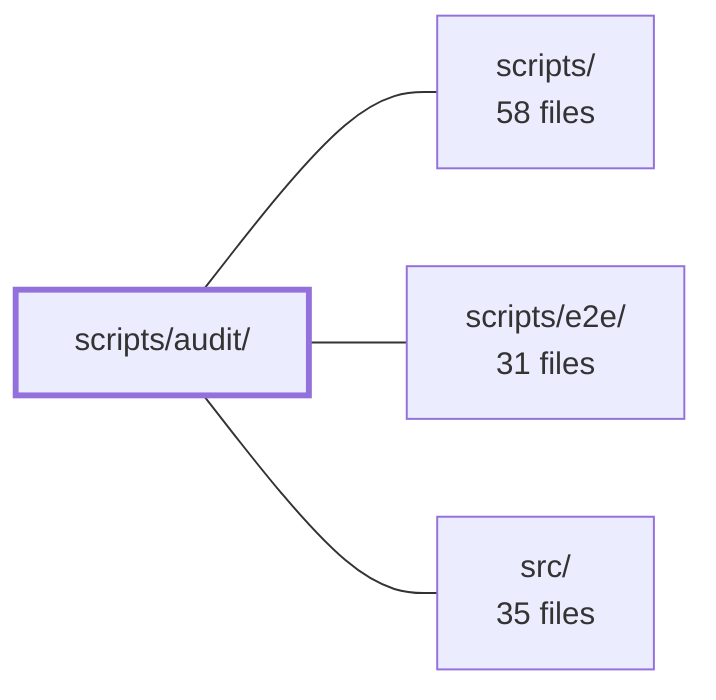

---
tags:
  - 2brain
  - 2brain/module
  - project/boilerplate-vue-frontend
type: module
module: scripts/audit/
files: 22
updated: 2026-11-10T08:35:15.607149+00:00
---

# scripts/audit/

## Purpose

This module houses every audit tool the project uses to check codebase health: automated scans (code shape, invasive CSS, unused locale keys) and manual review workflows (design capture, accessibility, suite bloat). Each concern lives in its own sub-directory with a `SKILL.md` describing the editorial rules, plus the scripts that perform the actual work. All tools are report-only by default — they surface findings but never block a build unless explicitly wired into CI.

## Key parts

- **`code-shape/`** — Builds a full TypeScript program over the app, its Vitest project, and every `.vue` SFC (as virtual `.vue.ts` sources), then counts structural facts (small bodies, pass-throughs, unsupplied optional params, few importers). `generate-shallow-candidates.ts` is the CLI entry; `shallow-candidates.ts` holds the pure counting logic.

- **`css-invasive/`** — A single automated gate (`npm run audit:css`). `scan.ts` walks CSS files, SFC templates, and TS string literals for patterns that reach into Vuetify internals, redefine Tailwind utilities, or use disallowed units, all filtered through a shared `css-allow` grammar. `report.ts` is the thin CLI that prints findings.

- **`design-manual/`** — The largest sub-module: a full capture-and-review pipeline. `capture.ts` resolves a scope to E2E spec files and runs a serial sweep; `capture-task.ts` handles Node-side Cypress tasks (stitching, manifest writes); `stitch.ts` and `bands.ts` are pure image-geometry helpers; `plan.ts` / `plan-batches.ts` split the manifest into reviewer-sized batches; `check.ts` / `check-report.ts` validate citations in the resulting report Markdown against the manifest.

- **`unused-locale-keys/`** — `scan.ts` performs a source-text scan for locale dictionary keys no file ever reads; `report.ts` prints the list and always exits 0.

- **`accessibility-manual/` and `suite-bloat/`** — Skill definitions (`SKILL.md` only) that codify manual audit checklists for a human or reviewer agent to follow.

## How it connects

- **`src/`** — Every audit reads the production source: `code-shape` builds its TypeScript program over `src/` and the Vitest project; `css-invasive` parses SFCs and TS files under `src/`; `unused-locale-keys` scans for key references across `src/`.
- **`scripts/e2e/`** — `design-manual`'s capture step resolves a scope to concrete E2E sweep spec files that live in `scripts/e2e/` and executes them via the serial e2e runner.
- **`scripts/`** — Sibling tooling directory; audit scripts follow the same `tsx` / `npm run audit:*` conventions and write their JSON/Markdown reports into `reports/audit/` at the repository root.
- **Repository root** — Reports are emitted to `reports/audit/<name>/` (e.g. `shallow.json`, the design `manifest.json`), and the `css-allow` grammar and locale JSON files live at the root.

## Where to start

1. **`code-shape/scripts/shallow-candidates.ts`** — the most self-contained audit: one file, pure functions, no I/O. Reading it shows the pattern (build a TS program → count facts → emit JSON) that the other automated audits follow.

2. **`design-manual/scripts/capture.ts`** — the most complex workflow. It is the single entry point that strings together scope resolution, the E2E runner, stitching, batching, and citation checking, so it gives a map of the entire design-review pipeline in one read.

## Connected modules

[[boilerplate-vue-frontend_ROOT|/ (repository root)]] · [[boilerplate-vue-frontend_scripts|scripts/]] · [[boilerplate-vue-frontend_scripts_e2e|scripts/e2e/]] · [[boilerplate-vue-frontend_src|src/]]

## Files
- `scripts/audit/accessibility-manual/SKILL.md` — name: accessibility-manual
- `scripts/audit/code-shape/SKILL.md` — name: code-shape
- `scripts/audit/code-shape/scripts/generate-shallow-candidates.ts` — CLI entry point for the `code-shape` audit's shallow-candidate report. It builds a full TypeScript program over the app, its Vitest project, and every `.vue` SFC (treated as a virtual `.vue.ts` source), then hands that program to `findShallowCandidates` and writes the resulting JSON to `reports/audit/code-shape/shallow.json`.
- `scripts/audit/code-shape/scripts/shallow-candidates.ts` — A `@module` (no default export) that counts the facts the `code-shape` audit uses to judge shallow code: small bodies with few users, pure pass-through bodies, optional parameters no caller supplies, and files with few importers. It resolves references through the TypeScript checker (not text search) so aliases, re-exports, and shorthand properties all count as one use. It is Vue-aware: `.vue` SFCs appear in the program as virtual `.vue.ts` sources. The module only produces counts and structural facts; all verdicts live in `scripts/audit/code-shape/SKILL.md`.
- `scripts/audit/css-invasive/SKILL.md` — name: css-invasive
- `scripts/audit/css-invasive/report.ts` — CLI entry point (`npm run audit:css`) that runs an invasive-CSS scan and prints the findings either as a human-readable report or as a single JSON document (`--json`). It is a pure reporting layer: it performs no scanning logic itself and always exits 0 when the scan completes, regardless of hit count.
- `scripts/audit/css-invasive/scan.ts` — The single automated gate behind `npm run audit:css` and the cross-cutting test spec. It scans three sources — CSS files (via PostCSS + postcss-selector-parser), Vue SFC templates (via `vue/compiler-sfc`), and TS/JS string literals (via the TypeScript compiler) — for patterns that reach into Vuetify internals, redefine Tailwind utilities, or use disallowed CSS units. All findings pass through a unified `css-allow` allowance grammar so the lint and the test share one rule set and one report.
- `scripts/audit/design-manual/SKILL.md` — name: design-manual
- `scripts/audit/design-manual/scripts/bands.ts` — Pure arithmetic shared between the browser-side capture (`design-capture.ts`) and the Node-side stitcher (`stitch.ts`), which cannot both load the same bundle because `stitch.ts` depends on `pngjs`. This module holds the scroll-offset calculation and fixed-element band classification so both halves agree on the numbers without pulling in an image library, a DOM, or a disk.
- `scripts/audit/design-manual/scripts/capture-matrix.ts` — Pure-function module that decides **which screenshots a sweep case or action-table row produces** in design-manual capture mode. It encodes the editorial rules (which viewports, themes, and locales matter for a given case) so the sweep runner and action-table runner can plan shots without any I/O or Cypress dependency.
- `scripts/audit/design-manual/scripts/capture-scope.ts` — Resolves a user-typed scope argument (empty, `shell`, a module name, a file path, or `--diff`) into the concrete list of E2E sweep spec files the capture should run. It is a pure function: filesystem access and git state are injected via `ScopeInput`, so tests can stub both without touching disk.
- `scripts/audit/design-manual/scripts/capture-task.ts` — Implements the two Node-side `cy.task` handlers that complete the `cy.captureDesign()` workflow: stitching multiple viewport screenshots into model-sized tiles and persisting shot metadata to per-spec JSONL manifest files. It exists because the Cypress browser context cannot read the screenshots it wrote or produce the output tiles and manifest rows on disk.
- `scripts/audit/design-manual/scripts/capture.ts` — CLI entry point (`npm run audit:design:capture -- [scope]`) that photographs the running app for design review. It resolves a scope (everything, `shell`, a module, a path, or `--diff`) to concrete e2e spec files, runs those specs in capture mode under the serial e2e runner, then merges the resulting shot rows into a single `manifest.json`. Each invocation replaces the previous capture entirely.
- `scripts/audit/design-manual/scripts/check-report.ts` — Pure citation validator for design-review reports. Given a markdown findings table and a `CitationSources` oracle, it verifies every row's tile exists (in manifest and on disk), every `file:line` citation is in-bounds, every item matches the D1–D16 checklist or the `+ name — anchor` reviewer-addition format, severity is S1–S3, and the fix cell is non-empty. It is deliberately side-effect-free so the CLI and tests can each supply their own sources.
- `scripts/audit/design-manual/scripts/check.ts` — CLI entry point (`npm run audit:design:check -- <SCOPE>`) that validates the citations in a design-review report. It reads the scope's report Markdown and the capture's `manifest.json`, delegates row-level checking to `checkReport`, prints any unresolvable tile or `file:line` references, and exits non-zero so the calling skill can drop bad rows.
- `scripts/audit/design-manual/scripts/manifest.ts` — Defines the type schema and a single merge utility for a design-capture manifest — the JSON artifact that records what was screenshotted, from which git commit, at which viewport sizes, and with what page geometry. It exists so that the capture writer, the batch planner, and the citation checker all agree on the same shape of data without duplicating type definitions.
- `scripts/audit/design-manual/scripts/plan-batches.ts` — Pure planning module that splits a design-capture manifest into batches sized to fit a single reviewer's context window. It groups shots by module and spec case, then greedily packs them into batches under token and tile ceilings so each batch can be handed to one sub-agent reviewer.
- `scripts/audit/design-manual/scripts/plan.ts` — CLI entry-point (run via `tsx`) that turns the last design capture's manifest into a concrete set of review batches. It reads `manifest.json`, optionally filters shots by a scope argument, delegates the batching decision to `plan-batches`, writes `batches.json` alongside the manifest, and prints a one-line summary per batch. Existing as a thin orchestration layer keeps the pure batching logic testable and the capture contract explicit.
- `scripts/audit/design-manual/scripts/stitch.ts` — Pure image-geometry helpers for the design-capture pipeline: it stitches a sequence of viewport PNGs (shot at known scroll positions) into one tall canvas, then slices that canvas into model-sized tiles. It contains no Cypress, browser, or disk I/O — the calling Node tasks supply PNG buffers and receive PNG buffers back.
- `scripts/audit/suite-bloat/SKILL.md` — name: suite-bloat
- `scripts/audit/unused-locale-keys/report.ts` — CLI report script that lists every locale key no code reads. It is intentionally non-blocking: it prints findings to stdout and always exits 0, so it can be run ad-hoc or in CI without failing a build.
- `scripts/audit/unused-locale-keys/scan.ts` — Scans the repository for locale dictionary keys that no source file ever reads, flagging them as dead leftovers or misplaced entries. Because locale JSON has no compiler, only a source-text scan can detect these. The module is strictly report-only — it never blocks a build.

---
[[boilerplate-vue-frontend_INDEX|← boilerplate-vue-frontend index]]
