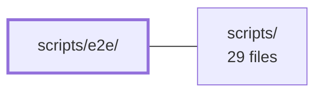

---
tags:
  - 2brain
  - 2brain/module
  - project/boilerplate-vue-frontend
type: module
module: scripts/e2e/
files: 20
updated: 2026-10-17T02:50:06.459622+00:00
---

# scripts/e2e/

## Purpose

`scripts/e2e/` holds the non-Cypress plumbing that powers the E2E test suite: shard scheduling and CI fan-out, webhook simulation and verification, flaky-test visibility, and a set of pure helper functions (TOTP, money parsing, session management) that Cypress specs and the unit suite both import. Nothing here drives a browser; every file is either an orchestration entry-point run via `tsx`, a configuration/constants module, or a dependency-free utility that can be unit-tested in isolation.

## Key parts

- **Shard scheduling & CI entry-points** — `run-shards.ts` (parallel-shard launcher), `shard-balancer.ts` (LPT bin-packing), `spec-durations.ts` (per-spec timing persistence), `live-shard.ts` / `print-live-shard.ts` (nightly live-shard slice computation and CLI), and `cypress-spec-globs.ts` (canonical spec-glob constants shared by `cypress.config.ts`, ESLint, `package.json`, and `run-shards.ts`).
- **Webhook infrastructure** — `webhook-sink.ts` (in-process TLS receiver for the demo profile), `webhook-tester.ts` (reader for the live `webhook-tester` container), `webhook-tls.ts` (shared PEM loading), `webhook-demo-secret.ts` (hardcoded signing key), and `payment-webhook.ts` (HMAC-signing + POST helper for triggering webhook deliveries).
- **Flaky-test reporting** — `flaky-report.ts` (collection logic) and `report-flaky.ts` (standalone CLI entry-point for CI paths that skip `run-shards.ts`).
- **Pure E2E utilities** — `cents.ts` (locale-aware money parsing), `totp.ts` (TOTP code generation), `mail-message.ts` (Mailpit message normalisation), `device-session.ts` (stateless "second device" session), `step-prefix.ts` (failure-message formatting), `antibot-backend.ts` (shared antibot provider config), and `reset-command.ts` (scenario placeholder resolution).

## How it connects

- **`scripts/` (parent)** — This directory is a sub-package of the broader `scripts/` tree. Sibling modules such as `scripts/pairing/paired-backend-path.ts` feed into `reset-command.ts`, and `cypress.config.ts` at the root imports the glob constants and duration hooks defined here. The sharding entry-points (`run-shards.ts`, `report-flaky.ts`) are invoked directly by CI workflow steps at the repository root.
- **Repository root (`/`)** — `package.json` references the glob set exported by `cypress-spec-globs.ts`; `cypress.config.ts` wires in `spec-durations.ts`, `flaky-report.ts`, and `antibot-backend.ts`; `eslint.config.ts` and `run-shards.ts` consume the same glob constants; the nightly `e2e-live.yml` workflow calls `print-live-shard.ts`. The module is the single source of truth for E2E scheduling and glob definitions that the root configuration files rely on.

## Where to start

1. **`cypress-spec-globs.ts`** — a tiny file that shows how every other tool in the suite (Cypress config, ESLint, sharding, CI) agrees on *where* specs live. Reading it first gives you the map.
2. **`run-shards.ts`** — the main local entry-point. Tracing how it boots per-shard backends, applies the balancer from `shard-balancer.ts`, and collects flaky results from `flaky-report.ts` gives you the full local E2E lifecycle in one pass.

## Connected modules

[[boilerplate-vue-frontend_ROOT|/ (repository root)]] · [[boilerplate-vue-frontend_scripts|scripts/]]

## Files
- `scripts/e2e/antibot-backend.ts` — Defines the shared configuration for booting the demo backend with its antibot (human-challenge) provider enabled. The provider is self-hosted `altcha` (proof-of-work), so no external vendor or network is needed. A single env record and a CLI flag keep the three entry points that need this backend in sync.
- `scripts/e2e/cents.ts` — A pure, browser-free utility that parses a locale-formatted money string into an integer count of cents, so e2e assertions can compare *amounts* without caring how the locale spells them (e.g. `€1,234.50` vs `1.234,50 €`). It lives in `scripts/e2e/` rather than `tests/support/e2e/` so the unit suite can import it without a running browser, mirroring the split used by `mail-message.ts`.
- `scripts/e2e/cypress-spec-globs.ts` — Single source of truth for where Cypress spec files live. Because `cypress.config.ts`, `eslint.config.ts`, `run-shards.ts`, and `package.json` all need the same glob set but cannot import from each other, this module exports the canonical constants so those consumers stay in agreement without duplicating strings.
- `scripts/e2e/device-session.ts` — Implements a "second device" for E2E journey tests: a server-side login that maintains its own session cookie (and, in `jwt` mode, an access token) independently of the browser's session. Journey specs use it to prove session-scoped guarantees — that a logout-everywhere, password reset, or session expiry invalidates *this* device's session by asserting a subsequent refresh is refused. Stateless by design: the spec owns the `Device` value and passes it back on every call. Deliberately free of Cypress and placed outside `tests/support/e2e/` so the unit suite can import and pin it without a browser.
- `scripts/e2e/flaky-report.ts` — Collects and reports Cypress tests that passed only after a retry (i.e., were flaky). It is the visibility half of the trade made in `cypress.config.ts` (which allows one retry to keep contention from failing a run). The module is deliberately fail-soft: it surfaces flakiness as a warning annotation or plain list, never as a run failure.
- `scripts/e2e/live-shard.ts` — Computes the spec-to-matrix-job assignment for the nightly "live" E2E run. Because live shards cannot share a database, each CI matrix job gets its own services and runs its slice sequentially; this file only decides which specs land in which slice. It reuses the same balancing logic as the demo shards so slices finish at roughly the same time.
- `scripts/e2e/mail-message.ts` — Normalises a Mailpit SMTP message into the same `MailedEmail` shape the demo outbox already provides, so e2e journey specs can assert on email content without caring which profile (demo backend vs. live SMTP/Mailpit) delivered it. Pure parsing logic with no browser dependency.
- `scripts/e2e/payment-webhook.ts` — Utility for signing and POSTing a payment-provider webhook to the backend's `POST /payments/webhook` endpoint, replicating the provider's HMAC authentication. Exists so e2e specs can trigger webhook deliveries (including edge cases like duplicate event IDs or stale signatures) without depending on a real provider. Deliberately kept pure of Cypress so it can be unit-tested in isolation.
- `scripts/e2e/print-live-shard.ts` — CLI helper that prints a comma-separated `--spec` value for one (or all) live-e2e shard slices, so CI's `e2e-live.yml` matrix can hand each job a non-overlapping subset of functional or antibot specs. It exists to keep the glob-and-balance logic out of the YAML and to guarantee no slice is ever empty (an empty `--spec` would make Cypress run the full suite against the wrong backend).
- `scripts/e2e/report-flaky.ts` — A thin entry-point script (run via `tsx`) that prints which Cypress tests passed only on a retry in the last run. It exists for CI paths that do **not** go through `run-shards.ts` (e.g. a live-profile or single-spec invocation): a CI step invokes this file after Cypress finishes, regardless of pass/fail, to surface flaky tests as a warning.
- `scripts/e2e/reset-command.ts` — Resolves the `{scenario}` placeholder in a `LIVE_RESET_COMMAND` into a concrete shell command string. It exists because the scenario name is a per-call value (chosen at `cy.restore(scenario)` time) while the rest of the command (`{backend}`, `{describeTo}`) is already substituted upstream by `scripts/pairing/paired-backend-path.ts`.
- `scripts/e2e/run-shards.ts` — Entry-point script (run via `tsx`) that fans out the Cypress e2e suite into N parallel shards against a single **built** preview server, booting one isolated demo backend per shard. It exists to cut wall-clock from ~13 min to ~2.5 min on a 16-core machine without relying on Cypress Cloud, while guaranteeing shard isolation (own in-memory DB, own webhook sink) and refusing to run under the live profile where that isolation is impossible.
- `scripts/e2e/shard-balancer.ts` — Pure LPT (longest-processing-time) bin-packing logic extracted from `run-e2e-shards.ts` so the scheduling algorithm can be unit-tested in isolation. Contains no I/O or process orchestration—just the duration table, weight resolution, and shard assignment.
- `scripts/e2e/spec-durations.ts` — Persists per-spec wall-clock durations (keyed by full relative path) so the e2e shard balancer weighs each spec by its actual cost rather than a single shared basename entry. Durations accumulate across runs via `cypress.config.ts`'s `after:spec` hook, keeping the balancer's numbers fresh without manual re-measurement.
- `scripts/e2e/step-prefix.ts` — Pure helper that formats a Cypress failure message by prepending the current step name (`[step: <name>]`) so that error output identifies which step a failure occurred in. Extracted as a standalone module so it can be unit-tested without a live Cypress browser session.
- `scripts/e2e/totp.ts` — Generates a valid TOTP code for a given base32 secret so that e2e (Cypress) journeys can enrol a TOTP factor and immediately sign in with it, without waiting 30 seconds or running a real authenticator app. Kept pure and outside `tests/support/e2e/` so the unit suite can exercise it without a browser.
- `scripts/e2e/webhook-demo-secret.ts` — Exports a single hardcoded signing secret for the seeded demo subscription so that browser-side Cypress journeys can verify webhook signatures without pulling in Node-only dependencies.
- `scripts/e2e/webhook-sink.ts` — A TLS webhook receiver hosted by the Cypress node process for the demo profile. The demo backend has no message broker, so an admin "replay" is the only way a webhook is delivered; this sink listens on the URL the seeded subscription points to, lets a spec read what arrived, and verifies the Standard Webhooks signature. It exists because the demo profile runs without Docker and therefore cannot use the live-profile `webhook-tester` container.
- `scripts/e2e/webhook-tester.ts` — Reads captured webhooks from a running `tarampampam/webhook-tester` container (behind a TLS proxy) via its HTTP API, and normalises the response into the same `SinkRequest`-compatible shape the local demo sink produces. This lets an e2e journey read received webhooks identically whether the receiver is the in-process sink or the live tester.
- `scripts/e2e/webhook-tls.ts` — Centralises the loading of the demo webhook sink's TLS material (a test CA, a leaf cert for `127.0.0.1`, and its private key) into a single read at module-evaluation time. It exists so that the sink (`webhook-sink.ts`) and the tester (`webhook-tester.ts`) share one source of truth for the PEM files rather than each reading them independently.

---
[[boilerplate-vue-frontend_INDEX|← boilerplate-vue-frontend index]]
