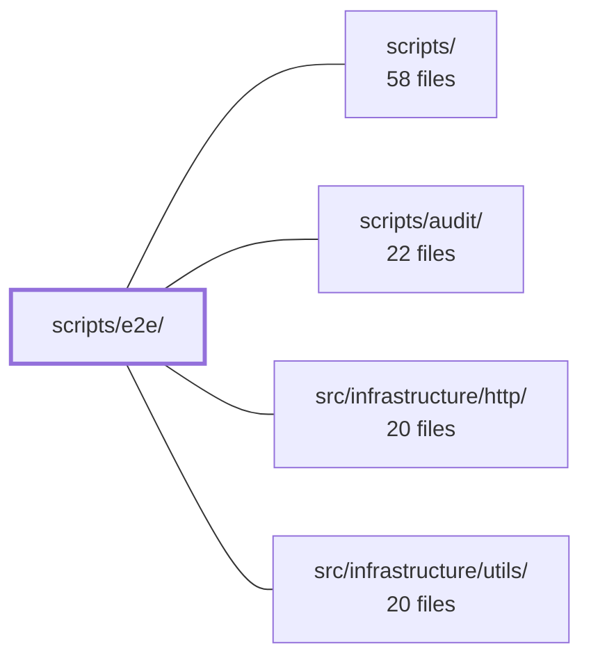

---
tags:
  - 2brain
  - 2brain/module
  - project/boilerplate-vue-frontend
type: module
module: scripts/e2e/
files: 31
updated: 2026-11-10T08:35:31.407681+00:00
---

# scripts/e2e/

## Purpose

`scripts/e2e/` holds the Node-side support logic for the project's Cypress E2E suite. Every file here is either a pure helper that the browser-side specs import, a CLI/orchestration script that drives shard execution, or a configuration/data module shared across multiple tooling layers. The module's design principle is to keep decision logic, parsing, and balancing algorithms out of the browser process so they can be unit-tested without launching a browser.

## Key parts

- **Sharding & orchestration** — `run-shards.ts` (main CLI entry), `live-shard.ts` / `print-live-shard.ts` (live-profile slicing), `shard-balancer.ts` (LPT bin-packing), `shard-process.ts` (detached process watchdog), `shard-verdict.ts` (pass/fail decision), `spec-durations.ts` (self-improving duration store). Together they cut the sequential E2E gate into parallel shards and guard against hung browsers.
- **Webhook simulation** — `webhook-sink.ts` (local TLS receiver for the demo profile), `webhook-tester.ts` (reader for the live `webhook-tester` container), `webhook-tls.ts` (shared test CA/leaf/key), `webhook-demo-secret.ts` (browser-side secret constant), `payment-webhook.ts` (HMAC-SHA256 signing + POST). Specs assert webhook deliveries identically regardless of profile.
- **Mail & device simulation** — `mail-filters.ts`, `mail-message.ts` (normalise Mailpit vs. demo-outbox mail), `device-session.ts` (independent second-device session for cross-device journey tests).
- **Browser & viewport config** — `browser-launch.ts` (headless Chromium fixes), `viewports.ts` (single source of truth for all device viewports), `shot-size.ts` (screenshot-dimension guard).
- **Layout & touch auditing** — `layout-findings.ts` (pure judgment layer), `touch-findings.ts` (touch-reachability classifier). Both are split from their DOM-collecting counterparts for unit-testability.
- **Contract & status validation** — `contract-mismatch.ts` (diagnostic-line predicate), `declared-statuses.ts` (extracts OpenAPI status codes to prevent spec drift).
- **Flaky-test reporting** — `flaky-report.ts` (collects retry-passes into JSONL), `report-flaky.ts` (prints the report for non-sharded runs).
- **Auth & antibot boot** — `totp.ts` (RFC 6238 in Node), `antibot-backend.ts` (centralised antibot env/CLI config).
- **Miscellaneous pure helpers** — `cents.ts` (money-string parsing), `step-prefix.ts` (failure-message tagging), `reset-command.ts` (placeholder resolution), `live-rate-limit-guard.ts` (Redis-URL pre-flight), `cypress-spec-globs.ts` (shared glob patterns).

## How it connects

- **`/` (repository root)** — `cypress.config.ts` composes the `browser-launch.ts` functions in its `before:browser:launch` hook and imports `flaky-report.ts` for retry tracking. `package.json` scripts and the ESLint config both reference the glob from `cypress-spec-globs.ts`. CI workflows (e.g. `e2e-live.yml`) invoke `print-live-shard.ts` and `report-flaky.ts` as standalone steps.
- **`scripts/`** — This module sits alongside sibling script directories; shared patterns (pure-core / orchestration-shell, JSONL stores) are reused across them.
- **`src/infrastructure/http/`** — `declared-statuses.ts` and `payment-webhook.ts` validate or produce HTTP-level artefacts (status codes, signed payloads) that the backend in `src/infrastructure/http/` defines and consumes.
- **`src/infrastructure/utils/`** — Pure helpers here (e.g. `cents.ts`, `totp.ts`) mirror the dependency-free style of the infra utilities and can be imported by both test support files and unit tests without pulling in server runtime.

## Where to start

1. **`run-shards.ts`** — Reading this file shows the full demo E2E lifecycle: spec discovery, duration lookup, shard balancing, backend boot, and parallel Cypress execution. Every other file in the module feeds into or is invoked by this orchestrator.
2. **`shard-balancer.ts`** — A short, dependency-free file that isolates the LPT algorithm. It's the quickest way to understand the "pure core / orchestration shell" pattern the rest of the module follows, and it's directly unit-testable.

## Connected modules

[[boilerplate-vue-frontend_ROOT|/ (repository root)]] · [[boilerplate-vue-frontend_scripts|scripts/]] · [[boilerplate-vue-frontend_scripts_audit|scripts/audit/]] · [[boilerplate-vue-frontend_src_infrastructure_http|src/infrastructure/http/]] · [[boilerplate-vue-frontend_src_infrastructure_utils|src/infrastructure/utils/]]

## Files
- `scripts/e2e/antibot-backend.ts` — Centralizes the environment variables and CLI flag needed to boot the demo backend with its antibot (human-challenge) provider enabled. This lets the demo shard, the single-process `backend:demo --antibot` entry, and the live workflow's antibot matrix entry all boot an identical configuration from one source.
- `scripts/e2e/browser-launch.ts` — A collection of pure functions that transform Cypress `BrowserLaunchOptions` to fix two headless-browser quirks: the default window size clips viewport screenshots, and headless Chromium reports no pointing device (breaking Vuetify's touch CSS). `cypress.config.ts` keeps a single `before:browser:launch` handler that composes these functions.
- `scripts/e2e/cents.ts` — Pure helper module that converts a locale-formatted money string (e.g. `€1,234.50` or `1.234,50 €`) into an integer count of cents, and sums multiple such strings. It lives outside `tests/support/e2e/` deliberately so the unit test suite can import and test it without a browser.
- `scripts/e2e/contract-mismatch.ts` — Pure predicate that determines whether a given `console` call is the application's contract-mismatch diagnostic — the specific error line the global Cypress hook turns into a failed test. Extracted as a dependency-free function so its decision logic can be pinned in a unit test without a browser or Cypress runtime.
- `scripts/e2e/cypress-spec-globs.ts` — Single source of truth for the glob patterns that define where Cypress spec files live. The pattern is needed in five places that cannot share an import (Cypress config, ESLint config, the shard runner, `package.json` scripts, and a test that cross-checks the last). Centralizing it here keeps those five in sync without a shared runtime dependency.
- `scripts/e2e/declared-statuses.ts` — Single-purpose helper that extracts the numeric HTTP status codes an OpenAPI operation declares, so that a stubbed failure row can be validated against the contract. Prevents E2E specs from asserting responses the server could never produce (spec drift). Kept pure over the raw YAML text so it is testable without a browser.
- `scripts/e2e/device-session.ts` — Simulates a "second device" in e2e journey tests: a server-side login that carries its own session cookie (and, in `jwt` mode, an access token) independent of the Cypress page's session. Exists so specs can prove cross-device effects — logout-everywhere, password reset, session expiry — by asserting that this device's subsequent refresh returns 401.
- `scripts/e2e/flaky-report.ts` — Collects and reports e2e tests that passed only on a retry (i.e., are flaky). It is the reporting half of the retry allowance configured in `cypress.config.ts`: instead of letting a retry silently turn a red test green, this module records every retry-pass in a shared JSONL file and prints them as warnings at the end of the run — visible on the PR but never causing a failure.
- `scripts/e2e/layout-findings.ts` — Pure-data "judgment" layer for the layout sweep: defines the finding/allowance types, decides which findings block a run, stamps allowances onto findings, and formats the failure message. Split from the DOM-collecting code (`layout-checks.ts`) so the rules are unit-testable with no browser.
- `scripts/e2e/live-rate-limit-guard.ts` — A pre-flight guard that refuses to start a live-profile Cypress run when the rate-limiter's Redis URL is missing. Without that URL the backend keeps rate-limit counters in-process, so the inter-spec reseed (`LIVE_RESET_COMMAND` via `cy.exec`) cannot clear them; card-payment journeys then hit 429 and time out silently. This file converts that hours-long failure into an immediate, descriptive error at the top of the run.
- `scripts/e2e/live-shard.ts` — Computes how to split the nightly live E2E suite into CI matrix slices. Because live tests cannot share a database between shards, each matrix job runs its own services sequentially; this module only decides which spec paths land in which slice. It reuses the same duration-based balancing algorithm as the demo shards so all slices finish at roughly the same time.
- `scripts/e2e/mail-filters.ts` — Provides pure predicate functions that filter an address's mailbox down to the one email a spec is waiting for. Because the demo outbox records template and locale metadata while a live SMTP inbox records neither, every matcher explicitly defines its fallback when those fields are absent, so a single spec runs unchanged on both profiles. Kept outside `tests/support/e2e/` so the unit suite can assert matcher rules without a browser.
- `scripts/e2e/mail-message.ts` — Normalises a Mailpit (SMTP) email into the same `MailedEmail` shape the demo outbox produces, so e2e journey specs can assert against either backend without branching. It is a pure module kept outside `tests/support/e2e/` so the unit suite can pin the parsing logic without a browser.
- `scripts/e2e/payment-webhook.ts` — A pure utility that signs a payment-provider webhook event with HMAC-SHA256 and POSTs it to the backend's `POST /payments/webhook/fake` endpoint. It exists so E2E specs can simulate the provider nudging the server (duplicate events, stale signatures, dispute reports) without duplicating the signing logic, and so the unit suite can exercise the pure functions without a browser.
- `scripts/e2e/print-live-shard.ts` — CLI helper (run via `tsx`) that prints one or more nightly live-e2e shard assignments as comma-separated `--spec` values for `cypress run`. It supports three invocation modes — a specific shard index, `antibot` (all antibot specs in a single unsliced job), and `all` (every slice from one durations read). The `e2e-live.yml` matrix invokes it to feed each parallel job its spec list.
- `scripts/e2e/report-flaky.ts` — Thin entry-point script that prints the flaky-test report (tests that passed only after a retry) for a single Cypress run that did **not** go through `run-shards.ts` (e.g. the live profile). A CI step invokes it unconditionally after Cypress and treats the output as a warning only.
- `scripts/e2e/reset-command.ts` — Resolves the `{scenario}` placeholder in a `LIVE_RESET_COMMAND` string at restore time, producing the concrete shell command that will be passed to `cy.exec`. It exists because the backend receives the scenario name as a positional argument, and that value is only known per-call—not when the command template is defined.
- `scripts/e2e/run-shards.ts` — CLI orchestrator behind `npm run test:e2e`: discovers all functional and antibot Cypress specs, balances them into N shards (default 4) using a longest-processing-time heuristic weighted by measured spec durations, boots one demo backend per shard, and spawns a parallel `cypress run` per shard against a single `vite preview` (built) server. It exists to cut the ~13-minute sequential gate to roughly the duration of the longest single spec, while keeping the demo profile safe (each shard isolates its own in-memory Mongo) and refusing to run under the live profile where sharding would be destructive.
- `scripts/e2e/shard-balancer.ts` — Pure (side-effect-free) balancing logic for distributing e2e spec files across parallel shards. Extracted from `run-shards.ts` so the LPT bin-packing algorithm can be unit-tested in isolation, following the same "pure core / orchestration shell" pattern used by `mutation-baseline.ts`.
- `scripts/e2e/shard-process.ts` — Spawns a single E2E shard's command (e.g. a Cypress run) in a detached process group and watches it for progress. If the child produces no stdout or stderr output for a configurable window, a watchdog SIGKILLs the entire process group, preventing a hung browser from blocking the CI gate for an hour.
- `scripts/e2e/shard-verdict.ts` — Pure decision logic that turns a finished Cypress shard's raw outcome (exit code, signal, hang status, spec counts) into a single pass/fail verdict. It exists because a shard can exit 0 while most of its specs never ran (killed externally, hung, or silently aborted), so the exit code alone is an unreliable gate.
- `scripts/e2e/shot-size.ts` — A guard function that detects when a captured screenshot's pixel dimensions do not match the page's declared viewport, preventing mismatched images from being recorded or compared against baselines. It distinguishes between a DPR-2 capture and a clipped browser window, producing a human-readable diagnostic string in either failure case.
- `scripts/e2e/spec-durations.ts` — Provides a self-improving store of per-spec measured wall-clock durations (JSONL) for the e2e shard balancer. Because `run-shards.ts` now keys weights by the spec's full relative path rather than basename, this file holds the real per-path numbers. Durations are recorded automatically on every Cypress run and accumulate over time, replacing the old frozen hand-measured `SECONDS` table.
- `scripts/e2e/step-prefix.ts` — Provides a pure helper that prepends a `[step: <name>]` marker to a Cypress failure message so that stack traces and error output identify which step was active when the test failed. It lives outside the browser runtime so it can be unit-tested without launching Cypress.
- `scripts/e2e/totp.ts` — Generates RFC 6238 TOTP codes in the Cypress Node process so e2e journeys can enrol an authenticator and then sign in with it, without bundling a crypto library into the browser. Pure Node (no Cypress import) so the unit suite can exercise it without a browser.
- `scripts/e2e/touch-findings.ts` — Pure classifier that turns `TouchProbe` records (plain data about page elements) into `TouchFinding` results describing what a finger cannot reach. It encodes four "touch-reachability" rules and groups repeated hits so a report doesn't repeat one issue a hundred times. Splitting classification from collection (in `tests/support/e2e/touch.ts`) keeps the rules unit-testable with no DOM.
- `scripts/e2e/viewports.ts` — A single-source-of-truth data module that defines every device viewport the browser test suites render the app at. It is pure data (no `cy`, no DOM) so it can be imported uniformly by Cypress config, Cypress support files, Vitest unit tests, and Node-side report tooling without pulling in a browser context.
- `scripts/e2e/webhook-demo-secret.ts` — A single-constant file that exposes the fixed demo webhook signing secret (`DEMO_WEBHOOK_SECRET`) to browser-side journey tests. It exists as a separate module so that a Cypress journey can import the secret without pulling in Node-only dependencies that live in the neighboring `webhook-sink.ts`.
- `scripts/e2e/webhook-sink.ts` — A TLS webhook receiver hosted inside the Cypress node process for the **demo** profile. The demo backend has no message broker, so webhooks only arrive when an admin triggers a replay — which POSTs synchronously to the subscription URL. This file provides the HTTPS listener that receives those POSTs, records each delivery (path, headers, body, signature validity) for spec assertions, and verifies Standard Webhooks signatures. It exists because the demo runs without Docker, so a full `webhook-tester` container is unavailable.
- `scripts/e2e/webhook-tester.ts` — Reads captured webhook deliveries from a `tarampampam/webhook-tester` container (the live profile's receiver) and normalizes them into the same `ReceivedWebhook` shape the local sink (`webhook-sink.ts`) produces. This lets a journey test read captured requests identically whether the subscription points at the demo sink or the live tester.
- `scripts/e2e/webhook-tls.ts` — Provides the TLS material (test CA + leaf certificate + key) for the demo webhook sink so that `https://` URLs on `127.0.0.1` are accepted by the backend. It exists as a standalone module so that both the sink (which serves the leaf) and the tester (which connects to it) read the same three PEM files from one place.

---
[[boilerplate-vue-frontend_INDEX|← boilerplate-vue-frontend index]]
