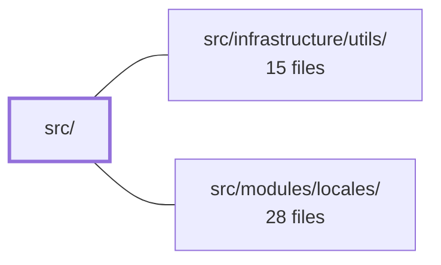

---
tags:
  - 2brain
  - 2brain/module
  - project/boilerplate-vue-frontend
type: module
module: src/
files: 31
updated: 2026-10-17T02:50:21.512202+00:00
---

# src/

## Purpose

`src/` is the application shell and composition root of a pet-supply e-commerce frontend. It owns the boot sequence, the module-registry contract, shared infrastructure services (session, analytics, theme, shop config, SSE, query client), the i18n runtime, the Vuetify theming layer, and the type/build-ambient declarations that let domain modules under `src/modules/` plug in with a single-line import.

## Key parts

- **Composition root & module kernel** — `main.ts` wires Pinia, Vue Router, i18n, Vuetify, and TanStack Query into a single promise chain; `App.vue` renders the routed view and a live region; `modules.ts` is the one-line-per-domain registry; `kernel/registry.ts` defines the `AppModule` manifest and boot-time helpers (route collection, duplicate detection, dictionary unwrapping); `kernel/slots.ts` implements the slot-based extension point so modules contribute UI without importing each other; `kernel/route-link.ts` guards cross-module route references; `demo-modules.ts` lists which modules ship in the demo build.
- **i18n tier** (`src/i18n/`) — Self-contained locale lifecycle: `index.ts` owns load → merge → activate; `router-link.ts` rewrites locations to carry the current locale; `language-label.ts` and `country-label.ts` resolve human-readable names via `Intl.DisplayNames` (no third-party dependency).
- **Infrastructure services** (`src/infrastructure/`) — `session.ts` (auth state & CASL abilities), `shop.ts` (shop-wide config singleton), `theme-preference.ts` and `analytics-consent.ts` (cookie-backed visitor preferences), `query-client.ts` (shared TanStack QueryClient), `create-sse-client.ts` (typed, auto-reconnecting SSE), `locale-overrides.ts` (runtime i18n fetch with safe defaults), `runtime-config.ts` (container-start config reader), `observability/` (Faro + Umami config and Pinia store).
- **UI & theming** (`src/ui/`) — Vuetify setup (`vuetify/`), shared dialog helpers, a `focusable-scroll` directive for a11y, and shared UI types.
- **Types & build ambient** — `types/index.ts` (barrel over generated REST + AsyncAPI types), `types/enums.ts` (the sole runtime enum bridge allowed into templates), `globals.d.ts` (Vite `define` inlined constants), `vite-env.d.ts` (typed `import.meta.env` keys).

## How it connects

- **`/` (repository root)** — Provides the Vite build pipeline, TypeScript config, and ESLint rules (including the module-boundary enforcement that restricts what `src/` files may import from `@api` and how they may reach `kernel/`). The `globals.d.ts` and `vite-env.d.ts` files exist solely to satisfy the compiler under that toolchain.
- **`src/infrastructure/utils/`** — Supplies shared utility functions (e.g., cookie read/write via `@guebbit/js-toolkit` wrappers, small pure helpers) that infrastructure services like `session.ts`, `analytics-consent.ts`, and `theme-preference.ts` call at runtime.
- **`src/modules/locales/`** — Ships the bundled `src/locales/*.json` dictionaries that `src/i18n/index.ts` loads as the offline rendering floor and that `infrastructure/locale-overrides.ts` layers server-side overrides onto.

## Where to start

Read **`src/main.ts`** first: it is the single sequential boot chain and shows, in order, every plugin, every store, and every module contribution the app receives before the first render. Then open **`src/kernel/registry.ts`** to see the `AppModule` manifest shape—once you understand that contract, every domain module under `src/modules/` becomes a predictable, one-line addition to `modules.ts`.

## Connected modules

[[boilerplate-vue-frontend_ROOT|/ (repository root)]] · [[boilerplate-vue-frontend_src_infrastructure_utils|src/infrastructure/utils/]] · [[boilerplate-vue-frontend_src_modules_locales|src/modules/locales/]]

## Files
- `src/App.vue` — The root Vue component (composition root) for the application. It is deliberately minimal: it renders the routed view and a single accessibility live region. All global plugins (Pinia, router, i18n, Vuetify) are installed by `src/main.ts`; no domain-specific state or logic is placed here.
- `src/demo-modules.ts` — Declares the definitive list of demo-only frontend modules shipped for the pet-supply e-commerce domain. It serves as the single resolved answer to "which modules belong to the demo?", mirroring the backend's `group: shop` axis, and is intentionally kept as a standalone, import-free list rather than a per-module manifest field.
- `src/globals.d.ts` — Ambient type declarations for constants that Vite's `define` inlines as literals at build time. Because these identifiers never exist as real runtime variables, they can't be imported—each one must be declared here to satisfy the TypeScript compiler.
- `src/i18n/country-label.ts` — Provides a localized display name for an ISO 3166-1 alpha-2 country code, rendered in the viewer's current language. It uses the browser's built-in `Intl.DisplayNames` API so the project can avoid a third-party dependency (`i18n-iso-countries`, which was rejected for not meeting the repo's 12-month maintenance-window requirement).
- `src/i18n/index.ts` — Core i18n runtime that owns the full locale lifecycle: which languages exist, which are loaded, and the load → merge → activate pipeline every locale switch passes through. It is deliberately self-contained (no app modules, no Pinia, no API client) so that `src/i18n/` can be lifted into a standalone package with minimal further work.
- `src/i18n/language-label.ts` — Provides a plain-function way to resolve a locale tag into a human-readable label for a language picker. It was extracted from `AppLanguageSwitcher.vue` so the logic is callable without mounting a component.
- `src/i18n/router-link.ts` — Rewrites any `vue-router` location (string, `path`-object, or named route) so it carries the current locale. Because vue-router ignores `params` when a `path` is present, the two location shapes require different treatment — path strings get a locale segment prepended, while named routes get `params.locale` injected.
- `src/infrastructure/analytics-consent.ts` — Manages the visitor's analytics consent (unknown / granted / denied) and gates all analytics side-effects (Umami loading, Faro instrumentation, backend browsing events) on that answer. Persists the guest's choice in a first-party cookie via `@guebbit/js-toolkit`, mirrors the convention used by `session.ts` for `isAuth`/`rememberMe`. When a signed-in account holds its own answer (`accountChoice`), that answer overrides the guest cookie and the profile store (not this module) persists it.
- `src/infrastructure/create-sse-client.ts` — Provides a typed, auto-reconnecting Server-Sent Events client that wraps the browser's `EventSource`. It JSON-parses each frame, optionally validates payloads against AsyncAPI-derived Zod schemas (behind the same `VITE_VALIDATE_RESPONSES` gate as REST), and transparently reopens the stream after the browser gives up on a connection (e.g. 401/429/503 on reconnect).
- `src/infrastructure/locale-overrides.ts` — Fetch layer for the runtime (database-backed) half of the i18n dictionaries: the API's locale manifest and per-locale edited overrides. Every function resolves to a safe default rather than rejecting, so the offline-bundled `src/locales/*.json` files remain the guaranteed rendering floor. It lives in the app (not `@/i18n`) because it calls `@api`, the app-specific OpenAPI client that the extractable i18n tier must not depend on.
- `src/infrastructure/observability/config.ts` — Reads `VITE_FARO_*` and `VITE_UMAMI_*` environment variables into typed config objects for the two telemetry backends (Grafana Faro tracing, Umami analytics). Each backend is entirely opt-in: if its required variable is unset, the reader returns `undefined`, which is the single switch `store.ts` checks to decide whether to initialize that backend.
- `src/infrastructure/observability/store.ts` — A Pinia store that provides a single, lazily-initialized API over two independent telemetry SDKs—Grafana Faro (errors, tracing, web-vitals) and Umami (product analytics). It exists to eliminate init-order problems between the two SDKs and to make telemetry calls available from components, other stores, and the router alike. Consent-gating logic (Faro measurement instrumentations, Umami script loading, opt-out persistence) is centralized here so the rest of the app never touches either SDK directly.
- `src/infrastructure/query-client.ts` — Exports the app's single shared TanStack `QueryClient` instance. All `useStructureRestApi`, `useStructureSearchApi`, and `useStructureCrudApi` Pinia stores receive this same client, enabling cross-resource cache invalidation scoped by `resourceKey`. It is passed explicitly via each store's `queryClient` option rather than through Vue's injection context, so it works identically in a mounted app, in store unit tests, and in router guards where no component tree exists.
- `src/infrastructure/runtime-config.ts` — Single reader for deployment values a running container may override at start time. Reads from `window.__APP_CONFIG` (populated by a `config.js` generated at container start) and falls back to `import.meta.env.VITE_*` build-time defaults. Dev, unit tests, and `vite preview` never receive `config.js`, so they always hit the fallback — same code path, no central config object.
- `src/infrastructure/session.ts` — Pinia store that gates the entire app: it tracks whether a session is held (in-memory JWT in `jwt` mode, or an HttpOnly-cookie flag in `cookie` mode), holds a minimal viewer projection, and manages the CASL abilities every screen checks. It exists so route guards, the app shell, and cross-tab logout all read one source of truth for "who is signed in and what may they see."
- `src/infrastructure/shop.ts` — Module-level singleton that fetches the shop's configuration (currency, ship-to countries, seller identity, returns destination) once via `GET /shop` and exposes it through Vue reactive refs. It exists so that any part of the app can read shop-wide settings without each component issuing its own request, and so that a currency code is available even before a specific product/resource carries one.
- `src/infrastructure/theme-preference.ts` — Persists the visitor's explicit light/dark theme override as a first-party cookie, following the same pattern as `analytics-consent.ts` (cookie-backed, `@guebbit/js-toolkit`-mediated, no `localStorage`). Read once at boot to set the initial Vuetify theme before first paint; written back when the user toggles the theme.
- `src/kernel/registry.ts` — Defines the module-registry contract: the `AppModule` manifest shape, the `AppNavigationEntry` shape, and boot-time helpers that turn the explicit list in `src/modules.ts` into a runnable application (route collection, duplicate-route detection, locale-dictionary unwrapping). It exists so that "what does this domain touch" is answerable from one typed object rather than by grepping across ten files.
- `src/kernel/route-link.ts` — Provides a module-system-generic guard (`linkIfRouted`) that lets a module resolve a *sibling* module's route by name only when the current build actually ships that route. Because this cross-module reach is invisible to `MODULE_EDGES`, it is not covered by the normal dependency-review process; `linkIfRouted` calls `router.hasRoute` so an unresolved name yields `undefined` instead of triggering vue-router's throw. It lives in `kernel` (not `src/app`) because it depends only on the module system's `hasRoute` contract, and the ESLint module-boundary rules allow a module to import from `kernel` but not from `src/app`.
- `src/kernel/slots.ts` — Defines the slot-based extension-point system: a module *owns* a named slot in one of its views, and other modules *contribute* components to it via their manifest. This inverts the dependency (contributor → owner) so that, e.g., a cart module can place "Add to cart" on the product page without `products` importing the cart.
- `src/main.ts` — The composition-root entry point. It wires all shared infrastructure (Pinia, router, i18n, Vuetify, Vue Query) together with the data contributed by enabled modules (locale dictionaries, response schemas, slot bindings), then boots the Vue application as a single sequential promise chain so that no step can race the next.
- `src/modules.ts` — Central registry that enumerates every domain module included in this build. Each entry is a one-line import from `src/modules/<name>/module`, collected into a single exported array. It is the sole place that decides which domains are active; adding or removing a domain means adding or deleting exactly one line here.
- `src/types/enums.ts` — The single sanctioned **runtime** bridge between `.vue` templates and the generated API. It re-exports a curated set of enum-shaped constants that a template must evaluate at runtime (status-badge colors, `<select>` options, filter values). Everything else in the generated API stays type-only via `@types`; `eslint.config.ts` bans components from importing `@api` directly and allows **only** this file as the named exception.
- `src/types/index.ts` — Barrel module that aggregates the app's two codegen type surfaces (Orval REST client types and AsyncAPI feed types) behind a single import path, `@/types`, so consumers never reach into generated packages directly.
- `src/ui/dialog.ts`
- `src/ui/directives/focusable-scroll.ts` — A Vue custom directive that retrofits Vuetify's `v-table` inner scroll wrapper (`.v-table__wrapper`) with keyboard focusability (`tabindex="0"`) and an optional accessible region name, resolving the axe `scrollable-region-focusable` violation for keyboard and screen-reader users.
- `src/ui/types.ts`
- `src/ui/vuetify/icons.ts`
- `src/ui/vuetify/index.ts`
- `src/ui/vuetify/selectors.ts`
- `src/vite-env.d.ts` — Ambient type declaration that makes every `import.meta.env.VITE_*` key used in the app a compile-checked, typed property. Without this file, Vite falls back to `Record<string, any>` for undeclared keys, so a typo'd or missing env var would silently resolve to `any` instead of failing at build time.

---
[[boilerplate-vue-frontend_INDEX|← boilerplate-vue-frontend index]]
