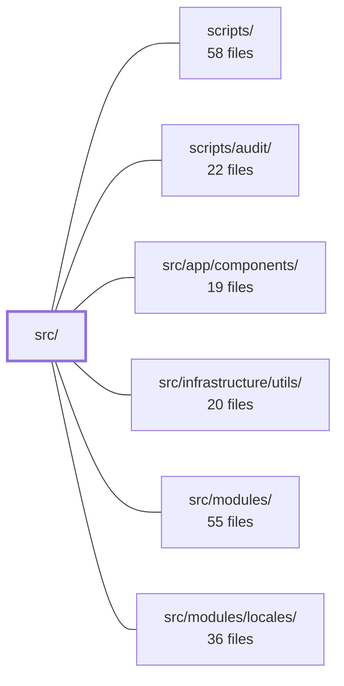

---
tags:
  - 2brain
  - 2brain/module
  - project/boilerplate-vue-frontend
type: module
module: src/
files: 35
updated: 2026-11-10T08:35:47.491720+00:00
---

# src/

## Purpose

`src/` is the application shell: it owns the composition root, the kernel contracts that wire domain modules together, shared infrastructure (session, configuration, i18n runtime, telemetry, browser-storage inventory), and the global type/style surface. It deliberately contains no business logic—domain behaviour lives in `src/modules/`—but it provides every cross-cutting service those modules consume at boot and at runtime.

## Key parts

- **Composition root** — `main.ts` (sequential boot: locale merge → mount → observability → readiness), `App.vue` (route outlet + a11y live region + address-bar colour), and `modules.ts` (the single ordered list of active domain modules).
- **Kernel** (`src/kernel/`) — the cross-module coordination layer: `registry.ts` (the `AppModule` contract every domain must fulfil), `slots.ts` (dependency-inverted UI contribution), `route-link.ts` / `order-link.ts` (safe cross-module link resolution), `inbox-notices.ts` (notification decoupling), `work-counts.ts` and `use-badge-refresh.ts` (staff badge state without direct module coupling).
- **Infrastructure** (`src/infrastructure/`) — shared services consumed by every module: `session.ts` (auth gating), `config.ts` (one-time site config fetch), `query-client.ts` (shared TanStack Query instance), `reauth.ts` (step-up auth), `analytics-consent.ts` + `observability/` (GDPR-gated telemetry), `create-sse-client.ts` (typed EventSource wrapper), `browser-storage.ts` + `browser-storage.generated.ts` (single source of truth for all storage keys), `locale-overrides.ts` / `locale-preference.ts` (runtime dictionary fetch + signed-in persistence), `email-verification.ts`, `theme-preference.ts`, `tour-seen.ts`, `runtime-config.ts` (post-build container overrides).
- **i18n runtime** (`src/i18n/`) — self-contained language management (load → activate → merge pipeline, per-locale code-splitting) plus small helpers: `country-label.ts`, `language-label.ts`, `router-link.ts`.
- **Global types & styles** — `types/index.ts` (barrel over generated REST/feed types), `types/enums.ts` (the one sanctioned enum import for templates), `globals.d.ts` + `vite-env.d.ts` (ambient build-time declarations), `styles/main.css` (Tailwind v4 + Vuetify coexistence layer).

## How it connects

- **`src/modules/`** — `modules.ts` enumerates each domain; `kernel/registry.ts` defines the shape each module must export; `kernel/slots.ts`, `inbox-notices.ts`, and `work-counts.ts` mediate all inter-module communication so modules never import one another directly.
- **`src/modules/locales/`** — `i18n/index.ts` dynamically imports the per-locale JSON bundles from here; `infrastructure/locale-overrides.ts` layers server-fetched overrides on top of those same files.
- **`src/app/components/`** — shared UI components consumed across modules and the shell; they inherit the i18n, theme, and query-client context established in `main.ts`.
- **`src/infrastructure/utils/`** — pure helpers (string formatting, date utilities, etc.) used throughout both the shell and domain modules.
- **`/` (repository root) / `scripts/` / `scripts/audit/`** — Vite build configuration supplies the `VITE_*` env vars read by `vite-env.d.ts` and `runtime-config.ts`; Docker entrypoint scripts populate `window.__APP_CONFIG`; audit scripts validate that `browser-storage.generated.ts` stays in sync with its YAML source.

## Where to start

1. **`src/main.ts`** — reading top to bottom shows the exact boot sequence, which stores and services are created, and how module-contributed data (locales, schemas, slots, notices) is injected before the first render.
2. **`src/kernel/registry.ts`** — once you understand the boot, this file is the contract a domain module must satisfy, giving you the vocabulary (routes, nav entries, tours, slots) that every module under `src/modules/` implements.

## Connected modules

[[boilerplate-vue-frontend_ROOT|/ (repository root)]] · [[boilerplate-vue-frontend_scripts|scripts/]] · [[boilerplate-vue-frontend_scripts_audit|scripts/audit/]] · [[boilerplate-vue-frontend_src_app_components|src/app/components/]] · [[boilerplate-vue-frontend_src_infrastructure_utils|src/infrastructure/utils/]] · [[boilerplate-vue-frontend_src_modules|src/modules/]] · [[boilerplate-vue-frontend_src_modules_locales|src/modules/locales/]]

## Files
- `src/App.vue` — The composition root of the application. It renders the active route (`RouterView`) and two app-wide concerns that must live outside any individual page: an accessibility live region that announces route changes to screen readers, and the browser address-bar theme colour. It is deliberately kept minimal so that no domain-specific state outlives the feature folder it originally came from.
- `src/globals.d.ts` — Ambient TypeScript declarations for constants that Vite's `define` option replaces with a literal at build time. Because these identifiers never exist at runtime, they must be declared globally here rather than imported.
- `src/i18n/country-label.ts` — Provides a single utility to obtain a country's own localized display name (e.g. "Italy" vs. "Italia") using the browser's built-in `Intl.DisplayNames`. It replaces a library dependency that was rejected for not meeting the repo's 12-month maintenance-window policy. Used to label country picker options and, via `formatCountry`, to render localized names in printed addresses.
- `src/i18n/index.ts` — Core i18n runtime that manages which languages exist, which are loaded, and the load → activate → merge pipeline every locale switch passes through. Bundled dictionaries are code-split per locale via Vite dynamic imports. The file is deliberately self-contained (no app-specific imports) so the entire `src/i18n/` directory can be extracted into a standalone package.
- `src/i18n/language-label.ts` — Provides a standalone function that resolves a locale code to its human-readable display label for language-picker UI. It was extracted from `AppLanguageSwitcher.vue` so the logic lives as a plain, testable function rather than being coupled to a Vue component mount.
- `src/i18n/router-link.ts` — Provides a single helper (`routerLinkI18n`) that rewrites any vue-router location so it carries the current locale prefix. It exists because vue-router's link resolution does not automatically inject the active locale, and the two location forms (path-based vs. named) require different treatment.
- `src/infrastructure/analytics-consent.ts` — Pinia store that manages the visitor's analytics consent (unknown / granted / denied) for both guest and signed-in users. It persists the guest choice in a first-party cookie, gates Umami and Faro loading, exposes a `trackBrowsing` relay for server-side event reporting, and coordinates with the profile store when a signed-in account's own answer applies.
- `src/infrastructure/browser-storage.generated.ts` — Machine-generated registry of every cookie, `localStorage`, and `sessionStorage` key the app uses. It exists so that downstream code and UI (e.g. a cookie-consent table) can iterate a single typed source of truth without hard-coding storage keys. Generated from YAML contracts; the YAML files are the source of truth.
- `src/infrastructure/browser-storage.ts` — Central inventory of every cookie and storage key the app leaves in a visitor's browser. It defines the shared types and a typed list of items (name, kind, setter, necessity, optional condition) that the privacy page renders as a table and that the code setting each item imports as its storage-name constant, so the two never drift apart. Wording (purpose, lifetime) lives in translation keys under `browser-storage.rows.<id>` so a shop can edit it at runtime.
- `src/infrastructure/config.ts` — Holds the site's public configuration (session mode, OAuth providers, anti-bot challenge, operator info, terms version) fetched once per tab from `GET /config` and shared read-only across every consumer. Exists as a single-module singleton so that multiple readers (session store, OAuth buttons, human check, cookie table) trigger at most one network call.
- `src/infrastructure/create-sse-client.ts` — A thin, typed wrapper around the browser's `EventSource` that JSON-parses each SSE frame, optionally validates the payload against its AsyncAPI-derived Zod schema, and reconnects with backoff when the browser gives up on a connection (401/429/503 on reconnect). It mirrors the REST response-validation gate (`VITE_VALIDATE_RESPONSES`) so SSE streams get the same contract enforcement without a separate mechanism.
- `src/infrastructure/email-verification.ts` — Stateless helpers for the email-verification resend flow: one function calls the API to resend the verification mail, the other extracts the server's cooldown from a `429` rejection. Both the banner (`POST /account/email-verification/resend`) and the profile page (`POST /account/email-change/resend`) share this module so the retry logic and the single `EMAIL_VERIFY_RESEND_TOO_SOON` code live in one place.
- `src/infrastructure/locale-overrides.ts` — Fetch layer for the runtime half of the app's dictionaries. It calls the app's own API (`@api`) to retrieve the locale manifest and per-locale message overrides, then merges those overrides on top of the statically bundled `src/locales/*.json` files. It lives in the app tier (not `@/i18n`) because it depends on the app-specific OpenAPI client, which the extractable i18n tier must not import.
- `src/infrastructure/locale-preference.ts` — Persists a signed-in visitor's chosen language to their account record so the preference outlives the browser tab. It is deliberately best-effort and fire-and-forget: guests are a no-op, and a failed write resolves silently rather than surfacing an error the caller never asked to handle.
- `src/infrastructure/observability/config.ts` — Pure environment-variable readers for the two telemetry back-ends (Grafana Faro and Umami). Each reader returns `undefined` when its required variable is unset, which serves as the single opt-in gate: a build with neither set ships the code but never calls out.
- `src/infrastructure/observability/store.ts` — Pinia store that wraps two lazily-initialized telemetry SDKs—Grafana Faro (errors, tracing, web-vitals) and Umami (product analytics)—behind a single consent-gated API. It exists so that neither SDK loads, no identifying data is transmitted, and no measurements occur until the visitor explicitly consents, satisfying ePrivacy Art. 5(3) and GDPR data-minimisation (Art. 5(1)(c), 25(2)).
- `src/infrastructure/query-client.ts` — Defines the single shared TanStack `QueryClient` instance for the entire application. All API stores (`useStructureRestApi`, `useStructureSearchApi`, `useStructureCrudApi`) reference this one client so that `resourceKey`-scoped cross-resource cache invalidation works. The instance is created here to centralise the non-default query/mutation options and to provide a stable import target that works both in the mounted app and in store unit tests.
- `src/infrastructure/reauth.ts` — Implements the step-up re-authentication flow: a small Pinia store that tracks the dialog's spinner and performs the single write (proving identity and adopting the new session), plus two stateless helper calls that feed the prompt (available answer methods and the mailed code). It lives in `infrastructure` rather than `account` because the shell renders the re-auth prompt on every page, independent of any account-specific routing.
- `src/infrastructure/runtime-config.ts` — Sole reader for deployment values that a container may override after the image is built. At container start, `docker/docker-entrypoint.d/` generates a script that sets `window.__APP_CONFIG` before the app bundle loads; in dev, tests, and `vite preview` no such script exists, so every read falls through to its `import.meta.env.VITE_*` default. There is no central config object — each value is read independently at the call site.
- `src/infrastructure/session.ts` — Pinia setup store that gates the entire application: it holds the session credential (in-memory JWT in `jwt` mode, a boolean flag over an HttpOnly cookie in `cookie` mode), a minimal viewer projection, and the two CASL ability scopes every screen is gated on. It also owns idle-timeout tracking, cross-tab logout broadcast, and the "remember me" cookie lifecycle. The step-up re-proof, verification-mail resend, and language preference live in sibling files and share no state with this store.
- `src/infrastructure/theme-preference.ts` — Persists the visitor's explicit light/dark theme choice as a first-party cookie (via `@guebbit/js-toolkit`), so the app can restore the correct theme on the next visit without re-defaulting to the OS preference.
- `src/infrastructure/tour-seen.ts` — Persists, per browser, which guided tours have already been shown so they are not replayed on every visit. Stores a single JSON record (`{ savedAt, keys }`) in `localStorage`; the record self-expires after six months and is capped at 40 keys to stay small across multiple accounts.
- `src/kernel/inbox-notices.ts` — Decouples readers of the notification bell from the module that populates it. It extracts inbox rows (stamped `source: 'inbox'` in the toolkit's persistent messages) into plain notices, and hosts a boot-time registry that maps notice codes to their display wording and links—so sibling modules never import the notifications module directly.
- `src/kernel/order-link.ts` — Provides two Vue composable factories that return a link-builder for navigating to an order page from a module that is **not** `orders` itself. Because `orders` is a sibling module, the routes may be absent at build time; each factory guards with `linkIfRouted` so callers simply receive `undefined` and render plain text instead of a broken link.
- `src/kernel/registry.ts` — Defines the typed contract (`AppModule`) that every domain module must fulfil to be wired into the running application. It turns the flat list in `src/modules.ts` into a structured set of routes, navigation entries, notification descriptors, tour steps, slot contributions, and response-schema loaders — all declared in one object per module so the application's surface is answerable from a single file.
- `src/kernel/route-link.ts` — Provides a single guard, `linkIfRouted`, that safely produces a `vue-router` location for a named route or returns `undefined` when the route is not registered in the current build. It exists to let one module reference a *sibling* module's route by name without triggering `vue-router`'s throw on an unresolved name — a dependency edge that `dependsOn` declarations do not capture.
- `src/kernel/slots.ts` — Defines the slot-based extension mechanism that lets one module contribute UI components into a view owned by another module without either side importing the other. The composition root collects all enabled modules' contributions once and provides them for injection; slot owners simply call `useSlot` and render whatever arrives. This inverts the dependency (contributor → owner) so, e.g., `products` never needs to know `cart` exists.
- `src/kernel/use-badge-refresh.ts` — Composable that wires event-driven refresh triggers to a single staff navigation badge's count read. It replaces timer-based polling: the badge re-reads only when the person moves (route change, tab regain), the viewer changes, or a new staff notice arrives. It also enforces a once-per-outage error notification while keeping the last known count.
- `src/kernel/work-counts.ts` — Holds the reactive "open-work" counts shown as badges on the staff navigation. It exists so that the screen manifests that *read* a badge count never need to import the `shop-tasks` module that *writes* it, keeping the dependency direction one-way through this thin kernel file.
- `src/main.ts` — The composition root and single entry point of the Vue 3 application. It wires infrastructure (Pinia, router, i18n, Vuetify, Vue Query) to module-contributed data (locale dictionaries, notices, response schemas, slots), then boots the app as one sequential promise chain—remote-locale merge → mount → observability → readiness signal—so no step can race the next.
- `src/modules.ts` — Central registry that enumerates every domain module wired into this build. It exists so there is exactly one list—ordered and importable—of active modules, making "which domains does this build serve?" a single-file question.
- `src/styles/main.css` — Global entry point that configures Tailwind v4 to coexist with Vuetify. It establishes the cascade layer order, strips Tailwind's default palettes/fonts/radii/shadows in favor of Vuetify's theme tokens, and declares the small set of layout tokens (spacing-independent containers, grid templates, z-index tiers) that belong to neither library's built-ins. Every Tailwind utility class in the app resolves through the values defined or mapped here.
- `src/types/enums.ts` — A curated re-export of enum-shaped constants from `@api`, serving as the single allowed runtime import path for `.vue` components. It exists because ESLint bans components from importing `@api` directly or pulling runtime values through `@types`; this file is the one named exception, letting templates reference a handful of discriminant values (badge colors, select options, sort tokens, filter states) without widening the surface of what a template can reach.
- `src/types/index.ts` — Barrel file that re-exports two sets of generated types (Orval REST client types and AsyncAPI feed types) behind a single import path, `@/types`. It exists so consumers never reach into the generated packages or contract files directly. It owns no types of its own; module-owned view types (e.g. `realtime`, `webhooks`) deliberately live in their owning module's `types.ts` instead.
- `src/vite-env.d.ts` — Ambient type declaration that makes `import.meta.env.VITE_*` reads type-safe. By declaring every key the app actually uses and enabling `strictImportMetaEnv`, any read of a key *not* listed here becomes a compile error instead of silently resolving to `any`.

---
[[boilerplate-vue-frontend_INDEX|← boilerplate-vue-frontend index]]
