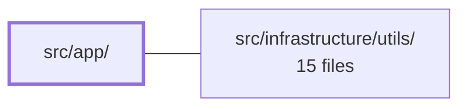

---
tags:
  - 2brain
  - 2brain/module
  - project/boilerplate-vue-frontend
type: module
module: src/app/
files: 32
updated: 2026-10-17T02:50:37.819628+00:00
---

# src/app/

## Purpose

`src/app/` is the application shell: it owns the persistent chrome (navigation bar, banners, dialogs), the central router and its guards, the layout wrapper that mounts around every route, and the site's four static prose pages plus the landing and error pages. Domain-specific functionality is delegated to modules contributed through the kernel registry; this module provides the frame in which those modules render.

## Key parts

- **Layout & shell** — `layouts/LayoutDefault.vue` is the single persistent wrapper (skip-link, banners, nav, footer, dialog/toast hosts). `components/` holds the banner trio (`AppHealthBanner`, `AppVerificationBanner`, `AppAnalyticsConsentBanner`), the idle/re-auth dialogs, and the language switcher that all live inside that shell.
- **Navigation** — `AppNavigation.vue` composes the desktop bar and mobile drawer by merging shell entries with module-contributed items (filtered through `canAccess`). Supporting pieces: `AppNavBarLink`, `AppNavIconButton`, `AppNavMenu`, `AppNavPinnedButton`, the shared `AppNavItem` type, and the `use-focus-tooltip` composable for consistent keyboard/tooltip behaviour.
- **Router & guards** — `router/index.ts` assembles all routes under `/:locale`, wires global guards, scroll behaviour, and post-navigation side-effects (a11y announcement via `announcer.ts`, focus deferral, tab-title). `guards/authentications.ts` is the single `canAccess` predicate shared by both the router guard and the nav component; `guards/locale-choice.ts` synchronises i18n state with the `:locale` param. `router/navigation.ts` and `oauth-callback.ts` handle auth-entry routing and locale re-injection on OAuth redirects; `stale-deploy.ts` recovers from Vite's stale-chunk 404.
- **Static pages & errors** — `views/` contains `Home.vue`, the four prose pages (`AboutPage`, `FaqPage`, `PrivacyPage`, `TermsPage`), the catch-all `Error.vue`, and `StaticPageLinks` (shared cross-link strip). `utils/static-pages.ts` is the single source of truth for the name→route mapping.
- **App-level utilities** — `utils/branding.ts` (product name/logo via runtime config → env → default), `utils/error-messages.ts` (validates which strings may surface verbatim), and `vue-error-handler.ts` (global last-resort error handler wired via `app.config.errorHandler`).

## How it connects

The shell's utility helpers (e.g. error formatting, shared constants) are provided by `src/infrastructure/utils/`, which this module imports rather than re-implementing. The router, guards, and navigation components in `src/app/` are the sole consumer of that shared utility surface for the app's chrome; domain modules build on the routing and access-control contracts defined here but do not import the shell components directly.

## Where to start

Read `src/app/layouts/LayoutDefault.vue` first — it is the single file that shows the full chrome stack (banners, nav, router-view, dialogs, footer) in one place and makes the component tree immediately legible. Then open `src/app/router/index.ts` to see how routes are assembled, which guards run in which order, and where module-contributed routes enter the tree. Together they give a newcomer the "outside-in" map of the entire application shell before diving into individual components.

## Connected modules

[[boilerplate-vue-frontend_src_infrastructure_utils|src/infrastructure/utils/]]

## Files
- `src/app/components/AppAnalyticsConsentBanner.vue` — A bottom-pinned consent banner for guest (non-authenticated) users. It appears while the analytics consent state is `unknown` or after the footer "Privacy choices" link re-opens it, and only when an analytics provider (Umami or Faro) is actually configured. Accept and Decline both write to the shared consent store, which the HTTP layer's `onRequest` interceptor later reads to decide whether to attach the `X-Analytics-Consent` header.
- `src/app/components/AppHealthBanner.vue` — A thin, always-mounted banner that probes the API's liveness endpoint (`GET /`) and conditionally renders a warning bar when the backend is unreachable. It communicates a *degraded* state (not a hard error) because the app still serves cached pages and bundled dictionaries without the API.
- `src/app/components/AppLanguageSwitcher.vue` — Language-switcher menu in the app header. It renders a dropdown of supported locales and, on selection, re-enters the current route under the new `:locale` param. It deliberately owns only the routing side of a switch; dictionary loading and locale persistence are delegated to the i18n runtime and the session store respectively.
- `src/app/components/AppNavBarLink.vue` — Desktop navigation-bar entry that renders a text link with a leading Lucide icon and an optional count badge on the glyph. Unlike its icon-only sibling `AppNavIconButton`, the visible label doubles as the accessible name, so no `aria-label` or tooltip is required.
- `src/app/components/AppNavIconButton.vue` — Icon-only navigation button (or router-link) for the desktop nav bar. Because the bar shows glyphs alone, this component guarantees every entry carries a proper accessible name in two places—`aria-label` for screen readers and a visible tooltip for sighted users—using the *same* string so a voice-control user can read the tooltip and speak it (WCAG 2.5.3). All non-prop attributes fall through to the inner `<v-btn>` so a parent can wrap the component as a `v-menu` activator.
- `src/app/components/AppNavMenu.vue` — A generic dropdown-menu shell that wraps an `AppNavIconButton` activator and renders an array of `AppNavItem`s as a WAI-ARIA `role="menu"` list. It exists so the account menu and the admin menu share one keyboard/interaction contract (Vuetify `v-menu` arrow-key navigation, Escape-to-close, focus management) without duplicating that logic in two places.
- `src/app/components/AppNavPinnedButton.vue` — Renders a single "pinned" entry in the app navigation bar: an icon glyph with an optional count badge and an optional live detail string (e.g. a cart total). It exists so that a pinned nav item can show richer information than a plain icon button while keeping one cohesive `aria-label` that reads the same at every viewport width.
- `src/app/components/AppNavigation.vue` — Renders the app shell's top navigation bar (desktop) and right-hand drawer (mobile). It merges the shell's own two entries with contributions from every enabled module (via the kernel registry), filters each section through `canAccess`, and produces the visible bar links, the account/admin dropdowns, the `pinned` standalone buttons, and the mobile drawer — all in one component.
- `src/app/components/AppVerificationBanner.vue` — A warning banner displayed on **every** page (mounted in the app shell) when the signed-in viewer has an unverified email address. It exists because the checkout flow rejects unproved addresses (`EMAIL_NOT_VERIFIED`), and surfacing the issue only at the point of sale would be too late. Provides a single action: re-send the verification email, gated by a server-driven cooldown.
- `src/app/components/IdleSessionDialog.vue` — A "still there?" prompt shown to staff 2 minutes before their idle session expires. It is mounted once by `LayoutDefault.vue`, counts down using the server's idle clock, and lets the user either extend the session ("Stay signed in") or end it explicitly. It exists as a WCAG 2.2.1 courtesy — the server enforces the timeout regardless.
- `src/app/components/ReauthDialog.vue` — A step-up re-authentication dialog that prompts the user to prove their identity (password, mailed code, and optionally a second-factor OTP) when a session's interceptor detects the need for a fresh token. It is mounted once alongside `<DialogHost />` in `LayoutDefault.vue`, queries the server for the applicable method, renders the matching form, and resolves the interceptor's parked requests on success.
- `src/app/components/StaticPageLinks.vue` — Renders the cross-link navigation strip at the bottom of every static prose page (About, FAQ, Terms, Privacy). By sharing a single component across all four pages, it guarantees they always present the same set of sibling links in the same order, preventing drift.
- `src/app/components/app-nav-item.ts` — Defines the `AppNavItem` interface — the shape of a single resolved navigation entry (translated, locale-prefixed, counted). It was extracted out of `AppNavMenu.vue` into a plain `.ts` file so that TypeScript-ESLint's type-aware rules can resolve it without `no-unsafe-*` noise, and so both `AppNavMenu.vue` and `AppNavigation.vue` can import the same type from a non-SFC module.
- `src/app/components/use-focus-tooltip.ts` — A small Vue composable that drives the open/close state of a `v-tooltip` from keyboard focus events, replacing Vuetify's built-in `open-on-focus` wiring. It exists to fix two specific problems in that wiring: a 50 ms "reopen lock" that drops rapid Tab-back interactions, and a synchronous-close path that creates a keyboard trap by pulling focus back onto the button. Both the icon button and the pinned button share this behavior.
- `src/app/guards/authentications.ts` — Central route-access-control module. It defines the access-level and permission types every route declares in `meta`, provides the single `canAccess` predicate shared by both the router guard and the navigation component, and handles silent session restoration after a page reload — all so that "what is reachable" and "what is shown" can never diverge.
- `src/app/guards/locale-choice.ts` — Vue Router `beforeResolve` guard that keeps the active i18n locale in sync with the `:locale` route parameter. On first use of a locale it loads the bundled JSON dictionary plus any remote overrides, registers the messages, and activates the language. If the param is missing or unsupported it redirects to the same route with the default locale injected.
- `src/app/layouts/LayoutDefault.vue` — The single-page application shell that the router mounts once for every route under `/:locale`. It provides the persistent chrome around `<RouterView />`: skip link, health/verification/consent banners, navigation, a default page hero, footer legal links, a dialog host, a toast stack, and two tiers of loading indicators. It deliberately preloads no domain data.
- `src/app/router/announcer.ts` — Holds two pieces of router-owned state that `App.vue` reads to satisfy WCAG 4.1.3 (status message on page change) and focus management: the current page-title announcement for a visually-hidden `role="status"` live region, and a one-shot flag that defers moving focus to `<v-main>` until the new route's content has actually rendered.
- `src/app/router/index.ts` — The application's central router. It assembles all routes—shell-owned pages and module-contributed domain routes collected via the kernel registry—under a `/:locale` prefix, configures global navigation guards (session restore, access enforcement, locale sync), scroll behavior, error handling, and post-navigation side effects (tab title, a11y announcement, focus management). No domain name is hard-coded here; adding or removing a domain only touches `src/modules.ts`.
- `src/app/router/navigation.ts` — Provides route-name constants and location-builder helpers for the app shell's auth entry points ("Log in" / "Sign up"). It centralises the `?continue=` mechanism so that an unauthenticated visitor is sent back to their original destination after authenticating, while remaining safe when the account module is absent from the build.
- `src/app/router/oauth-callback.ts` — Converts the raw query string from a backend OAuth redirect (`/oauth/callback?locale=…&…`) into a localized Vue Router location for the `OAuthCallback` route. It exists because the redirect lands on a locale-less backend URL, so the visitor's language must be re-applied client-side before the callback view renders.
- `src/app/router/stale-deploy.ts` — Recovery mechanism for a specific Vite SPA failure mode: an open tab whose asset manifest was replaced by a newer deploy, causing its next lazy route-chunk fetch to 404. Vite surfaces this as a `vite:preloadError` global event. This file intercepts that event, flags it, and lets `router.onError` perform a single full-page reload to the failed navigation's target. A `sessionStorage` guard ensures the reload happens at most once per tab session, so a genuinely broken build still lands on the error page instead of looping.
- `src/app/utils/branding.ts` — Centralises the two values a derived project needs to rebrand without touching source code: the product name and the logo image path. Both are read from runtime (container-level) configuration first, then Vite env vars, then a hard-coded default, so a rename is purely a deployment concern.
- `src/app/utils/error-messages.ts` — Defines a single predicate that distinguishes "known" error-page dictionary keys from arbitrary free-form strings (stale-chunk URLs, raw `Error.message` text, fetch-failure messages). This lets the UI and router show only vetted, translatable keys verbatim while collapsing everything else to one generic message, preventing implementation details from leaking into the rendered page, the URL, and Umami pageview events.
- `src/app/utils/static-pages.ts` — Centralises the shop's four prose pages (about, FAQ, terms, privacy) and the single formula that maps a page name to its router route name. By living in one place, the router, footer, and any page that cross-links its siblings all share the same source of truth instead of duplicating the mapping.
- `src/app/views/AboutPage.vue` — Static "About" page for the storefront. It renders the shop's self-introduction: a tagline + intro paragraphs, a feature grid ("what you can try"), a tech-stack list ("under the hood"), and a guided walkthrough with conditional CTA buttons. All copy is pulled from the i18n dictionary under `static-pages.about.*`; this file only declares structure, icon mappings, and route guards.
- `src/app/views/Error.vue` — A generic, catch-all error page rendered when the router's `onError` handler redirects an unhandled failure here. It displays the supplied HTTP-like status and a (validated) translated message, and offers a single "Home" action so the user can recover.
- `src/app/views/FaqPage.vue` — Renders the shop's FAQ as a series of topic headings, each with an accordion of question/answer pairs. All copy is pulled from the i18n dictionary under `static-pages.faq.topics.*`; the file itself only declares the topic keys and their order. A contact CTA card appears at the bottom only when a `Contact` route exists in the current build.
- `src/app/views/Home.vue` — Landing page of the application. Renders a static hero with a conditional call-to-action button and a three-card showcase grid. All copy is i18n-driven; the single cross-domain link (to the products list) is guarded at runtime so the page degrades gracefully when the products module is absent from the build.
- `src/app/views/PrivacyPage.vue` — Renders the site's privacy-policy page as a standalone Vue SFC. It exists as its own component (rather than reusing a shared paragraph renderer) because real policy copy will need richer structure—headings, lists, data-category tables—that a generic paragraph renderer does not provide.
- `src/app/views/TermsPage.vue` — Dedicated terms-of-service page component. It exists as its own view rather than reusing a shared paragraph renderer because legal copy requires specific structure (headings, lists, numbered clauses) that the generic renderer does not support.
- `src/app/vue-error-handler.ts` — Last-resort global error handler for the Vue app. When a component's render, setup, or watcher throws and nothing downstream catches it, this function logs the error, reports it to Faro, and shows the visitor a localized "something went wrong" notification instead of a blank page. Wired into the app via `app.config.errorHandler` in `main.ts`.

---
[[boilerplate-vue-frontend_INDEX|← boilerplate-vue-frontend index]]
