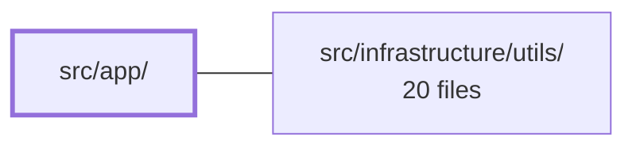

---
tags:
  - 2brain
  - 2brain/module
  - project/boilerplate-vue-frontend
type: module
module: src/app/
files: 24
updated: 2026-11-10T08:36:01.009171+00:00
---

# src/app/

## Purpose

`src/app/` is the application shell: the top-level Vue app that assembles routing, layout chrome, authentication and locale guards, accessibility plumbing, error recovery, guided-tour hosting, and the shop's static content pages (Home, About, FAQ, Terms, Privacy, Legal). Domain modules register their routes into this shell; this module itself names no domain.

## Key parts

- **Router & guards** — `router/index.ts` creates the single Vue Router instance and wires every global guard, scroll behaviour, accessibility hook, and top-level 404 shell. `guards/authentications.ts` is the one predicate (`canAccess`) both the guard and the nav component share so reachable pages and visible links never disagree. `guards/locale-choice.ts` keeps the active i18n locale in sync with the `:locale` route param. `router/navigation.ts` holds sign-in/sign-up route-name constants, `router/oauth-callback.ts` resolves the unlocalized `/oauth/callback` redirect, and `router/stale-deploy.ts` catches Vite's `vite:preloadError` for a one-shot full-page reload.
- **Layout & shell** — `layouts/LayoutDefault.vue` is the persistent chrome (banners, nav, footer, dialog/toast hosts, `<RouterView/>`) mounted once for the whole `/:locale` tree. `tours/` centralises guided-tour hosting: `catalogue.ts` + `tours.generated.ts` define what tours exist, `use-tour.ts` is the single `driver.js` integration point, and `AppTourHost.vue` is the always-mounted trigger watcher.
- **Static content views** — `views/Home.vue`, `views/AboutPage.vue`, `views/FaqPage.vue`, `views/TermsPage.vue`, `views/PrivacyPage.vue`, `views/LegalPage.vue`, and `views/Error.vue` render the shop's prose pages and the generic error fallback. Copy lives in i18n dictionaries or `GET /config`; these SFCs define only structure.
- **Shared utilities** — `utils/static-pages.ts` (plus its generated counterpart) is the single source of truth for the page-name list and route-name formula. `utils/branding.ts` resolves product name and logo from runtime config. `utils/error-messages.ts` gates which router error strings are safe to display. `vue-error-handler.ts` is the last-resort `app.config.errorHandler`.
- **Accessibility** — `router/announcer.ts` provides the live-region title announcer and the deferred focus-move-to-main-landmark helper.

## How it connects

- **Repository root (`/`)** — This module is the app that the root-level build tooling (Vite config, entry point, shared rule files such as `shared/rules/tours.yaml` and `shared/rules/static-pages.yaml`) feeds into. Generated files in `src/app/` (e.g. `tours.generated.ts`, `static-pages.generated.ts`) are produced from those root-level YAML sources.
- **`src/infrastructure/utils/`** — Provides lower-level utility helpers that the shell's guards, router hooks, and views import for cross-cutting concerns (e.g. config fetching, shared type guards). The shell depends on it but not vice-versa.

## Where to start

1. **`src/app/router/index.ts`** — Reading this top-to-bottom shows how locale-prefixed routes, the three global guards, scroll handling, accessibility announcements, and the 404 shell are all composed in one place. It is the map of the entire shell.
2. **`src/app/guards/authentications.ts`** — A short, self-contained file that clarifies the access-control contract every page and every nav link must satisfy, and the session-restore hook that runs before the first page render.

## Connected modules

[[boilerplate-vue-frontend_ROOT|/ (repository root)]] · [[boilerplate-vue-frontend_src_infrastructure_utils|src/infrastructure/utils/]]

## Files
- `src/app/guards/authentications.ts` — Single source of truth for route access control. Provides the `canAccess` predicate (consumed by both the router guard and the navigation component so reachable pages and visible links can never disagree), a silent session-restore hook for post-reload hydration, and the global `beforeEach` guard that enforces `meta.access` + `meta.can` on every navigation.
- `src/app/guards/locale-choice.ts` — A Vue Router `beforeResolve` guard that synchronises the active i18n locale with the `:locale` route parameter. It handles first-time dictionary loading (bundled JSON + remote overrides), corrects non-canonical BCP 47 casing (e.g. `/pt-br/` → `/pt-BR/`), redirects when the locale is missing or unsupported, and protects against out-of-order async completions when a user fires rapid locale switches.
- `src/app/layouts/LayoutDefault.vue` — The single layout shell the router mounts once for every route under `/:locale`. It provides the persistent chrome around the matched page—skip link, health/consent/staff banners, navigation, page hero, footer, dialog hosts, toast stack, and dual loading indicators—with `<RouterView />` in the middle for the actual page content. Because it is mounted only on the very first navigation (not per view), per-route side-effects like focus handoff live in `router/index.ts`'s `afterEach` instead of here.
- `src/app/router/announcer.ts` — Router-owned reactive state and helpers for two accessibility concerns: announcing page-title changes to screen readers via a visually-hidden live region, and deferring a focus move to the main landmark until the new page's content has actually rendered.
- `src/app/router/index.ts` — The application's single Vue Router instance. It wires together locale-prefixed routing, module-contributed domain routes (collected via the kernel registry, so this file names no domain), global navigation guards (session restore, `meta.access` enforcement, i18n locale sync), scroll behaviour, accessibility announcements, stale-deploy recovery, and the top-level 404/redirect shells that belong to the app shell rather than any module.
- `src/app/router/navigation.ts` — Defines the route-name constants and helper functions the app shell uses to send unauthenticated visitors to the sign-in or sign-up page while preserving the page they were on. The route names are plain strings (not typed) because the account module that owns them is optional at build time; every consumer must guard with `router.hasRoute` before navigating.
- `src/app/router/oauth-callback.ts` — Resolves the unlocalized `/oauth/callback` redirect (sent by the backend) into a localized Vue route location. Because `NODE_FRONTEND_URL` carries only an origin, the visitor's language is round-tripped via a `?locale=` query param; this file validates that param and maps it onto the `OAuthCallback` route.
- `src/app/router/stale-deploy.ts` — Provides a one-shot recovery path for the "stale deploy" scenario: a user's open tab references a lazily-imported route chunk that a newer deployment has already replaced, so the chunk request 404s. Vite surfaces this as a `vite:preloadError` global event; this module listens for it and, on the next router error, performs a single full-page reload to the failed navigation's target. A `sessionStorage` flag ensures the reload happens at most once per tab session, so a genuinely broken build still reaches the error page instead of looping.
- `src/app/tours/AppTourHost.vue` — A headless component (renders only a hidden ``) that centralises the two triggers for opening a guided tour: the user's first sign-in on a given browser (welcome tour) and an explicit `?tour=<id>` query parameter. By living as a single always-mounted watcher, any part of the app can request a tour simply by setting that query param, and the welcome tour fires automatically without per-screen boilerplate.
- `src/app/tours/catalogue.ts` — Pure-function catalogue that defines which guided tours this build supports, their version/auto-open metadata, and the step ordering and visibility rules the shell applies before handing steps to the DOM-driving layer (`use-tour.ts`). It exists so that tour registration, filtering, and ordering live in one importable, side-effect-free module.
- `src/app/tours/tours.generated.ts` — Auto-generated lookup table of all tour IDs and their metadata (version, auto-trigger flag) available in the current build. It exists so that runtime code can reference the authoritative set of tours without parsing YAML at runtime; the source of truth is `shared/rules/tours.yaml`.
- `src/app/tours/use-tour.ts` — The single integration point for the `driver.js` library. It exposes a `useTour()` composable that assembles, translates, and displays a tour identified by catalogue id—lazily loading driver.js and its stylesheet on first use so neither joins the boot bundle. It also handles anchor-waiting, seen-state tracking per account and tour version, and a single-active-tour guard.
- `src/app/utils/branding.ts` — Centralizes the two identity values a derived deployment changes to look like its own — product name and logo — so renaming the app requires zero source edits. Both values resolve from runtime configuration first, then Vite env vars, then a hardcoded fallback.
- `src/app/utils/error-messages.ts` — Provides a single predicate that decides whether a router error message is a known, translatable dictionary key safe to display verbatim, or whether it should be replaced with a generic fallback. This prevents free-form strings (stale-chunk URLs, raw `Error.message` values) from leaking into the page body, the URL, and Umami pageview data. Both `Error.vue` and the router's `onError` hook rely on this one check so they never disagree.
- `src/app/utils/static-pages.generated.ts` — Generated, read-only source for the canonical list of the shop's prose pages (about, faq, terms, privacy, legal). It exists so that a single YAML file (`shared/rules/static-pages.yaml`) can be the one place an editor changes the page set, and every downstream consumer gets a typed, ordered tuple without hand-syncing.
- `src/app/utils/static-pages.ts` — Single source of truth for the shop's prose pages (about, FAQ, terms, privacy, legal). Centralises the page-name list, the name→route-name formula, and an i18n paragraph resolver so the router, footer, and cross-linking pages all read from one place.
- `src/app/views/AboutPage.vue` — Renders the storefront's "About" page: an intro blurb, a feature grid showcasing what the shop offers, a tech-stack description, and a short guided walkthrough with call-to-action buttons. All human-readable text is pulled from the i18n dictionary under `static-pages.about.*`; this file only defines structure, icon pairings, and key names.
- `src/app/views/Error.vue` — Generic error page rendered when the router's `onError` handler (in `router/index.ts`) redirects the user here with a status code and a message. It displays the status in the heading, a safely-resolved translated message, and a "back to Home" action.
- `src/app/views/FaqPage.vue` — Renders the shop's FAQ page: questions grouped into four topics (shopping, orders, account, demo), each topic a heading over an accordion of expansion panels. All copy is pulled from the i18n dictionary under `static-pages.faq.topics.*`; the file itself only declares topic keys and their order. Conditionally appends a contact-form CTA when the Contact route exists in the build.
- `src/app/views/Home.vue` — The application's landing page. Renders a static hero card (title, description, optional CTA button) and a responsive grid of three translated showcase cards. Exists as the default route view that users see on first load.
- `src/app/views/LegalPage.vue` — A static legal-notice page that displays the operator's full identity and a one-line introduction. The identity data is not hardcoded here; it is sourced from `GET /config` (set via `NODE_LEGAL_*` at deployment time), so every page rendering it stays in sync without local duplication.
- `src/app/views/PrivacyPage.vue` — A dedicated privacy-policy page rendered as its own Vue SFC. It exists separately from the shared paragraph renderer because real policy copy needs structure (headings, data-category tables) that a generic paragraph list cannot express. The page combines operator identity, a replaceable legal placeholder, i18n-driven prose, a code-generated storage table, and cross-page links.
- `src/app/views/TermsPage.vue` — Dedicated terms-of-service page component. It exists as its own SFC (rather than reusing a shared paragraph renderer) because real legal copy requires specific structure—headings, lists, numbered clauses—that a generic renderer does not provide. It composes an operator identity block, an optional version line, a legal-content placeholder, and navigation links.
- `src/app/vue-error-handler.ts` — Implements the Vue app's global `app.config.errorHandler` — the last-resort catch for errors thrown during a component's render, setup, or watcher that no local error boundary handles. Instead of leaving the user a blank page, it logs the error, reports it to Faro, and shows a generic notification.

---
[[boilerplate-vue-frontend_INDEX|← boilerplate-vue-frontend index]]
