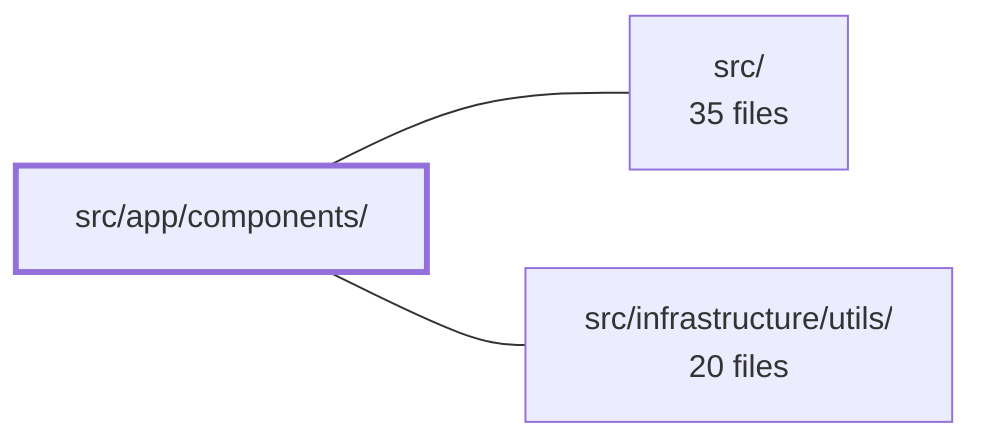

---
tags:
  - 2brain
  - 2brain/module
  - project/boilerplate-vue-frontend
type: module
module: src/app/components/
files: 19
updated: 2026-11-10T08:36:13.126817+00:00
---

# src/app/components/

## Purpose

`src/app/components/` holds the presentation-layer Vue SFCs and small composables that make up the application shell: the desktop navigation bar and mobile drawer, shell-level status banners (consent, health, enrollment, verification), cross-cutting dialogs (idle timeout, step-up re-auth), and the reusable building blocks behind the five static prose pages. Every component here is mounted outside individual route views so its state (banners, dialogs, nav items) persists across page transitions.

## Key parts

- **Navigation chrome** — `AppNavigation.vue` is the entry point; it composes `AppNavBarLink`, `AppNavIconButton`, `AppNavMenu`, and `AppNavPinnedButton` into the app bar, and renders the phone drawer. `app-nav-item.ts` exports the shared `AppNavItem` interface; `use-focus-tooltip.ts` supplies a keyboard-safe tooltip helper used by both nav-button components.
- **Language switching** — `AppLanguageSwitcher.vue` renders the bar/dropdown; `use-language-switch.ts` is the single composable that both the top bar and the phone drawer call, keeping locale state and the switch action in one place.
- **Shell-level banners** — `AppAnalyticsConsentBanner`, `AppHealthBanner`, `AppStaffEnrollmentBanner`, and `AppVerificationBanner` are always-mounted alerts that surface cross-page conditions (unresolved consent, degraded API, missing authenticator, unverified email) without requiring any route to opt in.
- **Dialogs** — `IdleSessionDialog` (WCAG 2.2.1 "still there?" prompt) and `ReauthDialog` (step-up 401 re-authentication) are mounted once in `LayoutDefault.vue` and react to app-wide stores rather than per-route state.
- **Static-page support** — `OperatorIdentityBlock`, `LegalPlaceholder`, `BrowserStorageTable`, and `StaticPageLinks` provide the legal-notice blocks, the placeholder for missing copy, the dynamic cookie/storage table, and the shared cross-link bar used by all five prose pages.

## How it connects

- **`/` (repository root)** — Components read shared, deployment-wide configuration (analytics backends, shop/operator identity, Turnstile/Faro flags) and i18n messages resolved at the root level. `BrowserStorageTable` pulls its cookie list from root-level infrastructure code; `OperatorIdentityBlock` reads core config resolved at startup.
- **`src/`** — Components import stores (`useReauthStore`, language store), composables, the kernel registry (for nav entries contributed by enabled modules), and the `canAccess` router guard. They are also consumed by layout components (`LayoutDefault.vue`) and route views that slot in static-page content.
- **`src/infrastructure/utils/`** — Utility functions (e.g., cookie/storage key enumeration, formatting helpers) are imported here so that what the UI displays stays in lock-step with what the server actually sets.

## Where to start

1. **`AppNavigation.vue`** — It is the single component that assembles the entire shell chrome (app bar + phone drawer) and shows how nav items are sourced from the kernel registry, filtered by `canAccess`, and split into `main` / `account` / `admin` sections. Reading it first gives you the mental map for every other nav component.
2. **`use-language-switch.ts`** — A short, self-contained composable that illustrates the project's pattern of centralising cross-surface state (top bar vs. phone drawer) in one function, a pattern that repeats throughout the module.

## Connected modules

[[boilerplate-vue-frontend_ROOT|/ (repository root)]] · [[boilerplate-vue-frontend_src|src/]] · [[boilerplate-vue-frontend_src_infrastructure_utils|src/infrastructure/utils/]]

## Files
- `src/app/components/AppAnalyticsConsentBanner.vue` — A fixed-bottom consent banner that asks visitors to accept or decline analytics tracking (Umami usage statistics, Faro crash reports and page-speed data). It is shown only while the consent choice is still `unknown` (or reopened via the footer "privacy choices" link) and only when at least one analytics backend is configured.
- `src/app/components/AppHealthBanner.vue` — Presentational banner that appears only when the API health endpoint stops responding. It signals a **degraded** state (not a full outage) because the app continues to render from bundled dictionaries and cached pages without a live backend.
- `src/app/components/AppLanguageSwitcher.vue` — Renders the language-switcher button and dropdown menu in the app bar. It delegates all language logic (available locales, active locale, label formatting, draft detection, and the switch action) to the shared `useLanguageSwitch` composable so that the phone drawer can present the same choices without duplicating state.
- `src/app/components/AppNavBarLink.vue` — Renders a single desktop navigation-bar entry as a full-text link: a lucide icon glyph followed by a visible label, with an optional count badge on the glyph. It is the text-label counterpart to `AppNavIconButton`, used where the label has enough horizontal room to display.
- `src/app/components/AppNavIconButton.vue` — Renders a single icon-only button (or router link) in the desktop navigation bar. It ensures every glyph carries a proper accessible name (`aria-label`) and a visible tooltip from the **same** string, satisfying WCAG 2.5.3 for voice-control users. It also serves as a drop-in activator for parent `v-menu` wrappers by forwarding all non-prop attributes to the inner `<v-btn>`.
- `src/app/components/AppNavMenu.vue` — A generic dropdown-menu shell that wraps `AppNavIconButton` and renders an array of `AppNavItem`s inside a Vuetify `v-menu` with `role="menu"` semantics. It serves both the account menu and the admin menu, giving them a shared keyboard contract (ArrowDown opens, arrows navigate, Escape closes) and an ARIA-correct menu/menuitem structure.
- `src/app/components/AppNavPinnedButton.vue` — Renders a single pinned item in the app navigation bar: an icon glyph with an optional count badge and an optional live detail string (e.g. a cart total) that collapses on narrow viewports. Composes a single `aria-label` so screen-reader output matches the visual layout at any width.
- `src/app/components/AppNavigation.vue` — Renders the application shell's navigation chrome: the desktop app bar (logo, nav links, account/admin menus, pinned buttons) and the mobile phone drawer. It merges the shell's own two entries (Home, About) with whatever entries enabled modules contribute through the kernel registry, filters them through the `canAccess` guard so the UI mirrors exactly what the router would allow, and presents the result across three sections (`main`, `account`, `admin`).
- `src/app/components/AppStaffEnrollmentBanner.vue` — A shell-level Vuetify `v-alert` banner that appears on **every** page when a signed-in staff user still needs to enroll an authenticator app. It exists because a staff role grants no menu access until an app is armed, so the user would otherwise see a silently missing staff menu with no explanation. The banner explains *why* and links to the Profile page to fix it.
- `src/app/components/AppVerificationBanner.vue` — A shell-level Vuetify alert that prompts a signed-in but unverified user to re-send their email-verification link. Because it is mounted in the app shell (outside route views), it appears on every page, catching the visitor early rather than at checkout where an unverified address would hard-fail (`EMAIL_NOT_VERIFIED`).
- `src/app/components/BrowserStorageTable.vue` — Renders the "Cookies and storage" table (`#cookies`) on the privacy page. It dynamically lists every cookie/storage key the current deployment actually sets, pulling the item list from infrastructure code and resolving display text through i18n. The component adapts its rows to the shop's configuration (analytics, Faro, Turnstile) so operators see only what applies.
- `src/app/components/IdleSessionDialog.vue` — Staff idle-timeout courtesy dialog. Mounted once by `LayoutDefault.vue`, it renders a "still there?" prompt two minutes before the server's idle limit would expire, giving the visitor a chance to stay signed in rather than being silently dropped (WCAG 2.2.1 Timing Adjustable). The server enforces the timeout regardless; this component is the UX layer on top.
- `src/app/components/LegalPlaceholder.vue` — A stand-in rendered on the Terms and Privacy pages until the operator writes real legal copy. It displays a warning alert ("text is missing") and a headings-only checklist of what the real text must cover. It deliberately contains **no** legal wording so a multi-tenant demo cannot ship words a shop might mistake for its own.
- `src/app/components/OperatorIdentityBlock.vue` — Renders the site operator's legal identity (name, address, email, VAT, phone, trade register, registration number) as a definition list, satisfying e-Commerce Directive Art. 5 and GDPR Art. 13(1)(a). Intended for use on the Terms, Legal Notice, and Privacy pages. Renders nothing until the shared config has resolved, and works without a shop because it reads the core config only.
- `src/app/components/ReauthDialog.vue` — Step-up re-authentication dialog. It is mounted once in `LayoutDefault.vue` (beside `<DialogHost />`) and reacts to the reauth-prompt store: when an interceptor parks a request on a 401, this dialog asks the server which method the account can use (password or emailed code), renders the appropriate form, and on submit calls `useReauthStore().reauth()` directly. A wrong answer keeps the dialog open for retry; any other close rejects the parked requests.
- `src/app/components/StaticPageLinks.vue` — Renders the bottom cross-link bar shared by all five static prose pages (About, FAQ, Terms, Privacy, Legal). By living in a single component, it guarantees the five pages never drift on which siblings they link to or in what order.
- `src/app/components/app-nav-item.ts` — Single-purpose type file that exports the `AppNavItem` interface. It was extracted from `AppNavMenu.vue` because TypeScript-ESLint's type-aware rules (`no-unsafe-*`) could not reliably resolve types exported from `.vue` SFCs, producing spurious lint errors. The shape is plain data with no SFC-specific logic, so it lives here as a `.ts` module both components can import.
- `src/app/components/use-focus-tooltip.ts` — A small Vue composable that replaces Vuetify's built-in `open-on-focus` wiring for nav-button tooltips, giving the caller an explicit open state and two listeners. It exists because Vuetify's default focus handling has a 50 ms reopen lock and a synchronous close that creates a keyboard trap; both are problems here. Shared by the two nav-button components so they behave identically.
- `src/app/components/use-language-switch.ts` — A single composable that bundles everything a UI surface needs to let a visitor change the app language: the list of choices, the active locale, a localised label helper, draft detection, and the navigation action. Both the top-bar language menu and the phone-drawer language entries call this one function so the switching logic stays in one place.

---
[[boilerplate-vue-frontend_INDEX|← boilerplate-vue-frontend index]]
