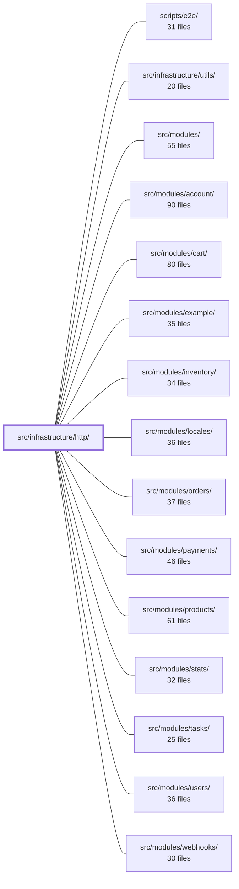

---
tags:
  - 2brain
  - 2brain/module
  - project/boilerplate-vue-frontend
type: module
module: src/infrastructure/http/
files: 20
updated: 2026-11-10T08:36:28.179628+00:00
---

# src/infrastructure/http/

## Purpose

The transport layer of the application. It owns everything that happens between the app and the network: the shared axios instance, authentication and session lifecycle over HTTP, runtime contract validation of every request/response, and the safety rails (idempotency, ETag, single-flight, keep-alive) that keep client-side writes reliable. Domain modules never touch the network directly; they call the single `orvalMutator` exported from this module.

## Key parts

- **Composition root & client** — `index.ts` registers all interceptors onto the axios instance defined in `client.ts` and exports `orvalMutator`, the one function every generated API client funnels through. `types.ts` supplies the shared error/retry shapes those interceptors rely on.
- **Auth & session over the wire** — `interceptors.ts` injects bearer tokens, locale, and consent headers on the request path and normalises every failure into one envelope on the response path. `refresh.ts` handles 401 token renewal-and-replay (and degrades to guest on terminal failures). `step-up.ts` intercepts `REAUTH_REQUIRED` 401s, parks the request, and replays it after the user re-proves. `reauth-prompt.ts` is the small Pinia store that tracks the open/closed state of that dialog. `passive.ts` tags app-initiated calls so the backend's idle timer isn't reset by housekeeping traffic.
- **Write safety** — `idempotency.ts` mints and retires `Idempotency-Key` headers. `etag.ts` replays `If-Match` on conditional writes. `single-flight.ts` coalesces concurrent duplicates (token refresh, reauth). `keepalive.ts` fires a `fetch(keepalive:true)` write that survives `pagehide` where XHR would be cancelled.
- **Contract validation** — `validate.ts` Zod-parses request bodies and response bodies at the mutator boundary. `response-schema-map.ts` is the generated route→schema table it resolves against. `problem.ts` and `envelope.ts` build and read RFC 9457 Problem Details so every rejection has a uniform shape. `contract-mismatch-text.ts` centralises the diagnostic phrase so producers and the Cypress hook agree on wording.
- **Miscellaneous helpers** — `url.ts` normalises paths for route matching. `download.ts` turns a `Content-Disposition` blob into a named `File`. `antibot.ts` wraps the two ALTCHA calls `HumanCheck.vue` needs without breaking the `.vue → @api` import ban.

## How it connects

- **`orval.config.ts` (repo root)** points every generated API client at `index.ts` / `orvalMutator`, making this module the single entry point for all outbound HTTP.
- **`src/modules/*`** (account, cart, orders, products, etc.) are the primary consumers: they call the generated clients, which route through this module. They never import axios or the interceptors directly.
- **`src/infrastructure/utils/`** provides low-level helpers (e.g. the `content-disposition` parser used by `download.ts`, and `@guebbit/js-toolkit` primitives) that this module imports as leaves.
- **`src/ui/composables/`** reads `reauth-prompt.ts` (the Pinia store) to render the step-up dialog without crossing a tier boundary.
- **`scripts/e2e/`** (Cypress) imports `contract-mismatch-text.ts` so the e2e assertion matches the exact diagnostic string the runtime validators emit.

## Where to start

1. **`index.ts`** — read it first because it is the public surface: you see which interceptors are wired, in what order, and the single `orvalMutator` that every request passes through. It gives you the skeleton in ~80 lines.
2. **`interceptors.ts`** — once you know the shape of the pipeline, this file shows how a bare axios call becomes an authenticated, locale-tagged, error-normalised request. Understanding the request and response interceptor pair explains why downstream `catch` blocks can destructure a single uniform envelope.

## Connected modules

[[boilerplate-vue-frontend_ROOT|/ (repository root)]] · [[boilerplate-vue-frontend_scripts_e2e|scripts/e2e/]] · [[boilerplate-vue-frontend_src_infrastructure_utils|src/infrastructure/utils/]] · [[boilerplate-vue-frontend_src_modules|src/modules/]] · [[boilerplate-vue-frontend_src_modules_account|src/modules/account/]] · [[boilerplate-vue-frontend_src_modules_cart|src/modules/cart/]] · [[boilerplate-vue-frontend_src_modules_example|src/modules/example/]] · [[boilerplate-vue-frontend_src_modules_inventory|src/modules/inventory/]] · [[boilerplate-vue-frontend_src_modules_locales|src/modules/locales/]] · [[boilerplate-vue-frontend_src_modules_orders|src/modules/orders/]] · [[boilerplate-vue-frontend_src_modules_payments|src/modules/payments/]] · [[boilerplate-vue-frontend_src_modules_products|src/modules/products/]] · [[boilerplate-vue-frontend_src_modules_stats|src/modules/stats/]] · [[boilerplate-vue-frontend_src_modules_tasks|src/modules/tasks/]] · [[boilerplate-vue-frontend_src_modules_users|src/modules/users/]] · … and 3 more

## Files
- `src/infrastructure/http/antibot.ts` — Front-end glue for the backend's `humanChallengeGate` (ALTCHA anti-bot flow). It exists because no domain module owns this "rung 3" concern, and `no-restricted-imports` forbids `.vue` components from importing `@api` directly—so the two calls `HumanCheck.vue` needs live here.
- `src/infrastructure/http/client.ts` — The leaf node of the HTTP tier: a single, pre-configured axios instance that every API client in the app goes through. It exists as a dedicated, import-safe module so that higher-level wiring (interceptors, error handling) in `index.ts` never risks a circular import back into this file.
- `src/infrastructure/http/contract-mismatch-text.ts` — A single-constant module that centralises the phrase every `[contract] … does not match the …` diagnostic emits. It exists so that the three producers (request/response validators, SSE client) and the Cypress e2e hook all agree on the exact wording without duplicating the string, and so a reword is a one-line change rather than a multi-file hunt.
- `src/infrastructure/http/download.ts` — Client-side download helper that turns a blob `AxiosResponse` carrying a `Content-Disposition` header (RFC 6266 / 8187) into a `File` object bearing the server-specified name. Call sites then save `file.name` without inventing one. It is a leaf of the HTTP tier: it imports only the `content-disposition` parser and `@guebbit/js-toolkit`.
- `src/infrastructure/http/envelope.ts` — Provides runtime type-guard readers for the `errors` array in an RFC 9457 problem-document rejection envelope. It exists at the transport layer because the problem shape is a property of the wire protocol: every refusal arrives in it, and none of that concern belongs in a session store. Success responses are not touched here — their body is the payload itself.
- `src/infrastructure/http/etag.ts` — Client-side ETag bookkeeping for conditional writes. It remembers the `ETag` returned by reads and patches, then replays it as `If-Match` on subsequent PUT/PATCH/DELETE of the same resource so the server can reject stale edits with 412. Wired onto the shared axios instance so every edit form gets the behavior without explicit wiring.
- `src/infrastructure/http/idempotency.ts` — Provides a reusable `Idempotency-Key` lifecycle for guarded HTTP writes. It mints a UUID per user intent, retains the key only while the first attempt may still be in-flight or was lost (connection drop, `409 IDEMPOTENCY_IN_FLIGHT`), and mints a fresh key after **any** response—including 5xx—because the backend stores every answer and replays it for the same key, so resending a used key would replay the fault.
- `src/infrastructure/http/index.ts` — Composition root of the HTTP tier. Imports every leaf module, registers the interceptors onto the shared axios instance in the correct order, and exports `orvalMutator` — the single function through which all generated-client requests flow. It is the tier's public surface: `orval.config.ts` points every generated client here, and interceptor specs import the re-exported handlers from this module.
- `src/infrastructure/http/interceptors.ts` — Defines the axios request/response interceptors for the application's HTTP client. On the request path it injects the bearer token, the active locale, session-activity signalling, and (for anonymous callers only) the guest's analytics-consent header. On the response path it normalises every failure—transport loss, proxy error, or API problem detail—into one consistent rejection envelope that downstream `catch` blocks can destructure uniformly.
- `src/infrastructure/http/keepalive.ts` — Provides a fire-and-forget HTTP write (`PUT`/`PATCH`/`POST`) that survives page unload by using `fetch` with `keepalive: true`. It exists because the generated axios client's XHR is canceled when the page goes away, and `sendBeacon` cannot carry an `Authorization` header. This is the only browser mechanism that lets a request finish after `pagehide` while still carrying a bearer token.
- `src/infrastructure/http/passive.ts` — Provides a small helper for tagging outgoing HTTP requests as *passive*—i.e. initiated by the app itself rather than by the human in the tab. The paired backend's session guard treats any request lacking this marker as staff activity, which would reset the idle timer; passive calls (token refresh, abilities re-read, notifications sync) must carry it so an unattended tab can actually idle out.
- `src/infrastructure/http/problem.ts` — Builds and reads RFC 9457 Problem Details objects on the client side, so that every rejection a caller catches has the same shape regardless of whether the server sent one or the client synthesised it (dropped connection, proxy error, contract violation). Also handles the edge case where a problem JSON body arrived as a raw string or Blob because axios was configured with a non-JSON `responseType`.
- `src/infrastructure/http/reauth-prompt.ts` — Pinia store that tracks the single open/closed state of the step-up (re-authentication) prompt. It exists in the `infrastructure/` tier rather than `ui/` so that `step-up.ts` can read it directly without violating the tier-import rules defined in `eslint.config.ts`. It resolves `void` (not `boolean`) because a step-up answers "a fresh session now exists," not a yes/no.
- `src/infrastructure/http/refresh.ts` — Response-error interceptor that implements the refresh-and-retry flow. On a 401 (outside excluded auth endpoints) it renews the token via the session store and replays the original request exactly once. It also handles the terminal cases—idle timeout, cookie-mode expiry, and a refresh the server refused outright—by replaying the request as a guest so a product page degrades to anonymous access instead of showing an error.
- `src/infrastructure/http/response-schema-map.ts` — Route table that maps every `orvalMutator` call site (HTTP method + URL pattern) to its Zod response and request-body schemas. It exists so a live contract violation is caught at the mutator boundary without each call site knowing which OpenAPI operation it serves. All rows are generated from `openapi.yaml` (via `@api/routes`), so the method/pattern/schema triple cannot drift from the contract by hand-editing.
- `src/infrastructure/http/single-flight.ts` — Provides two small combinators that guarantee concurrent callers of an async operation share a single in-flight promise instead of each kicking off a duplicate request. Exists so that token renewal (`refresh.ts`) and reauth prompts (`step-up.ts`) — and any button-driven action lacking an `Idempotency-Key` — can coalesce overlapping triggers into one network call.
- `src/infrastructure/http/step-up.ts` — Response interceptor that handles the step-up authentication flow. When the API returns a `401` with code `REAUTH_REQUIRED`, it parks the failing request, opens a single reauth dialog (single-flight), and replays the parked request once the user has re-proved their password. Every other `401` is delegated unchanged to the existing refresh-and-retry path.
- `src/infrastructure/http/types.ts` — Defines the shared type aliases for the HTTP tier: the request/error payload shapes and the retry-loop-guard config extension. Centralizing these keeps `interceptors.ts`, `refresh.ts`, and `step-up.ts` in agreement on what a normalized error looks like and which flags mark a request as already retried.
- `src/infrastructure/http/url.ts` — Single-point URL normalisation for the HTTP layer. Converts any request URL (absolute or relative) into a consistent pathname so that route matching and exclusion logic agree on the same shape of identifier.
- `src/infrastructure/http/validate.ts` — Runtime contract validation for the `orvalMutator` HTTP layer. It Zod-parses outgoing request bodies and incoming response bodies against the schemas resolved by the response-schema-map, enforcing at runtime the type guarantees the generated client makes. It gates on feature flags and a production-vs-dev distinction so that a backend adding a field never becomes a frontend outage.

---
[[boilerplate-vue-frontend_INDEX|← boilerplate-vue-frontend index]]
