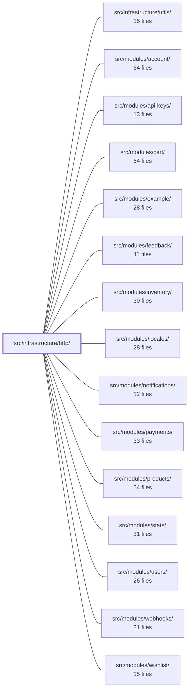

---
tags:
  - 2brain
  - 2brain/module
  - project/boilerplate-vue-frontend
type: module
module: src/infrastructure/http/
files: 16
updated: 2026-10-17T02:50:51.376619+00:00
---

# src/infrastructure/http/

## Purpose

The HTTP transport layer for the entire application. It owns the single shared axios instance, wires every interceptor onto it, and exposes `orvalMutator` as the one function through which all API calls—generated or hand-written—pass. It also handles cross-cutting HTTP concerns (auth refresh, step-up reauth, ETag concurrency, idempotency, response contract validation) so that feature modules never have to deal with them directly.

## Key parts

- **Core plumbing** — `client.ts` creates the shared axios instance (kept free of app-level imports to avoid circular evaluation). `index.ts` is the composition root: it attaches all interceptors and exports `orvalMutator`, which `orval.config.ts` points every generated client at. `interceptors.ts` decorates outgoing requests (auth, locale, analytics-consent) and normalises rejections into a single error shape.
- **Auth & session flow** — `refresh.ts` implements the 401 → refresh-token → replay loop. `step-up.ts` intercepts the separate `REAUTH_REQUIRED` 401, parks the request, and replays it after re-identity. `reauth-prompt.ts` is a small Pinia store that exposes a promise-based open/close API so the interceptor can `await` without knowing about the UI. `antibot.ts` re-exports the two anti-bot API calls for `HumanCheck.vue` (bypassing the ESLint restriction on `.vue` → `@api` imports) and provides helpers to attach the solved token and detect the "show the widget" 401.
- **Contract validation** — `envelope.ts` provides type-guard readers for the `{ data }` and `{ errors }` wire shapes. `response-schema-map.ts` maps every method + URL pattern to a Zod schema (generated from `openapi.yaml`, loaded lazily). `validate.ts` enforces those schemas at the `orvalMutator` boundary—throwing in dev/test, reporting to Faro in production.
- **Reliability helpers** — `etag.ts` tracks per-resource ETags and re-sends `If-Match` on writes. `idempotency.ts` mints a per-intent `Idempotency-Key` via a Vue composable. `single-flight.ts` coalesces concurrent calls (token refresh, reauth prompt) into one in-flight promise. `keepalive.ts` issues a `fetch` with `keepalive: true` for fire-and-forget writes that must survive page unload.
- **Shared types & URL utils** — `types.ts` holds the request/response payload aliases and retry-loop-guard config shared by the interceptors. `url.ts` normalises any Axios URL into the canonical pathname used for route matching and exclusion filtering.

## How it connects

- **`src/modules/*`** (account, api-keys, cart, payments, products, users, etc.) are the primary consumers: every API call they make flows through `orvalMutator` in `index.ts`. They never import `client.ts` or the interceptors directly.
- **`src/ui/composables/`** — the `useIdempotencyKey` composable in `idempotency.ts` is a Vue composable usable alongside other UI-layer composables; `reauth-prompt.ts` is a Pinia store that the UI layer renders against.
- **`src/infrastructure/utils/`** — shared low-level utilities (string helpers, etc.) that the HTTP tier may import for small concerns.
- **Repository root** — `orval.config.ts` and `scripts/contracts/generate-route-table.ts` live here and point into this module; `response-schema-map.ts` is generated by that script.

## Where to start

1. **`index.ts`** — it is the public surface of the tier. Reading it shows how the client, interceptors, ETag, step-up, and validation layers are composed into the single `orvalMutator` export.
2. **`client.ts`** — a short, dependency-free file that establishes the base axios instance and its defaults. Understanding what it does *not* import (no app code) clarifies why the tier can be pulled in without circular-evaluation surprises.

## Connected modules

[[boilerplate-vue-frontend_ROOT|/ (repository root)]] · [[boilerplate-vue-frontend_src_infrastructure_utils|src/infrastructure/utils/]] · [[boilerplate-vue-frontend_src_modules_account|src/modules/account/]] · [[boilerplate-vue-frontend_src_modules_api-keys|src/modules/api-keys/]] · [[boilerplate-vue-frontend_src_modules_cart|src/modules/cart/]] · [[boilerplate-vue-frontend_src_modules_example|src/modules/example/]] · [[boilerplate-vue-frontend_src_modules_feedback|src/modules/feedback/]] · [[boilerplate-vue-frontend_src_modules_inventory|src/modules/inventory/]] · [[boilerplate-vue-frontend_src_modules_locales|src/modules/locales/]] · [[boilerplate-vue-frontend_src_modules_notifications|src/modules/notifications/]] · [[boilerplate-vue-frontend_src_modules_payments|src/modules/payments/]] · [[boilerplate-vue-frontend_src_modules_products|src/modules/products/]] · [[boilerplate-vue-frontend_src_modules_stats|src/modules/stats/]] · [[boilerplate-vue-frontend_src_modules_users|src/modules/users/]] · [[boilerplate-vue-frontend_src_modules_webhooks|src/modules/webhooks/]] · … and 2 more

## Files
- `src/infrastructure/http/antibot.ts` — Front-end utilities for the human-challenge (anti-bot) gate. Because the ESLint `no-restricted-imports` rule forbids `.vue` files from importing `@api` directly, this module re-exports the two `@api` calls (`getAntibotConfig`, `getAntibotChallenge`) that `HumanCheck.vue` needs, and provides helpers to attach a solved challenge token to outgoing requests and to detect the specific 401 that means "show the widget and retry."
- `src/infrastructure/http/client.ts` — Creates and exports a single shared axios instance that every API client in the app routes through. It sits at the leaf of the http tier and is intentionally free of app-level imports so it can be pulled in without triggering circular evaluation of `index.ts`.
- `src/infrastructure/http/envelope.ts` — Type-guard readers for the two response envelopes the API uses: the `{ data }` success wrapper and the `{ errors: [...] }` rejection list. Every function starts from `unknown` and narrows structurally, so no declared type is trusted past the wire. It lives in the transport layer (not a store) because the envelope shape is a property of the HTTP boundary, shared by all endpoints.
- `src/infrastructure/http/etag.ts` — Client-side ETag bookkeeping for conditional writes. It remembers the `ETag` each resource last answered with and re-sends it as `If-Match` on subsequent PUT/PATCH/DELETE requests so the server can reject stale edits (412). Wired transparently onto the shared axios instance by `index.ts`, so edit forms get it without explicit code.
- `src/infrastructure/http/idempotency.ts` — Provides a Vue composable (`useIdempotencyKey`) that mints and tracks a single `Idempotency-Key` header value per user intent (e.g. one payment step, one form submission). The key survives retryable failures (transport errors, 5xx) so the server can deduplicate retries, and is replaced with a fresh UUID after any definitive response (success or 4xx), signaling that the next attempt is a genuinely new intent.
- `src/infrastructure/http/index.ts` — Composition root of the HTTP tier. It wires all interceptors onto the shared axios instance (from `client.ts`) and exports `orvalMutator` as the single function through which every API call—generated or hand-written—passes. `orval.config.ts` points all generated clients at this export, making this file the tier's public surface.
- `src/infrastructure/http/interceptors.ts` — Defines the axios request/response interceptors that decorate outgoing requests with auth, locale, and analytics-consent headers, and normalize every rejection into a single error-envelope shape. Token refresh is deliberately absent (see `refresh.ts`).
- `src/infrastructure/http/keepalive.ts` — Provides a fire-and-forget JSON write that survives page unload. The generated client rides axios (XHR), which is cancelled the moment the page goes away; `fetch` with `keepalive: true` is the one browser mechanism that lets a request finish after `pagehide` while still carrying a bearer token (unlike `sendBeacon`, which is POST-only and has no header support).
- `src/infrastructure/http/reauth-prompt.ts` — A Pinia store that holds the open/closed state of the step-up re-authentication prompt and exposes a promise-based API so the HTTP interceptor can `await` a result without knowing anything about the UI. It resolves `void` (meaning "a fresh session now exists") rather than a `boolean`, distinguishing itself from the general-purpose confirm dialog in `ui/dialog.ts`.
- `src/infrastructure/http/refresh.ts` — Response-error interceptor that implements the refresh-and-retry flow: on a 401 (excluding auth endpoints), it calls `session.refreshToken()` once and replays the original request. In `cookie` mode there is no refresh endpoint, so a 401 immediately ends the session instead.
- `src/infrastructure/http/response-schema-map.ts` — Maps every HTTP method + URL-pattern pair to a Zod response (and optional request-body) schema so that live contract violations are caught at the `orvalMutator` boundary. Routes are generated from `openapi.yaml` (via `scripts/contracts/generate-route-table.ts`) rather than hand-typed, and the ~350 KB `@api/schemas` chunk is loaded lazily through a single dynamic `import()` so it never lands in every entry bundle.
- `src/infrastructure/http/single-flight.ts` — Provides a minimal single-flight (request coalescing) wrapper so that concurrent callers of an async operation share one in-flight promise instead of each kicking off a duplicate. It exists to de-duplicate work that must happen at most once at a time—token refresh, reauth prompts—without pulling in a full library.
- `src/infrastructure/http/step-up.ts` — Response interceptor that handles the step-up authentication flow: when the server rejects a request with a `REAUTH_REQUIRED` 401, this file parks the request, surfaces a single reauth prompt, and replays the request once the visitor has re-proven their identity. All other 401s fall through to the standard refresh-and-retry path untouched.
- `src/infrastructure/http/types.ts` — Shared type aliases for the HTTP tier. Defines the request/response payload shapes and the retry-loop-guard config extension that `interceptors.ts`, `refresh.ts`, and `step-up.ts` all reference, keeping the contract in one place.
- `src/infrastructure/http/url.ts` — Single-source utility that normalises an Axios request URL (absolute or relative) into the pathname the HTTP layer uses for matching. It exists so that every consumer derives the same canonical pathname from a raw URL, preventing mismatches between route-pattern lookup and exclusion filtering.
- `src/infrastructure/http/validate.ts` — Contract-validation layer for the `orvalMutator` HTTP client. It Zod-parses every response body (and, separately, every outgoing JSON body) against the schema that `response-schema-map.ts` resolves for the route. Behaviour is profile-dependent: dev/test/e2e profiles throw on mismatch so drift is caught at the source; production reports to Faro and lets the call through so a single additive backend field never becomes a frontend outage.

---
[[boilerplate-vue-frontend_INDEX|← boilerplate-vue-frontend index]]
