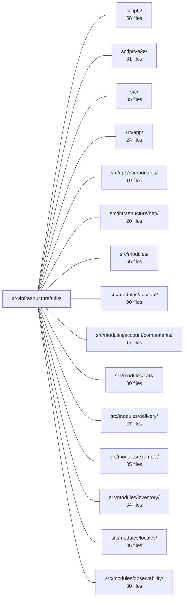

---
tags:
  - 2brain
  - 2brain/module
  - project/boilerplate-vue-frontend
type: module
module: src/infrastructure/utils/
files: 20
updated: 2026-11-10T08:36:46.992974+00:00
---

# src/infrastructure/utils/

## Purpose

`src/infrastructure/utils/` is the shared, dependency-light toolbox for the entire application. It collects pure helpers (string shaping, decimal math, sort-grammar conversion), thin Vue composables (error surfacing, stale-record handling, token extraction), and small invariants (single-flight guarding, ticket ordering, safe storage) that are too small to warrant their own module but are used across many feature areas. Every file here is leaf-level: it imports from `src/infrastructure/http/`, `src/modules/observability/`, or third-party packages, but never from a sibling feature module.

## Key parts

- **Error handling & surfacing** — `errors.ts` defines the RFC 9457 → user-sentence pipeline, the retryable/idempotency classifiers, and the `notifyErrorMessages` toast+Faro pair. `use-ambient-error.ts` wraps that for fire-and-forget background reads; `use-blocking-error.ts` keeps the message inline on a single form; `use-missing-record.ts` redirects on 404/403; `use-stale-record.ts` centralises 412 (Precondition Failed) recovery for edit forms.
- **Form-to-wire & data shaping** — `forms.ts` translates a changed-field set into the RFC 7396 request body (the single boundary where form state becomes JSON). `money.ts` performs all arithmetic on `BigInt` minor units so floating-point never touches an amount. `sort.ts` converts between JSON:API, `SingleSort`, and Vuetify's sort model. `formatters.ts` binds `@guebbit/js-toolkit` formatters to the active locale and a shared empty glyph. `day-range.ts` expands a `YYYY-MM-DD` string into UTC day bounds.
- **Concurrency & state safety** — `request-ticket.ts` provides a monotonic ticket so stale async answers can never overwrite fresh ones. `single-flight.ts` drops re-entrant async calls while a previous one is pending. `use-reset-on-viewer-change.ts` clears per-person Pinia state when the signed-in viewer changes.
- **Storage, images, uploads** — `safe-storage.ts` wraps `localStorage`/`sessionStorage` and `JSON.parse` so callers never see exceptions. `images.ts` resolves relative API image paths to absolute URLs and supplies a fallback. `uploads.ts` mirrors the backend's size/type limits client-side via a Zod schema (UX affordance, not a security boundary).
- **Reference data & constants** — `country-codes.ts` holds the full ISO 3166-1 alpha-2 list as a plain in-repo constant (avoids a stale npm dependency). `address-limits.ts` re-exports the `CreateAddressRequest` max-length constants for `.vue` files that cannot import the `@api` package directly.
- **Logging** — `logger.ts` is the sole sanctioned `console` boundary; four severity functions gated by a level ceiling and an opt-in scope set resolved from environment variables at load time.
- **Auth token handling** — `use-link-token.ts` reads and cleans a one-time token from the URL fragment (`#token=…`) so it never appears in `Referer` headers or server logs.

## How it connects

- **`src/infrastructure/http/`** — `errors.ts` consumes the `onResponseReject` problem-details envelope produced by the HTTP layer; `forms.ts` and `money.ts` shape the request bodies that the HTTP layer transmits.
- **`src/modules/observability/`** — `use-blocking-error.ts` and `use-ambient-error.ts` push events into the observability (Faro) store. The composable lives here rather than in `src/ui/composables/` because the UI tier's ESLint boundary rules forbid importing that store.
- **`src/modules/locales/`** — `formatters.ts` resolves the active locale before delegating to `@guebbit/js-toolkit`, so call sites never pick a locale independently.
- **Feature modules (`src/modules/cart/`, `wishlist/`, `orders/`, `payments/`, `products/`, `returns/`, etc.)** — these are the primary consumers: they call `request-ticket.ts` to order async writes, `single-flight.ts` to guard double-submits, `forms.ts` to build request bodies, `money.ts` for display and input parsing, `safe-storage.ts` for session caching, `use-reset-on-viewer-change.ts` to clear per-person state, and the error composables to surface failures.
- **`src/app/`** — `use-missing-record.ts` redirects to the app-level Error page; `logger.ts` is imported app-wide as the only legal `console` outlet.
- **`src/ui/composables/`** — sibling tier; `use-blocking-error.ts` intentionally lives in this module (not there) to stay within the allowed import graph.

## Where to start

1. **`errors.ts`** — reading it first shows the canonical shape of every failure in the app (problem-details → sentence → toast/Faro) and introduces the ambient-vs-blocked split that several other files build on.
2. **`forms.ts`** — it is the single choke-point where UI state becomes a wire payload; understanding its baseline-diff + Zod-empty-spelling logic makes the rest of the form-to-API flow (in `src/infrastructure/http/` and feature stores) far easier to follow.

## Connected modules

[[boilerplate-vue-frontend_ROOT|/ (repository root)]] · [[boilerplate-vue-frontend_scripts|scripts/]] · [[boilerplate-vue-frontend_scripts_e2e|scripts/e2e/]] · [[boilerplate-vue-frontend_src|src/]] · [[boilerplate-vue-frontend_src_app|src/app/]] · [[boilerplate-vue-frontend_src_app_components|src/app/components/]] · [[boilerplate-vue-frontend_src_infrastructure_http|src/infrastructure/http/]] · [[boilerplate-vue-frontend_src_modules|src/modules/]] · [[boilerplate-vue-frontend_src_modules_account|src/modules/account/]] · [[boilerplate-vue-frontend_src_modules_account_components|src/modules/account/components/]] · [[boilerplate-vue-frontend_src_modules_cart|src/modules/cart/]] · [[boilerplate-vue-frontend_src_modules_delivery|src/modules/delivery/]] · [[boilerplate-vue-frontend_src_modules_example|src/modules/example/]] · [[boilerplate-vue-frontend_src_modules_inventory|src/modules/inventory/]] · [[boilerplate-vue-frontend_src_modules_locales|src/modules/locales/]] · … and 11 more

## Files
- `src/infrastructure/utils/address-limits.ts` — Provides a single, neutral import path for address-field max-length constants. It exists so that `.vue` view files— which cannot import the `@api` package directly—can still read the same limits the API enforces on `CreateAddressRequest` fields.
- `src/infrastructure/utils/country-codes.ts` — Static reference data containing the full list of current ISO 3166-1 alpha-2 country codes. It exists as a plain in-repo constant to avoid a runtime dependency (`i18n-iso-countries`) whose last release fell outside the repo's 12-month maintenance window. There is no logic in this file—only data.
- `src/infrastructure/utils/day-range.ts` — Converts a calendar-day string (`YYYY-MM-DD`) into the first or last UTC instant of that day, providing the inclusive lower/upper bounds needed by the staff-list `…From` / `…To` filters (orders, payments). Pure, dependency-free utility.
- `src/infrastructure/utils/errors.ts` — Shared error-handling primitives for the entire app. It turns an unknown rejected value (the RFC 9457 problem-details envelope from `onResponseReject`) into a user-facing sentence, classifies the failure (transport vs. answered, retryable, absent, idempotency-safe, etc.), and exposes the toast+Faro pair (`notifyErrorMessages`) that AMBIENT calls (list refreshes, background polls) use. Its sibling `useBlockingError` reuses `getErrorMessage` for BLOCKED workflows that render inline instead.
- `src/infrastructure/utils/formatters.ts` — Locale-bound formatting wrappers that bind the pure `@guebbit/js-toolkit` `formatX` functions to this app's active locale and a shared empty-value glyph. Call sites never restate either, and cannot accidentally pick a different locale than the rest of the page.
- `src/infrastructure/utils/forms.ts` — The form-to-wire boundary. A text input produces `''` for "empty," but the wire (RFC 7396) uses `null` to clear a field and omission to leave it alone. This module translates once: the loaded record (baseline) decides *which* fields changed, and the generated Zod schema decides *how* empty is spelled for each field. It is the single place form state becomes a request body.
- `src/infrastructure/utils/images.ts` — Turns the API's relative `imageUrl`/`thumbnailUrl` paths into absolute URLs the browser can actually fetch, and supplies a bundled fallback when no image exists. Both are pure string-shaping helpers with no side effects, kept in one leaf because they are two sides of the same "what goes in ``" decision.
- `src/infrastructure/utils/logger.ts` — The single sanctioned `console` boundary in the application (the `no-console` ESLint rule is an error everywhere else). It provides four severity functions (`debug`, `info`, `warn`, `error`) gated by two axes: a level ceiling and an opt-in scope set, both resolved once at module load from environment variables. It mirrors the backend's `NODE_LOG_LEVEL` ladder and adds scope-based filtering for the quieter levels so noisy traces (navigation, per-request) can be enabled per-area without lowering the global level.
- `src/infrastructure/utils/money.ts` — Pure utility module for handling money as decimal strings exactly as the API transmits them (e.g. `"19.90"`, JPY `"1000"`, KWD `"1.500"`). All arithmetic is performed on `BigInt` minor units so no floating-point ever touches an amount. Also parses user-typed, locale-formatted numbers back into the plain decimal the API expects.
- `src/infrastructure/utils/request-ticket.ts` — Provides a ticket-based ordering mechanism so that async answers which write to the same piece of state are applied in the correct sequence. A slow, stale answer can never overwrite a fresher one, and a `reset` call acts as a barrier that invalidates all prior tickets (e.g., a person change). The module is pure — no Vue, no timers — and is intended to be created once per state slot (a store's cart, a store's list, etc.).
- `src/infrastructure/utils/safe-storage.ts` — Centralizes all Web Storage (`localStorage`/`sessionStorage`) and `JSON.parse` interactions behind a small set of helpers that **never throw**. Because blocked storage, full quota, and malformed JSON all manifest as exceptions, the `try/catch` logic lives here once, and every caller simply receives `undefined` or a silent no-op instead of handling errors.
- `src/infrastructure/utils/single-flight.ts` — Prevents re-entrant execution of an async handler: any call made while a previous call is still pending is silently dropped. It exists because UI-level guards like `:disabled="loading"` only take effect on the next render, leaving a window where a double-click (or rapid repeat trigger) can enqueue the operation twice—critical when the downstream store queues questions and a double answer produces a double write.
- `src/infrastructure/utils/sort.ts` — Pure conversion utilities for the project's sort grammar. Translates between three representations — the JSON:API wire format (`-price,title`), a `SingleSort` object, and Vuetify's `v-data-table` sort model — so every list page shares one consistent reading of sort state without duplicating parsing logic.
- `src/infrastructure/utils/uploads.ts` — Client-side mirror of the backend's image-upload limits. Provides a reusable Zod schema and helper predicates so forms can reject oversized or wrong-type files *before* the user waits out a network upload. It is explicitly a UX affordance, not a security boundary — the backend independently validates `Content-Type` and magic bytes.
- `src/infrastructure/utils/use-ambient-error.ts` — Composable that returns a ready-to-use error handler for **ambient** (fire-and-forget) background reads. When a background fetch rejects, the returned handler toasts the error messages instead of blocking the UI — the "ambient failure" side of the pattern described in `docs/theory/request-flow.md#blocked-vs-ambient-failures`.
- `src/infrastructure/utils/use-blocking-error.ts` — A Vue composable that gives a single blocked workflow (save, delete, refund, lookup) its own local error state. Instead of pushing a message into the shared toast queue, the message stays attached to the form or panel that was stopped, rendered by `InlineErrorAlert`. Real failures are still captured in Faro; expected-absence warnings are not. It lives in `infrastructure/utils` rather than `ui/composables` because it reaches into the observability store, which the UI tier is not allowed to import (eslint tier-boundary rules).
- `src/infrastructure/utils/use-link-token.ts` — Provides utilities for handling a one-time token delivered in the URL **fragment** (`#token=…`) of a mailed link. Because fragments are never transmitted to servers (RFC 3986 §3.5), the token avoids access logs, proxies, and `Referer` headers; the remaining exposure (browser history, telemetry) is eliminated by the cleanup hook.
- `src/infrastructure/utils/use-missing-record.ts` — Provides the `onError` handler that record detail pages attach to their data-fetching `watch*` calls. When the API responds with 404 or 403, it redirects the user to the app's single Error page (replacing the history entry so Back doesn't return to a dead page). All other failures fall through to an ambient toast, preserving the existing error-display behavior.
- `src/infrastructure/utils/use-reset-on-viewer-change.ts` — A small Vue composable that prevents per-person Pinia store data (cart, wishlist, etc.) from leaking into the next visitor's session on the same tab. It watches the signed-in viewer's ID and invokes a caller-supplied `reset` whenever the person changes or leaves.
- `src/infrastructure/utils/use-stale-record.ts` — A Vue composable that centralises 412 (Precondition Failed) handling for a single edit form. When a save is rejected because the record changed on the server, it flags the form as stale, surfaces a non-fatal warning, and lets the user explicitly reload the latest copy — it never auto-resends the conflicting edit.

---
[[boilerplate-vue-frontend_INDEX|← boilerplate-vue-frontend index]]
