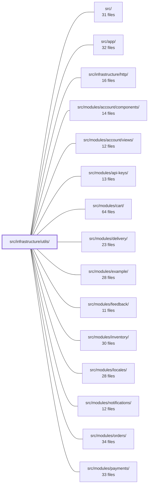

---
tags:
  - 2brain
  - 2brain/module
  - project/boilerplate-vue-frontend
type: module
module: src/infrastructure/utils/
files: 15
updated: 2026-10-17T02:51:04.882541+00:00
---

# src/infrastructure/utils/

## Purpose

Shared, framework-agnostic (and a few framework-specific) utilities that every feature module reuses: data-formatting wrappers, form-to-wire translation, error handling, request ordering, upload validation, logging, and small domain-agnostic helpers. The goal is to keep each list page, form, and view from re-implementing the same cross-cutting logic and to enforce a single, consistent interpretation of edge cases (empty values, stale responses, locale binding, sort grammar).

## Key parts

- **Formatting & data shaping** — `formatters.ts` (locale-bound `formatX` wrappers over `@guebbit/js-toolkit`), `sort.ts` (JSON:API ↔ CSV ↔ Vuetify sort-grammar translation), `day-range.ts` (calendar-day → ISO instant bounds for date filters), `country-codes.ts` (static ISO 3166-1 alpha-2 list, no runtime dependency).
- **Form / wire boundary** — `forms.ts` (the single place that translates raw form state into the Zod-generated request body, diffing against a loaded record for PATCH); `uploads.ts` (client-side image-size/type pre-check mirroring backend limits).
- **Error & status handling** — `errors.ts` (message extraction, transport-vs-answered classification, `notifyErrorMessages` toast + Faro pair), `use-blocking-error.ts` (inline non-toast error state for save/delete/refund workflows), `use-missing-record.ts` (404/403 redirect to the shell Error page), `use-stale-record.ts` (412 Precondition Failed → inline warning + "reload latest").
- **Request lifecycle & session safety** — `request-ticket.ts` (ticket-based ordering so only the newest response per state is applied; `reset` barrier on context change), `use-reset-on-viewer-change.ts` (wipes per-person Pinia stores when the signed-in user changes).
- **Auth & asset resolution** — `use-link-token.ts` (one-time token in URL fragment; read, discriminate, then erase), `images.ts` (API-relative path → absolute URL; bundled placeholder fallback).
- **Logging** — `logger.ts` (the only module allowed to touch `console`; level ceiling + scope filter resolved from env vars at load).

## How it connects

This module sits in the **infrastructure tier** and is imported by virtually every feature module (`orders`, `payments`, `products`, `cart`, `wishlist`, `users`, `api-keys`, `webhooks`, `notifications`, `stats`, `inventory`, `delivery`, `returns`, `feedback`, `locales`, `account`, `example`) as well as by `src/app/` shell code and `src/infrastructure/http/`. It is a leaf dependency: it does not import from any feature module.

A few notable relationships:

- `formatters.ts` imports `getCurrentLocale()` from the locales module and `@guebbit/js-toolkit` (external).
- `errors.ts` and `use-blocking-error.ts` reach into the **observability store** (Faro). That is why `use-blocking-error.ts` lives here rather than in `src/ui/composables/`: the ESLint tier-boundary rules in `eslint.config.ts` forbid `ui` from importing observability-store symbols.
- `use-reset-on-viewer-change.ts` imports Pinia store `reset` actions exposed by cart, wishlist, and other feature stores.
- `request-ticket.ts` is consumed by `src/infrastructure/http/` (or the fetch layer) to sequence responses; feature modules simply call the HTTP layer and inherit the guarantee.
- `uploads.ts`'s Zod rule is reused by any form that accepts an image field across feature modules.

## Where to start

1. **`errors.ts`** — reading this first shows the two error channels (toast vs. inline), the transport-vs-answered split, and the Faro reporting convention. Once you understand that, every other error composable in the list is a thin specialisation.
2. **`forms.ts`** — this is the single boundary between "what the user typed" and "what the wire schema expects." Understanding its `''`/`null`/omitted-key rules prevents the most common class of form bugs when you start editing feature views.

## Connected modules

[[boilerplate-vue-frontend_src|src/]] · [[boilerplate-vue-frontend_src_app|src/app/]] · [[boilerplate-vue-frontend_src_infrastructure_http|src/infrastructure/http/]] · [[boilerplate-vue-frontend_src_modules_account_components|src/modules/account/components/]] · [[boilerplate-vue-frontend_src_modules_account_views|src/modules/account/views/]] · [[boilerplate-vue-frontend_src_modules_api-keys|src/modules/api-keys/]] · [[boilerplate-vue-frontend_src_modules_cart|src/modules/cart/]] · [[boilerplate-vue-frontend_src_modules_delivery|src/modules/delivery/]] · [[boilerplate-vue-frontend_src_modules_example|src/modules/example/]] · [[boilerplate-vue-frontend_src_modules_feedback|src/modules/feedback/]] · [[boilerplate-vue-frontend_src_modules_inventory|src/modules/inventory/]] · [[boilerplate-vue-frontend_src_modules_locales|src/modules/locales/]] · [[boilerplate-vue-frontend_src_modules_notifications|src/modules/notifications/]] · [[boilerplate-vue-frontend_src_modules_orders|src/modules/orders/]] · [[boilerplate-vue-frontend_src_modules_payments|src/modules/payments/]] · … and 6 more

## Files
- `src/infrastructure/utils/country-codes.ts` — Provides the complete list of ISO 3166-1 alpha-2 country codes as a plain static constant. It exists so the codebase does not need a runtime dependency (e.g. `i18n-iso-countries`) for what is ultimately a fixed, well-known set of two-letter strings.
- `src/infrastructure/utils/day-range.ts` — Converts a `YYYY-MM-DD` calendar-day string into the first or last local instant of that day (as an ISO 8601 UTC string), providing inclusive `From` / `To` bounds for the staff-list date-range filters (orders, payments). It is a pure utility with no external dependencies.
- `src/infrastructure/utils/errors.ts` — Shared error-handling utilities for the app: extracting a user-facing message from an unknown rejection, classifying failures as transport-level vs. answered, and providing the `notifyErrorMessages` toast + Faro report pair used by ambient (background) failure sites.
- `src/infrastructure/utils/formatters.ts` — Locale-bound formatting wrappers that bind the pure `@guebbit/js-toolkit` `formatXBase` functions to this app's active locale (`getCurrentLocale()`) and a shared empty-value glyph (`EMPTY_VALUE`). Call sites never restate locale or fallback, and cannot accidentally pick a different locale than the rest of the page.
- `src/infrastructure/utils/forms.ts` — The single form-to-wire translation boundary. It converts raw form state (where `''`, `null`, and `undefined` are all "empty") into the correct wire spelling dictated by the generated Zod request-body schema, diffing against a loaded record to omit unchanged fields on PATCH. All other code treats form values opaquely; this file is where `''` becomes `''`, `null`, or an omitted key depending on what the schema accepts.
- `src/infrastructure/utils/images.ts` — Resolves API-relative image paths into absolute URLs the browser can fetch, and provides a bundled placeholder for records with no image. It exists because the API returns `uri-reference` paths (e.g. `/images/<hash>.png`) that, if handed to `` unchanged, resolve against the frontend origin and 404 whenever the API lives on a different host.
- `src/infrastructure/utils/logger.ts` — The single module in the app permitted to call `console` (ESLint `no-console` is an error everywhere else). It wraps the four console methods behind a level ceiling plus an opt-in scope filter, both resolved once from environment variables at module load. It exists to give every other file a consistent, gated logging API without any of them touching the global console object.
- `src/infrastructure/utils/request-ticket.ts` — A pure ticket-ordering utility that guarantees only the newest answer for a given piece of state is applied. Each outgoing request takes a ticket; when its response arrives, the ticket claims whether it is still the freshest (and in the same "era"). A `reset` barrier invalidates all prior tickets, preventing a stale response from a previous context (e.g., a prior user) from overwriting the current one. No Vue, no timers.
- `src/infrastructure/utils/sort.ts` — Pure conversion utilities that translate a sort specification between three representations: the JSON:API wire format (`-price,title`), the CSV shape a URL or filter box holds, and Vuetify's `{ key, order }[]` model a table header edits. Every list page imports from here so there is a single, shared reading of the sort grammar.
- `src/infrastructure/utils/uploads.ts` — Client-side mirror of the backend's image-upload limits and a shared Zod validation rule (`imageUploadSchema`). It exists purely as a UX affordance—rejecting bad files before the user waits for a network round-trip—while the backend remains the authoritative gate on `Content-Type` and magic bytes.
- `src/infrastructure/utils/use-blocking-error.ts` — A Vue composable that holds the inline (non-toast) half of blocking-workflow error state — the message a save, delete, refund, or empty-lookup produces that must stay rendered next to the offending form or panel rather than scrolling away in the toast queue. It pairs with `InlineErrorAlert` (`src/ui/molecules/`) the same way `notifyErrorMessages` pairs with a toast: real failures still reach Faro, but the user-facing text is local. It lives in `infrastructure/utils` (not `ui/composables`) because it reaches into the observability store, which the tier-boundary rules in `eslint.config.ts` forbid `ui` from importing.
- `src/infrastructure/utils/use-link-token.ts` — Handles the one-time authentication token that travels in a mailed link's URL **fragment** (`#token=…`). Because fragments are never transmitted to a server (RFC 3986 §3.5), this avoids leaking the token into access logs, proxy logs, or `Referer` headers. The module provides a read helper, an anchor-vs-credential discriminator, and a post-mount cleanup that erases the fragment from the URL so it doesn't linger in tab history or telemetry.
- `src/infrastructure/utils/use-missing-record.ts` — Provides the error handler a record detail page uses when the API responds with 404 or 403. Instead of the page sitting on loading placeholders indefinitely, it redirects the visitor to the shell's single Error page. Any other rejection falls through to an ambient toast, preserving the existing non-record error behavior.
- `src/infrastructure/utils/use-reset-on-viewer-change.ts` — Composable that prevents per-person Pinia store data (cart, wishlist, etc.) from surviving a session change. Because Pinia stores live for the lifetime of the tab, data loaded for one visitor would otherwise be visible to the next person who signs in on the same tab. This hook detects a change in the signed-in user and calls the store's own `reset` to wipe that state.
- `src/infrastructure/utils/use-stale-record.ts` — Vue composable that handles a **412 Precondition Failed** response on an edit-form save. When the server rejects the write because the record changed underneath the user, it displays an inline warning (not an error), exposes a "reload latest" action, and deliberately never re-sends the stale payload on its own. It is the client-side half of the conditional-write (`ETag` / `If-Match`) flow.

---
[[boilerplate-vue-frontend_INDEX|← boilerplate-vue-frontend index]]
