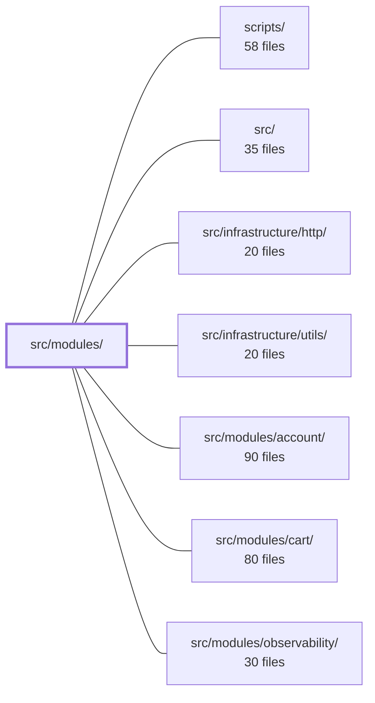

---
tags:
  - 2brain
  - 2brain/module
  - project/boilerplate-vue-frontend
type: module
module: src/modules/
files: 55
updated: 2026-11-10T08:37:06.386116+00:00
---

# src/modules/

## Purpose

`src/modules/` is the domain-module layer of the application. Each subdirectory (e.g. `api-keys/`, `notifications/`, `shop-tasks/`) is a self-contained subdomain that registers its routes, response-envelope schemas, locale dictionaries, UI surfaces, and tests into a shared app registry at boot. The design invariant is that **deleting a module folder removes everything that belongs to it**—routes, validation, a11y sweeps, e2e coverage, and nav entries—leaving no orphaned references.

## Key parts

- **Module manifests (`module.ts`)** — Every subdomain exposes one file that assembles an `AppModule` object (route table, schema registry, locale loaders, shell-slot contributions) consumed by the kernel. `notifications/` and `shop-tasks/` declare *no* routes; their UI is a bell or a zero-render feed component mounted into the shell's `app-bar` slot. `api-keys/` declares list and create routes plus an admin nav entry.
- **Response schemas (`response-schemas.ts`)** — Each module plugs its endpoints into the global contract-validation pipeline under its `x-module` stamp from `openapi.yaml`. Toggling the module folder on/off is the only switch needed.
- **Stores (`store.ts`)** — Pinia stores that own the data-fetching and state-mutation logic for their domain. `api-keys` uses hand-written mint/revoke actions to avoid caching plaintext secrets; `notifications` bridges server rows into a shared toolkit message store; `shop-tasks` reads a summary and publishes counts into the kernel's work-count store.
- **Views & components** — `api-keys/views/` holds the list and create screens. `notifications/components/NotificationsBell.vue` is the user-facing bell. `shop-tasks/components/ShopWorkFeed.vue` is a zero-render side-effect component that keeps badge subscriptions alive.
- **Composables** — `notifications/composables/use-inbox-lifecycle.ts` (SSE stream + session tie-in) and `shop-tasks/composables/use-shop-work-feed.ts` (passive badge refresh) encapsulate cross-cutting reactive logic that a single long-lived shell component invokes once.
- **Co-located tests** — Every subdomain ships unit specs (Zod schemas, stores, composables), E2E Cypress specs (functional flows, a11y sweeps, role/permission gates), and route-access pinning specs. They live *inside* the module so they are removed together.

## How it connects

- **`src/infrastructure/http/`** — Module stores and composables call the generated HTTP client (the `orvalMutator` transport) for all server requests; response-schemas files validate the envelopes that client returns.
- **`src/infrastructure/utils/`** — Shared helpers (e.g. `useStructureCrudApi`) are consumed by module stores for generic CRUD plumbing.
- **`src/modules/account/`** — Session and permission context gates module UI: the notifications bell renders nothing for guests, the api-keys create button is hidden without the right permission, and the inbox lifecycle opens/closes the SSE stream on sign-in/sign-out.
- **`scripts/`** — Build tooling that generates the `@api/schemas` catalog and the `routesForModules` helper that each `response-schemas.ts` filters by `x-module` stamp.
- **`src/modules/observability/`** — Cross-cutting logging/tracing that module actions and the HTTP layer emit into.
- **`src/`** — The parent directory providing the kernel (module registry, work-counts store, shell slot system) that every module registers into at boot.

## Where to start

1. **`api-keys/module.ts`** — The smallest, most self-contained manifest. Reading it shows the full registration contract (routes, schemas, locales, nav) in one file, and the sibling files in that folder (`routes.ts`, `schemas.ts`, `store.ts`, `views/`) give a complete end-to-end picture of one subdomain.
2. **`notifications/composables/use-inbox-lifecycle.ts`** — The best example of a module that owns *no* routes but still drives a full reactive lifecycle (SSE open/close, session binding, locale re-translation). Understanding it clarifies how the shell's `app-bar` slot and the kernel's session hooks compose with module code.

## Connected modules

[[boilerplate-vue-frontend_ROOT|/ (repository root)]] · [[boilerplate-vue-frontend_scripts|scripts/]] · [[boilerplate-vue-frontend_src|src/]] · [[boilerplate-vue-frontend_src_infrastructure_http|src/infrastructure/http/]] · [[boilerplate-vue-frontend_src_infrastructure_utils|src/infrastructure/utils/]] · [[boilerplate-vue-frontend_src_modules_account|src/modules/account/]] · [[boilerplate-vue-frontend_src_modules_cart|src/modules/cart/]] · [[boilerplate-vue-frontend_src_modules_observability|src/modules/observability/]]

## Files
- `src/modules/api-keys/module.ts` — Module manifest that registers the **api-keys** subdomain into the application's module registry. It wires the route table, the admin nav entry, lazily-loaded response schemas, and locale dictionaries together into a single `AppModule` object consumed by the kernel at boot.
- `src/modules/api-keys/response-schemas.ts` — Declares the response-envelope schemas for every API endpoint attributed to the backend `api-keys` module (as stamped via `x-module` in `openapi.yaml`). It exists so that the domain's contract validation can be toggled on/off simply by including or deleting the module folder.
- `src/modules/api-keys/routes.ts` — Declares the route table for the api-keys module: a list screen and a create screen. There is no edit or detail route because API-key fields (name, permissions, expiry) are fixed at mint time.
- `src/modules/api-keys/schemas.ts` — Zod validation schema for the credential-mint (API-key-create) form. It enforces client-side constraints on name, permissions, and expiry before the request leaves the browser, and resolves error messages through i18n at parse time so the active locale is always reflected.
- `src/modules/api-keys/store.ts` — Pinia store for machine-to-machine credentials (API keys). Wraps `useStructureCrudApi` for a search-only listing (no single-resource GET/PATCH, no filters) and provides two hand-written actions — `mintCredential` and `revokeCredential` — that intentionally bypass the generic create/update paths to prevent caching plaintext secrets or relying on response bodies the API does not return.
- `src/modules/api-keys/tests/api-keys-list-url.spec.ts` — Verifies that `ApiKeysList` reads `page` and `pageSize` from the URL query string on initial load and forwards them to the `listApiKeys` API call, so a shared link opens the correct page directly.
- `src/modules/api-keys/tests/e2e/a11y.cy.ts` — Declares the accessibility sweep routes for the api-keys module, registering five page states (empty list, populated list, create form, create form with validation errors, create form with the one-time-secret modal) through the shared `sweepA11y` helper. Co-located with the module so that removing the module also removes its a11y coverage, and so the cross-cutting coverage spec cannot silently lose a domain.
- `src/modules/api-keys/tests/e2e/actions.cy.ts` — End-to-end failure-path tests for the api-keys module. It drives the shared `actionTable` runner through two scenarios—a failed key mint (create form) and a failed key revoke (list-row action)—verifying that a server fault produces the correct alert, preserves the user's typed/visible state, and that a retry once the fault is cleared succeeds.
- `src/modules/api-keys/tests/e2e/api-keys.cy.ts` — Cypress end-to-end spec for the admin-only API keys module. It verifies the functional mint/revoke lifecycle (create a credential through the real form, confirm the one-time secret reveal, then revoke it) and the basic list-page rendering. Accessibility coverage lives in a separate spec.
- `src/modules/api-keys/tests/e2e/roles.cy.ts` — End-to-end test case list for the API-keys module. It registers which pages and routes each persona should be allowed to open, delegating the actual page-walking and permission-assertion logic to the shared `sweepRoles` helper. Lives inside the module so that removing the module removes its sweep test automatically.
- `src/modules/api-keys/tests/routes.spec.ts` — Pins the `meta.access` and `meta.can` values that every api-keys route declares, so a route that silently loses its access gate becomes indistinguishable from a public one and is caught by CI. Checks against the module's raw route records (by name) rather than a resolved router, so no locale prefix or full app context is needed.
- `src/modules/api-keys/tests/schemas-i18n.spec.ts` — Proves that the api-keys module's Zod schema (`apiKeyCreateSchema`) resolves its validation messages to the correct localized strings for English and Italian, using the **real** vue-i18n instance. It is the module-specific counterpart to the cross-cutting test in `tests/cross-cutting/schemas-i18n.spec.ts`, which demonstrates the thunk-re-resolves-at-parse-time mechanism with an invented schema. This file confirms this module's schema and its locale dictionaries actually agree.
- `src/modules/api-keys/tests/schemas.spec.ts` — Vitest suite that pins down the **structural validation rules** of `apiKeyCreateSchema` (name, permissions, expiry) for the API-key mint form. It deliberately does **not** assert on error-message text—that concern is delegated to `schemas-i18n.spec.ts`.
- `src/modules/api-keys/tests/store.spec.ts` — Unit tests for the `useApiKeysStore` Pinia store. The transport layer (`orvalMutator`) is fully mocked so each test can assert the exact URL, method, and body the store sends, and the exact shape it expects back. The suite specifically guards two invariants that no other test in the codebase covers: the plaintext secret from `mintCredential` must never persist in store state, and `revokeCredential` must patch the cached row in place rather than trigger a refetch.
- `src/modules/api-keys/views/ApiKeyCreate.vue` — Single-page form for minting a new API key. Collects a name, a set of permissions, and an optional expiry, validates them against a Zod schema, submits via the Pinia store, and—on success—displays the one-time secret in a modal. There is no detail page for an API key, so after the modal the user is routed back to the list.
- `src/modules/api-keys/views/ApiKeysList.vue` — Paginated list view for machine-to-machine API keys. Renders a `DataTable` with per-row revoke action (behind a confirm dialog), page-size selector, and a create button gated by session permission. There is no filter form because `ListApiKeysParams` accepts only `page`/`pageSize`.
- `src/modules/notifications/components/NotificationsBell.vue` — The app-bar bell and its dropdown panel, contributed to the shell's `app-bar` slot. It displays an unread badge, opens a panel that marks notifications read on the server and lists them newest-first (each with a delete button and a "Clear all" action), splits into "Mine"/"Work" tabs when the user holds staff notices, and serves as the mount point that kicks off the inbox lifecycle (fetch + live stream). Renders nothing for guests.
- `src/modules/notifications/composables/use-inbox-lifecycle.ts` — Vue composable that ties the notifications inbox to the signed-in session: it opens a Server-Sent Events stream and performs an initial read when an authenticated user is present, closes the stream and resets the inbox when the user leaves or switches accounts, and re-translates all notifications when the locale changes. It is meant to be called once from a long-lived shell component.
- `src/modules/notifications/composables/use-notification-link.ts` — A Vue composable that turns a `NoticeTarget` (either a named route or a raw path) into a locale-prefixed `RouteLocationRaw`, or `undefined` when the screen is not shipped in this build or the current session lacks permission to open it. It is the single resolution point so that no notification row can link to a page the reader would be refused.
- `src/modules/notifications/module.ts` — Module manifest for the notifications subdomain (`supporting`). Declares no routes and no menu entry; its sole UI surface is a lazily-loaded bell component mounted into the shell's `app-bar` slot. It also registers the module's response schemas, locale loaders, and foundation notices in the app registry.
- `src/modules/notifications/notices.ts` — Declares the foundation's six staff-facing notification codes as `AppNotice` entries (each with a `describe` and a `target`). This file is the single place that names the wording keys and route targets for those codes; nothing else in the codebase references their text or destinations.
- `src/modules/notifications/response-schemas.ts` — Defines and exports the response-envelope schema rows for every endpoint the `notifications` module calls. It plugs the module into the global contract-validation pipeline by registering a `ResponseSchemaRoute[]` under the `'notifications'` key, so that enabling the module activates validation and removing the folder disables it.
- `src/modules/notifications/store.ts` — Pinia store (setup-style) that bridges the server's notification inbox to the `@guebbit/vue-toolkit` message store. It owns the translation between a server `Notification` row and a toolkit `IToastMessage` (toast + persistent bell entry), every write the bell makes, and the concurrency guard that keeps in-flight reads from undoing newer mutations. It holds no list of its own; `items` is a computed view over the toolkit's `persistentMessages`.
- `src/modules/notifications/tests/notices.spec.ts` — Vitest spec for the `foundationNotices` registry. It asserts, for each of the six staff-facing notice codes, which dictionary entry `describe` reaches and which route/params `target` links to — using a stub translator so assertions are on key structure, not English wording.
- `src/modules/notifications/tests/notifications-bell.spec.ts` — Unit tests for the `NotificationsBell` component mounted against the real Pinia inbox store, with the HTTP transport and SSE stream mocked. Covers guest/signed-in rendering, badge and aria-label behavior, panel open/close lifecycle (read-all, listing, delete, clear-all, empty state), focus management, axe accessibility, and permission-gated work-notice links.
- `src/modules/notifications/tests/store.spec.ts` — Integration-style spec for `useNotificationsInboxStore` that verifies how server rows become persistent messages in the vue-toolkit message store, how concurrent reads and stream frames interact, and what each failure mode leaves behind. Transport is mocked (one router keyed on `METHOD /url`), but the generated HTTP client, the toolkit store, and the inbox store under test are all real, so the property under test is their combined behaviour.
- `src/modules/notifications/tests/use-inbox-lifecycle.spec.ts` — Vitest spec for the `useInboxLifecycle` composable. It verifies the full wiring contract: which SSE URL and event names are opened, that every (re)open triggers a fresh inbox read, how each stream frame mutates the inbox store, and that session teardown or component unmount tears down the stream and clears notifications. The SSE client itself is mocked; the test owns the *interaction* assertions.
- `src/modules/notifications/tests/use-notification-link.spec.ts` — Vitest spec that verifies the `useNotificationLink` composable resolves notification targets (named routes and relative paths) into valid route locations, correctly rejecting targets that don't exist in the build or that the current reader lacks permission to open.
- `src/modules/notifications/types.ts` — Defines the presentation-layer shape for the notification bell panel. It is a view-only projection assembled from the toolkit's message store — no API endpoint returns these objects directly, and no logic lives here.
- `src/modules/shop-tasks/components/ShopWorkFeed.vue` — A zero-render side-effect component mounted in the app bar for the lifetime of the shell. Its sole role is to keep the `useShopWorkFeed` composable's reactive subscriptions alive so that staff nav badge counts stay updated. It renders nothing user-visible.
- `src/modules/shop-tasks/composables/use-shop-work-feed.ts` — A one-shot composable that wires the kernel's badge-refresh mechanism to the shop-tasks summary endpoint. It runs for the lifetime of the shell component that calls it, feeding work-count badges to any viewer who holds at least one relevant permission and doing nothing for everyone else.
- `src/modules/shop-tasks/describe.ts` — Pure formatting functions that turn a shop-task notification (a code plus its `params`) into a localized sentence. The caller supplies the translate function and the reader's preferred languages via `NoticeContext`; the server itself stores no text, only the code and the data the sentence needs.
- `src/modules/shop-tasks/module.ts` — Module manifest for the `shop-tasks` subdomain. It declares **no routes and no menu entry**; instead it wires up the shop's notice wording, task-label locales (EN/IT), response schemas, and the data feed that drives staff-nav badge counts. It exists so the foundation's bell, the tasks screens, and the shell can consume shop-specific copy and counts without the shop owning any navigation surface.
- `src/modules/shop-tasks/notices.ts` — Declares every notification code the shop module owns, as `AppNotice` entries (each with a `describe` formatter and a `target` screen link). This is the registry the shell's bell consults; the foundation's bell knows none of these codes directly.
- `src/modules/shop-tasks/response-schemas.ts` — Exports the complete list of response-envelope schema routes for every `shop-tasks` backend endpoint. It is a thin, generated-consumption wrapper: the actual rows are produced by `routesForModules` filtering the shared `@api/schemas` catalog by the `x-module` stamp, so this file only selects the subset that belongs to the `shop-tasks` module.
- `src/modules/shop-tasks/store.ts` — Pinia store that fetches the shop work summary (the number behind the staff navigation badges) and publishes those counts into the shared kernel store (`@/kernel/work-counts`). It holds no local state of its own; it exists solely to read the summary once per freshness window and write the result where the screen manifests can pick it up.
- `src/modules/shop-tasks/tests/e2e/nav-badges.cy.ts` — E2E test verifying that the **Sales → Orders** badge in the staff nav reflects *open work* (the `salesOrders` count from `GET /shop-tasks/summary`) rather than *unread notices*. It asserts the badge value is unchanged after the notifications bell is opened (which marks every notice read server-side).
- `src/modules/shop-tasks/tests/notices.spec.ts` — Vitest spec that verifies the shop's notification registry (`shopNotices`) end-to-end: every declared code resolves through the right dictionary entry with the correct facts, links to the expected route/params, and the locale-aware `productName` helper picks the right string. Uses a stub translator that prints `key|name=value…` so assertions check structure, not English prose.
- `src/modules/shop-tasks/tests/summary-fixtures.ts` — Test fixture factory that builds a valid `ShopWorkSummary` object for shop-task unit tests. It runs the assembled object through the Zod schema (`GetShopWorkSummaryResponse`) at construction time, so any fixture that drifts from the API contract fails immediately in the test rather than surfacing later in a screen or integration test.
- `src/modules/shop-tasks/tests/work-feed.spec.ts` — Vitest spec for the `useShopWorkFeed` composable. Verifies the staff-nav badge feed contract: a staff member with `display` ability triggers a **passive** `GET /shop-tasks/summary`, a buyer triggers none, a route change within the minute reuses the cached answer, a staff inbox notice forces a fresh read, switching users re-reads, and sign-out empties every count.
- `src/modules/shop/index.ts` — Public barrel for the shop module. It re-exports the module's commerce settings (currency, ship-to countries, backorder promise) so that sibling modules (`cart`, `delivery`, `orders`, `products`) can consume them without importing the internal implementation file directly.
- `src/modules/shop/module.ts` — App-module manifest for the `shop` module. It registers the module with the kernel (name, response schemas, boot-time setup) so the shop's settings load once at startup and are validated against their schema. It owns no routes, no navigation, and no locales.
- `src/modules/shop/response-schemas.ts` — Registers the response-envelope schema for the shop module's single endpoint (`GET /shop`). It plugs the shop's response validation into the global response-schema map so that responses are validated against the OpenAPI-derived schemas, with the module tag `"shop"` as the selector.
- `src/modules/shop/shop.ts` — Module-level holder for the shop's static settings (currency, shipping countries, time zone, backorder promise), fetched once from `GET /shop` and exposed as Vue reactive read-only views. It exists so that price-input sizing, address-form validation, and backorder labeling all draw from a single shared source rather than each component re-fetching.
- `src/modules/shop/tests/shop.spec.ts` — Vitest spec for the shop store. Verifies the module's contract: the store starts empty (never a guessed default), holds whatever the API reports, deduplicates concurrent/repeated reads into a single request, recovers cleanly from a failed call, and loads once when the module boots.
- `src/modules/stock-alerts/components/NotifyMeButton.vue` — A slot-injected button that lets a signed-in shopper request (or cancel) a stock-restock notification for a product that is currently not buyable (sold out, off sale). It is contributed to the `product-actions` slot by the stock-alerts module manifest; the products module that owns the page and card never imports it directly.
- `src/modules/stock-alerts/module.ts` — Module manifest for the "stock-alerts" feature (back-in-stock / "Notify me" requests). It registers the module's name, navigation entry, locales, response schemas, and a lazy button contributed to the `product-actions` slot, so the rest of the app (e.g. `products`) never needs to import this feature directly.
- `src/modules/stock-alerts/response-schemas.ts` — Declares the response-envelope schema rows for every endpoint the `stock-alerts` domain calls. The rows are registered through the module manifest so that contract validation is enabled by the module's presence and disabled by deleting the folder.
- `src/modules/stock-alerts/routes.ts` — Declares the single authenticated route for the stock-alerts module. It defines the route record that the module registry merges into the application's Vue Router, mapping the `stock-alerts` path to a lazy-loaded view component.
- `src/modules/stock-alerts/store.ts` — Pinia setup-store that holds the signed-in shopper's open back-in-stock ("notify me") requests. Every mutating or reading action **replaces the local list wholesale** with whatever the API returns, so the client state can never drift from the server. It also deduplicates concurrent reads so a grid of fifty buttons triggers a single `GET /stock-alerts`.
- `src/modules/stock-alerts/tests/e2e/a11y.cy.ts` — Co-located accessibility test for the stock-alerts module. It declares which routes the module exposes and hands them to the shared a11y sweep utility. Co-locating the route list here (rather than in a central file) ensures that deleting the module automatically removes its a11y coverage, and a cross-cutting spec asserts no module is missing one.
- `src/modules/stock-alerts/tests/e2e/actions.cy.ts` — E2E tests for the stock-alerts module's failure and empty-state behaviors. Drives three scenarios through the shared `actionTable` runner: a failed "notify me" request, a failed request withdrawal, and an empty alerts list, verifying that UI controls persist, alerts display, and empty copy renders correctly.
- `src/modules/stock-alerts/tests/notify-me-button.spec.ts` — Vitest spec for the `NotifyMeButton` component. It verifies the button's visibility contract (hidden for guests and for any orderable product; shown for sold-out or non-purchasable items) and its toggle behavior—asking for an alert, cancelling an existing one, and surfacing a write failure—without hitting a real transport.
- `src/modules/stock-alerts/tests/store.spec.ts` — Vitest spec for the stock-alerts Pinia store. Verifies list-replacement semantics, the "already asked" set, concurrent-read deduplication, and failure-toast behaviour — all with only the HTTP transport mocked so the store logic itself is exercised for real.
- `src/modules/stock-alerts/views/StockAlerts.vue` — The shopper-facing page that lists their open "notify me" stock-alert requests and lets them cancel any one. A request is single-use: once a product's stock is answered, the record is simply absent from the list.

---
[[boilerplate-vue-frontend_INDEX|← boilerplate-vue-frontend index]]
