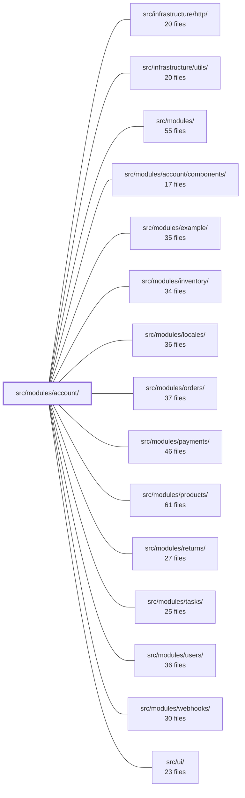

---
tags:
  - 2brain
  - 2brain/module
  - project/boilerplate-vue-frontend
type: module
module: src/modules/account/
files: 90
updated: 2026-11-10T08:37:25.516754+00:00
---

# src/modules/account/

## Purpose

The `account` module owns every visitor-facing interaction around identity and self-service: login, signup, password reset, two-factor authentication, OAuth linking, profile editing (avatar, email, password), the address book, device-session management, account deletion with a grace-period restore flow, and personal-data export. It registers its routes, response schemas, and locale loaders into the kernel's module registry so that "enabling the account module" is a single declarative act.

## Key parts

- **Module manifest & routing** — `module.ts` declares the routes, navigation entry, response schemas, and locale loaders that define the module's presence in the app. `routes.ts` exports the full `RouteRecordRaw[]` (login, signup, reset, 2FA, profile, logout, etc.), each carrying an `access` meta field the shared route guard reads. `index.ts` is the public barrel that exposes two UI components (address picker, purchase-hold messaging) to external consumers such as the cart/checkout flow.
- **Validation & contracts** — `schemas.ts` holds Zod form schemas (address, login, signup, password-reset) with i18n error thunks and length bounds imported from the generated `@api/schemas` contract. `response-schemas.ts` declares the response-envelope schemas for every REST endpoint the module owns, wiring them into per-domain contract validation.
- **Stores (Pinia, Composition API)** — `auth.ts` (session-lifecycle verbs: login, signup, password reset, logout), `profile.ts` (self-service: avatar, email change, password change, deletion/restore, data export), `addresses.ts` (address book with fetch-after-write invariant), `two-factor.ts` (enrollment machine, backup codes, login challenge, resend cooldown), `oauth-providers.ts` / `oauth-links.ts` (deployment provider catalog vs. per-visitor linked providers), `sessions.ts` (device-session list & revocation), `deletion-restore.ts` (grace-period claim-check redemption).
- **Composables** — `use-countdown.ts` (server-deadline-driven ticking seconds), `use-method-label.ts` (2FA wire-name → i18n display copy), `use-password-strength.ts` (zxcvbn scoring), `use-password-breach-check.ts` (debounced advisory breach check), `use-post-login-redirect.ts` (single `redirectAfterLogin()` covering `?continue=`, saved locale, Home fallback).
- **Tests** — Vitest unit specs (auth, addresses, 2FA, confirm-once, link-token, account-restore, password-reset, export) and a comprehensive Cypress e2e suite (auth, registration, 2FA, OAuth, password-reset, profile, address actions, keyboard traps, a11y, visual regression).

## How it connects

- **`src/infrastructure/http/`** — Every store and action calls the API through `useStructureRestApi` / `orvalMutator` from this layer; tests mock only that transport boundary.
- **`src/infrastructure/utils/`** — Shared helpers (debounce, formatting, etc.) are consumed by composables and views.
- **`src/modules/`** (kernel registry) — `module.ts` is the registration point that makes the router, response-schema validator, and locale loader aware of this domain.
- **`src/modules/account/components/`** — The view layer (login form, 2FA dialogs, profile panels, address picker, export download) lives here; the barrel in `index.ts` re-exports the two components other modules need.
- **`src/modules/orders/`, `src/modules/payments/`** — The cart/checkout flow imports the address-picker and purchase-hold components through `index.ts` without reaching into internal stores.
- **`src/modules/locales/`** — All user-facing strings (method labels, form errors, toasts) resolve through `vue-i18n` keys loaded by the module manifest.
- **`src/ui/`** — Form controls (`VAutocomplete`, `VDialog`, `VBtn`, etc.) come from this shared component library; the 2FA dialogs and address form are built on top of them.
- **`src/modules/users/`** — The admin user-management module routes to `/users` with a distinct `access` level; the account module's route guard (`access` meta) is what the shared guard reads to allow or redirect.

## Where to start

1. **`module.ts`** — Read this first to see the single declarative surface (routes, schemas, locales, navigation) that defines what "the account module is enabled" means in the running app.
2. **`stores/auth.ts`** — The most-touched store in the module; reading it shows the login → 2FA-challenge → profile-fetch chain, the MFA branch, and how the deletion-restore branch diverts, which is the pattern every other store follows.

## Connected modules

[[boilerplate-vue-frontend_ROOT|/ (repository root)]] · [[boilerplate-vue-frontend_src_infrastructure_http|src/infrastructure/http/]] · [[boilerplate-vue-frontend_src_infrastructure_utils|src/infrastructure/utils/]] · [[boilerplate-vue-frontend_src_modules|src/modules/]] · [[boilerplate-vue-frontend_src_modules_account_components|src/modules/account/components/]] · [[boilerplate-vue-frontend_src_modules_example|src/modules/example/]] · [[boilerplate-vue-frontend_src_modules_inventory|src/modules/inventory/]] · [[boilerplate-vue-frontend_src_modules_locales|src/modules/locales/]] · [[boilerplate-vue-frontend_src_modules_orders|src/modules/orders/]] · [[boilerplate-vue-frontend_src_modules_payments|src/modules/payments/]] · [[boilerplate-vue-frontend_src_modules_products|src/modules/products/]] · [[boilerplate-vue-frontend_src_modules_returns|src/modules/returns/]] · [[boilerplate-vue-frontend_src_modules_tasks|src/modules/tasks/]] · [[boilerplate-vue-frontend_src_modules_users|src/modules/users/]] · [[boilerplate-vue-frontend_src_modules_webhooks|src/modules/webhooks/]] · … and 1 more

## Files
- `src/modules/account/composables/use-countdown.ts` — A single ticking "seconds left" primitive whose value is always derived from a server-provided deadline (epoch-ms or ISO timestamp), never from a client-guessed duration. The `setInterval` exists only while a deadline is active, so idle components carry no timer. Used across the account module for challenge expiries, delivered-code expiries, and resend cooldowns.
- `src/modules/account/composables/use-method-label.ts` — Provides a single composable that resolves a 2FA method's wire name (e.g. `'email'`, `'totp'`) into display copy via `vue-i18n`, falling back to the raw string when no locale key exists. This keeps the codebase agnostic to which methods a particular deployment supports—new methods like `sms` become readable without touching this file.
- `src/modules/account/composables/use-password-breach-check.ts` — Provides a debounced, advisory-only password breach check (via `POST /account/password/check`) for forms where the user is choosing a *new* password. It exists so the three password-entry forms share one small composable instead of duplicating debounce/race/scope-disposal logic. The result is display-only; it never blocks submission — the four password-SET endpoints remain the authoritative check.
- `src/modules/account/composables/use-password-strength.ts` — Composable that scores a password's strength locally via zxcvbn on every keystroke. It is deliberately separate from the breach-check composable so a page consuming only one never loads the other's dependencies. The score is purely advisory and must never gate form submission.
- `src/modules/account/composables/use-post-login-redirect.ts` — Centralises the "where does a visitor land once a session exists" decision so that every login step (plain form, 2FA, OAuth callback, account restore, signup) resolves the redirect identically instead of each re-deriving it. Encapsulates the `?continue=` deep-link guard, the saved-locale preference, and the Home fallback into a single `redirectAfterLogin()` call.
- `src/modules/account/index.ts` — Public barrel for the `account` module. It exposes two UI components to consumers (notably the `cart` module's checkout flow) so they can render address selection and purchase-hold messaging without reaching into the account module's internal stores or dialogs.
- `src/modules/account/module.ts` — Module manifest for the `account` domain (login, signup, profile, password reset, account deletion). It declares the routes, navigation entry, response schemas, and locale loaders that make up "having the account module enabled" in the kernel registry. It does not own the session token or auth guards — those live in `infrastructure/session`.
- `src/modules/account/response-schemas.ts` — Declares the response-envelope schemas for every REST endpoint owned by the `account` and `addresses` backend modules, so that contract validation can be toggled per-domain via the module manifest. It is the wiring point that turns "this module is loaded" into "these HTTP response shapes are validated."
- `src/modules/account/routes.ts` — Defines the complete route table for the account module as a single `RouteRecordRaw[]` export. The kernel's router splices this array into the app-level route tree, so every login, signup, reset, verification, email-change, export, profile, and logout path is registered here. Each entry carries an `access` meta field (or none, meaning "token-only / public") that the shared route guard reads to decide whether to allow, redirect, or challenge the visitor.
- `src/modules/account/schemas.ts` — Zod validation schemas for the account-module forms (address, login, signup, password-reset). Error messages are i18n thunks resolved at parse time, and every length bound is imported from the generated `@api/schemas` contract so a backend contract change propagates through `npm run gen:api` alone.
- `src/modules/account/stores/addresses.ts` — Pinia store (Composition API) that owns the visitor's address book. Every write action re-fetches the entire list rather than patching a single row, because the invariant the UI must render — exactly one default address — is a property of the whole list, and a write (create, set-default, delete) can change a row other than the one the API returns.
- `src/modules/account/stores/auth.ts` — Pinia store (Composition API form) that owns the session-lifecycle verbs: login, signup, password reset, and logout. It wraps `useStructureRestApi` for the HTTP calls and coordinates with the session and profile stores, chaining `.then` rather than awaiting each step. It deliberately does **not** own the editable user record — that belongs to `src/modules/account/stores/profile.ts`.
- `src/modules/account/stores/deletion-restore.ts` — Pinia store (Composition API) that backs the single screen shown when a user signs in to an account currently in its deletion grace period. The server returns a claim check instead of a session; this store holds that check, lets the user either redeem it (restore + sign in) or discard it (let the account be purged). It supports two entry paths: form-based sign-in (challenge in the response body) and OAuth redirect (challenge in an httpOnly cookie, dates in the query string).
- `src/modules/account/stores/oauth-links.ts` — Pinia store (Composition API form) that manages the signed-in visitor's list of connected OAuth sign-in providers — fetching, linking, and unlinking them. It is deliberately a plain array `ref` rather than a keyed record because links have no detail page and are only ever read whole. It is distinct from `oauth.ts`, which holds the deployment's public provider catalog.
- `src/modules/account/stores/oauth-providers.ts` — Pinia store (Composition API) that holds the deployment's enabled OAuth provider list and exposes two pure helpers (`providerLabel`, `oauthStartUrl`) so login/signup components can render one button per provider. The list is a deployment fact, not per-visitor state, so it is fetched once and cached in the store rather than refetched on every mount.
- `src/modules/account/stores/profile.ts` — Pinia store (Composition API) that owns the authenticated visitor's own `Account` record and every self-service operation on it: fetch/update, avatar upload/removal, live password change, email verification and email-change lifecycle, account deletion/restore, and data export. It wraps `useStructureRestApi` from `@guebbit/vue-toolkit` so all actions reuse shared `selectedIdentifier`/`fetchTarget`/`updateTarget` primitives instead of duplicating request and cache logic per action.
- `src/modules/account/stores/sessions.ts` — Pinia store (Composition API) that loads and revokes the visitor's device-session list via the `@guebbit/vue-toolkit` REST helper. It exists as a dedicated slice so `ProfileSessions.vue` can render "who else is signed in" and offer a per-device "end session" action without coupling to the broader auth store.
- `src/modules/account/stores/two-factor.ts` — Single Pinia store (Composition API) covering every 2FA surface on the account: the armed/available method status, the enrollment machine (setup → confirm → backup codes), and the login-time challenge (send → submit). It exists as one store rather than three because enrollment and the login challenge share the same `GET /account/2fa` endpoint and the same server-driven resend cooldown.
- `src/modules/account/tests/account-export-download-view.spec.ts` — Vitest spec for the `AccountExportDownload.vue` page (the target of the "your data export is ready" email link). Verifies that the page displays the correct status state (ready, building, failed, none), only initiates a download on explicit user click, saves the file under the server-supplied name, distinguishes a 404 (expired) from a 500 (server error), and disables the button while a download is in flight.
- `src/modules/account/tests/account-restore-challenge-view.spec.ts` — Vitest unit test for the `AccountRestoreChallenge.vue` view. Verifies the five visitor flows on the restore-offer page: displaying the scheduled erasure date, restoring through the store and redirecting post-login, showing an inline error when the claim is refused, discarding the offer and navigating Home when the visitor walks away, and redirecting to `Login` when no offer is pending.
- `src/modules/account/tests/address-form-dialog.spec.ts` — Unit-test suite for the country `v-autocomplete` inside `AddressFormDialog.vue`. It asserts the `items` array the component hands to `VAutocomplete` under three scenarios (unrestricted, narrowed by `shipToCountries`, and i18n labels) — a scope explicitly carved out because neither `ProfileAddresses.vue` nor `AddressPicker.vue`'s own suites cover it.
- `src/modules/account/tests/address-picker.spec.ts` — Vitest unit-test suite for the `AddressPicker.vue` component, focused on its pre-select watcher (default/first-entry fallback logic), the checkout add-address flow, isolation between two pickers sharing one store, and the billing-purpose variant. It exists to pin down the component's reactive contract without rendering the full app shell.
- `src/modules/account/tests/addresses.spec.ts` — Unit tests for `useAccountAddressesStore` that mock **only** the HTTP transport (`orvalMutator`) so the store's real fetch-after-write logic executes. Every write case asserts the same invariant: the store replaces its local list with a fresh `GET` reload rather than patching a single row in place.
- `src/modules/account/tests/auth-login-mfa.spec.ts` — Unit tests for the **`mfa` branch** of `useAccountAuthStore().login()`. They verify that when the login endpoint returns an MFA challenge, the store resolves with the challenge payload **without** storing a token, fetching the profile, or mutating the session store — the exact regression (storing `undefined` as a token → 401 on profile fetch → 2FA accounts locked out) this narrowing was introduced to fix. A single contrast test for the `session` branch is included for completeness.
- `src/modules/account/tests/auth-login-restore.spec.ts` — Unit tests for the deletion-grace sign-in branch: `login()` resolves with a `deletion-pending` outcome (no session issued), and the deletion-restore store later redeems the claim check to adopt the session. Covers the happy path, the OAuth variant (cookie-based claim check), the remember-me tier mapping, and the error path where the API rejects the claim check.
- `src/modules/account/tests/auth-session.spec.ts` — Unit tests for the auth store's session flows — login, logout, logoutEverywhere, and password-reset request. The file mocks **only** the HTTP transport (`orvalMutator`) and lets every layer above it (generated client, session/profile/observability stores) execute for real, so assertions hit the same state the router guards read. `signup` is excluded and lives in `auth-signup.spec.ts`.
- `src/modules/account/tests/auth-signup.spec.ts` — Unit tests for `useAccountAuthStore.signup` and its avatar follow-up (`setAvatarAfterSignup`). Pins the exact HTTP request each action emits: signup is a JSON `POST /account/signup`; a picked avatar is a separate multipart `PATCH /account`. The generated client (`@api`) is **not** mocked — the transport layer (`orvalMutator`) is, so every assertion inspects the real request that would go over the wire.
- `src/modules/account/tests/confirm-once.spec.ts` — Guards against a race in the account panels where a user double-clicks a "confirm-then-write" control (remove address, delete account, log out everywhere). Each test fires two clicks in the same tick, answers the confirm dialog "yes", and asserts that the dialog was asked exactly once and the destructive store action was called exactly once.
- `src/modules/account/tests/delete-account-panel.spec.ts` — Unit-test spec for the `ProfileDeleteAccount` panel. It verifies the two outcomes of requesting account deletion: when the API accepts, the visitor is routed Home and a toast names the purge date; when the API refuses (e.g. a 500), no navigation occurs and the API's own error sentence is rendered in place.
- `src/modules/account/tests/e2e/a11y.cy.ts` — Declares the list of routes and in-page states that the account module exposes to the accessibility sweep. It does not contain audit logic; it only names *what* to audit and *how to reach* each state (via a route string or a `prepare` callback). Co-located with the account module so that deleting the module removes its a11y coverage automatically, and so that `tests/cross-cutting/a11y-coverage.spec.ts` can verify no routed module is left without one.
- `src/modules/account/tests/e2e/account.visual.cy.ts` — Declares the list of screens (routes, viewports, and state-setup steps) that the account module's visual-regression sweep will snapshot. All machinery (viewport cycling, baseline comparison, re-recording) lives in the shared `visual-sweep.ts` helper; this file only *names* what to photograph and how to reach each state.
- `src/modules/account/tests/e2e/actions.cy.ts` — E2e failure-path tests for the account module's address actions. Each case injects a server fault on the relevant HTTP call, verifies the page surfaces the expected alert, preserves any user-typed state, and confirms a retry succeeds once the stub is removed. All cases are driven by the shared `actionTable` runner rather than individual `it()` blocks.
- `src/modules/account/tests/e2e/auth.cy.ts` — Cypress end-to-end suite covering the full authentication lifecycle: login (form validation, TOTP challenge, remember-me cookie), signup (password match, unverified session start), route guards for `/cart`, `/orders`, `/admin`, `/users`, logout, in-tab user switching, and a live-profile-only session-refresh case that exercises the cross-origin (`:8085 → :3000`) refresh flow through a forced 401.
- `src/modules/account/tests/e2e/keyboard.cy.ts` — Verifies that the three persistent two-factor dialogs in the account module (enrolment, backup-codes display, and the removal code prompt) **ignore Escape** and **trap Tab/Shift+Tab focus** inside the overlay. These are the only dialog kind where dismissing would lose in-progress data or the user's sole view of backup codes, so the standard "Escape closes the dialog" pattern does not apply.
- `src/modules/account/tests/e2e/oauth.cy.ts` — Cypress end-to-end suite covering the OAuth login flow against the backend's `fake` provider. Real Google/GitHub cannot run in CI, but `fake` still round-trips the genuine `state` cookie and redirect chain (BE start → BE callback → cookies → FE `/oauth/callback`), so the tests exercise the real integration path. All tests are gated behind `isDemoMode()` on the backend.
- `src/modules/account/tests/e2e/password-reset.cy.ts` — End-to-end test for the forgot-password flow. Rather than assuming a reset URL, the test reads the actual link from the demo backend's email outbox (or a live Mailpit inbox) and follows it, proving the mailed link is the one that works. It then verifies both halves of the outcome at the login form: the pre-reset password is dead and the new password is accepted. A second case confirms that a fabricated token changes nothing.
- `src/modules/account/tests/e2e/profile.cy.ts` — Cypress e2e specs for the self-service profile page (password change, active sessions, address book, email verification). They run against the real API in its demo profile so the invariants under test (one default address, a single `current` session flag, email change parked as `pendingEmail`) are the backend's own. The tests pin the *page honouring* those invariants, not the rules themselves.
- `src/modules/account/tests/e2e/registration.cy.ts` — Cypress e2e suite that exercises the full registration arc — signup → unverified session → email-token spend as a *guest* → password-gate verification — while deliberately crossing real page reloads so the server-side account must genuinely persist between steps.
- `src/modules/account/tests/e2e/two-factor.cy.ts` — Cypress e2e suite covering the full email-2FA lifecycle: enroll email as a second factor, verify the login challenge flow (correct and wrong codes), regenerate backup codes, and remove the factor so a subsequent login bypasses 2FA entirely. Every test is gated behind `cy.skipUnlessMailbox()` because it depends on reading the one-time code from a Mailpit (or demo) outbox.
- `src/modules/account/tests/link-token-confirm-card.spec.ts` — Vitest spec that exercises the shared `LinkTokenConfirmCard` behavior across three account pages (verify-email, email-change-undo, account-restore). It verifies that the token is prefilled from the `#token=` fragment, scrubbed from the URL on mount, spent exactly once on submit via the profile store, and that refusal keeps the form blocked in place with the appropriate error surface.
- `src/modules/account/tests/login-view-i18n.spec.ts` — Integration test that mounts the real `Login` view and verifies it is genuinely wired to `usersSchema` + vue-i18n's `revalidateOn: locale`. It renders the form, triggers validation, and asserts the displayed `v-text-field` error message changes correctly when the locale switches from English to Italian — without mocking either the schema or the i18n instance.
- `src/modules/account/tests/oauth-buttons.spec.ts` — Vitest spec for the `OAuthButtons` component. Verifies two contract points of the sign-in wrap: when at least one OAuth provider is configured the terms/privacy notice and both links render; when no provider is configured nothing renders at all.
- `src/modules/account/tests/oauth-callback-view.spec.ts` — Unit-test suite for the `OAuthCallback.vue` landing page. It verifies the three decision paths the view takes after a backend OAuth redirect—successful provider link, account in deletion grace, and backend error codes—asserting the correct toast, store mutation, and navigation without exercising real routing or network calls.
- `src/modules/account/tests/oauth-continue.spec.ts` — Verifies that `Login.vue` and `Signup.vue` correctly forward the page's `?continue=` query parameter onto every rendered OAuth button's `href`, alongside the active `?locale=`. It also asserts that the views *reject* unsafe `continue` values (protocol-relative strings, array values) so an open-redirect or type-confusion cannot slip through the button URL. The URL-building logic itself (`oauthStartUrl`) is pinned by `oauth.spec.ts`; this suite exercises the view-level wiring only.
- `src/modules/account/tests/oauth-links-store.spec.ts` — Unit tests for the OAuth linked-providers store (`useAccountOAuthLinksStore`) and the `startProviderLink` helper. Verifies that fetching lists providers with their connected-at timestamps, unlinking a provider issues a single DELETE without a follow-up reload, and starting a link flow returns the consent URL (or rejects when the server omits it). Only the HTTP transport is mocked; the store logic under test is exercised for real.
- `src/modules/account/tests/oauth.spec.ts` — Unit tests for the OAuth provider store (`useAccountOAuthProvidersStore`) and its two pure helpers (`oauthStartUrl`, `providerLabel`). The transport layer (`orvalMutator`) is fully mocked, with canned responses keyed by `METHOD URL` — the same pattern used in `sessions.spec.ts`. No real network calls are made.
- `src/modules/account/tests/password-breach-hint.spec.ts` — Integration test that mounts the three real forms `usePasswordBreachCheck` is wired into (ProfilePasswordChange, PasswordResetConfirm, Signup) to verify the **wiring** — that the breach warning appears, clears, and never blocks submission. It does not test the composable's debounce logic in isolation; that is covered by `use-password-breach-check.spec.ts`.
- `src/modules/account/tests/password-change-sessions-refresh.spec.ts` — Verifies that a successful password change triggers a refetch of the device-sessions list. Because the backend (`postPasswordChange`) revokes every other session server-side, the sessions panel must update immediately; this test guards against the panel displaying stale, already-revoked sessions.
- `src/modules/account/tests/password-reset-confirm-view.spec.ts` — Tests the `PasswordResetConfirm` page in both `setup` and `reset` modes. The central assertion is the Terms-acceptance checkbox: it must be visible and unticked on the setup page, and on the reset page it must only appear after the API returns a 422 naming `termsAccepted`. Verifies that the tick is included in the `confirmPasswordReset` call only when the box is actually shown.
- `src/modules/account/tests/password-reset-request-view.spec.ts` — Unit test for the "forgot password" page. Verifies client-side email validation, the exact payload sent to the auth store, and the two error-rendering paths (field-named vs. generic refusal). Mounts the real `PasswordResetRequest` component with the real router, Vuetify, and i18n plugins; only the store method and the antibot widget are faked.
- `src/modules/account/tests/password-strength-meter.spec.ts` — Vitest spec for `PasswordStrengthMeter.vue`. Verifies three rendering contracts: an empty password produces no DOM node, a scored password shows the strength bar and label, and the component never renders a breach warning (that belongs to a separate component).
- `src/modules/account/tests/profile-account-consent.spec.ts` — Verifies that while signed in, analytics-consent decisions are persisted to the account via `PATCH /account` (never to the guest cookie), and that sign-out hands the consent banner back to the cookie. Only the HTTP transport is mocked; the consent, profile, auth, and session stores run for real.
- `src/modules/account/tests/profile-addresses-default.spec.ts` — Unit tests scoped to the **"set as default" checkbox** in the ProfileAddresses add-address dialog. It verifies three UI decisions: the checkbox is hidden when the address book is empty (first address is default server-side), hidden again when editing an existing entry, and — when visible and checked — the POST body gains only `default: true`; when unchecked the key is omitted entirely (never `default: false`). Store-level PATCH/POST plumbing is covered separately in `addresses.spec.ts`.
- `src/modules/account/tests/profile-addresses-view.spec.ts` — Unit-tests the save-payload construction and card rendering in `ProfileAddresses.vue` — specifically the create/update body the component itself builds from dialog fields, which the store-level test (`addresses.spec.ts`) does not cover. It also verifies that the country is displayed by name (translated) rather than by its stored ISO code.
- `src/modules/account/tests/profile-avatar-panel.spec.ts` — Vitest spec that verifies the remove-button behavior on `ProfileAvatar.vue`: the button appears only when the account has a stored `imageUrl`, is absent otherwise, and triggers exactly one `updateProfile` call even if the user double-clicks before the first dialog resolves.
- `src/modules/account/tests/profile-avatar.spec.ts` — Unit tests for the avatar-specific branches of `useAccountProfileStore.updateProfile`: multipart file upload, `onUploadProgress` forwarding, the plain-JSON `imageUrl: null` removal path, and the per-path loading flags (`uploadingAvatar` / `removingAvatar`) that distinguish avatar writes from ordinary field saves. Split out from `profile.spec.ts` so the larger file can focus on every other field of the same action.
- `src/modules/account/tests/profile-connected-accounts.spec.ts` — Vitest unit tests for the `ProfileConnectedAccounts.vue` panel. Verifies that linked providers render with correct labels, the empty state appears when none are connected, removal requires a confirmation dialog before calling the store, the connect flow filters already-linked providers and navigates to the server-issued consent URL, and error/refusal responses are surfaced in-place.
- `src/modules/account/tests/profile-export-data.spec.ts` — Vitest spec for the `ProfileExportData.vue` component. Verifies that the card reads export status on load (via MSW), displays the correct state (none / building / ready / failed), triggers `requestAccountExport` on click, and surfaces errors in place without downloading anything itself.
- `src/modules/account/tests/profile-guest-consent-sync.spec.ts` — Tests the login-time consent-sync flow: when a guest who already answered the analytics consent banner authenticates into an account that has never recorded its own `analyticsConsent` preference, that choice is persisted via `PATCH /account` exactly once. Only the HTTP transport is mocked; the consent store itself runs for real.
- `src/modules/account/tests/profile-page.spec.ts` — Vitest spec that mounts the real `Profile.vue` page (with every sibling panel stubbed) to assert the behaviour of the form the page owns directly: what an ordinary save sends over `PATCH /account`, which fields it deliberately omits, and the full lifecycle of the pending-email-change workflow (request, error, notice, resend countdown).
- `src/modules/account/tests/profile-sessions-last-used.spec.ts` — Vitest unit test for `ProfileSessions.vue` that verifies the sessions panel renders each session's "last used" timestamp, sign-in start time, and (for `cookie`-mode sessions) the device label. It asserts these data-test-attribute hooks appear with correct localized text.
- `src/modules/account/tests/profile-stale-record.spec.ts` — Tests the Profile page's reaction to a 412 (Precondition Failed) response on `PATCH /account` — the "record changed on another device or tab" conflict. It verifies the form displays an in-place warning with a "reload latest" action, and that pressing that action issues a fresh `GET /account` past any store-level cache and clears the warning. Lives in its own file because `profile-page.spec.ts` mocks every PATCH as a success and cannot express the refusal path.
- `src/modules/account/tests/profile.spec.ts` — Unit tests for `useAccountProfileStore` covering profile fetch/update, role-view, email change, locale preference, account deletion/restore, and the export lifecycle (request → poll → download). The file mocks **only** the `orvalMutator` transport, keying canned responses by `METHOD /path`, so every layer above it — the generated Orval client, `useStructureRestApi`, the session store, and observability — executes for real.
- `src/modules/account/tests/purchase-hold-notice.spec.ts` — Unit tests for the `PurchaseHoldNotice` banner. Verifies that the banner renders (or stays hidden) based on whether a valid, unexpired hold exists, displays the correct reason text, staff note, and conditional contact link, and that it fetches/reloads the account profile via the `refreshSignal` prop.
- `src/modules/account/tests/routes.spec.ts` — Vitest spec that pins the `meta.access` value declared on every account route. It asserts directly against the module's raw route records (not a resolved router), so no locale prefix or full app context is needed. Its job is to guarantee that the *declaration* exists and is correct; the router-level spec separately proves that enforcement is actually attached to those declarations.
- `src/modules/account/tests/schemas.spec.ts` — Vitest spec that pins the validation boundaries of the account-module Zod schemas. It asserts that each string field accepts exactly its contractual maximum (and rejects one character more) and that required fields reject empty strings, keeping the test suite in lockstep with the shared API contract without retyping numeric limits.
- `src/modules/account/tests/sessions.spec.ts` — Unit tests for the `useAccountSessionsStore` (list sessions + revoke one). The only thing mocked is the HTTP transport (`orvalMutator`); responses are keyed by `"METHOD url"` and shaped through `parseOrvalFixture`. Follows the same mocking pattern as `profile.spec.ts`.
- `src/modules/account/tests/signup-antibot.spec.ts` — Single-focus integration test that mounts the real `Signup.vue` page (with a stubbed `HumanCheck`) and asserts one thing: after form submission, the solved token is present as the `antibot-challenge-token` request header on `POST /account/signup`. It deliberately does **not** re-test `HumanCheck`'s branching (that lives in `human-check.spec.ts`) nor the store's forwarding of `options` (that lives in `auth-signup.spec.ts`)—it verifies only the view-level wiring between the two.
- `src/modules/account/tests/signup-continue.spec.ts` — Integration test that mounts the real `Signup` page and asserts the post-signup navigation target: the same-origin path from `?continue=`, Home when absent, and Home (never off-site) for malicious values. Network is mocked at the `orvalMutator` layer; routing is fully mocked so assertions inspect `router.push` calls.
- `src/modules/account/tests/two-factor-challenge-view.spec.ts` — Integration-level spec for `TwoFactorChallenge.vue` that verifies the view's wiring to its accessibility and navigation behaviors: that the ticking countdown is **not** itself a live region, that an expired or rate-limited challenge still offers a "Back to login" escape, and that distinct error paths (429 vs 422 vs `deletion-pending`) resolve to the correct UI state and route.
- `src/modules/account/tests/two-factor-enroll-countdown.spec.ts` — Verifies the accessibility fix on `TwoFactorEnroll.vue` for the delivered-method setup code: the visible countdown text must live outside any ARIA live region, with a separate `role="status"` element available for screen-reader announcements. Complements `two-factor-challenge-view.spec.ts` (same fix on the challenge view) and `use-countdown.spec.ts` (the shared announcement logic itself).
- `src/modules/account/tests/two-factor-store.spec.ts` — Unit tests for the `useAccountTwoFactorStore` Pinia store, covering the enrollment machine (setup → confirm → backup codes), the login-time challenge flow, the `resendAfter` countdown, 429 rejection handling, and the guarantee that every write operation hits the transport each time (no client-side caching). Only the HTTP transport is mocked; the store logic under test runs for real.
- `src/modules/account/tests/two-factor-view.spec.ts` — Integration spec that mounts the real `ProfileTwoFactor.vue` panel (and its `TwoFactorEnroll.vue` child) to verify a specific security invariant: TOTP secrets and one-time backup codes must render from component-local refs fed directly by the setup/confirm API response, and **never** from `useAccountTwoFactorStore()`. It complements `two-factor-store.spec.ts`, which pins the store as holding neither field.
- `src/modules/account/tests/use-countdown.spec.ts` — Unit tests for the `useCountdownAnnouncement` composable. While `two-factor-store.spec.ts` exercises `useCountdown`'s ticking through the store, this file verifies the announcement layer directly: a screen reader should hear 60s, 30s, 10s, and "expired" — never every individual tick across a five-minute countdown.
- `src/modules/account/tests/use-password-breach-check.spec.ts` — Vitest suite that verifies the debounce and verdict semantics of the `usePasswordBreachCheck` composable. It uses fake timers because the 500 ms delay is the behaviour under test; a real wait would make the suite both slow and flaky.
- `src/modules/account/tests/use-password-strength.spec.ts` — Vitest spec for the `usePasswordStrength` composable. Verifies that the composable delegates scoring to zxcvbn, short-circuits (clearing the score without calling zxcvbn) when the password is empty, and re-scores when the password value changes.
- `src/modules/account/tests/use-post-login-redirect.spec.ts` — Vitest spec for the `usePostLoginRedirect` composable's `redirectAfterLogin` method. It verifies two security/behavior contracts: (1) the `?continue=` query param is validated against open-redirect vectors (protocol-relative, absolute URL, array, backslash) and falls back to `Home` when invalid, and (2) a saved language preference is applied *via routing* (`params.locale`) rather than by calling `changeLanguage` directly, preserving the `localeChoice` guard's ability to detect a locale switch.
- `src/modules/account/views/AccountExportDownload.vue` — Landing page for the "your data export is ready" email link. It requires an authenticated (step-up) session, reads the export's current status, and—only when the status is `ready`—lets the user trigger a download. The button-based flow (rather than an auto-download on mount) is deliberate so that mail-client prefetching does not silently fetch the file.
- `src/modules/account/views/AccountRestore.vue` — Landing page for the "your account is scheduled for deletion" email link. The one-time token in the URL is the sole credential, so the route requires no auth guard and is accessible to a signed-out visitor. Submitting the form cancels the pending deletion and redirects to the login page.
- `src/modules/account/views/AccountRestoreChallenge.vue` — The final step of signing in for an account that is in its deletion grace period. Credentials have been verified but no session exists yet; the visitor is presented with a binary choice—restore the account (redeeming the claim and starting a session) or abandon it, letting the scheduled purge proceed. It is a guest route: arriving here without a pending offer redirects back to `Login`.
- `src/modules/account/views/EmailChangeConfirm.vue` — Public confirmation page for a user-initiated email change. The user enters the one-time token that was mailed to the **new** address to complete the change. It is a thin page: all form logic lives in `LinkTokenConfirmCard`, and the API call comes from the profile store.
- `src/modules/account/views/EmailChangeUndo.vue` — Page component for the email-change undo flow. The undo link is delivered to the *old* address and carries its own token type as the credential. All form logic is delegated to `LinkTokenConfirmCard`; on success the user is routed to **Login** because the server has already terminated every active session.
- `src/modules/account/views/Login.vue` — The login form page. Collects email and password, validates them client-side, and submits to the auth store. Depending on the server's `LoginOutcome` it either redirects the user onward (plain login), pushes `TwoFactorChallenge` (MFA armed), or pushes `AccountRestoreChallenge` (deletion-pending grace period). Also surfaces an inline antibot human-check widget when the per-identity failure budget is nearly exhausted.
- `src/modules/account/views/OAuthCallback.vue` — Landing view for the OAuth redirect chain. By the time it mounts, the router's global guard (`tryRestoreAuth`) has already restored or minted a session. This view's sole job is to read the query-string flags the backend set and dispatch the user to the correct next step: a plain success redirect, the 2FA challenge, the account-restore challenge, a "provider connected" toast, or a translated error card.
- `src/modules/account/views/PasswordResetConfirm.vue` — The public-facing confirmation page for a password reset. The one-time token delivered by email is the sole credential; the user supplies a new password (plus a confirmation field) and, in some cases, accepts Terms. Supports two modes — `reset` (default) and `setup` (staff-created accounts) — that share the same token, endpoint, and form, differing only in whether the Terms checkbox is always visible or appears reactively after a 422.
- `src/modules/account/views/PasswordResetRequest.vue` — Public-facing page where a visitor enters their email to request a password-reset token. The response is deliberately identical whether or not the account exists, to prevent username/email enumeration.
- `src/modules/account/views/Profile.vue` — The account profile page. Composes a record-edit form (username, phone, website, locale, analytics consent) as the primary panel, with sibling components for avatar, password, 2FA, sessions, addresses, connected accounts, export, and delete. Owns the save flow (validation → `PATCH /account` → re-baseline → optional language re-route) and the email-change sub-flow (request, resend-with-cooldown, cancel).
- `src/modules/account/views/Signup.vue` — The account-creation page. Collects email, password (+ confirm), terms acceptance, optional analytics consent, and an optional avatar; validates via a Zod schema; registers the account through the auth store (which also sets the session); uploads the avatar as a best-effort follow-up; then redirects the visitor.
- `src/modules/account/views/TwoFactorChallenge.vue` — The second step of the login flow: presents a code-entry form (or backup-code entry) against a two-factor challenge opened by `Login.vue`. Because the challenge token itself is the credential (not a session), the page is a public route that redirects back to `Login` if no live challenge is present. It also handles the terminal "locked out" state when the per-challenge guess budget (HTTP 429) is exhausted.
- `src/modules/account/views/VerifyEmailConfirm.vue` — Thin page-level wrapper for the email-verification confirmation flow. The visitor arrives via a one-time token link (not necessarily signed in); this file supplies the store call, the i18n copy keys, and the `data-test` hooks, then delegates all rendering to `LinkTokenConfirmCard`. On success the user is routed to **Home** so the "verify your email" banner disappears.

---
[[boilerplate-vue-frontend_INDEX|← boilerplate-vue-frontend index]]
