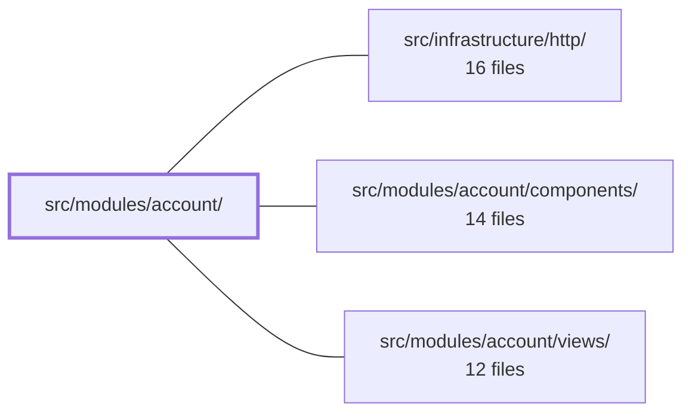

---
tags:
  - 2brain
  - 2brain/module
  - project/boilerplate-vue-frontend
type: module
module: src/modules/account/
files: 64
updated: 2026-10-17T02:51:19.617901+00:00
---

# src/modules/account/

## Purpose

The `account` module owns the full visitor-identity and self-service surface: authentication (plain login, OAuth, 2FA, signup, password reset), the signed-in profile (password, email, avatar, language, device sessions, address book), and account-level operations (data export, deletion). It also hosts the address-book UI that the `addresses` domain depends on, since `addresses` has no frontend of its own.

## Key parts

- **Stores** (`stores/`) — Pinia stores that own client state and all write actions:
  - `auth.ts` — session lifecycle (login, signup, logout, password-reset); coordinates results into the session and profile stores.
  - `profile.ts` — the visitor's editable `User` record and every self-service mutation (avatar, email, password, export, delete).
  - `two-factor.ts` — 2FA enrollment, login-time challenge, and the shared `resendAfter` cooldown.
  - `addresses.ts` — address-book CRUD; re-reads the full book after every mutation to maintain the "exactly one default" invariant.
  - `oauth.ts` / `oauth-links.ts` — deployment-level provider list vs. the visitor's linked providers.
  - `sessions.ts` — device-session list and per-device revocation.

- **Composables** (`composables/`) — small, reusable view-layer logic:
  - `use-post-login-redirect.ts` — single navigation target for every login step (form, 2FA, OAuth, signup).
  - `use-password-strength.ts` / `use-password-breach-check.ts` — advisory score and breach hint, kept separate so pages load only what they need.
  - `use-countdown.ts` — ticking "seconds left" timer with accessible threshold announcements.
  - `use-method-label.ts` — wire-name → i18n label for 2FA methods without hard-coding method names.

- **Module wiring** — `module.ts` (registration manifest), `routes.ts` (route table with access guards), `response-schemas.ts` (OpenAPI response-contract rows), `index.ts` (barrel that re-exports `AddressPicker` for other modules such as cart checkout).

- **Tests** (`tests/`) — a mix of unit specs (stores, composables, individual views), wiring-level integration tests (password-breach across three forms), and Cypress e2e suites covering the full auth lifecycle, OAuth redirect chain, 2FA, password reset, profile self-service, registration, plus a11y and visual-regression declarations.

## How it connects

- **`/` (repository root)** — The kernel reads `module.ts` to splice this module's routes, nav entry, and locale loaders into the app. `response-schemas.ts` plugs into the root's OpenAPI validation pipeline. Deleting the folder removes all of that.
- **`src/infrastructure/http/`** — Every store calls the generated REST client (`useStructureRestApi`) from the HTTP infrastructure layer. Tests mock only the `orvalMutator` transport boundary, so the stores and API client above it run for real.
- **`src/modules/account/views/`** — `routes.ts` lazily imports the page components (Login, Signup, Profile*, PasswordReset*, AccountExportDownload, etc.) that live in this subdirectory. The route table is the only coupling point.
- **`src/modules/account/components/`** — Reusable widgets (AddressPicker, OAuthButtons, PasswordStrengthMeter, AddressFormDialog) are consumed by those views. `index.ts` re-exports `AddressPicker` so external modules (notably cart checkout) can mount it without reaching into internal stores.

## Where to start

1. **`stores/auth.ts`** — Reading the login → session → profile hand-off here shows the module's central data flow and how it touches the HTTP layer, session store, and profile store in one action.
2. **`routes.ts`** — Skimming the route table and its `meta.access` values gives you the full page map and the guest/authed boundary in a single file, making it easy to find the view you need next.

## Connected modules

[[boilerplate-vue-frontend_ROOT|/ (repository root)]] · [[boilerplate-vue-frontend_src_infrastructure_http|src/infrastructure/http/]] · [[boilerplate-vue-frontend_src_modules_account_components|src/modules/account/components/]] · [[boilerplate-vue-frontend_src_modules_account_views|src/modules/account/views/]]

## Files
- `src/modules/account/composables/use-countdown.ts` — A single ticking "seconds left" primitive plus an ISO-timestamp wrapper. It derives the remaining seconds from a server-provided deadline (not a client-guessed duration), runs a `setInterval`-driven `now` ref only while a deadline is active, and provides an accessible announcement layer that fires at discrete thresholds rather than every tick.
- `src/modules/account/composables/use-method-label.ts` — Composable that turns a 2FA method's wire name (e.g. `'email'`, `'totp'`) into a human-readable label via i18n. It deliberately avoids branching on specific method names: if a locale key exists for the name it is used, otherwise the raw wire string is returned as-is, so a method added by a later deployment renders correctly with no code change here.
- `src/modules/account/composables/use-password-breach-check.ts` — Vue composable that wires a debounced advisory password-breach check (via `POST /account/password/check`) into any form that collects a brand-new password. It exists to give the visitor a soft "this password appears in a breach list" hint while typing, without becoming a submit gate — the four password-SET endpoints remain the authoritative check. Shared across `Signup.vue`, `ProfilePasswordChange.vue`, and `PasswordResetConfirm.vue`.
- `src/modules/account/composables/use-password-strength.ts` — Provides a reactive, client-side password strength score (0–4) using zxcvbn, scored locally on every keystroke. It is deliberately separate from the breach-check composable so that pages needing only one feature never load the other's dependencies. The score is strictly advisory and must never gate form submission.
- `src/modules/account/composables/use-post-login-redirect.ts` — Centralises the "where do I go once a session exists" logic so that every login step (plain form, 2FA challenge, OAuth callback, signup) ends with the same navigation rather than each re-deriving it. When the visitor's saved record carries a locale preference, it chains that switch onto the `Home` route before navigating.
- `src/modules/account/index.ts` — Public barrel for the `account` module. It re-exports a single component (`AddressPicker`) so that other modules (notably `cart`'s checkout) can mount the address-choose UI without importing into this module's internal stores or add/edit dialog directly.
- `src/modules/account/module.ts` — Module manifest for the `account` module. Exports a single default object (typed as `AppModule`) that, once spliced into the kernel registry by name, activates the account routes, navigation entry, response-schema loader, and locale loaders. It is the registration point, not the implementation.
- `src/modules/account/response-schemas.ts` — Declares the response-envelope schema rows for every REST endpoint the **account** and **addresses** domains call. It registers those rows so that enabling the account domain in the module manifest activates OpenAPI contract validation for those responses, and deleting the folder disables it. The `addresses` module has no frontend of its own; its address-book screens live in this account module.
- `src/modules/account/routes.ts` — Defines the complete route table for the account module as a single array of `RouteRecordRaw` entries. The kernel splices this array into the app router; each entry pairs a path, a lazily-loaded view component, and a `meta.access` value that the global route guard reads to enforce guest/authed access. The file also contains one routeless entry (`Logout`) that performs its side-effect in `beforeRouteEnter` rather than rendering a view.
- `src/modules/account/stores/addresses.ts` — Pinia store (Composition API) that owns the visitor's address-book state and all write actions against the address endpoints. It exists because the "exactly one default" invariant is a property of the whole list: any write that changes which entry is the default mutates a *different* row than the one the API responds with, so the store re-reads the full book after every mutation rather than patching a single entry locally.
- `src/modules/account/stores/auth.ts` — Pinia store (Composition API) that owns the **session lifecycle**: login, signup, password reset, and the two logout paths. It wraps the generated REST calls from `@api` via `useStructureRestApi`, then coordinates the resulting state into the session store and profile store rather than holding user-editable data itself.
- `src/modules/account/stores/oauth-links.ts` — Pinia store (Composition API) holding the signed-in visitor's connected OAuth sign-in providers. It exists to separate the *visitor's own* linked providers from the deployment-level provider registry in `oauth.ts`, giving `ProfileConnectedAccounts.vue` a single place to read the list and trigger a disconnect.
- `src/modules/account/stores/oauth.ts` — Pinia store (Composition API form) that holds the list of enabled OAuth providers for a deployment, plus two pure helpers (`providerLabel`, `oauthStartUrl`) used by `Login.vue` and `Signup.vue` to render one button per configured provider. The provider list is a deployment-level fact fetched once and cached, not per-visitor state.
- `src/modules/account/stores/profile.ts` — Pinia store (Composition API) that owns the visitor's own editable `User` record and every self-service operation on it: fetch/update, avatar upload/removal, live password change, email verification and change, account export, and account deletion. It wraps `useStructureRestApi` so all actions share one cache/loading lifecycle rather than duplicating request logic per endpoint.
- `src/modules/account/stores/sessions.ts` — Pinia store (Composition API) that loads and revokes the visitor's device-session list. It wraps the session REST endpoints so the UI can ask "who else is signed in?" and "log out that one device" without touching the API layer directly.
- `src/modules/account/stores/two-factor.ts` — A single Pinia store (Composition API, id `accountTwoFactor`) that owns all client-side 2FA state and actions: the account's armed/available methods, the enrollment machine (setup → confirm → backup codes), and the login-time challenge (send code → submit code). The shared `resendAfter` cooldown lives here so both the login challenge and the enrollment "send me a code" step read the same server-driven number.
- `src/modules/account/tests/account-export-download-view.spec.ts` — Unit tests for the `AccountExportDownload` page — the landing target of a "your data export is ready" email link. Verifies that the page fetches nothing on arrival, downloads and saves the export as a dated JSON file on button press, handles missing/errored exports with the correct copy, and guards against double-clicks.
- `src/modules/account/tests/address-form-dialog.spec.ts` — Unit test suite for the country `v-autocomplete` inside `AddressFormDialog.vue`. It verifies the options list that gets passed down to `VAutocomplete` (full ISO list vs. narrowed ship-to list) and that labels are localized via `Intl.DisplayNames`. It exists to fill a gap not covered by `ProfileAddresses.vue` or `AddressPicker.vue`'s own suites.
- `src/modules/account/tests/address-picker.spec.ts` — Unit tests for `AddressPicker.vue`'s pre-select watcher and related UI behavior. Verifies that the watcher picks a default (or first) entry when nothing valid is chosen, never overrides a still-valid manual pick, and correctly distinguishes a freshly added entry from the initial book load.
- `src/modules/account/tests/addresses.spec.ts` — Unit tests for the `useAddressesStore` (address-book Pinia store). The only external boundary mocked is the HTTP transport (`orvalMutator`); the store's own fetch-after-write logic executes for real. Every test pins the same invariant: after a mutation the store **replaces** its local list with the full book returned by the server rather than locally patching a single row, and exactly one entry is flagged as default.
- `src/modules/account/tests/auth-login-mfa.spec.ts` — Unit tests for the **MFA branch** of `useAuthStore().login()`. The critical contract under test: when the server responds with a `mfaRequired` challenge, the Promise must resolve with the challenge payload and must **not** write anything into the session store or trigger a profile fetch. A single minimal session-branch test is included only as a contrast assertion; the full session flow lives in `auth-session.spec.ts`.
- `src/modules/account/tests/auth-session.spec.ts` — Unit tests for the auth store's session flows (login, logout, logoutEverywhere, password-reset request). The file mocks only the HTTP transport (`orvalMutator`) and keys canned responses by `METHOD /path`, so every layer above it — the generated API client, session/profile/observability stores — runs for real. This lets the tests assert against the same session state that router guards actually read, rather than against a mock of the store itself. `signup` is covered separately in `auth-signup.spec.ts`.
- `src/modules/account/tests/auth-signup.spec.ts` — Unit tests for the auth store's `signup` action and the `setAvatarAfterSignup` follow-up. They pin the exact HTTP request (method, URL, body shape, encoding) each action produces against the generated API schemas, without mocking the `@api` client itself.
- `src/modules/account/tests/e2e/a11y.cy.ts` — Declares the list of routes and UI states in the **account** module that the shared a11y sweep should audit. It does not implement any auditing logic itself — it only names what to check and how to reach each state (via a `prepare` callback where needed). The file is co-located with the account module so that deleting the module automatically removes its a11y coverage; a central registry would drift.
- `src/modules/account/tests/e2e/account.visual.cy.ts` — Declares the list of screens to capture in the account module's visual-regression sweep. It contains no snapshot logic itself — that mechanism lives in `visual-sweep.ts`; this file only names routes, readiness selectors, and any per-screen `prepare` / `redact` hooks needed to reach a specific state.
- `src/modules/account/tests/e2e/auth.cy.ts` — Cypress end-to-end spec covering the full authentication lifecycle: login form (render, validation, success, "remember me" cookie expiry), signup (render, password mismatch, successful unverified signup), route-guard redirects for `/cart`, `/orders`, `/admin`, `/users`, `/login`, logout, cross-account user switching without a page reload, and a live-profile-only session-refresh test that exercises the `:8085 → :3000` cross-origin cookie boundary after a forced 401.
- `src/modules/account/tests/e2e/oauth.cy.ts` — Cypress e2e suite that exercises the OAuth login button against the backend's `fake` provider (demo-mode only). Because real Google/GitHub redirects cannot complete in CI, the `fake` provider substitutes the consent screen while still round-tripping the genuine `state` cookie, letting tests validate the full redirect chain: BE start → BE callback → cookies → FE `/oauth/callback`.
- `src/modules/account/tests/e2e/password-reset.cy.ts` — Cypress end-to-end suite for the forgot-password flow. It verifies the full reset round-trip by reading the actual link from the demo backend's email outbox (or Mailpit in live mode) rather than constructing a known URL, then proves both halves of the outcome at the login form: the old password is dead and the new one is live. A second case confirms a fabricated token changes nothing.
- `src/modules/account/tests/e2e/profile.cy.ts` — End-to-end specs for the signed-in **Profile** self-service surface: language preference, password change, active-session list/revocation, the address book (add / promote / remove default), and email-change behaviour. Runs against the real API in its demo profile so the invariants under test (one default address, a `current` session flag, a `pendingEmail` park) are the backend's own. The specs pin the *page's* honouring of those invariants, not the business rules themselves.
- `src/modules/account/tests/e2e/registration.cy.ts` — Cypress end-to-end spec covering the full registration arc: a visitor signs up, the session is established immediately (account lands as `unverified` with a banner), the user logs out to simulate a separate device, the emailed verification token is spent as a guest, and the password gate is proven (wrong password refused, correct password accepted). It also verifies that the unverified banner persists on every page until the token is actually consumed.
- `src/modules/account/tests/e2e/two-factor.cy.ts` — Cypress end-to-end spec that exercises the full email-based two-factor authentication lifecycle: enrolling email as a second factor, verifying the challenge page on the next login, accepting a code read from the mailbox, rejecting an incorrect code, regenerating backup codes, and removing the last factor to disable 2FA. It exists because the 2FA flow spans multiple pages, a backend mail template, and mailbox polling, none of which unit tests can cover together.
- `src/modules/account/tests/login-view-i18n.spec.ts` — End-to-end view test that the `Login.vue` form re-translates Vuetify validation messages when the active locale changes mid-form. It exists to catch a specific regression: a view that forgets `revalidateOn: locale` on its `v-text-field` renders correctly in one language but shows stale (or both) messages after switching. Unlike `tests/cross-cutting/schemas-i18n.spec.ts` (which proves the mechanism in isolation), this spec proves the *wiring* inside a real mounted component.
- `src/modules/account/tests/oauth-buttons.spec.ts` — Unit test for the `OAuthButtons` component's sign-in-wrap notice. Verifies that the terms/privacy notice and its two links render when at least one OAuth provider is enabled, and that the component renders nothing at all when no providers are configured.
- `src/modules/account/tests/oauth-continue.spec.ts` — Verifies that `Login.vue` and `Signup.vue` forward the page's `?continue=` query parameter onto every OAuth button's `href`, while always including the active `?locale=`. Also asserts that the views **reject** unsafe `continue` values (protocol-relative URLs, array/repeated params) rather than passing them through. Complements `oauth.spec.ts`, which pins the `oauthStartUrl` function's own encoding logic in isolation.
- `src/modules/account/tests/oauth-links-store.spec.ts` — Unit tests for the `useOAuthLinksStore` Pinia store. Verifies that fetching the connected-provider list populates the store correctly, that unlinking a provider issues a DELETE and then reloads the list, and that a payload missing the `links` array degrades to an empty list. Only the HTTP transport layer is mocked; the store logic under test runs for real.
- `src/modules/account/tests/oauth.spec.ts` — Unit tests for the OAuth provider store (`useOAuthProvidersStore`) and its two pure helpers (`oauthStartUrl`, `providerLabel`). Only the HTTP transport is mocked; responses are keyed by request URL using the same pattern as `sessions.spec.ts`.
- `src/modules/account/tests/password-breach-hint.spec.ts` — Wiring-level integration test that mounts the three real Vue forms (`ProfilePasswordChange`, `PasswordResetConfirm`, `Signup`) to prove `usePasswordBreachCheck` is correctly connected in each. It does **not** test the debounce logic in isolation (that lives in `use-password-breach-check.spec.ts`); it asserts that typing a password triggers the `POST /account/password/check` endpoint and that the `[data-test=password-breach-warning]` element appears and clears as expected.
- `src/modules/account/tests/password-change-sessions-refresh.spec.ts` — Verifies that the `ProfilePasswordChange` form triggers a device-sessions refetch after a successful password change. Because the backend (`postPasswordChange`) revokes all other sessions server-side, the UI must proactively refetch rather than showing stale session data until the user's next navigation.
- `src/modules/account/tests/password-reset-request-view.spec.ts` — Vitest unit tests for the "forgot password" page (`PasswordResetRequest.vue`). Verifies four behaviors: client-side email validation blocks submission, a valid email reaches the auth store, a field-named API error renders under the input, and a non-field API error shows an inline banner. The real component, router, and Pinia store are used; only `requestPasswordReset` and `HumanCheck` are stubbed.
- `src/modules/account/tests/password-strength-meter.spec.ts` — Vitest unit test for `PasswordStrengthMeter.vue`. Verifies three contracts: the meter is absent for an empty password, it renders a bar + label once a score exists, and it **never** renders a breach warning (that responsibility belongs to a separate component).
- `src/modules/account/tests/profile-account-consent.spec.ts` — Verifies that while signed in, analytics consent is written to the account record (`PATCH /account`) rather than the guest cookie, and that signing out hands the consent banner back to cookie-based tracking. Only the HTTP transport is mocked; the consent, profile, and auth stores run as real Pinia instances.
- `src/modules/account/tests/profile-addresses-default.spec.ts` — Unit tests scoped to the "set as default" checkbox in the ProfileAddresses add/edit dialog. Verifies the checkbox is hidden when the address book is empty (first address is always default server-side) or when editing an existing entry, and that checking it adds only `default: true` to the POST body — never `default: false`. Complements `addresses.spec.ts`, which covers the store's HTTP plumbing.
- `src/modules/account/tests/profile-addresses-view.spec.ts` — Unit test for `ProfileAddresses.vue`'s save-payload construction, scoped to the create/update body the component builds from dialog fields. It fills the gap left by the store-level test (`addresses.spec.ts`): verifying that an emptied label or phone on **edit** serialises to `null` (not `""`, which the API rejects with 422, and not an omitted key, which a PATCH treats as a no-op), and that on **create** those fields are omitted entirely.
- `src/modules/account/tests/profile-avatar-panel.spec.ts` — Unit tests for the remove-button behavior in `ProfileAvatar.vue`: the button is rendered only when the account currently has a picture (`imageUrl` present) and is hidden when it does not. Exists to pin down that conditional visibility contract.
- `src/modules/account/tests/profile-avatar.spec.ts` — Unit tests for the avatar-specific branches of `updateProfile` in the profile store: multipart file upload, `onUploadProgress` forwarding, the plain-JSON `imageUrl: null` removal path, and the per-path loading flags (`uploadingAvatar` / `removingAvatar`). Split out from `profile.spec.ts` because it covers only the picture concern.
- `src/modules/account/tests/profile-connected-accounts.spec.ts` — Unit tests for the `ProfileConnectedAccounts.vue` panel. Verifies three behaviours: provider rows render the human-readable label, an empty-state element appears when no links exist, and the remove button gates the store's `unlinkProvider` call behind a `useDialogStore().confirm` prompt.
- `src/modules/account/tests/profile-export-data.spec.ts` — Vitest unit test for the `ProfileExportData` component. Verifies that clicking the export button calls `requestAccountExport` (and never performs a download itself), displays a success message about an emailed link, surfaces server errors in place, and clears a prior success when a subsequent attempt fails.
- `src/modules/account/tests/profile-guest-consent-sync.spec.ts` — Tests the login-time consent-sync path: when a guest who already answered the analytics consent banner authenticates into an account that has **no** `analyticsConsent` field, the guest's choice is persisted via `PATCH /account` exactly once. Mocks only the HTTP transport; the guest choice flows through the real `useAnalyticsConsentStore`.
- `src/modules/account/tests/profile-page.spec.ts` — Integration-level test for the record-edit form that `Profile.vue` owns directly. It asserts exactly what a user-initiated save sends over `PATCH /account`—and, equally, what it deliberately leaves out—while every sibling panel (`ProfileAvatar`, `ProfileSessions`, etc.) is stubbed so each fetches nothing. The file exists to pin the "absent means untouched" PATCH semantics and the pending-email change workflow.
- `src/modules/account/tests/profile-sessions-last-used.spec.ts` — Render-focused unit tests for `ProfileSessions.vue` that verify the sessions panel correctly displays each session's last-used timestamp, sign-in start time, and (for `cookie`-mode sessions) the coarse device label. The file exists to guard the "pick the device to revoke" UX described in the component's header comment.
- `src/modules/account/tests/profile-stale-record.spec.ts` — Unit test for the Profile page's 412 (Precondition Failed) save-rejection path: verifies the form displays an in-place warning and that the "reload latest" button triggers a fresh `GET /account` and clears the warning. It lives in its own file because `profile-page.spec.ts`'s shared `orvalMutator` mock answers every PATCH with success.
- `src/modules/account/tests/profile.spec.ts` — Unit tests for the `useProfileStore` covering fetch, update, locale persistence, the account-deletion flow, and the account-export flow. Only the HTTP transport (`orvalMutator`) is mocked; every layer above it — generated client, `session.ts`, observability store, `useStructureRestApi` — executes for real. Cases that need an authenticated session log in through the actual `useAuthStore().login`, mirroring production callers.
- `src/modules/account/tests/routes.spec.ts` — Vitest spec that pins the `meta.access` value declared on every account route by reading the module's raw route records directly (no locale prefix, no resolved router). It guarantees two things: each named route carries the expected access level, and no new route has been added without an explicit access decision.
- `src/modules/account/tests/sessions.spec.ts` — Unit tests for the device-sessions Pinia store (`useAccountSessionsStore`). Verifies that `revokeSession` triggers a list refetch (unless the revoked session is the caller's own), and that a payload missing the `sessions` key degrades to an empty list. Mocks only the HTTP transport, keying canned responses by `METHOD URL` — the same pattern as `profile.spec.ts`.
- `src/modules/account/tests/signup-antibot.spec.ts` — Proves the "rung 3" integration: the real `Signup.vue` view attaches a solved `HumanCheck` token as the `x-antibot-challenge-token` header on `POST /account/signup`. The test mounts the actual view (with Vuetify and i18n), stubs only the `HumanCheck` widget with a fixed token, and inspects the outgoing request to confirm the header is present. It deliberately does **not** test the token-generation logic (`human-check.spec.ts`) or store forwarding (`auth-signup.spec.ts`).
- `src/modules/account/tests/signup-continue.spec.ts` — Integration test that mounts the real `Signup.vue` page and verifies the post-signup navigation target. It asserts that a same-origin relative path in `?continue=` is followed, that a missing parameter lands on Home, and that unsafe values (protocol-relative, absolute, repeated) are rejected in favor of Home.
- `src/modules/account/tests/two-factor-challenge-view.spec.ts` — Vitest spec for the `TwoFactorChallenge.vue` view. It verifies three view-level behaviours that store-level tests (`use-countdown.spec.ts`) cannot cover: (1) the visible countdown text is **not** itself a live region while a separate `[role=status]` element exists, (2) an expired challenge disables submit and exposes a "Back to login" link with a live-region announcement, and (3) the back-to-login link is present even while the challenge is live, plus terminal (429) vs. non-terminal (422) submit-failure handling.
- `src/modules/account/tests/two-factor-enroll-countdown.spec.ts` — Component-level accessibility test for `TwoFactorEnroll.vue`. It verifies that the visible countdown ticker (the "expires in …" paragraph) is kept **outside** any ARIA live region, while a dedicated `[role=status]` element exists to announce state changes. This complements `two-factor-challenge-view.spec.ts` (same pattern for the login challenge view) and `use-countdown.spec.ts` (unit-level proof of the shared announcement logic).
- `src/modules/account/tests/two-factor-store.spec.ts` — Unit tests for `useTwoFactorStore()`, covering the full enrollment flow (setup → confirm → backup codes), the login-time challenge, the `resendAfter` countdown behaviour, and 429 / wrong-code rejections. Only the HTTP transport is mocked; the store logic itself runs for real.
- `src/modules/account/tests/two-factor-view.spec.ts` — Regression spec that pins the "never park a secret in a store" invariant: the TOTP secret and one-time backup codes must render from component-local state fed directly by the `setup`/`confirm` API response, **not** from `useTwoFactorStore()`. It exercises the real `ProfileTwoFactor.vue` + `TwoFactorEnroll.vue` pair through user-visible interactions (enroll, confirm, regenerate, replace, cancel) and asserts the rendered values on `document.body`.
- `src/modules/account/tests/use-countdown.spec.ts` — Unit tests for `useCountdownAnnouncement`, the screen-reader-friendly subset of the countdown composable. Where the store spec (`two-factor-store.spec.ts`) already exercises the raw ticking, this file verifies that announcements fire exactly once per threshold crossing (60s → 30s → 10s → "expired") and never on every individual tick of a multi-minute challenge.
- `src/modules/account/tests/use-password-breach-check.spec.ts` — Vitest spec for the `usePasswordBreachCheck` composable. Verifies that rapid keystrokes produce a single debounced API call, that pending checks are cancelled on scope disposal or empty input, that the breach flag reflects the server verdict without alarming on failures, and that stale responses are discarded in favor of newer ones.
- `src/modules/account/tests/use-password-strength.spec.ts` — Vitest spec that verifies `usePasswordStrength` correctly delegates scoring to zxcvbn, clears the score when the password is emptied, and re-scores on subsequent changes. It exists to lock in the composable's contract so the dynamic-import lazy-loading strategy and empty-string short-circuit remain intact.
- `src/modules/account/tests/use-post-login-redirect.spec.ts` — Unit tests for the `usePostLoginRedirect` composable, covering two security and correctness concerns: (1) the `?continue=` query parameter must be a single same-origin path or the app must fall back to `Home` (blocking open-redirects via protocol-relative URLs, absolute URLs, and array injection), and (2) a saved language preference must be applied exclusively through routing (`params.locale`), never by calling `changeLanguage` directly, which would defeat the `localeChoice` guard.

---
[[boilerplate-vue-frontend_INDEX|← boilerplate-vue-frontend index]]
