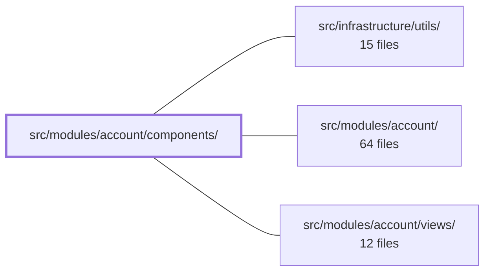

---
tags:
  - 2brain
  - 2brain/module
  - project/boilerplate-vue-frontend
type: module
module: src/modules/account/components/
files: 14
updated: 2026-10-17T02:51:32.909958+00:00
---

# src/modules/account/components/

## Purpose

This directory holds every presentational Vue SFC for the account domain: the profile-page management panels, the checkout address-picker widgets, the shared OAuth button block, and the 2FA enrollment UI. It contains no routing, no top-level state, and no API calls beyond what the parent `account` module exposes—each component is a self-contained visual unit that reads from and writes through the account stores.

## Key parts

- **Address management** — `AddressFormDialog.vue` is the single add/edit form (Zod schema + save logic) shared by both the profile and checkout flows. `AddressPicker.vue` is the radio-group selector used during checkout, and `ProfileAddresses.vue` is the full CRUD card grid on the profile page.
- **Profile panels** — `ProfileAvatar`, `ProfileConnectedAccounts`, `ProfileDeleteAccount`, `ProfileExportData`, `ProfilePasswordChange`, and `ProfileSessions` each render one isolated card inside the Profile view, each owning its own loading/error state.
- **2FA flow** — `ProfileTwoFactor.vue` is the management panel (list, enroll, remove, backup-codes count). `TwoFactorEnroll.vue` is the per-method enrollment card (QR or delivered-code branch). `TwoFactorBackupCodes.vue` is the one-time blocking gate shown after first arming.
- **Shared auth UI** — `OAuthButtons.vue` renders the provider buttons + terms notice used by both Login and Signup. `PasswordStrengthMeter.vue` is a passive visual indicator fed by `usePasswordStrength`.

## How it connects

- **`src/modules/account/`** (parent) — Provides the stores, composables (`usePasswordStrength`), API wrappers (`requestAccountDelete`, session revocation, 2FA mutations), and Zod schemas that every component here consumes. Components never call the HTTP layer directly.
- **`src/modules/account/views/`** — The Profile, Login, Signup, and Checkout views are thin layout shells that import and position these components. Each view decides *where* and *when* a panel appears; the panel itself owns *what* it shows and *how* user interaction is handled.
- **`src/infrastructure/utils/`** — Supplies shared helpers (formatting, validation guards, confirmation-dialog plumbing) that individual components import rather than re-implementing.

## Where to start

1. **`ProfileAddresses.vue`** — It exercises the module's dominant pattern in one file: render a list, delegate the form to a child dialog (`AddressFormDialog`), re-fetch on every mutation, and surface per-row actions. Reading it alongside `AddressFormDialog.vue` shows how the shared form is kept single-source.
2. **`OAuthButtons.vue`** — The simplest component in the set; a quick read shows how a component reads provider config from the account store, renders conditionally, and gets reused across two different views with zero prop-passing.

## Connected modules

[[boilerplate-vue-frontend_src_infrastructure_utils|src/infrastructure/utils/]] · [[boilerplate-vue-frontend_src_modules_account|src/modules/account/]] · [[boilerplate-vue-frontend_src_modules_account_views|src/modules/account/views/]]

## Files
- `src/modules/account/components/AddressFormDialog.vue` — Reusable add/edit address dialog, extracted from `ProfileAddresses.vue` so that both the profile page and the checkout `AddressPicker` share a single implementation of the form, its Zod schema, and its save logic instead of maintaining two copies.
- `src/modules/account/components/AddressPicker.vue` — A radio-group picker for choosing a saved address (shipping or billing) during checkout. It renders one radio per entry in the shared address book, supports an optional "same as shipping" choice, and lets the visitor add a new address inline via `AddressFormDialog`. Mounted twice by `ShippingSelector.vue` (or `Cart.vue`) — once per `purpose` — so a new address saved through one picker is never accidentally adopted by the other.
- `src/modules/account/components/OAuthButtons.vue` — Shared "Continue with \<provider\>" block rendered by both the Login and Signup views. It displays a divider, one outlined button per enabled OAuth provider, and a terms/privacy notice explaining that the first sign-in with a provider creates the account (the backend stamps the acceptance at that point). The entire block is hidden when no provider is enabled.
- `src/modules/account/components/PasswordStrengthMeter.vue` — A purely visual, advisory password-strength indicator (progress bar + text label) that reflects a zxcvbn score supplied by `usePasswordStrength`. It renders nothing for an empty password and never blocks form submission; actual enforcement is delegated to schema validation and server-side checks.
- `src/modules/account/components/ProfileAddresses.vue` — Vue SFC that renders the address-book panel inside the profile view. It lists the visitor's saved addresses in a responsive card grid, provides add / edit / remove / set-default actions, and delegates the add & edit form to `AddressFormDialog`. Every write action triggers a full list re-fetch so the "exactly one default" invariant is always reflected from the API's authoritative response.
- `src/modules/account/components/ProfileAvatar.vue` — The profile-picture panel for the account page. It lets the visitor upload a new avatar or remove the current one, each action committed immediately to the profile store (no separate "save" step, since the avatar is not part of the details form below it). It owns client-side file validation, upload progress display, a confirmation dialog for removal, and in-place error reporting.
- `src/modules/account/components/ProfileConnectedAccounts.vue` — Renders the "Connected accounts" card on the profile page, listing the OAuth sign-in providers (Google, GitHub) currently linked to the visitor's account. Each row shows the provider name, connection date, and a remove button gated behind a confirmation dialog.
- `src/modules/account/components/ProfileDeleteAccount.vue` — Renders a single "Delete account" button that, on click, opens a shared confirmation dialog and—on accept—calls `requestAccountDelete` from the profile store. The component is the most destructive control on the profile page and is intentionally given its own card rather than sharing a panel with less critical actions.
- `src/modules/account/components/ProfileExportData.vue` — A single-button GDPR self-service export trigger. Clicking it asks the API to build the visitor's data export in the background; the server then emails a download link. The component only confirms the request was accepted (or shows an inline error on failure). It is deliberately simpler than its `ProfileDeleteAccount` sibling: no confirm dialog, no re-auth UI (the step-up interceptor handles that transparently).
- `src/modules/account/components/ProfilePasswordChange.vue` — A collapsible form for live password change (current-password-verified, no email round-trip). It sits inside the Profile view and is hidden behind a toggle so the page does not open with all three account forms visible simultaneously.
- `src/modules/account/components/ProfileSessions.vue` — A profile-page panel that lists the visitor's live device sessions and lets them revoke any single session or end all of them at once. It exists as a standalone SFC so the profile view stays a thin layout shell and the session UI (list, per-row revoke, logout-everywhere) is self-contained with its own loading and error handling.
- `src/modules/account/components/ProfileTwoFactor.vue` — The account's 2FA management panel. It renders the list of armed second-factor methods (each removable; an already-armed one also replaceable), the methods still available for enrollment, and the backup-codes count. Every code-guarded mutation (remove, disable-all, regenerate, enroll-while-armed) flows through a single shared code-prompt dialog, with in-dialog error blocking instead of toasts.
- `src/modules/account/components/TwoFactorBackupCodes.vue` — A one-time, blocking confirmation screen that displays a set of 2FA backup codes to the user. It is rendered only at the moment an account first arms a second factor (the store's `confirmed.backupCodes` is populated exactly once), and the user must explicitly acknowledge having saved the codes before proceeding. Because the codes are never retrievable again, this component acts as a hard gate in the enrollment flow.
- `src/modules/account/components/TwoFactorEnroll.vue` — Renders the enrollment card for a single second-factor method (TOTP device or delivered code such as email). It branches only on `setup.delivers`: a QR code + manual-entry secret for device methods, a "code sent to…" prompt with resend for delivered methods, plus a code input field in both cases. It is method-agnostic — no logic inspects the `method` string.

---
[[boilerplate-vue-frontend_INDEX|← boilerplate-vue-frontend index]]
