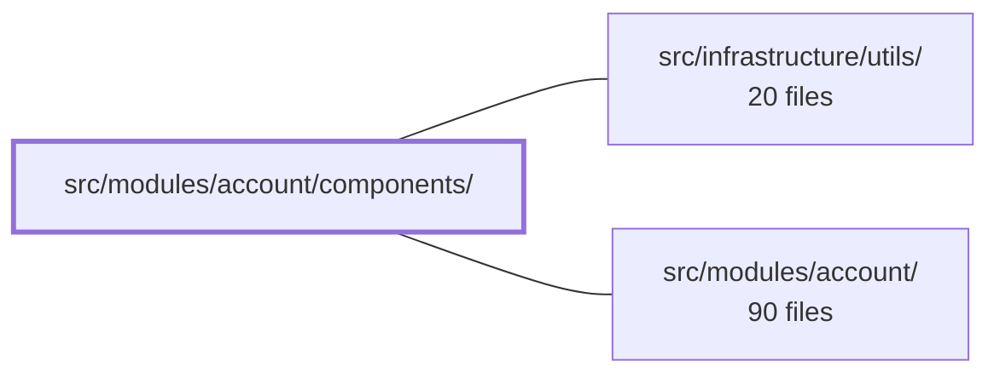

---
tags:
  - 2brain
  - 2brain/module
  - project/boilerplate-vue-frontend
type: module
module: src/modules/account/components/
files: 17
updated: 2026-11-10T08:37:37.960073+00:00
---

# src/modules/account/components/

## Purpose

This directory holds every presentational and form-level Vue component for the account domain: profile-management panels, authentication helpers (2FA enrollment, OAuth, password), checkout address selection, and shared confirmation flows. It is the visual layer that the parent account module's routes and stores drive.

## Key parts

- **Profile panels** (`ProfileAddresses`, `ProfileAvatar`, `ProfileConnectedAccounts`, `ProfileDeleteAccount`, `ProfileExportData`, `ProfilePasswordChange`, `ProfileSessions`, `ProfileTwoFactor`) — self-contained cards rendered inside the Profile view. Each owns its local UI state, delegates all reads/writes to the corresponding Pinia store, and handles in-place error display via `useBlockingError`.
- **2FA flow** (`TwoFactorEnroll`, `TwoFactorBackupCodes`, `ProfileTwoFactor`) — enrollment card for a single method, one-shot backup-code display, and the parent panel that orchestrates the code-prompt dialog before any state change.
- **Authentication & shared forms** (`OAuthButtons`, `PasswordStrengthMeter`, `TermsAcceptanceCheckbox`, `LinkTokenConfirmCard`) — small, reusable pieces shared across Login, Signup, Password-Reset, and token-confirm pages so markup, i18n, and validation logic stay in one place.
- **Checkout address** (`AddressPicker`, `AddressFormDialog`) — radio-group picker used twice per checkout (shipping + billing) and the extracted add/edit dialog both the profile and checkout flows can mount without duplicating fields, Zod schema, or save logic.
- **Status presentational** (`PurchaseHoldNotice`) — conditional alert card that renders nothing unless the account is under an active hold.

## How it connects

- **`src/modules/account/`** (parent) — Owns the Pinia stores (addresses, sessions, 2FA, connected-accounts, etc.), the route definitions that mount these components, and the global auth interceptor. Components here are purely presentational: they read store state, dispatch store actions, and react to store-emitted errors.
- **`src/infrastructure/utils/`** — Supplies the cross-cutting helpers the components consume: Zod schema helpers, `useStructureFormValidation`, `useBlockingError`, `usePasswordStrength` (zxcvbn scoring), i18n utilities, and route helpers. Components import from this layer rather than re-implementing validation or error-handling primitives.

## Where to start

1. **`AddressFormDialog.vue`** — The shortest example of the module's core pattern: a Zod-validated form that dispatches to a Pinia store and displays server errors in-place. Reading it once makes the same structure in `ProfilePasswordChange` and `TwoFactorEnroll` obvious.
2. **`ProfileTwoFactor.vue`** — Shows how a parent panel composes child components (`TwoFactorEnroll`, `TwoFactorBackupCodes`) and funnels all mutations through a single code-prompt dialog, which is the pattern the other profile panels follow (one card, one store, blocking errors).

## Connected modules

[[boilerplate-vue-frontend_src_infrastructure_utils|src/infrastructure/utils/]] · [[boilerplate-vue-frontend_src_modules_account|src/modules/account/]]

## Files
- `src/modules/account/components/AddressFormDialog.vue` — A reusable add/edit address dialog extracted from `ProfileAddresses.vue` so that `AddressPicker.vue` (the checkout flow) can offer the same "add an address" experience without duplicating the form fields, validation schema, or save logic. It validates via a shared Zod schema, dispatches to the addresses store, and keeps the user in-place on failure.
- `src/modules/account/components/AddressPicker.vue` — A radio-group picker for choosing one saved address from the visitor's address book during checkout. Checkout mounts two instances (one for shipping, one for billing) that share the same Pinia address store but must never cross-select. The component exposes its selection through `defineModel<string | undefined>` and includes an embedded "add address" dialog so a visitor can save a new address without leaving checkout.
- `src/modules/account/components/LinkTokenConfirmCard.vue` — A single reusable card for every "the email link is the credential" confirmation page. The owning page supplies its wording, `data-test` hooks, the store call that spends the token, and the post-success route; the card handles everything shared — reading the token from the URL `#fragment`, scrubbing it from the URL, Zod validation, the submit toast, in-place error display, and the redirect. It renders a submit button (not an auto-fire) so a mail scanner prefetching the URL cannot spend the token before a human acts.
- `src/modules/account/components/OAuthButtons.vue` — Shared "Continue with \<provider\>" block rendered inside both the Login and Signup views. It displays a divider, one button per enabled OAuth provider, and a terms/privacy notice. It renders nothing when no provider is enabled. Because a first sign-in via a provider *creates* the account, the notice is where the terms are surfaced before that implicit acceptance (the backend stamps acceptance at account-creation time).
- `src/modules/account/components/PasswordStrengthMeter.vue` — A read-only, advisory strength indicator (colored progress bar + text label) for a password input. It scores the password via `usePasswordStrength` and maps the 0–4 zxcvbn score to a Vuetify color and i18n label. It never blocks form submission and renders nothing when the password is empty.
- `src/modules/account/components/ProfileAddresses.vue` — Address-book panel for the Profile page. Renders the visitor's saved addresses in a card grid and provides add, edit, set-default, and remove actions. All mutations go through the Pinia store, which re-fetches the full list after each write so the "exactly one default" invariant is always reflected from the server's answer.
- `src/modules/account/components/ProfileAvatar.vue` — Renders the profile-picture panel: a file picker that uploads immediately on selection (no separate save button — the image lives outside the details form) and a remove button. Uploads and removals both PATCH the same single field, so they share one blocking-error slot.
- `src/modules/account/components/ProfileConnectedAccounts.vue` — Renders the "Connected accounts" panel on the profile page: lists OAuth sign-in providers (e.g. Google, GitHub) already linked to the current user, allows removing them behind a confirmation dialog, and offers buttons to connect providers that the deployment supports but the user hasn't linked yet. It delegates all server-side auth (linking, unlinking, step-up challenges) to stores and the global interceptor, keeping this component UI-only.
- `src/modules/account/components/ProfileDeleteAccount.vue` — Single-action account-deletion trigger for the profile page. It chains a confirmation dialog → store request → redirect-with-notice, and surfaces failures as an in-place blocking alert next to the button rather than a toast.
- `src/modules/account/components/ProfileExportData.vue` — A self-service GDPR data-export card for the profile page. It exposes a single button that asks the server to build the visitor's data export, then polls the export status until it is ready, failed, or expired. The component never handles the data transfer itself — the server mails a download link separately.
- `src/modules/account/components/ProfilePasswordChange.vue` — Collapsible form that lets a user change their password live (current-password proof, no email round-trip). It sits behind a toggle on the profile page so the page does not render three forms open at once. Validation is handled client-side via zod + `useStructureFormValidation`; submission errors that are field-mappable are applied to fields, and anything else blocks the form in place via `useBlockingError` rather than toasting.
- `src/modules/account/components/ProfileSessions.vue` — Device-sessions panel that lists all live sign-ins, allows revoking a single session or logging out everywhere, and navigates away when the current session is terminated. It exists as a self-contained card component rendered inside the account Profile view.
- `src/modules/account/components/ProfileTwoFactor.vue` — The account's two-factor authentication panel. It displays the armed methods (each removable or replaceable), the methods still available to add, and the backup-codes count. All code-guarded mutations (remove, disable-all, regenerate, enroll-with-existing-factor) funnel through one shared code-prompt dialog so the visitor proves an existing factor before any state change.
- `src/modules/account/components/PurchaseHoldNotice.vue` — A presentational Vue component that displays a warning alert when the signed-in buyer's account is under an active purchase hold. It surfaces the hold's reason, end date, any staff note, and a link to contest the decision (GDPR Art. 22(3)). Renders nothing when no hold is in force.
- `src/modules/account/components/TermsAcceptanceCheckbox.vue` — A presentational, two-way-bound checkbox for "I accept the Terms and have read the privacy notice." It exists so that both the signup flow and the password-reset flow can share the exact same UI (label, links, i18n) without duplicating markup.
- `src/modules/account/components/TwoFactorBackupCodes.vue` — A one-shot display screen for two-factor backup codes. It renders the codes exactly once at enrolment, forces the user to confirm they've saved them via a checkbox, and then emits `done`. Because the codes are never retrievable after this point, the component is intentionally blocking — there is no way to proceed without ticking the confirmation.
- `src/modules/account/components/TwoFactorEnroll.vue` — A single-method 2FA enrollment card. Renders the setup UI for one factor at a time — either a QR code + manual-entry secret (device method) or a "code sent to…" prompt with resend (delivered method) — plus a code-entry field to confirm. It is method-agnostic: it branches only on the `delivers` flag returned by the store, never on the method string itself.

---
[[boilerplate-vue-frontend_INDEX|← boilerplate-vue-frontend index]]
