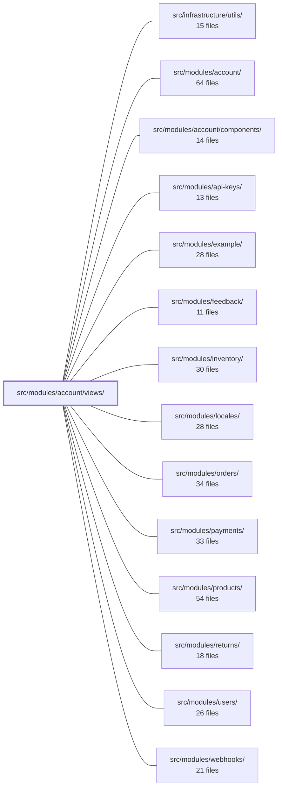

---
tags:
  - 2brain
  - 2brain/module
  - project/boilerplate-vue-frontend
type: module
module: src/modules/account/views/
files: 12
updated: 2026-10-17T02:51:47.047644+00:00
---

# src/modules/account/views/

## Purpose

This module contains the top-level Vue page components for every account-related screen in the application: authentication (login, signup, 2FA, OAuth redirect), the authenticated profile dashboard, and a family of public "one-time-token" pages triggered by emailed links (password reset, email verification, email change, account deletion, and data-export download). Each file is a self-contained view that composes sub-components, talks to the account/auth stores, and handles its own navigation logic.

## Key parts

- **Authentication flow** — `Login.vue`, `Signup.vue`, `TwoFactorChallenge.vue`, `OAuthCallback.vue`. Together they cover the full sign-in/sign-up path: credential entry, anti-bot challenge, MFA code entry, and OAuth redirect resolution. `OAuthCallback` is a thin router that inspects the query string after the global session-restore guard has run.
- **Public token-confirmation pages** — `PasswordResetConfirm.vue`, `VerifyEmailConfirm.vue`, `EmailChangeConfirm.vue`, `EmailChangeUndo.vue`, `AccountDeleteConfirm.vue`. Each renders a small form around a one-time token (prefilled from the emailed link) and requires an explicit user click to spend it, preventing mail-scanner prefetch from consuming the token. `PasswordResetRequest.vue` is the "request" half of that pair.
- **Authenticated profile & data** — `Profile.vue` orchestrates the shared record-edit form and composes sibling panels (avatar, password, 2FA, sessions, addresses, connected accounts, data export, deletion). `AccountExportDownload.vue` is the landing page for the "export ready" email; the download fires only on a button click.

## How it connects

- **`src/modules/account/`** — Every view imports the auth store (session state, `usePostLoginRedirect`, login/signup/reset actions) and composable helpers from the parent account module. The views are the UI layer; the store and composable layer live here.
- **`src/modules/account/components/`** — `Profile.vue` composes its sibling panels (avatar picker, 2FA toggle, session list, etc.) from this components directory. `Signup.vue` and `Login.vue` render the `HumanCheck` anti-bot widget, also sourced here.
- **`src/modules/locales/`** — `Profile.vue` reads and writes the user's language preference, and several views use translated strings from the locale store for their UI copy.
- **`src/infrastructure/utils/`** — Shared validation (zod schemas for password strength, email format) and small helpers are consumed across multiple views.

## Where to start

Read **`Login.vue`** first: it is the shortest "full" view and shows the typical pattern of form state → auth-store call → conditional redirect (to app or to `TwoFactorChallenge`). Then read **`Profile.vue`** to see how a larger page composes sibling components, manages a shared form lifecycle, and wires up the pending-email / stale-record edge cases that recur across the token-confirmation pages.

## Connected modules

[[boilerplate-vue-frontend_src_infrastructure_utils|src/infrastructure/utils/]] · [[boilerplate-vue-frontend_src_modules_account|src/modules/account/]] · [[boilerplate-vue-frontend_src_modules_account_components|src/modules/account/components/]] · [[boilerplate-vue-frontend_src_modules_api-keys|src/modules/api-keys/]] · [[boilerplate-vue-frontend_src_modules_example|src/modules/example/]] · [[boilerplate-vue-frontend_src_modules_feedback|src/modules/feedback/]] · [[boilerplate-vue-frontend_src_modules_inventory|src/modules/inventory/]] · [[boilerplate-vue-frontend_src_modules_locales|src/modules/locales/]] · [[boilerplate-vue-frontend_src_modules_orders|src/modules/orders/]] · [[boilerplate-vue-frontend_src_modules_payments|src/modules/payments/]] · [[boilerplate-vue-frontend_src_modules_products|src/modules/products/]] · [[boilerplate-vue-frontend_src_modules_returns|src/modules/returns/]] · [[boilerplate-vue-frontend_src_modules_users|src/modules/users/]] · [[boilerplate-vue-frontend_src_modules_webhooks|src/modules/webhooks/]]

## Files
- `src/modules/account/views/AccountDeleteConfirm.vue` — Public, unauthenticated confirmation page for permanent account deletion. The one-time token delivered via email link serves as the sole credential, so the route requires no auth guard and must work for a signed-out visitor.
- `src/modules/account/views/AccountExportDownload.vue` — The landing page for the "your data export is ready" email link. It requires a signed-in session (the route is under the `auth` guard) and presents a single button that, when clicked, fetches the export and saves it as a local JSON file. The download is intentionally triggered by user action rather than on mount so that a mail-scanner prefetching the link does not trigger the API call.
- `src/modules/account/views/EmailChangeConfirm.vue` — Public confirm page for an email-change request. The one-time token arrives via the emailed link (prefilled into the form); the visitor clicks **Submit** to spend it. A deliberate submit-button (rather than an auto-fire on mount) prevents mail scanners that prefetch the link from consuming the token before a human acts.
- `src/modules/account/views/EmailChangeUndo.vue` — The public undo page for an email-address change. The user clicks a link delivered to their **old** address; the link carries a one-time token that this page submits to revert the change. It mirrors the shape of the confirm page but uses a different token type (`EMAIL_CHANGE_UNDO_TOKEN_TYPE`). A submit button (rather than auto-firing on mount) ensures a mail scanner that prefetches the link cannot spend the token before the human arrives.
- `src/modules/account/views/Login.vue` — The login page view. It presents an email/password form (plus an optional anti-bot challenge), authenticates via the auth store, and routes the visitor either to their post-login destination or to `TwoFactorChallenge` depending on whether the account has MFA armed.
- `src/modules/account/views/OAuthCallback.vue` — Landing view for the OAuth redirect chain. By the time this component mounts, the session (if any) has already been restored by the router's global guard. This file's sole job is to inspect the query string and decide the next navigation: route to `TwoFactorChallenge` when 2FA is required, call `redirectAfterLogin()` for a plain success, or render a translated error card for a failed redirect.
- `src/modules/account/views/PasswordResetConfirm.vue` — Public password-reset confirmation page. The visitor arrives with a one-time token (prefilled from the email link), enters a new password and its confirmation, and the page validates locally (zod) then calls the auth store to set the new password. Success redirects to Login.
- `src/modules/account/views/PasswordResetRequest.vue` — Public-facing password-reset request page. The visitor enters an email address, a human-challenge token is attached, and the component calls the backend to schedule a reset-token email. The UI always shows the same "check your inbox" acknowledgement regardless of whether the address is registered, preventing account enumeration.
- `src/modules/account/views/Profile.vue` — The profile page composes the record-edit form (email, username, locale, phone, website, analytics consent) alongside sibling panels for avatar, password, 2FA, sessions, addresses, connected accounts, data export, and account deletion. Each panel owns its own store slice; this file orchestrates the shared form lifecycle, language-preference routing, stale-record recovery, and pending-email actions.
- `src/modules/account/views/Signup.vue` — The signup page view. It collects email, password (+ confirm), a required terms checkbox, an optional analytics-consent checkbox, and an optional profile image, then calls `POST /account/signup` via the auth store. After the account is created (and a session cookie is set), it optionally uploads the chosen avatar with a follow-up `PATCH /account`, then redirects via `usePostLoginRedirect`. It also renders OAuth sign-in buttons and an antibot (`HumanCheck`) widget whose token is attached to every submit.
- `src/modules/account/views/TwoFactorChallenge.vue` — The second step of the login flow: a public page where a visitor submits a one-time code (or a backup code) against a challenge that `Login.vue` opened. The challenge token itself is the credential — no session or auth state is required — so a visitor who lands here without one (reload, bookmarked URL) is redirected back to `Login`.
- `src/modules/account/views/VerifyEmailConfirm.vue` — Public, unauthenticated confirm page that spends a one-time email-verification token delivered by email. The token is the credential (the visitor may not be signed in), and the page requires an explicit button press—rather than auto-firing on mount—so that a mail-client prefetch of the link cannot consume the token before the human arrives.

---
[[boilerplate-vue-frontend_INDEX|← boilerplate-vue-frontend index]]
