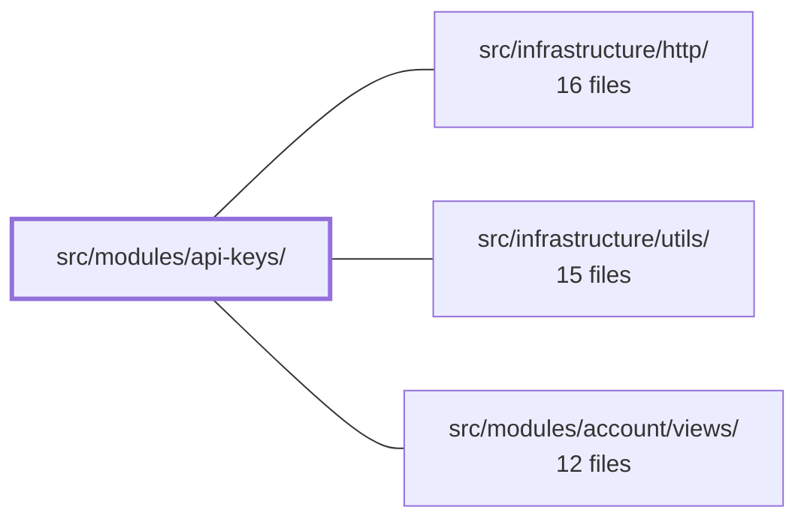

---
tags:
  - 2brain
  - 2brain/module
  - project/boilerplate-vue-frontend
type: module
module: src/modules/api-keys/
files: 13
updated: 2026-10-17T02:51:59.967557+00:00
---

# src/modules/api-keys/

## Purpose

The `api-keys` module implements the admin-only lifecycle for machine-to-machine API credentials: listing, minting, and revoking. Because keys are immutable after creation (no edit, no detail page), the entire domain fits in a paginated list view plus a single create form that reveals a one-time plaintext secret.

## Key parts

- **Registration & contracts** — `module.ts` is the single wiring point the kernel reads to discover this module's routes, response-schema rows, nav entry, and locale bundles. `routes.ts` declares the two route records (list + create). `response-schemas.ts` supplies the typed `ResponseSchemaRoute` list that activates HTTP response validation for this domain.
- **Validation** — `schemas.ts` defines the Zod mint form schema. Error messages are i18n-thunked (call `translate()` at parse time) so the form works regardless of the locale active at import.
- **State** — `store.ts` is a Pinia store that uses the shared `useStructureCrudApi` helper for the search-only list, and two hand-written actions (`mintCredential`, `revokeCredential`) for the non-standard responses (one-time secret; no updated body).
- **Views** — `views/ApiKeysList.vue` renders a paginated `DataTable` with a per-row revoke button and client-side status derivation (Active / Revoked / Expired). `views/ApiKeyCreate.vue` collects name, permissions, and optional expiry, then shows the secret in a one-time modal on success.
- **Tests** — Unit specs pin validation rules, store invariants (e.g. secret never persisted in cache), route-access metadata, and locale resolution. Cypress e2e specs cover the functional mint → reveal → revoke flow and a multi-state a11y sweep under the `admin` role.

## How it connects

- **Repository root (`/`)** — `module.ts` registers this feature's routes, nav entry, response schemas, and locale bundles into the central `AppModule` registry that the kernel boots.
- **`src/infrastructure/http/`** — The store's actions (`mintCredential`, `revokeCredential`, and the list fetch) go through the shared HTTP mutator (`orvalMutator`) for request/response handling.
- **`src/infrastructure/utils/`** — The store imports the `useStructureCrudApi` helper from here to build the paginated list query.
- **`src/modules/account/views/`** — This module's routes declare `meta.access` / `meta.can` permission strings (e.g. `apikeys.*`) that are evaluated against the role/permission model owned by the account module; the a11y and route-meta tests both assert that only the `admin` role satisfies them.

## Where to start

1. **`routes.ts`** — Two short route records that tell you exactly what the module exposes (list + create) and what access metadata guards each one.
2. **`views/ApiKeyCreate.vue`** — The one view with meaningful logic (permission combobox, secret-reveal modal, error mapping). Reading it alongside `schemas.ts` and the `mintCredential` action in `store.ts` gives you the full happy-path in one pass.

## Connected modules

[[boilerplate-vue-frontend_ROOT|/ (repository root)]] · [[boilerplate-vue-frontend_src_infrastructure_http|src/infrastructure/http/]] · [[boilerplate-vue-frontend_src_infrastructure_utils|src/infrastructure/utils/]] · [[boilerplate-vue-frontend_src_modules_account_views|src/modules/account/views/]]

## Files
- `src/modules/api-keys/module.ts` — Module manifest that registers the api-keys feature (routes, nav entry, response schemas, locale bundles) into the app's central `AppModule` registry. It is the single wiring point the kernel reads to discover this module's contributions.
- `src/modules/api-keys/response-schemas.ts` — Defines the response-envelope schema contract for all `api-keys` module endpoints. It produces a typed list of `ResponseSchemaRoute` rows that, once registered via the module manifest, turn on HTTP response validation for this domain.
- `src/modules/api-keys/routes.ts` — Declares the two route records for the api-keys module (list and create/mint). There is deliberately no edit or detail route: API keys are immutable after minting, so every field fits in a list row and there is nothing to patch.
- `src/modules/api-keys/schemas.ts` — Defines the Zod validation schema for the API-key (credential) minting form. Error messages are i18n-thunked — they call `translate()` at parse time rather than baking a locale string into the schema at module load, so the form works regardless of which locale was active when the module was first imported.
- `src/modules/api-keys/store.ts` — Pinia store managing machine-to-machine API credentials. Exposes a search-only list (via the shared `useStructureCrudApi` helper) plus two hand-written actions (`mintCredential`, `revokeCredential`) that bypass the generic CRUD paths because their responses either contain a one-time plaintext secret or lack an updated record body.
- `src/modules/api-keys/tests/e2e/a11y.cy.ts` — Cypress a11y sweep for the api-keys module. It registers a set of routes and states with the shared `sweepA11y` helper so that automated accessibility audits run against each variant (empty list, populated list, phone viewport, create form, error state) as the `admin` role — the only preset role with `apikeys.*` permissions.
- `src/modules/api-keys/tests/e2e/api-keys.cy.ts` — Cypress end-to-end spec that exercises the functional mint-and-revoke flow of the admin-only API keys module against the running app. It covers the list page and the full create → secret-reveal → revoke lifecycle; the accessibility sweep lives in a separate spec.
- `src/modules/api-keys/tests/routes.spec.ts` — Vitest spec that pins the `meta.access` and `meta.can` values every api-keys route must declare. It checks routes by name against the module's own raw route records (imported directly, not via a resolved router), so it needs neither a locale prefix nor the rest of the app. It exists because a route that silently loses its access meta is indistinguishable from a public one.
- `src/modules/api-keys/tests/schemas-i18n.spec.ts` — Verifies that the api-keys module's Zod validation messages resolve to the correct localized strings from the real vue-i18n instance when the active locale changes. It complements the cross-cutting test (`tests/cross-cutting/schemas-i18n.spec.ts`) that proves the general thunked-message mechanism; this file proves that *this module's* schema and locale dictionaries actually agree.
- `src/modules/api-keys/tests/schemas.spec.ts` — Vitest suite that verifies the validation rules (not the user-facing messages) enforced by `apiKeyCreateSchema` on the API-key mint form. It pins down the allowed shape of `name`, `permissions`, and `expiresAt` so that contract changes are caught by tests rather than at runtime.
- `src/modules/api-keys/tests/store.spec.ts` — Unit tests for the `useApiKeysStore` Pinia store. The file mocks `orvalMutator` at the transport level to assert on the raw HTTP requests the store's actions produce, and to verify store-specific invariants (e.g. the plaintext mint secret is returned to the caller but never persisted in cached state). Structurally mirrors `webhooks/tests/store.spec.ts`.
- `src/modules/api-keys/views/ApiKeyCreate.vue` — Single-page form for minting a new API key. Collects a name, a set of permissions, and an optional expiry; on success the one-time secret is displayed in a modal (there is no detail page to redirect to). On failure it maps permission-specific refusals to the combobox and surfaces anything else as a blocking inline alert.
- `src/modules/api-keys/views/ApiKeysList.vue` — Renders the paginated list of machine-to-machine API credentials. Because `ListApiKeysParams` accepts only `page`/`pageSize` (no filter fields), the page is a plain `DataTable` + pagination with a per-row revoke button. Key status (Active / Revoked / Expired) is derived client-side rather than stored, and revoked rows remain visible in the list.

---
[[boilerplate-vue-frontend_INDEX|← boilerplate-vue-frontend index]]
