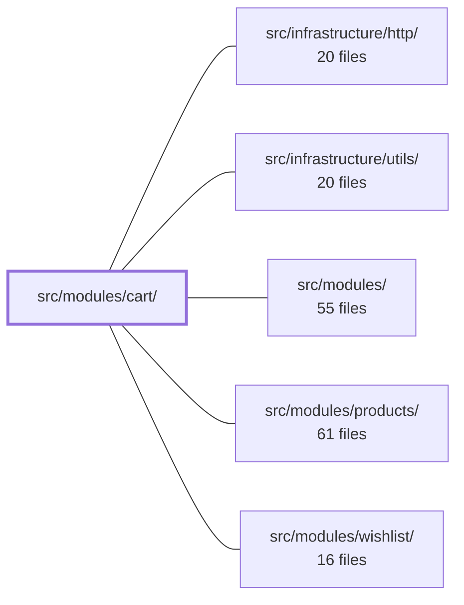

---
tags:
  - 2brain
  - 2brain/module
  - project/boilerplate-vue-frontend
type: module
module: src/modules/cart/
files: 80
updated: 2026-11-10T08:37:57.215305+00:00
---

# src/modules/cart/

## Purpose

The cart module owns the full shopping-cart and checkout experience for both signed-in users and guest visitors. It manages adding, removing, and re-quantifying line items; persists a guest cart in the browser; merges that cart into the server on sign-in; and drives the checkout flow—including idempotent order placement, draft-form recovery, and targeted UI reactions to each server refusal. All business invariants (quantity rules, merge-report classification, checkout-fingerprinting, error verdicts) live in a pure `domain/` layer so they are testable without Vue or a network.

## Key parts

- **`store.ts`** — The Pinia store. Single source of truth for cart state (guest *and* signed-in). Every mutating action replaces the local `cart` ref wholesale with the server's response. Also hosts checkout and guest-merge orchestration.
- **`domain/`** — Pure, Vue-free business rules: quantity stepping invariants, checkout-attempt fingerprinting, checkout-error classification, merge-report filtering, expected-total shape, guest-cart line caps, stock-poll interval validation. Re-exported through `domain/index.ts`.
- **`components/`** — Presentational views: `SignedInCart.vue` (full checkout page), `GuestCart.vue` (sign-out view), `CartLineCard.vue` (shared line item), `AddToCartButton.vue` (injected into the product page), `CartEmptyState.vue`, `MergeReportAlert.vue`.
- **`composables/`** — Behavioural helpers that sit between the store and the views: `use-guest-cart` (localStorage CRUD), `use-line-quantity` (debounced stepper), `use-checkout-refusals` (maps verdict → UI reaction), `use-checkout-draft` (session-form persistence), `use-cart-focus-refresh`, `use-cart-stock-poll`.
- **Storage & transport** — `guest-cart-storage.ts` (safe `localStorage` wrapper), `checkout-attempt-storage.ts` (idempotency-key survival across reloads), `idempotent-calls.ts` (header constant, retry ladder, merge-finality predicate).
- **Module wiring** — `module.ts` (route, nav badge, slot contribution, locale bundles), `routes.ts`, `response-schemas.ts` (contract validation), `index.ts` (public barrel).
- **`tests/`** — ~40 spec files covering unit, integration, and interleaving scenarios; `cart-fixtures.ts` and `cart-interleave.ts` are shared helpers.

## How it connects

- **`src/modules/products/`** — The cart module injects `AddToCartButton.vue` into the product page's `product-actions` slot via the manifest declared in `module.ts`. The products module never imports cart code; the coupling is one-directional through the app registry.
- **`src/infrastructure/http/`** — All network calls (add item, read cart, merge, checkout, product batch read) go through the shared HTTP client. `idempotent-calls.ts` and `response-schemas.ts` plug into that layer's idempotency and contract-validation machinery.
- **`src/infrastructure/utils/`** — The safe-storage helpers wrapped by `guest-cart-storage.ts` and `checkout-attempt-storage.ts` come from this shared utility package, ensuring degraded (blocked/full) storage never throws into cart logic.
- **`src/modules/wishlist/`** — The `use-cart-focus-refresh` composable re-reads the cart on tab focus partly to pick up changes triggered by wishlist operations (e.g., moving an item from wishlist into cart) in another tab.
- **`/` (repository root)** — The module registers itself with the app shell via `module.ts`, exposing its route, navigation entry, and slot contribution so the shell composes cart without importing it.

## Where to start

1. **`store.ts`** — Reading this first gives the full API surface (actions, getters, state shape) and shows how guest and signed-in paths diverge and converge. Every component and composable ultimately reads from or calls into this store.
2. **`module.ts`** — Shows *how* the cart plugs into the app (routes, nav badge, product-page slot, locale bundles) without the cart importing the shell. Understanding this manifest pattern makes the rest of the module's file layout much easier to navigate.

## Connected modules

[[boilerplate-vue-frontend_ROOT|/ (repository root)]] · [[boilerplate-vue-frontend_src_infrastructure_http|src/infrastructure/http/]] · [[boilerplate-vue-frontend_src_infrastructure_utils|src/infrastructure/utils/]] · [[boilerplate-vue-frontend_src_modules|src/modules/]] · [[boilerplate-vue-frontend_src_modules_products|src/modules/products/]] · [[boilerplate-vue-frontend_src_modules_wishlist|src/modules/wishlist/]]

## Files
- `src/modules/cart/checkout-attempt-storage.ts` — Persists an in-flight checkout attempt in `sessionStorage` so that a page reload mid-checkout replays the same idempotent key instead of minting a new one (and risking a duplicate order). The attempt is scoped to a person and a fingerprint of the order; if either changes, a fresh key is generated. All storage access is defensive—blocked or unavailable storage degrades to a no-op rather than throwing.
- `src/modules/cart/components/AddToCartButton.vue` — Renders the "add to cart" button for a product page. It is injected into the `product-actions` slot by the cart module's manifest, so the products module never imports cart code. On click it adds one unit of the product—via `POST /cart/items` for signed-in users or a local browser list for guests—and surfaces failures as an inline alert on the button rather than a toast.
- `src/modules/cart/components/CartEmptyState.vue` — Shared empty-cart display for both the guest and signed-in cart views. It shows a cart icon, an i18n "your cart is empty" message, and a button back to the catalogue. Because the wording is identical for both carts, this component is prop-free and can be dropped into either without configuration.
- `src/modules/cart/components/CartLineCard.vue` — A presentational card that renders a single cart line (title, quantity, optional price breakdown, quantity steppers, and a Remove button). It is intentionally dumb: all business rules (whether a step is allowed, what the line is worth) arrive as props, and every user action is forwarded as an emit. This lets `GuestCart` and `SignedInCart` share one component and differ only in the rules they pass down.
- `src/modules/cart/components/GuestCart.vue` — The cart view rendered for signed-out visitors. It displays the lines the shopper has added (persisted in the browser), prices them via one batched product read, and presents sign-in as the path to checkout. It deliberately omits shipping, address, and payment fields because those require an account.
- `src/modules/cart/components/MergeReportAlert.vue` — Renders an inline, closable alert on the signed-in cart page that lists the specific lines affected by a guest-to-account cart merge (quantity changes, stock caps, removed products, failed additions). It is screen-scoped (not a toast or global notification) and disappears when the shopper dismisses it. Renders nothing while the store's `mergeReport` is empty.
- `src/modules/cart/components/SignedInCart.vue` — The signed-in cart page. Renders the shopper's line items (via `CartLineCard`), a shipping/payment/address section, and a gated checkout button. Layers a debounced local quantity stepper on top of the store's update endpoint so rapid clicks collapse into one request per line, and reacts to server-side checkout refusals (short stock, unavailable items, open-order limit, purchase hold) with targeted UI updates rather than a single generic error.
- `src/modules/cart/composables/use-cart-focus-refresh.ts` — Vue composable that re-reads the cart when the shopper returns to the page (window focus or tab visibility change). It catches out-of-band changes—another tab, wishlist edits, price/stock shifts—before the shopper clicks "Place order." It is event-driven, not polling: zero cost while the page is idle.
- `src/modules/cart/composables/use-cart-stock-poll.ts` — Opt-in composable that re-reads `GET /cart` on a fixed interval while the signed-in cart page is open, keeping each line's `availability` flag in sync with the shelf. It is a no-op unless `CART_STOCK_POLL_SECONDS` resolves to a valid positive number, and it permanently stops once the signed-in identity that opened the page is gone.
- `src/modules/cart/composables/use-checkout-draft.ts` — Persists the browser-only parts of a checkout form — the free-text order note, the chosen payment method, and the chosen address id — in `sessionStorage`, scoped per signed-in user. This lets a page reload or crashed tab restore what the customer already typed, while the data still dies with the tab. The delivery method is intentionally excluded (the server-side cart owns it).
- `src/modules/cart/composables/use-checkout-refusals.ts` — Maps each classified checkout-error verdict to its specific UI reaction on the cart page (toast, inline shortfall lines, cart refetch, shipping-method picker reopen, or navigation to orders) and owns the reactive state those reactions leave on screen. It exists so the cart component never inspects raw error shapes itself — it calls one `handleRefusal` entry and reads the returned refs.
- `src/modules/cart/composables/use-guest-cart.ts` — A Vue composable that manages the signed-out visitor's cart as a `{ productId, quantity }` list persisted to `localStorage`. It exposes reactive state, CRUD actions, cross-tab synchronisation, and an idempotency-key helper for merging the guest cart into a server cart. It is invoked inside the cart store's `setup`, so its lifecycle is bound to the store; the store itself owns the network call (`mergeGuestCart`).
- `src/modules/cart/composables/use-line-quantity.ts` — A Vue composable that decouples the visitor's quantity-stepper clicks from the API round-trip. It accumulates rapid clicks per product into a single debounced request while immediately reflecting each click locally, so the UI never shows a stale server value and the server never receives out-of-order quantities.
- `src/modules/cart/domain/checkout-attempt.ts` — Defines the **fingerprint** of a checkout attempt — a canonical string that identifies "the same order" for idempotency purposes. The server binds an `Idempotency-Key` to a request body and replays the recorded response on repeat; this fingerprint is what the client compares to decide whether a repeat key is still valid (same order) or has been invalidated (cart changed). The module is intentionally pure: it computes a string from inputs and touches no storage, no store, no I/O.
- `src/modules/cart/domain/checkout-errors.ts` — Pure classifier that takes the raw rejection thrown by `cartStore.checkout()` and returns a typed `CheckoutErrorVerdict` the view can branch on. It reads only `errors[0]` from the API envelope, performs all wire-data narrowing, and produces no user-facing copy — the view layer decides messaging and behavior per verdict.
- `src/modules/cart/domain/empty-cart.ts` — Provides a single pure function that constructs the exact `CartResponse` shape the server returns after a successful checkout empties the cart. It exists so the local store can synchronously update its state to the known-empty shape without an extra network round-trip or guessing the response.
- `src/modules/cart/domain/expected-total.ts` — A type-only module that exports the `ExpectedTotal` shape sent in the `POST /cart/checkout` request body. It pairs a decimal-string amount (at the currency's places) with its ISO-4217 code so the server can compare the buyer's cart summary against what it would actually charge and return a `409 CART_TOTAL_CHANGED` on mismatch.
- `src/modules/cart/domain/guest-cart.ts` — Pure domain logic for a signed-out visitor's cart: a list of `{ productId, quantity }` lines with no storage, no store, and no side effects. All caps mirror the `POST /cart/merge` API contract so a fully-built guest cart can always be sent in a single call.
- `src/modules/cart/domain/index.ts` — Barrel file for the cart domain layer. It re-exports every public symbol (values, types, and constants) from the sibling domain modules so that consumers can import cart rules from a single path. The file contains no logic of its own; its sole job is to define the domain's public API surface.
- `src/modules/cart/domain/merge-report.ts` — Pure domain logic that decides which lines in a `POST /cart/merge` response are worth surfacing to the shopper and classifies what kind of news each one is. It deliberately excludes stock counts (the server sends a name, never a number) and carries no store or markup dependencies.
- `src/modules/cart/domain/quantity.ts` — Pure domain rules for cart line quantities. Encapsulates the invariant that stepping a line can never produce zero—zero is a removal, handled by a different call. Exists as a Vue-free module so the rule is testable in isolation.
- `src/modules/cart/domain/stock-poll.ts` — Pure validation logic for the cart's optional stock-poll interval. It translates the raw `VITE_CART_STOCK_POLL_SECONDS` env value into a timer-safe millisecond delay, or returns `undefined` to signal "polling is off." It reads no environment, starts no timer, and never guesses a default—anything that is not a plain positive whole number of seconds is treated as disabled.
- `src/modules/cart/guest-cart-storage.ts` — Persists a guest's cart (and any in-flight merge attempt) in `localStorage` so the data survives tab closes and page reloads. It is the sole write/read path for the two guest-cart keys and wraps every access in the safe-storage helpers, so a blocked or full storage degrades gracefully rather than throwing.
- `src/modules/cart/idempotent-calls.ts` — Transport-layer rules for the cart's two idempotent calls: exports the `Idempotency-Key` header constant, the retry ladder used when checkout answers `IDEMPOTENCY_IN_FLIGHT`, and the predicate that decides whether a merge refusal is final. Entirely stateless — `store.ts` owns what the results do to cart state.
- `src/modules/cart/index.ts` — Barrel (public API) file for the `cart` module. It defines the single import surface that sibling modules are allowed to use, preventing them from reaching into internal files directly.
- `src/modules/cart/module.ts` — Module manifest for the cart and checkout feature. It declares routes, navigation entry (with a live badge and currency detail), onboarding tours, response schemas, locale bundles, and a cross-module slot contribution so that the app registry (`AppModule`) can wire the cart into the shell without the cart importing the shell.
- `src/modules/cart/response-schemas.ts` — Exports the response-envelope schemas for every REST endpoint the `cart` domain calls. The list is generated declaratively from a shared schema registry filtered to the `'cart'` module, so the file itself contains no hand-written route definitions. It plugs into the module-manifest system: creating the folder enables contract validation for cart responses; deleting it disables it.
- `src/modules/cart/routes.ts` — Defines the cart module's single route record so the app router can serve the `Cart.vue` view under the module's registered path. It exists to keep route declarations co-located with the module and to declare the access policy (open) at the routing layer.
- `src/modules/cart/store.ts` — Pinia store that owns the entire shopping-cart lifecycle for both signed-in users and guest visitors. Every mutating action replaces the local `cart` ref wholesale with the API's authoritative response rather than patching fields locally. It also houses checkout (because `POST /cart/checkout` empties the cart this store is responsible for) and coordinates guest-cart merging on sign-in.
- `src/modules/cart/tests/add-to-cart-button.spec.ts` — Unit tests for `AddToCartButton.vue`, mounted in isolation with a `Product` prop. Verifies the button's disabled/enabled state and label text across shelf conditions (in-stock, out-of-stock, backorder, preorder, off-sale), guest-cart line management, and signed-in cart-addition (API payload, in-flight guard). The hosting product page is explicitly out of scope and lives in the `products` module's tests.
- `src/modules/cart/tests/cart-fixtures.ts` — Typed cart factory for cart test specs. It builds a full `CartResponse` from a list of `[productId, quantity]` lines so that every total, count, and flag is *derived* from the lines rather than hand-copied. Specs that assert "this is the cart the server last answered" compare whole objects produced by this factory, keeping arithmetic in one place.
- `src/modules/cart/tests/cart-interleave.ts` — A shared test helper that lets a spec fire cart store actions while holding back their network answers, so the spec controls the order in which responses are delivered. This enables deterministic testing of interleaved, concurrent, or out-of-order cart API calls.
- `src/modules/cart/tests/cart-line-card.spec.ts` — Vitest unit tests for `CartLineCard.vue`. The spec locks in the component's contract: data-test hook naming, per-flag button disabling, event emission (step delta + remove), conditional price rendering, currency-aware price formatting, and the badges slot.
- `src/modules/cart/tests/cart-line-price.spec.ts` — Verifies that `SignedInCart` renders both the unit price and the line total (unit × quantity) in the resolved product's currency, and renders nothing until the product lookup completes. Unlike the broader `cart-view.spec.ts`, the cart store's product-resolution logic runs for real here; only the `@api/searchProducts` network call is stubbed, so the price computation path is exercised end-to-end.
- `src/modules/cart/tests/cart-route-view.spec.ts` — Verifies the single routing decision made by `Cart.vue`: render `GuestCart` for anonymous visitors and `SignedInCart` for authenticated ones. Both child components are stubbed out so the spec tests only *which* branch is chosen, not what each branch renders.
- `src/modules/cart/tests/cart-view-double-submit.spec.ts` — Vitest spec that verifies the cart page is locked down while a checkout request is in flight: quantity steppers are disabled, a debounced step that was in progress does not mutate the cart after the order resolves, and two clicks dispatched in the same task produce exactly one checkout call.
- `src/modules/cart/tests/cart-view-interleavings.spec.ts` — Integration tests for the cart page running against the **real** Pinia store, focused on event interleavings: the shipping radio seeded from a server-held value, a quantity step that must settle before checkout fires, and a lost checkout answer that is retried with the same idempotency key and body. The file complements `cart-view.spec.ts` (which stubs store methods and asserts rendered output) by asserting the interaction contract between page and store.
- `src/modules/cart/tests/cart-view-shipping-radio.spec.ts` — Vitest spec for the cart page's shipping radio under concurrent async state. It verifies that the radio's selection and the displayed cost stay correct no matter the relative ordering of the opening `getCart` read and the shopper's `setCartShippingMethod` pick, and that a subsequent read reporting the method as unavailable deselects it.
- `src/modules/cart/tests/cart-view-stale-refusal.spec.ts` — Verifies the cart page's recovery behavior when a checkout call is refused because the screen is out of date. Covers three refusal shapes — `CART_EMPTY`, `IDEMPOTENCY_IN_FLIGHT`, and a bare 500 — and asserts the page either re-reads the cart, retries under the same idempotency key, or navigates to the orders list depending on what the server reports.
- `src/modules/cart/tests/cart-view.spec.ts` — Integration test suite that mounts the real `SignedInCart.vue` component against a real memory-history router and verifies that the checkout screen handles each of the seven documented refusal codes (from `docs/modules/cart-checkout.md`) with distinct, specific UI responses rather than a single generic toast. It also covers the order button's terms/privacy-link placement and an in-flight guard.
- `src/modules/cart/tests/checkout-errors.spec.ts` — Unit tests for the pure `classifyCheckoutError` function. The function maps a raw server checkout rejection (or a non-object throw) to a small typed verdict; these tests pin that mapping—including the degraded shapes the function must tolerate when the `errors` field is absent, malformed, or carries legacy data. No DOM, no Pinia, no HTTP mocking is involved.
- `src/modules/cart/tests/e2e/a11y.cy.ts` — End-to-end accessibility sweep for the cart module's single route (`/en/cart`). It exists co-located with the cart module so that deleting the module automatically removes its a11y coverage, and so that `tests/cross-cutting/a11y-coverage.spec.ts` can assert every routed module contributes one of these files.
- `src/modules/cart/tests/e2e/actions.cy.ts` — Declares two end-to-end failure scenarios for the cart module via the shared `actionTable` runner. Each scenario verifies that when a server fault occurs during a cart mutation (line removal, add-to-cart), the UI keeps the relevant row/button in place, displays a specific error alert, and that a retry succeeds. The file is side-effect-only; it has no exports.
- `src/modules/cart/tests/e2e/analytics.cy.ts` — Cypress end-to-end spec that asserts a single add-to-cart user action produces **exactly one** `cart_item_added` row in Umami, guarding against a double-emission bug where both the frontend cart store and the backend `POST /cart/items` handler fire the same event name. It also verifies that a plain page visit emits **zero** backend-owned events (`checkout_completed`, `order_created`, `payment_succeeded`). Only runnable against a live Umami instance; skipped under the demo profile.
- `src/modules/cart/tests/e2e/cart.cy.ts` — Cypress end-to-end test suite for the cart page. It verifies the full cart user journey: rendering an empty state, displaying seeded items, adjusting quantities, removing individual items, clearing the cart (with and without confirmation), and completing a checkout that redirects to an order page.
- `src/modules/cart/tests/e2e/cart.visual.cy.ts` — Declares the visual-regression scenes for the cart screen. The actual sweep logic lives in the shared helper; this file is purely a declarative list of routes, viewports, themes, and prep steps to photograph. Baselines (PNGs) are stored in `__snapshots__/` alongside this file so that deleting the module also deletes its captures.
- `src/modules/cart/tests/e2e/resilience.cy.ts` — Cart-specific slice of the shell-wide resilience sweep. It verifies that the `/en/cart` route renders without unexpected console errors and stays within the viewport, in two states: empty and holding one line item. It intentionally asserts **no** prices or values so that layout/logic bugs surface even when value-focused specs pass.
- `src/modules/cart/tests/e2e/roles.cy.ts` — A Cypress E2E spec that registers the cart route for the shared role-sweep test. It declares which URL and root selector each persona must be able to reach, delegating all traversal and assertion logic to the shared `sweepRoles` helper.
- `src/modules/cart/tests/empty-cart.spec.ts` — Vitest spec for the `emptyCart` factory: verifies that the cart a successful checkout produces is structurally correct (all counts zeroed, no shipping options, not checkoutable) and that the currency/zero-string the caller passes in is faithfully preserved at every monetary field.
- `src/modules/cart/tests/expected-total.spec.ts` — Vitest spec for `checkoutFingerprint`, the pure function that derives a fingerprint string from a checkout's expected total, cart lines, and shipping selection. It verifies the fingerprint is a stable, distinguishable identifier: equal inputs yield equal outputs, and any meaningful change (total amount, line quantity, shipping method) changes the result.
- `src/modules/cart/tests/guest-cart-input-validation.spec.ts` — Property-based test suite that verifies the guest cart's quantity rules hold for **every** numeric input a caller might supply—`NaN`, `Infinity`, `-Infinity`, `0`, `-0`, and arbitrary doubles. It guards two invariants: `setGuestLineQuantity` always yields a line whose quantity is within `[1, MAX_GUEST_LINE_QUANTITY]`, and `addGuestLine` never produces a line that storage would silently drop on the next read.
- `src/modules/cart/tests/guest-cart-storage.spec.ts` — Vitest spec for the guest-cart `localStorage` layer. It verifies the read/write round-trip, the 30-day expiration policy, the defensive parsing that tolerates hand-edited or legacy data, and the hard rule that storage failures (blocked, quota-exceeded) are silently swallowed so the visitor never sees an error.
- `src/modules/cart/tests/guest-cart-store.spec.ts` — Unit tests for the guest-cart half of the cart Pinia store: what a signed-out visitor can add/remove, how lines persist in `localStorage`, how cross-tab changes propagate via `StorageEvent`, how `mergeGuestCart` sends all lines to the server and clears local state, and how `seedAfterSignIn` decides between merging and simply reading a summary. All generated API calls are mocked with responses validated against their OpenAPI response schemas.
- `src/modules/cart/tests/guest-cart-view.spec.ts` — Vitest spec that mounts `GuestCart.vue` against a real router and a stubbed `searchProducts` endpoint, verifying the guest's view of their cart: empty state, batched pricing, quantity steppers, sign-in redirect, line removal, cart clearing with confirmation, and graceful handling of products that are no longer available.
- `src/modules/cart/tests/guest-cart.property.spec.ts` — Property-based tests (fast-check + vitest) that verify the guest-cart domain invariants hold after **every** possible sequence of guest operations, not just the hand-picked boundary cases covered by the example specs. It exercises the pure domain functions and the `localStorage`-backed storage layer, asserting that validity, round-trip fidelity, merge/additivity, and subtraction properties are preserved universally.
- `src/modules/cart/tests/guest-cart.spec.ts` — Vitest spec for the guest cart domain logic. It pins down the mutation rules (add, set, remove, subtract), the clamping behaviour, the defensive `parseGuestCart` reader for untrusted storage, and verifies that the domain's two caps mirror the values generated into the API contract.
- `src/modules/cart/tests/idempotent-calls.spec.ts` — Unit tests for the keyed-call transport rules defined in `idempotent-calls.ts`: verifying that an in-flight 409 is retried under the same idempotency key once per configured delay, that any other refusal is rethrown immediately, and that `isMergeRefusedForGood` classifies only 400/413/422 as final merge refusals.
- `src/modules/cart/tests/lighthouse.ts` — Declares the Lighthouse audit cases for the cart module. Two scenarios are defined — a guest cart and a signed-in checkout — each prepared by adding a single rich product to the cart. Neither case is crawled, so no SEO audit runs on them.
- `src/modules/cart/tests/merge-report-alert.spec.ts` — Isolated Vitest suite for the `MergeReportAlert` component. Verifies what the alert renders for each merge-report line kind (changed, short, gone), that it speaks the reader's locale, that it exposes exactly one polite live region, and that dismissing it empties the store's report. Product lookups exercise the real composable over the real products store, with only the network read layer stubbed to answer from a small in-memory catalogue.
- `src/modules/cart/tests/merge-report.spec.ts` — Vitest spec that pins down two pieces of merge-report domain logic: which lines of a merge answer are "changed" (i.e. visible to the shopper) via `changedMergeLines`, and what severity label (`gone` / `short` / `off-sale` / `changed`) each kept line receives via `mergeReportKind`.
- `src/modules/cart/tests/module-badge-account-switch.spec.ts` — Verifies that the cart badge re-seeds itself (via `seedAfterSignIn`) when a different account's session appears in the same tab without an intervening sign-out. Guards against a regression where the store resets for the previous user but the badge never repopulates for the new one, leaving a visible user with a bare cart icon.
- `src/modules/cart/tests/module-badge.spec.ts` — Tests the cart badge's session watcher (wired via `module.ts`'s navigation entry). Verifies two invariants: a checkout draft is cleared when the signed-in visitor logs out, but survives a page reload that starts signed-out and re-authenticates a moment later. Also confirms the badge calls `seedAfterSignIn` when a signed-in session appears.
- `src/modules/cart/tests/mount-cart-page.ts` — Test helper that mounts the real `SignedInCart` page against the real cart store, holding only the network boundary for the calling spec to mock. It exists for specs that need to observe store-and-page interactions (interleavings, double-submit, stale-refusal) rather than isolated render output.
- `src/modules/cart/tests/quantity.spec.ts` — Unit tests for the `steppedQuantity` pure function from the cart domain. They verify that quantity stepping behaves correctly at the boundaries defined by the OpenAPI contract (`minimum: 1`), particularly that the function clamps rather than allowing a line quantity to drop to zero or below. The file exists as a guard against the module's internal floor constant drifting out of sync with the API contract.
- `src/modules/cart/tests/routes.spec.ts` — Verifies that every route declared in the cart module has an explicit, correct `meta.access` value and no unintended permissions. This guards against a route silently losing its access declaration and becoming publicly reachable — a failure no other test in the suite would catch.
- `src/modules/cart/tests/stock-poll-interval.spec.ts` — Vitest spec for `stockPollIntervalMs`, which converts the `VITE_CART_STOCK_POLL_SECONDS` env-var string into a millisecond value. The contract under test: a positive whole number (seconds) yields `seconds × 1000`; every other spelling yields `undefined` (poll disabled). The file exists to pin that strict parsing boundary against regressions.
- `src/modules/cart/tests/store-add-key.spec.ts` — Spec that verifies the cart store's idempotency-key contract for `POST /cart/items` and `POST /cart/reorder`: a retry after a lost (network) answer must resend the **same** key, while any subsequent successful answer must cause the next call to mint a **fresh** key (new user intent).
- `src/modules/cart/tests/store-checkout-key.spec.ts` — Vitest spec for the cart store's `Idempotency-Key` lifecycle on `POST /cart/checkout`. It verifies the store's rules for when a key is **reused** (same order after a lost answer, 503, unknown 500, in-flight 409 retries) versus **rotated** (different body, definitive server verdict like insufficient stock, confirmed order written, different signed-in person), ensuring the client never sends one key with two bodies and never leaks a key across users.
- `src/modules/cart/tests/store-double-seed.spec.ts` — Verifies that two consecutive `seedAfterSignIn()` calls (e.g., a shell re-rendering or StrictMode double-effect) result in exactly **one** `mergeCart` API call. The second call joins the in-flight first rather than issuing a duplicate merge, so the server never sees the same cart key twice and the shopper is not shown a spurious "stays on this device" warning.
- `src/modules/cart/tests/store-interleavings.spec.ts` — Tests the interleavings (two-call interactions) of the cart store: that answers are applied in request order, that a late answer for the same viewer is still applied, and that any successful basket-write invalidates a pending checkout attempt (new idempotency key) while plain reads do not. It is the companion to `store.spec.ts`, which covers single-call behavior; this file covers what two calls do *to each other*.
- `src/modules/cart/tests/store-late-answer.spec.ts` — Verifies that the cart store's per-person reset acts as a hard barrier for in-flight API requests. When person A initiates a request and the tab subsequently passes to person B (or to no one after logout), the late-arriving answer must not populate B's cart, badge, or merge report. This guards against cross-session data leakage in a multi-person tab.
- `src/modules/cart/tests/store-stale-answer.spec.ts` — Verifies that the cart Pinia store always ends up showing the answer to the **last** request issued, even when the network delivers earlier responses after later ones. Complements `store-interleavings.spec.ts` (the in-order control) by exercising the out-of-order path.
- `src/modules/cart/tests/store-stock-poll.spec.ts` — Vitest spec for the cart store's `pollCart` background read. It verifies that polling refreshes cart line availability without letting a stale answer overwrite a fresher state, never toggles `loading`, and leaves the merge report untouched.
- `src/modules/cart/tests/store.spec.ts` — Vitest unit tests for `useCartStore`, verifying that every store action stores the API payload verbatim, that derived getters (`badgeQuantity`, `cartItems`, `cartSummary`, `cartShipping`) behave correctly in both the unfetched and post-fetch states, and that error semantics (401 vs. 500 on summary, rejection envelopes on checkout) match the contract described in the module's header comment.
- `src/modules/cart/tests/track-stores.ts` — A tiny test helper that tracks every cart store a spec creates and disposes them all together after each case. Without it, the `storage` listener each store attaches to `globalThis` would leak across tests. It lives in its own file (rather than in `cart-interleave.ts`) because that sibling imports the generated API client, which breaks specs that partially mock `@api`.
- `src/modules/cart/tests/use-cart-focus-refresh.spec.ts` — Unit tests for the `useCartFocusRefresh` composable. Verifies the cart page's refresh-on-return contract: a window focus or tab becoming visible triggers exactly one `getCart` read, a tab going hidden triggers none, an in-flight write is never overwritten by a read, and all listeners are torn down when the page scope is disposed.
- `src/modules/cart/tests/use-cart-stock-poll.spec.ts` — Vitest spec for the `useCartStockPoll` composable. Drives the real Pinia cart store under fake timers to verify the full polling lifecycle: env-knob opt-in, auth gating, tab-visibility pause/resume, interaction with in-flight cart writes, and permanent teardown on logout / account switch / unmount.
- `src/modules/cart/tests/use-checkout-draft.spec.ts` — Vitest spec that pins down the persistence contract of the checkout draft composable. Each test mirrors a real customer failure: a note disappearing after reload, an address reverting, one user's draft leaking to the next, or a corrupt storage value crashing the checkout page.
- `src/modules/cart/tests/use-line-quantity.spec.ts` — Vitest suite for the `useLineQuantity` composable. Every test is written against the race the debounce was introduced to fix (three rapid clicks → three in-flight requests → last-write-wins) rather than against the debounce mechanism in isolation. The suite also pins down the two silent data-loss modes a naive debounce would introduce (swallowing a click made mid-flight, cancelling an unflushed step on unmount) and the checkout / page-leave contracts (`settle`, `sendPendingKeepalive`).
- `src/modules/cart/views/Cart.vue` — The single view component behind the cart route. Its only job is to check the session store's `isAuth` flag and render the appropriate cart screen — `SignedInCart` for authenticated users (shipping, payment, checkout) or `GuestCart` for anonymous visitors (browser-stored list). It exists so both experiences share one route URL without leaking account-specific UI to guests.

---
[[boilerplate-vue-frontend_INDEX|← boilerplate-vue-frontend index]]
