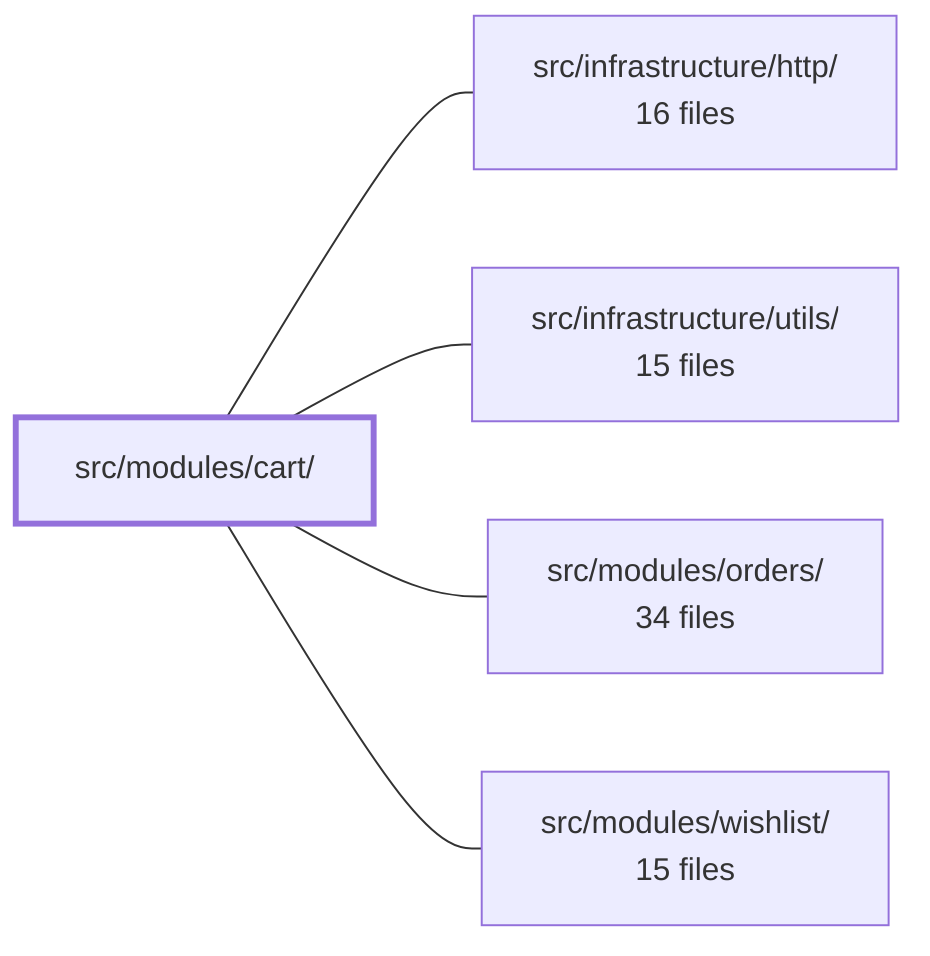

---
tags:
  - 2brain
  - 2brain/module
  - project/boilerplate-vue-frontend
type: module
module: src/modules/cart/
files: 64
updated: 2026-10-17T02:52:14.469353+00:00
---

# src/modules/cart/

## Purpose

The cart module owns the full shopping-cart experience: adding products, viewing and editing line items, merging a guest's local cart into an account on sign-in, and executing a checkout with idempotent, race-safe order placement. It serves both signed-in users (server-authoritative) and signed-out visitors (browser-persisted) behind a single `/cart` route and a shared header badge.

## Key parts

- **Views & components** — `CartEntry.vue` (route view, guest/signed-in routing), `Cart.vue` (signed-in cart page), `GuestCart.vue` (guest cart), `AddToCartButton.vue` (product-page button contributed via slot), `MergeReportAlert.vue` (post-merge summary).
- **Store** — `store.ts`: the Pinia store that holds the signed-in cart, the guest cart, the checkout call, idempotency-key management, and header-badge derivations.
- **Domain (pure, framework-free)** — `domain/` directory: `guest-cart.ts` (line rules & caps), `quantity.ts` (step/remove invariant), `checkout-attempt.ts` (fingerprint), `checkout-errors.ts` (refusal classification), `expected-total.ts` (minor-unit math), `stock-poll.ts` (interval validation), `merge-report.ts` (merge-response filtering). All pure functions, no Vue/Pinia/axios imports.
- **Composables** — `use-guest-cart.ts` (reactive guest CRUD + cross-tab sync), `use-line-quantity.ts` (debounced stepper), `use-cart-stock-poll.ts` / `use-cart-focus-refresh.ts` (re-read triggers), `use-checkout-draft.ts` (session-scoped draft fields), `guest-cart-storage.ts` / `checkout-attempt-storage.ts` (guarded localStorage/sessionStorage wrappers).
- **Module wiring** — `module.ts` (manifest: routes, badge, slot contribution, auth seed/reset), `index.ts` (public barrel), `routes.ts` (single `/cart` route), `response-schemas.ts` (contract-validation registration).
- **Tests** — Unit specs for domain functions and components; integration specs for the cart page against the real store; Cypress e2e suites (journey, a11y, analytics, resilience, visual) co-located under `tests/e2e/`.

## How it connects

- **`/` (repository root)** — The module registers itself (routes, badge, locales, slot) into the app shell via its manifest, so the root knows about cart's existence without importing its internals.
- **`src/infrastructure/http/`** — All cart API calls (`POST /cart`, `GET /cart`, `POST /cart/merge`, `POST /cart/checkout`) go through the shared HTTP client for consistent auth, error handling, and response-schema validation.
- **`src/infrastructure/utils/`** — Shared helpers (e.g., formatting, safe-parsing utilities) are consumed by both domain and composable layers.
- **`src/modules/orders/`** — A successful checkout redirects the user to the orders module's page; the orders module may also read cart line data for order-history display.
- **`src/modules/wishlist/`** — Wishlist actions can mutate the server-side cart (e.g., moving a wished item into the cart), which is why the cart's focus-refresh composable re-reads after such events.

## Where to start

1. **`store.ts`** — Read this first. It is the single source of truth for cart state (signed-in and guest), the checkout flow, and the badge; almost every other file in the module either feeds into it or reads from it.
2. **`domain/guest-cart.ts`** — A short, pure file that spells out the line/quantity invariants and the add/set/remove/reconcile operations. Understanding these rules makes the composables, storage layer, and merge flow straightforward to follow.

## Connected modules

[[boilerplate-vue-frontend_ROOT|/ (repository root)]] · [[boilerplate-vue-frontend_src_infrastructure_http|src/infrastructure/http/]] · [[boilerplate-vue-frontend_src_infrastructure_utils|src/infrastructure/utils/]] · [[boilerplate-vue-frontend_src_modules_orders|src/modules/orders/]] · [[boilerplate-vue-frontend_src_modules_wishlist|src/modules/wishlist/]]

## Files
- `src/modules/cart/components/AddToCartButton.vue` — Renders the product page's "Add to Cart" button. It is contributed to the `product-actions` slot via the cart module's manifest so the products module never imports cart code directly. Routes the add action differently based on session state: signed-in users hit the server (`POST /cart`), guests grow a local browser list. Failures are surfaced inline via `InlineErrorAlert` rather than a toast.
- `src/modules/cart/components/GuestCart.vue` — Renders the cart view for signed-out visitors: the product lines stored in their browser, priced by a single batched product read. It deliberately omits shipping, address, and payment (all of which require an account) and instead offers a "Sign in to check out" link that deep-links back to this page after login, where the same lines are promoted into the real cart.
- `src/modules/cart/components/MergeReportAlert.vue` — Renders an inline, closable alert on the cart page that appears after a guest cart has been merged into the account's cart. It lists each affected line—summed quantities, stock-capped lines, removed products, and add failures—so the shopper can verify quantities before checkout. It is screen-local (not a toast or bell notification) and disappears when the shopper dismisses it.
- `src/modules/cart/composables/checkout-attempt-storage.ts` — Persists an in-flight checkout attempt in `sessionStorage` so that a page reload mid-checkout replays the same `Idempotency-Key` on retry instead of creating a duplicate order. The attempt dies with the tab, and every access is wrapped in try/catch so a blocked or full storage degrades gracefully to "no stored attempt" without breaking the checkout flow.
- `src/modules/cart/composables/guest-cart-storage.ts` — Persists a guest's cart and any in-flight merge attempt to `localStorage` so they survive tab closures and page reloads. It isolates all `localStorage` access (with guards against blocked or full storage) behind a small read/write API, leaving validation of the stored payloads to the domain layer.
- `src/modules/cart/composables/use-cart-focus-refresh.ts` — Event-driven cart re-read: when the browser window regains focus or a hidden tab becomes visible again, this composable triggers a single `pollCart()` call so the on-screen cart reflects any server-side changes (price/stock shifts, edits from another tab, wishlist actions). It is explicitly not a poller — it fires only on user-visible "return" events and costs nothing while the page sits idle.
- `src/modules/cart/composables/use-cart-stock-poll.ts` — Registers a timed re-read of `GET /cart` while the cart page is open, keeping each line's `availability` flag in sync with shelf stock. It is fully opt-in: if the poll interval resolves to `undefined`, no timer or listener is created at all. Its lifetime is tied to the calling component's scope (the cart page / checkout).
- `src/modules/cart/composables/use-checkout-draft.ts` — Persists the checkout-only fields that exist solely in the browser — the customer's free-text order note, selected payment method, and chosen shipping address — into `sessionStorage` keyed per signed-in user. This gives the draft automatic resilience across page reloads and tab crashes, per-user isolation within a shared tab, and automatic expiry when the tab closes, without any server round-trip.
- `src/modules/cart/composables/use-guest-cart.ts` — Vue composable that manages the signed-out visitor's cart (a `{ productId, quantity }` list) persisted in `localStorage`. It exposes reactive state, CRUD actions, cross-tab synchronisation, and idempotency-key management for the server merge call. It is instantiated inside the cart store's setup, so its lifetime is bound to the store.
- `src/modules/cart/composables/use-line-quantity.ts` — A Vue composable that debounces per-product quantity stepper clicks into a single trailing API call, while a local `pending` map immediately reflects the visitor's last click in the UI. It exists to eliminate the race condition where rapid successive `updateCartItem` calls resolve out of order and the cart displays whichever response arrived last.
- `src/modules/cart/domain/checkout-attempt.ts` — Defines the fingerprint for a single checkout attempt — a stable string derived from the request body, the cart's lines, and the selected shipping method. The server uses an `Idempotency-Key` bound to this fingerprint; if a repeat arrives with the same fingerprint, the recorded response is replayed. The function is pure: no I/O, no store access.
- `src/modules/cart/domain/checkout-errors.ts` — Classifies a checkout rejection (the value thrown by `cartStore.checkout()`) into one of the API's documented error shapes and returns a typed verdict the view can act on. It is a pure, side-effect-free mapping from wire-format error to a domain-level decision; it reads `error.errors[0]`, validates the payload defensively, and produces no user-facing copy.
- `src/modules/cart/domain/expected-total.ts` — Pure helper module that computes the integer-minor-unit total a buyer sees before "Place order" and shapes it into the `{ amount, currency }` form the `POST /cart/checkout` endpoint expects. The server rejects with 409 `CART_TOTAL_CHANGED` if its own calculation differs, so this file exists to keep the client-side number math precise and testable without any `Intl` or locale dependency.
- `src/modules/cart/domain/guest-cart.ts` — Pure domain logic for a signed-out visitor's cart: the `GuestCartLine` type, the quantity/line-count caps that mirror the `POST /cart/merge` contract, and a set of stateless functions to add, set, remove, and reconcile cart lines. No storage, no framework imports — it loads with the app shell and keeps the merge invariants (per-line cap, line-count cap, id format) in one place.
- `src/modules/cart/domain/index.ts` — Barrel (module index) for the cart domain layer. It re-exports every public symbol from the sibling domain files so that consumers import from a single entry point. The layer is intentionally framework-free — pure rules, with no Vue, Pinia, or axios imports (enforced by lint).
- `src/modules/cart/domain/merge-report.ts` — Pure domain logic that decides which lines from a `POST /cart/merge` response are "news" worth surfacing to the shopper, and classifies each as a kind of alert. It deliberately contains no store access and no markup—just filtering and classification over server-answered lines.
- `src/modules/cart/domain/quantity.ts` — Pure, framework-free rules for computing a cart line's next quantity. It enforces the invariant that a line can never be stepped to zero — reaching zero is a removal operation, not a quantity update — and exists so that clamping logic lives in one testable, side-effect-free location.
- `src/modules/cart/domain/stock-poll.ts` — Defines the single rule for the cart stock-polling interval: how a raw environment string maps to a valid timer delay (or "off"). It is deliberately pure—no timer is started and no environment is read here—so the validation logic can be unit-tested in isolation.
- `src/modules/cart/index.ts` — Barrel (public entry point) for the cart module. It defines the single import surface that sibling modules are allowed to consume, preventing them from reaching into internal files directly.
- `src/modules/cart/module.ts` — The Cart module manifest. Declares the module's identity (`name`, `loadingKeys`, `icon`, `section`, `order`), wires its routes and locales into the app registry, and defines the navigation entry—including a live badge (count + formatted total) and the auth-driven seed/reset logic that makes the badge correct across sign-in, sign-out, and account-switch events. Also contributes the `AddToCartButton` slot to the products module's `product-actions` area.
- `src/modules/cart/response-schemas.ts` — Thin registration file that builds the response-schema route table for the `cart` domain. It exists so that contract validation for cart endpoints can be toggled simply by adding or removing this file (via the module manifest), without touching shared infrastructure.
- `src/modules/cart/routes.ts` — Declares the cart module's route table (a single `/cart` route) that the module registry merges into the app router. The route is accessible to guests and to signed-in users who hold the `update` permission on `Cart`, lazy-loading the `CartEntry.vue` view.
- `src/modules/cart/store.ts` — Pinia store that owns the shopping cart for both signed-in users (every mutation replaces the local `cart` ref with the server's full response) and signed-out visitors (a local guest list merged into the real cart on sign-in). It also hosts the checkout call, idempotency-key management, and the header-badge data derivations.
- `src/modules/cart/tests/add-to-cart-button.spec.ts` — Unit tests for `AddToCartButton` mounted in isolation with a `Product` prop. Covers button availability states (in-stock, out-of-stock, off-sale, preorder, no-permission, guest), guest-local cart mutations, and the server "add" contract (always sends quantity 1). The hosting product page is intentionally out of scope — it belongs to the `products` module's tests.
- `src/modules/cart/tests/cart-entry-view.spec.ts` — Vitest spec that verifies the single routing decision in `CartEntry.vue`: a guest is shown the guest cart, a signed-in visitor is shown the real cart, and the view swaps reactively when a guest signs in. The actual cart screens are mocked out because they are tested in their own specs.
- `src/modules/cart/tests/cart-line-price.spec.ts` — Unit test for the cart line-price display: it verifies that `Cart.vue` renders both the unit price and the line total (unit × quantity) in the product's resolved currency, and that nothing is rendered before the product lookup completes. Unlike `cart-view.spec.ts`, the product read runs for real here — only `searchProducts` is mocked — because the displayed price is exactly what that lookup returns.
- `src/modules/cart/tests/cart-view-double-submit.spec.ts` — Vitest spec that verifies the cart page is safely "shut" while a checkout request is in flight: quantity steppers are disabled, any in-debounce quantity change never fires after the order resolves, and two rapid clicks in the same task produce exactly one `checkout` call.
- `src/modules/cart/tests/cart-view-interleavings.spec.ts` — Integration-style tests for the cart page running against the **real** Pinia store, focused on *event interleavings*: a shipping radio seeded from a server response, a quantity step that must settle before checkout is dispatched, and a lost checkout answer that is retried with an identical idempotency key and body. Explicitly complementary to `cart-view.spec.ts`, which stubs store methods and asserts what each refusal *renders*; this file asserts what the page and store *do to each other*.
- `src/modules/cart/tests/cart-view-shipping-radio.spec.ts` — Vitest spec that verifies the cart page's shipping radio handles three race/ordering scenarios between the opening `getCart` read and a `setCartShippingMethod` pick: a stale opening read must not wipe a fresh pick, a late opening read must not leave an outdated cost, and a subsequent read that clears the method must move the radio off it.
- `src/modules/cart/tests/cart-view-stale-refusal.spec.ts` — Vitest spec verifying the cart page's recovery behavior when a checkout attempt is refused with a "screen is out of date" signal. It asserts that `CART_EMPTY` and `IDEMPOTENCY_IN_FLIGHT` refusals trigger a fresh cart read (removing phantom items or waiting for an in-flight retry), and that a bare 500 is resolved by re-reading the cart to decide whether the order was written.
- `src/modules/cart/tests/cart-view.spec.ts` — Integration-style spec that mounts the real `Cart.vue` page against a real memory-history router and verifies that each documented checkout refusal (CART_CHANGED, CART_TOTAL_CHANGED, CART_INSUFFICIENT_STOCK, etc.) produces its own distinct user-facing message rather than collapsing into a single generic toast. Also covers the order-button terms/privacy link placement and accessibility (axe-core).
- `src/modules/cart/tests/checkout-errors.spec.ts` — Pure unit tests for `classifyCheckoutError`, the cart domain function that maps an arbitrary checkout rejection (HTTP-shaped object, `Error`, string, or `undefined`) to a typed verdict the view can act on. The file exists to pin down the classification contract—including how malformed or missing `details` are handled—without any component mounting, Pinia store, or network layer.
- `src/modules/cart/tests/e2e/a11y.cy.ts` — Co-located accessibility (a11y) route sweep for the cart module. It declares *which* routes the cart module exposes and delegates the actual checking to a shared sweep helper. Co-location is deliberate: deleting the cart module also removes its a11y coverage, and a cross-cutting spec (`tests/cross-cutting/a11y-coverage.spec.ts`) asserts that every routed module has exactly one of these files, so a domain can't silently lose a11y testing.
- `src/modules/cart/tests/e2e/analytics.cy.ts` — Live-only Cypress e2e spec that proves a single add-to-cart click writes exactly **one** `cart_item_added` row into Umami (not two, since both frontend and backend historically fired the same event name) and that a plain page visit triggers no backend-owned events. The spec exists because the double-emission bug was invisible from either repo's own test suite: both sides asserted their own emission and both passed.
- `src/modules/cart/tests/e2e/cart.cy.ts` — Cypress end-to-end suite for the cart page. It verifies the full user journey against a running app: empty-cart rendering, item display, quantity stepping, item removal, cart clearing (both confirm and cancel paths), and checkout with redirect to the order page.
- `src/modules/cart/tests/e2e/cart.visual.cy.ts` — Registers the cart screen for the project-wide visual-regression sweep. This file is a *screen list*, not a test suite: it tells `sweepVisual` which URL and root element to photograph for the cart.
- `src/modules/cart/tests/e2e/resilience.cy.ts` — Cart-module contribution to the shell's end-to-end resilience sweep. Verifies that the `/en/cart` route renders without unexpected console errors and fits the viewport — both when the cart is empty and when it holds a single line item. It deliberately avoids asserting on specific values (prices, quantities beyond item count) so it catches rendering/breakage that value-focused specs would miss.
- `src/modules/cart/tests/expected-total.spec.ts` — Vitest spec that verifies the cart domain's money-conversion helpers (`toMinorUnits`, `fromMinorUnits`, `expectedTotalOf`) produce exact integer minor units with no floating-point drift, and that `checkoutFingerprint` generates distinct, stable identifiers from a checkout's expected total, cart lines, and shipping selection. Because the tested functions are pure, no mocks or store setup are needed.
- `src/modules/cart/tests/guest-cart-input-validation.spec.ts` — Property-based tests (fast-check) that verify the guest cart's quantity rules hold for *every* numeric input a caller might pass—including `NaN`, `±Infinity`, `0`, and `-0`—ensuring that `set` always leaves a line within the valid range and that no written line is silently dropped on a subsequent read.
- `src/modules/cart/tests/guest-cart-storage.spec.ts` — Vitest spec for the `guest-cart-storage` composable. It pins down three contracts: round-trip fidelity of guest cart lines and merge-attempt data in `localStorage`, graceful degradation when stored values are corrupt or non-conforming, and the guarantee that browser storage failures (blocked, quota-exceeded) never surface as exceptions to the visitor.
- `src/modules/cart/tests/guest-cart-store.spec.ts` — Vitest spec for the guest-cart half of the cart Pinia store. It verifies the full lifecycle of a signed-out visitor's list: local CRUD and `localStorage` persistence, cross-tab synchronisation via `StorageEvent`, the badge count, `mergeGuestCart` (success, partial-change, and failure paths), and `seedAfterSignIn` (merge-vs-summary dispatch, and the distinct toast messaging for client-side 4xx vs. server-side 5xx refusals). The generated API client is fully mocked, and every canned response is validated against its Orval response schema before being served.
- `src/modules/cart/tests/guest-cart-view.spec.ts` — Vitest unit test spec for the `GuestCart.vue` view. It verifies the guest cart's user-facing behavior—empty state, batched pricing, quantity steppers, sign-in hand-off, line removal, cart clearing, and graceful handling of unavailable products—by mounting the component against a real (memory-history) router with the product-read API stubbed.
- `src/modules/cart/tests/guest-cart.property.spec.ts` — Property-based tests (via `fast-check`) that verify the guest cart's invariants hold for **every** reachable state, not just hand-picked edge cases. It exercises two layers: the pure domain operations in `domain/guest-cart.ts` (add, set, remove, subtract, parse, quantity) and the `localStorage` persistence in `composables/guest-cart-storage.ts`. Example specs elsewhere cover specific boundaries (999th unit, 101st product); this file proves the rules survive arbitrary operation sequences.
- `src/modules/cart/tests/guest-cart.spec.ts` — Vitest spec that exercises every exported function of the guest cart domain module. It locks down the behavioral contract—clamping rules, caps, immutability, and defensive parsing of untrusted storage—so regressions in `guest-cart.ts` surface immediately.
- `src/modules/cart/tests/merge-report-alert.spec.ts` — Isolated component test for `MergeReportAlert.vue`. Verifies the alert's display logic (which lines appear, their wording, the "short" vs "gone" vs "changed" classification), its i18n output, its dismissal behavior, and its assistive-technology contract (single polite live region, axe audit). The products lookup is exercised through the real composable with the network layer stubbed against a small in-memory catalogue.
- `src/modules/cart/tests/merge-report.spec.ts` — Vitest spec that pins down the two public helpers the cart merge-report flow exposes to the UI layer: *which* merge-result lines are worth surfacing to a shopper (`changedMergeLines`) and *what label* each surfaced line gets (`mergeReportKind`). It exists so that changes to the filtering/classification rules in the domain layer are caught before they alter what the shopper sees.
- `src/modules/cart/tests/module-badge-account-switch.spec.ts` — Vitest spec that verifies the cart badge's session watcher re-seeds the cart when a new account takes over the tab without an intervening sign-out. Without this behavior the header would show an empty cart to the new viewer, and any leftover guest cart would not be merged.
- `src/modules/cart/tests/module-badge.spec.ts` — Vitest spec for the cart badge's session watch (defined in `module.ts`). It verifies two behavioral contracts: (1) the checkout draft is destroyed when a signed-in user logs out, but survives a page-reload sequence (signed-out → session restored); and (2) the badge calls `seedAfterSignIn` only when the session actually holds the `update Cart` tenant ability.
- `src/modules/cart/tests/quantity.spec.ts` — Vitest unit tests for the `steppedQuantity` domain rule. The tests assert the rule's contract (step arithmetic and floor clamping) in isolation—no component rendering, no Pinia store, no HTTP—so a regression in the rule's logic is caught without a DOM.
- `src/modules/cart/tests/routes.spec.ts` — Verifies that the cart module's route records carry the access declarations the domain expects. It exists because a route that silently loses its `meta.access` is indistinguishable from a public one—no other test in the suite would flag it. Asserting literal expected values (rather than deriving them from the records) makes that failure visible.
- `src/modules/cart/tests/stock-poll-interval.spec.ts` — Vitest spec that pins down the parsing contract of `stockPollIntervalMs`: a raw string from the `VITE_CART_STOCK_POLL_SECONDS` environment variable is accepted only when it is a positive whole number of seconds (whitespace-trimmed), and every other form — zero, negative, fractional, non-numeric, hex, exponent, signed, out-of-range — must resolve to `undefined` (poll disabled).
- `src/modules/cart/tests/store-checkout-key.spec.ts` — Vitest spec for the cart store's `Idempotency-Key` handling on `POST /cart/checkout`. It verifies the key's lifecycle rules: it is bound to an order fingerprint and a specific person, survives a page reload, is replayed for lost answers and in-flight 409s, and is discarded when the server issues a terminal refusal (409 stock, bare 500 with a successful re-read).
- `src/modules/cart/tests/store-double-seed.spec.ts` — Regression test that guarantees a burst of `seedAfterSignIn()` calls (e.g., the app shell calling it twice in the same tick) results in exactly **one** `mergeCart` API request. Without this guarantee the server would see the same guest cart key twice and the shopper could get a spurious "stays on this device" warning for a merge that is actually working correctly.
- `src/modules/cart/tests/store-interleavings.spec.ts` — Verifies the two invariants the cart store must maintain under interleaved (out-of-order) API responses: (1) the last answer to settle is the cart the store holds, and (2) any successful write to the basket invalidates a lost checkout attempt so the next checkout carries a fresh `Idempotency-Key`, while plain reads do not. It is the "two calls interacting" companion to `store.spec.ts`, which covers single-call behaviour.
- `src/modules/cart/tests/store-late-answer.spec.ts` — Verifies that the cart store's per-person reset acts as a hard barrier: when an in-flight API answer (cart read, badge summary, merge report) finally resolves *after* the tab has moved to a different user—or to nobody—that data must never appear in the store. Each test forces a response to land late via a deferred promise and asserts the next person's state stays clean.
- `src/modules/cart/tests/store-stale-answer.spec.ts` — Verifies that the cart store discards out-of-order (stale) API responses: when multiple writes are in flight, the store must always settle on the answer to the **last** request issued, no matter which order the network delivers the responses. Serves as the adversarial counterpart to `store-interleavings.spec.ts`, which covers the same action pairs delivered in order.
- `src/modules/cart/tests/store-stock-poll.spec.ts` — Vitest spec for the cart store's background `pollCart` read. It verifies that a poll refreshes the cart (and per-line `availability`) while guaranteeing a stale answer can never overwrite a fresher one, that `loading` and `mergeReport` remain untouched, and that the poll correctly yields to and defers to in-flight writes, other polls, and explicit reads.
- `src/modules/cart/tests/store.spec.ts` — Unit tests for the `useCartStore` Pinia store. They verify three invariants called out in the module doc-block: every mutating action replaces local cart state with the API payload, summary getters survive an unfetched (guest) cart, and checkout surfaces both success and failure rather than silently swallowing rejections.
- `src/modules/cart/tests/use-cart-focus-refresh.spec.ts` — Unit tests for the `useCartFocusRefresh` composable, verifying the cart page's refresh-on-return contract: a window focus or tab-becoming-visible triggers exactly one cart read, a tab going hidden triggers none, an in-flight write is never clobbered by a read, and all listeners are torn down when the page unmounts.
- `src/modules/cart/tests/use-cart-stock-poll.spec.ts` — Vitest spec for the `useCartStockPoll` composable. Exercises the composable against the **real** Pinia cart store (not a mock) while faking timers, tab visibility, and the `@api` layer. Covers five behavioral axes: the opt-in knob, auth gating, tab-visibility pause/resume, lifecycle teardown, and interaction with in-flight shopper writes.
- `src/modules/cart/tests/use-checkout-draft.spec.ts` — Unit tests for the checkout-draft persistence layer. They verify that a customer's partial checkout state (delivery note, payment method, selected address) survives a page reload, stays isolated between users on the same tab, and degrades gracefully when the stored value is corrupt—so a bad draft never crashes the checkout page.
- `src/modules/cart/tests/use-line-quantity.spec.ts` — Vitest suite for the `useLineQuantity` composable. It verifies that the debounce protecting quantity-stepper API calls eliminates the original race (multiple in-flight requests where the last response wins) without introducing data loss, incorrect UI state, or broken checkout/unmount flows.
- `src/modules/cart/views/Cart.vue` — The cart page view. It renders the cart's lines and summary, provides quantity steppers, lets the shopper pick shipping / payment / address, and drives the checkout call. It also surfaces structured checkout refusals (insufficient stock, unavailable products, open-order limits) inline so the shopper can fix the basket without a round-trip error loop.
- `src/modules/cart/views/CartEntry.vue` — The cart route's top-level screen. It reads the session's auth flag and renders exactly one of two cart experiences — a full signed-in cart or a lightweight guest cart — behind a single URL.

---
[[boilerplate-vue-frontend_INDEX|← boilerplate-vue-frontend index]]
