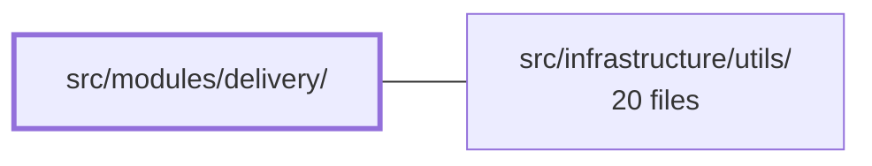

---
tags:
  - 2brain
  - 2brain/module
  - project/boilerplate-vue-frontend
type: module
module: src/modules/delivery/
files: 27
updated: 2026-11-10T08:38:13.347262+00:00
---

# src/modules/delivery/

## Purpose

The delivery module provides all admin-UI functionality for the shipping and fulfillment domain: selecting a shipping method at cart time, managing the lifecycle of fulfillment orders (ship, hold, release, fulfill, report-lost, mark-delivered), and presenting the preorder fulfillment board. It is a page-less, composable unit—no routes are declared—so that other modules (cart, orders, inventory) mount its components and store on demand.

## Key parts

- **State & writes — `store.ts`**: Pinia setup store that owns all delivery-side state (shipping methods, fulfillment orders, shipments, preorder board) and every admin write action. Centralises idempotency-key management for destructive writes and re-reads fulfillment lists after each successful mutation.
- **Order-page components — `ShipmentPanel`, `FulfillmentOrderCard`, `ShipmentRow`**: The shipping section of the order detail page. The panel renders cards; each card shows order-level status, date context, line-item progress, and server-driven action buttons; each row inside a card renders a single shipment with its own staff controls (mark-delivered, tracking correction, report-lost).
- **Action dialogs — `ShipItemsDialog`, `HoldDialog`, `ReportLostDialog`**: Staff-facing modals for the three destructive writes. Each owns its store call, toasts on success, surfaces 409/422 refusals inline, and emits a domain event so the parent page can re-fetch.
- **Preorder board — `PreorderFulfillmentTable`, `use-preorder-summaries.ts`**: Second tab of the preorder board. The table renders one row per fulfillment order with server-computed late/due-soon flags; the composable exposes a narrow read-only slice of the store to sibling components.
- **Cart-time components — `ShippingSelector`, `ShippingMethodName`**: Radio-group selector for server-priced shipping methods and an i18n-backed display-name component so raw method IDs never reach the user.
- **Domain layer — `domain/ship-lines.ts`, `domain/index.ts`**: Pure, side-effect-free helpers (quantity validation, shipment-count calculation) with a single public import path.
- **Module plumbing — `module.ts`, `index.ts`, `response-schemas.ts`**: Kernel registration (response schemas, locale loaders), the four-component + one-composable public barrel, and the OpenAPI contract-validation toggle for delivery endpoints.
- **Tests — `tests/`**: Per-component unit specs, a domain-helper spec, a store spec, and an e2e test for failure-recovery on the fulfillment screen.

## How it connects

- **Repository root (`/`)**: The kernel/app-shell registers this module via `module.ts` (response schemas, locale loaders) without assigning it any routes. The module is a peer to other feature modules and is mounted by them rather than owning a URL.
- **`src/infrastructure/utils/`**: Provides shared utility helpers (formatting, date handling, or other cross-cutting functions) that delivery components and the store import rather than re-implementing locally.

## Where to start

1. **`store.ts`** — Read this first to understand the full set of delivery state slices and every write action the admin UI can perform. Every component's behaviour ultimately reduces to calling one of these actions.
2. **`components/FulfillmentOrderCard.vue`** — The richest single component in the module. Reading it shows how server-supplied `actions` drive the UI, how the two dialog triggers and two dialog-less writes are wired, and how the `moved` event bubbles up to the parent page for a re-fetch.

## Connected modules

[[boilerplate-vue-frontend_ROOT|/ (repository root)]] · [[boilerplate-vue-frontend_src_infrastructure_utils|src/infrastructure/utils/]]

## Files
- `src/modules/delivery/components/FulfillmentOrderCard.vue` — Renders a single fulfillment order as a Vuetify card in Shopify-admin style: header with number/status/hold chips, date context (expected, promised, last notice), line-item progress, action buttons driven by the server-supplied `actions` object, and a list of shipments cut from the order. It owns the two dialog triggers (ship, hold) and the two dialog-less writes (fulfill, release), and bubbles a `moved` event so the parent page can re-fetch.
- `src/modules/delivery/components/HoldDialog.vue` — A staff-facing dialog that records a hold on a single fulfillment order. The operator selects one of the allowed `HoldFulfillmentOrderRequestReason` values (never `awaiting_stock`), optionally writes an internal note for other staff, and optionally writes a buyer-facing message. On success it toasts, closes itself, and emits `held` so the parent page can refresh the order.
- `src/modules/delivery/components/PreorderFulfillmentTable.vue` — Second tab of the preorder board: renders one row per fulfillment order derived from a preorder, showing buyer, paid/agreed/expected dates, and fulfillment state. Provides three server-driven warning filters (state, "Late", "Due soon") and a product chip that arrives from the adjacent products tab. The component owns no business logic for the warning flags—the server decides which rows are late or due soon; this file only passes the filter parameters and renders the result.
- `src/modules/delivery/components/ReportLostDialog.vue` — A modal dialog for staff to record that a parcel was lost or damaged in transit. It collects a reason (from the `ShipmentLostReason` enum), an optional internal note for colleagues, and an optional buyer-facing message that gets mailed. On success it closes itself, fires a toast, and emits `reported` so the parent page can refresh.
- `src/modules/delivery/components/ShipItemsDialog.vue` — A modal dialog that lets staff cut (partial-ship) a single fulfillment order. The user picks a quantity per shippable line (default: full remaining) and an optional tracking code, then submits. The dialog owns the store call, reports success as a toast, and surfaces refusals (409/422) inline beside the form.
- `src/modules/delivery/components/ShipmentPanel.vue` — The shipping section of the order page. It renders the order's fulfillment orders as `FulfillmentOrderCard` children, shows a shipment-count summary, and exposes the single order-level control — "Mark in progress" — which is gated by the order's own `canStart` flag. All per-record lifecycle actions live on the cards themselves; this panel never derives its own lifecycle rules.
- `src/modules/delivery/components/ShipmentRow.vue` — Renders a single shipment (parcel) inside its parent fulfillment-order card: number, status chip, tracking code, line items, ship/deliver dates, and any lost-parcel details. It also exposes the staff action controls that the server's `actions` object allows — inline tracking-code correction, mark-delivered, and report-lost.
- `src/modules/delivery/components/ShippingMethodName.vue` — Renders a human-readable display name for a shipping method by translating its stable ID (e.g. `standard` → "Standard") via i18n. It exists as the single point through which any order-facing UI shows a method name, so that a raw ID never reaches the end user. If no translation is registered for the current deployment, it falls back to displaying the ID itself.
- `src/modules/delivery/components/ShippingSelector.vue` — Renders a radio group for selecting a shipping method. Each radio corresponds to a server-priced, basket-fitting option passed in via props; the component never computes prices itself. It also mirrors two derived values (`requiresAddress`, `shipToCountries`) out to its caller so the parent (`SignedInCart.vue`) need not import the delivery store directly.
- `src/modules/delivery/composables/use-preorder-summaries.ts` — Narrow read interface for the preorder board's product table. Exposes the delivery store's preorder summaries, loading flag, and re-fetch action to sibling components without granting them the store's full write surface. Exists as a composable rather than a direct store import so consumers get exactly one scoped entry point.
- `src/modules/delivery/domain/index.ts` — Barrel file that defines the public API surface of the delivery domain layer. It re-exports the pure, framework-free shipping-rule functions and their types from `ship-lines.ts`, giving consumers a single stable import path (`delivery/domain`) while keeping internal module paths private.
- `src/modules/delivery/domain/ship-lines.ts` — Pure, side-effect-free helpers that power the delivery UI panels: validating what the ship dialog's quantity fields represent and computing how many shipments an order will arrive in. They exist so the form rejects impossible inputs early and the page can display a shipment count without manual tallying. The server remains the final authority (`DELIVERY_LINES_INVALID`).
- `src/modules/delivery/index.ts` — Public barrel for the delivery module. It re-exports exactly four Vue components and one read-only composable, and nothing else. Consumers (cart, orders, the preorder board in `inventory`) import from this single path rather than reaching into subdirectories.
- `src/modules/delivery/module.ts` — App-module manifest for the **delivery** module. It registers the module's response schemas and locale loaders with the kernel registry, without declaring any routes. This module exists to bundle shipping-related *components* (selector, parcel panel) and their store as a single, page-less unit that other modules (cart, orders) mount on demand.
- `src/modules/delivery/response-schemas.ts` — Defines the response-envelope schemas for every `delivery` endpoint recognized by the generated route table (`contracts/rest/routes.ts`, derived from `openapi.yaml` `x-module` stamps). It exists as the module-manifest entry that toggles contract validation for the delivery domain: present and enabled → validation on; folder deleted → validation off.
- `src/modules/delivery/store.ts` — Pinia setup store that owns all delivery-side state (shipping methods, fulfillment orders, shipments, preorder board) and every write action the admin UI can perform against a paid order (ship, fulfill, hold, release, report-lost, deliver, update). It centralises idempotency-key management for the two destructive writes (ship, fulfill) and always re-reads the order's fulfillment lists after a successful mutation so components render current data.
- `src/modules/delivery/tests/e2e/actions.cy.ts` — End-to-end test that verifies the fulfillment screen's failure-recovery behavior: when a ship or hold action is answered with a server fault, the dialog stays open with the user's input intact, an error alert is shown, and a retry succeeds. Delegates all orchestration to the shared `actionTable` runner.
- `src/modules/delivery/tests/fulfillment-order-card.spec.ts` — Unit tests for `FulfillmentOrderCard.vue`. Verifies the card's rendered text for every fulfillment-order status and hold variant, confirms that staff action buttons are driven exclusively by the record's `actions` field (not by status or kind), and checks that successful mutations emit a `moved` event to the parent page while failures surface an in-place error without emitting. Dialog internals are covered in `ship-items-dialog.spec.ts` and are out of scope here.
- `src/modules/delivery/tests/hold-dialog.spec.ts` — Unit tests for the `HoldDialog.vue` component, verifying the staff workflow for holding a fulfillment order: reason validation, the allowed reason set, note/message handling (including trimming), and in-dialog error display on refusal.
- `src/modules/delivery/tests/preorder-fulfillment-table.spec.ts` — Unit-test suite for `PreorderFulfillmentTable.vue` (the delivery board's second tab). It verifies two things: (1) the filter parameters the component passes to the store's `fetchPreorderBoard` read (Late, Due-soon, product), and (2) what each rendered row displays (state label, late flag, slip days, deadline, cancellation reason). The store read is always spied; no real network call is made.
- `src/modules/delivery/tests/report-lost-dialog.spec.ts` — Unit tests for `ReportLostDialog.vue`, the staff-facing dialog used to report a parcel as lost or damaged. Verifies submission gating, the two available reasons, field trimming, optional-field omission, and in-place error display on store rejection.
- `src/modules/delivery/tests/ship-items-dialog.spec.ts` — Vitest spec that mounts `ShipItemsDialog.vue` with `VDialog` stubbed to render inline and the delivery store's `ship` action spied. It verifies the user-facing contract of the shipping form: quantity defaults, submit gating, optional tracking-code handling, and error retention on refusal. Arithmetic correctness is explicitly deferred to `ship-lines.spec.ts`.
- `src/modules/delivery/tests/ship-lines.spec.ts` — Unit tests for the three pure helpers (`shippableLines`, `readShipLines`, `shipmentCount`) that power the ship dialog and the "arrives in N shipments" UI line. Each test case exercises a way the user-typed quantities or record counts can disagree with what the server would accept.
- `src/modules/delivery/tests/shipment-panel.spec.ts` — Unit-test spec for `ShipmentPanel.vue`, the order-page shipping panel. Verifies the panel's own rendering logic (which cards appear, the "arrives in N shipments" line, the order-level "start fulfillment" action, and re-fetching on `orderId` change) while the delivery store's network calls are stubbed. Explicitly out of scope: card-internal buttons (covered by `fulfillment-order-card.spec.ts`) and store-level logic (covered by `store.spec.ts`).
- `src/modules/delivery/tests/shipment-row.spec.ts` — Unit test for `ShipmentRow.vue` that verifies each staff control (mark-delivered, tracking-code form, report-lost button) renders only when the shipment's `actions` flags permit it, and that a server refusal (e.g. "already delivered") stays as an inline row error rather than propagating to the parent page.
- `src/modules/delivery/tests/shipping-selector.spec.ts` — Unit tests for `ShippingSelector.vue`, scoped to the component's own responsibilities: rendering one radio per caller-provided `options` entry (already priced, never re-derived) and fetching the shared unfiltered methods list exactly once on mount. Fetch-internal logic is deliberately out of scope (lives in `delivery/tests/store.spec.ts`).
- `src/modules/delivery/tests/store.spec.ts` — Vitest suite for the delivery store (`useDeliveryStore`). It mocks the HTTP transport (`orvalMutator`) and verifies that every store method sends the correct request body, mirrors API responses into state, propagates failures as rejections, and maintains state consistency when partial reads fail.

---
[[boilerplate-vue-frontend_INDEX|← boilerplate-vue-frontend index]]
