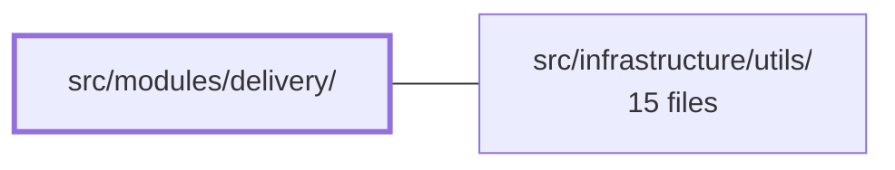

---
tags:
  - 2brain
  - 2brain/module
  - project/boilerplate-vue-frontend
type: module
module: src/modules/delivery/
files: 23
updated: 2026-10-17T02:52:28.025473+00:00
---

# src/modules/delivery/

## Purpose

The delivery module owns every UI surface and piece of session state related to shipping and order fulfillment: selecting a shipping method at the cart level, managing an order's fulfillment orders (ship, hold, track, arrive, override) on the order-detail page, and browsing the preorder fulfillment board. It bundles the Pinia store, pure domain helpers, response-schema registrations, and all related Vue components behind a single public barrel.

## Key parts

- **State & domain** — `store.ts` (Pinia store holding shipping methods, fulfillment orders, shipments, and the preorder board), `domain/ship-lines.ts` (pure validation/counting helpers for the ship dialog and shipment-count label), `response-schemas.ts` (generated contract-validation rows for every `delivery` endpoint), `module.ts` (module manifest).
- **Order-detail panel** — `ShipmentPanel.vue` (top-level container), `FulfillmentOrderCard.vue` (one fulfillment order's details and actions), `ShipmentRow.vue` (a single shipment's metadata and controls), `ShipItemsDialog.vue` (partial/full shipment form), `HoldDialog.vue` (hold-reason form).
- **Preorder board** — `PreorderFulfillmentTable.vue` (paginated, filterable table), `composables/use-preorder-summaries.ts` (narrow read-only accessor over the store).
- **Cart-level** — `ShippingSelector.vue` (radio group of priced options), `ShippingMethodName.vue` (i18n-resolved method name display).
- **Public API** — `index.ts` re-exports the four components and the composable so other modules import from `@/modules/delivery` without touching internal paths.
- **Tests** — `tests/` contains a dedicated Vitest spec per component, the store, and the domain helpers, covering rendering, action-gating, form validation, and error paths.

## How it connects

- **Repository root (`/`)** — The module's `index.ts` barrel is the only public surface other modules or pages import; it also registers response schemas through the module manifest so the app-level contract-validation pipeline can toggle delivery checks on or off.
- **`src/infrastructure/utils/`** — Shared utility helpers (e.g. date formatting, i18n lookup) are consumed by the components and the `ShippingMethodName` lookup so that cross-cutting formatting logic stays in one place rather than being duplicated inside delivery templates.

## Where to start

1. **`store.ts`** — Reading this first gives you the full state shape (shipping methods, fulfillment orders, shipments, preorder board) and every action the UI can trigger, which maps directly to the API calls behind each button you'll see in the components.
2. **`FulfillmentOrderCard.vue`** — The most interaction-dense component. It shows the core pattern the whole module follows: action buttons are driven entirely by the server-provided `actions` object on the record, and the component delegates form dialogs (`ShipItemsDialog`, `HoldDialog`) to sibling components while reporting results back via events.

## Connected modules

[[boilerplate-vue-frontend_ROOT|/ (repository root)]] · [[boilerplate-vue-frontend_src_infrastructure_utils|src/infrastructure/utils/]]

## Files
- `src/modules/delivery/components/FulfillmentOrderCard.vue` — Renders a single fulfillment order as a card in Shopify's admin layout: status chip, hold reason/note, expected and promised dates, buyer consent state, per-line shipped/cancelled quantities, the shipments cut from this order, and context-sensitive action buttons. Every action button is driven by the server-provided `actions` object on the record; the sole exception is a forced-ship button surfaced to an `override` holder when the ordinary ship action is unavailable.
- `src/modules/delivery/components/HoldDialog.vue` — A modal dialog that lets a staff member place a hold on a single fulfillment order. The user selects one of three staff-facing reasons (`incorrect_address`, `high_risk`, `other`) and optionally adds a free-text note, then submits. The dialog owns its submit call, reports success via a toast, and notifies the parent to re-fetch the order.
- `src/modules/delivery/components/PreorderFulfillmentTable.vue` — Renders the second tab of the preorder board: a paginated table of fulfillment orders created from preorders, showing buyer, dates, state, and line items. It provides server-side filters for order state, lateness, and "due soon" window, plus a closable product-filter chip inherited from the sibling products tab.
- `src/modules/delivery/components/ShipItemsDialog.vue` — A modal dialog that lets staff cut a partial or full shipment from one fulfillment order. Staff set a quantity per remaining line, optionally enter a tracking code, and (when the ordinary ship action is closed) may force the shipment with a required reason. The dialog owns its submit call, reports success as a toast, and surfaces server refusals inline.
- `src/modules/delivery/components/ShipmentPanel.vue` — Renders the shipping section of the order detail page: lists the order's fulfillment orders (each delegated to `FulfillmentOrderCard`), shows a "arrives in N shipments" summary, and exposes the single order-level "Start fulfilment" action. All per-record actions (ship, arrive, override) live on the cards themselves; this panel never derives lifecycle rules.
- `src/modules/delivery/components/ShipmentRow.vue` — Renders a single shipment row inside a `FulfillmentOrderCard`: the shipment's number, status chip, tracking code, line items, and dates. It also provides the two staff controls that the shipment's own `actions` object authorizes — inline tracking-code correction and mark-as-delivered (with an optional forced-arrival override for `override:Order` holders). Which controls appear is driven entirely by `shipment.actions` and the `canForce` prop; no rules are re-derived locally.
- `src/modules/delivery/components/ShippingMethodName.vue` — A presentational component that renders a shipping method's human-readable name by resolving its stable id (e.g. `standard`) through i18n. It exists so that any UI surface displaying a frozen shipping-method id to a person goes through a single translation lookup with a safe fallback, rather than printing the raw key.
- `src/modules/delivery/components/ShippingSelector.vue` — Renders a radio group of shipping methods for a cart. Each radio corresponds to one already-priced `CartShippingOption` supplied by the caller; the component never re-derives prices. It also mirrors `requiresAddress` and `shipToCountries` outward via `defineModel` so the parent (`Cart.vue`) can gate the address form and narrow country selection without importing the delivery store directly.
- `src/modules/delivery/composables/use-preorder-summaries.ts` — Provides a narrow, read-oriented composable for the preorder board's product table. It wraps the delivery store so that a consuming component gets exactly the three values it needs (`summaries`, `loading`, `load`) without importing the full store and gaining a second, wider path into the module's state.
- `src/modules/delivery/domain/ship-lines.ts` — Pure validation and counting helpers for the delivery UI panels. They turn raw fulfillment-order data into (a) a form-ready verdict of what a ship dialog may send, and (b) a stable shipment count for display. The server re-validates all limits (`DELIVERY_LINES_INVALID`); these functions only prevent the UI from requesting the impossible or hand-counting parcels.
- `src/modules/delivery/index.ts` — Public barrel for the delivery module. It re-exports four Vue components and one read-only composable so that consumers (other modules, pages) can `import { ShippingSelector } from '@/modules/delivery'` without reaching into internal paths. No logic lives here.
- `src/modules/delivery/module.ts`
- `src/modules/delivery/response-schemas.ts` — Declares the response-envelope schema rows for every backend `delivery` endpoint. The rows are generated from `openapi.yaml` (via `x-module` stamps surfaced in `contracts/rest/routes.ts`) and registered through the module manifest so that contract validation is enabled when the delivery domain is active and disabled when the folder is removed.
- `src/modules/delivery/store.ts` — Pinia setup store (`useDeliveryStore`) that owns all delivery and fulfillment state for a session: shipping methods, an order's fulfillment orders and shipments, and the preorder board. Every action wraps a single API call through the toolkit's `fetchAny`, giving the whole module one shared `loading` flag. It exists so that the delivery UI components and the preorder-board pages can read and mutate fulfillment state without managing HTTP calls or loading state themselves.
- `src/modules/delivery/tests/fulfillment-order-card.spec.ts` — Vitest spec for `FulfillmentOrderCard.vue`. Mounts the real card (Vuetify + i18n, `VDialog` stubbed inline) and verifies three things: the human-readable label and line details shown per status, that every staff action button is driven by the record's own `actions` object (with the single "forced-ship" override exception), and that a successful or failed action is reported to the parent page via the `moved` event. Dialog *forms* are deliberately out of scope (see `ship-items-dialog.spec.ts`).
- `src/modules/delivery/tests/hold-dialog.spec.ts` — Unit tests for the staff "hold a fulfillment order" dialog. Verifies that a reason is mandatory before submission, that the reason list excludes `awaiting_stock`, that the optional note is trimmed before dispatch, and that a rejected `hold` call keeps the user in the dialog with an inline error.
- `src/modules/delivery/tests/preorder-fulfillment-table.spec.ts` — Unit test for the `PreorderFulfillmentTable.vue` component (the delivery board's second tab). It verifies two concerns: that the component forwards the correct filter parameters to the store's `fetchPreorderBoard` call, and that each rendered row displays the expected state, late/slip indicators, consent deadline, or cancellation reason.
- `src/modules/delivery/tests/ship-items-dialog.spec.ts` — Component-level test for `ShipItemsDialog.vue`. It mounts the real dialog with Vuetify's `VDialog` stubbed to render its slot inline, spies on the delivery store's `ship` action, and asserts the dialog's form behaviour: quantity defaults and validation, the tracked-method tracking-code rule, the forced-shipping door (toggle + reason), and the refusal path that keeps the dialog open. Explicitly out of scope: the ship-line arithmetic (covered by `ship-lines.spec.ts`).
- `src/modules/delivery/tests/ship-lines.spec.ts` — Unit tests (Vitest) for the three pure helpers in the delivery domain that power the ship dialog and the "arrives in N shipments" label. Each `describe` block maps to one exported function and exercises the edge cases where typed quantities or record counts diverge from what the server would accept.
- `src/modules/delivery/tests/shipment-panel.spec.ts` — Vitest spec that exercises `ShipmentPanel.vue` in isolation: which fulfillment-order cards render for a given order, the "arrives in N shipments" summary line, the order-level "Start fulfilment" action (including its error path), and the re-fetch that fires when `orderId` changes without a remount. Store fetch calls are spied so the test stays scoped to the panel's own decision logic, not the store's or the cards' internals.
- `src/modules/delivery/tests/shipment-row.spec.ts` — Vitest unit-test suite for `ShipmentRow.vue`. It mounts the real component against a real Pinia store (with write methods spied) to verify three behaviours: the row renders shipment metadata correctly, staff controls appear only when the shipment's `actions` field permits them, and the forced-arrival path is gated on both an override toggle and a reason string.
- `src/modules/delivery/tests/shipping-selector.spec.ts` — Vitest spec for `ShippingSelector.vue` that verifies the component's own scoped contract: it renders exactly the priced options it is given (never re-derives pricing), fetches the shared methods list once on mount (to power the ship-to list and the free-above hint), and correctly distinguishes a threshold-crossed "free" from an always-free method.
- `src/modules/delivery/tests/store.spec.ts` — Unit test suite for the delivery Pinia store (`useDeliveryStore`). It pins down that every store method mirrors the API contract: reads fill the correct state slices, writes send the exact body the schema accepts, and failures propagate as rejections rather than being silently swallowed. The transport layer is fully mocked so no real HTTP occurs.

---
[[boilerplate-vue-frontend_INDEX|← boilerplate-vue-frontend index]]
