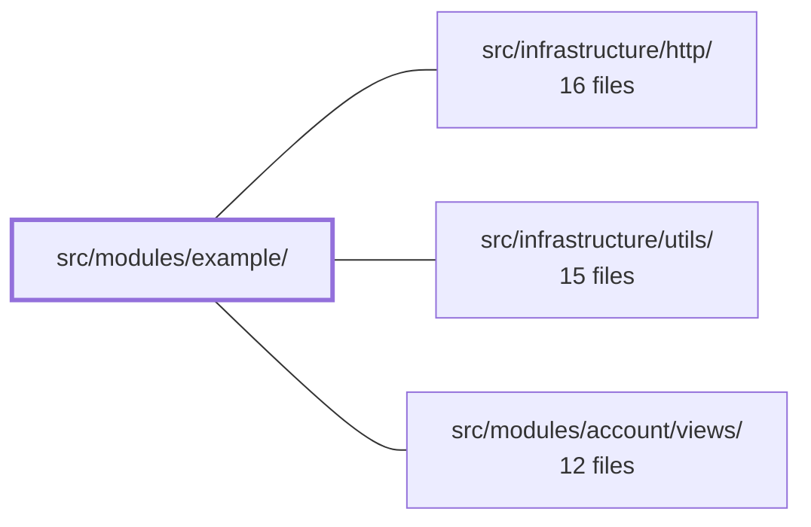

---
tags:
  - 2brain
  - 2brain/module
  - project/boilerplate-vue-frontend
type: module
module: src/modules/example/
files: 28
updated: 2026-10-17T02:52:46.241500+00:00
---

# src/modules/example/

## Purpose

The **example** module is a self-contained vertical slice that implements the full lifecycle of an "Example" entity: a state-machine domain layer, a Pinia store, five Vue screens (list, create, edit, detail, public-read), Zod form schemas, a router guard, a provide/inject contract, and an exhaustive test suite. It doubles as the canonical copy-paste template from which new domains are bootstrapped.

## Key parts

- **Module wiring** — `module.ts` is the single entry point the kernel loads; it registers routes, navigation items, response schemas, and locale loaders. `routes.ts` declares the path→view table (lazy-loaded). `response-schemas.ts` activates contract validation for every endpoint the module touches.
- **Domain layer** — `domain/statuses.ts` holds the pure, store-free status-transition state machine (`NEXT_STATUSES`, `EXAMPLE_STATUSES`). `domain/index.ts` re-exports it so consumers import from one stable path.
- **State & data** — `store.ts` centralises record cache, list, pagination, and selection, delegating generic CRUD to `useStructureCrudApi` and hand-writing the cover-image upload and public read actions.
- **Screens** — `views/` contains the five user-facing pages: `ExamplesList` (filterable, paginated), `ExampleCreate`, `ExampleEdit`, `ExampleTarget` (detail + delete), and `ExamplePublished` (unauthenticated read).
- **Cross-component plumbing** — `provided.ts` defines the typed `InjectionKey` pair; `components/ExampleStatusActions.vue` consumes it to render legal status-transition buttons without prop-drilling.
- **Validation** — `schemas.ts` builds Zod schemas (i18n-thunked error messages, bounds sourced from the generated API contract) for the create and edit forms.
- **Routing guard** — `guards.ts` pre-fetches the target record before the edit view mounts so the form opens pre-filled.
- **Tests** — `tests/` covers the full pyramid: pure domain specs, component/integration tests for every view, guard and provide/inject contracts, schema boundary and i18n specs, store request-shape tests, a route-table pin, and two Cypress e2e specs (full lifecycle + a11y sweep).

## How it connects

- **`/` (repository root / kernel)** — `module.ts` is the sole file the application imports directly. It registers this module's routes, navigation entries, response schemas, and locale loaders into the kernel registry and declares the store-loading key, making the domain opt-in.
- **`src/infrastructure/http/`** — `store.ts` calls the generated API client (via `orvalMutator`) for every network operation, and `useStructureCrudApi` (hosted in this layer) handles generic list/get/create/update/delete calls. Response schemas registered by this module are validated against that transport layer.
- **`src/infrastructure/utils/`** — provides shared building blocks the module consumes: `useStructureFormValidation` (wired into the create/edit views), the i18n `translate()` helper used by `schemas.ts`, shared layout components (`FormCard`, `ItemDetailLayout`, `DataTable`), and the `sweepA11y` e2e helper.
- **`src/modules/account/views/`** — the `ExamplePublished` view renders owner attribution, and the detail/list screens surface user-related context, tying this domain's read paths to the account module's data.

## Where to start

Read **`module.ts`** first: in ~40 lines it shows how routes, schemas, navigation, and locale files are registered, giving you the map of everything else. Then open **`domain/statuses.ts`** — it is a small, dependency-free file that defines the entire status state machine, and understanding it makes the views, guard, `ExampleStatusActions` component, and their tests immediately legible.

## Connected modules

[[boilerplate-vue-frontend_ROOT|/ (repository root)]] · [[boilerplate-vue-frontend_src_infrastructure_http|src/infrastructure/http/]] · [[boilerplate-vue-frontend_src_infrastructure_utils|src/infrastructure/utils/]] · [[boilerplate-vue-frontend_src_modules_account_views|src/modules/account/views/]]

## Files
- `src/modules/example/components/ExampleStatusActions.vue` — Injecting half of a provide/inject pair. It reads the current example and a status-mutation function from its parent (the detail screen) and renders one button per allowed next status. It exists as a separate component so the provide/inject mechanism is exercised across a real component boundary.
- `src/modules/example/domain/index.ts` — Barrel file for the `example` module's domain layer. It re-exports the module's pure domain rules (status constants) so that screens, schemas, and tests can import from a single, stable path (`domain`) rather than reaching into individual implementation files.
- `src/modules/example/domain/statuses.ts` — Defines the allowed status transitions for an example on the client side and derives the canonical list of all statuses. Exists as a pure, store-free module so that Vue components (which must not import the generated API client) can read the transition rules without pulling in HTTP infrastructure.
- `src/modules/example/guards.ts` — A single Vue Router `beforeEnter` guard for the example edit route. Its job is to pre-fetch the target example from the Pinia store *before* the edit view mounts, so the form opens pre-filled rather than flashing empty. The file also serves as an in-code lesson on what a guard can and cannot access (store: yes; translations: no; injected props: no).
- `src/modules/example/module.ts` — Module manifest for the **example** domain — the single entry point the application loads directly. It wires routes, navigation, response schemas, and locale loaders into the kernel registry, and declares the store-loading key for this domain. It also exists as a copy-paste template: new domains start by duplicating this folder.
- `src/modules/example/provided.ts` — Defines a typed Vue provide/inject contract so a parent screen can hand its `Example` and a single status-mutation callback to descendant components without prop-drilling. The pair is exchanged through a `Symbol`-based `InjectionKey`, giving full type inference on the `inject` side.
- `src/modules/example/response-schemas.ts` — Declares the response-envelope schemas for every endpoint the `example` backend module calls. The rows are derived from the generated route table in `contracts/rest/routes.ts` (sourced from `openapi.yaml`'s `x-module` stamps) and registered via the module manifest so that contract validation activates automatically when the `example` domain is enabled.
- `src/modules/example/routes.ts` — Declarative route table for the example module. Each entry pairs a path with a lazy-loaded Vue view and the access rules the router enforces. The file exists so `module.ts` can register the module's screens in one place while keeping component imports out of the critical bundle path.
- `src/modules/example/schemas.ts` — Defines Zod validation schemas for the Example create and edit forms. Error messages are i18n-thunked (resolved at parse time via `translate()`) so the active locale is picked up dynamically. Field bounds are sourced from generated API contract schemas rather than restated locally.
- `src/modules/example/store.ts` — Pinia store for the **example** domain. It centralises every piece of example-related state (record cache, list, pagination, selection) and every call to the generated API client. Generic CRUD is delegated to `useStructureCrudApi`; two hand-written actions cover the cover-image upload and the public (unauthenticated) read that don't fit the generic shape.
- `src/modules/example/tests/domain.spec.ts` — Vitest spec that pins down the example-status lifecycle: the allowed transitions between statuses (`NEXT_STATUSES`) and the canonical display order (`EXAMPLE_STATUSES`). It exists so that any change to the state machine in the domain module is caught immediately in CI rather than discovered at runtime on a screen.
- `src/modules/example/tests/e2e/a11y.cy.ts` — Co-located Cypress a11y sweep for the example module. It feeds the shared `sweepA11y` helper a list of routes and optional state-preparation callbacks covering the signed-in screens (list, create, detail, edit) and one public screen, so that the module's accessibility coverage lives in the same directory and is deleted alongside the module.
- `src/modules/example/tests/e2e/example.cy.ts` — Cypress end-to-end spec that drives the real application to verify the example module's full lifecycle: seeded-data visibility (per role and status filter), create → publish → public-read, edit, and delete. It exists to catch regressions across the frontend, routing, and backend in one integrated flow.
- `src/modules/example/tests/example-create-view.spec.ts` — Component-level integration test for the **ExampleCreate** view. It mounts the real page against a real (memory-history) router and a real Pinia store with the store's `createExample` action spied, then verifies four behaviours: pre-submit validation refusal, the exact payload sent on success, the post-create navigation target, and how server refusals (field-specific vs. generic) are surfaced in the UI.
- `src/modules/example/tests/example-edit-view.spec.ts` — Integration test that mounts the real `ExampleEdit` page against a real memory-history router and a seeded Pinia store (spies, not HTTP mocks). It verifies that the form opens pre-filled from the cached record, sends only changed fields as a merge, omits the cover upload when no image is selected, blocks invalid input client-side, and surfaces an API error in-place.
- `src/modules/example/tests/example-published-view.spec.ts` — Unit-tests the `ExamplePublished` view in isolation: verifies it renders fetched data with owner attribution, redirects to the shell's Error page on a 404 response, and renders nothing while the fetch is still pending.
- `src/modules/example/tests/example-status-actions.spec.ts` — Vitest spec for the `ExampleStatusActions` component. It verifies two contracts: (1) the component renders only the status transitions legal for the current status, and (2) clicking a move button delegates the mutation to the injected provider (`changeStatus`) rather than calling the store directly.
- `src/modules/example/tests/guards.spec.ts` — Vitest spec for `exampleEditGuard` (the Vue Router navigation guard on the example-edit route). It verifies three production-critical contracts: the guard resolves to `undefined` so Vue Router treats it as a pass-through, it survives a failed store fetch without blocking navigation, and it only fetches when the route carries a scalar `id`.
- `src/modules/example/tests/provided.spec.ts` — Verifies the provide/inject pair exported by `provided.ts` by mounting a real parent → child component tree. This exercises `provide`/`inject` in their only meaningful context (inside a component instance) and asserts that a descendant receives the *same* ref object and the *same* `changeStatus` function the provider holds, rather than a copy.
- `src/modules/example/tests/routes.spec.ts` — Pins every route the example module declares—by name, against the raw route records rather than a resolved router—so that a silently dropped `meta.access` or an accidentally added public route is caught at test time. Each expected permission value is written out explicitly rather than derived.
- `src/modules/example/tests/schemas-i18n.spec.ts` — Verifies that the example module's Zod schema and its locale dictionaries actually agree: when the active i18n locale switches between English and Italian, the same schema object emits the corresponding locale-specific error string for an empty `title`. It lives alongside the domain code because it pins a module-internal contract (schema ↔ JSON), distinct from the cross-cutting mechanism test that proves the thunk-at-parse-time trick works in general.
- `src/modules/example/tests/schemas.spec.ts` — Vitest spec that verifies the refusal boundaries of the example form schemas (`exampleCreateSchema`, `exampleEditSchema`). It confirms that inputs violating the generated API contract (empty strings, lengths past the ceiling, unknown or missing status values) are rejected, and that inputs sitting exactly on the contract's limits are accepted. The bounds are asserted against constants imported from the generated contract rather than hardcoded numbers, so the test tracks the contract if it changes.
- `src/modules/example/tests/store.spec.ts` — Unit tests for the `useExampleStore` Pinia store. They mock `orvalMutator` (the HTTP transport) and assert on the raw request config the store's actions produce—URL, method, params, and body. Every canned response is validated through the real Orval contract schema (`parseOrvalFixture`), so a fixture that drifts from `openapi.yaml` fails here rather than in a downstream integration test.
- `src/modules/example/views/ExampleCreate.vue` — The create-form screen for the Example module. It renders a two-field form (title, body) inside the shared `FormCard`, validates input against a Zod schema via `useStructureFormValidation`, calls the store's `createExample` action, then toasts success and navigates to the newly created example.
- `src/modules/example/views/ExampleEdit.vue` — The edit screen for an example resource. It hydrates a form from the Pinia store cache (the route guard has already loaded the record), lets the visitor change title, body, status, and cover image, and on save sends only the changed fields as a JSON diff followed by an optional multipart cover upload.
- `src/modules/example/views/ExamplePublished.vue` — Public, unauthenticated read page for a single published example. It resolves the route `id` through the store's `fetchPublished` action and renders the result (title, body, owner, date, optional image). A 404 response—regardless of whether the id is a draft, archived, or nonexistent—diverts to the shell's Error page.
- `src/modules/example/views/ExampleTarget.vue` — Detail (read) screen for a single example record. It hydrates one example from the store by route id, renders it in the shared `ItemDetailLayout` skeleton, exposes a `changeStatus` mutation to `ExampleStatusActions` via provide/inject, and owns the confirm-and-delete flow.
- `src/modules/example/views/ExamplesList.vue` — The list screen for the Example module. It wires a filter form (text + status) and a paginated `DataTable` to the module's Pinia store, exposes per-row view/edit/delete actions, and keeps the current filter/page state in the URL so views are shareable and survive reloads.

---
[[boilerplate-vue-frontend_INDEX|← boilerplate-vue-frontend index]]
