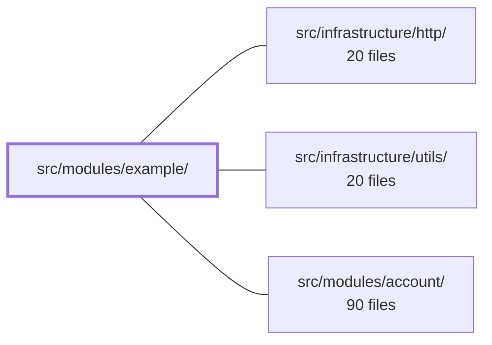

---
tags:
  - 2brain
  - 2brain/module
  - project/boilerplate-vue-frontend
type: module
module: src/modules/example/
files: 35
updated: 2026-11-10T08:38:27.847780+00:00
---

# src/modules/example/

## Purpose

The `example` module is a self-contained domain implementation for a single entity ("Example") that demonstrates the project's full module anatomy: routing, state, validation, lifecycle transitions, and testing. It is explicitly designed as a **template**—a developer reads it in one sitting, copies the folder, renames the entity, and deletes this reference copy.

## Key parts

- **`module.ts`** – The manifest. Registers routes, a nav entry, response schemas, and locale loaders with the app-level registry, and declares the store's loading key. This is the single file a new domain must adapt first.
- **`views/`** – Five screens covering the full user loop: `ExamplesList` (paginated, URL-driven search/sort), `ExampleCreate`, `ExampleEdit` (PATCH-only, 412 reload flow), `ExampleTarget` (signed-in detail with delete), and `ExamplePublished` (public, no-auth read).
- **`store.ts`** – Pinia setup store owning record cache, list, pagination, and selection. Delegates generic CRUD to `useStructureCrudApi`; hand-writes lifecycle transitions, idempotent create, multipart upload, and public read.
- **`composables/use-example-transition.ts`** – Shared transition logic (publish / archive / unarchive) used by both the detail and edit screens, including the 409 conflict re-read path.
- **`provided.ts`** – Typed `provide`/`inject` pair so descendant components (e.g. `ExampleStatusActions`) access the current record and `changeStatus` without prop-drilling.
- **`domain/publication.ts`** – Pure rule collapsing `status` + `publishedAt` into a `live` / `withdrawn` / `never` verdict for display; testable without a component.
- **`routes.ts` / `schemas.ts` / `response-schemas.ts`** – Route table (with `meta.access` / `meta.can`), Zod form-validation schema (i18n-thunked), and contract-validation routes for backend endpoints.
- **`tests/`** – Layered coverage: unit specs for every composable, component, and rule; integration specs for create/edit/published views; Cypress e2e specs for the full lifecycle, role enforcement, UI resilience, a11y, visual regression, and Lighthouse.

## How it connects

- **`src/infrastructure/http/`** – The store issues all API calls through the shared HTTP layer (via the generated orval client / `orvalMutator`); response schemas in this module plug into the same contract-validation pipeline.
- **`src/infrastructure/utils/`** – Shared helpers (e.g. `useStructureCrudApi`, toast utilities) are consumed by the store and composables.
- **`src/modules/account/`** – Route `meta.access` / `meta.can` values reference account-defined roles; the `sweepRoles` e2e helper walks those personas to verify enforcement.
- **Repository root** – `module.ts` registers this domain's routes, nav entry, schemas, and locales with the app-level registry, making the module discoverable to the router and i18n loader without per-file imports elsewhere.

## Where to start

1. **`module.ts`** – One short file that shows exactly what a module must declare to the application; reading it tells you the module's full surface area.
2. **`views/ExampleTarget.vue`** together with **`composables/use-example-transition.ts`** – Together they show the typical data flow (route → store → view) and the lifecycle-action pattern (provide/inject → composable → store → HTTP), which is the recurring shape across all domain modules.

## Connected modules

[[boilerplate-vue-frontend_ROOT|/ (repository root)]] · [[boilerplate-vue-frontend_src_infrastructure_http|src/infrastructure/http/]] · [[boilerplate-vue-frontend_src_infrastructure_utils|src/infrastructure/utils/]] · [[boilerplate-vue-frontend_src_modules_account|src/modules/account/]]

## Files
- `src/modules/example/components/ExampleStatusActions.vue` — Renders one button per lifecycle action the server has flagged as open on the current example (publish, archive, unarchive). It is purely presentational: it reads which actions are available from injected state, displays them in a fixed order, and delegates the actual status change to an injected mutation. It exists as a separate component (rather than inline in a view) so the provide/inject boundary is explicit and visible.
- `src/modules/example/composables/use-example-transition.ts` — Composable that applies a lifecycle event (status transition) to a routed example and handles the 409 "someone got there first" conflict: on success it toasts; on 409 it blocks the UI in place and forces a cache-bypassing re-read so the record reflects what the server now offers. It exists so both the detail screen and the edit screen share one transition path.
- `src/modules/example/domain/index.ts` — Barrel file for the `example` module's domain layer. It re-exports the module's pure rules (currently just `publicationOf`) so that screens and tests import from one stable entry point rather than reaching into individual rule files. The `domain/` folder exists because the publication rule met the project's threshold (2+ callers or a known trap).
- `src/modules/example/domain/publication.ts` — A domain-layer reading rule that collapses an `Example`'s `status` and `publishedAt` into a single three-state verdict (`live` / `withdrawn` / `never`) for screen display. It interprets existing server data but makes no decisions the server doesn't already own, and it is testable as a pure function with no component mounting.
- `src/modules/example/module.ts` — The manifest for the **example** domain — a minimal, self-contained template that a developer copies to bootstrap a new domain. It registers routes, a navigation entry, response schemas, and locale loaders with the application registry, and declares the loading key its store reports under. It exists to be read in one sitting and then deleted.
- `src/modules/example/provided.ts` — Defines a typed Vue provide/inject pair that passes the current `Example` (read-only) and a single `changeStatus` mutation down a screen's component tree. It exists so descendants never need prop-drilling to reach the screen's data or to request a lifecycle event, and so a rename on either side is a compile error.
- `src/modules/example/response-schemas.ts` — Defines the response-schema routes for every `example` operation the generated table attributes to the `example` backend module. It exists so that contract validation for this module's endpoints can be toggled simply by enabling or removing the module folder, without a per-route line.
- `src/modules/example/routes.ts` — Declares the route table for the example module. Each entry pairs a URL path with a lazy-loaded view component and a `meta` block that the app-level router uses for access control (`access` / `can`) and page titles. This file is the single source of truth for which URLs the module serves and who may reach them.
- `src/modules/example/schemas.ts` — Client-side Zod form-validation schema for the Example module. It defines what a user may submit when creating or editing an example, enforcing required fields and max-length bounds sourced from the generated API contract. Error messages are i18n-thunked (resolved at parse time) so the UI language is correct regardless of when validation fires.
- `src/modules/example/store.ts` — Pinia setup store for the "example" domain. It owns the entity's state (record cache, list, pagination, selection) and every API call the module makes. Generic CRUD is delegated to `useStructureCrudApi` from `@guebbit/vue-toolkit`; hand-written actions cover the cases that do not fit that shape (idempotent create, lifecycle transitions, multipart cover upload, public read).
- `src/modules/example/tests/e2e/a11y.cy.ts` — Declares the list of routes that the shared `sweepA11y` helper must accessibility-audit for the example module. It covers the editor's signed-in screens (list, create, detail, edit) and one anonymous public screen. Co-locating the file under the module ensures that removing the module removes its a11y coverage in the same commit, and a cross-cutting spec enforces that no routed module is missing one of these files.
- `src/modules/example/tests/e2e/actions.cy.ts` — Cypress end-to-end test that verifies the example module's UI resilience: each user-facing action (create, edit, delete ×2, status move) is forced to fail via a server-fault stub, and the test asserts the page shows the correct alert, preserves any typed input or visible row, then succeeds on retry once the stub is removed. This file is the canonical template that new modules copy when adding their own `actionTable` coverage.
- `src/modules/example/tests/e2e/example.cy.ts` — Cypress end-to-end spec that drives the example module's full user loop against the real running app: role-based list visibility, the draft → publish → read → archive lifecycle, and edit/delete. It verifies what each role (editor, admin, anonymous stranger) can see and do, using the backend's seeded demo data as a known starting state.
- `src/modules/example/tests/e2e/example.visual.cy.ts` — Declares the visual-regression route list for the example module and hands it to the shared `sweepVisual` helper. It covers three views: the examples list, the editor detail page (seeded example), and the public published page (guest context).
- `src/modules/example/tests/e2e/resilience.cy.ts` — Module-level slice of the application-wide resilience sweep. Verifies that the example list, detail, edit, and public pages each render their expected content without emitting unexpected log output and within the viewport. Runs as an authenticated editor (internal pages) and as a guest (public page).
- `src/modules/example/tests/e2e/roles.cy.ts` — E2E test that verifies the "example" module's pages enforce role-based permissions correctly. It delegates the generic "walk every persona, assert the browser matches that persona's rules" loop to the shared `sweepRoles` helper, and adds one targeted test for a moderator viewing another author's published record.
- `src/modules/example/tests/example-create-view.spec.ts` — Vitest suite that mounts the real `ExampleCreate` page against a real (memory-history) router and the real Pinia store, then verifies: client-side validation blocks empty fields before any call, the exact payload sent on success, the post-create redirect, and how server-side refusals (field-level vs. generic) surface in the UI. The HTTP layer is intentionally out of scope; only the store method is spied.
- `src/modules/example/tests/example-edit-view.spec.ts` — Integration test for the `ExampleEdit` view. It mounts the real component against a real memory-history router with the full plugin stack (Pinia, Vuetify, i18n) and asserts end-to-end edit-flow behavior: the form pre-fills from the store cache, a save sends only the changed fields as a merge, validation blocks locally, API refusals (500, 412) surface in-place, and server-listed actions render conditionally. Store method calls are spied at the store boundary so no HTTP layer is involved.
- `src/modules/example/tests/example-published-view.spec.ts` — Unit tests for the `ExamplePublished` view. Verifies that the page renders a published example (title, body, owner), redirects the visitor to the shell's Error page when the store's public read resolves to a 404, and displays nothing while the data is still in flight.
- `src/modules/example/tests/example-status-actions.spec.ts` — Unit-test spec for the `ExampleStatusActions` component. It verifies two contracts: (1) the component renders a button **only** for each event the server flags open in `actions` (it makes no independent decisions), and (2) clicking a button delegates to the injected provider's `changeStatus` rather than calling the store directly.
- `src/modules/example/tests/example-target-confirm-once.spec.ts` — Regression test for the `ExampleTarget` delete flow: pressing the delete button twice in rapid succession (before the first confirmation dialog resolves) must produce exactly one confirm prompt and one `deleteExample` call. Exists to guard against a double-fire bug in the component's confirm-then-delete handler.
- `src/modules/example/tests/examples-list-view.spec.ts` — Vitest spec that verifies the **ExamplesList** page performs server-side sorting: clicking a sortable column header issues a new `listExamples` request with `sort` set, while columns the contract does not name remain inert. Only the API client call is mocked; the store, search, and pagination pipeline run for real, and assertions target the outgoing request parameters.
- `src/modules/example/tests/lighthouse.ts` — Declares the Lighthouse audit case(s) contributed by the `example` module. It exposes a single, read-only route (a published example viewed as a guest) so the shared Lighthouse runner can include it in live-site audits.
- `src/modules/example/tests/provided.spec.ts` — Vitest suite that exercises the `provideExample` / `useProvidedExample` pair end-to-end by mounting a real parent/child component tree. It verifies that a descendant receives the *same* ref and the *same* function reference the provider holds, and that mutations propagate reactively across the boundary.
- `src/modules/example/tests/publication.spec.ts` — Exhaustive unit spec for the `publicationOf` helper (the template's single reading rule). Because the input space is small — three `ExampleStatus` values × `publishedAt` present or absent — the spec enumerates every combination via `it.each` rather than using property-based testing. It also pins two invariants: the `publishedAt` date alone must never read as "live", and the first-publish stamp is immutable across re-publishes.
- `src/modules/example/tests/routes.spec.ts` — Vitest spec that pins the route table in the `example` module by name. It verifies each route's `meta.access`/`meta.can` values, confirms the one public route truly lacks them, asserts no route uses a `beforeEnter` guard, checks path declaration order, and guards against untracked routes. It validates the raw route records directly (not a resolved router) so a silently dropped `meta` field is caught as a failure, not a "no-op."
- `src/modules/example/tests/schemas-i18n.spec.ts` — Domain-level i18n test proving that `exampleFormSchema` and the local locale dictionaries (`en.json`, `it.json`) actually agree on message strings. It runs against the **real** vue-i18n instance (not a mock) so that a wrong-language message would fail the assertion. The *mechanism* of thunked Zod messages re-resolving at parse time is covered separately in `tests/cross-cutting/schemas-i18n.spec.ts`; this file lives with the domain because it validates this module's specific schema + dictionary pairing.
- `src/modules/example/tests/schemas.spec.ts` — Vitest suite for `exampleFormSchema` (the Zod schema governing the create/edit form). It verifies what the form accepts and rejects, sourcing length ceilings from the generated API contract rather than restating them, so the tests stay in sync automatically when the contract changes.
- `src/modules/example/tests/store.spec.ts` — Unit tests for the `useExampleStore` Pinia store. The file mocks `orvalMutator` (the HTTP transport) so that each store action's outgoing request—URL, method, params, body, headers—can be inspected directly. Every canned response is validated against the real OpenAPI contract schema before being returned, ensuring fixtures cannot silently drift from `openapi.yaml`.
- `src/modules/example/tests/use-example-transition.spec.ts` — Unit tests for the `useExampleTransition` composable. Verifies the three status-transition outcomes: a successful publish, a 409 conflict (which must re-read the record past the cache), and any other refusal (which must not re-read).
- `src/modules/example/views/ExampleCreate.vue` — Create screen for the Example entity. Renders a two-field form (title, body) inside the shared `FormCard`, validates input against a Zod schema, calls the store's `createExample` action, and navigates to the newly created record on success.
- `src/modules/example/views/ExampleEdit.vue` — Edit screen for an "example" record, identified by the route `id`. It hydrates a form (title, body, cover image) from the Pinia cache, sends only changed fields as a JSON PATCH, handles the 412 "record moved" case with a reload-latest flow, and renders the status-transition buttons the server allows. The form is read-only when the record's `actions.update` is `false`.
- `src/modules/example/views/ExamplePublished.vue` — Public (no-auth) detail page that displays a single published example by its route `id`. It fetches the record via a store action, renders it inside the shared detail-layout organisms, and delegates 404 handling (draft, archived, or missing id) to the `useMissingRecord` composable.
- `src/modules/example/views/ExampleTarget.vue` — Detail screen for a single example record. It resolves the route `id` through the Pinia store, renders the record inside the shared `ItemDetailLayout` skeleton, and exposes two record-specific mutations: a status transition (delegated to `ExampleStatusActions` via provide/inject) and a delete that navigates back to the list.
- `src/modules/example/views/ExamplesList.vue` — List screen for the Example module. It wires the Pinia store's paginated search to a filter form and a server-sorted `DataTable`, keeps all list state (filters, page, sort) in the URL for shareable deep links, and renders per-row View / Edit / Delete actions plus a session-gated Create button.

---
[[boilerplate-vue-frontend_INDEX|← boilerplate-vue-frontend index]]
