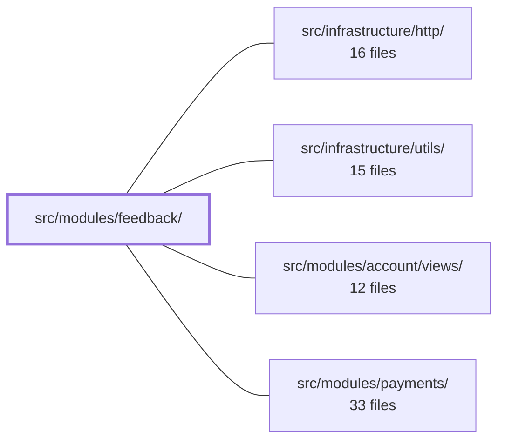

---
tags:
  - 2brain
  - 2brain/module
  - project/boilerplate-vue-frontend
type: module
module: src/modules/feedback/
files: 11
updated: 2026-10-17T02:53:02.546927+00:00
---

# src/modules/feedback/

## Purpose

The feedback module implements the public contact form and the admin inbox for managing visitor-submitted tickets. It provides a single registration point (module manifest) that wires routes, schemas, and locale loaders into the application kernel, and exposes a Pinia store for all server-side CRUD operations against the `/feedback` backend.

## Key parts

- **`module.ts`** – The module manifest. It registers the route table, response-schema rows, navigation entries, and locale loaders into the `AppModule` registry so the kernel can boot the feature.
- **`routes.ts` & `response-schemas.ts`** – Declarative tables: two URL paths (public contact form, authenticated admin inbox) mapped to Vue components, and the contract-validation rows that bind feedback endpoints to OpenAPI-derived response envelopes.
- **`store.ts`** – Pinia setup store. Exposes `submitContact` for the public form and a server-paginated, filterable inbox (status updates, deletion) built on `useStructureCrudApi` from `@guebbit/vue-toolkit`.
- **`views/Contact.vue` & `views/FeedbackInbox.vue`** – The two user-facing components: a Zod-validated public form with antibot token, and an admin inbox with per-row status transitions, inline notes, and GDPR deletion.
- **`tests/`** – Co-located coverage: Vitest unit tests for the store and route metadata, Cypress e2e specs for the full user loop and a11y/visual sweeps. Deleting the module automatically removes its test surface.

## How it connects

- **`src/infrastructure/http/`** – The store talks to the backend through the shared HTTP client / Orval-generated API layer; the `orvalMutator` transport is the seam at which unit tests mock network calls.
- **`src/infrastructure/utils/`** – General-purpose helpers (validation, locale, shared types) consumed across the module's views and store.
- **`src/modules/account/views/`** – Provides the authentication context the module relies on: the contact form is explicitly open to unauthenticated visitors, while the inbox route is gated behind an authenticated-admin guard. The e2e spec exercises the guest-redirect and admin-only route guards that originate in the account domain.
- **`src/modules/payments/`** – A sibling domain module that follows the same structural pattern (module manifest → store → views → co-located tests); the feedback store explicitly mirrors the CRUD pattern used by the payments, products, and orders stores via `useStructureCrudApi`.

## Where to start

1. **`module.ts`** – Read this first to see the full registration surface (routes, schemas, i18n) and understand how the kernel boots the feature.
2. **`store.ts`** – Next, read the store to see the data flow: how the contact submission and inbox CRUD calls are shaped, what the server contract expects, and how the views consume the resulting state.

## Connected modules

[[boilerplate-vue-frontend_ROOT|/ (repository root)]] · [[boilerplate-vue-frontend_src_infrastructure_http|src/infrastructure/http/]] · [[boilerplate-vue-frontend_src_infrastructure_utils|src/infrastructure/utils/]] · [[boilerplate-vue-frontend_src_modules_account_views|src/modules/account/views/]] · [[boilerplate-vue-frontend_src_modules_payments|src/modules/payments/]]

## Files
- `src/modules/feedback/module.ts` — Module manifest for the **feedback** domain. It wires the contact form and admin inbox routes, navigation entries, response schemas, and locale loaders into the app's module registry (`AppModule`). It is the single registration point the kernel reads to boot this feature.
- `src/modules/feedback/response-schemas.ts` — Declares the response-schema route rows for every endpoint the `feedback` backend module owns. These rows feed the shared contract-validation map so that, once the module is enabled, incoming/outgoing responses on feedback routes are checked against the expected envelopes derived from the OpenAPI spec.
- `src/modules/feedback/routes.ts` — Declares the route table for the feedback module. It maps two URL paths — a public contact form and an authenticated admin inbox — to their respective Vue components, and exports the array so the app's module registry can mount them.
- `src/modules/feedback/store.ts` — Pinia setup store for the feedback module. It exposes a public `submitContact` action (for the contact form) and an admin inbox — a server-paginated, filterable list of feedback requests supporting status updates and deletion. The inbox is built on `useStructureCrudApi` from `@guebbit/vue-toolkit`, matching the pattern used by the users, products, and orders stores.
- `src/modules/feedback/tests/e2e/a11y.cy.ts` — Cypress a11y sweep route list for the feedback module. It hands the module's routable pages to the shared `sweepA11y` helper so accessibility checks run against both the public and admin surfaces. The file is co-located with the module so that deleting the module automatically removes its a11y coverage.
- `src/modules/feedback/tests/e2e/feedback.cy.ts` — Cypress end-to-end spec covering the feedback module's full user loop: a visitor submits the public contact form, an admin reads the ticket back in the inbox, and admin-only actions (delete, notes, status change) are exercised through the real UI. It also verifies route guards (admin-only, guest redirect) and the static-page cross-link chain (About → FAQ → Terms → Privacy). The contact form doubles as the test fixture because the demo profile seeds no tickets.
- `src/modules/feedback/tests/e2e/feedback.visual.cy.ts` — Declares the visual-regression routes for the feedback module. It is a side-effect-only Cypress spec that registers routes with the shared `sweepVisual` helper so that screenshot-based visual tests can be run against the feedback pages.
- `src/modules/feedback/tests/routes.spec.ts` — Vitest spec that pins the `meta.access` and `meta.can` values declared on every feedback route. Because a route that silently loses its `meta.access` becomes open, the test enforces the module's access split (public contact form vs. authenticated inbox) and guards against unknown routes appearing in the array.
- `src/modules/feedback/tests/store.spec.ts` — Unit tests for the feedback Pinia store, with the HTTP transport mocked at the `orvalMutator` level so both the generated API client and the store logic remain real. Pins down that inbox reads go through `POST /feedback/search` (not the browser-cached GET), that `pageTotal` comes from server-side meta rather than local row count, and that writes correctly patch or evict the cached row.
- `src/modules/feedback/views/Contact.vue` — Public contact form for unauthenticated visitors. Validates input client-side with a Zod schema, attaches an antibot token, and submits through the feedback store. On success it resets itself in place; on failure it blocks the submit button with an inline error alert.
- `src/modules/feedback/views/FeedbackInbox.vue` — Admin inbox for the public feedback/contact-form tickets. Renders a filterable, paginated list of `FeedbackRequest` records and exposes per-row actions: status transitions, inline internal-notes editing, and deletion (GDPR erasure path).

---
[[boilerplate-vue-frontend_INDEX|← boilerplate-vue-frontend index]]
