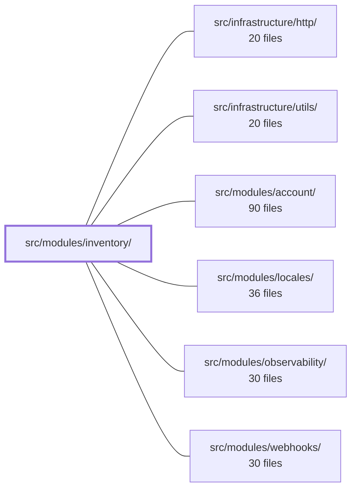

---
tags:
  - 2brain
  - 2brain/module
  - project/boilerplate-vue-frontend
type: module
module: src/modules/inventory/
files: 34
updated: 2026-11-10T08:38:44.037401+00:00
---

# src/modules/inventory/

## Purpose

The inventory module manages stock lifecycle operations for the application: it tracks per-product counters (on-hand, reserved, available, backorder), records every stock transition in an immutable movement ledger, and provides a staff-facing preorder board that joins inventory allowances with fulfillment-order state. All state lives in a single Pinia store; components are read-mostly views over that store, and all writes go through a small set of typed actions (receive, adjust, sweep, set-limit).

## Key parts

- **Views** — `views/InventoryLedger.vue` (stock board + movement ledger on one screen) and `views/PreordersBoard.vue` (two-tab preorder board with URL-persisted tab/filter state). These own no domain logic.
- **Components** — `StockBoard.vue`, `MovementLedger.vue`, `StockMovementForm.vue`, `BackorderLimitDialog.vue`, `PreorderProductsTable.vue`, and `OpeningStockField.vue` (injected into the product-create form via a slot). Each is a focused, single-responsibility rendering or input surface.
- **Domain layer** — `domain/index.ts` re-exports pure functions (e.g. `preorder-rows.ts` for the allowance + unit-state join) from a single stable path. The doc-block invariant is no Vue, Pinia, axios, or other tier dependencies.
- **Store** — `store.ts` owns all client-side state and exposes the three stock-mutation actions plus the preorder-limit setter. Every write reloads affected views before resolving.
- **Routing & module registration** — `routes.ts` declares two lazy-loaded page routes with per-route access/permission metadata; `module.ts` assembles routes, nav entries, response-schema validators, locale loaders, onboarding steps, and a UI slot into the kernel's `AppModule` contract. `response-schemas.ts` declares the expected response-envelope shapes for every inventory endpoint.
- **Composable** — `composables/use-product-picker.ts` provides debounced search-as-you-type that bypasses the products store's first-page cache by calling `POST /products/search` directly.
- **Tests** — A co-located `tests/` tree covers unit specs (store, domain, each component), e2e suites (a11y, keyboard, roles, resilience, visual regression, user actions, preorder board), and an i18n completeness check. Removing the module removes all of these automatically.

## How it connects

- **`src/infrastructure/http/`** — The store's shared `useStructureRestApi` loader and the product-picker composable's direct `searchProducts` call both flow through the infrastructure HTTP layer (axios/orval transport).
- **`src/modules/account/`** — Permission abilities (`create:StockMovement`, `update:StockLevel`, stock-read, orders-read) gate component visibility, route access metadata, and store actions. The e2e `roles.cy.ts` suite walks each persona against these rules.
- **`src/modules/locales/`** — `module.ts` registers locale loaders; `reason-labels-i18n.spec.ts` verifies that every `StockMovementReason` has a label in both `en` and `it` locale files.
- **`src/modules/observability/`** — The resilience e2e sweep asserts that inventory pages log nothing unexpected, tying into the shared observability conventions.
- **`src/modules/webhooks/`** — Stock mutations (receipt, adjust, sweep) produce domain events that downstream webhook consumers may react to; the store's write actions are the client-side origin of those events.
- **`src/infrastructure/utils/`** — Shared form-validation helpers (`useStructureFormValidation`) and other cross-cutting utilities are consumed by `StockMovementForm` and other components.

## Where to start

1. **`store.ts`** — Read this first. It defines the three stock actions, the preorder-limit setter, the state shape, and the "reload-both-views-before-resolving" invariant. Every component and view in the module is a thin projection of this store.
2. **`domain/preorder-rows.ts`** — A short, pure function that shows the module's core domain rule (full-outer-join of allowances and unit-state counts, missing halves stay `undefined`). Reading it alongside `domain/index.ts` makes the pure-logic boundary and its import path obvious.

## Connected modules

[[boilerplate-vue-frontend_ROOT|/ (repository root)]] · [[boilerplate-vue-frontend_src_infrastructure_http|src/infrastructure/http/]] · [[boilerplate-vue-frontend_src_infrastructure_utils|src/infrastructure/utils/]] · [[boilerplate-vue-frontend_src_modules_account|src/modules/account/]] · [[boilerplate-vue-frontend_src_modules_locales|src/modules/locales/]] · [[boilerplate-vue-frontend_src_modules_observability|src/modules/observability/]] · [[boilerplate-vue-frontend_src_modules_webhooks|src/modules/webhooks/]]

## Files
- `src/modules/inventory/components/BackorderLimitDialog.vue` — A modal dialog that lets a staff member set (or clear) the maximum backorder quantity for a single product. It supports a numeric cap (`0` = refuse all new backorders) or an "unlimited" mode that removes the cap entirely. Errors from the save call are surfaced inline in the dialog rather than as toasts.
- `src/modules/inventory/components/MovementLedger.vue` — Renders the "Movement Ledger" tab: a paginated, filterable table of all stock transitions (newest-first) showing product, on-hand/reserved/backorder deltas, reason, and reference. Also hosts the **sweep** action that expires stale reservation holds, since that write targets the same ledger.
- `src/modules/inventory/components/OpeningStockField.vue` — Renders an optional "opening stock" number input that the inventory module injects into the product-create form via the `product-create-extras` slot. It lets a caller record an initial stock quantity as a **post-create side-effect** (a `StockMovement` receipt) without adding stock data to the product-create request body. The field is hidden entirely from callers lacking the `create:StockMovement` permission.
- `src/modules/inventory/components/PreorderProductsTable.vue` — The first tab of the preorder board. Renders one row per product sold as a preorder, joining its inventory allowance (limit, outstanding, left) with delivery unit-state counts (waiting, allocated, shipped, canceled, late) into a single paginated table. It lets a viewer see at a glance which preorders are most at risk and act on them (jump to fulfillment orders or move the release date).
- `src/modules/inventory/components/StockBoard.vue` — A tab-level table component that displays current shelf counts (on-hand, reserved, available, backorder limit, backordered) one row per product. It provides a "low only" filter, client-side pagination (10 rows), and a per-row action to open the backorder-limit editor. It is designed as a read-mostly admin view, not a data-entry surface.
- `src/modules/inventory/components/StockMovementForm.vue` — A Vuetify form for writing to inventory counters in two modes — **receipt** (strictly-positive delivery) and **adjustment** (signed delta, e.g. shrinkage). It is instantiated twice (once per mode) rather than as a single form with a runtime sign toggle, so a mis-click cannot convert one transition into the other. All field state, validation, and submit gating are delegated to `useStructureFormValidation` with a mode-branching Zod schema.
- `src/modules/inventory/composables/use-product-picker.ts` — Composable that provides search-as-you-type product options for inventory pickers. It bypasses the products store's `listProducts()` cache (which only holds the first page) and instead calls `POST /products/search` directly, so products beyond the first ~10 items remain selectable.
- `src/modules/inventory/domain/index.ts` — Barrel file that exposes the public surface of the inventory domain layer. It exists so consumers (UI components, tests) import domain rules from a single stable path (`./domain`) rather than reaching into individual implementation files. The module doc-block states the invariant: everything re-exported here must be pure logic, free of Vue, Pinia, axios, and any other tier.
- `src/modules/inventory/domain/preorder-rows.ts` — Builds the row data for the preorder board's product table by performing a full outer join of two domain reads — the allowance (`PreorderLevel`) and the per-product unit-by-state counts (`PreorderProductSummary`) — keyed on product. The union guarantees that a product appearing in only one read is still represented, with the missing half left as `undefined` rather than a fabricated zero.
- `src/modules/inventory/module.ts` — Module manifest that registers the inventory domain (stock ledger + preorder board) under the kernel's `AppModule` registry. It assembles the domain's routes, nav entries, response-schema validators, locale loaders, onboarding tour steps, and a single UI slot, and exposes them as a single default export satisfying `AppModule`.
- `src/modules/inventory/response-schemas.ts` — Declares the response-envelope schema rows for every backend `inventory` endpoint identified in the OpenAPI contract. The rows are consumed by the generated route table (`contracts/rest/routes.ts`) so that incoming responses can be validated against the expected envelope shape.
- `src/modules/inventory/routes.ts` — Declares the route table for the inventory domain. It defines two lazy-loaded page routes (the stock ledger and the staff preorder board) so their Vue components are only bundled on navigation, and attaches per-route access/permission metadata consumed by the router guard.
- `src/modules/inventory/store.ts` — Pinia store for the inventory domain. It owns the client-side state for the stock board (levels), the movement ledger, and preorder allowances, and exposes the three stock-mutation actions (receive, adjust, sweep) plus the preorder-limit setter. All reads and writes go through a shared `useStructureRestApi` loader, and every write reloads the views it affected before resolving so callers never see a counter that disagrees with what's rendered.
- `src/modules/inventory/tests/backorder-limit-dialog.spec.ts` — Unit-test suite for `BackorderLimitDialog.vue`. Verifies that the staff-facing dialog opens showing the product's current backorder limit and outstanding count, saves the typed number (including zero) or "no limit" (`null`) via the store's `setLimit`, and keeps the dialog open with an error message when the server refuses.
- `src/modules/inventory/tests/e2e/a11y.cy.ts` — Defines the list of inventory-module routes that must pass the shared accessibility sweep. It exists co-located with the inventory module so that removing the module automatically removes its a11y coverage, preventing a central list from referencing routes the app no longer serves.
- `src/modules/inventory/tests/e2e/actions.cy.ts` — E2E test suite for the inventory module's user-facing actions, driven through the shared `actionTable` runner. It verifies three empty-state renderings (stock-movement ledger, preorder level board, preorder order board) and two error-then-retry form flows (stock receipt, stock adjustment).
- `src/modules/inventory/tests/e2e/inventory.visual.cy.ts` — Defines the visual-regression screen list for the inventory module. It declares *which* routes and viewports to photograph; the actual capture logic lives in a shared helper. It exists so that deleting the inventory module also removes its baselines (they co-locate in a sibling `__snapshots__/` folder).
- `src/modules/inventory/tests/e2e/keyboard.cy.ts` — Cypress e2e test that verifies the WAI-ARIA keyboard contract of the inventory stock board's preorder-allowance (backorder-limit) modal dialog: focus moves in on open, Tab is trapped inside, Escape closes without persisting changes, and focus returns to the button that opened the dialog.
- `src/modules/inventory/tests/e2e/preorders.cy.ts` — Cypress end-to-end spec for the staff preorder board (`/en/sales/preorders`). It verifies the page-level concerns only: that the two tabs render, that the active tab persists in the URL, that the Late and Due-soon filters can be toggled, and that a non-staff customer is redirected to the home page. Lateness business rules are tested elsewhere in the backend.
- `src/modules/inventory/tests/e2e/resilience.cy.ts` — Inventory's contribution to the cross-module "resilience sweep." Verifies that the stock board (`/en/inventory`) and the preorder board (`/en/sales/preorders`) render, log nothing unexpected, and stay within the viewport for the staff who read them. It is intentionally value-agnostic ("names no value") per the convention set by the central resilience spec.
- `src/modules/inventory/tests/e2e/roles.cy.ts` — End-to-end test that verifies role-based access control on the inventory module's pages. It walks each persona's permissions against the stock board and preorder board, asserting that buttons and routes are visible only to roles whose rules permit them. The file is deliberately co-located with the module so that removing the module also removes its role sweep.
- `src/modules/inventory/tests/movement-ledger.spec.ts` — Unit-test suite for the `MovementLedger` Vue component. It verifies how the ledger resolves product titles via a single batched `searchProducts` call, renders movement deltas and reason labels, restores filters/page from URL query params, and guards the sweep action against duplicate submissions.
- `src/modules/inventory/tests/opening-stock-field.spec.ts` — Vitest spec for `OpeningStockField.vue`. Verifies the field's visibility gate (only renders for callers holding a `StockMovement` create ability), that a typed count is dispatched via the inventory store's `receive` as an "Opening stock" movement against the newly created product, that no dispatch occurs when the count is empty or the ability is absent, and that a rejected receipt still resolves so the enclosing product-creation flow is never rolled back.
- `src/modules/inventory/tests/preorder-products-table.spec.ts` — Unit tests for `PreorderProductsTable.vue`, the first tab of the preorders board. They verify the on-screen join of two API reads (preorder allowance levels and fulfillment-order summaries): rendering of limits/outstanding/splits, state-count chips (only non-zero states, late flagged), the "show orders" hand-off event, and the permission-gated release-date edit link.
- `src/modules/inventory/tests/preorder-rows.spec.ts` — Vitest spec for the `preorderRows` domain function. Verifies that the join of preorder levels (allowances) and preorder summaries (units by state) produces one row per product, leaves a missing half absent (never zero), names the product by the live allowance title when available, and orders rows worst-first (most late → most outstanding → alphabetical).
- `src/modules/inventory/tests/preorders-board-view.spec.ts` — Vitest spec for the staff PreordersBoard view. It verifies three behaviors without touching the actual table internals: which tabs appear based on the viewer's abilities (stock read vs. orders read), how the active tab and product filter are read from / written to the URL query string, and the `showOrders` / `clearProduct` hand-off between the two tabs.
- `src/modules/inventory/tests/reason-labels-i18n.spec.ts` — Guarantees that every `StockMovementReason` enum value has a corresponding `inventory-page.reason-*` i18n label in both supported locales (`en`, `it`). It exists because a missing label (e.g. `restock`) caused `MovementLedger.vue` to render the raw key instead of a human-readable word in both the filter and ledger rows.
- `src/modules/inventory/tests/routes.spec.ts` — Pins the `meta.access` and `meta.can` declarations on every inventory route by name, asserting the exact values rather than deriving them. It exists to catch a route that silently loses its access declaration (making it indistinguishable from a public one) and to flag any new route added without an explicit access decision.
- `src/modules/inventory/tests/stock-board.spec.ts` — Vitest spec that verifies the `StockBoard` component's backorder (preorder) columns: that limit and outstanding values render, that the limit-edit control is gated behind the `update:StockLevel` ability, and that clicking the control opens `BackorderLimitDialog` bound to the correct row.
- `src/modules/inventory/tests/stock-movement-form.spec.ts` — Component-level test suite for `StockMovementForm.vue` that exercises both `mode` branches (`receipt` and `adjust`) in a single file, verifying that each branch's amount schema rejects invalid input, enforces integer-only values, and — on success — dispatches the correct store action and cache invalidation.
- `src/modules/inventory/tests/store.spec.ts` — Unit spec for `useInventoryStore` (the inventory Pinia store). It verifies every read/write action against a fully mocked HTTP transport, asserting both the state the store exposes and the exact sequence of API calls (URLs, params, bodies, idempotency headers). The file pins the contract that writes reload *both* affected views before resolving, and that the reload order is movements-then-levels.
- `src/modules/inventory/tests/use-product-picker.spec.ts` — Unit tests for the `useProductPicker` / `useProductPickerPin` composables, covering two behaviours that `StockMovementForm` and `MovementLedger` now share: search-as-you-type (with debounce) and `pin()`. Only the HTTP transport (`orvalMutator`) is stubbed; the real `@api` schemas are left intact so that any regression in the request shape `searchProducts` builds is caught directly.
- `src/modules/inventory/views/InventoryLedger.vue` — Admin-side inventory page that displays the current stock board and the full movement ledger on a single screen, so that a write (receipt or adjustment) is visibly reflected in both simultaneously. It owns no domain logic; all state comes from the shared `useInventoryStore()`.
- `src/modules/inventory/views/PreordersBoard.vue` — Staff-facing preorder board page. Presents two tabs over existing backend data: a per-product stock/allowance view ("Products") and a fulfillment-order list with buyer, dates, and Late/Due-soon filters ("Orders"). Tab and product-filter state are persisted in the URL query string so links and reloads restore the same view.

---
[[boilerplate-vue-frontend_INDEX|← boilerplate-vue-frontend index]]
