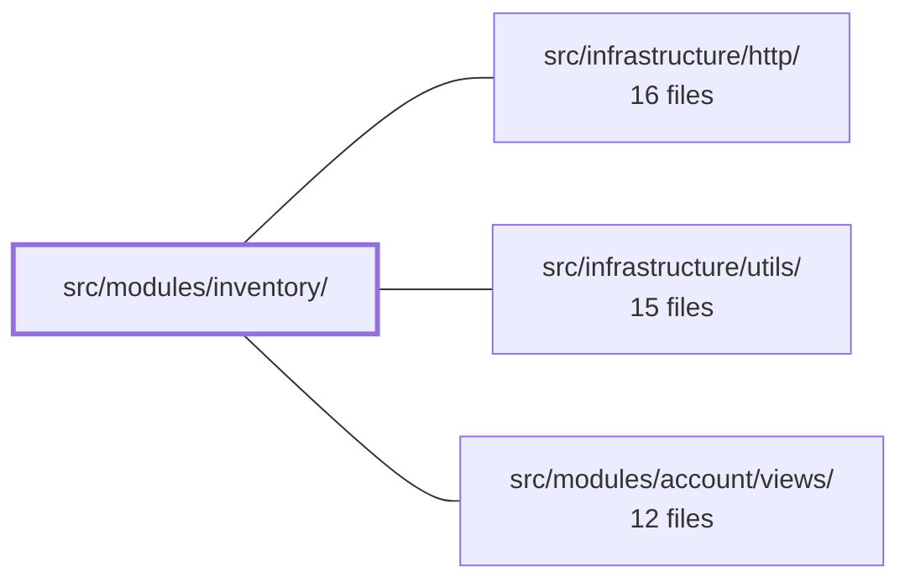

---
tags:
  - 2brain
  - 2brain/module
  - project/boilerplate-vue-frontend
type: module
module: src/modules/inventory/
files: 30
updated: 2026-10-17T02:53:18.342354+00:00
---

# src/modules/inventory/

## Purpose

The inventory module manages stock levels and stock movements (receipts, adjustments, sweeps) for products, and provides the staff-facing preorder board for setting per-product preorder limits and tracking fulfillment-state counts. It is a self-contained domain: a pure domain layer, a Pinia store, page-level views, presentational components, and module plumbing (routes, schemas, manifest) that the app kernel picks up at boot.

## Key parts

- **Domain layer** (`domain/`) — Pure, framework-free business logic. Currently exposes `preorderRows`, which joins allowance levels with per-product delivery-state counts into a single board row. Lint-guaranteed free of Vue, Pinia, and HTTP.
- **Store** (`store.ts`) — Pinia setup store that owns every read (stock ledger, stock board, preorder allowances) and write (receive, adjust, set-preorder-limit, sweep). All writes reload the views they touched before resolving.
- **Views** (`views/`) — Two top-level pages: `InventoryLedger.vue` (stock board + movement ledger + receipt/adjust forms on one screen) and `PreordersBoard.vue` (two-tab preorder board with URL-persisted tab and product filter).
- **Components** (`components/`) — `StockBoard`, `MovementLedger`, `StockMovementForm` (dual-mode receipt/adjust), `PreorderLimitDialog`, `PreorderProductsTable`, and `OpeningStockField` (slotted into the products module's create form via the manifest).
- **Composable** (`composables/use-product-picker.ts`) — Debounced search-as-you-type product selector that bypasses the products store's single-page cache.
- **Module plumbing** (`module.ts`, `routes.ts`, `response-schemas.ts`) — Assembles routes (with permission metadata), admin nav entries, response-envelope schemas, locale loaders, and the product-form slot into a single `AppModule` object registered by the kernel.
- **Tests** (`tests/`) — Co-located unit specs (Vitest) for every component, the store, the domain function, routes, and i18n labels; plus Cypress e2e specs for accessibility, visual regression, and the preorder board page.

## How it connects

- **`/` (repository root / kernel registry)** — `module.ts` exports an `AppModule` that the root-level registry collects at app boot to install routes, nav items, schema validators, locale bundles, and the product-form slot. Deleting the module removes all of these automatically.
- **`src/infrastructure/http/`** — The store and `useProductPicker` issue REST calls through the shared HTTP transport (`orvalMutator` / `useStructureRestApi`). The module never talks to a raw `fetch` or `axios` instance directly.
- **`src/infrastructure/utils/`** — Shared utility helpers (e.g. `useStructureFormValidation` with Zod schemas, pagination helpers) that the store, forms, and composables consume.
- **`src/modules/account/views/`** — Inventory routes declare `meta.access` and `meta.can` (permission strings). Enforcement is wired at the router level by the account module's auth guards; the inventory module only *declares* which abilities are required and which UI elements to show/hide based on the current user's abilities.

## Where to start

1. **`store.ts`** — Reading the four write actions and three read actions (with their reload sequences) gives you the complete data contract for the module in ~150 lines.
2. **`module.ts`** — Shows how routes, nav, schemas, locale, and the product-form slot are assembled into the single object the kernel consumes, making the module's external surface obvious.

## Connected modules

[[boilerplate-vue-frontend_ROOT|/ (repository root)]] · [[boilerplate-vue-frontend_src_infrastructure_http|src/infrastructure/http/]] · [[boilerplate-vue-frontend_src_infrastructure_utils|src/infrastructure/utils/]] · [[boilerplate-vue-frontend_src_modules_account_views|src/modules/account/views/]]

## Files
- `src/modules/inventory/components/MovementLedger.vue` — Renders the "movement ledger" tab of the inventory screen: a paginated, filterable table of stock transitions (newest-first) and a **sweep** button that expires stale reservation holds. All reads/writes go through `useInventoryStore`; filters are local refs synced to the URL.
- `src/modules/inventory/components/OpeningStockField.vue` — A slot-contributed numeric input for the product create form that lets the user specify opening stock. The inventory module registers this component into the products module's `product-create-extras` slot via its manifest, so the products module never imports inventory code directly. Stock is not a product field; this component defers the write until after the product row exists.
- `src/modules/inventory/components/PreorderLimitDialog.vue` — A Vuetify dialog that lets staff set the absolute maximum number of units that can be preordered for a single product. A value of `0` closes preordering entirely; setting a limit below the current outstanding preorders does not cancel existing orders—it only blocks new ones. The dialog owns its open/close state (via `v-model`), seeds its input from the provided `InventoryLevel` row, and handles both success (toast + close) and failure (inline error) locally.
- `src/modules/inventory/components/PreorderProductsTable.vue` — Renders the "products" tab of the preorder board: one row per product sold as a preorder, joining its inventory allowance (limit, outstanding, left) with its delivery-state counts (waiting, awaiting, allocated, shipped, cancelled, late). Acts as the entry point for the board, emitting a `showOrders` event to switch the parent to the fulfillment-orders tab.
- `src/modules/inventory/components/StockBoard.vue` — Renders the "Stock Board" tab of the inventory page: a paginated, filterable table of per-product shelf counts (on-hand, reserved, available, preorder limit, preordered). It owns its own data-fetching via the inventory store and emits a `history` event so the parent view can jump the ledger tab to a product.
- `src/modules/inventory/components/StockMovementForm.vue` — A single SFC that handles both stock **receipts** (positive deliveries) and stock **adjustments** (signed deltas, typically shrinkage). It is instantiated twice by its parent with a `mode` prop (`'receipt' | 'adjust'`) rather than using a runtime sign toggle, so a mis-click cannot convert one counter-write into the other. Validation, field state, and submit gating are delegated to `useStructureFormValidation` with a Zod schema that branches on the mode.
- `src/modules/inventory/composables/use-product-picker.ts` — A Vue composable that provides search-as-you-type product selection for inventory forms. It exists because the products store's `listProducts()` cache only holds the first page (~10 items), making later products unreachable in a plain `v-select`. Instead, it queries `POST /products/search` on each keystroke (debounced) to return up to 20 matching results.
- `src/modules/inventory/domain/index.ts` — Barrel file for the inventory **domain layer**. It re-exports the pure domain rules (currently `preorderRows`) so consumers can import from a single path (`@/modules/inventory/domain`) without reaching into individual files. The domain layer is lint-guaranteed to be free of Vue, Pinia, axios, and all other application tiers.
- `src/modules/inventory/domain/preorder-rows.ts` — Builds the product rows for the preorder board's table by joining two separate reads—allowance levels (`inventory`) and per-product unit counts by delivery state (`delivery`)—into a single list where each product appears exactly once. Products that exist in only one read are still included; the missing half is left `undefined` rather than defaulted to zero.
- `src/modules/inventory/module.ts` — Module manifest for the inventory domain. It assembles the inventory routes, admin navigation entries, response-schema validators, locale loaders, and a product-form slot into a single `AppModule` object that the kernel registry picks up at app boot.
- `src/modules/inventory/response-schemas.ts` — Declares the response-envelope schemas for every REST endpoint attributed to the `inventory` backend module. It is the per-module slice of the global response-schema table that `contracts/rest/routes.ts` (generated from `openapi.yaml`'s `x-module` stamps) assembles across all domains.
- `src/modules/inventory/routes.ts` — Defines the two Vue Router route records for the inventory domain (the stock ledger and the staff preorder board). Each route lazily imports its view component so the JS bundle is only fetched on actual navigation. The file exists to centralize path, name, permission, and title metadata in one place that the inventory module registers with the app router.
- `src/modules/inventory/store.ts` — Pinia setup store for the inventory domain. It exposes two paginated reads (stock-movement ledger, stock-level board), one whole-list read (preorder allowances), and four writes (receive, adjust, set-preorder-limit, sweep). All writes reload the views they touched before resolving, so callers never observe a counter the views have not caught up with. A single shared `loading` flag and `fetchAny` runner (from `useStructureRestApi`) governs every request.
- `src/modules/inventory/tests/e2e/a11y.cy.ts` — Co-located Cypress e2e test that runs an accessibility sweep against every route the inventory module serves (including phone-viewport variants). It is deliberately placed inside the module so that deleting the module removes its a11y coverage with it, preventing a stale central route list from pointing at removed pages.
- `src/modules/inventory/tests/e2e/inventory.visual.cy.ts` — Declares the visual-regression screen list for the inventory module. It tells the shared `sweepVisual` harness which URL to load, which selector signals the page is ready to photograph, and under which role to run. The file exists so that deleting the inventory module also removes its baselines (they live in a sibling `__snapshots__/` folder).
- `src/modules/inventory/tests/e2e/preorders.cy.ts` — Cypress e2e spec for the staff preorder board (`/en/sales/preorders`). It verifies the page-level concerns — tab visibility, tab persistence in the URL, the Late / Due-soon filter toggles, and that a non-admin customer is bounced back to home. It does **not** assert which orders are late; that rule belongs to the backend and is covered by its own tests.
- `src/modules/inventory/tests/movement-ledger.spec.ts` — Unit tests for the `MovementLedger` Vue component. They verify three behaviours: that preorder movements render their signed delta and a human-readable reason word; that the component batch-fetches only the product titles it is missing (via one `POST /products/search` call) and falls back to raw ids on failure or unknown products; and that deep-link query parameters (`movements-productId`, `movements-page`) are read on mount and forwarded to the store.
- `src/modules/inventory/tests/opening-stock-field.spec.ts` — Unit tests for the `OpeningStockField` component, verifying that the opening-stock input (slotted into the product-create form via `product-create-extras`) is gated on the `create StockMovement` ability, registers exactly one post-create step that delivers the typed count through the inventory door, and never throws if the receipt fails.
- `src/modules/inventory/tests/preorder-limit-dialog.spec.ts` — Unit test for the `PreorderLimitDialog.vue` component (staff UI for setting one product's preorder limit). Mounts the real dialog with an inline `VDialog` stub and a spied store action, then verifies four behaviours: the field initialises to the current limit, a typed value (including zero) is saved and the dialog closes, and a rejected save keeps the dialog open with the error visible.
- `src/modules/inventory/tests/preorder-products-table.spec.ts` — Vitest unit tests for `PreorderProductsTable.vue` (the board's first tab). Verifies the on-screen join of two transport-level reads — the allowance list and the fulfillment-order summary — including display of allowance numbers, non-zero state counts, the "show orders" hand-off emit, and the conditional release-date link gated on the product write ability.
- `src/modules/inventory/tests/preorder-rows.spec.ts` — Vitest spec for `preorderRows`, the board function that joins preorder allowance (level) and sales (summary) reads into one row per product. It pins the join semantics (missing half left absent, never zero-filled), title-precedence rule, and the "worst first" sort order.
- `src/modules/inventory/tests/preorders-board-view.spec.ts` — Unit tests for the staff preorder board page (`PreordersBoard.vue`). Verifies which tabs a viewer sees based on their abilities (stock readers get both tabs; orders-only readers get just the orders tab), how the `tab` and `productId` query params land in and leave the URL, and the event-driven hand-off from the products tab to the orders tab. Tab bodies are stubbed, so assertions target only the data passed to them and the resulting route state.
- `src/modules/inventory/tests/reason-labels-i18n.spec.ts` — Guarantees that every value in the `StockMovementReason` enum has a corresponding `inventory-page.reason-*` i18n label in both supported locales. Without this, `MovementLedger.vue`'s filter dropdown and ledger rows would render the raw enum key instead of a human-readable word (a regression that previously shipped with `restock`).
- `src/modules/inventory/tests/routes.spec.ts` — Pins the `meta.access` and `meta.can` declarations on every inventory route by name, using the module's own route records directly. It complements the router-level spec (which proves enforcement is *attached*) by proving the declarations are *there*—a route that silently loses `meta.access` is indistinguishable from a public one.
- `src/modules/inventory/tests/stock-board.spec.ts` — Unit tests for `StockBoard.vue` covering the preorder-limit columns and the ability-gated limit control. Verifies that the limit/outstanding numbers render, that the edit button appears only to holders of `create:StockMovement`, and that pressing the button opens `PreorderLimitDialog` scoped to the correct row.
- `src/modules/inventory/tests/stock-movement-form.spec.ts` — Vitest suite that proves the two `mode` branches of `StockMovementForm` enforce different amount schemas: receipt rejects non-positive and fractional quantities, while adjust rejects zero and fractional deltas but carries a negative delta through signed (not absolute). It mounts the real component twice (once per mode) to confirm the branches genuinely differ.
- `src/modules/inventory/tests/store.spec.ts` — Unit spec for the inventory Pinia store that exercises every read and write action with a fully mocked HTTP transport. It pins down the store's contract: whole-list replacement on reads, the exact reload sequence after writes (ledger before board), idempotency-key lifecycle on stock writes, and pagination behaviour for preorder levels.
- `src/modules/inventory/tests/use-product-picker.spec.ts` — Unit tests for the `useProductPicker` / `useProductPickerPin` composables, covering the search-as-you-type list and the `pin()` mechanism that `StockMovementForm` and `MovementLedger` share. Only the HTTP transport (`orvalMutator`) is mocked; the real request builder and API schemas stay in the loop so a shape regression would surface here.
- `src/modules/inventory/views/InventoryLedger.vue` — The single-screen inventory admin page that pairs the live stock board with the movement ledger and the two entry forms (receipt / adjust). It exists so that a stock write is visible in both the board and the ledger simultaneously, without tab-switching, and so that the one explicit cross-component interaction (board → ledger focus) is wired at this level.
- `src/modules/inventory/views/PreordersBoard.vue` — Staff-facing preorder board page offering two tabs — "Products" (allowance and per-state unit counts) and "Fulfillment orders" (one row per order with buyer and dates). Tab selection and the product filter for the second tab are persisted in the URL query string (`?tab=`, `?productId=`) so links and reloads restore the exact view.

---
[[boilerplate-vue-frontend_INDEX|← boilerplate-vue-frontend index]]
