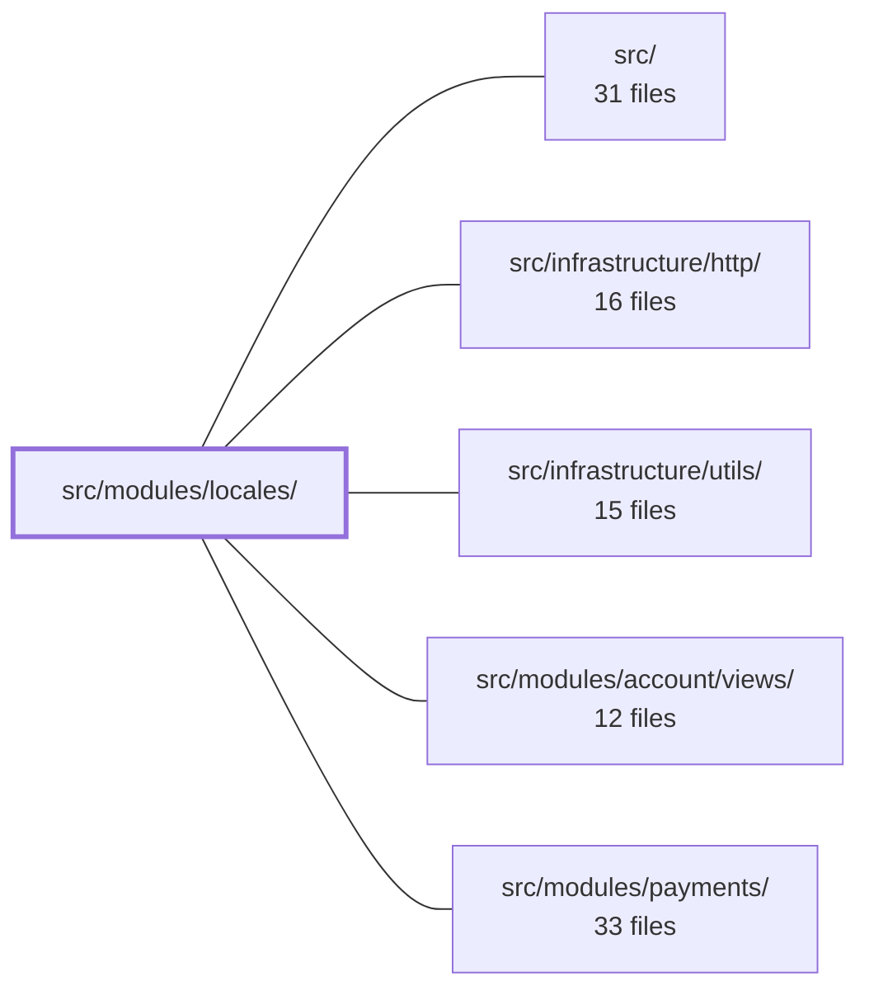

---
tags:
  - 2brain
  - 2brain/module
  - project/boilerplate-vue-frontend
type: module
module: src/modules/locales/
files: 28
updated: 2026-10-17T02:53:38.619604+00:00
---

# src/modules/locales/

## Purpose

The locales module is the translation-administration domain. It lets an administrator manage the list of supported languages, create and edit individual key/value translation entries per language, view and edit a cross-language dictionary board, and import bulk entries from JSON. It also exposes a generic, entity-agnostic translations editor that any other module can route into.

## Key parts

- **Views (route screens)**
  - `views/LocalesList.vue` — Languages board: CRUD over the locale manifest (create, edit, activate/deactivate, delete).
  - `views/LocalesDictionary.vue` — Dictionary board: a matrix of i18n keys × languages with inline cell editing, filtering, and pagination.
  - `views/LocaleEntries.vue` — Per-language entries: paginated table of flat key/value rows with inline edit, add, bulk-import, and delete.
  - `views/EntityTranslations.vue` — Entity-agnostic translation editor (one tab per locale, one textarea per translatable field). Currently invoked from the payments module's product-edit screen.

- **Dialogs / form components**
  - `components/EntryFormDialog.vue` — Single-entry add dialog; validates via Zod and emits fields upward.
  - `components/LanguageFormDialog.vue` — Create-or-edit language dialog; swaps schema based on whether editing.
  - `components/EntriesImportDialog.vue` — Bulk JSON import dialog; flattens nested dictionaries into flat rows and emits with a merge/replace mode.

- **Composables (board logic)**
  - `composables/use-dictionary-aggregation.ts` — Merges stored entries, deployed baseline, and bundled baseline into a single per-cell read model for the dictionary board.
  - `composables/use-dictionary-cell-editor.ts` — Per-cell edit lifecycle: draft tracking, save/clear handlers, transient saved/error UI state.

- **Store & domain logic**
  - `store.ts` — Pinia store split into language-capabilities CRUD and per-language entries CRUD (two different API record shapes).
  - `domain/deactivate-then-delete.ts` — Encapsulates the deactivate → delete API sequence with rollback.
  - `dictionaries.ts` — Pure functions converting between nested (vue-i18n) and flat dotted-key (API) dictionary shapes.
  - `schemas.ts` — Zod schemas for the language and entry forms; error messages are i18n thunks resolved at parse time.

- **Module wiring**
  - `module.ts` — `AppModule` manifest: routes, nav entry, response-schema rows, per-locale JSON loaders.
  - `routes.ts` — The four route records (lazy-loaded) with access-control metadata.
  - `response-schemas.ts` — Contract-validation rows for every locales REST endpoint, registered as a unit.

- **Tests** — Unit specs for every composable, store, dialog, and schema file; e2e hooks for accessibility (`a11y.cy.ts`), visual regression (`locales.visual.cy.ts`), and entity-translations flows; plus route-metadata pin tests.

## How it connects

- **`src/infrastructure/http/`** — The store and domain functions issue REST calls through the shared HTTP layer (the `orvalMutator` transport). `response-schemas.ts` plugs into the same infrastructure to validate incoming payloads against OpenAPI-derived contracts.
- **`src/infrastructure/utils/`** — General-purpose utilities (e.g., the `useStructureCrudApi` toolkit, `useStructureFormValidation`, blocking-error helpers) are consumed by the store, forms, and cell editor.
- **`src/modules/account/views/`** — Route records in `routes.ts` carry `meta.access` / `meta.can` metadata that the account/auth module enforces at navigation time, gating the four locales screens behind admin permissions.
- **`src/modules/payments/`** — `EntityTranslations.vue` is designed as a reusable, entity-agnostic screen; its current caller is the payments module's product-edit "Translations" action, which routes into `/locales/entity/:entityType/:id`.

## Where to start

1. **`store.ts`** — Reading this first gives you the two data shapes (capabilities vs. entries), the API surface, and the refetch-on-write pattern that every view relies on.
2. **`composables/use-dictionary-aggregation.ts`** — Understanding how the three-source merge works explains why the dictionary board's cells are not simply "what the API returned" and makes the rest of the board view and cell editor intuitive.

## Connected modules

[[boilerplate-vue-frontend_ROOT|/ (repository root)]] · [[boilerplate-vue-frontend_src|src/]] · [[boilerplate-vue-frontend_src_infrastructure_http|src/infrastructure/http/]] · [[boilerplate-vue-frontend_src_infrastructure_utils|src/infrastructure/utils/]] · [[boilerplate-vue-frontend_src_modules_account_views|src/modules/account/views/]] · [[boilerplate-vue-frontend_src_modules_payments|src/modules/payments/]]

## Files
- `src/modules/locales/components/EntriesImportDialog.vue` — A modal dialog that lets a translator import locale entries by pasting or uploading a nested JSON dictionary (the same shape as bundled `src/locales/*.json` files). It validates the input client-side, flattens the dictionary into flat `LocaleEntryInput` rows, and emits them upward with a chosen mode (`merge` | `replace`) and destination app. The component performs no persistence itself.
- `src/modules/locales/components/EntryFormDialog.vue` — A reusable "add one locale entry" dialog that validates a three-field form (app, key, value) against `localesEntrySchema` and emits the validated fields upward. It owns no store access, performs no persistence, and renders no save-failure UI itself — all of that is delegated to the parent via the `error` slot and the exposed `applyServerErrors` method.
- `src/modules/locales/components/LanguageFormDialog.vue` — A create-or-edit dialog for a single language entry in the locales module. It renders a schema-validated form (via `useStructureFormValidation`) that swaps between a create schema and an edit schema depending on whether the `language` prop is present, resets its fields on every open, and emits the validated fields upward. It deliberately carries no save logic or error handling of its own; the parent owns both the open state and any post-validation failure.
- `src/modules/locales/composables/use-dictionary-aggregation.ts` — Composable that builds and owns the dictionary board's read model. It merges three data sources (stored entries, the API's deployed baseline, the bundled baseline) plus locally-added pending keys into a single per-cell lookup surface, so the board view and the cell editor always ask one place "what is this cell?" instead of reading the raw sources independently.
- `src/modules/locales/composables/use-dictionary-cell-editor.ts` — Composable that owns the per-cell edit lifecycle on the locales dictionary board. It tracks a local draft per cell (keyed by tag+key) so a blur event can distinguish "user typed something" from "user clicked through," and it wires the save / clear / enter / input handlers to the locales store while managing the transient UI state each cell displays (a saved checkmark, an inline error message).
- `src/modules/locales/dictionaries.ts` — Pure conversion functions that translate between the two shapes a dictionary travels in: the flat dotted-key rows the entries API persists, and the nested object/array structure vue-i18n consumes. The file is side-effect-free by design so the round-trip logic can be unit-tested without a browser.
- `src/modules/locales/domain/deactivate-then-delete.ts` — Implements the "deactivate → delete" sequence required by the API for active locales, including a best-effort reactivation rollback if the delete step fails. Exists so the caller never has to hand-code the rollback logic or risk leaving a silently deactivated row behind.
- `src/modules/locales/module.ts` — Module manifest for the translation-admin domain. Declares the locales screens' routes, a single admin navigation entry, response-schema rows, and per-locale JSON loaders in the `AppModule` shape consumed by the kernel registry.
- `src/modules/locales/response-schemas.ts` — Defines the response-envelope schema rows for every REST endpoint attributed to the `locales` backend module. The list is derived from the generated route table (`contracts/rest/routes.ts`, stamped via `x-module` in `openapi.yaml`) so that contract validation for locales responses is registered as a unit—enabling the domain folder turns validation on, deleting it turns it off.
- `src/modules/locales/routes.ts` — Declares the four locale-management routes (languages board, dictionary, per-language entries, and a generic entity-translations view) as a plain `RouteRecordRaw[]`. The array is lazy-loaded per route and spliced into the application router by the module registry, so this file is the single source of truth for URL patterns, route names, and access-control metadata for the locales module.
- `src/modules/locales/schemas.ts` — Zod validation schemas for the two locale-admin forms (language and entry). Error messages are written as thunks wrapping `translate` so they resolve to the active locale at parse time rather than being frozen at module-load time.
- `src/modules/locales/store.ts` — Pinia store that powers the translation-admin UI. It is deliberately split into two halves behind a single `defineStore` setup function: (1) language **capabilities** — reading the merged manifest and wrapping every write in an explicit refetch — and (2) one language's **entries** — a standard paginated CRUD resource driven by the `useStructureCrudApi` toolkit composable. The split exists because the API returns two different record shapes (`LocaleCapability` vs. `Language`), making a single generic CRUD resource impossible.
- `src/modules/locales/tests/deactivate-then-delete.spec.ts` — Vitest suite that verifies the behavior of `deactivateThenDelete`, covering the happy-path ordering (deactivate → delete), the no-op path for already-inactive rows, and the critical recovery path where a failed delete after a successful deactivation must reactivate the row without swallowing the original error.
- `src/modules/locales/tests/dictionaries.spec.ts` — Vitest unit tests for the two pure conversion functions (`flattenDictionary` / `expandEntries`) that translate locale dictionaries between nested-object and flat dotted-key-row representations. No store, transport, or DOM involvement — the tests exercise edge cases (arrays, deep nesting, collision resolution) directly against inline fixtures.
- `src/modules/locales/tests/e2e/a11y.cy.ts` — Declares the locales module's routes (and one dialog state) to the shared `sweepA11y` runner, which visits each and asserts against axe-core. This is the module-level hook that plugs locales into the cross-cutting accessibility sweep.
- `src/modules/locales/tests/e2e/entity-translations.cy.ts`
- `src/modules/locales/tests/e2e/locales.visual.cy.ts` — Declares the locales module's screens (routes, ready selectors, and per-screen hooks) to the shared `sweepVisual` visual-regression runner, which visits each screen and diffs a screenshot against a stored baseline. It is the locales-specific screen registry for the project-wide visual test suite.
- `src/modules/locales/tests/entries-import-dialog.spec.ts` — Unit-test spec for `EntriesImportDialog.vue` that verifies the import-confirmation flow: replace-mode submits must pass through the shared dialog-store confirmation gate before emitting, while merge-mode submits emit immediately with no confirmation. Vuetify's `v-dialog` overlay is stubbed away so the component's own script logic (the confirmation gate) is what's exercised.
- `src/modules/locales/tests/form-dialogs.spec.ts` — Unit tests for the two locale form dialogs (`EntryFormDialog`, `LanguageFormDialog`) that verify two parent-owned-write contracts: the submit button is disabled while a save is in flight, and a server refusal that names a specific field is surfaced on that field via the dialog's exposed `applyServerErrors` method.
- `src/modules/locales/tests/routes.spec.ts` — Pin-tests the `meta.access` and `meta.can` declarations on every route the locales module exports. It verifies the security metadata is *present and correct* at the data level, complementing a separate router spec that proves enforcement is *attached*. Running this spec requires no app boot, no locale prefix, and no resolved router.
- `src/modules/locales/tests/schemas.spec.ts` — Vitest suite that locks down the behavioral contract of the three Zod schemas exported from `../schemas`. Beyond happy-path and obvious rejection cases, it specifically asserts two things a plain `parse` would not exercise: BCP 47 case-sensitivity rules on the `tag` field, and that every error message is an i18n thunk resolved at parse time rather than frozen at import time.
- `src/modules/locales/tests/store.spec.ts` — Unit-test suite for the locales Pinia store. It replaces the HTTP layer (`orvalMutator`) with a table-driven mock keyed by `METHOD path`, then asserts both the returned state and the exact sequence of URLs the store requested. The pattern mirrors the inventory spec: pin *what* the store calls and *in what order*, not *how* the transport works.
- `src/modules/locales/tests/use-dictionary-aggregation.spec.ts` — Vitest spec for the `useDictionaryAggregation` composable. It drives the composable's lookup and state logic (entry vs. baseline vs. missing, app-specific baseline sourcing, key union, pending-key lifecycle, missing counts, and the `afterWrite` refresh call) by faking the `useLocalesStore` with plain reactive variables rather than mocking the transport layer.
- `src/modules/locales/tests/use-dictionary-cell-editor.spec.ts` — Vitest spec for the `useDictionaryCellEditor` composable. All external dependencies (locales store, dialog, notifications, i18n, blocking-error utility) are mocked at the module boundary so the tests assert purely on which store write (`addEntry` / `editEntry` / `removeEntry`) a given cell state selects and what local reactive state (drafts, saved marks, cell errors) is left behind.
- `src/modules/locales/views/EntityTranslations.vue` — Generic, entity-agnostic translation editor. Given a route parameter pair (`entityType`, `id`), it fetches the entity's existing translation rows via the locales store, renders one tab per locale (with the entity's registered translatable fields as textareas), and sends a single merging `PATCH` on save. Currently the only caller is `ProductEdit.vue`'s "Translations" action, but the screen is designed to work for any entity registered in `translatables`.
- `src/modules/locales/views/LocaleEntries.vue` — Route view for a single language's translation entries (reached via `/locales/:tag`). It drives a paginated, filterable table of flat key/value rows, supports inline value editing on blur, add-entry and bulk-import dialogs, and deletion. Every successful write also refreshes the currently running app's dictionary so the admin sees the change immediately without a page reload.
- `src/modules/locales/views/LocalesDictionary.vue` — Route view for the locales dictionary board: a client-side paginated, debounced-filtered table showing every i18n key down the rows and every language across the columns. The file owns only the filtering, pagination, "add key" flow, and "create language" flow — the three-source read model and all per-cell writes are delegated to dedicated composables.
- `src/modules/locales/views/LocalesList.vue` — The admin-facing languages board: a thin CRUD view over the locales manifest that lists every `LocaleCapability` row (both tiers), lets the admin create, edit, activate/deactivate, and delete languages, and links out to the dictionary reader view.

---
[[boilerplate-vue-frontend_INDEX|← boilerplate-vue-frontend index]]
