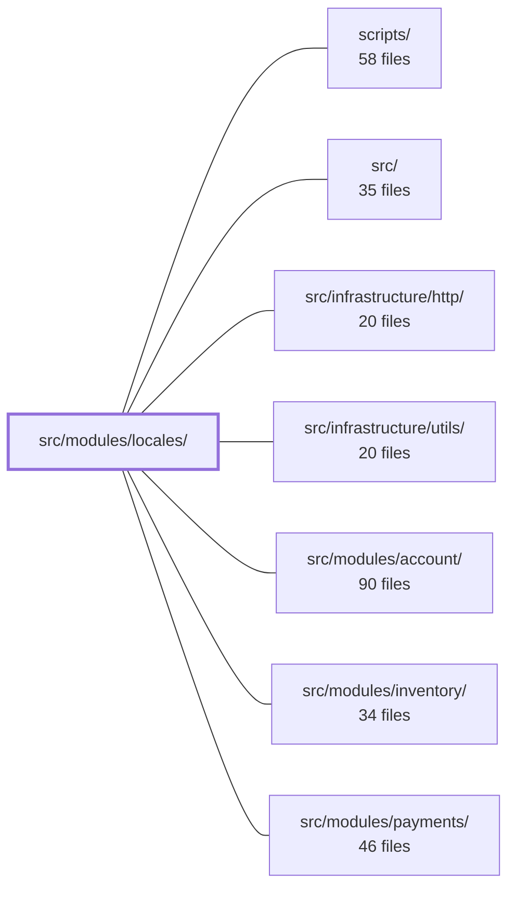

---
tags:
  - 2brain
  - 2brain/module
  - project/boilerplate-vue-frontend
type: module
module: src/modules/locales/
files: 36
updated: 2026-11-10T08:39:07.702702+00:00
---

# src/modules/locales/

## Purpose

The locales module is the admin-facing translation management area of the app: it provides screens for managing the language manifest, editing per-language locale entries, a cross-language dictionary board, and a generic entity-translation editor. It is the "author half" of the i18n system; the "consumer half" (per-visitor locale switching at runtime) lives in `src/infrastructure/locale-overrides.ts` and does not depend on this module.

## Key parts

- **Views (route screens):** `LocalesList.vue` (language CRUD), `LocaleEntries.vue` (per-language entry list with search, inline edit, import), `LocalesDictionary.vue` (cross-language key grid), `EntityTranslations.vue` (per-entity translation editor, currently used for products).
- **Dialog components:** `LanguageFormDialog.vue` (create/edit a language), `EntryFormDialog.vue` (add a single key-value entry), `EntriesImportDialog.vue` (paste or upload a full locale JSON and preview the flattened rows).
- **Composables (board logic):** `use-dictionary-aggregation.ts` (merges stored entries, the API's deployed baseline, and the build's bundled baseline into one per-cell read model) and `use-dictionary-cell-editor.ts` (per-cell draft tracking, save/clear dispatch, and transient feedback).
- **Pure domain logic:** `dictionaries.ts` (flat dotted-key ↔ nested object conversion, the only real transformation logic the module owns) and `domain/translation-drafts.ts` (draft-to-PATCH-body serialization for the entity-translation editor).
- **Schemas & store:** `schemas.ts` (Zod validation with locale-resolved error thunks) and `store.ts` (Pinia store split into a non-paginated language CRUD surface and a paginated, search-driven entry CRUD surface).
- **Module wiring:** `module.ts` (kernel manifest), `routes.ts` (lazy-loaded route table), `response-schemas.ts` (response-envelope contract declarations).
- **Tests:** unit specs for every pure/composable/store piece, plus E2E suites covering a11y sweeps, action-table flows, entity-translation round-trips, visual regression, role access, and the leave-guard / stale-state edge cases.

## How it connects

- **`src/modules/inventory/`** — `EntityTranslations.vue` is opened from the product edit page's "Translations" action; the entity-translation PATCH it issues targets the product entity owned by the inventory module.
- **`src/modules/account/`** — every locales route declares a `meta.can` RBAC permission; the role-sweep E2E tests (`roles.cy.ts`) verify that only the correct account roles can reach each screen.
- **`src/infrastructure/http/`** — the store's CRUD surface is powered by `useStructureCrudApi` / `orvalMutator` from the shared HTTP layer; `response-schemas.ts` plugs the module into the global response-envelope validation map.
- **`src/infrastructure/utils/`** — shared utility helpers (e.g. the `useStructureFormValidation` composable, confirmation-dialog guards) consumed by the form dialogs and the board.
- **`scripts/`** — the build pipeline produces the bundled locale JSON files that `use-dictionary-aggregation` reads as the "bundled baseline" third source.
- **`src/modules/payments/`** — appears in the dependency graph as a sibling domain that may expose its own `translatables` registration, making `EntityTranslations.vue` a reusable screen across modules.

## Where to start

1. **`dictionaries.ts`** — a short, pure, dependency-free file that shows the core data-model transformation (flat dotted keys ↔ nested objects). Reading it first makes the rest of the module's vocabulary concrete.
2. **`store.ts`** — the Pinia store that every view and composable talks to. It defines the two CRUD surfaces (languages, entries), the pagination/search contract, and the exact API calls the module makes, giving you the full state picture before touching any UI.

## Connected modules

[[boilerplate-vue-frontend_ROOT|/ (repository root)]] · [[boilerplate-vue-frontend_scripts|scripts/]] · [[boilerplate-vue-frontend_src|src/]] · [[boilerplate-vue-frontend_src_infrastructure_http|src/infrastructure/http/]] · [[boilerplate-vue-frontend_src_infrastructure_utils|src/infrastructure/utils/]] · [[boilerplate-vue-frontend_src_modules_account|src/modules/account/]] · [[boilerplate-vue-frontend_src_modules_inventory|src/modules/inventory/]] · [[boilerplate-vue-frontend_src_modules_payments|src/modules/payments/]]

## Files
- `src/modules/locales/components/EntriesImportDialog.vue` — A dialog that lets a translator paste or upload a nested locale JSON file (the same shape as `src/locales/*.json`), previews the flattened row count, and emits the parsed rows upward for the parent to persist. The component performs no network call itself; it only parses, validates, and hands off.
- `src/modules/locales/components/EntryFormDialog.vue` — A reusable "add one locale entry" dialog (app / key / value) that validates input against `localesEntrySchema`, resets all fields on every open, and emits the saved fields upward. It owns no store access and no error-handling policy of its own — the parent page decides how a blocked save is displayed. It is strictly add-only; edits to existing entries happen inline in the table.
- `src/modules/locales/components/LanguageFormDialog.vue` — Create-or-edit dialog form for a single language entry in the locales module. It validates input against a schema (selected by create vs. edit mode) via `useStructureFormValidation`, resets its fields on every open, and emits the validated fields upward to whichever parent owns the save request.
- `src/modules/locales/composables/use-dictionary-aggregation.ts` — Composable that exposes a single, unified read model for the locales dictionary board. It merges three data sources—stored entries, the API's deployed baseline, and this build's bundled baseline—plus locally-added pending keys, into per-cell lookup functions. Consumers (the board view, the cell editor) always ask *this* composable "what is this cell?" instead of reading the raw sources, guaranteeing one consistent answer.
- `src/modules/locales/composables/use-dictionary-cell-editor.ts` — Vue composable that owns all per-cell editing state and event handlers for the locales dictionary board. It tracks a local draft per cell (so blur can distinguish a real change from a focus move), dispatches save/clear/enter to the locales store, and maintains transient per-cell feedback (a 1.5 s "saved" mark and a persistent inline error).
- `src/modules/locales/dictionaries.ts` — Pure, side-effect-free conversion functions between the two shapes a dictionary takes in this app: the **flat dotted-key rows** the entries API stores (e.g. `products.list.title`) and the **nested object** vue-i18n and bundled JSON files use. Both directions live here so the translation logic is testable without a browser.
- `src/modules/locales/domain/index.ts` — Barrel entry point for the **locales domain layer**. It re-exports the public API of `./translation-drafts` so that consumers (views, services, tests) import from a single stable path without reaching into internal files. The module doc declares this layer as pure domain logic, explicitly free of Vue, Pinia, axios, and all other tiers.
- `src/modules/locales/domain/translation-drafts.ts` — Pures the entity-translations editor's in-memory draft state into the PATCH request body sent to `PATCH /locales/translations/{entityType}/{id}`. It exists so the view layer never has to know the wire format.
- `src/modules/locales/module.ts` — Module manifest for the **locales** domain. It registers the translation-admin screens (the "author half" of the dynamic tier) with the kernel registry so the app can mount routes, a navigation entry, response schemas, and i18n dictionaries. The "consumer half" (per-visitor locale switching) lives in `infrastructure/locale-overrides.ts` and does not depend on this module.
- `src/modules/locales/response-schemas.ts` — Declares the response-envelope schema registry for every HTTP endpoint the `locales` module consumes. It plugs the module into the shared response-schema-map system so that contract validation activates (or deactivates) automatically with the domain's manifest entry.
- `src/modules/locales/routes.ts` — Defines the route table for the locale-management area of the app. It exports a plain array of `RouteRecordRaw` records (four routes) that the module registry splices into the Vue Router instance. Every view is lazy-loaded via dynamic `import()`.
- `src/modules/locales/schemas.ts` — Zod validation schemas for the locale admin's two dialogs (language and entry). Error messages are defined as thunks (`() => translate(...)`) so they resolve against the *current* locale at parse time rather than freezing to whichever locale was active when the schema object was constructed.
- `src/modules/locales/store.ts` — Pinia store (`useLocalesStore`) that backs the translation-admin UI. It is deliberately split into two halves behind one `defineStore`: a small, non-paginated CRUD surface for the language manifest (list, create, edit, activate/deactivate) and a paginated, search-driven CRUD resource for one language's locale entries (powered by `useStructureCrudApi` from `@guebbit/vue-toolkit`). The store never touches the running app's live i18n dictionaries; applying overrides after an edit is the view's responsibility.
- `src/modules/locales/tests/confirm-once.spec.ts` — Verifies that the locale-admin delete buttons (language list and entry list) are idempotent under a rapid double-click: a second press arriving before the first confirmation resolves must neither re-open the dialog nor fire a second delete request. The file exists to guard against accidental double-deletion in the two Vuetify views.
- `src/modules/locales/tests/dictionaries.spec.ts` — Vitest unit tests for the pure transformation functions owned by the locales dictionaries module. Exercises `flattenDictionary` → `expandEntries` round-tripping and `findDuplicateKey` against plain in-memory fixtures, with no store, transport, or external dependencies. Because these are the only real logic pieces the module owns, all edge cases (array folding, deep nesting, collision resolution) are concentrated here.
- `src/modules/locales/tests/e2e/a11y.cy.ts` — Registers the locales module's routes (and one transient dialog state) with the shared `sweepA11y` runner so that axe-core accessibility assertions are run against each screen as part of the E2E suite. The file is purely declarative: it lists *what* to sweep, not *how* to sweep.
- `src/modules/locales/tests/e2e/actions.cy.ts` — E2e test that exercises the failure-and-retry path of the locales (languages) page: when a registration or deletion request is answered with a server fault, the form/row is preserved, an error alert appears, and a subsequent retry succeeds. It delegates all assertion mechanics to the shared `actionTable` runner so the page only declares *what* to set up and *what* to check.
- `src/modules/locales/tests/e2e/entity-translations.cy.ts` — E2E suite for the generic entity-translation admin screen. It verifies the full write→invalidate→read path: an admin edits a product's translation in the UI, the save clears the API's cache tag, and a fresh storefront page load renders the new text. Also covers navigation into the screen and a touch-screen regression (swipe inside a field must not switch tabs).
- `src/modules/locales/tests/e2e/locales.visual.cy.ts` — Declares the locales module's visual-regression screens (routes, ready selectors, and optional per-screen hooks) to the shared `sweepVisual` runner. Each screen is visited and a screenshot is diffed against a stored baseline. It is **not** part of `npm run complete`; it runs under `npm run test:e2e:visual`.
- `src/modules/locales/tests/e2e/roles.cy.ts` — Declares the role-sweep case list for the locales module. It tells the shared `sweepRoles` helper which routes to visit, what permission each route requires, and which DOM root to assert on. The file is deliberately co-located inside the locales module so that deleting the module removes its access-control tests automatically.
- `src/modules/locales/tests/entity-translations-leave-guard.spec.ts` — Vitest spec that verifies the `isDirty` ref handed to `useLeaveGuard` by the EntityTranslations screen transitions correctly through the expected states: clean after a load, dirty after a field edit or a tab is opened, dirty when a saved tab is marked for removal, and clean again once the value is restored or the transient tab is closed.
- `src/modules/locales/tests/entity-translations-stale.spec.ts` — Unit test for the `EntityTranslations` screen's handling of a **412 Precondition Failed** response on save. It verifies that, when the entity has been edited since the screen loaded, the UI shows an in-place warning, offers a "reload latest" action, and that activating that action re-fetches the rows (`fetchEntityTranslations`) rather than re-attempting the save (`saveEntityTranslations`).
- `src/modules/locales/tests/entries-import-dialog.spec.ts` — Unit-test spec for `EntriesImportDialog.vue`. It verifies the component's import submission logic across three scenarios: replace-mode with confirm/decline, duplicate-key detection after flattening, and merge-mode (which skips confirmation entirely). It stubs Vuetify's `v-dialog` overlay so the dialog's content renders without managing open/close state, while letting the real `useDialogStore` drive the confirmation gate.
- `src/modules/locales/tests/form-dialogs.spec.ts` — Vitest spec covering the two locale form dialogs (`EntryFormDialog`, `LanguageFormDialog`) that their parent component owns the write for. It verifies that the submit button is disabled while the parent's save is in flight (preventing double-submit via click or Enter) and that a 422 refusal naming a specific field is routed onto that field through the dialog's exposed `applyServerErrors` method.
- `src/modules/locales/tests/languages-list-actions.spec.ts` — Unit-test suite for the `LocalesList.vue` board that verifies two contract rules: (1) each row control (edit, activate, deactivate, delete) renders **iff** the server-supplied `actions` flag for that language is `true`, and (2) clicking a control issues exactly one store call for that action — never a chained delete or side-call.
- `src/modules/locales/tests/locale-entries-url.spec.ts` — Verifies that the LocaleEntries view reads the `app`, `text`, and `page` query parameters from the URL and passes them through to the initial `listAppLocaleEntries` call. This ensures that a shared link reproducing a filtered, paginated state actually opens the list in that state.
- `src/modules/locales/tests/routes.spec.ts` — Pins the `meta.access` and `meta.can` declarations on every locales route by name. It verifies that each route *states* its intended access level (auth vs. public, and the specific RBAC permission), complementing the router-level spec which verifies enforcement is *attached*. It is a self-contained check against the module's own route records — no resolved router, locale prefix, or app shell required.
- `src/modules/locales/tests/schemas.spec.ts` — Vitest spec for the three Zod schemas that validate locale-admin form payloads (create, edit, entry). Beyond happy-path and rejection checks, it verifies two invariants a normal parse would never expose: the BCP 47 tag pattern's breadth (casing, script, numeric subtags, 3-letter languages) and that every error message is a *thunk* resolved against the active locale at parse time rather than frozen at import time.
- `src/modules/locales/tests/store.spec.ts` — Unit tests for the locales Pinia store (`useLocalesStore`). Driven entirely by mocking the `orvalMutator` transport with canned `METHOD path → response` pairs, then asserting on both store state and the exact URLs the mock received. Exists to lock down the store's fetch, write, pagination, search-cache, and contract-body behaviors without hitting a real network.
- `src/modules/locales/tests/translation-drafts.spec.ts` — Vitest spec for `toUpdateEntityTranslationsBody`, verifying the save-payload contract of the entity-translations editor: blank input fields are serialized as `null` (clearing the stored value) rather than being omitted, and removed locales are represented as `null`.
- `src/modules/locales/tests/use-dictionary-aggregation.spec.ts` — Vitest suite that exercises the `useDictionaryAggregation` composable end-to-end at the store boundary. Instead of mocking the HTTP transport, it fakes the three fetch methods on `useLocalesStore` (entries, API baseline, bundled baseline) with plain mutable refs, so each test only sets the data it cares about and asserts on the composable's cell-state, key-union, and write-aftermath logic.
- `src/modules/locales/tests/use-dictionary-cell-editor.spec.ts` — Vitest spec for the `useDictionaryCellEditor` composable. It isolates the per-cell decision logic (create vs. edit vs. no-op on blur, and the explicit remove path) by faking the store, dialog, notifications, i18n, and error-reporting at the module boundary, then asserts which store method is called with what arguments and what the composable's reactive state looks like afterward.
- `src/modules/locales/views/EntityTranslations.vue` — The generic translation editor screen for any `translatables`-registered entity (currently only `product`). It renders one tab per language the entity has a translation row for, lets the user add/remove language tabs and edit fields inline, then saves all changes in a single merging `PATCH /translations/{entityType}/{id}` call. Reachable via the "Translations" action on the product edit page.
- `src/modules/locales/views/LocaleEntries.vue` — Route view for `/locales/:tag` that lists, searches, and edits the translation entries of a single language. It wires the locales store's paginated search to a `DataTable`, provides inline value editing (save-on-blur), an add-entry dialog, an import dialog, and a confirmed delete — and after every successful write it calls `refreshRunningLocale` so the currently-displayed app reflects the edit without a page reload.
- `src/modules/locales/views/LocalesDictionary.vue` — Route view that renders the locales dictionary board: a client-side paginated, debounced-filtered grid where rows are i18n keys and columns are languages. It owns only the filtering, pagination, "add key," and "create language" UI flows; the three-source read model (entries, API baseline, bundled baseline) and per-cell write logic are delegated to composables.
- `src/modules/locales/views/LocalesList.vue` — Route view for the languages board: a thin CRUD screen over the merged `Language` manifest. It lists every language the deployment offers (both static and dynamic tiers), lets the admin create, edit, activate/deactivate, and delete languages, and opens the shared `LanguageFormDialog` for create/edit. The page exists as the admin-facing surface for managing which languages the product can answer in.

---
[[boilerplate-vue-frontend_INDEX|← boilerplate-vue-frontend index]]
