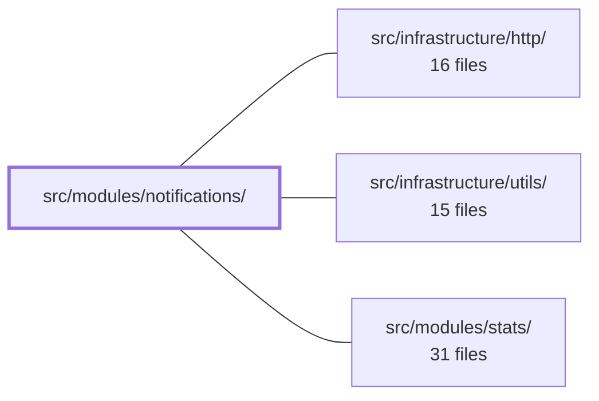

---
tags:
  - 2brain
  - 2brain/module
  - project/boilerplate-vue-frontend
type: module
module: src/modules/notifications/
files: 12
updated: 2026-10-17T02:53:53.012807+00:00
---

# src/modules/notifications/

## Purpose

A read-only notification surface for the application shell. It renders an unread-count bell in the app bar, lets signed-in users open a panel to review, dismiss, or clear their inbox, and keeps that inbox live via a server-sent-events stream. The module never *creates* notifications—the server emits them (e.g. product removed from cart, guest-cart merge refusal)—and this module only displays and manages the viewer's local view.

## Key parts

- **UI & registration** — `components/NotificationsBell.vue` (bell, badge, dialog panel, per-item delete, clear-all) and `module.ts` (manifest: registers the bell in the shell `app-bar` slot, exposes response schemas and locale loaders; declares no routes or sibling deps).
- **State & lifecycle** — `store.ts` (Pinia store that projects server rows into the vue-toolkit persistent-message store and owns all mutations) and `composables/use-inbox-lifecycle.ts` (opens the SSE stream + initial fetch when an authenticated user with read permission is present; tears both down on logout/account switch; re-translates on locale change).
- **Domain (pure logic)** — `domain/describe.ts` (turns a stored `code` + `params` pair into a locale-aware sentence; receives `translate` and `formatDate` as callbacks) and `domain/index.ts` (barrel re-export, lint-guaranteed free of Vue/Pinia/axios).
- **Contract & types** — `response-schemas.ts` (per-endpoint validation rows derived from the OpenAPI spec) and `types.ts` (`InboxItem` view-model shape for the panel).
- **Tests** — five spec files covering the domain function, the component, the store, and the lifecycle composable; the transport is the only mock in store/lifecycle specs.

## How it connects

- **`src/infrastructure/http/`** — Supplies the orval-generated HTTP client (mutated via `orvalMutator`) that the store calls for inbox reads, single-item deletes, and clear-all. The SSE URL is also derived from this layer.
- **`src/infrastructure/utils/`** — Provides shared utilities (e.g. date formatting, i18n helpers) that `describe.ts` and the store use through the callback parameters, keeping the domain layer framework-free.
- **`src/modules/stats/`** — A peer feature module registered alongside notifications in the same shell. The notifications manifest explicitly declares *no* sibling dependencies, so the relationship is architectural (shared shell slot, shared infrastructure) rather than a code-level import.

## Where to start

1. **`module.ts`** — Two dozen lines that show exactly what the module registers, what it exposes to the shell, and what it deliberately does *not* do (no routes, no sibling deps). Gives immediate scope.
2. **`domain/describe.ts`** — A single pure function with zero framework imports. Reading it makes the "server stores code + params, client composes prose" design concrete before you touch Vue, Pinia, or SSE.

## Connected modules

[[boilerplate-vue-frontend_ROOT|/ (repository root)]] · [[boilerplate-vue-frontend_src_infrastructure_http|src/infrastructure/http/]] · [[boilerplate-vue-frontend_src_infrastructure_utils|src/infrastructure/utils/]] · [[boilerplate-vue-frontend_src_modules_stats|src/modules/stats/]]

## Files
- `src/modules/notifications/components/NotificationsBell.vue` — The app-bar notification bell, contributed to the shell's `app-bar` slot via the module manifest. It renders an unread-count badge, opens a dialog panel listing notifications (newest first) with per-item delete and "Clear all", and bootstraps the inbox lifecycle (initial fetch + live stream) for signed-in users. Renders nothing for guests.
- `src/modules/notifications/composables/use-inbox-lifecycle.ts` — Composable that binds the notifications inbox to the signed-in user's lifetime. While an authenticated user with `read` permission on `Notification` is present, it opens an SSE stream and performs an initial inbox read; when the user leaves or switches accounts it tears the stream down and empties the store. It also re-translates all inbox text when the app locale changes.
- `src/modules/notifications/domain/describe.ts` — Pure domain function that turns a stored notification row (`code` + `params`) into the sentence the reader sees. The server stores no text—only a code and the facts that sentence needs—so this module is the single place that knows how to compose those facts into locale-aware prose. It receives the translate and date-format callbacks from the caller, keeping it free of any locale or i18n machinery.
- `src/modules/notifications/domain/index.ts` — Barrel (public entry point) for the notifications domain layer. It re-exports the pure, framework-free rule functions and types defined in `./describe` so that callers import from a single canonical path. The module doc comment states it is lint-guaranteed free of Vue, Pinia, axios, and all other tiers.
- `src/modules/notifications/module.ts` — Module manifest for the notifications feature. It registers a lazily-loaded bell component in the shell's `app-bar` slot, provides response schemas and locale loaders for the app registry, and declares **no** routes or sibling dependencies. The module is purely a read/render surface: the server produces notifications (product removed from cart/wishlist, guest-cart merge refusal), pushes them over SSE, and this module only displays them.
- `src/modules/notifications/response-schemas.ts` — Provides the response-schema route definitions for every `notifications` endpoint, enabling per-module contract validation. The rows are derived from the OpenAPI-generated table in `contracts/rest/routes.ts` (sourced from `openapi.yaml` `x-module` stamps) and filtered to the `notifications` module.
- `src/modules/notifications/store.ts` — Pinia store that projects the server's notification inbox into the vue-toolkit's persistent message store. It owns the translation between a server `Notification` row and a toolkit message, the read/write reconciliation logic, and every mutation the bell triggers. It holds no list of its own — `items` is a computed view over the toolkit's `persistentMessages`.
- `src/modules/notifications/tests/describe.spec.ts` — Unit tests for the notification sentence builder. Verifies language-preference logic for product names, which i18n dictionary entry each notification code resolves to (with what params), and graceful degradation for missing names, empty line lists, and codes unknown to the current contract. Assertions target the *key* and *named values* rather than English prose, which the store-level spec covers separately.
- `src/modules/notifications/tests/notifications-bell.spec.ts` — Vitest unit-test suite for the `NotificationsBell` component. It mounts the real component against the real Pinia inbox store, mocks the HTTP transport and SSE stream, and verifies the full user-facing lifecycle: guest invisibility, unread badge/aria labeling, panel open/close, listing, per-row delete, clear-all, focus management, order-link rendering, and an axe-core accessibility pass.
- `src/modules/notifications/tests/store.spec.ts` — Unit spec for the inbox store (`useInboxStore`). Verifies how server notification rows become persistent messages in the vue-toolkit store, how refetches, stream frames, and bell-side writes interact with them, and what each failure mode leaves behind. The transport (`orvalMutator`) is the only mock; the generated HTTP client, the toolkit message store, and the inbox store under test are all real, so the property under test is their collaboration.
- `src/modules/notifications/tests/use-inbox-lifecycle.spec.ts` — Integration-style unit test for the `useInboxLifecycle` composable. It verifies the *wiring* the composable owns—which SSE URL and event names are opened, that a read fires on every (re)open, that stream frames mutate the inbox store, and that session teardown (logout, user swap, component unmount) closes the stream and clears notifications. The SSE client and HTTP layer are both mocked; no network or browser SSE is involved.
- `src/modules/notifications/types.ts` — Declares the view-model shape (`InboxItem`) that the notification bell panel renders. It exists to separate the UI-facing contract from raw server/toolkit payloads—no endpoint returns this shape directly.

---
[[boilerplate-vue-frontend_INDEX|← boilerplate-vue-frontend index]]
