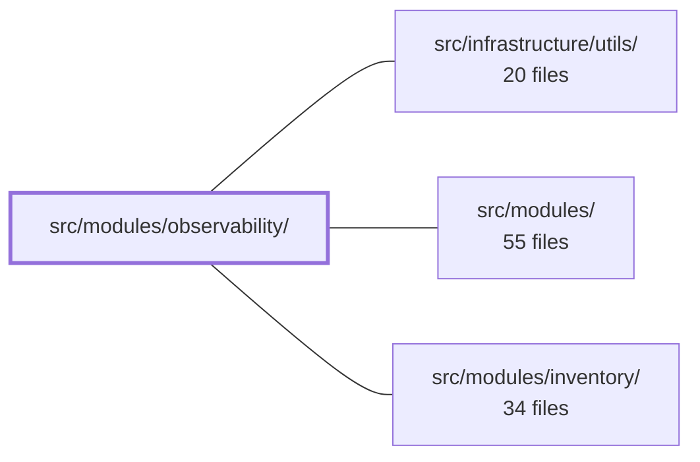

---
tags:
  - 2brain
  - 2brain/module
  - project/boilerplate-vue-frontend
type: module
module: src/modules/observability/
files: 30
updated: 2026-11-10T08:39:23.925360+00:00
---

# src/modules/observability/

## Purpose

The observability module is the admin-facing monitoring and audit domain of the platform. It provides three operator tools — a health/metrics overview dashboard, a paginated audit trail (both platform-wide and shop-scoped), and a live Server-Sent Events metrics playground — all behind authenticated, permission-gated routes. The module is designed to be a self-contained unit that can be added to or removed from the build without touching the rest of the codebase.

## Key parts

- **Module plumbing** — `module.ts` (kernel registration: routes, schemas, locale loaders), `routes.ts` (three lazy-loaded routes), and `response-schemas.ts` (contract-validation envelopes) are the only files that cross the module boundary outward.
- **Views** — `views/Admin.vue` (dashboard shell owning tab state), `views/AuditLog.vue` (shop-scoped audit page and single-record history), `views/RealtimePlayground.vue` (live SSE feed UI).
- **Components** — `AdminOverviewTab.vue` (KPI grid, presentational), `AdminAuditTab.vue` (filterable, paginated audit table), `AuditMetadataDetail.vue` (generic metadata / changes-table renderer).
- **Composables & store** — `use-admin-observability.ts` (health + metrics fetch), `use-audit-trail.ts` (shared pagination/error logic for both audit endpoints), `use-realtime-observability.ts` (SSE connection lifecycle), and `store.ts` (Pinia state for the live stream).
- **Supporting utilities** — `audit-target.ts` (maps audit targets to detail-page routes; shortens IDs for table cells) and `types.ts` (view-layer and SSE types, deliberately excluding API contract types).
- **Tests** — Co-located Vitest specs per composable/component, plus a `tests/e2e/` folder containing role-sweep, accessibility, visual-regression, and live-SSE integration specs. Each e2e file is scoped to this module so deleting the folder also removes its coverage.

## How it connects

- **Repository root / kernel** — `module.ts` is the sole import into the application kernel; it registers this module's routes, schemas, and locales so the root can mount or unmount the entire domain.
- **`src/infrastructure/utils/`** — Shared helpers (e.g. the `useAsyncAction` wrapper referenced in the composable tests) provide generic loading/error primitives that this module's fetchers build on.
- **`src/modules/` (sibling modules)** — The module sits alongside other domain modules under the same registry pattern; it does not import from them directly.
- **`src/modules/inventory/`** — The audit trail's "History" links originate from inventory detail views (order, user targets). Conversely, `audit-target.ts` resolves those target types back into inventory detail-page routes so operators can jump from an audit row to the underlying record.

## Where to start

1. **`module.ts`** — Ten lines that show exactly what the kernel receives from this domain (routes, schemas, locales) and confirm the module's self-containment guarantee.
2. **`views/Admin.vue`** — The entry-point view for the main dashboard. Reading it reveals how the two composables feed the two tab components, giving you the data-flow skeleton before diving into any individual card or table.

## Connected modules

[[boilerplate-vue-frontend_ROOT|/ (repository root)]] · [[boilerplate-vue-frontend_src_infrastructure_utils|src/infrastructure/utils/]] · [[boilerplate-vue-frontend_src_modules|src/modules/]] · [[boilerplate-vue-frontend_src_modules_inventory|src/modules/inventory/]]

## Files
- `src/modules/observability/audit-target.ts` — Maps an audit-log row's target (type + id) to the detail-page route for that record, if this build ships one. Also provides a helper to shorten target ids for table-cell display.
- `src/modules/observability/components/AdminAuditTab.vue` — Self-fetching audit-log tab that renders a filter form, a paginated table, and a pager over one audit trail. A single `endpoint` prop (`'platform' | 'shop'`) selects which contract-backed read `useAuditTrail` drives, letting one component serve the platform dashboard's audit tab, a record's own history, and the shop-wide audit page without duplicating fetch/pagination wiring.
- `src/modules/observability/components/AdminOverviewTab.vue` — Presentational "Overview" tab of the admin observability dashboard. It receives pre-fetched health and metrics payloads from the parent view, derives every KPI card's value, status colour, and accessible text via pure computed functions, and renders the grid of cards plus the auth / business / system info sections. It performs no data fetching of its own — it only emits `refresh` and lets the parent own the network calls.
- `src/modules/observability/components/AuditMetadataDetail.vue` — Renders the `metadata` object of a single audit row as an expandable detail section: non-`changes` keys as a label/value list, and the `changes` sub-object (field → `{ from, to }`) as a dedicated table. It is intentionally generic—reads no action name—so newly audited actions surface their extras without touching this component. Renders nothing when the row has no metadata or no displayable content.
- `src/modules/observability/composables/use-admin-observability.ts` — Composable that wraps the two read-only endpoints behind the Admin observability dashboard's overview tab (health and metrics overview). It centralises per-panel loading/data/error state and guarantees that each fetch *resolves* (writing into a local error ref) rather than rejecting, so a partially available stack still renders whichever panel answered. Audit-trail fetching is deliberately excluded here; `AdminAuditTab.vue` uses its own `useAuditTrail` for that concern.
- `src/modules/observability/composables/use-audit-trail.ts` — A self-contained composable that fetches one page of an audit trail from either the platform-wide or shop-scoped endpoint, providing uniform pagination state and error handling. It exists so that the dashboard audit tab, a single record's history view, and the shop-wide audit page all share one implementation of pagination/error bookkeeping instead of duplicating it.
- `src/modules/observability/module.ts` — Module manifest that registers the observability domain with the application kernel. It declares the module's routes, navigation entries, response-schema validators, and locale loaders so the kernel's registry can wire them in. It is intentionally the only file in the domain that imports from the kernel, keeping the rest of the module self-contained and trivially removable.
- `src/modules/observability/response-schemas.ts` — Declares the response-envelope schemas for every admin endpoint attributed to the **observability** module. It is the per-module glue that registers those schemas into the global response-schema map, so contract validation for observability endpoints can be toggled by simply enabling or deleting this module folder.
- `src/modules/observability/routes.ts` — Declares the Vue Router route table for the observability domain. It defines three authenticated, permission-gated, lazy-loaded routes (admin console, tenant-scoped audit log, and a realtime SSE playground) that are mounted into the app's module registry.
- `src/modules/observability/store.ts` — Pinia store that holds the reactive state of the live Server-Sent Events (SSE) metrics stream for the observability dashboard. It stores connection status, the two most recent payload shapes (snapshot and incremental update), a timestamped heartbeat, a capped event feed, and the last error. The file is intentionally state-and-setters only; the SSE connection logic lives in `use-realtime-observability.ts`, which calls the store's actions.
- `src/modules/observability/tests/admin-audit-tab.spec.ts` — Vitest spec for `AdminAuditTab.vue` that covers the component's self-fetching behavior — the initial load on mount, the `target` prop reaching the request, and the filter form's search re-fetching through the same endpoint. It exists as the companion to `use-audit-trail.spec.ts`, which tests the composable in isolation; this file tests the component-level wiring around it.
- `src/modules/observability/tests/admin-overview-tab.spec.ts` — Unit tests for the **parked-jobs (queues) section** of `AdminOverviewTab.vue`. The suite is intentionally scoped to that one card; every other KPI on the tab is a pure function of props not exercised here.
- `src/modules/observability/tests/audit-log-view.spec.ts` — Vitest spec that proves one contract: `AuditLog.vue` reads the `target` value from its own query string and passes it straight through to `AdminAuditTab`. This ensures both a record-specific "History" link (e.g. `?target=o1`) and the plain `/audit` nav entry land on the same page scoped correctly.
- `src/modules/observability/tests/audit-metadata-detail.spec.ts` — Vitest unit tests for the `AuditMetadataDetail.vue` component. They verify the component's shape-handling contract: empty metadata renders nothing, the details panel toggles open/closed with correct ARIA state, scalar and composite values render as compact JSON, and a `changes` key is rendered as a before/after table rather than a plain key-value pair.
- `src/modules/observability/tests/audit-target.spec.ts` — Vitest spec for the `audit-target` module. It verifies that `auditTargetLocation` returns the correct route link only when the target type has a detail route **and** the current build ships that route, and that `shortTargetId` truncates to the first eight characters.
- `src/modules/observability/tests/e2e/a11y.cy.ts` — Declares the list of observability-module routes subject to the shared accessibility sweep. It exists co-located with the module so that deleting the module also removes its a11y coverage, preventing stale route references in a central list. A cross-cutting spec (`tests/cross-cutting/a11y-coverage.spec.ts`) enforces that every routed module carries one of these files.
- `src/modules/observability/tests/e2e/admin.visual.cy.ts` — Declares the visual-regression screen list for the admin dashboard. It calls the shared `sweepVisual` helper with a single route entry so that a baseline PNG is captured (or compared) for `/en/admin`. It exists so the observability module's own UI is covered by the project-wide visual suite while keeping its snapshot local to the module.
- `src/modules/observability/tests/e2e/realtime.cy.ts` — Cypress end-to-end test for the live observability stream. It opens a real `EventSource` on the operator's session cookie (via the playground UI), verifies the server's initial snapshot, then generates its own traffic and asserts a subsequent server-pushed update reflects that traffic — proving the stream is live rather than replayed.
- `src/modules/observability/tests/e2e/realtime.visual.cy.ts` — Declares the **realtime** playground screen to the shared visual-sweep runner so that a screenshot can be captured and diffed against a stored baseline. It exists to catch unintended visual regressions in the realtime observability page without asserting specific DOM content.
- `src/modules/observability/tests/e2e/roles.cy.ts` — End-to-end role-sweep case list for the observability module. It declares which personas must be able to reach each platform page (administration, realtime playground, audit trail) and which permissions they need, then hands that list to a shared helper that drives the browser and asserts the UI matches the persona's rules. The file is deliberately co-located with the module so that deleting observability also deletes its sweep.
- `src/modules/observability/tests/routes.spec.ts` — Vitest suite that verifies every observability route explicitly declares its access and permission metadata. A route that silently loses its access field would still render and pass all other tests, effectively becoming public; this file is the only guard against that regression.
- `src/modules/observability/tests/store.spec.ts` — Vitest unit tests for the `useObservabilityRealtimeStore` Pinia store. Each test runs against a freshly created Pinia instance (via `setActivePinia(createPinia())` in `beforeEach`) to verify that the store's state fields and action methods behave in isolation without cross-test contamination.
- `src/modules/observability/tests/use-admin-observability.spec.ts` — Unit tests for the `useAdminObservability` composable's composition layer: verifying that each fetcher writes only its own slice of reactive state, that a failing endpoint degrades to an error message beside the panel that succeeded, and that the correct error message (API-supplied vs. i18n fallback) surfaces in each case. Loading/error mechanics delegated to `useAsyncAction` and audit-trail behavior are explicitly out of scope.
- `src/modules/observability/tests/use-audit-trail.spec.ts` — Vitest unit tests for the `useAuditTrail` composable. They pin the observable contract of the composable for both the **platform** (`GET /observability/audit`) and **shop** (`GET /audit`) endpoints: which API function each `endpoint` string routes to, which filters are forwarded vs. stripped, how the response envelope is split into `entries`/`total`/`pages`, and how a failed call degrades to an `error` string instead of rejecting.
- `src/modules/observability/tests/use-realtime-observability.spec.ts` — Unit tests for the `useRealtimeObservability` SSE composable. The file verifies wiring only — which URL `connect()` opens, which store action each SSE event name dispatches to, and that the module-level singleton is torn down before a second connection replaces it. The SSE transport itself is exercised in `tests/unit/infrastructure/create-sse-client.spec.ts`; here `createSseClient` is fully mocked.
- `src/modules/observability/types.ts` — Defines the view-layer type shapes for the observability domain—specifically the UI/composition types that the Admin dashboard and Realtime Playground assemble locally, plus the SSE feed-entry and connection-lifecycle types. It deliberately excludes contract types (e.g. `ObservabilityHealth`, `AuditEntryItem`) that live in `@types` (re-exported from the generated `@api` client), keeping this file scoped to what only the front-end layers need.
- `src/modules/observability/use-realtime-observability.ts` — Composable that manages a single SSE (Server-Sent Events) connection for the observability dashboard. It exposes `connect`/`disconnect` controls and routes each typed event into the paired Pinia store. The connection lives in a module-level singleton so re-mounting the consuming component never opens a duplicate stream.
- `src/modules/observability/views/Admin.vue` — Admin dashboard shell that owns the active-tab state (overview / audit) and routes shared observability data from the `useAdminObservability` composable down to the child tab components. It exists as the single entry-point view for the admin section of the observability module.
- `src/modules/observability/views/AuditLog.vue` — Shop-scoped audit-log page, reachable by any tenant role holding `read:AuditLog` (`manager`/`support`/`moderator`/`admin`). It also serves as a single record's history view when opened via `?target=<id>` (set by "History" links on `UserTarget.vue`/`OrderTarget.vue`). All fetching and rendering is delegated to `AdminAuditTab`; this file only reads the initial `target` param and picks a heading.
- `src/modules/observability/views/RealtimePlayground.vue` — Route-level view that renders the live SSE observability stream: a connection status indicator, connect/disconnect controls, KPI tiles summarising the latest event (uptime, heap, HTTP requests, SSE clients), and a scrollable, newest-first feed of individual events with a toggle between a formatted metric grid and raw JSON.

---
[[boilerplate-vue-frontend_INDEX|← boilerplate-vue-frontend index]]
