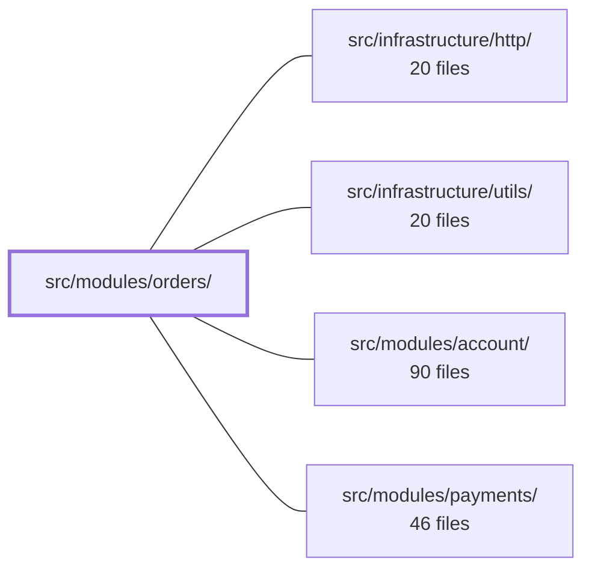

---
tags:
  - 2brain
  - 2brain/module
  - project/boilerplate-vue-frontend
type: module
module: src/modules/orders/
files: 37
updated: 2026-11-10T08:39:37.306898+00:00
---

# src/modules/orders/

## Purpose

The orders module owns the full customer- and staff-facing order lifecycle UI: browsing order history, viewing a single order's detail, and performing operator actions (cancel, refund, status override, address correction, reorder). It also houses the pure domain logic that interprets server responses (timeline entries, reorder outcomes, export-refusal classification) in a framework-agnostic, testable layer.

## Key parts

- **Views** (`views/`) — Three pages form the UI surface: `OrdersList.vue` (dual-scope list with filters, CSV export, role-gated row actions), `OrderTarget.vue` (shared detail page for customer and operator, with timeline, payment panels, cancel/reorder), and `OrderEdit.vue` (operator edit page with email form and all correction actions).
- **Components** (`components/`) — `OrderTimeline.vue` renders the per-order event history with pagination and a staff-note form; `ShippingAddressForm.vue` handles the address-correction submit flow.
- **Composables** (`composables/`) — `use-order-documents.ts` encapsulates invoice/credit-note PDF fetching and download; `use-order-hero.ts` derives the heading, subheading, and status labels for the page hero.
- **Domain layer** (`domain/`) — Pure, side-effect-free functions (`timeline.ts`, `reorder.ts`, `export-refusal.ts`) that translate raw API payloads into display-ready structures. Re-exported through `domain/index.ts`, which is lint-constrained to exclude Vue/Pinia/axios imports.
- **Store** (`store.ts`) — Pinia store (`useOrdersStore`) that owns all order CRUD state and hand-written actions for cancel, invoice, credit notes, timeline, notes, and CSV export.
- **Module wiring** — `module.ts` (manifest: nav entries, locale bundles, route table), `routes.ts` (four route records with access-control metadata), `response-schemas.ts` (contract-validation registry), `schemas.ts` (Zod form schemas with i18n-thunk error messages).
- **Tests** (`tests/`) — Unit specs for every store action, domain function, and view; a full Cypress e2e suite covering roles, keyboard a11y, resilience, visual regression, and action-table scenarios; plus Lighthouse and routes-permission checks.

## How it connects

- **`src/infrastructure/http/`** — The store's HTTP transport goes through the shared `orvalMutator`; `response-schemas.ts` registers envelope contracts that the HTTP layer validates at runtime.
- **`src/infrastructure/utils/`** — Shared utility helpers (e.g., formatting, i18n thunks) are used by both the domain layer and the views.
- **`src/modules/account/`** — The `OrdersList` "mine" scope is bound to the signed-in account; order data is contextualized by the account's identity.
- **`src/modules/payments/`** — `OrdersList` delegates the RF-reference lookup to payments' `OrderReferenceSearch` component rather than reimplementing it; `OrderEdit` exposes offline-payment/settle actions that touch payment state.

## Where to start

1. **`store.ts`** — Read it first to understand the single source of truth: which actions exist, what the cache shape looks like, and how CRUD vs. bespoke endpoints are separated. Every view and composable in the module reads from or writes to this store.
2. **`views/OrderTarget.vue`** — The shared detail page is the richest single component; reading it shows how the store, composables (`use-order-hero`, `use-order-documents`), the timeline component, and the domain layer compose together into a rendered page.

## Connected modules

[[boilerplate-vue-frontend_ROOT|/ (repository root)]] · [[boilerplate-vue-frontend_src_infrastructure_http|src/infrastructure/http/]] · [[boilerplate-vue-frontend_src_infrastructure_utils|src/infrastructure/utils/]] · [[boilerplate-vue-frontend_src_modules_account|src/modules/account/]] · [[boilerplate-vue-frontend_src_modules_payments|src/modules/payments/]]

## Files
- `src/modules/orders/components/OrderTimeline.vue` — Renders the order page's event history: a newest-first list of timeline entries with "show older" pagination, an optional staff-note form, and per-row actions (remove note text). Server-side filtering determines what each caller sees; this component displays rows as-is and adds only presentation chrome (badges, chips, i18n strings).
- `src/modules/orders/components/ShippingAddressForm.vue` — A Vuetify form that lets staff correct the shipping address of an unshipped order whose `incorrect_address` hold-group is active. It pre-fills from the order's current address, validates client-side via a Zod schema, and delegates the write to the orders store. The owning page controls *when* the form is visible (based on `actions.correctAddress`); this component only handles the submit flow.
- `src/modules/orders/composables/use-order-documents.ts` — Vue composable that encapsulates everything the order page needs to render and interact with the invoice and credit-note documents for a single order: availability checks, PDF fetching, download/open actions, and per-action loading and blocked-error state. The consuming view renders exclusively what this composable returns.
- `src/modules/orders/composables/use-order-hero.ts` — Centralizes the derivation of the three "hero" labels (heading, subheading, status) displayed at the top of every order-detail page. Each consuming page only supplies its own fallback title key; the composable handles all fallback and formatting logic so the views stay thin.
- `src/modules/orders/domain/export-refusal.ts` — Classifies the two specific failure modes of `GET /orders/export` (oversized filter result, rate-limit exceeded) so the UI can show a targeted message for each, as opposed to a generic error. Pure and side-effect free — it inspects the reject envelope produced by the HTTP layer and returns a token the caller maps to copy.
- `src/modules/orders/domain/index.ts` — Barrel file for the orders domain layer. It re-exports the public API (functions and types) from the three sibling modules so that consumers can import domain logic from a single path (`@/modules/orders/domain`) without reaching into sub-files. The module is explicitly constrained—by lint rules—to contain no Vue, Pinia, or axios imports, keeping it pure and framework-agnostic.
- `src/modules/orders/domain/reorder.ts` — Pure domain rule that interprets a server's per-line reorder response (`MergeLineResult[]`) into a display-ready summary of what was *not* added to the cart — which products are gone from the catalogue and which hit the cart's cap. It exists to keep this "read back" logic free of Vue/store concerns so it is trivially testable and reusable.
- `src/modules/orders/domain/timeline.ts` — Pure domain logic that turns one order-timeline entry (as the API sends it) into a display-ready `{ title, detail? }` pair. All i18n and formatting is injected via `TimelineTools`, so the same function serves the Vue component and plain unit tests without importing Vue or an i18n library.
- `src/modules/orders/module.ts` — Module manifest for the **orders** subdomain (`core`). Declares the navigation entries, lazy-loaded response schemas, locale bundles, and the route table so the kernel's `AppModule` registry can mount the customer-facing order history and the admin order-status screens without this file containing any business logic itself.
- `src/modules/orders/response-schemas.ts` — Exports the response-envelope schema registry for every backend endpoint owned by the `orders` domain (including `invoicing`, which has no dedicated frontend module). The list is consumed by the module-manifest system so that contract validation for these routes activates or deactivates with the module folder.
- `src/modules/orders/routes.ts` — Defines the four route records for the orders module. Each record pairs a URL path with a lazy-loaded view component and the access-control metadata (`meta.access`, `meta.can`) the router guard checks before allowing navigation.
- `src/modules/orders/schemas.ts` — Defines Zod validation schemas for order-related forms. Error messages are i18n thunks (resolved at parse time via `translate`) so they work regardless of which locale is active when the schema was constructed.
- `src/modules/orders/store.ts` — Pinia store (`useOrdersStore`) that owns all order-domain state: CRUD via the toolkit's `useStructureCrudApi`, plus hand-written actions for endpoints that don't fit record-shaped primitives (cancel, invoice, credit notes, timeline, notes, CSV export). It is the single source of truth the views and composables read from when displaying or mutating an order.
- `src/modules/orders/tests/cancel.spec.ts` — Vitest spec for the `cancelOrder` store action. It mocks `orvalMutator` at the transport layer so assertions can inspect the raw HTTP request body (not just the URL) and confirm that the canceled record **replaces** the cached one. This is the only customer-write in the orders store, and the spec pins both the cache-replacement invariant and the three refund-choice variants of the request payload.
- `src/modules/orders/tests/e2e/a11y.cy.ts` — Cypress e2e test that runs accessibility (a11y) audits across the orders module's routes using the shared `sweepA11y` helper. It covers the orders list, detail, and edit pages under both a signed-in user and an admin profile, plus module-hosted dialogs (ship, hold, cancel-the-rest) that require interaction steps to become visible before auditing.
- `src/modules/orders/tests/e2e/actions.cy.ts` — Registers the orders module's failure, empty-state, and slow-load e2e scenarios with the shared `actionTable` runner. Each scenario specifies a persona, route, network intercept, and UI assertions so the runner can drive a consistent "trigger → error → verify → retry succeeds" cycle without per-test boilerplate.
- `src/modules/orders/tests/e2e/keyboard.cy.ts` — Cypress E2E suite that verifies the WAI-ARIA modal-dialog keyboard contract (focus moves in on open, Tab stays trapped, Escape closes without submitting, focus returns to the opener) for the three dialogs hosted on the order page by the delivery and returns modules.
- `src/modules/orders/tests/e2e/orders.cy.ts` — Cypress end-to-end spec that exercises the real Orders UI: it logs in as different roles, navigates the orders list and order-detail pages, and asserts on rendered rows, role-gated actions, CSV export, the order timeline, and responsive button sizing.
- `src/modules/orders/tests/e2e/orders.visual.cy.ts` — Declares the set of orders-module routes that are snapshotted in the project's visual-regression suite. It is a thin, data-only consumer of the shared `sweepVisual` helper—no custom test logic lives here.
- `src/modules/orders/tests/e2e/resilience.cy.ts` — Module-level shard of the shell's resilience sweep for the Orders feature. It verifies that the orders list and individual order pages (for both customer and admin roles) render without unexpected console output and fit the viewport. It deliberately asserts no data values, deferring that responsibility to the central resilience spec.
- `src/modules/orders/tests/e2e/roles.cy.ts` — Declares the role-based access-control expectations for the staff order pages (list and edit). For each defined page and button, the browser must enforce the same permission rules the data model prescribes. The file exists as a declarative case list co-located with the orders module so that removing the module automatically removes its sweep.
- `src/modules/orders/tests/lighthouse.ts` — Declares the Lighthouse test cases that the orders module contributes to the shared Lighthouse suite. Each case maps a named scenario to a route and persona so the Lighthouse runner can execute it. The file exists so the orders module can plug its specific cases into the centralized `tests/support/lighthouse/case.ts` framework without hard-coding them elsewhere.
- `src/modules/orders/tests/order-edit-view.spec.ts` — Test suite for `OrderEdit.vue` that proves the page renders its action controls (cancel, refund, override, settle) directly from the order's `actions` field as delivered by a list-cache arrival—without requiring a second fetch. It also verifies refund flows (full, partial, validation) and settling hand-paid refunds. Follows the same structural template as `product-view.spec.ts` and `wishlist-view.spec.ts`.
- `src/modules/orders/tests/order-timeline.spec.ts` — Unit tests for the `OrderTimeline.vue` component in isolation. Verifies what the component renders for a staff viewer versus a buyer, the "own order" chip, refetch-on-change behavior, error display, the staff note form (add, fail, empty), and note-text withdrawal. The store's `fetchTimeline` call is always mocked; the server's per-caller filtering is treated as the API's job, so the buyer case simply hands the component pre-filtered rows and asserts nothing extra appears.
- `src/modules/orders/tests/order-view.spec.ts` — Component test for the order detail page (`OrderTarget.vue`). Mounts the real component against a real memory-history router and verifies behaviours scoped to this page: line-item pictures resolved live from `item.current` (never a frozen `item.product.imageUrl`), invoice button visibility/gating, credit-note listing and download, order-number display, timeline mounting and its `refreshKey`, and the reorder in-flight guard. The store's own `watchOrder` fetch is stubbed so the order is seeded directly into the dictionary.
- `src/modules/orders/tests/orders-list-view.spec.ts` — Vitest suite that verifies the **mount-level decisions** of the `OrdersList` page: which optional sub-components and row actions the page renders (or withholds) based on the viewer's abilities and the server-supplied `actions` flags. It deliberately stubs out child components and HTTP calls so that only the page's own rendering logic is exercised.
- `src/modules/orders/tests/override-status.spec.ts` — Vitest spec for the `overrideStatus` store action (the operator's manual correction path for `shipped`/`delivered` orders). It mocks `orvalMutator` at the transport layer so assertions can inspect the **raw request body** and verify that the corrected record replaces the cached one in Pinia.
- `src/modules/orders/tests/reorder-domain.spec.ts` — Vitest spec for the `reorderOutcome` domain function. It verifies that reorder results are correctly bucketed into `gone` (removed) and `capped` (summed) lists, and that product names fall back to IDs when a title is missing.
- `src/modules/orders/tests/routes.spec.ts` — Vitest spec that asserts every orders route record's `meta.access` and `meta.can` permission against a hard-coded table, keyed by route name. It guards against a route silently losing its access declaration (which would make it indistinguishable from a public route) and against new routes being added without an explicit access decision.
- `src/modules/orders/tests/schemas-i18n.spec.ts` — Vitest spec that verifies the orders module's Zod schemas and its own Italian locale dictionary (`locales/it.json`) agree: every message key the schemas resolve at parse time exists in the dictionary, and the Italian strings are genuinely Italian (not copies of English). It runs against the real `vue-i18n` instance with modules wired through the shared test helper, so a message frozen in the wrong language would fail.
- `src/modules/orders/tests/schemas.spec.ts` — Vitest suite that verifies `shippingAddressCorrectionSchema` enforces the staff shipping-address correction contract: a valid address parses, each string field rejects input beyond its documented maximum, and whitespace-only required fields are rejected. Bounds are read from the shared `@api/schemas` constants so the tests track the contract automatically.
- `src/modules/orders/tests/shipping-address-form.spec.ts` — Unit tests for the staff-facing "correct the shipping address" form. Verifies that the component seeds fields from the order's current address, enforces required-field validation before any store call, builds a correct payload (including conditional phone), and surfaces a server-locked (409) message in place rather than emitting success.
- `src/modules/orders/tests/store.spec.ts` — Unit tests for the `useOrdersStore` Pinia store. The `@api` client module is mocked in its entirety so that each store action can be exercised against canned responses without network I/O. The suite covers every store action except `checkout`, which lives in the cart store and is covered in `src/modules/cart/tests/store.spec.ts`.
- `src/modules/orders/tests/timeline-domain.spec.ts` — Unit tests for the pure (UI-agnostic) half of the order timeline: verifying that `describeTimelineEntry` produces the correct translation-key structure for every entry type and that `exportRefusalOf` maps API error responses to the expected refusal reasons. Assertions check *which* keys and values are emitted, not the rendered wording, by injecting a fake `TimelineTools` that echoes its arguments.
- `src/modules/orders/views/OrderEdit.vue` — Single-file Vue component that renders the operator's order-edit page. It loads one order by route id, exposes an email-only edit form, and presents the operator's cancel / refund / status-override / offline-payment / address-correction actions — each gated on the `actions` flags the server attaches to the loaded record.
- `src/modules/orders/views/OrderTarget.vue` — Order detail page shared by customer and operator roles. Loads a single order by route id, forces a detail re-fetch (because the list-seeded cache row lacks the `actions` field), and renders payment, withdrawal, and shipment panels alongside an order timeline. Provides the cancel and reorder action buttons with their own blocking-error states and server-driven availability.
- `src/modules/orders/views/OrdersList.vue` — Dual-scope orders list page. Rendered as `mine` (the signed-in account's own orders) or `all` (staff view of every order at `/sales/orders`), it wires the orders Pinia store's paginated search to a filter form, a sortable `DataTable`, per-row role-gated actions (view / edit / delete / hard-delete), and a CSV export. The RF-reference lookup is delegated to `payments`' `OrderReferenceSearch` rather than reimplemented locally.

---
[[boilerplate-vue-frontend_INDEX|← boilerplate-vue-frontend index]]
