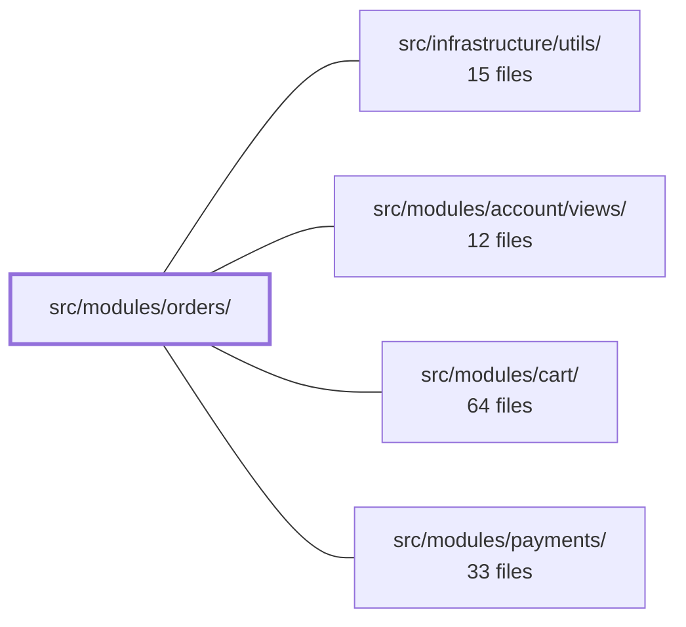

---
tags:
  - 2brain
  - 2brain/module
  - project/boilerplate-vue-frontend
type: module
module: src/modules/orders/
files: 34
updated: 2026-10-17T02:54:24.929739+00:00
---

# src/modules/orders/

## Purpose

The orders module owns the full lifecycle of a customer's purchase record: listing, filtering, viewing, editing, cancelling, status-override, export, and timeline inspection. It serves two scopes—customer ("my orders" on the account page) and admin ("sales orders" on the back-office route)—and additionally contributes the "Awaiting transfer" queue to the payments page so bank-transfer payments can be recorded offline.

## Key parts

- **Domain layer (`domain/`)** — Pure, dependency-free business rules: `hard-delete.ts` (gate for permanent deletion), `reorder.ts` (detects lines dropped when a past order is re-added to the cart), `timeline.ts` (formats timeline entries and flags staff-only types), `export-refusal.ts` (classifies export failures). Re-exported via `domain/index.ts`.
- **Store (`store.ts`)** — Pinia store covering CRUD, paginated search, and order-specific actions (cancel, restore, status-override, timeline fetch, invoice/credit-note download, CSV export). CRUD is generated by `useStructureCrudApi`; remaining actions are hand-written.
- **Views (`views/`)** — `OrdersList.vue` (dual-scope table with role-gated row actions), `Order.vue` (single-order detail with payment, shipment, and timeline panels), `OrderEdit.vue` (email edit + operator money/status controls gated on server-attached `actions`).
- **Components & composables** — `OrderTimeline.vue` (vertical event history), `AwaitingTransferTable.vue` (paid-transfer queue slot for the payments page), `useOrderActionsRefetch.ts` (forces one detail re-fetch so the `actions` field populates on the order-detail page).
- **Module wiring** — `module.ts` (registers routes, navigation entries, slot contribution, schemas, locales), `routes.ts` (path → lazy view + permission meta), `response-schemas.ts` (contract-validation schemas for orders/invoicing endpoints), `schemas.ts` (Zod form validation with i18n-thunked errors).
- **Tests (`tests/`)** — Unit specs for domain rules, store actions, and page-level rendering; Cypress e2e specs for flows, accessibility, visual regression, and resilience sweeps.

## How it connects

- **`src/modules/payments/`** — `AwaitingTransferTable` is injected into the payments page via the `payments-awaiting-transfer` slot; its "Record" action opens the payments module's offline-recording form in a dialog. Conversely, the orders store exposes a "record offline payment" action used from `OrderEdit`.
- **`src/modules/cart/`** — The reorder domain function reads the re-created cart to detect dropped lines; checkout logic lives in `useCartStore` and is intentionally absent from the orders store.
- **`src/modules/account/views/`** — The customer-facing "Orders" navigation entry (registered in `module.ts`) is rendered within the account page's section, making `OrdersList` in scope `mine` a child of that view.
- **`src/infrastructure/utils/`** — Provides shared low-level helpers (e.g. i18n resolution, date/money formatting) consumed by domain functions and views.
- **Repository root** — The module manifest (`module.ts`) plugs into the app's global module registry, which discovers routes, navigation items, and slot contributions at boot.

## Where to start

Read **`views/OrdersList.vue`** first to see how the two scopes wire the store's filters, pagination, and row actions into the table. Then move to **`store.ts`** to understand the data flow—CRUD generation, the hand-written action methods, and how cached records are replaced after mutations. Together they give the shortest path from "user sees a table" to "server response updates the store."

## Connected modules

[[boilerplate-vue-frontend_ROOT|/ (repository root)]] · [[boilerplate-vue-frontend_src_infrastructure_utils|src/infrastructure/utils/]] · [[boilerplate-vue-frontend_src_modules_account_views|src/modules/account/views/]] · [[boilerplate-vue-frontend_src_modules_cart|src/modules/cart/]] · [[boilerplate-vue-frontend_src_modules_payments|src/modules/payments/]]

## Files
- `src/modules/orders/components/AwaitingTransferTable.vue` — Renders the "Awaiting transfer" tab of the payments page (contributed via the `payments-awaiting-transfer` slot). It displays a paginated table of **orders** that are still waiting for a bank-transfer payment to be recorded by an admin — no `Payment` record exists yet for these. Each row exposes a "Record" action that opens the payments module's offline recording form in a dialog.
- `src/modules/orders/components/OrderTimeline.vue` — Renders the per-order event history as a vertical list (oldest first). All row filtering is server-side; this component simply displays whatever the API returns for the signed-in caller and annotates staff-only rows with a badge. It exists to separate the "read and present a timeline" concern from the parent `Order.vue` page.
- `src/modules/orders/composables/use-order-actions-refetch.ts` — Ensures an order-detail page retrieves the full `actions` field when it arrives from the orders list, which only seeds a summary row (no `actions`) into the store. Because the store's `watchOne`/`watchOrder` is cache-first, the page would otherwise settle for that incomplete row. This composable forces exactly one `GET /orders/:id` re-fetch to populate `actions`, preventing the silent "no status moves" bug that originally affected `OrderEdit.vue`.
- `src/modules/orders/domain/export-refusal.ts` — Classifies the two user-facing failure modes of `GET /orders/export` so the view layer can render distinct, copy-specific messages instead of a generic error. It is a pure, side-effect-free helper that inspects the reject envelope produced by the HTTP layer and returns a discriminated label (or `undefined` for failures the generic message already covers).
- `src/modules/orders/domain/hard-delete.ts` — Defines the client-side guard for the "permanent delete" action on an order row. It mirrors the server's 409 rule (`ORDER_NOT_CANCELLED` / `ORDER_INVOICED`) so the UI can hide the button before a request would be rejected. Kept as a pure, dependency-free module (no Vue, no I/O) so the rule is trivially testable and reusable.
- `src/modules/orders/domain/index.ts` — Barrel file for the Orders domain layer. It re-exports the pure business-rule functions and types defined in sibling modules so that consumers (views, components, tests) can import from a single entry point. The domain layer is intentionally free of Vue, Pinia, axios, and any other tier — a constraint enforced by lint rules.
- `src/modules/orders/domain/reorder.ts` — Pure domain rule that determines which products a past order contained but the re-created cart does not. The server silently drops any line whose product has left the catalogue during a reorder; this module reads the order lines and the resulting cart back and reports what went missing. No Vue, no store, no side effects.
- `src/modules/orders/domain/timeline.ts` — Pure domain logic that turns a raw `OrderTimelineEntry` (type + free-form `data`) into a displayable title and optional detail string, and declares which timeline types are staff-only. All formatting dependencies (translation, money, dates) are injected via the `TimelineTools` interface so the same code powers both the Vue component and plain unit tests without pulling in Vue or i18n.
- `src/modules/orders/module.ts` — Module manifest that registers the **orders** module into the app's module registry. It wires together the route table, two navigation entries (customer "Orders" and admin "Sales Orders"), a slot contribution to the payments page, lazy response schemas, and locale dictionaries so the rest of the app can discover and mount order-related functionality without importing individual files.
- `src/modules/orders/response-schemas.ts` — Registers response-envelope schemas for every REST endpoint attributed to the `orders` or `invoicing` backend modules. It exists so that, once the orders domain is enabled via the module manifest, contract validation for those endpoints is automatically active (and removed if the folder is deleted).
- `src/modules/orders/routes.ts` — Defines the route table for the orders module. Each record pairs a path with a lazy-loaded Vue view and the `meta.access` / `meta.can` permissions the router guard enforces before the route is rendered.
- `src/modules/orders/schemas.ts` — Defines Zod validation schemas for the order creation/edit form. Error messages are i18n-thunked (resolved at parse time via `translate()`) so that the UI language can change without re-evaluating the schema definitions.
- `src/modules/orders/store.ts` — Pinia store that owns all order CRUD, paginated search, and order-specific actions (cancel, restore, override status, timeline, invoices, credit notes, CSV export). CRUD and search are generated by `useStructureCrudApi` from `@guebbit/vue-toolkit`; the remaining actions are hand-written because their endpoints don't fit the toolkit's record-shaped primitives.
- `src/modules/orders/tests/awaiting-transfer-table.spec.ts` — Unit spec for the `AwaitingTransferTable` component (the "Awaiting transfer" tab on the payments page). It pins the queue rendering, the record-payment dialog lifecycle, and the reload-after-recording behavior, while the form itself is stubbed out (its own spec covers recording logic).
- `src/modules/orders/tests/cancel.spec.ts` — Vitest spec for the orders store's `cancelOrder` action. It mocks `orvalMutator` at the transport boundary so assertions can inspect the **raw request body** (not just the URL) and verify that the server response replaces the cached order record.
- `src/modules/orders/tests/e2e/a11y.cy.ts` — Cypress a11y sweep for the orders module. It invokes the shared `sweepA11y` helper against the module's routes as both a signed-in user and an admin, covering desktop and phone-viewport layouts. Co-located with the module so that removing the module also removes its a11y coverage, preventing a central list from referencing dead routes.
- `src/modules/orders/tests/e2e/orders.cy.ts` — Cypress end-to-end spec that exercises the Orders module against the running app. It verifies the orders list rendering, role-gated row actions, CSV export, navigation to order detail, and the order timeline — covering both admin and non-admin customer perspectives.
- `src/modules/orders/tests/e2e/orders.visual.cy.ts` — Declares the visual-regression route list for the orders module. Each entry specifies a route, a readiness selector, and CSS selectors for dynamic cells that must be redacted before snapshot comparison. The file is a thin config consumed by the shared `sweepVisual` runner.
- `src/modules/orders/tests/e2e/resilience.cy.ts` — The orders module's contribution to the project-wide resilience sweep. It verifies that the order list and a single order page render without unexpected console output and fit the viewport, covering both the customer's view and the admin's ledger. It intentionally asserts no data values—only structural health (render, silence, viewport).
- `src/modules/orders/tests/hard-delete-domain.spec.ts` — Unit test suite (Vitest) for the `canHardDelete` domain rule. It verifies the single business invariant that an order may be permanently deleted only when it is both **cancelled** and **unpaid**, and that any other combination is rejected.
- `src/modules/orders/tests/order-edit-view.spec.ts` — Vitest spec that mounts `OrderEdit.vue` against a real memory-history router to verify the page gains its `actions` (cancel, refund, override controls) through the forced re-fetch path (`useOrderActionsRefetch`) rather than by pre-seeding the answer. It simulates the list-cache arrival scenario: the store holds a summary row with no `actions`, and the page must still offer the correct moves once `fetchOrder` resolves.
- `src/modules/orders/tests/order-timeline.spec.ts` — Unit tests for the `OrderTimeline` Vue component in isolation. Verifies the rendered output for staff vs. buyer ability contexts (which rows appear, whether actor names and staff-only badges show) and confirms the component re-fetches its timeline only when the `refreshKey` prop actually changes. The store's network call is always mocked; correctness of the fetch itself is covered elsewhere.
- `src/modules/orders/tests/order-view.spec.ts` — Vitest spec for the `Order.vue` detail page. It mounts the real component against a memory-history router and asserts that each line's picture resolves live from `item.current` (never a frozen `item.product.imageUrl`), that invoice/credit-note buttons appear and behave correctly, and that the order number, timeline, payment deadline, and VAT summary render from the store's seeded data. `watchOrder` is stubbed so the store's own fetch never fires; the order is injected directly into the dictionary.
- `src/modules/orders/tests/orders-list-view.spec.ts` — Page-level integration tests for `OrdersList.vue`. The suite verifies what the page *decides* to render and wire up—permission-gated actions, row-level buttons (Restore / Delete / Hard-Delete), filter visibility by scope, and the server-side sort contract—without re-testing the internal logic of child components (e.g. `OrderReferenceSearch` is stubbed by name). It exists so regressions in the page's conditional rendering and ability checks are caught at the page boundary rather than buried in component unit tests.
- `src/modules/orders/tests/override-status.spec.ts` — Vitest spec for the `overrideStatus` store action. It mocks `orvalMutator` at the transport layer (same pattern as `cancel.spec.ts`) so assertions can inspect the raw request body and verify two things: that `to` and `reason` reach the body unchanged, and that the server's corrected record **replaces** the cached one rather than merging into it.
- `src/modules/orders/tests/reorder-domain.spec.ts` — Vitest spec that pins down the behavior of `leftOutByReorder` — a pure domain function that returns the titles (or ids) of order-line products the cart failed to restore. Exists so the reorder-domain contract is locked by executable examples rather than prose.
- `src/modules/orders/tests/routes.spec.ts` — Vitest spec that verifies every orders route record carries the expected `meta.access` and `meta.can` declarations. It guards against a route silently losing its access metadata (which would make it indistinguishable from a public route) and ensures no new route is added without an explicit access decision.
- `src/modules/orders/tests/schemas-i18n.spec.ts` — Validates that the orders module's Zod schemas and its Italian locale dictionary actually agree: every error key the schemas look up exists in `it.json`, and the Italian strings are genuinely translated (not a copy of the English). Runs against the real vue-i18n instance rather than a mocked `t`, so a regression that freezes a message in the wrong language would be caught.
- `src/modules/orders/tests/store.spec.ts` — Unit tests for the orders Pinia store (`useOrdersStore`). The entire `@api` client module is mocked so every store action is exercised against canned, schema-validated responses. This file also covers the binary-Blob paths (`fetchInvoice`, `fetchCreditNote`) and the CSV export flow that have no JSON envelope to validate. Checkout is deliberately absent here — it belongs to `useCartStore` and is covered in `src/modules/cart/tests/store.spec.ts`.
- `src/modules/orders/tests/timeline-domain.spec.ts` — Vitest suite covering the pure domain logic of the order timeline: how each `OrderTimelineType` renders into a title/detail line via `describeTimelineEntry`, which types are restricted to staff via `isStaffOnly`, how export refusals are classified via `exportRefusalOf`, and that both locale dictionaries name every type. It exists to pin the *structure* of the output (key names, argument order, separator placement) without depending on real i18n wording.
- `src/modules/orders/tests/use-order-actions-refetch.spec.ts` — Vitest spec for the `useOrderActionsRefetch` composable. It verifies each of the four guard conditions (once-only latch, stale-id check, `actions === undefined` test, `immediate` run) independently, because any single one in isolation would appear correct from the outside. The file exists to lock in the contract that exactly one forced detail re-fetch fires per mount and no more.
- `src/modules/orders/views/Order.vue` — Single-order detail page (SFC) shared by customer and operator roles. Loads one order by route id from the orders store, gates action buttons on server-provided `actions` flags, and composes the payment, withdrawal, and shipment panels alongside a timeline. Exists as the top-level view for the `/orders/:id` route.
- `src/modules/orders/views/OrderEdit.vue` — Order-edit page for a single order (identified by route prop `id`). It renders an email-only edit form, a read-only order-detail hero, and a set of operator money/status actions (cancel, refund, status-override, record offline payment) whose availability is governed entirely by the server-attached `actions` object on the loaded record.
- `src/modules/orders/views/OrdersList.vue` — A dual-scope Vue SFC that renders the paginated, filterable orders table. Scope `mine` (default) shows only the signed-in viewer's orders on the account page; scope `all` adds staff-only controls (search-by-id/user/product/email, date-range pickers, transfer queue, deleted filter) on the `/sales/orders` page. It wires the orders store's reactive filters and pagination into a `DataTable` with per-row view/edit/delete/hard-delete actions gated on role.

---
[[boilerplate-vue-frontend_INDEX|← boilerplate-vue-frontend index]]
